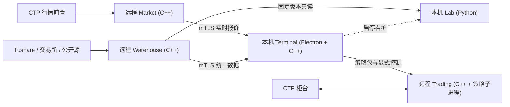

# Asterion Terminal

面向中国期货的个人量化研究与交易桌面终端，支持 macOS（Apple Silicon）与 Linux x86_64。核心与远程服务采用 C++20，桌面界面采用 Electron + React，策略与研究使用 Python——同一份策略代码可不经改写地运行于回测、仿真柜台与实盘，详见[产品说明](docs/product.md)。

## 架构



Market 负责分发实时行情，Warehouse 负责历史采集与版本化数据仓库，本机 Lab 按固定数据版本开展研究，Terminal 承担看盘、研究、发布与监控，Trading 在交易主机独立连接行情与柜台（支持实时 K 线与可选的固定版本 Warehouse 历史预热）。关闭 Terminal 不影响已授权交易，策略目标统一经账户下单路径执行，详见[架构](docs/architecture.md)。

## 当前能力

- **行情**：CTP 实时报价、合约目录、自选、五档盘口、分时与分钟 K 线。
- **历史数据**：Warehouse 以 Tushare 为主、交易所及公开源补缺，采集合约、日历、日线、分钟线、结算参数、历史报价单位及仓单、会员持仓、库存周报，对外提供固定版本的统一数据集。
- **研究**：固定目录中的 Python 策略与因子；支持日线/分钟线回测、参数扫描、滚动验证、因子评价、图表分析与可复现的研究记录。
- **策略部署**：Terminal 将研究源码打包发布；Trading 从主机离线运行时加载并预热，目标统一经账户唯一下单路径报单。
- **交易**：面向 CTP 柜台（仿真或实盘），落实显式授权、白名单、限额与价格风控、先记录后发送、断线不重发。
- **部署**：Market、Warehouse、Trading 独立部署于 Linux；Terminal 仅看护本机 Lab，Lab 只读缓存 Warehouse 固定版本。

能力边界与已知限制见[现状](docs/status.md)，推进顺序与验收项见[开发计划](docs/plan.md)。

## 快速开始

依赖：Node.js 22+、pnpm 10、Python 3、uv 0.12.9+、Conan 2、CMake 3.25+、Ninja；macOS 需 Xcode 26 Command Line Tools，Linux 需 GCC 13+。

```sh
conan profile detect --exist-ok
pnpm sync      # 同步 CTP/DuckDB 配方、前端与 Conan 依赖、Debug 构建及 Python 运行时
pnpm desktop   # 构建 Release 并启动桌面端
```

| 命令 | 用途 |
| --- | --- |
| `pnpm sync` | 首次准备或拉取更新后同步依赖、构建 `build/Debug` 并准备 Python 运行时 |
| `pnpm desktop` | 构建 Release 并启动桌面端 |
| `pnpm desktop --debug` | 构建 Debug 并启动，便于 C++ 调试 |
| `pnpm desktop:check` | 构建并校验桌面链路，不打开窗口 |
| `pnpm desktop:build` | 生成发行安装包（macOS `.dmg`、Linux `.deb`） |
| `ctest --preset conan-debug -j 6` | 运行 C++ 单元与进程测试 |
| `pnpm test:unit` | 运行界面单元与组件测试 |
| `pnpm run test:e2e:journeys` | 在隔离环境中运行关键端到端链路 |

详情见[开发指南](docs/development.md)。

## 目录

| 路径 | 内容 |
| --- | --- |
| `core/` | 基础层（`Decimal`、时间、错误）、系统层（IPC、进程、日志、持久文件）、期货领域模型与 SQLite 访问 |
| `apps/services/` | 各独立服务实现；跨服务共用代码位于 `common/` |
| `apps/services/market/` | C++ 实时行情与合约目录服务 |
| `apps/services/warehouse/` | C++ 历史采集、数据仓库与固定版本读取服务 |
| `apps/services/lab/` | Python 研究服务与 C++ 回测扩展 |
| `apps/services/trading/` | 单账户独立交易进程、内置风控与策略运行器 |
| `protocol/` | Protobuf 契约与边界校验 |
| `apps/clients/terminal/` | Terminal 桌面端：`src/`、`features/` 为界面，`native/` 为 C++ 原生层，`bindings/` 为 Node-API 绑定 |
| 各子项目 `config/` | 默认配置与部署配置示例，见[配置文件](docs/configuration.md) |
| `tests/` | C++ 单元、进程与验收测试 |

## 文档

[文档导航](docs/README.md) · [产品说明](docs/product.md) · [交易规则](docs/safety.md) ·
[开发计划](docs/plan.md) · [架构](docs/architecture.md) · [贡献约束](AGENTS.md)
