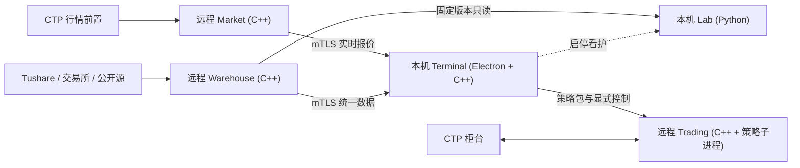

# Asterion Terminal

面向中国期货的个人量化研究与交易桌面终端，运行于 macOS（Apple Silicon）与 Linux x86_64。
C++20 核心与独立服务进程，Electron + React 界面。目标是用 Python 写策略，同一份策略在回测、仿真柜台和实盘上运行，
见[产品说明](docs/product.md)。

## 架构



Market 分发实时行情，Warehouse 负责历史采集与版本化数据仓库，本机 Lab 按固定版本做研究，Terminal 负责看盘、研究操作、策略发布与监控，Trading 在交易主机独立连接行情与柜台（支持实时 K 线与可选固定版本 Warehouse 历史预热）。关闭 Terminal 不影响已授权交易，策略目标统一经账户下单路径执行，见[架构](docs/architecture.md)。

## 当前能力

- **行情**：CTP 实时行情、合约目录、自选、五档、分时与分钟 K 线。
- **历史数据**：Warehouse 采集 Tushare 日线、分钟线、合约与日历，以及交易所日线和结算参数，对外提供固定版本统一数据集。
- **研究**：固定策略目录中的 Python 策略与因子；日线/分钟线回测、参数扫描、滚动验证、因子评价、图表与研究记录。
- **策略部署**：Terminal 发布小型源码包；Trading 从主机离线运行时加载、预热，目标经账户唯一下单路径报单。
- **交易**：CTP 账户（柜台仿真或实盘）：授权、合约白名单、限额与价格风控、先记录后发送、断线不重发。
- **部署**：Market、Warehouse 和 Trading 在 Linux 独立部署；Terminal 只看护本机 Lab。Lab 只读 Warehouse 的固定版本并缓存。

能力边界与已知限制见[现状](docs/status.md)，先做什么见[开发计划](docs/plan.md)。

## 快速开始

依赖：Node.js 22+、pnpm 10、Python 3、uv、Conan 2、CMake 3.25+、Ninja；
macOS 需要 Xcode 26 Command Line Tools，Linux 需要 GCC 13+。

```sh
conan profile detect --exist-ok
pnpm sync      # 同步 CTP/DuckDB 配方、前端与 Conan 依赖、Debug 构建和 Python 运行时
pnpm desktop   # 构建 Release 并启动桌面端
```

| 命令 | 用途 |
| --- | --- |
| `pnpm sync` | 首次准备或拉取更新后同步依赖、构建 `build/Debug` 并确保 Python 运行时可用 |
| `pnpm desktop` | 构建 Release 并启动桌面端 |
| `pnpm desktop --debug` | 构建 Debug 并启动，供 C++ 调试 |
| `pnpm desktop:check` | 构建并检查桌面链路，不打开窗口 |
| `pnpm desktop:build` | 生成发行安装包（macOS `.dmg`，Linux `.deb`） |
| `ctest --preset conan-debug -j 6` | C++ 测试 |
| `pnpm test:unit` | 界面单元与组件测试 |
| `pnpm run test:e2e:journeys` | 隔离环境下的关键端到端链路 |

细节见 [开发指南](docs/development.md)。

## 目录

| 路径 | 内容 |
| --- | --- |
| `core/` | 基础（Decimal、时间、错误）、内核（IPC、进程、日志、持久文件）、期货领域模型 |
| `apps/services/` | 各服务拥有自己的实现；跨服务复用在 `common/`，共享 SQLite 和订单限额在 `core/` |
| `apps/services/market/` | C++ 实时行情与合约目录 |
| `apps/services/warehouse/` | C++ 历史采集、数据仓库与固定版本读取 |
| `apps/services/lab/` | Python 研究服务与 C++ 回测扩展 |
| `apps/services/trading/` | 独立账户进程、内置风控与交易主机策略运行器 |
| `protocol/` | Protobuf 契约与边界校验 |
| `apps/clients/terminal/` | Terminal 桌面端：`src/`、`features/` 是界面，`native/` 是 C++ 原生层（Lab 看护与行情、数据、交易连接） |
| `apps/clients/terminal/bindings/` | Terminal 的 Node-API 绑定 |
| 各子项目的 `config/` | 默认配置和部署配置示例，见[配置文件](docs/configuration.md) |
| `tests/` | C++ 与进程测试 |

## 文档

[文档导航](docs/README.md) · [产品说明](docs/product.md) · [交易规则](docs/safety.md) ·
[开发计划](docs/plan.md) · [架构](docs/architecture.md) · [贡献约束](AGENTS.md)
