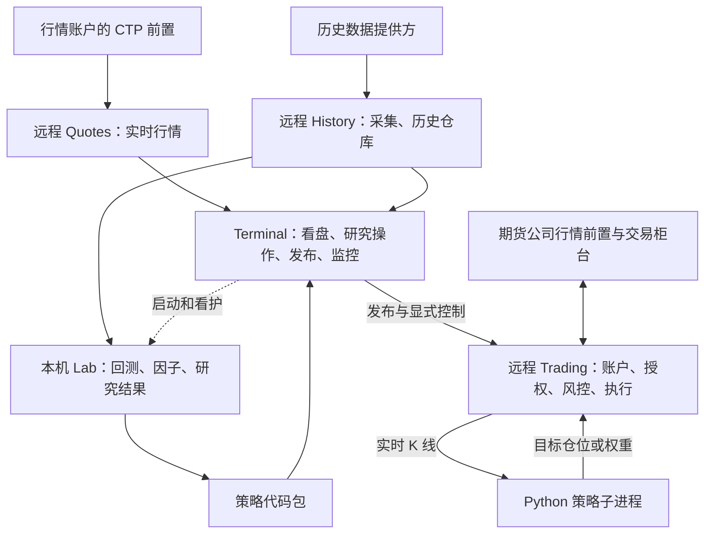

# 架构

进程按状态的拥有者和生命周期划分：每份长期状态只有一个拥有者，其他组件只提交意图或展示拥有者发布的状态。工作包和进度见[开发计划](plan.md)。



| 组件 | 拥有 | 说明 |
| --- | --- | --- |
| **Quotes** | 行情连接、合约目录 | Linux 上一个 C++ 进程，systemd 看护，用单独的行情账户，不含下单代码。一个客户端的订阅、断开或退出不影响其他客户端 |
| **History** | 正式仓库、采集任务 | Linux 上一个 C++ 进程，systemd 看护，不连接柜台。客户端看到一份统一的数据，来源选择在服务内部 |
| **Lab** | 研究记录、数据缓存 | Terminal 启动的本机 Python 服务，只读 History 的固定版本；回测、扫描、因子和报表在子进程中运行 |
| **Trading** | 授权、风控、交易记录、柜台连接、策略实例 | 每个账户一个 Linux C++ 进程，自己连接柜台的行情和交易前置，不依赖 Terminal、Lab、Quotes 或 History 在线 |
| **策略子进程** | 策略对象和它的状态 | Trading 管理，每个实例一个；没有凭据，不能下单，只把目标交给账户 |
| **Terminal** | 界面偏好、连接设置、客户端证书 | Electron + React + C++ 原生层；只启动 Lab，直连 Quotes、History 和 Trading |

设计决策：

- **关闭 Terminal 不影响交易**：不停止策略、不撤销授权、不撤单、不平仓。Trading 重启也不恢复授权，必须重新授权。
- **策略只用 Trading 自己收到的行情**：实例使用启动后自行聚合的 K 线预热；结束后可以用自己的记录热重启，但不读其他来源的历史数据。
- **安全由 C++ 账户保证**：策略只输出目标，授权、风控、先记录后发送都在 Trading 的同一条下单路径上，见[交易规则](safety.md)。
- **账户执行归属**：Trading 在指定安装目录内用经纪商代码和投资者账号取得独占锁并绑定原交易记录，避免配置别名分裂风控账本，见[部署与运行](trading/deployment.md#安装与账户配置)。
- **三类服务各管一件事**：Quotes 分发实时行情，History 提供历史数据，Trading 执行交易。行情进程没有下单代码，历史服务没有柜台凭据，一个的崩溃和升级不影响另外两个。理由：下单路径要尽量简单，看盘和数据处理的负载与变化不该靠近它。三者之间没有通信，可以分开部署。
- **研究可复现**：研究被接纳时固定数据版本和策略代码副本，见 [Lab](lab/README.md)。
- **凭据只在服务主机**：柜台密码、授权码和数据源 token 以 systemd 加密凭据保存；Terminal 只保存地址、证书指纹和自己的客户端证书。

## 代码分层

| 层 | 目标 | 内容 |
| --- | --- | --- |
| 基础 `base` | `asterion_base` | `Decimal`（8 位小数定点）、ID、时钟、错误码、序列化 |
| 系统 `system` | `asterion_system` | 本机 IPC、固定指纹 TLS、RPC、子进程、文件锁、持久写入、线程池、日志 |
| 期货 `futures` | `asterion_futures` | 合约、订单、账本、回放与撮合、交易时段、分钟线、订单限额 |
| 数据库 `database/` | `asterion_sqlite` | SQLite 访问 |
| 协议 | `asterion_protocol` | `protocol/proto/` 的 Protobuf 契约，规则见[通信协议](protocol.md) |

依赖只向下。业务代码在 `apps/services/<服务>/`，跨服务共用的代码在 `apps/services/common/`。订单限额编译进 Trading 和回测扩展，两边用同一套实现。

`apps/crash_reporter/` 是 Linux 服务随包提供的内部崩溃解析程序，入口独立于基础库；采集和解析能力由 `asterion_system` 提供。

## Terminal

| 位置 | 内容 |
| --- | --- |
| `apps/clients/terminal/electron/` | 主进程、预加载、窗口 |
| `apps/clients/terminal/native/`、`apps/clients/terminal/bindings/` | C++ 原生层：服务客户端、命令、状态快照；Node-API |
| `apps/clients/terminal/src/` | React 宿主：工作台、设置、启动、多语言、桥接 |
| `apps/clients/terminal/features/` | 行情、研究、交易、数据页面 |

- 原生层定时汇总服务状态，发布带修订号的快照；界面按修订号读取，没变化时不返回内容。
- 页面用 `pnpm generate:protocol` 生成的 TS 类型直接组装和读取消息。Lab 由 Electron 主进程转发字节；Quotes、History 和 Trading 由原生层按保存的连接原样转发（`quotes.call`、`history.call`、`trading.call`），TLS 私钥不离开原生层。
- 实时行情：原生层为页面保持一条 Quotes `stream_quotes` 流，把帧按顺序排队；页面定期取走新帧（`quotes.watch`），自己维护报价表（首帧完整，之后只有变化的行）。页面没有完整的首帧时要求重开一条流。理由：桌面和浏览器开发桥都只有请求/应答，没有推送。

## 进程与安装目录

- 本机用 Unix socket；Quotes、History 和 Trading 用双向固定证书指纹 TLS，History 按客户端证书区分只读和采集管理权限。
- Lab 是 Terminal 的子进程，没有启停按钮：退出或持续心跳失败后自动重启，直到恢复；Terminal 退出（包括被强制结束）后 Lab 随之退出。一个根目录同时只能有一个 Terminal。
- 每个程序有自己的安装目录：

```
<根>/<程序>/bin/      程序
           lib/      原生库；Trading 另有 strategy/ 框架
           runtime/  Trading 的 Python 运行时
           config/   配置，含 logging.json
           logs/     日志
           data/     数据，多实例的程序按 data/<实例>/ 分开
```

| 根目录 | 位置 |
| --- | --- |
| 本机 | Linux `~/.local/share/asterion/`，macOS `~/Library/Application Support/Asterion/`，从项目启动和安装后相同；隔离测试为 `ASTERION_ROOT` |
| 服务主机 | `/opt/asterion/quotes/`、`/opt/asterion/history/`、`/opt/asterion/trading/` |

- 程序从自己的路径（`bin/` 的上一级）找到安装目录，开发和测试可以用符号链接把构建产物放进 `bin/`。
- 默认配置位于各子项目的 `config/`，首次安装或启动时复制，之后保留用户配置。Quotes、History 和 Trading 的业务配置由安装脚本生成；缺少或无效的业务配置会使程序启动失败并报告路径。文件清单见[配置文件](configuration.md)，日志配置的缺省行为见[运行日志](services.md#运行日志)。
- 不做旧格式兼容或迁移；读不懂的记录明确拒绝，不自动改写或删除用户数据。
