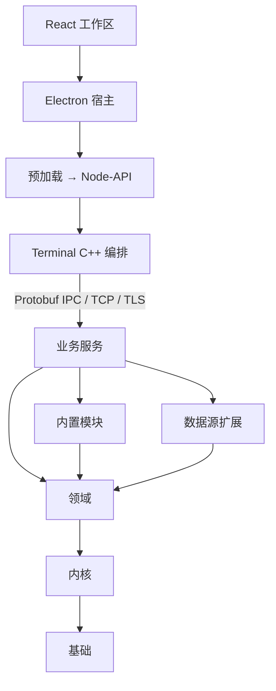
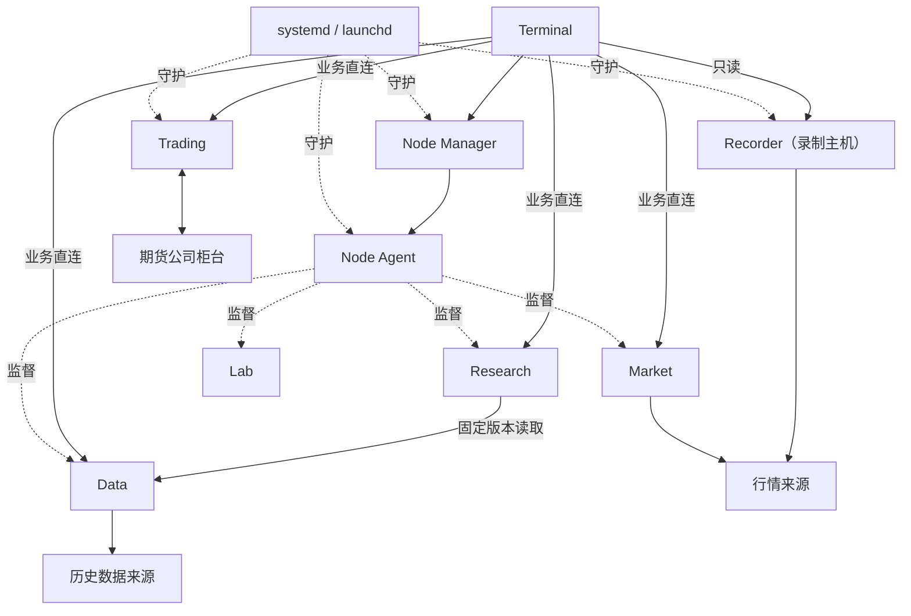

# 架构

本文描述当前代码。目标形态和替换顺序见[评估与路线](reviews/project-assessment-2026-10-28.md)：
Data、Research、共享任务库、Node Manager 与 SSH 编排、Node-API 原生层和手写 JSON 映射都会被替换，
在被替换之前只做当前阶段需要的修复。Node Manager 的进程设计见 [architecture/node-manager.md](architecture/node-manager.md)。

## 原则

- 每份长期状态只有一个拥有者；其他组件只提交意图或展示拥有者发布的状态。
- 进程按状态与生命周期划分，不按页面或功能数量划分。
- Manager 与 Agent 只管理节点和进程，不转发行情、订单、数据或任务结果。
- 对外扩展只面向数据源与策略；因子是普通研究函数或包。内置模块不提供第三方插件生命周期。
- 原生数据源是可信的进程内代码，不是沙箱。
- 交易：策略产生意图，风控给出裁决，账户服务唯一决定是否发送。

## 分层



| 层 | 目标 | 内容 |
| --- | --- | --- |
| 基础 | `asterion_foundation` | `Decimal`（8 位小数定点）、ID、时钟、错误码、序列化 |
| 内核 | `asterion_kernel` | 原生插件装载、本机 IPC、带连接魔数的 TCP 与固定指纹 TLS、RPC 宿主与客户端、子进程、文件锁、持久写入、线程池、日志 |
| 领域 | `asterion_domain` | 合约、订单、期货账本、交易时段、分钟线、执行/风险/策略端口 |
| 协议 | `asterion_protocol` | Protobuf 契约、边界校验、界面 JSON 映射 |

依赖只向下。领域接口返回结构化 C++ 类型，金额与价格保留 `Decimal`；JSON 只用于协议边界、
配置/日志编码和界面展示。

## 进程



| 程序 | 职责 |
| --- | --- |
| `asterion_node_manager` | Terminal 所在机器：Agent 登记、连接、节点状态汇总、远程部署与维护协调 |
| `asterion_node_agent` | 每个节点：服务部署、启停、健康探测、有限重启、资源观察、程序升级 |
| `asterion_market` | CTP 实时行情、合约目录、事件流、当日分钟线 |
| `asterion_recorder` | 录制主机上独立运行，由 systemd 直接看护，不受 Agent 管理：自己登录行情，把全市场 Tick 与分钟线存为 Parquet，只读接口供读取（见[行情录制](recorder.md)） |
| `asterion_data` | 历史版本仓库、全市场数据表、数据集、材料与观测归档；拥有采集任务、执行与发布 |
| `asterion_research` | 研究类任务（回测、因子、统计、样本、逻辑试算、评估）及研究变量、逻辑、策略包 |
| `asterion_trading` | Linux 独立安装，每个 CTP 账户一个 systemd 进程；Terminal 以双向固定指纹 TLS 直连，负责授权、风控、先记录后发送、在途订单与成交核对 |
| `asterion_lab` | Python 研究服务，每个本机节点一个，用随包 Python 以 `-I -B -m asterion_lab` 运行。期货数据仓库与 Tushare 采集（见 [lab](lab.md)）；按计划逐步接管 Data 与 Research |

- 节点内使用 Unix Socket，局域网连接使用以 `ASTR` 开头的不加密 TCP；交易服务使用双向固定证书指纹 TLS（同机也一样）。消息均为 `protocol/proto/asterion/` 中的 Protobuf。
- 交易实例配置拥有 CTP 账户、前置地址与柜台环境；Terminal 只保存交易连接并读取账户信息，独立设置风险政策。行情账户登记不参与交易身份绑定。交易凭据在交易主机本地输入并按实例加密保存，由 systemd 提供给服务；Terminal 不接收交易凭据。
- 一个服务实例对应一个进程；停止保留实例与数据，重启只改变运行代次。
- 安装版关闭窗口后服务继续运行；开发入口退出时停止本机开发服务、Agent 与 Manager，保留数据。
- Agent 异常退出时其托管的服务一并退出；Manager 独立运行并报告节点失联。
- Research 显式绑定一个 Data 实例；跨节点组合 Research 与 Data 目前明确拒绝。

## 任务

任务属于各自的业务服务，不存在中央任务服务。Data 拥有分钟下载、表更新、单分区重取和材料采集；
Research 拥有研究类任务。两者共用 `apps/services/common/tasks` 的持久任务机制，任务种类的含义由各服务的 `TaskDomain` 提供：

- `tasks.sqlite` 保存任务索引与状态事件；固定输入为任务目录下的 `input.pb`，各次尝试的结果为
  `results/<尝试>.pb`。SHA-256 摘要是固定输入与结果的身份。
- 状态拥有者（服务的 I/O 线程）决定状态变化，持久写入在单独的日志线程执行，算法在有界计算池执行。
- 取消是协作式的；服务重启把未确认的尝试标为中断，不自动重跑；重试必须显式发起。
- 结果在任务完成时由所属服务校验；之后的启动和读取只解析已发布的文件，不重新哈希。
  冷备检查是唯一重新核对摘要的信任边界。
- 每个服务最多 1,000 个活动任务；Research 计算并发默认 1，可配置为 1—2。

细节见 [任务](tasks.md)。

## 线程与状态拥有者

| 进程 | 应用线程 |
| --- | --- |
| Trading | 状态单写入者、I/O、持久日志、SDK 调用各一条；SDK 回调进入有界队列 |
| Market | 状态与 I/O、观测聚合、SDK 调用各一条 |
| Data | 状态与 I/O、串行持久写入、固定文件池、采集执行池 |
| Research | 状态与 I/O、日志线程、固定文件池、有界计算池 |
| Manager | RPC 接入；I/O 拥有者持有 Agent 连接与节点状态；固定池执行 SSH 与部署 |
| Agent | 管理与 I/O、配置写入线程、固定管理池 |
| Terminal Native | 一个状态与 I/O 拥有者、两条批量读取线程、一条响应线程、两条管理线程 |

服务端的请求在 I/O 线程上以协程（`PolledTask`）推进，等待文件、日志或 RPC 时挂起而不阻塞线程。

## Terminal

| 位置 | 职责 |
| --- | --- |
| `apps/clients/terminal/electron/` | 主进程、预加载、窗口 |
| `bindings/node/`、`bindings/c/` | Node-API 与 C ABI |
| `apps/clients/terminal/native/` | 服务客户端、命令、状态快照 |
| `apps/clients/terminal/src/` | React 宿主：工作台、设置、启动、多语言、桥接 |
| `apps/clients/terminal/features/` | 工作区插件：行情、数据、研究、交易 |

Native 每 0.5—2 秒汇总各服务状态并发布带修订号的快照；界面按修订号轮询，未变化时不返回内容，
行情只返回变化的报价行。命令参数类型定义在 `src/bridge/commands.ts`，Native 在边界再次校验。
界面草稿与缓存不是账户、数据或任务状态的权威。

新服务改走生成的客户端：TS 类型由 `pnpm generate:protocol` 从 proto 生成到 `src/generated/` 并提交。
页面用这些类型组装和解析消息，Electron 主进程持有服务连接，只按帧转发字节
（`electron/lab-channel.cjs`），连接地址由主进程向 Native 查询，不取自页面；开发浏览器由开发服务端
以同样方式转发。目前只有 Python 研究服务走这条路径（见 [lab](lab.md)），之后新增界面一律如此。

## 工程结构与扩展边界

| 路径 | 职责 | 第三方扩展 |
| --- | --- | --- |
| `core/` | 基础、内核与领域事实；共享交易时段及保证金语义 | 否 |
| `core/storage/sqlite/`、`core/risk/order_limits/` | 共享数据库访问与编译进程序的订单限额 | 否 |
| `apps/services/common/` | 跨服务共用的 CTP 行情、图表计算、Parquet 和备份文件操作 | 否 |
| `apps/services/trading/ctp/` | 交易柜台适配 | 否 |
| `apps/services/data/storage/` | 数据仓库 | 否 |
| `apps/services/research/` | 回测撮合、因子评价、绩效、内置规则策略与分析助手 | 否；Python 策略接口按 M2.1 实施 |
| `apps/services/data/providers/` | 数据源调用与供应商响应解释的内部编排 | 否 |
| `extensions/data/native/` | 当前 Tushare、SHFE 原生数据源 | 是，SDK 在 `bindings/plugin/` |
| `apps/services/lab/asterion_lab/sources/` | Python 数据源约定及当前内置实现 | 数据源扩展方向，按数据底座替换顺序接入 |
| `apps/clients/terminal/features/` | 内置行情、数据、研究、交易界面 | 否；共享类型化应用上下文，无插件命令权限声明 |

源代码的模块边界不等于第三方插件边界。CMake 在各模块目录声明自己的目标，依赖指向核心及更低层模块；
业务服务负责进程与状态。原生动态装载器服务于当前数据源，不再预留策略、执行、存储、工具等能力分类。

策略扩展输出目标仓位或权重，由 C++ 内核转换为订单并强制执行风险控制。因子可被独立评价，也可由策略直接导入；
统一数据时间、合约索引与缺失值约定，不增加独立的因子安装、注册或生命周期机制。Python 策略运行接口仍按 M2.1 实施。

风控规则编译进 Trading 与 Research，双方使用同一套订单限额实现。账本保存明确的政策参数和变更事件，
不保存算法摘要或动态库副本。没有旧格式兼容或迁移；不识别的记录明确拒绝，绝不自动改写或删除用户数据。

## 安装目录

每个程序装在自己的目录里，所有程序在同一个根目录下：

```
<根>/<程序>/bin/      程序
           lib/      它的动态库：CTP 库、插件（plugins/<实例>/）
           config/   它的配置，logging.json 在其中
           logs/     它的日志
           data/     它的数据，有多个实例的程序按 data/<实例>/ 分开
```

| 根目录 | 位置 |
| --- | --- |
| 本机 | Linux `~/.local/share/asterion/`（设置了 `XDG_DATA_HOME` 时在其下），macOS `~/Library/Application Support/Asterion/`；开发环境为 `asterion-development/` 与 `Asterion Development/`；隔离测试为 `ASTERION_ROOT` |
| 远程节点 | `/var/lib/asterion/nodes/<节点>/` |
| 录制或交易主机 | `/opt/asterion/recorder/`、`/opt/asterion/trading/` 独立安装；不属于 Agent 节点 |

本机的程序目录有 `agent/`、`manager/`、`market/`、`data/`、`research/`、`lab/`，以及 `terminal/`（只有 `config/`、
`logs/`、`data/`：Terminal 程序本身留在应用安装包里）。

- 程序从启动它的路径（`argv[0]`，不解析符号链接）找到自己的安装目录：`bin/` 的上一级。所以开发和测试可以把构建出的
  程序以符号链接放进 `bin/`，不必复制。Terminal 和安装器从应用里运行，由代码指明各自的目录。
- 应用里打包的程序、插件与默认配置所在的目录称为应用目录。从别处运行的 Manager 由 Terminal 以 `--application` 告知。
- Agent 把每种服务的程序放进 `<根>/<程序>/bin/`：从它按内容命名的程序仓库（`agent/data/artifacts/`）建硬链接，跨文件系统
  时复制。同一程序的各实例运行同一版本，另一实例运行其他版本时拒绝替换。CTP 库按内容命名放在 `lib/`。

## 配置与日志

- 默认配置在仓库 `config/`，首次部署时复制到 `agent/`、`manager/`、`terminal/` 的 `config/`；Agent 首次安装一种服务时把
  自己的 `logging.json` 复制给它。已有配置不被覆盖，程序只读。独立 Recorder 和 Trading 的默认值写在各自安装脚本里，安装时生成实际配置，不携带默认 JSON 文件。
- 缺失或无效的必需配置使启动失败并报告路径。Manager 的启动上下文通过 OS 服务参数传递。
- 日志接口是格式字符串（`log::info("… {}", x)`），配置是各程序的 `config/logging.json`，见[运行日志](services.md#运行日志)。

## 安装与维护

独立安装器负责当前用户安装、同版本修复、停机升级和默认保留资料的卸载；Terminal 普通启动不安装或升级程序。
远程节点的登记、SSH 与 Agent 管理只经 Manager。整体升级先停业务、冻结节点并更新远程程序，再更新本机，
最后启动并确认远程 Agent；中断的维护按登记的目标显式继续，不自动回滚。
操作步骤见[服务与部署](services.md)。
