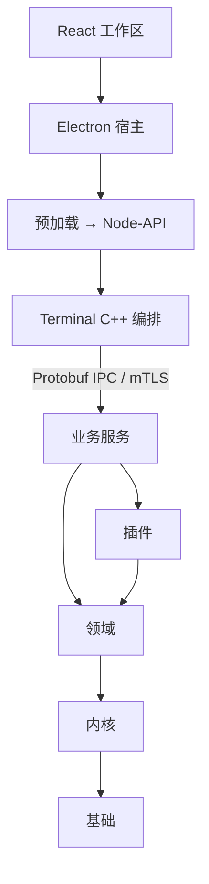
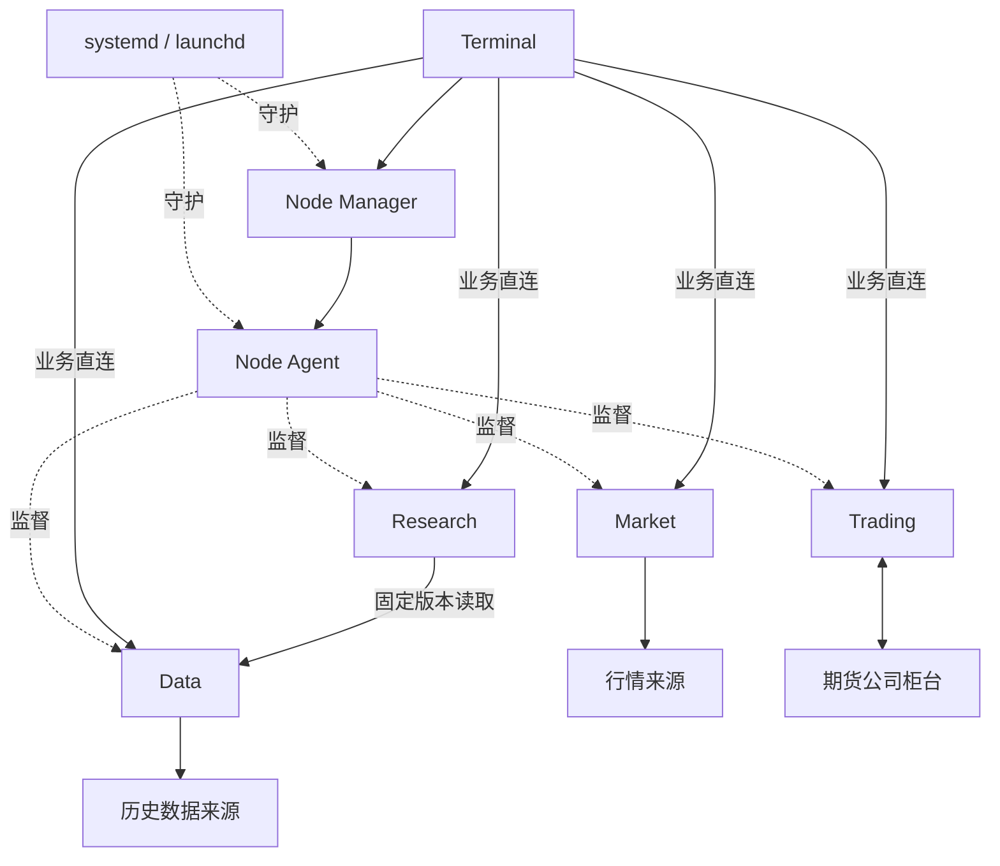

# 架构

本文描述当前代码。目标架构见 [architecture/target.md](architecture/target.md)，
Node Manager 的进程设计见 [architecture/node-manager.md](architecture/node-manager.md)，
正在进行的整改见 [重构计划](reviews/project-assessment-2026-10-25.md)。

## 原则

- 每份长期状态只有一个拥有者；其他组件只提交意图或展示拥有者发布的状态。
- 进程按状态与生命周期划分，不按页面或功能数量划分。
- Manager 与 Agent 只管理节点和进程，不转发行情、订单、数据或任务结果。
- 插件是可信的进程内代码，不是沙箱。
- 交易：策略产生意图，风控给出裁决，账户服务唯一决定是否发送。

## 分层

| 层 | 目标 | 内容 |
| --- | --- | --- |
| 基础 | `asterion_foundation` | `Decimal`（8 位小数定点）、ID、时钟、错误码、序列化 |
| 内核 | `asterion_kernel` | 原生插件装载、本机 IPC 与 TCP+mTLS、RPC 宿主与客户端、子进程、文件锁、持久写入、线程池、日志 |
| 领域 | `asterion_domain` | 合约、订单、期货账本、交易时段、分钟线、执行/风险/策略端口 |
| 协议 | `asterion_protocol` | Protobuf 契约、边界校验、界面 JSON 映射 |

依赖只向下。领域接口返回结构化 C++ 类型，金额与价格保留 `Decimal`；JSON 只用于协议边界、
配置/日志编码和界面展示。

## 进程

| 程序 | 职责 |
| --- | --- |
| `asterion_node_manager` | Terminal 所在机器：Agent 登记、连接、节点状态汇总、远程部署与维护协调 |
| `asterion_node_agent` | 每个节点：服务部署、启停、健康探测、有限重启、资源观察、程序升级 |
| `asterion_market` | CTP 实时行情、合约目录、事件流、当日分钟线 |
| `asterion_data` | 历史版本仓库、全市场数据表、数据集、材料与观测归档；拥有采集任务、执行与发布 |
| `asterion_research` | 研究类任务（回测、因子、统计、样本、逻辑试算、评估、账户复核）及研究变量、逻辑、策略包 |
| `asterion_trading` | 每个 CTP 账户一个进程：授权、风控、先记录后发送、在途订单与成交核对 |

- 本机使用 Unix Socket，远程使用 TCP + 双向 TLS，消息均为 `protocol/proto/asterion/` 中的 Protobuf。
- 一个服务实例对应一个进程；停止保留实例与数据，重启只改变运行代次。
- 安装版关闭窗口后服务继续运行；开发入口退出时停止本机开发服务、Agent 与 Manager，保留数据。
- Agent 异常退出时其托管的服务一并退出；Manager 独立运行并报告节点失联。
- Research 显式绑定一个 Data 实例；跨节点组合 Research 与 Data 目前明确拒绝。

## 任务

任务属于各自的业务服务，不存在中央任务服务。Data 拥有分钟下载、表更新、单分区重取和材料采集；
Research 拥有研究类任务。两者共用 `apps/services/common/tasks` 的持久任务机制，任务种类的含义由各服务的 `TaskDomain` 提供：

- `tasks.sqlite` 保存任务索引与状态事件；固定输入为任务目录下的 `input.pb`，各次尝试的结果为
  `results/<尝试>.pb`。SHA-256 摘要是固定输入与结果的身份。
- 状态拥有者（服务的 I/O 线程）决定状态变化，持久写入在单独的日志线程执行，算法在有界计算池执行。
- 取消是协作式的；服务重启把未确认的尝试标为中断，不自动重跑；重试必须显式发起。
- 结果在任务完成时由所属服务校验；之后的启动和读取只解析已发布的文件，不重新哈希。
  冷备检查是唯一重新核对摘要的信任边界。
- 每个服务最多 1,000 个活动任务；Research 计算并发默认 1，可配置为 1—2。

细节见 [任务](tasks.md)。

## 线程与状态拥有者

| 进程 | 应用线程 |
| --- | --- |
| Trading | 状态单写入者、I/O、持久日志、SDK 调用各一条；SDK 回调进入有界队列 |
| Market | 状态与 I/O、观测聚合、SDK 调用各一条 |
| Data | 状态与 I/O、串行持久写入、固定文件池、采集执行池 |
| Research | 状态与 I/O、日志线程、固定文件池、有界计算池 |
| Manager | RPC 接入；I/O 拥有者持有 Agent 连接与节点状态；固定池执行 SSH 与部署 |
| Agent | 管理与 I/O、配置写入线程、固定管理池 |
| Terminal Native | 一个状态与 I/O 拥有者、两条批量读取线程、一条响应线程、两条管理线程 |

服务端的请求在 I/O 线程上以协程（`PolledTask`）推进，等待文件、日志或 RPC 时挂起而不阻塞线程。

## Terminal

| 位置 | 职责 |
| --- | --- |
| `apps/clients/terminal/electron/` | 主进程、预加载、窗口 |
| `bindings/node/`、`bindings/c/` | Node-API 与 C ABI |
| `apps/clients/terminal/native/` | 服务客户端、命令、状态快照 |
| `apps/clients/terminal/src/` | React 宿主：工作台、设置、启动、多语言、桥接 |
| `apps/clients/terminal/plugins/` | 工作区插件：行情、数据、研究、交易 |

Native 每 0.5—2 秒汇总各服务状态并发布带修订号的快照；界面按修订号轮询，未变化时不返回内容，
行情只返回变化的报价行。命令参数类型定义在 `src/bridge/commands.ts`，Native 在边界再次校验。
界面草稿与缓存不是账户、数据或任务状态的权威。

## 插件

| 类别 | 实现 |
| --- | --- |
| 数据 | `data/ctp`、`data/tushare`、`data/shfe`、`data/registry` |
| 执行 | `execution/paper`（回测撮合）、`execution/ctp` |
| 存储 | `storage/sqlite`、`storage/filesystem`、`storage/parquet` |
| 策略 | `strategy/cta`（四条单合约规则与截面排序） |
| 风控 | `risk/order-limits`、`risk/registry` |
| 工具 | `tools/chart_indicators`、`tools/factor_analysis`、`tools/performance`、`tools/analytics`（Polars/QuantStats/skfolio 冻结助手） |

只有确有多个实现的能力才设端口：交易前风控（`RiskPort`）和历史分钟线读取（`HistoricalBarPort`）。
历史数据源与风控可作为原生动态库独立安装（C ABI，见 [原生插件](native-plugins.md)）；
策略、存储和执行是仓库内静态模块。

## 配置与日志

- 节点默认配置在仓库 `config/`，首次部署复制到 `<node>/config/`；已有配置不被覆盖，服务只读。
- 缺失或无效的必需配置使启动失败并报告路径。Manager 的启动上下文通过 OS 服务参数传递。
- 日志文件按程序、服务实例和进程区分；模块与操作是记录字段。日志策略每个节点环境一份。

## 安装与维护

独立安装器负责当前用户安装、同版本修复、停机升级和默认保留资料的卸载；Terminal 普通启动不安装或升级程序。
远程节点的登记、SSH 与 Agent 管理只经 Manager。整体升级先停业务、冻结节点并更新远程程序，再更新本机，
最后启动并确认远程 Agent；中断的维护按登记的目标显式继续，不自动回滚。
流程见[安装与配置需求](requirements/modules/system/setup.md)。
