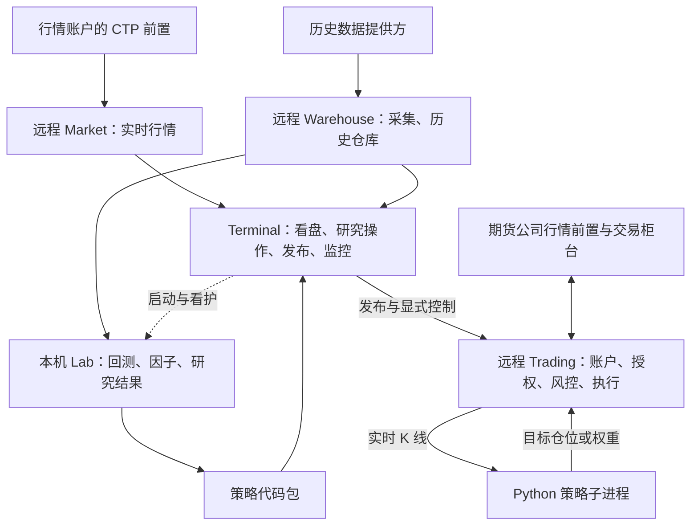

# 架构

系统按状态的拥有者与生命周期划分进程：每份长期状态只由一个拥有者读写，其他组件仅提交意图或展示拥有者发布的快照。待完成事项见[开发计划](plan.md)。



| 组件 | 拥有状态 | 职责说明 |
| --- | --- | --- |
| **Market** | 行情连接、合约目录 | Linux 单一 C++ 进程，由 systemd 看护；使用独立行情账户，不含下单代码；任一客户端的订阅或断开不影响其他客户端 |
| **Warehouse** | 正式历史仓库、采集任务 | Linux 单一 C++ 进程，由 systemd 看护，不连接柜台；内部完成来源选择，对外提供统一版本化数据集 |
| **Lab** | 研究记录、可重建数据缓存 | Terminal 启动的本机 Python 服务，只读 Warehouse 固定版本；回测、扫描、因子评价与报表均在子进程中执行 |
| **Trading** | 授权、风控、交易记录、柜台连接、策略实例 | 每账户一个 Linux C++ 进程，自行直连柜台行情与交易前置，不依赖 Terminal、Lab、Market 或 Warehouse 在线 |
| **策略子进程** | 策略对象及其内部状态 | 由 Trading 看护，每实例一个；仅通过接口提交目标仓位或权重，运行使用者信任的策略代码 |
| **Terminal** | 界面偏好、连接配置、客户端证书 | Electron + React + C++ 原生层；仅看护本机 Lab，直连远程 Market、Warehouse 与 Trading |

核心设计决策：

- **关闭 Terminal 不影响交易**：不停止策略、不撤销授权、不撤单、不平仓；Trading 重启也不恢复授权，必须重新确认。
- **策略输入由 Trading 固定**：运行期仅使用 Trading 自身收到的行情；预热仅可使用本地录制 K 线、已结束实例记录，或启动时显式提交且经固定版本与 SHA-256 摘要校验的历史 K 线，见[交易规则](safety.md)。策略子进程用于隔离运行时故障，不作为不可信代码的安全沙箱。
- **安全由 C++ 账户保证**：策略只输出目标，授权、风控、先记录后发送均收口于 Trading 的唯一下单路径，见[交易规则](safety.md)。
- **账户执行唯一归属**：Trading 在安装目录内以经纪商代码和投资者账号获取独占锁并永久绑定原交易记录，防止配置别名分裂风控账本，见[安装与账户配置](trading/deployment.md#安装与账户配置)。
- **三类远程服务职责解耦**：Market 分发行情、Warehouse 管理历史、Trading 执行交易，三者互不通信、独立部署。行情进程不含下单代码，Warehouse 不持有柜台凭据，任一服务的故障或升级不影响其余两者。理由：下单路径必须保持极简，看盘与数据处理的负载与变动不应波及执行链路。
- **研究与发布可复现**：研究任务接纳时即固定数据版本与策略源码副本；从成功回测部署策略包时直接打包该副本，并携带来源运行与配置，见 [Lab](lab/README.md)。
- **凭据只留在服务主机**：柜台密码、授权码与数据源 token 以 systemd 加密凭据保存；Terminal 仅保存服务地址、服务端证书指纹及自身客户端证书。

## 代码分层

| 层 | CMake 目标 | 内容 |
| --- | --- | --- |
| 基础层 `core/*/base` | `asterion_base` | `Decimal`（8 位小数定点）、ID、时钟、错误码、序列化 |
| 系统层 `core/*/system` | `asterion_system` | 本机 IPC、固定指纹 TLS、RPC、子进程、文件锁、持久文件、线程池、日志、崩溃采集 |
| 期货层 `core/*/futures` | `asterion_futures` | 合约、订单、账本、回放撮合、交易日、分钟线、订单限额 |
| 数据库层 `core/*/database` | `asterion_sqlite` | SQLite 封装与日志存储 |
| 协议层 `protocol/` | `asterion_protocol` | `protocol/proto/` 的 Protobuf 契约与校验，规则见[通信协议](protocol.md) |

依赖严格单向向下。业务实现位于 `apps/services/<服务>/`，跨服务复用代码位于 `apps/services/common/`。订单限额同时编译进 Trading 与 Lab 回测扩展，确保实盘与回测共用同一实现。

`apps/crash_reporter/` 是 Linux 服务随包分发的独立崩溃符号解析程序，其采集与解析能力由 `asterion_system` 提供。

## Terminal

| 位置 | 内容 |
| --- | --- |
| `apps/clients/terminal/electron/` | Electron 主进程、预加载脚本与窗口生命周期 |
| `apps/clients/terminal/native/`、`apps/clients/terminal/bindings/` | C++ 原生层（服务客户端、命令分发、状态快照）与 Node-API 绑定 |
| `apps/clients/terminal/src/` | React 宿主（工作台、设置、启动、多语言、桥接） |
| `apps/clients/terminal/features/` | 行情、交易、研究、数据四个业务模块 |

- 原生层定时汇总本机服务与连接状态并发布带修订号的快照；界面按修订号拉取，无变化时不返回正文。
- 页面使用 `pnpm generate:protocol` 生成的 TypeScript 类型直接组装和解析 Protobuf 消息。Lab 请求由 Electron 主进程转发字节；Market、Warehouse、Trading 请求由原生层按保存的连接原样转发（`market.call`、`warehouse.call`、`trading.call`），TLS 私钥始终不离开原生层。
- 实时行情由原生层维持一条 `stream_quotes` 长连接并将收到的帧按序排队，页面定期拉取（`market.watch`）并维护本地报价表（首帧全量，后续仅更新变化行）；缺少完整首帧时主动重开流。理由：桌面桥与浏览器开发桥均采用请求/应答模型，不依赖服务端主动推送。

## 进程与安装目录

- 本机通信采用 Unix socket；远程 Market、Warehouse、Trading 采用双向固定证书指纹 TLS 1.3，仅接受已登记的客户端证书。
- Lab 作为 Terminal 子进程运行，不设手动启停按钮：意外退出或持续心跳失败后自动重启；Terminal 退出（含被强制结束）后 Lab 随之退出。同一本机根目录同时仅允许运行一个 Terminal 实例。
- 每个程序使用一致的安装目录布局：

```text
<根>/<程序>/bin/      可执行程序与运维脚本
           lib/      原生库；Trading 另含 strategy/ 框架
           runtime/  Trading 的离线 Python 运行时
           config/   配置文件（含 logging.json）
           logs/     运行日志
           data/     业务数据（多实例程序按 data/<实例>/ 隔离）
```

| 根目录 | 路径 |
| --- | --- |
| 本机 | Linux `~/.local/share/asterion/`，macOS `~/Library/Application Support/Asterion/`（开发启动与安装版共用）；隔离测试通过 `ASTERION_ROOT` 指定 |
| 服务主机 | `/opt/asterion/market/`、`/opt/asterion/warehouse/`、`/opt/asterion/trading/` |

- 各程序按自身可执行路径（`bin/` 上级目录）定位安装目录；开发与测试可将构建产物符号链接至 `bin/`。
- 默认配置位于各子项目 `config/`，首次安装或启动时复制，升级时保留用户配置。Market、Warehouse、Trading 的业务配置由安装脚本生成，缺失或非法配置会在启动时失败并输出文件路径。文件清单见[配置文件](configuration.md)，日志默认行为见[运行日志](services.md#运行日志)。
- 不保留旧格式兼容与自动迁移；遇到无法识别的记录格式直接拒绝，不静默改写或删除用户数据。
