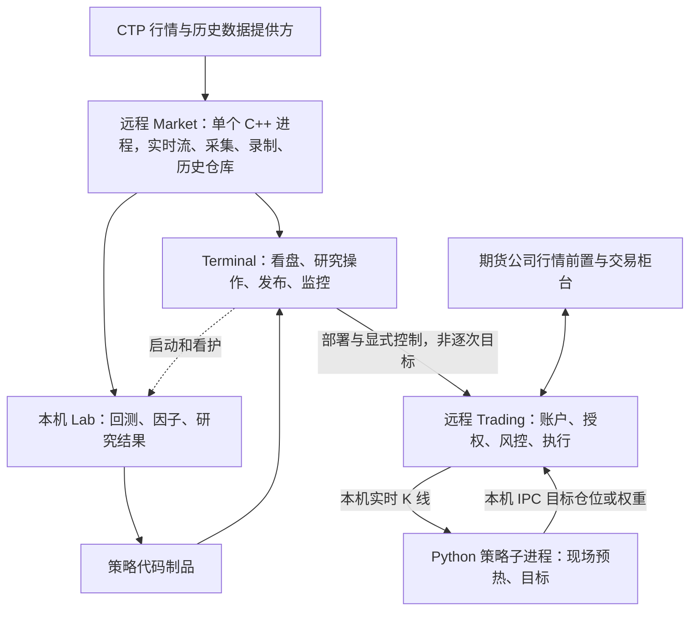
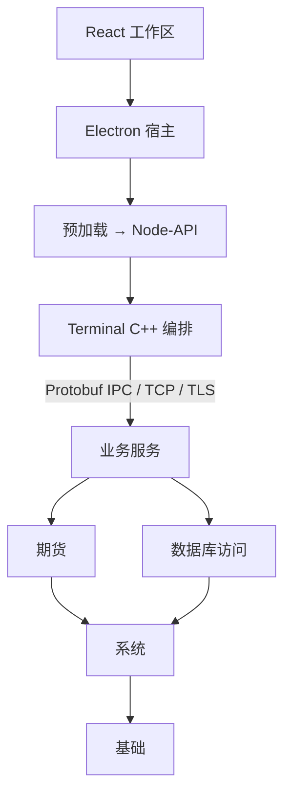
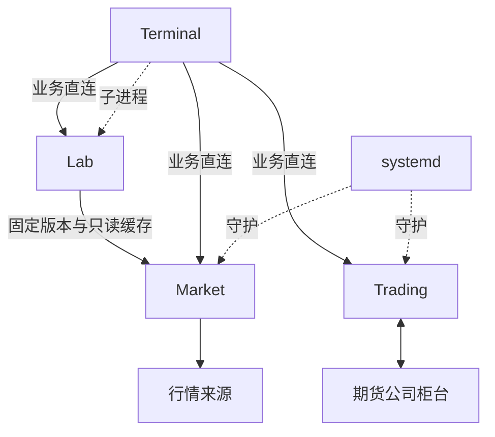

# 架构

本文区分已确认的目标设计与当前实现。实施顺序见[开发计划](plan.md)。

## 目标设计

2026-11-01 确认：Market 与 Trading 都是独立部署、独立运行的 Linux 服务。Market 是一个纯 C++ 服务进程，集中获取、保存与提供市场数据，支持多个互不干扰的客户端；Lab 研究；Terminal 发布；Trading 在交易主机自主运行策略与账户。



- **Market** 在 Linux 上以一个 C++ 服务进程独立部署，systemd 看护；统一实时接入、录制、历史采集、正式仓库读写与查询。
  进程内用有界线程和队列分开实时接收、供应商请求、文件写入、合并与查询；不携带 Python 运行时，不启动 Python 采集子进程。
  历史下载、合并与查询不阻塞实时链路；客户端退出或调整看盘订阅不能打断采集与录制。
  Market 唯一拥有正式仓库，Lab 只按版本读取或缓存；来源不混用、缺口不伪造。录制不再是独立部署单元。
- **Lab** 随本机 Terminal 运行，拥有研究配置与结果；回测、扫描、因子和报表用子进程。它不运行上线策略，只读固定 Market 版本，不拥有供应商采集与正式行情仓库。
- **Trading** 每账户一个 C++ 进程，独立连接期货公司的交易与行情服务；不依赖 Terminal、Lab 或 Market 的在线状态。
  它使用自己的行情连接为执行检查和本机策略提供数据，共享底层接入与聚合实现，不共享 Market 的运行状态。
- **策略运行器** 是 Trading 管理的 Python 子进程，每实例一个，不是本机 Lab 的子进程。无凭据和下单权限；目标只交给本机账户内核，权重换手数仍归 C++。
- **Terminal** 发布确定版本的策略包和实例配置、查看状态并发送显式控制命令。交易主机从已部署代码运行，不读取桌面源码目录，不经桌面转发决策。
  关闭或断开 Terminal 不停止策略、不撤权、不撤单、不平仓、不暂停新增交易；Trading 重启后的授权是另一项规则。

### Market 内部职责

| 模块 | 状态与职责 |
| --- | --- |
| 实时接入与聚合 | CTP 连接、合约目录、行情事件序列与完整 K 线；实时分发与录制消费同一条聚合链 |
| 历史采集 | C++ 直接请求供应商与交易所，统一负责来源能力、限流、任务状态和显式取消；任务属于服务，不属于提交它的连接 |
| 仓库与录制 | 唯一的正式文件、分区清单与数据集版本；写入完成后发布版本，读取固定版本不受后续采集影响 |
| 客户端接口 | 实时订阅、历史读取、覆盖与任务查询，以及有权限的采集管理；每个连接的筛选、游标与发送容量独立 |

这些是同一进程内的模块，不增加部署单元。阻塞的供应商请求和磁盘工作不在实时状态或网络 I/O 线程执行；
并发数、队列和每次读取的内存都有上限，容量不足明确拒绝，不为每个客户端新增采集线程。
线程隔离不等于进程故障隔离：Market 进程退出会同时中断该服务的实时流与采集，由 systemd 重启；Trading 的独立行情和执行继续运行。

现有历史数据的字段、精度、单位、交易日规则、Parquet 格式与版本清单契约继续使用，C++ 实现对应的请求、解析和入库。
Tushare 和六个交易所的历史数据由 Market C++ 直接请求、解析与入库。
录制分钟线既可通过 Market 归档接口读取，也可按合约和交易日发布为 `recorder` 研究版本；分钟与观测区间同次提交，Lab 只读缓存。
Lab 在研究接纳时固定远程数据版本，按需要批量读取；本地缓存只保存该版本的只读内容。缓存缺失时读取同一远程版本，指定版本无法取得则明确失败，不能改读当前版本。

供应商凭据由 Market 主机配置和加密保存；Terminal 只持有连接及必要的管理身份，不接收或转交供应商密码、授权码或 token。
已有本机数据不自动搬动或重建，后续落位由明确的数据操作完成。

### 多客户端与唯一数据

Market 的供应商连接、采集任务、合约目录、聚合、录制和正式仓库由服务统一拥有。
相同数据身份与版本只对应一份权威数据；多个 Terminal/Lab 读取这一份数据，
不为每个客户端重复连接供应商、采集或建立正式仓库。客户端可保留读取缓存，但不成为数据所有者。

每个客户端独立持有连接、订阅筛选、流游标、历史查询和界面自选。
A 调整订阅、断线、重连或退出，不改变 B 的订阅和读取基线，也不停止采集或录制。
慢客户端只占用自身有界的发送状态；错误、断流和重建基线由对应连接处理。
采集管理修改的是共享数据，必须由 Market 按管理权限和统一任务状态处理，不能通过普通客户端的订阅或退出隐式触发。

Market、Trading 的安装、启动、停止和升级由各自服务部署负责，Terminal 只是客户端。
Trading 为执行直接连接柜台行情与交易服务，依然不依赖 Market；它的执行观测不构成第二套研究数据仓库。

### 策略包与现场预热

策略包最小是名称/版本/入口/运行时要求的描述文件与 Python 策略代码，按需带辅助模块。描述采用 `strategy.json`，列明实际发布的 `.py` 文件，详见[策略包](trading.md#策略包与本机加载)；
不含账户、密码、历史行情、预热数据或研究报告。账户、合约、周期与参数在实例配置中给出，账户风控由 Trading 管理。
运行时由 Trading 的独立 Linux 发布包离线安装，不在启动时联网装依赖，也不借用 Terminal/Lab。
程序和运行时升级须先停止全部账户；安装器与账户互斥，失败后拒绝启动直至重新完成安装。部署不等于启动或授权，运行中的版本不被热替换。

每次实例启动从新接收的实时行情开始积累。启动时半根 K 线不计入，只给策略完整 K 线；策略根据实际参数和状态报告就绪，
预热期间账户不接受它的执行目标。不读取启动前历史、不下载预热数据、不用之前保存的窗口加速；日线策略必须等待足够完整交易日。
重启实例重新现场预热，但账户已有持仓、未终结与未确认委托继续存在，不因策略尚未就绪而丢失。
Trading 重启不恢复授权；执行行情失效、策略异常等由账户侧依[交易规则](safety.md)处理，桌面或中心 Market 失联不等于执行行情失效。

### 实施边界

M3.0/M3.1 及 M3.2 账户执行代码与隔离验证已完成，真实来源、柜台与正式部署待验收；接下来推进 M3.3 实例操作与监控和 M3.4 客户端收敛。
策略包发布、Trading 子进程生命周期、直接行情、现场预热与目标记录已实现；运行器已登记账户归属，账户故障结束实例，停止及故障按归属尝试撤单。已就绪目标使用直接行情与账户资金，经唯一执行路径逐笔推进；真实柜台验收仍待完成。
远程采集管理按固定证书身份授予 read/manage 权限；供应商配置与凭据由 Market 主机持有。已有用户数据不静默迁移或删除。
下面的路径、协议、进程和安装说明描述当前代码；工作包状态见[开发计划](plan.md)。

## 当前实现

Market 统一自动接入、录制与同端口历史读取，Terminal 作为远程客户端连接。
C++ 仓库已提供分区写入、版本发布与远程固定版本读取；Tushare 和交易所采集模块、持久任务管理器已实现，
管理权限、Terminal 数据页、Lab 固定版本读取和录制分钟研究版本发布已实现；部分来源与真实柜台录制仍待在线验收，见[仓库接口](market.md#仓库与固定版本读取)和[采集模块](market.md#c-历史采集与任务)。

Node-API 原生层和手写 JSON 映射将由 M3.4 替换，在此之前只做当前阶段需要的修复。

## 原则

- 每份长期状态只有一个拥有者；其他组件只提交意图或展示拥有者发布的状态。
- 进程按状态与生命周期划分，不按页面或功能数量划分。
- Terminal 只启动和看护本机 Lab；Lab 拥有研究状态，Market 与 Trading 独立安装和运行。
- 策略与因子是用户的 Python 代码；数据源作为 Market 内置 C++ 模块接入，不另建插件 SDK 或第三方插件生命周期。
- 数据源已由 Market C++ 模块实现；研究策略与因子在 Lab 的子进程中运行，按固定 Market 版本读取。
- 交易：策略产生意图，风控给出裁决，账户服务唯一决定是否发送。

## 分层



| 层 | 目标 | 内容 |
| --- | --- | --- |
| 基础 `base` | `asterion_base` | `Decimal`（8 位小数定点）、ID、时钟、错误码、序列化 |
| 系统 `system` | `asterion_system` | 本机 IPC、带连接魔数的 TCP 与固定指纹 TLS、RPC 宿主与客户端、子进程、文件锁、持久写入、线程池、日志 |
| 期货 `futures` | `asterion_futures` | 合约、订单、期货账本、交易时段、分钟线、执行/风险/策略端口、订单限额 |
| 数据库访问 `database/` | `asterion_sqlite` | 每种数据库一个目标，只有用到的程序才链接；目前只有 SQLite |
| 协议 | `asterion_protocol` | Protobuf 契约、边界校验、界面 JSON 映射 |

依赖只向下。头文件在 `core/include/asterion/<模块>/`，实现与 CMake 目标在 `core/src/<模块>/`。期货层接口返回结构化 C++ 类型，金额与价格保留 `Decimal`；JSON 只用于协议边界、
配置/日志编码和界面展示。

## 进程



| 程序 | 职责 |
| --- | --- |
| `asterion_market` | Linux 独立部署；CTP 实时行情、合约目录、事件流、当日分钟线与 Parquet 录制；C++ 仓库、固定版本读取和 Tushare/交易所采集模块，远程采集控制、权限及主机凭据已接入 |
| `asterion_trading` | Linux 独立安装，每个 CTP 账户一个 systemd 进程；Terminal 以双向固定指纹 TLS 直连，负责授权、风控、先记录后发送、在途订单与成交核对 |
| `asterion_lab` | Python 研究服务，本机一个，用第一次启动时安装的 Python 运行时（见[开发指南](development.md#python-运行时)）以 `-I -B -m asterion_lab` 运行。固定 Market 版本的只读缓存、策略与因子、回测与参数扫描、运行记录（见 [lab](lab.md)） |

- 本机使用 Unix Socket，Market 与交易服务均使用双向固定证书指纹 TLS（同机也一样），Market 按客户端证书区分只读与采集管理权限。消息均为 `protocol/proto/asterion/` 中的 Protobuf。
- 交易实例配置拥有 CTP 账户、前置地址与柜台环境；Terminal 只保存交易连接并读取账户信息，独立设置风险政策。Market 的柜台身份不参与交易身份绑定。交易凭据在交易主机本地输入并按实例加密保存，由 systemd 提供给服务；Terminal 不接收交易凭据。
- 一个服务实例对应一个进程；停止保留实例与数据，重启只改变运行代次。
- 本机服务是 Terminal 的子进程（`LocalServices`，`apps/clients/terminal/native/local_services.*`），仅 `lab` 一个。Terminal 启动时运行上次在运行的服务，探测心跳，进程退出或
  心跳连续失败时最多重启 3 次；用户停止的服务保持停止。每个服务以 `--owner-pid` 观察 Terminal 进程，Terminal
  退出（包括被强制结束）后随之退出。
- 运行意图保存在 `terminal/data/services/<服务>.json`；`terminal/data/node-id` 是本机数据的稳定标识。
  一个根目录同时只能有一个 Terminal（`terminal/data/services.lock`）。
## 线程与状态拥有者

| 进程 | 应用线程 |
| --- | --- |
| Trading | 状态单写入者、I/O、持久日志、SDK 调用各一条；SDK 回调进入有界队列 |
| Market | 行情状态、I/O、SDK、录制写入、历史读取、文件合并各自执行；采集固定两条工作线程、每来源最多一个任务；客户端不增加线程 |
| lab | 一个 asyncio 事件循环处理请求，远程读取与缓存查询用两条线程；回测、扫描、因子评价与 QuantStats 各在子进程中运行 |
| Terminal Native | 一个状态与 I/O 拥有者、两条批量读取线程、一条响应线程、两条管理线程；本机服务一条看护线程 |

服务端的请求在 I/O 线程上以协程（`PolledTask`）推进，等待文件、日志或 RPC 时挂起而不阻塞线程。

## Terminal

| 位置 | 职责 |
| --- | --- |
| `apps/clients/terminal/electron/` | 主进程、预加载、窗口 |
| `bindings/node/`、`bindings/c/` | Node-API 与 C ABI |
| `apps/clients/terminal/native/` | 服务客户端、命令、状态快照 |
| `apps/clients/terminal/src/` | React 宿主：工作台、设置、启动、多语言、桥接 |
| `apps/clients/terminal/features/` | 工作区功能：行情、数据、研究、交易 |

Native 每 0.5—2 秒汇总各服务状态并发布带修订号的快照；界面按修订号轮询，未变化时不返回内容，
行情只返回变化的报价行。命令参数类型定义在 `src/bridge/commands.ts`，Native 在边界再次校验。
界面草稿与缓存不是账户或数据状态的权威。

新服务改走生成的客户端：TS 类型由 `pnpm generate:protocol` 从 proto 生成到 `src/generated/` 并提交。
页面用这些类型组装和解析消息，Electron 主进程持有服务连接，只按帧转发字节
（`electron/lab-channel.cjs`），连接地址由主进程向 Native 查询，不取自页面；开发浏览器由开发服务端
以同样方式转发。Python 研究服务走这条路径（见 [lab](lab.md)）。
Market 数据页同样使用生成的 Protobuf 类型；当前原生桥接用标准 ProtoJSON 携带请求与回复，
由 Native 从保存的 Market 地址建立独立 TLS 请求，不启动实时 watch 或本机 Lab，不再增加业务字段的手写映射。

## 工程结构与扩展边界

| 路径 | 职责 | 第三方扩展 |
| --- | --- | --- |
| `core/` | 头文件在 `include/asterion/<模块>/`，实现与 CMake 目标在 `src/<模块>/`：`base`、`system`、`futures`（含交易时段、保证金语义与编译进程序的订单限额），以及 `database/` 下按数据库分的共享访问（目前 `sqlite`） | 否 |
| `apps/services/common/` | 跨服务共用的 CTP 行情与 Parquet 分钟线 | 否 |
| `apps/services/trading/ctp/` | 交易柜台适配 | 否 |
| `apps/services/lab/` | 固定 Market 读取与缓存、策略、因子、回测与扫描；`engine/` 是 `core` 回放的 Python 扩展 | 否 |
| `apps/clients/terminal/features/` | 内置行情、数据、研究、交易界面 | 否；共享类型化应用上下文，无插件命令权限声明 |

源代码的模块边界不等于第三方插件边界。CMake 在各模块目录声明自己的目标，依赖指向核心及更低层模块；
业务服务负责进程与状态。

策略扩展输出目标仓位或权重，由 C++ 内核转换为订单并强制执行风险控制。因子可被独立评价，也可由策略直接导入；
统一数据时间、合约索引与缺失值约定，不增加独立的因子安装、注册或生命周期机制（见 [lab](lab.md#因子)）。

风控规则编译进 Trading 与 lab 的回测扩展，双方使用同一套订单限额实现。账本保存明确的政策参数和变更事件，
不保存算法摘要或动态库副本。没有旧格式兼容或迁移；不识别的记录明确拒绝，绝不自动改写或删除用户数据。

## 安装目录

每个程序拥有自己的安装目录；本机应用共用用户根目录，远程服务各自独立安装：

```
<根>/<程序>/bin/      程序
           lib/      原生库；Trading 另有 strategy/ 框架
           runtime/  Trading 的独立 Python 运行时
           config/   它的配置，logging.json 在其中
           logs/     它的日志
           data/     它的数据，有多个实例的程序按 data/<实例>/ 分开
```

| 根目录 | 位置 |
| --- | --- |
| 本机 | Linux `~/.local/share/asterion/`（设置了 `XDG_DATA_HOME` 时在其下），macOS `~/Library/Application Support/Asterion/`；开发环境为 `asterion-development/` 与 `Asterion Development/`；隔离测试为 `ASTERION_ROOT` |
| 行情或交易主机 | `/opt/asterion/market/`、`/opt/asterion/trading/` 独立安装 |

本机的程序目录有 `lab/`，以及 `terminal/`（只有 `config/`、`logs/`、`data/`：
Terminal 程序本身留在应用安装包里）。

- 程序从启动它的路径（`argv[0]`，不解析符号链接）找到自己的安装目录：`bin/` 的上一级。所以开发和测试可以把构建出的
  程序以符号链接放进 `bin/`，不必复制。Terminal 和安装器从应用里运行，由代码指明各自的目录。
- 应用里打包的程序与默认配置所在的目录称为应用目录；Electron 以 `ASTERION_APPLICATION_DIRECTORY` 告知 Native。
- lab 用 Python 运行时运行应用自带的代码。Market 的程序与 CTP 库来自独立 Linux 安装包，桌面升级不修改远程服务。
- 已删除的旧 Data 与 Research 服务（M2.6）留在 `<根>/data/` 与 `<根>/research/` 下的数据不迁移、不删除，Terminal 也不再读取它们。

## 配置与日志

- 默认配置在仓库 `config/`，随应用打包。安装器首次安装时生成 `terminal/config/logging.json`；Terminal 首次启动一种
  服务时给它复制 `logging.json`。已有配置不被覆盖，程序只读。独立 Market 和 Trading 的默认值写在各自安装脚本里，安装时生成实际配置，不携带默认 JSON 文件。
- 缺失或无效的必需配置使启动失败并报告路径。
- 日志接口是格式字符串（`log::info("… {}", x)`），配置是各程序的 `config/logging.json`，见[运行日志](services.md#运行日志)。

## 安装与维护

独立安装器负责当前用户安装、同版本修复、升级和默认保留资料的卸载。它只发布应用目录、生成首次配置和注册桌面启动器，
不向操作系统注册服务；Terminal 运行时安装器拒绝修改。Market 与 Trading 各用自己的 Linux 安装脚本。操作步骤见[服务与部署](services.md)。
