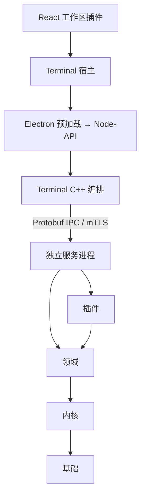
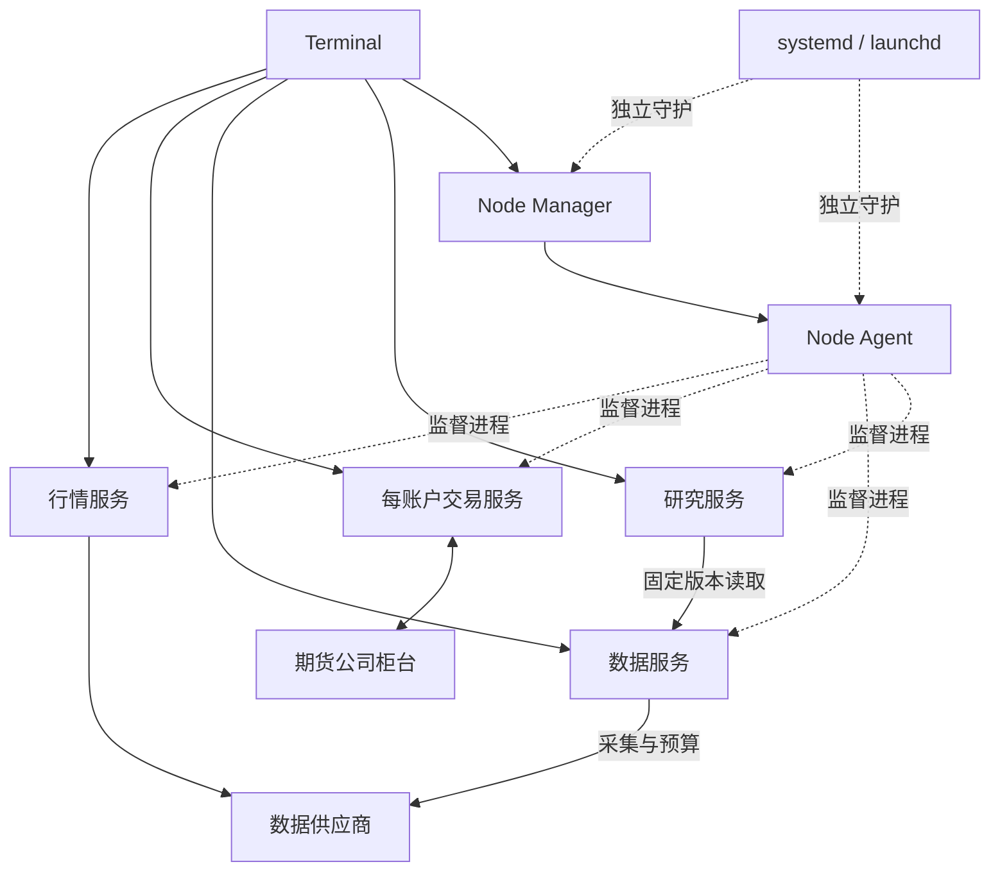

# 架构

2026-10-21 后续批准的数据通路目标见[统一数据通路](data-paths.md)，实现事实见[实施矩阵](reviews/data-paths-implementation-2026-10-21.md)。其中取消 Research 部署必绑 Data 是本轮待实施修正；下文现行代码描述不能反向约束目标。

当前产品为运行于 macOS（Apple Silicon）与 Linux x86_64 的期货 Terminal，本机服务与 Terminal 运行在同一台机器，远程节点服务仅支持 Linux x86_64。
本文描述当前代码，包含用户确认的[节点管理与进程日志设计](#节点管理与进程日志目标)。架构改造的逐项实现、验收证据及运行限制见[实施记录](reviews/architecture-implementation.md)。

需求驱动的下一步架构与工程组织见[目标设计](reviews/architecture-design-review.md)，
逐功能责任见[304项FR映射](reviews/requirements-architecture-map.md)。目标包含情报、四个研究子模块、
服务自有任务及定时机制；本轮已实现 Data/Research 任务归属及独立 Task 退出，情报、定时和其余目标不能据此视为完成。

## 架构约束

各进程的内部设计集中维护在 `docs/architecture/`，共同边界以本文为准。
当前已编写 [Node Manager 架构设计](architecture/node-manager.md)；进程源码目录的 README 提供设计与代码入口。

采用分层核心、按状态所有权划分的服务进程和类型化插件。长期事实只有一个明确拥有者，
插件交付方式按实际扩展需求选择；不以插件数量或进程数量衡量模块化程度。
Terminal 的草稿和缓存属于界面状态，不能成为账户、历史版本或任务终态的第二个权威。
策略产生意图，风控返回裁决，账户服务统一决定发送许可；受信任插件契约不是恶意代码沙箱。

当前实现和验证范围见[本轮收敛记录](reviews/architecture-convergence-2026-10-16.md)。
历史设计记录说明当时的方案比较，不替代本文的现行契约。

## 分层

| 层 | 目标 | 内容 |
| --- | --- | --- |
| 基础 | `asterion_foundation` | `Decimal`（8 位小数定点）、ID、时钟、错误码、序列化 |
| 内核 | `asterion_kernel` | 原生插件装载、本机 IPC 与 TCP+mTLS 通道、RPC 服务宿主与客户端、子进程与文件锁、持久文件写入、线程池、日志与追踪 |
| 领域 | `asterion_domain` | 合约与订单、组合期货账本、交易时段、当日分钟线、执行/风险/策略端口 |

领域依赖内核，内核依赖基础，不能反向依赖。
Terminal 的 JSON 命令注册与分派属于 Native 应用边界，核心库不提供 UI 命令宿主。

## 应用工程组织

目录按进程和职责归属组织，公共库只承载实际共享的机制，不作为业务代码的集中存放处。

| 目录 | 责任 |
| --- | --- |
| `apps/management/node-manager/` | Agent 登记、连接、节点汇总与远程维护协调 |
| `apps/management/node-agent/` | 本机业务进程监督、程序准备、资源观察与维护状态 |
| `apps/services/` | 常驻业务服务：行情、交易、数据和研究 |
| `apps/common/control/` | 多个应用共享的服务 I/O、端点与管理协议映射、节点路径及系统服务操作 |
| `apps/clients/terminal/native/` | Terminal 编排、业务服务客户端与界面数据投影，包括行情快照和展示历史 |
| `apps/clients/installer/native/` | 本机安装发布、维护执行器与操作系统服务调用 |
| `apps/clients/installer/electron/` | 安装器窗口、IPC 与本机／远程维护步骤编排 |
| `protocol/proto/` | 当前管理和业务通信契约 |
| `config/` | 首次部署复制的节点默认配置 |

安装器发行描述模板放在 `apps/clients/installer/product.json.in`。安装器 React 页面与国际化
目前仍复用 Terminal 前端工程，位于 `apps/clients/terminal/src/installer/` 和 `src/i18n/`；
这不赋予 Terminal 节点管理所有权，也不新增独立前端构建链。

`asterion_node_control` 不编译行情客户端或界面快照，也不依赖图表指标库；这些代码由
`asterion_terminal_application` 编译。Manager 和安装器通过共享控制库取得管理机制，不继承
行情展示依赖。安装执行器不链接 Manager 或 Agent 实现：通过 Manager 协议协调远程节点，
通过独立 Agent 的离线准备模式更新本机服务程序引用；共享准备调用放在 `service_programs`。CTP 账户路径由 Terminal 的 `ctp_connections` 模块拥有，钥匙串辅助程序
定位由 `keychain_store` 实现；共享节点路径不承担账户或凭据职责。管理进程可以随整体发行更新，工程组织不承诺跨发行混用或永不更新。

## 构建归属

根 `CMakeLists.txt` 负责项目选项、锁定依赖查找、产物位置与模块组合。
`core/`、`protocol/`、`plugins/`、`apps/`、`bindings/` 分别由自己的构建入口管理；
apps 按 common、management、services、clients 继续组合，插件按类别与实际
模块继续组合。叶模块声明自己的目标、源码、头文件可见性和依赖，父目录不跨层追加源码。

`cmake/CompilerOptions.cmake` 只复用已有编译告警策略，由目标所属模块显式调用。
测试仍在 `tests/CMakeLists.txt` 按测试模块登记，包含路径限定到测试目标。
原生 Terminal 实现目标为 `asterion_terminal_application`；`bindings/c/` 的
`asterion_terminal_api` 只编译 C ABI 封装并依赖原生实现，`bindings/node/` 编译 Node-API
模块。Manager 不依赖 C ABI 或原生 Terminal 实现。

可执行程序和 Node 模块继续输出到构建根目录，原生插件继续输出到 `plugins/`，
Protobuf 与 Python 生成物和安装器 `product.json` 的位置不变。源码输入清单覆盖参与
服务构建的层级 CMake 文件，不因移动构建定义漏掉制品更新。

## 接口与序列化边界

领域接口返回结构化 C++ 类型。账户快照的金额与价格保留 `Decimal`，订单方向、开平和状态
保留枚举；回测计算 直接把账户观察编码为 Protobuf，不通过 JSON 中转计算结果。
服务间传输继续使用现有 Protobuf。Native 的界面快照、供应商响应解析、日志/配置编解码
可以使用 JSON，但不能据此把领域模型改成动态字典。

UI 命令参数在 `src/bridge/commands.ts` 按方法定义，组件与宿主传递保持方法/参数关联的
联合元组，bridge 才进行 JSON 编码。Native 仍在输入边界验证结构与业务条件；前端类型
不是授权机制。实盘账户线程直接构造已有 `LiveSnapshot`，通过类型化 future 交给服务 I/O，
Terminal 收到后才转换为展示 JSON。账户状态和执行权不会随观察值转移，见
[实盘观察记录](reviews/live-observation-2026-10-16.md)。

实盘命令在 RPC 入口从 Protobuf 映射为 `AccountRequest`，账户循环只处理类型化操作。
政策定义以具体类型贯穿接纳、日志线程准备与账户采用；JSON 命令仅用于当前日志及请求内容核对，
恢复时在记录边界解析。详见[命令与政策收敛](reviews/command-boundaries-2026-10-16.md)。

内部依赖方向与职责归属通过代码组织和评审维护，不在构建阶段扫描依赖图、include 或
JSON 用法，也不维护只验证这些限制会报错的测试。编译链接检查和实际协议、领域校验
各自处理对应的构建条件和运行输入。

## 进程

任务归属依据见[服务自有任务设计](reviews/service-owned-tasks-design.md)。
数据与研究是独立业务进程，共用机制不形成第三个任务服务。Data/Research 所有权已切换；
任务级来源发现与统一数据通路的实施和验证状态见[验收矩阵](reviews/data-paths-implementation-2026-10-21.md)。

业务服务由 Node Agent 启动和监督，Agent 自身由系统服务管理器托管。安装版 Terminal 关闭后服务继续运行；开发入口退出时自动停止本机开发服务，保留数据，详见开发指南。Node Manager 独立托管规则见文末节点管理说明。

| 程序 | 职责 |
| --- | --- |
| `asterion_node_manager` | 本机／远程 Agent 登记、连接、状态汇总及管理协调；由 OS 独立守护 |
| `asterion_node_agent` | 部署、启停、健康探测、有限重启、程序升级 |
| `asterion_market` | CTP 实时行情、合约目录、事件流、当日分钟线与 1 分钟涨速 |
| `asterion_trading` | CTP 交易账户会话（授权、风控、执行链与持久记录） |
| `asterion_data` | 历史版本仓库、全市场数据表、具名数据集、查询、下载授权与供应商预算、候选准备和版本发布；拥有采集任务、执行、取消与恢复 |
| `asterion_research` | 回测与因子任务的接纳、排队、执行、取消、固定输入与结果保管；显式引用 Data |

本机通信使用 Unix Socket，远程使用 TCP + 双向 TLS，消息都是 `protocol/proto/asterion/` 中的 Protobuf。

Protobuf字段编号由当前契约定义。删除接口时同步删除生产者、消费者和测试，不增加旧消息兼容入口。

一个运行中的服务实例对应一个独立进程；停止保留实例与数据，重启只改变运行代次。
交易服务按账户隔离，账户持久绑定节点ID与服务实例ID；同一Trading程序可部署本机或远程，
真实柜台/柜台仿真环境由交易账本固定保存。Manager发现端点，Terminal直连业务服务。Research 独立部署和连接，不保管永久 Data 配对。任务准备通过 Agent 只读发现端点解析 Data 的稳定节点与服务身份，固定输入保存该身份及版本；多个候选不能随机选择，离线不能替换来源。同一节点的业务端点可直连；跨业务节点组合仍需远程解析与权限能力，当前明确拒绝，不因移除绑定自动开放。任务在所属服务线程池执行，不创建独立 Task 进程。

默认安装包含上述全部服务与所需插件，在本机形成完整业务系统。远程节点为
可选扩展；未登记远程节点或缺少远程 Linux 部署资源，不影响本机功能。安装启动 Manager
和 Agent，工作台按需准备本机行情、数据与任务服务；已有账户服务恢复不代表柜台登录或
交易授权。任务由所属服务内部调度执行。显式选用远程服务才访问远程资源，
不因本机故障自动把业务转往其他机器。

柜台拥有成交、资金与持仓事实；交易服务拥有本账户的执行许可、风险占用和本地投影。
交易服务内部以类型表示账户命令、日志记录、柜台阶段和本地结果码（`account_records.hpp`、
`broker_execution.hpp`）；JSON 只是命令的传输形式和日志的持久形式，在边界解析一次。
Data 拥有历史版本、来源证据及采集任务；Research 拥有研究任务、尝试及结果。Agent 只管理程序、进程和生命周期，Terminal 只提交意图和展示这些拥有者发布的状态。关闭窗口不改变服务端事实。
唯一的例外是引用检查：本机任务服务处于停止状态时，Terminal 以只读方式打开它在受管目录
中的账本，列出对某个历史版本的引用，不恢复任务也不写入任何文件。

## 插件

| 类别 | 实现 |
| --- | --- |
| 数据 | `data/ctp`（行情与合约目录）、`data/tushare`（分钟线、日线、全市场数据表）、`data/shfe`（已核验范围的历史保证金）、`data/registry`（历史数据源组合与目录入口） |
| 执行 | `execution/paper`（回测撮合）、`execution/ctp`（CTP 交易接口） |
| 存储 | `storage/sqlite`（交易记录与任务的有序日志和索引）、`storage/filesystem`（历史数据版本目录、全市场数据表的分区登记）、`storage/parquet`（K 线与数据表分区文件） |
| 策略 | `strategy/cta`（均线交叉、通道突破、时序动量、布林回归） |
| 风控 | `risk/order-limits`（交易前限额） |
| 工具 | `tools/chart_indicators`（均线、MACD）、`tools/factor_analysis`、`tools/performance`；`tools/analytics`（Polars、QuantStats、skfolio）为独立桌面分析助手 |

Domain 只为确有多个实现的能力保留端口：交易前风控（`RiskPort`，内置订单限额与原生风控）和历史分钟线读取（`HistoricalBarPort`，Tushare 与原生历史适配器）。全市场数据表通过插件注册层的 `history_providers::TableReader` 读取；日线与合约目录统一来自这些表，没有单独的日线端口。只有一个实现的能力不设端口，宿主直接使用具体类型：CTP 行情 `ctp::Feed`、CTP 交易 `ctp::Trader`、回测撮合 `PaperExecution`、`SqliteJournal` 与历史仓库 `Archive`。交易策略是例外：四条规则共用插件内的 `Strategy` 接口（`plugins/strategy/cta`），由 `make_strategy` 按策略定义创建，回测引擎和实盘策略运行都通过它使用。Kernel 不再有统一的插件生命周期基类；需要启停的插件自行提供 `start`/`stop`，原生历史适配器由自身持有的 `NativeInstance` 完成启停。

存储与回测插件直接读写 Protobuf 契约类型（数据集、任务事件、回测输入），因此依赖 `asterion_protocol`；这是持久格式的类型化表示，不是对服务或传输的依赖。

| 扩展方式 | 当前用途 | 契约与所有权 |
| --- | --- | --- |
| 构建期 UI 贡献 | 工作区、工具栏、任务入口、多语言 | TypeScript 契约，宿主限制声明命令；React 管理挂载和清理，无独立运行时 API 版本 |
| 原生动态库 | 历史数据、连接与原文观测、交易前风控 | C ABI 与能力函数表，明确版本/大小/平台检查；NativeInstance 持有库生命周期 |
| 仓库内静态模块 | 策略、CTP/执行、存储及内部分析 | 具体类型或已有多实现接口，由所属服务装配，不预建通用插件框架 |
| 独立桌面分析助手 | Polars、QuantStats、skfolio | Native 按需通过 Protobuf 调用冻结程序，不属于原生插件 ABI，也不拥有 Task 结果 |

UI 插件可贡献多个业务视图，由产品导航目录统一映射到模块和子模块；插件唯一持有其语言资源与声明命令，窗口按视图身份隔离草稿。一级菜单不再由插件数量决定。

原生动态库与内置 UI 模块都是可信代码；插件不等于独立进程或沙箱。只在实际需要独立交付时定义新的动态 ABI，不设全模块迁移计划。能力范围见 [原生插件 SDK](native-plugins.md)。

Native 的插件目录统一计算本机数据/任务插件的 `selectable`，启动、设置和测试入口消费相同投影；UI 不解释原生 ABI 版本。保存服务配置时 Manager 核对目录、固定摘要、必选插件和服务修订，Agent 验证部署产物及停止状态。前端选择只是草稿，不能越过后端检查。

Data 和 Research 各自保存插件集合；本机工作区准备可使用共同的所选集合，各宿主只消费对应能力。后续修改分别保存，不把目录中存在某个库等同于所有服务均启用它。

## Terminal

| 位置 | 职责 |
| --- | --- |
| `apps/clients/terminal/electron/` | 主进程、预加载、窗口 |
| `bindings/node/`、`bindings/c/` | Node-API 与 C ABI |
| `apps/clients/terminal/native/` | C++ 编排：服务客户端、命令、状态快照 |
| `apps/clients/terminal/src/` | React 宿主：工作台、设置、启动、多语言、桥接 |
| `apps/clients/terminal/plugins/` | 工作区插件：自选、合约、市场、数据、研究、交易 |
| `apps/clients/terminal/dev/` | 浏览器开发桥（`pnpm dev` 与 e2e 使用） |

### 状态同步

C++ 后台每 0.5–2 秒汇总各服务状态并发布带修订号的快照。界面按修订号轮询：修订号未变则不返回内容；行情部分只返回自持有版本以来变化的报价行，合约目录未变则不重复发送。界面把增量合并回完整快照，插件看到的数据形状不变。

Native 使用一个状态与 I/O owner、两条批量读取线程、一条响应线程和两条管理线程。
命令和观察在 owner 上推进，等待 RPC、文件或管理结果时挂起；不持有全局操作锁等待外部工作。各服务客户端的套接字都注册在 owner 的同一个事件循环上：套接字有进展、读取或管理线程完成工作、新操作被接纳时 owner 立即推进，此外每 2 ms 检查一次截止时间和停止请求。
节点管理操作显式串行接纳，设置与钥匙串工作另有单一拥有者；慢工作不占交易控制的接纳容量。

服务客户端共享 owner，各自保留连接、控制与观察状态。发布修订在 owner 上固定；节点、行情、
账户、任务页和设置通过不可变引用交接，响应线程在同一个工作中展开并编码 UI 快照。
Node-API 直接接纳异步请求并将完成交回 JS，不再建请求线程等待同步 C ABI；C ABI 供原生调用者使用。
载荷预算、队列和超额语义见 [Terminal](terminal.md)，不把序列化字节额度当作进程 RSS 上限。

## 状态与线程所有权

| 进程 | 应用管理的线程与职责 |
| --- | --- |
| 交易服务 | 状态单写入者、I/O、持久日志、SDK 调用各一条；SDK 回调复制入有界队列，账户线程裁决执行许可 |
| 行情服务 | 状态与 I/O、观测聚合、SDK 调用各一条；行情回调不拥有公开投影 |
| 数据服务 | 状态与 I/O、一条串行持久写入线程、固定文件池；候选验证与发布裁决分离 |
| 研究服务 | 状态与 I/O、一条日志线程、固定文件池；算法在有界计算池执行 |
| Node Manager | 独立 RPC 接入；ServiceIo owner 持有 Agent 连接与节点状态，固定池执行 SSH／部署及文件工作 |
| Node Agent | 管理与 I/O、一条配置写入线程、固定管理池；监督与服务生命周期属于同一 owner |

研究服务和数据服务的状态拥有者分别是 `ResearchHost` 与 `DataHost`，`main()` 只解析参数并把端点
接到它们。Node Agent 的请求路由按操作拆成成员函数；制品上传（`ArtifactUploads`）、防火墙计划
（`FirewallControl`）和升级计划（`UpgradePlan`）各有自己的类型，`Agent` 保留服务登记、监督与
升级协调。

固定池大小由所属服务管理，不随请求数增加；当前 Data/Research 文件池默认各两条线程。
SDK、DuckDB、Chromium、V8 与 libuv 的内部线程仍消耗真实资源，上表不是 OS 总线程数。
业务服务按实例配置决定任务并发，在自己的线程池执行。状态所有者准备固定输入、处理
进度与取消并确认结果，执行线程不修改服务状态。Agent不参与任务队列或线程管理。
当前 Research 的`task_concurrency`默认1、允许1–2，名额保留到执行和结果确认结束。

## 历史数据边界

统一身份与来源语义位于 Domain；Tushare 通过原生插件注册入口动态加载。Terminal 的 DataClient
直接访问 Data 的历史目录与查询协议，ResearchClient 访问研究任务和结果；Research 不打开 Data 的仓库文件。
下载请求使用完整合约身份、明确来源与供应商映射；Data 保管授权快照，服务计算线程 按尝试取得凭据
和共享额度，完成后由 Data 持久决定发布，Data 验证原决定并公开原版本。

[全市场数据表](market-data.md#全市场数据表)按“表 × 交易所 × 周期”取数和保存，表的列由 Domain 定义。
它的更新也是一个下载任务，授权、凭据和额度同上，但发布不同：服务计算线程 每读到一个分区就交给
Data，Data 校验通过即追加到只追加的登记里，分区随即可读；任务的取消或失败不撤回已入库的
分区，任务结果只是这次运行的摘要。理由见[设计](reviews/history-tables-design.md)。

文件插件保管数据块、摘要、来源取得证据和版本索引。取得时间不冒充历史公布时间，未知历史
可知性的来源明确标为事后分析。计算输入固定数据版本与算法摘要，后续下载不改写旧输入。
计算线程取得 Research 准备的小型执行定义，按任务保存的 DataOwner 解析固定版本，
重建输入并核对 Research 保存的完整摘要。Research 保管原输入证据供结果验收和离线结果读取；
领取前仅检查该任务自己的来源，来源暂不可用时保持排队，不切换仓库或阻止其它来源的任务。
详见 [行情与数据](market-data.md) 和 [原生插件 SDK](native-plugins.md)。

## 节点管理与进程日志目标

2026-10-20 用户确认：每台参与运行的机器都有 Agent；Terminal 所在机器还要有独立的汇总
管理程序，统一统计和管理各 Agent。日志文件由进程／服务实例决定，模块和操作作为字段，
公共配置统一管理。以下边界由独立 Manager、管理协议与公共进程日志器实现。

### 职责与信息流

汇总程序采用职责名称 **Node Manager**，可执行程序名为 `asterion_node_manager`。
每个开发、安装或隔离测试环境分别管理自己的节点集合；“所有 Agent”指该环境已登记并
获准连接的本机及远程 Agent，不自动发现、接管其他机器或混用不同环境。

| 构件 | 拥有的状态和职责 |
| --- | --- |
| Terminal | 展示、交互、操作草稿和用户确认；通过本机 Node Manager 查询节点和提交管理意图 |
| Node Manager | 已登记节点及连接配置、Agent 连接生命周期、健康与资源状态汇总、节点管理操作的协调和结果呈现 |
| 每台机器的 Node Agent | 本机程序与服务登记、进程启停和监督、健康观测、实际管理命令的执行 |
| 行情、数据、任务、交易服务 | 保持现有业务状态所有权；账户授权、风险、订单、任务尝试和数据发布不移到 Node Manager |

节点管理路径为 Terminal → 本机 Node Manager → 目标 Agent → 目标机器上的进程。
本机与远程 Agent 都进入同一节点列表；本机使用 Unix Socket，远程使用 TCP+mTLS，
继续使用 Protobuf。列表汇总节点在线状态、最后观测时间、资源观测、服务清单和
健康状态。失联保留最后观测并明确标记过期，不能把失联统计为“无服务”。

Manager 不重新执行业务服务的恢复、任务调度或交易授权，也不增加自动跨节点接管。
Terminal 的行情订阅、交易指令、历史数据、任务提交与结果读取直接连接对应业务服务，
禁止经 Manager 或 Agent 中转。业务服务之间的数据连接也直接到达其拥有者。端点发现、
产物部署、健康探测、服务进程管理属于管理链路，不能扩展成业务代理。
远程日志保留在产生它的机器，统一查看入口不等于默认全量复制日志。

Agent 每 5 秒使用现有工作池异步观察主机 CPU 使用率、可用内存估计与节点根目录所在
文件系统的可用空间，状态请求只读取已完成快照。Manager 透传观察结果，Terminal 展示
采样时间、目录与失败原因；离线保留最后观测并明确标注。指标失败不改变服务监督、任务
并发上限或业务状态。主机观测值不作为启动门禁或自动调度阈值。

### 生命周期

Node Manager 和本机 Node Agent 分别注册为独立的系统服务，由 Linux systemd 或 macOS
launchd 启动和守护。安装／开发启动引导准备这些系统服务，Terminal 连接 Manager；
Manager 不依赖某个 Agent 在线才能启动和提供节点状态。远程机器由其系统服务管理器
托管自己的 Agent。Agent 只启动和监督业务服务，不能托管 Manager。

管理关系为 Manager → Agent → 业务服务，系统进程守护关系与此分开。
Agent 故障、重启或更新不会连带终止 Manager；Manager 才能持续报告节点失联，并通过
对应机器的管理入口协调恢复。Manager 不复制系统服务管理器的 PID 监督逻辑。

安装版关闭 Terminal 窗口后，Manager、Agent 和业务服务继续运行。Manager 退出或与远程
Agent 断开不直接停止远程业务；恢复连接只重新取得当前状态，不盲目重发结果未确认的操作。
开发入口退出停止本机开发业务服务和 Agent，最后停止独立的开发 Manager；保留数据并
留下远程节点运行。Agent 与 Manager 的系统服务单元不能绑定为父子或级联停止关系。

本机或远程 Agent 的更新由 Manager 协调，实际安装、停止、拉起及更新事务仍由对应机器
的管理边界执行；Manager 在 Agent 重新接入后核对结果。Manager 自身的安装、更新和
停止属于桌面安装／维护入口与系统服务管理器，不回交给任一 Agent。

### 日志归属

所有进程使用公共日志机制和所属节点环境的公共日志策略，不为各进程复制配置文件。
程序、服务实例和本次进程运行决定文件归属；同一进程中的 `requests`、`transport`、
`data-client` 等成为模块字段，不再各开文件。多个账户交易进程、多个任务服务实例、
Agent 常驻进程和临时 Agent 进程必须能够明确区分，不能因程序名相同而写进同一文件。

记录保留时间、级别、程序、进程与服务身份、模块、事件及现有请求／任务关联字段。
共用输出策略与文件写入所有者，避免同一进程的各模块各自打开同一文件并独立轮转。
文件归属使用已有的进程身份和启动信息，不新增源代码指纹或内容哈希。

开发程序同步归属于 Agent 的准备运行模式。Agent 必须在进入该模式前完成公共日志初始化，
同步以事件记录进 Agent 进程日志；删除桌面维护的独立捕获文件命名与输出机制。
失败回复仍须携带实际日志位置和关键原因，不能退回泛化的“查看节点日志”。
日志配置、进程日志与账户账本、任务库、数据档案分别管理。

### 实施边界

`apps/management/node-manager/` 拥有 Agent 客户端、节点登记、SSH 管理、服务部署和 Agent 维护；`protocol/proto/asterion/manager.proto` 提供本机管理协议。Terminal 的 `ManagerClient` 只连接 Manager、投影状态和提交类型化请求，轻量节点句柄不持有 Agent 连接。公共客户端、系统服务注册和节点路径机制放在 `apps/common/control/`。Terminal 不链接 Manager 管理实现，Manager 不链接 Terminal 应用或 Agent 的进程监督实现；这些是职责约定，不另设构建守卫。

Manager 读取既有登记目录并恢复观察；本机 Agent 不在线时，显式本机管理请求才执行启动引导。Manager 和 Agent 的注册、开发退出及隔离测试规则见[开发指南](development.md#node-manager-的注册与连接)。公共进程日志的配置和文件格式见[服务日志](services.md#运行日志)。实现与实际验证结果记录在[整改进度](reviews/audit-progress.md)，源码实现不等于已完成 macOS、安装包和真实远程验收。

### 配置部署与运行读取

节点默认配置维护在仓库 `config/`，构建原样携带，首次本机或 SSH 部署复制到
`<node>/config/`。部署保留已有配置，服务启动只读；缺失的必需配置和无效配置明确失败，
不在启动阶段生成、补全或覆盖。Manager 的目录与环境属于启动上下文，通过 OS 服务
参数传递，资源从安装位置解析，不另存生成配置文件。服务部署记录和业务数据由原来的持久化所有者管理。
插件只有存在静态配置需求时才在插件源码内设 `config/`，实例配置归所属服务，见开发指南。
默认安装只部署本机；新增远程节点和业务服务由用户在 Terminal 中操作。Manager 将节点
登记落盘，Agent 将服务部署状态落盘，升级与卸载复用这些拥有者的记录，不将拓扑再复制到
`config/` 或安装器的独立清单。

## 本机安装维护边界

独立安装维护窗口负责当前用户安装、同版本修复、停机升级和默认保留资料的卸载；具体流程见
[安装与配置](requirements/modules/system/setup.md#安装升级启动与卸载的责任)。
首次安装和升级在请求 OS 启动后，通过 Manager 快照确认本机 Agent 在线且 READY，
等待上限 30 秒；失败报告原因和日志位置，已发布文件保留，不误报完成。修复仍保持停机。
Terminal 普通启动只使用已经注册的程序，不提供另一套 Agent 自升级入口。
安装器不处理业务流量，不解释交易或任务数据；离线服务程序准备复用 Agent 的运行模式。
安装登记拥有已安装状态，即使程序文件缺失也保留修复／卸载入口。原生执行器根据登记与
安装包的数字发行版本判定安装、升级或修复，拒绝降级；界面按判定结果进入对应维护模式。
修复复用完整应用发布与服务注册，不重置配置或业务状态。中断操作按登记的目标版本显式继续。
仅卸载允许用户取消资料保留并确认删除本机节点资料和本机连接登记；该选择随未完成操作
登记，继续时保持一致。删除保留诊断日志与互斥锁，不修改远程机器或系统钥匙串。

## 远程安装维护边界

安装器复用已安装维护执行器连接 Manager，Manager 是远程登记、SSH 与 Agent 管理的唯一
所有者。新增远程节点只从 Terminal 发起；安装器维护既有登记。普通启动不触发更新；远程首次系统准备由管理员授权专用账户和受限主机工具。
整体升级先确认业务停止、持久冻结节点并经 SSH 更新远程程序，再更新本机，最后由新
Manager 启动并确认远程 Agent。Agent 停机期间禁用开机启动；业务服务不会因升级完成自动
启动。维护过程中 Manager 拒绝普通管理变更，进度可独立读取。预检失败不移除现有节点连接。

联合卸载先远程后本机。保留资料卸载允许再次安装；取消保留只删除目标节点资料，保留
诊断日志与主机共享管理设施。仍有已安装远程节点时，禁止清除本机连接身份；仅卸载本机
程序允许远程继续运行。中断状态由原拥有者持久保存，同目标显式继续，不自动回滚。
完整流程和验收边界见[安装与配置](requirements/modules/system/setup.md#远程节点安装升级与卸载方案)。

### Data/Research 任务所有权（2026-10-21）

`DataRequest.acquisition_task` 直接处理分钟下载、表更新和单分区重取的接纳、读取、取消、显式重试与结果。Data 串行写入器确认状态与发布，两个固定执行槽运行采集。Research 仅执行回测与因子，通过独立 `ResearchRequest` 接口接纳并按任务解析 Data 公共端点。任务中心按所有者聚合读控，共用任务持久机制位于 `apps/services/task-runtime`，未搬入 Core。独立 Task 程序、服务类型、配置和提交入口已移除；旧数据原样保留，不创建兼容读写路径。实现与验证边界见[迁移记录](reviews/task-service-exit-2026-10-21.md)。
