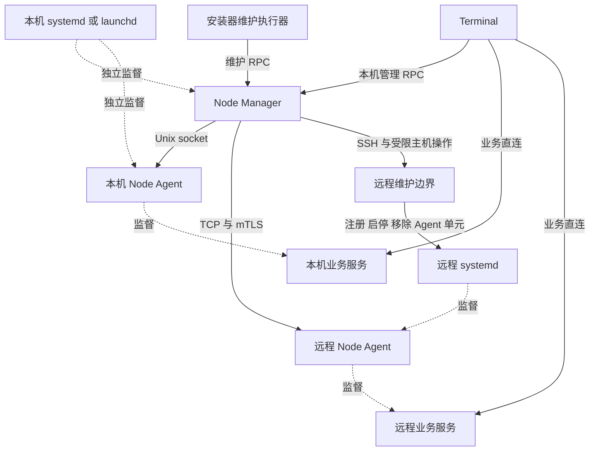
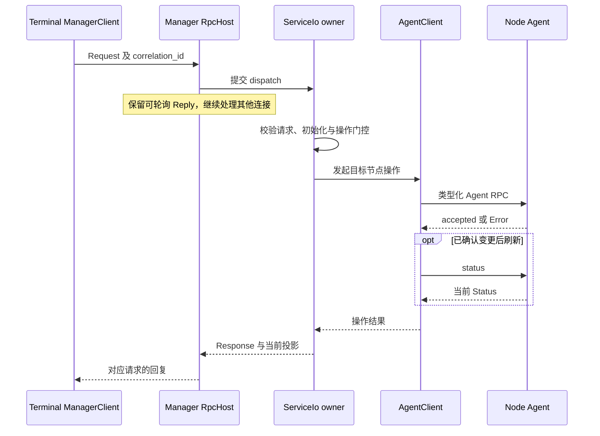
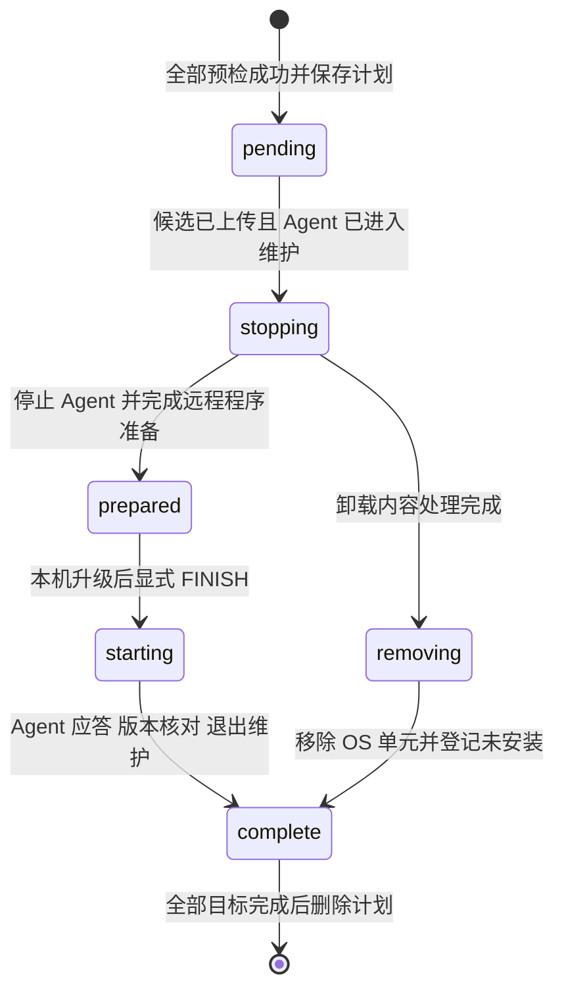

# Node Manager 架构设计

Node Manager 是 Terminal 所在机器上的独立节点管理进程，程序名为 `asterion_node_manager`。
它统一持有当前环境已登记 Agent 的管理连接，汇总节点状态，并协调登记、部署、启停和维护。
Agent 拥有目标机器的服务进程，业务服务拥有账户、数据和任务；这三层责任不能互相替代。

本文面向维护管理进程、Terminal 原生客户端和安装器的开发者，解释当前实现的控制流、状态所有权、
持久化及故障语义。核对日期为 2026-10-22，基线为主检出 `main`、HEAD `a717802` 及其未提交工作树，
不能仅凭该提交还原全部本文所述行为。
全局边界见[架构](../architecture.md)，部署操作见[服务与部署](../services.md)，
安装责任见[安装与配置](../requirements/modules/system/setup.md)。

## 定位与设计取舍

节点管理必须在 Terminal 窗口关闭后继续存在，也必须在某个 Agent 不可用时仍能报告其状态。
因此，Manager 独立于窗口和 Agent，由操作系统服务管理器监督。它不是集群任务调度器，
不决定业务任务的并发、不自动迁移执行位置，也不代理行情、订单、历史数据和任务结果。

| 组织方式 | 对状态与生命周期的影响 | 当前决定 |
| --- | --- | --- |
| Terminal 直接拥有所有 Agent 连接 | 连接和管理操作与窗口生命周期耦合，安装器还需要另一个管理拥有者 | 不采用 |
| Agent 托管 Manager | Agent 停止或更新会同时终止管理者，无法独立报告该节点故障 | 不采用 |
| OS 独立监督 Manager 与 Agent | 管理连接集中在 Manager，进程监督留在 OS 和各 Agent | 采用 |

必须维持的约束是：

1. 同一环境只有一个 Manager 持有节点注册与管理责任；Terminal 和安装器通过它操作 Agent。
2. Manager 管节点，Agent 管服务进程，业务服务裁决业务操作；部署成功不授予交易权限。
3. 登记、连接、进程存活、服务就绪和业务可执行分别表达，不能用一个“在线”替代。
4. 恢复观察不重放管理变更；超时或失联不能被解释为远端操作未执行。
5. 普通安装版启动不安装或升级程序；安装维护由独立安装器执行。
6. 运行配置只读，既有业务资料不因连接、登记恢复或程序更新而被迁移、重置或删除。

当前协议可管理 `MARKET_DATA`、`DATA_SERVICE`、`RESEARCH`、`LIVE_TRADING` 四类服务。
Data 已拥有采集任务，Research 拥有研究计算，独立 Task 服务已退出；Research 的部署也不再固定配对 Data。
目标设计中的 Intelligence 独立服务尚未成为 `node.proto` 的服务种类，不能把目标五服务架构当作
Manager 已经提供的完整部署能力。带日期的[架构设计审查](../reviews/architecture-design-review.md)
及早期实施记录应按其基线阅读。

## 进程关系与通信边界



实线表示通信或管理调用，虚线表示进程监督。Manager 与本机 Agent 是两个独立 OS 服务，
没有 Agent → Manager 的托管关系，也没有依附 Agent 的级联停止关系。
远程机器只需要自己的 Agent，不为每个远程节点再安装一个 Manager。

| 参与者 | 权威状态与责任 | 从其他参与者取得的内容 |
| --- | --- | --- |
| Terminal | UI 状态、用户操作意图、业务连接选择 | Manager 的节点投影和服务端点；业务服务直接返回的事实 |
| Manager | 远程登记、SSH 连接资料、管理连接、维护计划 | Agent 的健康、资源与服务清单 |
| Agent | 本机服务部署、期望运行状态、进程监督、主机资源观测 | Manager 发来的管理命令与制品 |
| 业务服务 | 账户授权、风控、订单、数据发布、任务状态与结果 | 其他业务服务直接提供的输入 |
| 安装器 | 本机安装登记、程序发布及安装维护流程 | Manager 已有远程登记与维护进度 |
| OS 服务管理器 | Manager 和 Agent 的启动、停止、退出后监督 | 安装器或开发引导注册的服务定义 |

Manager 返回的是可用于直连的地址和身份文件路径。返回端点后，Terminal 的业务客户端直接建立
Unix socket 或 TCP+mTLS 连接；Manager 不承载后续业务报文。
`history` 操作同样只返回 Data/Research 服务目录和地址，不读取历史数据内容。

## 工程模块与依赖

核心实现位于 [apps/management/node-manager/](../../apps/management/node-manager/)。
其中类型目前仍使用 `asterion::terminal` 命名空间；实际进程归属由目录、构建目标与调用关系确定。

| 文件 | 职责 |
| --- | --- |
| [main.cpp](../../apps/management/node-manager/main.cpp) | 参数、目录上下文、进程互斥、日志、PID 发布、RPC 接入及退出 |
| [manager.hpp](../../apps/management/node-manager/manager.hpp) / [manager.cpp](../../apps/management/node-manager/manager.cpp) | `NodeManager`、登记恢复、请求分派、节点表、全局管理变更门控 |
| [agent_client.hpp](../../apps/management/node-manager/agent_client.hpp) / [agent_client.cpp](../../apps/management/node-manager/agent_client.cpp) | 每节点连接、状态观察、Agent RPC、制品上传及服务操作 |
| [local_node.cpp](../../apps/management/node-manager/local_node.cpp) | 本机端点解析、显式本机连接引导、开发环境退出 |
| [node_enrollment.cpp](../../apps/management/node-manager/node_enrollment.cpp) | SSH 密钥、远程登记、证书替换、防火墙及远程维护协调 |
| [node_identity.cpp](../../apps/management/node-manager/node_identity.cpp) | 生成节点 CA 和分角色证书，持久发布身份文件 |
| [node_program.cpp](../../apps/management/node-manager/node_program.cpp) | 本机 Agent 程序首次发布和开发停机替换事务 |
| [remote_maintenance_script.hpp](../../apps/management/node-manager/remote_maintenance_script.hpp) | 上传到远端、以专用非特权账户执行的维护脚本 |

[CMakeLists.txt](../../apps/management/node-manager/CMakeLists.txt) 在所属模块定义两个目标：

- `asterion_node_manager`：入口程序，链接 `asterion_node_management` 和 CLI11。
- `asterion_node_management`：管理实现静态库，公开依赖 `asterion_node_control`，
  私有依赖 SQLite 存储检查、节点防火墙机制和 OpenSSL Crypto。

[apps/common/control/](../../apps/common/control/) 提供 `ServiceIo`、节点路径、服务程序定位、
OS 服务操作、端点类型与协议映射。Kernel 提供 RPC、进程、文件锁、持久文件和日志机制。
Manager 不链接 Terminal 的应用实现或 Agent 的进程监督实现。SQLite 依赖用于本机交易目录检查等
具体边界，不意味着 Manager 拥有业务账本。

Terminal 一侧的 [ManagerClient 和 NodeClient](../../apps/clients/terminal/native/node_client.cpp)
只发管理请求并保存返回投影；[local_manager.cpp](../../apps/clients/terminal/native/local_manager.cpp)
负责连接或启动已注册的 Manager。安装器执行器通过 Manager IPC 和离线 Agent 子进程完成维护，
不直接嵌入这两个管理进程的实现。

## 身份与状态模型

### 不同身份的含义

| 身份 | 含义与作用域 | 不能替代的身份 |
| --- | --- | --- |
| 登记 `id` | Manager 环境内的节点名称；`local` 保留给本机 | Agent 的持久节点身份 |
| `Status.node_id` | Agent 环境的稳定存储身份，用于业务所有者定位 | 主机名、端口或目录路径 |
| `Status.instance_id` | 本次 Agent 运行代次；维护请求用它确认操作对象 | 跨重启稳定身份 |
| 服务 `id` | 某 Agent 内的实例名称；管理定位使用节点名称加服务名 | 程序种类或程序文件名 |
| 服务 `revision` | 当前部署配置的修订，更新与插件选择带期望值 | 传输协议版本或程序版本 |
| `correlation_id` | 一次 RPC 的请求回复关联和诊断线索 | 持久幂等操作身份 |
| 维护 `operation` | 一次跨重启维护计划的身份 | 每次重连新建的请求编号 |
| `ipc-id` | 本机私有 socket 命名空间 | PID 或业务仓库身份 |

远程登记名校验为 `[A-Za-z0-9][A-Za-z0-9_-]{0,40}`，并禁止 `local`。
两个不同节点可以各有相同服务名；管理操作必须保留节点作用域。
`Endpoint.owner_node_id` 携带业务端点所属节点的稳定身份，Terminal 还保留其当前选择的登记名。

### Manager 内存状态

`NodeManager::Impl` 的核心状态很小：

- 一个 `ServiceIo`，负责异步管理操作的状态推进。
- `nodes`，从登记名到 `shared_ptr<AgentClient>` 的映射。
- `initialization`，表示启动恢复任务的完成或失败。
- `busy`，限制同时存在的全局管理变更。
- 一份 SSH 防火墙预览、对应参数和过期时间。

每个 `AgentClient::Impl` 拥有不可变连接参数、两个 RPC 客户端、最后一份不可变 `Status`、
最后成功观测时间、延迟、错误，以及连接和命令生命周期标记。
`NodeSnapshot` 是这些信息的投影，不是第二份服务部署登记。

`nodes` 只表示当前观察的节点集合，不等于持久登记全集。`disconnect` 删除当前远程连接句柄，
不删除登记、不卸载节点、不停止远程服务；本机观察不可移除。
由于断开选择没有持久保存，Manager 下次启动仍会按已有登记恢复远程观察。

## 目录与持久状态

以下 `<node>` 是传给 Agent 的节点运行目录，`<enrollments>` 是 Manager 的登记根目录。
它们由启动参数和现有路径机制决定，Manager 不生成另一份机器启动配置。

```text
<node>/
  manager/
    manager.lock             Manager 进程互斥
    bootstrap.lock           客户端或安装引导的启动互斥
    ipc-id                   Manager socket 命名空间
    manager.pid              最近启动的 Manager PID
  ipc-id                     本机 Agent socket 命名空间
  config/logging.json        全节点公共日志策略
  services/<service>/        Agent 的服务部署记录及所属目录
  logs/                      各进程诊断日志

<enrollments>/
  enrollment.lock            登记与身份替换的互斥
  ssh-keys.lock              管理密钥生成的互斥
  .ssh-keys/<id>/
    identity                 本机生成并保管的 SSH 私钥
    identity.pub             可交给远程管理员授权的公钥
  .maintenance.json          未完成远程维护计划
  <id>/
    enrollment.json          节点地址、平台、制品及安装信息
    ssh.json                 非秘密 SSH 连接资料
    ca.crt                   节点 CA 证书
    client.crt / client.key  管理客户端身份
    trading-client.*         业务客户端身份
    server.crt / server.key  节点服务端身份
    next/                    显式身份替换期间的新证书集合
```

临时安装脚本、SFTP 批次、程序清单及防火墙规则归属记录也由登记模块管理，不能当成业务数据仓库。
正常情况下，生产登记根目录为 `~/.asterion/nodes`；开发和隔离环境使用 `<node>/enrollments`。
本机节点根目录的平台规则见[开发指南](../development.md#node-manager-的注册与连接)。

远程安装根目录为 `/var/lib/asterion/nodes/<id>`；Agent 的运行目录是其中的 `state/`。
因此远程日志与运行配置分别位于 `state/logs/`、`state/config/`，不要把安装根目录和运行目录混用。
Manager 本地登记记录如何管理节点；远程 Agent 的服务登记记录该机器部署了什么。
安装器消费这两者，不再维护第三份拓扑清单。

## 启动与恢复

### 入口参数与初始化顺序

| 参数 | 作用 |
| --- | --- |
| `--directory` | 已存在的 Manager 目录，通常为 `<node>/manager`；其父目录确定节点根目录 |
| `--endpoint` | 本机 Unix socket 地址；Manager 入口没有远程监听参数 |
| `--enrollment-directory` | 绝对路径的登记根目录 |
| `--development` | 选择开发环境上下文 |
| `--isolated` | 显式隔离节点目录，并启用测试拥有者生命周期约束 |

`main()` 依次执行以下步骤：

1. CLI11 解析参数，取得 `manager.lock` 的非阻塞排他锁。
2. 校验节点和登记路径，设置环境类型，调用 `configure_node_paths()`。
3. 定位远程资源目录，指定 `<node>/logs`，初始化 `node-manager` 进程日志。
4. 校验本机传输配置，安装 SIGINT/SIGTERM 停止处理。
5. 使用 `replace_file_durably()` 写入 `manager.pid`。
6. 创建 `NodeManager` 和最多 16 连接的 `RpcHost`，调用 `manager.open()` 提交异步恢复。
7. 记录 `manager.started`，运行 RPC 循环，正常结束后记录 `manager.stopped`。

PID 文件在 RPC 正式运行前写入。因此，读取到 PID 既不证明进程仍存活，也不证明初始化或服务接入就绪。
启动失败由入口捕获，输出英文原因并记录 `manager.failed`，返回非零退出码。

### 恢复只建立观察

`restore()` 先尝试读取已有本机 Agent 的 `ipc-id`；存在时建立 `AgentClient`，
但使用 `observe=false`，不等待首次网络观测，也不启动或更新 Agent。
然后读取远程登记名，逐个载入端点与 TLS 身份并建立同样的观察客户端。
单个远程登记恢复失败记录 `node.restore_failed`，继续处理其他登记。

如果 `.maintenance.json` 存在，恢复只保留本机观察，暂不恢复远程连接，等待安装器显式继续维护。
`registered_node_inventory()` 只枚举名称，不读身份、不连接主机、不创建目录；枚举错误通过结果中的
`error` 字段显式呈现。读取登记成功也不代表 Agent 在线。

初始化期间 `snapshot` 可以返回当前已恢复的部分节点；初始化结束后的异常会通过请求暴露。
普通管理操作等待初始化完成。首轮自动观察约在客户端创建 5 秒后发起，
因此刚恢复的节点可以暂时没有健康快照。

### 显式连接本机 Agent

`connect("local")` 在已有在线客户端时直接复用；没有在线客户端时，才调用 `local_node()`。
该函数在管理工作池内持有启动锁，先探测已有 Agent，再按环境处理：

| 环境 | Agent 不在线时的动作 |
| --- | --- |
| 正式安装 | 启动已有 `me.asterion.node-agent` 注册；安装身份缺失则要求打开安装器 |
| 普通开发 | 按开发引导准备本机程序并注册独立开发服务；保留配置和业务资料 |
| 显式隔离测试 | 直接启动隔离 Agent 子进程，不注册登录服务 |

现有 Agent 更新记录会阻止普通引导并要求显式恢复。Manager 重启本身不会触发一次开发程序同步。
已有远程客户端的显式 `connect` 会实际刷新状态，不只返回旧在线缓存。

## 线程与异步执行模型

Manager 的 RPC 接入与管理状态推进分属两个所有者。`RpcHost` 在主线程推进本机 socket；
`NodeManager::accept()` 解码请求后提交给 `ServiceIo`，返回一个可轮询回复。
等待期间返回 `nullopt`，主线程继续处理其他连接，完成后才序列化并发送响应。

| 执行位置 | 当前线程数 | 职责 |
| --- | --- | --- |
| `RpcHost` 主线程 | 1 | 接收本机 RPC、调用接入函数、轮询和发送回复 |
| `ServiceIo` owner | 1 | 修改节点表、推进管理协程、Agent RPC 和状态观察 |
| 管理工作池 | 2 | SSH 子进程、文件、制品检查、程序及系统服务操作 |
| 批量读取池 | 2 | 共享 `ServiceIo` 提供的读取能力；具体工作按需提交 |
| 回复处理池 | 1 | Agent 响应解析、状态展开及独立维护状态读取 |

这是应用显式创建的线程结构，不包含依赖内部线程或 SSH 子进程。
状态 owner 只进行有限状态工作或挂起等待；耗时工作返回后，由 owner 接续更新管理状态。
socket 活动、池任务完成和新请求会唤醒 owner；有活动协程时 reactor 等待期限为 2 ms，
随后继续检查操作期限和停止请求。这是轮询等待设置，不是响应延迟保证。
Manager 复用此执行机制，没有为每个节点创建心跳线程。

[ServiceIo](../../apps/common/control/service_io.cpp) 的接纳额度覆盖排队和已挂起操作：
请求 32、管理 8、观察 64、应用 24；管理池和批量读取池各有 8 个排队位置，
回复池保留 128 个排队位置。这些是不同执行通道的容量，不等于同时允许 32 个节点变更。

RPC 载荷另外受限：Manager 接入沿用 `RpcHost` 默认的单请求 1 MiB 和端点在途载荷 64 MiB；
Agent 客户端采用单帧 2 MiB 上限，并共用 8 MiB 管理载荷预算。
这些额度限制序列化缓冲，不能解释为 Manager 进程的 RSS 上限。

### 管理变更的顺序

`NodeManager::Impl::busy` 是整个 Manager 的变更门控。SSH 登记、部署、启停、维护等进入该门控，
已有变更未完成时，新变更返回 `conflict`，不建立无界等待队列。
RAII 释放门控，失败也不会永久占用。

以下路径在全局变更门控之前处理：

- `snapshot`、登记 `inventory` 和维护 `INSPECT`。
- 已有客户端的 `history`、`endpoint`、`connect`；本机还要求当前在线。

后面三类仍执行 `node_command()` 的维护冲突检查，所以“绕过 busy”不意味着能绕过未完成维护。
维护状态读取走回复池，不排在耗时 SSH 工作之后；登记枚举仍走管理池，不能把所有读取都承诺为即时返回。

`AgentClient` 另有 `command_busy`，为独占管理方法串行化命令；观察用独立 `observing` 标记避免重复状态交换。
它不是 Manager 全局门控的替代：例如当前 `local_data()` 走非独占提交，外部变更顺序仍由 Manager 保证。

## 管理协议与请求流程

[manager.proto](../../protocol/proto/asterion/manager.proto) 定义 Terminal/安装器到 Manager 的契约，
[node.proto](../../protocol/proto/asterion/node.proto) 定义 Manager 到 Agent 的契约。
两跳均校验当前传输版本和请求关联编号；当前值 `version=1` 是传输约定，不是内部实现代次。

### 请求类别

| 顶层请求 | 操作范围 | 主要响应 |
| --- | --- | --- |
| `snapshot` | 当前节点投影和 Manager PID | `Snapshot` |
| `inventory` | 已登记远程名称和枚举诊断 | `presentation` |
| `node` | 连接、断开、目录、端点、本机服务准备、部署、更新、插件、启停、防火墙 | `Endpoint`、`History`、`accepted` 或展示结果 |
| `ssh` | 准备公钥、登记、替换身份、检查或应用防火墙计划 | `accepted` 或展示结果 |
| `maintenance` | `INSPECT`、`CONFIGURE`、`PREPARE`、`FINISH`、`UNINSTALL` | 维护进度展示结果 |
| `shutdown_development` | 停止正常开发环境的本机 Agent 与业务服务 | `accepted` |

`NodeCommand` 提供 `local_market`、`local_data`、`local_research`、`create_research`、
`local_session` 和 `trading_session` 等具体管理入口；不是可执行任意业务方法的通用代理。
`create_research` 携带显式插件选择，不能用它覆盖已存在的 Research 实例。

`Response` 使用类型化 `oneof` 返回结果或 `node.proto.Error`。
`presentation` 是 SSH、防火墙、维护等展示 JSON；端点路由使用类型化 `Endpoint`，不从展示 JSON 推导。
普通完成和错误回复通常附带 `view`；`snapshot`、`inventory`、维护 `INSPECT` 等提前返回路径有自己的结果，
客户端不能要求每个响应都带 `view`。



无法解析的 Protobuf 直接返回 `invalid_request`。可解析请求经 `validate_message()`、版本和关联编号校验，
再分派；异常在 RPC 边界转为英文诊断和 `ErrorCode`。
关联编号只校验回复归属，没有持久去重表，因此不能提供“重发相同请求就只执行一次”的承诺。
客户端关闭 socket 不自动取消已经接纳的管理操作，丢弃 future 也不会撤销 `ServiceIo` 已接纳的工作。
回复丢失后应核对 Agent 状态或既有维护计划，不能仅凭客户端退出推断远端没有变化。

## Agent 连接与状态观察

每个 Agent 客户端有两个独立的 `RpcClient`：管理通道和 `status` 通道，各自连接容量为 1，
共用 `ServiceIo` 的 reactor。独立状态通道使慢上传或管理请求不占据心跳连接。
本机连接使用私有 Unix socket；远程连接使用登记中的主机、端口与 mTLS 身份。

| 参数 | 当前普通构建行为 |
| --- | --- |
| 自动 Agent 观察 | 每轮等待约 5 秒后请求状态；请求耗时也计入完整周期 |
| Agent `status` 交换期限 | 3 秒 |
| Agent 普通管理交换期限 | 10 秒；sanitizer 构建放宽为 60 秒 |
| Agent 防火墙交换期限 | 30 秒 |
| 在线陈旧阈值 | 最后成功观察距今不超过 15 秒，且连接未标记失败 |
| Agent 初始化等待 | `ready()` 约 10 秒；每轮重新观察，中间等待 20 ms |
| Terminal 拉取 Manager 快照 | 每轮约 2 秒；快照请求期限 5 秒 |

这些是局部超时和观察间隔，不是整个部署或远程维护的总耗时上限。
Terminal 普通 Manager 操作请求使用 120 秒期限，安装器维护使用自己的调用和进度读取流程。

成功观察要求 Agent 返回非空实例身份、平台和有效阶段，随后用新的不可变 `Status` 替换缓存。
`last_heartbeat_ms` 是 Manager 收到成功观察的墙钟时间，失联判断和延迟使用单调时钟。
Agent 资源采样还有自己的 `sampled_at_ms`，两者不应混为同一次观测。

状态具有不同层次：

| 层次 | 表达的事实 |
| --- | --- |
| `Node.online` | Manager 最近能否正常观察该 Agent |
| Agent `phase` | `INITIALIZING`、`READY` 或 `RECOVERY_REQUIRED` |
| 服务 `state`、PID、`desired_running` | Agent 所知的进程状态及持久运行意愿 |
| 服务 `health`、执行进展 | 业务进程是否响应、是否准备好或等待输入 |
| 业务授权与风险条件 | 由所属业务服务检查，节点在线不能代替 |

观察失败保留上次 `health` 并标记离线和错误，而不是把服务清单清空。
周期观察会再次读取状态，但不会自动重发之前失败或结果未知的变更。
Agent 明确拒绝管理命令时，客户端通常保留连接在线状态；传输或响应身份失败则标记连接故障。

`refresh_after_acknowledgement()` 有明确语义：Agent 已经确认成功的变更仍返回成功，
后续观察失败只更新连接错误。这样 UI 不会因一次刷新失败误以为部署未执行，再盲目提交重复部署。

Agent 自己采集 CPU、内存和磁盘信息，Manager 只汇总其快照。
资源缺失、首次 CPU 样本或采样失败需要显式显示，不按零值计算，更不作为服务启动或业务并发门禁。

## 服务部署与端点发现

### 本机便捷入口

| 操作 | 当前实例选择 | 管理行为 |
| --- | --- | --- |
| `local_market` | `market-data` | 不存在则部署，存在则启动 |
| `local_data` | `historical-data` | 独立部署或启动 Data，不要求 Research 同时存在 |
| `local_research` | `research` | 独立部署或启动 Research，不创建固定 Data 配对 |
| `local_session` | 已选交易记录目录对应的实例；首次生成 `live-…` 名称 | 检查目录归属，复用或创建交易服务 |
| `trading_session` | 用户已选择的交易实例 | 校验种类，启动并等待可达 |

`market-data` 和 `historical-data` 是当前持久服务实例名称，不是可执行文件名。
程序产物仍使用 `asterion_market`、`asterion_data`、`asterion_research`、`asterion_trading`。
本机程序从当前平台的本机资源解析，完整本机流程不依赖远程 Linux 包存在。

### 部署与更新

通用 `deploy` 先读取节点观察，解析所选服务的程序，再委托 `AgentClient::deploy()`：

1. 要求 Agent 就绪并核对程序与节点平台；已有同名实例明确拒绝，不覆盖其程序和账本。
2. 为程序、SDK 和所需插件执行 `Upload → Chunk → Finish`。每块最多 1 MiB，携带连续偏移，
   制品身份使用 SHA-256；Agent 在接收与发布边界验证。
3. 发送类型化 `Deploy`，由 Agent 保存部署和运行意愿、管理实际进程。
4. Agent 确认后刷新状态，再向上层交付结果。

本机通用部署要求端口为 0，接受 Data、Research、Trading；Market 由本机便捷入口准备。
远程通用部署要求当前 Linux Agent 发行版本匹配，并使用 Linux x86_64 资源。
端口、目录、服务种类、配置和制品的最终接纳仍由 Agent 执行。

`update` 要求服务没有运行意愿、进程状态为 `stopped`、修订与用户刚检查的 `expected_revision` 一致。
它更新程序制品并保留当前插件选择，不把“更新程序”隐式变成“替换插件”。
`configure_plugins` 当前仅支持本机 Data/Research，要求停止且修订匹配，显式提交插件集合。
默认交易部署必须取得所需风控插件；准备好交易进程仍不代表账户授权或风险配置已完成。

这些哈希服务于传输制品选择、内容固定和发布校验；没有为 Manager 快照、PID、日志展示或普通启动
增加源码树摘要。部署校验与业务固定输入校验属于各自的责任边界。

### 端点发现的保证

`service_endpoint()` 先取得就绪 Agent 的状态，核对服务名、种类和 `running` 状态，再返回端点。
它不验证某次业务命令所需的全部条件。交易会话的便捷路径额外使用 `wait_trading()`，
等待该服务的 Agent 健康观察出现，且不是 `unresponsive`，再交给业务客户端连接。

业务连接仍可能在之后失败；调用方需要向业务服务确认账户、任务或数据状态。
不得因发现失败自动新建另一个交易执行者，也不得经 Manager 重发交易命令。

## SSH 登记与信任

### SSH 与 mTLS 的分工

SSH 用于首次安装、Agent 自身停机期间的维护、身份替换及必要的防火墙管理。
正常节点观察和服务部署使用 Agent RPC。
远程目标限 Linux x86_64，节点安装使用已由管理员初始化的 `asterion` 专用账户，Agent 端口至少为 1024。

SSH 明确使用经可信渠道核验的 `known_hosts`，开启严格主机校验，关闭自动更新主机密钥、
密码认证、SSH Agent、转发及隐式用户配置。单次连接只尝试一次。
支持两种密钥来源：本机生成保管的 Ed25519 密钥，或本次提供的完整未加密私钥。
后者为调用 OpenSSH 临时写入私有文件并由 RAII 清理，不保存到 `ssh.json`，也不上传远端。

`prepare_ssh_key()` 只返回公钥，检查已有密钥的权限、文件类型与公私钥匹配。
已登记节点的本机密钥丢失时，不静默生成替代密钥；需要管理员重新授权。
`ssh.json` 只保存节点名、主机、用户、端口、`known_hosts` 路径和密钥来源。

mTLS 身份由本机生成，包含管理客户端、业务客户端和节点服务端角色。
CA 私钥只在内存中存在，签发完成后销毁；证书和私钥使用持久文件机制以私有权限发布。
Agent 管理变更只允许管理角色或受信任本机连接，业务角色不取得部署权限。
本机 Unix socket 通过私有目录和同用户对端校验建立信任，不是隔离同用户可信插件的沙箱。

### 首次登记流程

`enroll_node()` 校验参数和远程平台，确认受限主机工具，再持有登记锁创建身份与 `enrollment.json`。
它先在本机保存身份，随后通过 SFTP 上传 Agent、服务端证书、缺少的默认配置及安装脚本。
脚本以专用账户发布文件，只有系统服务注册等固定操作进入
`sudo -n /usr/local/sbin/asterion_host --manage …` 的受限边界。

同名已有登记必须与目标安装匹配；不能借登记覆盖另一台主机或另一套身份。
安装之后检查 Agent 的 TCP+mTLS 心跳与平台；端口不可达时保留身份和现场，提示检查防火墙并连接，
不把连接失败当成必须重装的证据。

### 身份替换

CA 私钥没有持久保留，所以替换身份会重新签发整套角色证书。
新集合先完整写入 `next.draft/`，再发布成 `next/`；它是本次未完成事务的候选，
不是长期保留的兼容身份。

Manager 通过 SSH 将新服务端集合放到原安装，重启远程 Agent，再以 `next/` 验证连接。
验证成功后才逐个发布本机新身份，最后移除 `next/` 并同步目录。
若远端已接受新身份而本机尚未收尾，显式重试先用 `next/` 探测，避免再次无谓停止远端。
这是一项可中断、需显式继续的多文件操作，不是单次 rename 能完成的分布式原子提交。
替换会影响该 Agent 及其服务生命周期，业务资料保留原位。

## 防火墙计划与确认

防火墙有两个具体入口：在线 Agent 的服务防火墙 RPC，以及 SSH 下的主机检查和操作。
Manager 不把检查结果当作永久执行许可。

SSH `INSPECT_FIREWALL` 保存本次计划和参数，生成 token，使用单调时钟设置 5 分钟有效期。
保存参数时移除本次私钥；执行时需再次提供必要秘密。
`APPLY_FIREWALL` 校验 token 和期限，并消费计划；随后重新核对来源地址、后端和规则归属。
计划只在内存中存在，Manager 重启后必须重新检查确认。

规则以具体来源、端口和归属标识定位，新增前持久保存归属意图，删除仅针对匹配的自有规则。
当前 SSH 应用能力受 ufw、权限和观测状态限制，专用节点账户的检查可返回只读，不能承诺任意主机均可修改。
在线 Agent 的确认 token 由 Agent 自己维护，Manager 只协调调用。

应用完成与 TLS 可达分别报告。规则成功写入不等于网络已经可达；可达检查失败也不撤销已发生的规则变化。

## 安装器与远程维护

安装器复用 Manager 登记，通过 `Maintenance` 请求推进远程维护。
`INSPECT` 读取登记和未完成计划，`CONFIGURE` 更新非秘密 SSH 连接资料；两者不安装远程程序。

### 整体升级顺序

1. 用户先停止相关业务服务。新维护计划在全部目标上检查 SSH 主机能力、Agent 可达性，
   并要求服务 PID 和 `desired_running` 均已清空。
2. `PREPARE` 核验目标 Linux 包，持久保存计划，先向所有待处理节点上传候选资源，再逐个停止 Agent。
3. Manager 通过 Agent 的 `maintenance` RPC 固定操作身份与 Agent 运行代次，
   通过受限主机操作停止 Agent；远端非特权脚本替换程序，调用离线 Agent 的 `--prepare-programs`。
4. 远程节点进入 `prepared`，保持停止；安装器随后替换本机应用和管理程序。
5. 新 Manager 接受 `FINISH`。目标版本必须等于自身发行版本，然后启动远程 Agent，
   读取状态核对版本，按同一操作身份退出维护，更新登记并清理已完成计划。



升级路径使用 `prepared/starting`，卸载路径使用 `removing`；这些是各节点在 Manager 维护计划中的阶段。
跨节点没有同时提交或自动回滚：后一个节点失败不会撤销前一个节点已完成的准备。
失败保留原阶段和 `error`，重新启动 Manager 后仍可由安装器显式继续。

`.maintenance.json` 固定操作、动作、目标版本、删除选择和节点列表。
继续请求必须匹配原计划；不能在未完成时改版本、改卸载范围或切换资料保留决定。
远端的 `maintenance-operation.json` 和 Agent 维护状态共同约束同一操作，
避免把“回复丢失”变成另一项无身份的安装动作。

首次预检失败不会创建维护计划，也不会清除已有节点连接。
进入计划后，普通 `node` 和 `ssh` 操作返回维护冲突；快照、登记及维护进度仍可读取。
成功 `PREPARE` 才清除远程观察句柄；`FINISH` 完成后重新恢复观察。
由于维护检查位于整个 `node_command()` 入口，当前限制也覆盖普通本机节点操作。

`FINISH` 的代码核对 Agent 应答、发行版本和维护退出；它不提供全部业务服务就绪的证明。
维护前要求业务实例停止，升级完成不会自动恢复其运行，更不会恢复账户交易授权。

### 卸载与保留

远程卸载针对明确选择的已安装节点；协议中空选择表示全部已安装远程节点。
默认保留配置和业务资料。显式删除资料仅处理目标节点范围，保留诊断日志及必要锁，
不清理其他节点或主机共享管理设施。

远程卸载成功后登记标记 `installed=false`，观察句柄移除；这与 `disconnect` 完全不同。
本机联合卸载由安装器先完成远程部分再处理本机。
仍有已安装远程节点时，安装器必须保留其本机管理身份，不能让清理本机资料导致远端无人可管。
只卸载本机程序则可以保留远程运行和连接资料。

## 持久文件与崩溃语义

### 为什么 main 使用 replace_file_durably

入口中的调用：

```cpp
replace_file_durably(root / "manager.pid", std::to_string(current_process_id()));
```

它发布完整 PID 文本，避免覆盖写过程中把目标截断为半份内容。
真正排他的是贯穿 `main()` 生命周期的 `FileLock ownership(root, "manager.lock")`：
底层使用非阻塞 `flock`，锁由文件描述符持有，退出后释放。
`manager.pid` 是进程记录，不能用 PID 文件存在性替代锁，也不能把残留 PID 当作活跃拥有者。

[replace_file_durably()](../../core/src/kernel/durable_file.cpp) 的顺序为：

1. 拒绝符号链接目标，在同目录以 `O_EXCL` 创建唯一临时文件，默认权限 `0600`。
2. 校验已打开文件为当前用户的单链接普通文件，在同一描述符上写完全部字节并刷新。
3. 校验临时路径仍指向原打开对象，将临时文件 rename 到目标。
4. 关闭文件并同步父目录，确认目录项发布。

Linux 使用 `fsync`；macOS 先尝试 `F_FULLFSYNC`，失败时使用实现中的 `fsync` 路径。
同目录 rename 提供名称切换的原子性，文件与目录同步提供持久发布屏障；两者不是同一保证。
私有父目录的持续所有权由调用方负责，同用户可信代码不是这个函数的安全隔离边界。

### 不同失败位置的含义

| 失败位置 | 调用方应如何理解 |
| --- | --- |
| rename 之前 | 旧目标尚未被替换；异常清理尽力移除临时文件 |
| rename 已发生，目录同步尚未成功 | 新内容可能已经可见，但函数抛出异常，不能宣称持久提交成功 |
| 函数成功返回 | 文件内容和目录发布已经通过相应同步步骤 |
| 跨多个文件或跨机器操作中断 | 单文件原子替换不能保证整体原子性，必须依靠原操作身份及未完成记录继续 |

`write_file_durably()` 与它不同：前者直接创建或截断目标，失败时内容未定义；
`publish_file_durably()` 发布外部生成的候选文件；`sync_file_durably()` 刷新外部写入的既有文件而不重写字节。
SSH 密钥生成后的确认使用最后一种方式，避免为同步而重新生成密钥。
调用方必须根据实际所有权和操作语义选择函数，而不是靠增加前后哈希补偿中途放弃文件锁。

## 退出与故障隔离

| 事件 | 当前责任和结果 |
| --- | --- |
| 安装版 Terminal 关窗 | 客户端释放连接，Manager、Agent 和业务服务继续运行 |
| Manager 正常退出或故障 | 管理观察中断，独立 Agent 继续监督服务；恢复后重新观察，不重放管理命令 |
| Agent 退出或故障 | Manager 继续运行并报告离线；受该 Agent 拥有的业务进程按各自拥有者失联契约退出 |
| 远程链路中断 | 保留登记及最后快照；远程服务继续由远程 Agent 管理 |
| 普通开发入口退出 | 经 Manager 停本机 Agent 和业务服务，再由入口停止、移除开发 Manager 注册；数据保留，远端继续运行 |
| 隔离测试拥有者结束 | Manager 按测试 owner PID 检测退出，不创建 OS 登录服务 |

开发停止检查实际环境，生产或显式隔离环境不能通过 `shutdown_development` 走普通开发清理路径。
该请求停止本机 Agent 后返回；Manager 自身由 Terminal 的开发退出协调者通过 OS 服务边界停止，
不让 Agent 反向结束 Manager。

`RpcHost::run()` 尝试排空已接纳回复。如果不能完成排空，入口使用 `std::_Exit(0)` 结束进程，
避免析构仍被待完成回复引用的拥有者。它不证明所有管理操作都已确认完成；
调用方应按持久维护记录和目标 Agent 当前状态核对。
正常路径释放 Agent 客户端时请求取消观察，最后销毁 `ServiceIo` 并收束已接纳工作。

## 错误与可观测性

Manager 进程日志使用 `<node>/logs/node-manager-<PID>_YYYY-MM-DD.log`，
公共策略来自 `<node>/config/logging.json`。
模块和事件写在记录字段中；`manager`、`enrollment` 或 RPC 操作不各开独立日志文件。
文件存在但配置非法时明确失败。当前公共日志器在该文件不存在时仍使用内置默认策略，
不会在启动时补写；不能把这一实现描述为“缺少日志配置一定启动失败”。

主要定位线索包括 `manager.started`、`manager.stopped`、`manager.failed`、`node.restore_failed`，
以及带请求关联编号的 RPC 结果。Agent 客户端诊断标明操作与阶段，例如交换失败或响应验证失败。
Terminal 启动引导能读取本次 Manager 失败记录，并返回实际日志文件或日志目录。
远程维护错误同时指出远程 Agent 日志位置，不默认把远端日志全量复制回来。

| 情况 | 语义与处理 |
| --- | --- |
| 另一项管理变更尚未完成 | `conflict`；完成后由调用方显式重新操作 |
| 未连接节点或无效操作对象 | 明确拒绝，不隐式改选其他节点 |
| Agent 初始化或要求恢复 | 等待有限初始化期限，或报告 `recovery_required` |
| RPC 超时、断线、回复身份错误 | 标记可观测故障；不能据此断言管理副作用没有发生 |
| Agent 明确拒绝操作 | 保留原错误码和原因，不自动重试 |
| 成功变更后的观察失败 | 保留操作成功事实，同时显示观察不可用 |
| 未完成远程维护 | 保留计划，通过安装器以相同目标继续 |
| 持久化屏障失败 | 返回错误并保留可核对现场，不自动覆盖或删除原业务状态 |

主机 CPU、可用内存和磁盘观测是诊断字段，不是 Manager 的调度决策输入。
错误日志和快照也不替代业务账本、收费授权记录、账户核对或任务完成证据。

## 当前限制与验证入口

本设计没有把容量常量转换成未经验证的性能承诺：登记枚举上限 1000 与观察通道容量 64 是不同约束，
后者还承载长驻观察任务，不能据此宣称支持 1000 个同时在线节点。
Manager 当前是每环境单实例，没有主备切换、分布式一致性、自动跨节点接管或持久管理命令队列。

协议和端点仍维护四类可部署服务；完整五服务目标、远程业务组合能力及业务模块完成度需要分别验收。
节点在线只代表管理观察成功，快照不是所有节点在同一时刻的原子读。
维护与身份替换提供显式继续机制，不提供跨机器回滚或一般 RPC 的恰好执行一次语义。

以下入口承载相应行为的回归验证；表格描述覆盖范围，不表示本文编写时重跑了这些测试。

| 验证入口 | 关注行为 |
| --- | --- |
| [manager_lifecycle.py](../../tests/node/manager_lifecycle.py)，CTest `node_manager_lifecycle` | Manager/Agent 独立生命周期、本机无需远程资源、服务登记和配置跨重启保留 |
| [node_maintenance_test.cpp](../../tests/node/node_maintenance_test.cpp) | 已确认变更后的观察失败、慢管理不阻塞状态、维护与程序准备 |
| [ssh_keys.py](../../tests/node/ssh_keys.py)，CTest `ssh_keys` | 密钥生成、原文件保留与错误路径 |
| [ssh_bootstrap.py](../../tests/node/ssh_bootstrap.py)，CTest `ssh_bootstrap` | SSH 登记和身份替换的隔离回归 |
| [node_deployment.py](../../tests/node/node_deployment.py)，CTest `node_deployment` | 实际 mTLS Agent 的部署和服务操作 |
| [remote_maintenance.py](../../tests/node/remote_maintenance.py)，CTest `remote_maintenance` | 预检、跨 Manager 重启继续维护、卸载保留与删除；SSH/systemd 使用替身 |
| [node_manager_services.py](../../tests/acceptance/node_manager_services.py) | 需显式运行的 Linux 独立用户服务验收，检查 OS 注册与互不级联停止 |

文档改动只需核对源码、协议、相对链接和格式。改变运行行为时，应在上述责任层补充或运行有意义的测试；
实际 SSH 主机、macOS launchd 和安装包验收不能由 Linux 隔离进程测试替代。
历史验证及本次文档核对记录保留在[整改进度](../reviews/audit-progress.md)。
