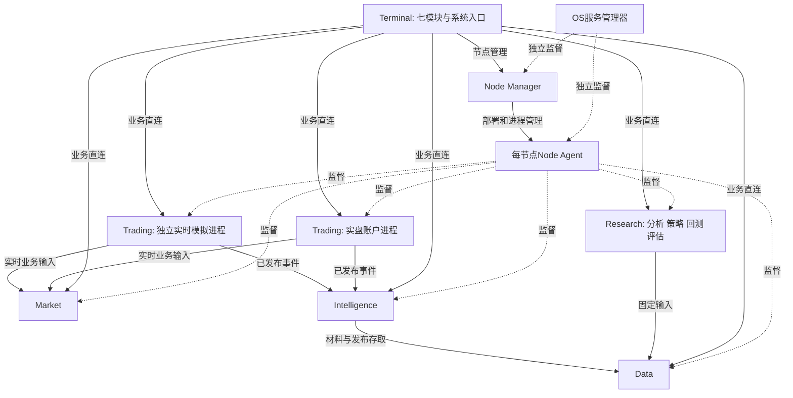

# 按产品需求组织的架构与工程设计

> 2026-10-25 决定：情报服务（Intelligence）以及模型训练与批次审阅已从代码中删除，首个版本只做“数据 → 策略 → 回测 → 评估 → 模拟 → 柜台仿真”闭环。本文中涉及情报的设计保留为需求目标，重新实现前需另行设计。

目标架构：由产品需求推导的业务服务划分、职责边界与工程组织。当前实现见[架构](../architecture.md)，
依据见[产品需求](../requirements/README.md)、[共同契约](../requirements/common/contracts.md)和
[非功能基线](../requirements/common/reliability.md#quality-baseline)。

## 架构决定

产品按数据、情报、分析、策略、回测、评估、实盘七个模块组织；后端按状态所有权和运行周期
组织为Market、Data、Intelligence、Research、Trading五类服务。Research内部承载分析、策略、
回测、评估，模块间直接调用。默认安装在本机提供完整能力，远程节点是用户选择的部署位置。

承担批任务的服务持有自己的任务状态、并发配置和执行池。Agent只管理服务进程，Manager只管理节点，
两者均不调度业务任务、不转发业务流量。Core提供实际复用的机制，插件提供算法与来源实现，安装器负责安装维护。

回测、本地实时模拟和实盘共用交易领域核心及适用的策略、风控实现；各自持有独立运行状态。
实盘与本地实时模拟运行在不同的Trading进程中，可使用同一个可执行程序；回测在Research执行池
内为每次实验创建独立交易核心实例，不启动独立任务进程。
Research和Trading的进程划分不形成两套策略语义、订单规则或金额算法。具体边界见下文“交易核心复用”。

## 方案比较与决定

| 方案 | 好处 | 代价与决定 |
| --- | --- | --- |
| 每个业务模块一个服务进程 | 名称与导航直接对应 | 分析、策略、回测、评估共享研究谱系及固定引用，却需多次跨进程提交；单机部署复杂，不采用 |
| 所有业务合成一个服务 | 部署进程少 | 来源阻塞、模型调用、研究故障与真实账户共处；不满足交易控制隔离，不采用 |
| 按长期状态和故障边界部署，进程内按业务模块组织 | 明确业务模块又保持直接调用；重计算在所属服务的有界线程池执行 | 采用：Data、Market、Intelligence、Research、Trading五类业务服务 |

Research只是后端承载分析、策略、回测、评估的进程名，不是新增产品模块。
四个模块有自己的对象、命令和结果，不能把Research写成一个巨大switch或任意JSON任务分派器。
情报单独部署，是因为候选、人工核验、发布和事件订阅有独立长期状态与生命周期；其不可用
不应影响固定数据读取、已有研究结果或账户控制。LLM慢调用通过异步I/O推进，不阻塞情报服务状态循环。
Market和Data同属一个数据功能模块，分别承载实时行情连接/分发与历史数据/材料/加工管理。
行情页在实盘导航下不改变其数据所有权，也不产生第二套来源、合约或数据定义。

### 一个数据模块为何有两个服务

实时与批量使用不同执行队列，并不足以要求拆进程：同一服务内用异步I/O和有界线程池也能实现。
这里保留两个服务的依据是独立生命周期：数据仓库维护、材料解析故障或Data重启时，已有行情连接
与订阅仍可由Market继续持有。它不保证共享主机CPU、磁盘或网络不发生竞争，也不代表行情一定达标。

| 数据模块的部署方式 | 可以解决的问题 | 代价 |
| --- | --- | --- |
| 一个Data进程，内部区分实时和批量执行 | 少一个进程和跨进程交接；线程池可隔离阻塞工作 | 进程崩溃、重启或整体停机维护同时中断行情和数据访问 |
| Market与Data两个进程，当前采用 | 行情连接可独立于仓库服务重启与维护，解析故障不直接终止行情进程 | 多一个部署实例和业务连接；归档交接需明确 |

Market只拥有运行中的来源连接、订阅、事件顺序与实时分发；Data拥有持久目录、历史内容、材料、
质量和发布。需要归档时，Data直接消费Market流并保存，不能让两个服务共同写同一份权威历史资料。
两者共享领域类型和来源插件契约；数据页面统一组织，不能要求用户理解两个进程才能完成普通采集。
Data离线时，依赖它的新查询/任务明确受阻；已准备好输入的行情订阅可继续，不能宣称所有业务均不受影响。

该拆分是数据模块内部的部署决定，不是产品必须有两个数据模块，也不是每类数据各建一个服务。
当前保留已有进程边界；独立维护与行情持续性仍须用实际旅程验证，不把进程数量当性能证据。

不会增加中央Task服务、独立风控服务、通用工作流引擎、消息总线、全局资源预留表或统一业务数据库。
服务数量是程序种类，不是固定同时运行的进程数；按部署实例和账户创建进程，任务按各服务配置并发执行。

## 功能模块到责任边界

下表覆盖全部23个子模块。`Research/…`表示同一进程内的模块，调用为类型化C++接口，不绕本机RPC。

| 需求子模块 | 唯一业务责任与长期对象 | 后端落点 | 主要执行方式 |
| --- | --- | --- | --- |
| 数据／接入与采集 | 来源能力、固定取数计划、原件、授权消耗；实时计划与连接事实分别归其执行方 | Data/acquisition；Market/acquisition | 历史与材料采集用Data执行池；实时连接常驻 |
| 数据／加工与质量 | 解析、标准化、时段聚合、连续映射、质量与排除证据 | Data/processing | Data执行池；短范围查询在服务读取池 |
| 数据／管理与服务 | 合约日历、不可变快照、目录、引用保护、历史访问 | Data/management；Market/distribution提供实时流 | 服务查询与订阅；重质量任务用Data执行池 |
| 情报／信息提取 | 方案、候选、模型调用与实际消耗、标注集合 | Intelligence/extraction | Intelligence异步I/O/执行池 |
| 情报／情报核验 | 实体判断、冲突、核验与发布决定 | Intelligence/verification | 服务处理人工决定；耗时核验用Intelligence异步I/O/执行池 |
| 情报／事件服务 | 事件关系、更正撤回、时点过滤与订阅游标 | Intelligence/events | 服务常驻；自然语言只产生可审阅查询 |
| 分析／数据探索与统计分析 | 研究问题、样本、观察与选择历史 | Research/analysis/exploration | Research执行池 |
| 分析／特征与因子构建 | 类型化定义、标签、预热、逐折拟合产物 | Research/analysis/features | Research执行池 |
| 分析／有效性评估与筛选 | 变量证据、候选及剔除理由 | Research/analysis/selection | Research执行池；确认候选由服务完成 |
| 策略／策略逻辑构建 | 规则、模型、混合逻辑、训练与样例证据 | Research/strategy/logic | 受限表达式检查；训练/试算用Research执行池 |
| 策略／组合与仓位管理 | 预算定义、目标生成和归属政策 | Research/strategy/portfolio | 离线计算用Research执行池；运行应用在Trading |
| 策略／策略管理与交付 | 参数方案、固定策略包、适用能力与交接 | Research/strategy/delivery | 服务持久确认；不授予账户权限 |
| 回测／回测设计与实验管理 | 固定方案、有限批次、各次尝试 | Research/backtest/experiments | 服务编排批次；Research执行池执行单次实验 |
| 回测／交易与账户模拟 | 模拟事件、订单、成交、风险和Decimal账本 | Research/backtest/simulation | Research执行池；输出固定模拟事实 |
| 评估／绩效度量与归因 | 固定事实切片、现金流口径、绩效贡献 | Research/evaluation/performance | Research执行池 |
| 评估／风险分析与压力测试 | 静态情景、风险与损失解释 | Research/evaluation/risk | 静态计算用Research执行池；动态重放交回测 |
| 评估／稳健性验证与综合评价 | 信息使用、比较、跨环境差异、结论和报告 | Research/evaluation/validation | Research执行池；报告引用已确认结果，不另算指标 |
| 实盘／实盘准备与运行管理 | 环境、固定运行包、授权、决策状态与暂停恢复 | Trading/operations；行情展示直接读Market | 常驻账户执行循环；不走批任务队列 |
| 实盘／订单执行与成交管理 | 意图、在途占用、订单成交与未知结果 | Trading/execution | 单账户执行边界串行接纳，直接调用柜台插件 |
| 实盘／账户管理与交易核对 | 账户政策、资金持仓、日切结算与核对 | Trading/accounts | 服务持久状态与查询；重分析交只读评估 |
| 系统／安装与配置 | 安装登记、节点身份、各配置责任入口 | Installer、Manager、Agent及Terminal/system | 独立维护程序；配置索引不复制业务配置 |
| 系统／任务调度与运行节点 | 各服务的任务/计划；Manager的节点登记 | 服务内公共任务/定时机制＋Manager/Agent | Terminal聚合，业务服务决定并发和实际受理 |
| 系统／资料维护、诊断与导出 | 各拥有者的资料；公共诊断与用户选择的导出 | Data维护任务＋各服务导出；Agent诊断；Terminal/system | 直接读取拥有者的固定导出；不通过Manager转发业务数据 |

系统管理的页面聚合不产生第二个权威：任务终态归原服务，账户风险归Trading，情报发布归Intelligence。

## 进程与部署



图中管理虚线只表示生命周期；Manager和Agent不转发行情、订单、材料、任务结果或报告。
服务间Unix socket／远程TCP+mTLS及Protobuf继续使用。服务直接持有所需业务连接，Manager仅发现端点。

| 程序 | 生命周期与实例边界 | 任务与执行权 |
| --- | --- | --- |
| `asterion_node_manager` | Terminal机器的独立OS服务 | 唯一Agent登记与管理连接；不拥有业务队列 |
| `asterion_node_agent` | 每参与节点一个环境实例，由OS监督 | 本机程序与服务进程；资源观察只作诊断 |
| `asterion_market` | 按来源连接/实时采集实例常驻，目标程序名 | 订阅与采集不随页面关闭终止；无批计算队列 |
| `asterion_data` | 按数据仓库实例常驻，目标程序名 | 采集、加工、质量、材料解析、资料维护任务 |
| `asterion_intelligence` | 按情报工作库实例常驻，新增目标 | 提取、方法评测；人工核验与发布由服务裁决 |
| `asterion_research` | 按研究工作库实例常驻，替代Task | 分析、训练、实验、评估；共享一份研究谱系与任务机制 |
| `asterion_trading` | 每个真实/柜台仿真账户独立进程；本地实时模拟账户另启独立进程 | 同一程序分别创建执行实例；账户控制和持续运行，不作为永不结束的批任务 |

默认单机安装包含所有这些能力及依赖，先启动Manager和Agent；业务服务按工作准备和已有部署意愿启动。
不预创建真实账户、外发模型材料、采集付费数据或授予交易权限。新增情报能力未配置模型时可保存材料，
不能显示提取就绪。远程节点初始为空，用户显式部署并选择业务位置；已受理工作不因断线自动换机器。
Research可以显式绑定可访问的Data及Intelligence实例；取消当前固定同节点Data/Task一对一契约后，
必须先完成稳定引用、权限、直接数据读取及删除保护，再允许跨节点组合，不能只删除配对校验。

Manager与Agent仍可能随发行升级，不以“足够稳定”承诺永不更新。独立安装器保留本机安装、修复、升级、
卸载和已有远程节点维护；首次部署与自身停机替换不能交给正在被替换的Agent。用户级本机服务与远程
专用账户/systemd权限模型沿用安装需求，普通启动不安装、不升级、不补写配置。

### 同一交易程序的跨节点实例管理

管理对象是`节点ID＋服务实例ID`，程序制品可以被多个实例复用。真实柜台和柜台仿真使用同一个
`asterion_trading`程序，账户选择自己的节点和实例；两个节点允许使用相同的实例名称。
Agent保存本机程序、目录、端口和期望运行状态；Manager持有节点登记并协调实例启停。
Terminal账户记录只持久保存实例引用，不复制Agent的部署状态或新建节点注册表。

创建账户前固定实例引用，随后通过业务直连写入账户定义；创建结果不明时查询原实例，不能
自动另建执行者。柜台环境由交易服务持久保存并返回，窗口不再拥有另一份可修改环境标记。
本机自动创建保留默认便捷流程；选择远程时需先部署实例，账户绑定后没有自动位置切换。
部署与就绪确认不授予交易权限，密码仍按次输入，账户授权由Trading裁决。

当前已接入真实柜台/柜台仿真的实例绑定与直连流程；本地实时模拟和完整交易核心整合仍属目标。
当前自动策略只接入本机行情与本机交易服务，远程策略的数据连接仍待实现。整机维护继续消费
既有Manager/Agent登记；停止或更新按实例定位，更新共享程序须核对所有受影响实例。

### 安装、启动与维护边界

| 操作 | 责任与完成条件 |
| --- | --- |
| 首次安装 | 安装器发布程序、复制缺少的默认配置并注册独立OS服务；立即启动Manager和Agent，确认本机Agent就绪后报告完成 |
| 普通启动 | Terminal连接已注册Manager；工作台按需要请求创建/启动本机业务实例。服务读取自己的配置和状态，准备完成才对外宣告可用 |
| 远程部署 | 用户在Terminal选择节点和服务；Manager负责已有SSH/Agent管理连接，首次引导使用主机管理边界，已运行Agent负责本机服务部署；业务连接由客户端直连服务 |
| 整体升级 | 安装器读取已有Manager/Agent登记，预备远程程序；各业务服务冻结新任务并完成停机条件，随后通过OS服务管理边界替换Manager/Agent，启动后确认本机和全部已登记远程节点就绪 |
| 卸载 | 先确认本机及选定远程范围和停机条件，再移除程序与服务注册；默认保留配置与业务资料，仅卸载允许用户取消保留并确认具体删除范围 |

服务就绪表示所需配置、存储和接口已完成初始化，不能以进程存在代替。模型凭据、行情连接和交易
授权属于具体业务能力状态，不应成为Manager/Agent管理就绪的前提。安装器不能将未完成的远程维护
报告为整体完成，也不能在远程节点仍受管理时删除唯一登记与身份。完整流程沿用
[安装需求](../requirements/modules/system/setup.md)，不新增第二份拓扑登记。

关闭已安装Terminal窗口保留后台服务；退出开发入口停止本机开发服务、Agent和Manager，保留资料及
远程服务。维护采用明确停机，不要求任意新旧版本长期互通，不做滚动升级或后台自动替换。

## 服务内任务执行

比较独立任务进程和服务内有界执行：前者隔离崩溃，但增加部署角色、启动与退出确认、
私有通信、心跳租约和进程状态同步。当前可信插件不需要按每次尝试隔离，采用服务内线程池与异步I/O。
不再建设data/intelligence/research三类worker，不保留Agent启动任务或回收任务进程的接口。

1. 所属服务持久接纳任务，按实例配置及正在执行的任务决定下一项。
2. 状态所有者准备固定输入并确认尝试，再提交到本服务的有界执行池；I/O密集请求可异步推进。
3. 执行线程独占算法状态，只交付进度与结果；不能直接修改任务账本、账户或发布状态。
4. 状态所有者处理取消、持久确认结果和安排后续任务。直到执行及确认结束才释放并发名额。

取消使用stop_token协作停止；不能强杀C++线程。运行失败持久记录原因，服务重启后未确认工作
标为中断，不自动重跑。无法返回的插件会影响其所属服务，进程监督仍由Agent负责；不声称线程
具备进程级故障隔离。已保存分区和已发生模型费用不会随取消回滚。

| 时刻/故障 | 所属服务的行为 | 管理层的行为 |
| --- | --- | --- |
| 队列已满或执行名额占用 | 按自身接纳策略排队或明确拒绝；不向Agent申请额度 | 仅报告进程和主机资源观察 |
| 用户取消 | 请求协作停止；执行返回且状态持久确认后才显示取消完成 | 不杀任务线程、不停止整个服务来代替取消 |
| 计算或外部来源失败 | 保存具体原因及已有进度；重试由用户明确发起新的尝试 | 不因业务失败重启健康服务 |
| 服务崩溃或被终止 | 重启后将未确认执行标为中断；已持久结果仍可查询 | 按服务监督策略恢复进程，不重放业务任务 |
| 升级排空 | 冻结新启动；等待实际执行、待提交写入与发布完成，或由用户取消；超时报告未完成 | 在业务停机条件满足后才替换程序，不用“进程在线”代替排空 |

普通进程停止受退出时限约束，不能承诺任意阻塞代码均能完成；线程仍访问的输入与状态必须保持有效
直到执行结束或进程退出。升级先排空再停止，与异常终止后的中断恢复分开。具体时限属于配置和
质量验收，不通过增加心跳租约、子进程任务身份或第二套结果状态来掩盖执行生命周期。

删除worker可执行程序、Agent私有启动/退出确认通道、领取/进度/完成RPC和心跳租约。
保留固定输入、尝试身份、结果验收和服务所有的持久化机制。批任务不进入Trading账户控制循环。

服务各有并发策略。需求明确参考环境单项计算默认1、最多2项研究并行；该限制在Research内落实，
分析/训练/回测/评估共用此实例的上限，不能给四个模块分别乘出8项。它不是Agent的节点总额度。
多Research实例的总并发不能据此宣称已满足质量基线；跨实例/跨机器的容量范围须单独验收，不引入
隐含的全局协调器。Data和Intelligence的任务并发由各自策略管理；来源共享速率/费用预算仍由对应
来源或模型业务边界核算，不拿并发任务数冒充供应商额度。

Core只复用实际共用的任务身份、尝试、取消与异步持久化机制；不持有全局任务数据库，不认识
回测、材料或账户。不把现有TaskHost/Store整体搬进Core。三个服务分别持有任务状态与实例存储，
状态机公共部分在第二个真实调用方出现时提取，业务完成/发布条件留在拥有者。

### 进程内执行与持久化

每个业务服务保持明确的状态写入所有者；RPC通过现有PolledTask/RpcHost推进，不为每个请求
或每个逻辑模块新建线程。阻塞文件/存储操作交有限工作池，完成后回到状态所有者确认并发布；
不能在持久写入还未确认时把请求显示为成功。已经接纳的写入即使调用方断开也保留其生命周期。
Research的四个模块共享进程运行机制，但各自解释业务命令，不共享未经类型约束的可变字典。

Trading继续由账户执行边界同时判断授权、风险和在途占用；慢查询、报告、模型训练不得占用该
控制循环。实时策略使用已固定的模型和受限计算，产生目标后仍通过账户统一执行；不在每次bar
启动研究任务等待结果。Market连续推进接收和分发，慢消费者明确报告滞后/缺口，不能静默丢弃
逐事件流后仍声称连续。具体池大小以既有工作负载和NFR测量确定，不把固定线程数写成永久架构规则。

### 定时计划

比较独立调度进程与服务内复用定时机制，采用后者。计划业务定义、日历引用、触发记录和已受理身份
存放在目标服务；Core提供时间计算与触发交接机制。系统页聚合各服务计划，Manager不提交业务任务。
因此窗口关闭或Manager暂时不可用不抹掉远程服务的已有计划，也不增加第二个常驻Task/Scheduler进程。

支持每天、每交易日固定时刻和最短1分钟间隔；默认不补跑、同计划不重叠、待处理最多一次。
服务先记录触发身份，再在同一拥有者内接纳业务任务；中断恢复查询这次受理，不产生重复收费或计算。
时钟跳变、休眠与离线留下漏触发，有限补跑须明确批准。暂停计划只影响未来触发，取消现有任务另办。
交易定时条件由固定策略和Trading在完整bar边界消费，公共计划不承载报单、撤单或断线补发命令。

## 数据、状态与跨模块交接

统一保存访问不等于所有对象写一个库，更不等于Data可修改情报发布或账户事实。

| 状态/内容 | 唯一拥有者 | 其他模块持有什么 |
| --- | --- | --- |
| 来源原件、标准行情、合约日历、数据快照与可读固定内容 | Data；实时事件及消费者游标由Market拥有 | 稳定引用、用途及时间限制 |
| 提取候选、模型处理记录、核验决定、事件关系与发布/撤回状态 | Intelligence | 已发布内容与确认过的发布记录投影 |
| 研究问题、样本观察/选择历史、定义、模型、策略包、实验、评价 | Research内相应业务模块 | 固定对象引用；同进程共享谱系机制不复制四份历史 |
| 各服务任务、计划与尝试 | 任务所属服务 | 全局任务中心只读投影及带作用域的操作地址 |
| 真实订单、成交、账户政策、风险占用与运行决策证据 | Trading | 固定截止的只读切片；评估不能回写账本 |
| 本地模拟账户和运行、历史模拟账本 | Trading隔离模拟实例；Research回测模块 | 模式明确的事实，不与真实账本共享可变状态 |
| 节点登记、服务部署与安装登记 | Manager、Agent、Installer分别拥有 | 对应管理协议返回的观察状态 |
| 通知阅读状态、窗口与语言偏好 | Terminal | 关联源事件；已读不修改源告警 |

Data统一保存原件、解析和发布内容；Intelligence保存业务决定并引用这些字节，不能维护另一套原件库。
发布先保存固定内容，再确认Intelligence的发布决定，Data目录按可查询的决定提供内容；未确认的内容
不进入正式查询。响应丢失按同一发布身份查询，保留“已核验待发布”，不自动制造新事件或跳过核验。
更正和撤回追加有时点的新事实，严格历史视图仍按当时信息判断。

Research与Trading自己保管账本和业务产物；统一目录可索引其只读摘要，不复制权威账本。
引用对象必须具有稳定的节点/服务/对象身份及固定内容，不能用某台机器的绝对文件路径作为跨节点契约。
服务恢复只恢复自身状态；外部依赖暂不可达时保留本地可读结果，并阻断确实依赖缺失内容的操作。

### 引用与删除

创建固定研究/运行引用时，由内容拥有者登记使用关系，持久确认引用后才能对外宣告对象可用。
任务所属服务先持久解除合法引用，再通知内容拥有者释放；中断留下的保留记录不能自动当垃圾删除。
删除预览不授予永久删除许可，执行时仍在内容拥有者的同一写入边界核对引用。
对跨服务引用无法确认时拒绝依赖性删除，不能以节点离线推定无引用；不另建全局引用扫描服务。
共同引用机制只负责对象与关系，各业务决定何时可以解除研究、情报或账户证据的引用。

### 交易核心复用

回测、本地实时模拟和实盘采用同一套适用的交易核心代码，分别由历史驱动器或实时驱动器推进。
复用单位是领域机制和插件实现；每次实验、每个账户各自创建实例，不能共享可变持仓、订单或风险额度。

| 场景 | 运行边界 | 时间、输入与执行 | 状态归属 |
| --- | --- | --- | --- |
| 历史回测 | Research服务的有界执行池，每次实验独立核心实例 | 历史事件推进模拟时钟，固定数据与模拟撮合 | 实验内账户、订单和风险状态；Research持久确认实验结果 |
| 本地实时模拟 | 独立的`asterion_trading`进程，每个模拟账户一个实例 | 实时行情驱动，模拟撮合生成成交 | 模拟账户自己的配置、账本、风险额度及日志 |
| 实盘交易 | 独立的`asterion_trading`进程，每个真实账户一个执行拥有者 | 实时行情驱动，柜台接纳订单并返回成交事实 | 真实账户自己的授权、配置、账本、风险额度及日志 |

实盘与本地实时模拟可以使用同一个程序文件，但必须分别启动进程，不能只在同一个进程中创建
两个账户对象来代替隔离。Agent按服务实例监督这些进程；Manager发现端点；Terminal直接连接
选定实例。柜台提供的仿真环境仍使用柜台执行适配，与本地模拟撮合明确区分。

运行环境在实例创建时确定；运行中的模拟实例不能切换成实盘、复用实盘授权或写入真实账本。
实例分别拥有状态目录和日志身份，关闭或重启模拟进程不停止实盘进程。进程隔离不代表同机资源
完全隔离，容量仍按实际同时运行的服务验收。

回测实验之间隔离可变状态，执行名额由Research管理；不恢复每次实验一个worker的架构。
因此同一Research进程崩溃可能中断多个实验，但不直接终止独立的Trading进程。

| 内容 | 共用部分 | 环境差异及归属 |
| --- | --- | --- |
| 策略与特征 | 固定策略定义、特征语义、预热、预测及目标仓位算法 | Research组织训练与实验；Trading运行已固定策略，不在账户循环训练模型 |
| 交易领域 | 订单/成交/持仓类型、Decimal金额规则、适用的状态转换和目标调整机制 | 模拟维护自己的账本；实盘接纳柜台事实并核对，不能用模拟预测覆盖柜台结果 |
| 风控 | 适用的规则接口和算法插件 | 各实例独立政策与额度；实盘额外执行真实账户授权及发送控制 |
| 时间与输入 | 类型化行情、完整bar、事件可得时点及决策输入契约 | 回测按历史时间推进；实时环境持续处理行情和柜台事件，不等待研究任务 |
| 执行 | 类型化订单意图与结果契约 | 回测使用模拟撮合插件；实盘使用柜台插件；成交、延迟、拒单和未知结果语义由对应环境明确提供 |
| 证据与评估 | 固定事实结构和同口径统计 | 每个环境独立保存证据；评估只读，不取得交易权限 |

通用领域类型与机制归`core/domain`；策略、特征算法、撮合及风控实现归对应`plugins/`。
`Research/backtest`负责实验、历史推进与结果交付，`Trading`负责账户生命周期、柜台连接、授权、
持久确认与核对。两者链接共用库，不相互启动或调用对方服务来执行每一步交易，也不把交易核心
放进`apps/common`。不为统一入口而堆积`is_backtest`等分支，让环境适配实现真实的差异。

当前代码已共用策略库、`make_strategy`入口及风控提供方；回测的`PaperExecution`与实盘的
`LiveAccountState`仍分别编排执行。因此“共用交易核心”是必须继续落实的设计原则，不能宣称
目前已经统一全部状态转换。实施时逐项提取双方真实相同的逻辑，删除重复实现；不把整个实盘
会话塞进回测，不要求两种环境拥有相同线程或持久化节奏。

验收使用相同固定策略、输入和明确可比的账户条件验证决策及共用规则一致；模拟撮合和柜台行为
分别验收。回测坚持完整bar后决策、新单最早作用后续bar；实盘撤权、订单反馈及风险控制持续处理。
共享代码减少实现偏差，不承诺真实成交与回测结果相同。
进程验收还须覆盖模拟停止/重启不终止实盘、各实例账本和授权不串用，以及并行回测之间状态不串用；
使用隔离夹具或测试柜台验证，不以真实账户制造故障。这些是目标验收条件，当前尚未完成全部实现。

### 必须落实的业务不变量

- 数据区分原始值、缺失、来源无记录与加工估计；连续合约只能产生信号，订单和模拟成交对应真实月份。
- 事件时间、来源发布、取得、处理、情报发布与策略可得时点分别保留；LLM事后处理不能回填历史可得时间。
- 分析的拟合只读训练范围；标签越界排除。研究谱系记录实际观察与选择，重命名、换频率或新快照不恢复“未见”。
- 策略支持受限规则、线性/岭回归及混合结构；模型训练产物与参数固定，运行不热换包。组合按规定向零取整，不自动再分配余量。
- 回测只在完整bar后决策；同边界先接纳旧单事实，再形成输入和状态，再决策，最后准入新意图；新单最早作用后续bar。
- 实盘订单反馈、撤权和独立风控持续处理，不等待bar；一个账户一套执行归属，账户控制不依赖Research或报告可用。
- 评估只读固定事实，现金流与净值口径明确；静态压力不冒充成交路径，动态策略压力调用回测产生新事实。
- 风险是策略预算、模拟检查、评估解释、账户执行各自的职责；共用规则/插件不共享可变风险额度，不增设独立风控服务。
- 行情归档可关闭，最小决策证据不可关闭；关键证据写入失败阻断依赖它的新发送，仍核对既有订单并保留合规撤单。
- 真实运行有人值守；后台服务存在不等于无人值守承诺，失联不自动接管、不补发交易命令。

### 资料维护、日志与通知

系统页向各事实拥有者请求固定导出及引用闭包，Data的资料维护任务汇集用户明确选择的内容到备份位置。
完整冷备份先确认相关写入者停止或进入其明确的只读维护状态，再复制；不能用全库前后哈希代替持续所有权。
源服务导出业务字节走直接业务通道，不经Manager/Agent搬运结果。在线账户不能被自动备份暗中停止。
自动备份默认关闭，启用后用同一服务内计划机制；遇到活动写入或未确认边界时报告受阻，不自动强停交易。
恢复写独立目录，先核对内容和依赖，再由用户明确选择；不迁移、不覆盖当前账本、不恢复交易授权。

公共日志策略存一次，按进程/服务实例输出；模块、任务、操作为字段。Agent可提供本节点诊断检索和
清理管理操作，Manager汇总诊断定位，不把业务记录当日志读取。目标落实30日及1GiB的节点诊断限制，
清理只针对确认属于诊断的已关闭文件，不触及账本、材料证据或安装故障现场。
Terminal统一呈现来源事件和阅读状态，业务服务负责告警产生/解除及离线事件保留；默认90日的通知
留存不解除业务限制，桌面提醒默认关闭。无需独立通知服务器或外部通知集成。

## 工程结构

下面是目标目录，不是本轮已创建的空工程。只有对应功能开始实施且已有源码时才建立目录和构建目标。
保留现有根层级，不新增一套与apps、core并列的泛化business/platform框架。

```text
config/                         # 部署默认值，启动不生成
  logging.json
  futures-sessions.json
  data.json
  intelligence.json
  research.json
core/
  include/asterion/
    foundation/                 # Decimal、ID、时间、错误、基本容器
    kernel/                     # IPC、进程、日志、持久文件、线程/协程、共用调度机制
    domain/                     # 类型化数据/任务/策略/账户/证据契约和必要不变量
  src/                          # 与公开头按层和责任对应
protocol/
  proto/asterion/                # 管理契约、各业务契约、公共任务观察，不携带UI字段
  include/asterion/protocol/
  src/                          # 类型映射与跨进程边界解析
plugins/
  data/                         # CTP、Tushare、SHFE、材料来源/解析等实际提供方
  intelligence/                 # 明确接入的提取/模型提供方与核验算法
  strategy/                     # 规则执行、训练、预测、组合算法
  execution/                    # CTP柜台与模拟撮合
  risk/                         # 风险算法
  storage/                      # SQLite、文件及Parquet后端
  tools/                        # 分析、回测计算、绩效及冻结Python依赖
apps/
  common/
    runtime/                    # Terminal与Manager共用的异步客户端接线、端点；不含管理政策
  management/
    common/                     # 节点路径、系统服务、包资源和管理契约映射
    node-manager/               # 唯一节点登记和Agent连接
    node-agent/                 # 部署、进程、遥测、维护
  services/
    market/                     # 实时行情：来源连接、订阅、接收与分发
    data/                       # 数据仓库与批处理：采集、加工、质量、存储与查询
    intelligence/               # extraction、verification、events
    research/                   # 共同运行外壳和研究谱系
      analysis/                 # exploration、features、selection
      strategy/                 # logic、portfolio、delivery
      backtest/                 # experiments、simulation
      evaluation/               # performance、risk、validation
    trading/                    # operations、execution、accounts；实盘/实时模拟分别启动独立进程
  clients/
    terminal/
      electron/
      native/                   # clients按data/intelligence/research/trading/market/management组织
      plugins/                  # data、intelligence、analysis、strategy、backtest、evaluation、live
      src/                      # shell、system、bridge、i18n与全局任务/通知入口
    installer/                  # native维护执行器、electron宿主、安装界面
bindings/                       # C ABI、Node-API只作边界转换
packages/client-ui/             # 公共控件与图表，不含业务权限或权威计算
tests/                          # 按业务/机制模块放测试与夹具，统一CTest登记
scripts/                        # 构建、依赖准备、打包、需求生成
```

### 服务命名

`apps/services/`已经表达进程角色，子目录统一使用职责名称，不再混用带`-service`和不带后缀的名称。
`market`统一表示实时行情服务，`data`表示数据仓库与采集加工服务，包含历史行情和原始材料，
因此不将后者缩窄命名为`history`或仅描述存储介质的`storage`。研究内部模块同样
直接使用`analysis`、`strategy`、`backtest`、`evaluation`，不追加`module`或`service`。

| 目录 | 可执行程序及CMake目标 |
| --- | --- |
| `apps/services/market/` | `asterion_market` |
| `apps/services/data/` | `asterion_data` |
| `apps/services/intelligence/` | `asterion_intelligence` |
| `apps/services/research/` | `asterion_research` |
| `apps/services/trading/` | `asterion_trading` |

目录与程序已按上表命名；`ServiceKind` 枚举为 `MARKET/DATA/RESEARCH/INTELLIGENCE/TRADING`。
已部署的服务实例 ID（如默认的 `market-data`）是持久身份，不随源码命名改变。

### common的具体归属

当前`asterion_node_control`同时编译`service_io`、节点路径、插件目录、程序包和OS服务操作。
实际使用`ServiceIo`的有Terminal业务客户端和Manager的Agent客户端；它是客户端运行接线，
并不是所有业务服务共同使用的服务宿主。业务服务已有Core的`RpcHost`，不另建一个ServiceHost框架。

如果把整个库移入management，Terminal的行情/交易客户端就会为了异步调用依赖管理实现；
如果全部保留在apps/common，安装与节点管理细节继续混入应用公共层。因此按下面的实际责任拆分：

| 当前内容 | 目标归属 | 边界 |
| --- | --- | --- |
| `service_io`、`service_endpoint` | `apps/common/runtime/` | Terminal和Manager共用的客户端I/O推进、端点表示；不拥有节点登记或任务队列 |
| `node_paths`、`node_service`、`application_environment` | `apps/management/common/` | 节点环境路径、OS服务操作和环境选择；账户/凭据助手专属路径仍在Terminal |
| `remote_bundle`、`service_programs`、部署用`plugin_catalog` | `apps/management/common/` | 选择和准备管理/业务程序及插件包；算法执行与插件装载机制不在这里 |
| `manager_wire`、节点/服务管理状态类型 | `apps/management/common/` | 管理边界的类型转换与状态；不包含图表、界面文案或业务结果 |
| `node_snapshot_json`中的Terminal展示映射 | `apps/clients/terminal/native/` | 当前Manager也调用此函数；拆分时同步改其调用，保留所需管理边界转换，不让Manager依赖客户端展示数据 |
| `managed_service`中的`DataTaskEndpoints`固定配对结构 | 随Data/Research职责切换删除 | 不移动后继续保留旧配对契约；业务客户端直接持有所需服务端点 |
| 各业务客户端、账户存储和凭据助手 | `apps/clients/terminal/native/`相应模块 | 只有Terminal使用的代码不因名称通用而移入common |

依赖方向为：应用入口使用所需公共库，management/common可使用common/runtime及Core/协议；
common/runtime不依赖management，Core不依赖任何apps目录。Terminal和Installer可使用管理公共库，
但不能链接Manager或Agent进程实现。运行接线与管理公共代码各有自己的构建目标，不再通过一个
聚合库传递所有依赖；业务服务直接使用Core机制，除非确有对应公共应用代码调用。

common里不保存业务状态、不定义业务算法，也不因“多个目录都能用”就吸收所有工具。
`kernel/native_plugin`继续负责通用装载；各服务负责选用与执行算法。整理目录时同时调整残留的
`asterion::terminal`公共命名空间、包含路径和链接关系，不保留旧别名或空转发头。

Core继续三个库、依赖向下：`asterion_domain → asterion_kernel → asterion_foundation`。
业务应用和插件依赖Core，协议依赖类型及机制，Core不依赖生成Protobuf、应用或具体插件。
算法插件可以静态链接，不为目录一致而强制所有库动态化；可信插件仍不是恶意代码沙箱。
服务的应用命令、持久提交顺序和状态所有权留在服务，存储介质实现留在storage插件。

每级CMake用`add_subdirectory()`组合，叶模块定义目标和依赖；同进程的研究模块可各有静态目标，
但不自动拥有独立线程池、连接池或数据库。产物使用下划线；不引入V1/V2、别名、兼容API或旧程序并存。
不添加检查include、命名或依赖层级的构建守卫；这些规则由结构、正常编译及评审维护。

### 协议与前端

管理仍用`manager.proto`、`node.proto`；`task.proto`收敛为有作用域的任务观察、尝试及控制公共结构，
不保留通用TaskService请求包。分析、策略、回测、评估分别拥有业务消息，Research组合其入口；
Data/Intelligence拥有自己的任务定义与提交入口。任务身份包含节点、服务实例、任务ID，禁止跨服务
仅凭任务ID取消或重试。不要为每个FR机械增加RPC，更不能用任意JSON绕开类型化契约。

Terminal七个业务入口严格对应需求，系统入口在底部；58项UI是工作区/抽屉/对话框，不是58个插件。
同一对象的多个页面共享一个服务客户端和观察值。任务中心按来源聚合、分页、取消与跳回责任模块，
没有中央任务写库；通知已读单独持久化。命令参数仍由类型化bridge映射，业务权限在服务执行边界判断。
安装器界面逐步移入自己的client目录，共用控件与国际化机制，不把Terminal业务依赖带进安装器。

### 第三方计算与展示

Lightweight Charts留在客户端图表适配层，只负责展示。Polars用于明确的数据/分析计算，QuantStats
服务评估，skfolio只作为声明过的组合研究方法实现；依赖的所有能力不等于产品已支持全部算法。
尤其需求的组合方法集合有限，不能因为已有skfolio优化器而默认启用超出规格的目标或权重规则。

持久计算从Terminal迁至所属服务的执行池。现有冻结Python运行时有独立语言运行时要求，
可由所属服务持有受控助手进程；不经过Agent，不增加领取、租约和第二套任务状态。
助手只完成计算调用，结果仍由服务确认。它的内存、线程和进程计入NFR总量。

## 配置、部署与运行资料

运行策略、业务对象、部署状态、秘密分开保存，但不复制同一配置到多个责任方。

| 类别 | 仓库位置 | 部署/运行位置 | 修改与生效 |
| --- | --- | --- | --- |
| 日志公共策略 | `config/logging.json` | `<node>/config/logging.json` | 显式管理操作保存；进程启动读取，节点清理遵守同一策略 |
| 服务任务策略 | `config/data.json`、`intelligence.json`、`research.json` | `<node>/config/services/<实例>/<职责>.json` | 部署复制缺少的模板；启动只读；重启指定服务生效 |
| 插件实际默认参数 | `plugins/<类别>/<插件>/config/` | `<node>/config/services/<实例>/plugins/<插件ID>.json` | 有实际参数才创建，所属服务核对影响 |
| 部署与运行意愿 | 不维护用户实例模板 | Agent服务登记；Manager节点登记 | 管理操作持久化，不当作手工策略文件 |
| 来源用途、模型方案、研究计划、账户风险与授权 | 不放可交易默认值 | 所属服务业务库 | 由业务界面显式保存/确认，展示保存与生效的区别 |
| 密码与密钥 | 不入仓库 | 允许的系统安全存储、受保护身份密钥或本次会话 | 仅行情密码/授权码可显式保存；无普通文件回退 |

每个服务有自己的配置责任，不意味着必须先创建一个空JSON。Market与Trading存在实际运行策略时，
再提供自己的模板和读取器；账户限额、来源授权等业务对象不能为了“配置统一”挪入这些文件。
Research初始并发按需求为1、可设2；Data与Intelligence的初始策略在相应实现中说明具体依据，不能
从研究上限推导收费请求额度。`task.json`在职责切换时连同旧读取器和打包项删除，不能现在先删导致服务无法启动。

配置索引只查责任方。安装/部署复制默认值，启动不补齐；升级保留文件，缺必需字段/不支持资料明确报路径。
模型和交易凭据不能持久保存到普通配置；服务重启后没有允许使用的凭据，计划保持受阻，不假装后台能继续。
现存业务资料不自动改名、搬库、转换或删除。代码切换时无法读取旧开发资料就明确拒绝并保留，
需要新实例时由用户明确选择新位置；不为本次重构增加迁移器或历史运行兼容层。

## 实施顺序与完成条件

采用纵向闭环，每一步同时改定义、消费者、测试、打包和当前文档，不先建立大量空目录。

| 顺序 | 交付范围 | 同步删除/调整 | 最低有效验收 |
| --- | --- | --- | --- |
| 2 | Research按分析/策略/回测/评估拆应用模块；七导航与任务中心作用域到位 | 混合research页面及桌面权威计算路径；保留现有可用业务直到同次切换 | 固定数据→因子→候选→策略→回测→评估的最小完整链；每个模块缺项可解释 |
| 3 | 完整规则/模型/组合、回测时钟和共享谱系；统计方法按有限集合落地 | 服务内算法按责任整理到插件；重复绩效公式按唯一口径收敛 | JRN-016/017/020/022/024/025/026；Decimal精确、标签与留出隔离 |
| 4 | 原始材料、情报提取/核验/事件服务及情报服务执行池 | 不创建第二原件库或第二发布拥有者；本地/远程依赖打包 | JRN-031/032/033；无外发许可零发送，人工核验、更正与历史查询 |
| 5 | 本地实时模拟、实盘准备/账户/执行模块；固定包与最小决策证据 | 单账户唯一执行边界不拆；研究算法不阻塞控制循环 | JRN-008/011/018/030/034/039/040/041；跨日、部分成交、记录失败和断线不重发 |
| 6 | 服务内计划、资料维护、日志容量和通知，配置索引完整 | 不新增中央调度库，不把操作审计当日志轮转 | JRN-014/035/036/037/038/042；重复触发只受理一次，关闭窗口不失计划 |
| 7 | 两平台安装包、Linux远程能力与全量容量验收 | 废弃路径、协议、测试夹具和文档同批删除，不留别名 | 58项UI、42条JRN及各FR/AC有实际证据；NFR逐项测量 |

此顺序不是降低其他模块优先级：数据/研究/实盘完整闭环均必须交付，P0行为在受影响能力启用前完成。
每阶段保留有限范围的当前实现说明，不以“框架已搭好”代替业务交付，也不把前一架构的测试结果当新架构验收。

## 验证与需明确的差异

当前需求规定M1/i5-12400、16GiB、100合约、1000万根分钟线、20特征、10万条索引，
两项研究并行；交互p95≤200ms、行情展示p95≤1s、取消反馈≤1s、可控停止≤30s、
外部阻塞上限60s，另有8小时持续运行、内存和恢复指标。以上是目标，不是当前测量结论。
账户撤权/暂停≤1s且生效后禁止发送数为0，不能用UI响应代替执行边界证据。

| 差异或需澄清之处 | 本设计的处理 |
| --- | --- |
| 需求有定时计划、模型/交易秘密却不可持久保存 | 后台执行必须检查本节点本次可用凭据；不足显示受阻，不添加秘密存储例外 |
| 数据概述提到OCR，情报有限格式明确不支持扫描件 | 当前交付只做文本型PDF/HTML/文本/结构表格；无文本扫描件明确不支持，不偷偷新增OCR范围 |
| 已集成skfolio等库与需求有限算法集合不完全对应 | 先按需求方法及拒绝条件设计能力，超出方法不得冒充本次必需交付 |
| 日志目前只有时间留存 | 1GiB容量缺口列入实施；不得将业务证据作为诊断文件清理 |

低层领域和服务行为用C++/CTest；UI状态及跳转用Vitest；真实跨进程旅程只通过仓库E2E入口，
外部来源、仿真柜台、实际系统服务和发行包另验收。真实账户不用于制造故障；无授权不登录或下单。
