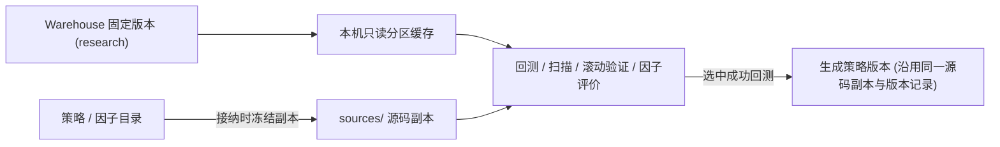
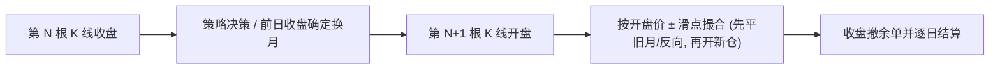

# Lab 研究服务

Lab 是 Terminal 启动和看护的本机 Python 服务，负责策略、因子、回测、参数扫描、滚动验证和研究记录。它只读 Warehouse 的固定数据版本，不采集数据，也不运行实盘策略。关闭 Terminal 会结束 Lab，不影响 Warehouse 和 Trading。

内部设计与通信时序见[开发者导读](architecture.md)，运行环境及目录见[部署与运行](deployment.md)。

Lab 用保存在本机的 Warehouse 地址和客户端证书直连 Warehouse；没有配置时数据请求失败，已有研究结果仍可查看。界面用 `protocol/proto/asterion/lab.proto` 的消息经本机 Unix socket 请求 Lab。

## 固定数据版本



- 回测、扫描和因子评价在被接纳时固定数据版本，之后的采集不影响它们；扫描的全部候选和滚动验证共用同一版本。指定版本取不到直接失败，不改读最新。
- Lab 只读 Warehouse 的研究数据集（来源 `research`，见 [Warehouse](../warehouse/README.md#仓库与固定版本)），不选来源；日线与分钟回测用同一版本。
- 缓存位于 `<根>/lab/data/lab/warehouse-cache/research/`，可随时删除重建；日线按交易所在窗口内下载（含前后换月判定所需行情），分钟线按合约与交易日按需下载。价格和数量保持精确小数，单日单合约分区不跨来源拼接。

## 主力连续

- **换月依据**：前一交易日持仓量最大的合约（当天有结算价的当月及以后月份），只向后换；次日生效。回测从 `begin_day` 前一交易日锚定首日主力合约，使 `begin_day` 当天即可交易；合约到期换月依据自身最后结算日判定，不依赖回测结束日 `end_day`。
- 用于交易的序列不持有合约到最后一天：最后一天就换给其他月份中持仓最大者。
- **策略看到的主力连续按当时复权**：换月那一刻，`ctx.history` 里已有的开高低收乘以新旧合约前一交易日结算价之比，新合约保持原价。之后的数据不会改变之前任何一根 K 线看到的价格，所以延长回测区间不影响之前的决策。策略自己另存的价格不会被调整，`bar.contract` 变化即换月。因子评价按换月分段传入各时点当时的复权序列，不将未来换月比例回溯至更早分段。
- 缺少可选的主力或换月所需的结算价时，回测失败，不做推测。连续序列只用于信号，成交落在真实合约上。
- **期限结构与展期收益率（`roll_yield`）**：在主力之后的在市交割月中按前一交易日持仓量选出次主力合约（无未来函数），用同根 K 线收盘价计算年化对数展期收益率 `12 * ln(P_主力 / P_次主力) / 交割月差`（四舍五入 8 位小数，贴水为正、升水为负），与因子评价、日线/分钟回测、预热及 Trading 实盘保持同一口径。换月复权只缩放开高低收，不缩放 `roll_yield`；固定合约、已处最后在市月份或分钟回测中次主力无对应完整 K 线时为 `NaN`。内置 `factors/term_structure.py` 提供 `roll_yield_carry` 与 `roll_yield_momentum`。

## 策略

策略和因子都在固定的策略目录里（位置见[开发](../development.md#本机数据目录)）。研究页的“策略”和“因子”视图左侧分别列出各自的模块，可以新建策略或因子（带一个能直接运行的模板）、在内置编辑器里修改、删除。内置的策略和因子来自项目的 `research/`，安装包原样带上；Lab 每次启动时把它们复制进策略目录，只读，升级时自动更新。新建的模块不能和内置的同名。研究与交易共用 `apps/services/common/python/asterion_strategy.py`：

```python
from asterion_strategy import Strategy

class MaCross(Strategy):
    """Long while the fast average of closes is above the slow one, short below it."""
    params = {"fast": 5, "slow": 20, "lots": 1}

    def ready(self, ctx):
        need = self.params["slow"]
        return all(len(ctx.history(symbol, "close", need)) == need for symbol in ctx.symbols)

    def on_bar(self, ctx, bar):
        closes = ctx.history(bar.symbol, "close", self.params["slow"])
        if len(closes) < self.params["slow"]:
            return
        up = closes[-self.params["fast"]:].mean() > closes.mean()
        ctx.target(bar.symbol, self.params["lots"] if up else -self.params["lots"])
```

- `strategies/` 下每个非下划线模块中的公开 `Strategy` 子类是一个策略，标识为 `<模块>.<类>`。模块可以导入策略目录里的其他代码。
- 策略用因子就是导入它的函数：`ctx.factor(momentum, symbol, lookback + 1, lookback=lookback)` 对这个品种最近 `count` 根 K 线算一次、取最后一个值，按因子的参数名取它要的 K 线字段；新建策略的模板是这个写法。要在自己挑出的数据上算时直接调用函数，内置的 `momentum_rank` 这样用 `factors/price.py`。理由：因子视图评价的和策略交易的是同一个函数，因子也不用为逐根推进另写一遍。回测副本和策略包都带上被导入的因子模块；这样的因子模块只能导入 NumPy、SciPy 和标准库，因为实盘的运行环境只有这些。
- `params` 的类型只能是 bool、int、float、str；运行时只能改成同类型的值。
- `on_bar` 每根完整 K 线调用一次；多品种策略改写 `on_bars`，同一时刻完成的 K 线一起给出，没有 K 线的品种不出现。
- `ready(ctx)` 每次决策后报告是否就绪；未就绪时丢弃当前和未执行的目标，回测与实盘一样不再下新委托，已有持仓保留，再次就绪后只执行这之后给出的目标。实盘要求策略显式实现它。
- `ctx.history(symbol, field, count)` 返回最近 `count` 个值（只读 NumPy 数组）。`ctx.target(symbol, lots)` 给整数手数，`ctx.weights({symbol: weight})` 给权益占比，一个策略只用一种（全仓组合上限 64 个品种／合约）。目标从下一根 K 线起执行；手数换算、风控和金额都由 C++ 计算。`asterion_strategy` 同时提供截面 Z-Score／排名（`cross_section_zscore`、`cross_section_rank`）、在市与成交量／持仓量流动性过滤（`liquid_symbols`）及单实例多子策略权重合成基类 `CombinedStrategy`（内置 `composite.CompositePortfolio` 可直接回测并打包发布）。
- Terminal 编辑器里未保存的修改属于工作区，切到结果或其他页面再回来仍在。运行回测或评价因子时先保存全部修改并提示，保存失败就不运行。理由：记录的源码副本必须是看得见的代码。
- 策略目录不在 Git 里，每次运行复制的代码就是记录；如果在 Git 里，记录的策略版本是提交号，目录里有未提交改动时另记改动摘要。回测或扫描被接纳时，策略模块及它从策略目录导入的模块（与[策略包](../trading/README.md#策略包)的范围相同，最多 16 MiB）复制到 `sources/`，这次回测、扫描的全部候选和滚动验证都从这份副本导入，之后修改策略目录不影响它们。
- 从成功回测准备策略包时使用这份副本，并携带运行 ID、参数、周期、研究品种、数据版本和权重预算；副本缺失时停止准备。扫描需选择具体候选，滚动验证报告需回到候选选择一组配置。交易页也可以明确改用当前策略目录，见[策略包](../trading/README.md#策略包)。

## 因子

因子是策略目录中 `factors/` 下各模块的公开函数，标识为 `<模块>.<函数>`：

```python
import numpy as np

def momentum(close, lookback: int = 20):
    """Return over the last `lookback` bars."""
    result = np.full(len(close), np.nan)
    result[lookback:] = close[lookback:] / close[:-lookback] - 1
    return result
```

- 参数名是 K 线字段（open、high、low、close、volume、open_interest、roll_yield）的接收数据，其余参数必须有默认值。某根 K 线的值只能用它和之前的 K 线。
- 品种可以写合约、品种主力连续，或只写交易所（该交易所在区间内有日线的全部品种）。
- 每个交易日，支持对原始因子值或截面 Z-Score／截面排名标准化后的因子计算与向后第 h 个交易日收益的秩相关 IC（至少 3 个品种），也可勾选多个因子计算每日截面秩相关均值矩阵，并按等权或仅使用已实现前瞻收益的历史滚动 IC 加权合成为复合因子（无未来函数泄漏）。每个持有期给出 IC 均值、标准差、IR、t 值和 IC 为正的占比；持有期 h 根的收益互相重叠，t 值按天数 / h 个独立样本计算。指定留出日时，另按不跨越留出日边界的样本内窗口与留出期分别统计对比各持有期 IC 与 ICIR。
- 每天按因子值分成若干组，各组下一根 K 线收益的平均值逐日累乘；最高组减最低组另成一线。结果列表保留分组换手率与留出期统计，供因子库总表直接排序展示而无需逐条打开报告。
- 评价必须在 25 秒内完成，否则缩小品种或区间。只读日线。
- 评价和回测一样，被接纳时复制因子模块及它导入的模块（可以导入 Lab 里有的库），从副本导入因子，记下数据版本、代码提交和参数。结果以名称保存在 `factors/<名称>.binpb`，包括当时因子模块的源码；因子配置下方的评价记录可以重新打开，之后修改源码不影响旧结果。

## 回测

品种写作合约（`SHFE/rb/2027-01`）或品种主力连续（`SHFE/rb`），合约乘数取固定版本合约表并用成交额核对，最小变动价位取同版本[历史报价单位](../warehouse/README.md#历史最小变动价位)（缺失或冲突即失败，夜盘按所属交易日）。

| 频率 | 完整性要求 | 特殊处理 |
| --- | --- | --- |
| **日线** | 存续期内每日有明确日历；开市日有日线与结算价；非零成交日有完整开高低收 | 明确零成交且无行情日只结算不交付 K 线；时间标签为当日 15:00 |
| **分钟线**（1/5/10/15/30/60） | 满足日线全部要求；除日线明确零成交外须有分钟线，缺失即失败（不用日线结算补） | 按交易时段聚合；周期内缺记录或不完整时撮合、策略与历史预热均跳过。分别统计不完整周期、整段缺记录周期与明确零成交分钟（周一夜盘起自周五晚；前一工作日休市则跳过夜盘，上市日或缺前日历标待核实） |

- **费用、权重与执行**：
  - 保证金率和手续费按合约与交易日取固定版本交易所结算参数（缺失即停止）；滑点、委托限额、权重预算及可选 `max_margin_ratio` / `min_rebalance_weight` 由运行配置给出。日线记录含每日涨跌停价（`lower_limit`、`upper_limit`）时自动送入撮合引擎，封涨停不买、封跌停不卖且含滑点成交价不超过涨跌停价。
  - `ctx.weights` 按当时价、当日方向保证金率和净持仓换算整数手（超保证金率上限同比例缩权；同向小偏离低于阈值保留原手数，平仓和反手不受抑制）。
  - 策略就绪期间手数目标持续有效，下一根 K 线按开盘价 ± 滑点主动成交，超单笔上限及反手先平后开在同根 K 线 10% 量限内分腿完成，余量在后续 K 线继续执行（与 Trading 实盘对齐）。组合回测同一时刻先全部按开盘价估值，完成当前有 K 线合约的全部减仓后再开仓，两轮共用各合约的成交量额度，理由：释放的资金和持仓额度不应依赖合约输入顺序；结束后再按收盘价记一次组合权益。
- **统计与拒绝记录**：
  - 指标含总收益、最大回撤、上涨日占比；指定年化周期且确认零无风险利率时另算年化、波动、夏普与卡玛（首日自初始入金计入），指定留出日时分段统计。主力换月交接腿与建平仓合为一笔完整回合交易统计胜率与盈亏。
  - 委托和成交同时记交易日与实际时间（周五夜盘归下周一）。被风控上限或资金拒绝的目标按合约、手数和原因汇总展示，理由：不记下来就看不出目标从未到位。撮合与账本细节见[交易与风控](../trading/README.md#回测的账本费用与撮合)。

### 回测引擎与换月

`asterion_engine` 是 `core` 的 `Replay` 的 Python 扩展：



- 挂单只在一根 K 线内有效，每日收盘后撤单并结算。换月两腿与普通目标一样按开盘价成交：换月日起先按开盘价平旧月，平完后下一根按开盘价开新月，换月成本即两腿手续费与滑点。
- 未就绪时换月暂停，恢复就绪后继续。参与回放的月份保留至请求结束或摘牌的行情与结算数据以便结算与延迟换月；分钟回测仅要求月份在主力期（含提前一天与交接）及仍持仓日有分钟线，理由：通常只采主力月份的分钟线。

## 参数扫描与滚动验证

- 扫描按独立品种（若指定）与参数取值的全部组合展开（最多 10000 组），每组一次独立回测，并行运行（默认处理器数减一）；起止日留空时按固定数据版本自动解析该次运行所涉品种的已入库区间。给出留出日时，选留出日之前夏普比率最高的一组。
- **滚动验证**（与留出日二选一，必须显式提供每年期数并确认无风险利率为零）：每一轮只看训练段（至少 20 个交易日）选夏普最高的一组，然后在验证段跟随它的目标；每轮向后移验证天数，最多 100 轮。全部候选成功后才运行，记为`<扫描ID>-rolling`，另算样本外指标。支持 `ctx.target` 手数策略和 `ctx.weights` 权重策略（轮次切换或候选更新权重时按当前验证账户权益与最新收盘价换算整数手）。
- 取消扫描时，未开始的候选不再开始，运行中的候选和滚动验证被终止。Lab 重启后，仍在运行的记录标为中断，不自动重跑。

## 运行记录

运行索引、结果表和源码副本的保存位置见[本机目录](deployment.md#本机目录)。运行详情保留数据版本、参数与代码来源。运行列表带上每次运行的品种、区间、周期、参数和成交笔数，读自它的 `run.json`，理由：记录表不用逐个打开运行就能比较。使用者给运行起的名字存在运行索引里，最长 64 个字符；空名字删除它。

一次运行完成后，报告的 QuantStats 标签页计算 QuantStats 指标（索提诺、Omega、溃疡指数、VaR 等），限时 60 秒。索提诺使用该次运行保存的年化周期和零无风险利率选择；未指定年化周期时不计算年化指标，避免报告与回测采用不同假设。

回测、滚动验证、因子、策略目录扫描和报告子进程在导入任务代码前绑定启动它的 Lab；Lab 退出时，正在导入或计算的任务也结束。超时或取消的短任务会先终止并回收子进程，再返回结果。

单条运行和参数扫描只读取对应的记录。回测记录按页读取，筛选与排序覆盖全部历史，参数扫描合并为一行；策略侧栏只读取每个策略最近三次运行。列表读取期间删除运行会略过已删除项，保留其他结果，避免并发删除中断整页读取。
