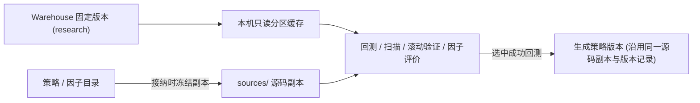

# Lab 研究服务

Lab 是由 Terminal 启动并看护的本机 Python 服务，负责策略与因子管理、回测、参数扫描、滚动验证及研究记录持久化。它只读取 Warehouse 的固定数据版本，不采集数据，也不运行实盘策略；关闭 Terminal 会随之结束 Lab，但不影响远程 Warehouse 与 Trading。

内置方法、公式与论文来源见[内置因子与策略](catalog.md)，内部架构与通信时序见[开发者导读](architecture.md)，本机目录与运行方式见[部署与运行](deployment.md)。

Lab 使用本机保存的 Warehouse 地址与客户端证书直连 Warehouse；未配置时仅数据请求报错，已有研究结果仍可浏览。界面通过 `protocol/proto/asterion/lab.proto` 经本机 Unix socket 调用 Lab。

## 固定数据版本



- 回测、参数扫描与因子评价在接纳瞬间即固定研究数据版本，不受后续采集影响；扫描的全部候选与滚动验证共享同一版本。指定版本不可读取时直接报错，不回退至最新版。
- Lab 只消费 Warehouse 合成后的统一研究数据集（`research`，见[仓库与固定版本](../warehouse/README.md#仓库与固定版本)），不选底层来源；日线与分钟回测共享同一版本。
- 缓存位于 `<根>/lab/data/lab/warehouse-cache/research/`，可随时删除重建。日线按交易所在时间窗内拉取（覆盖换月判定所需前后交易日），分钟线按合约与交易日按需下载；价格与数量维持精确十进制，单日单合约分区不跨来源拼接。
- 缓存未齐全时，已采集合约列表与默认研究日期范围直接读取 Warehouse 的固定版本覆盖并仅拉取合约名称表；缓存齐全时在本机统计。理由：打开合约列表必须快速返回，避免首次拉取全量日线拖慢交互。

## 主力连续

- **换月规则**：按前一交易日持仓量最大原则选定主力（限于当日有结算价的当月及后续交割月），只向后换月、次日生效。回测从 `begin_day` 前一交易日锚定首日主力，确保 `begin_day` 当天即可交易；合约到期换月依据自身最后结算日判定，不依赖回测结束日 `end_day`。用于交易的主力序列不持有至最后一天，最后交易日即切往其余月份中持仓最大者。
- **当时比值复权**：换月时刻，`ctx.history` 中既有的开高低收乘以“新旧合约前一交易日结算价之比”，新合约保持原始价格。后续行情绝不回溯改写历史时点看到的价格，延长回测区间不改变既有决策；策略自行缓存的价格不受调整，可通过 `bar.contract` 变化感知换月。因子评价同样按换月分段传入各时点当时的复权序列，不向更早分段透漏未来换月比例。
- **严谨性**：缺少可选主力或换月结算价时回测直接失败，不做推算。主力连续序列仅用于生成信号，全部撮合成交均落在真实交割月合约上。
- **期限结构、近远月收益与 PIT 基本面字段**：
  - 在当前主力之后的在市交割月中，按前一交易日持仓量选出次主力（无未来函数），以同根 K 线收盘价计算年化对数展期收益率 `roll_yield = 12 * ln(P_主力 / P_次主力) / 交割月差`（贴水为正、升水为负），同时提供次主力收盘价 `far_close` 及各自**同一合约**的单根简单收益 `near_return`、`far_return`（换月当日仍按新合约自身前一根收盘计算，不受换月跳空污染，用于 `basis_momentum`）。上述字段在因子评价、日线/分钟回测、预热与 Trading 实盘中保持一致；固定月份合约、已处最后在市月份或次主力缺 K 线时取 `NaN`。
  - 当固定数据版本包含 `warehouse_receipts`、`member_positions` 或 `inventory` 分区时，Lab 按严格 PIT（Point-in-Time）规则对齐品种级字段 `receipt_volume`（注册仓单量）、`member_long` / `member_short`（前排会员多/空持仓汇总）与 `inventory_total`（周度库存总量）：盘后报告仅在报告日 15:00 收盘之后且不早于 `published_ms`（如有）的 K 线上可见，避免当日收盘前视；汇总时优先累加明细行、避免与“合计/总计/小计”行重复计数，超有效期（日频 14 天、周频 21 天）回退 `NaN`。上述字段随预热 K 线一并纳入 SHA-256 摘要校验；Trading 实盘无实时基本面流时对应字段留空（`NaN`）。换月复权仅缩放 OHLC，不缩放期限结构与基本面字段。

## 策略

策略与因子存放在本机固定策略目录（路径见[本机数据目录](../development.md#本机数据目录)）。研究页的“策略”和“因子”视图自动扫描并列出全部公开模块，支持新建（自带可运行模板）、内置编辑与删除；内置模块来自仓库 `research/` 并随安装包更新，Lab 每次启动同步为只读文件，新建模块不可与内置同名。研究与交易共用 `apps/services/common/python/asterion_strategy.py`：

```python
from asterion_strategy import Strategy

class MaCross(Strategy):
    """Long while the fast average of closes is above the slow one, short below it."""
    params = {"fast": 5, "slow": 20, "lots": 1}

    def ready(self, ctx):
        need = self.params["slow"]
        return all(len(ctx.history(symbol, "close", need)) == need for symbol in ctx.symbols)

    def on_bar(self, ctx, bar):
        closes = ctx.history(bar.symbol, "close", self.params["slow"])
        if len(closes) < self.params["slow"]:
            return
        up = closes[-self.params["fast"]:].mean() > closes.mean()
        ctx.target(bar.symbol, self.params["lots"] if up else -self.params["lots"])
```

- **发现与调用**：`strategies/` 下非下划线开头模块中的公开 `Strategy` 子类即为一个策略（标识 `<模块>.<类>`），可自由导入策略目录内的其他模块。策略可直接调用因子函数——通过 `ctx.factor(momentum, symbol, lookback + 1, lookback=lookback)` 对最近 `count` 根 K 线求末值（按因子参数名自动提取对应字段），或如内置 `momentum_rank` 般直接传入自选数组。理由：因子评价与实盘策略复用同一函数，无需重写逐根版本；回测副本与策略包均自动纳入所导入的因子模块。
- **依赖边界**：策略与因子在研究、回测与 Trading 中严格限定于同一锁定版本的 Python 标准库、NumPy、SciPy 与 `asterion_strategy`。目录扫描、任务接纳与打包均校验导入范围，禁止依赖 Lab 私有数据分析或报表库（理由：通过评价的因子必须能够直接进入实盘策略）。
- **参数与回调**：`params` 仅支持 `bool`、`int`、`float`、`str`，运行时覆盖须保持同类型。单品种策略实现 `on_bar`（每根完整 K 线触发一次），多品种组合策略改写 `on_bars`（同一时刻完成的 K 线打包交付，休市或无 K 线的品种缺席）。
- **就绪与下单目标**：每次决策后检查 `ready(ctx)`；未就绪时丢弃当期及未执行目标，不再发新委托、保留既有持仓，再次就绪后仅执行新目标（实盘强制显式实现 `ready`）。`ctx.history(symbol, field, count)` 返回最近 `count` 个值的只读 NumPy 数组；`ctx.target(symbol, lots)` 指定整数手数，`ctx.weights({symbol: weight})` 指定权益占比，同一策略二选一（组合上限 64 个品种/合约），目标自下一根 K 线起由 C++ 内核换算并执行风控。`asterion_strategy` 另内置严格因果时序算子（`ts_mean`、`ts_std`、`ts_delta`、`ts_pct_change`、`ts_rank`、`ts_zscore`、`ts_corr`、`decay_linear`、`ts_ewma_vol`）、期货板块映射与截面清洗工具（`product_sector`、`winsorize_mad`、`cross_section_zscore`、`cross_section_rank`、`sector_neutralize`、`orthogonalize`、`liquid_symbols`）、组合构建原语（`vol_target_weights`、`cap_sector_weights`、`smooth_weights`、`drawdown_scale`）及单实例多子策略权重合成基类 `CombinedStrategy`（支持可选动态波动率平价、板块总/净敞口限额与权重平滑死区，内置 `composite.CompositePortfolio` 可直接回测并部署）。
- **源码冻结与打包**：Terminal 编辑器中的未保存草稿随工作区保留，发起回测或因子评价前先统一保存（保存失败不运行，确保冻结源码与所见一致）。接纳时将策略模块及目录内传递导入的本地模块（上限 16 MiB，范围与[策略包](../trading/README.md#策略包)一致）复制到 `sources/`，本次回测、扫描候选与滚动验证全部从中导入，后续编辑互不干扰；若目录受 Git 管理，另记提交号与未提交改动摘要。从成功回测生成策略包时直接打包该冻结副本并附带运行元信息（扫描须选中具体候选，滚动验证须回到单个候选）；交易页亦可显式改从当前策略目录打包。

## 因子

因子是策略目录 `factors/` 下各模块的公开函数，标识为 `<模块>.<函数>`：

```python
import numpy as np

def momentum(close, lookback: int = 20):
    """Return over the last `lookback` bars."""
    result = np.full(len(close), np.nan)
    result[lookback:] = close[lookback:] / close[:-lookback] - 1
    return result
```

- **接口契约与自动前视检验**：参数名匹配 K 线字段（`open`、`high`、`low`、`close`、`volume`、`open_interest`、`roll_yield`、`far_close`、`near_return`、`far_return`、`receipt_volume`、`member_long`、`member_short`、`inventory_total`）时接收只读一维数组，其余参数必须有默认值。返回同长一维数组，预热不足或缺测填 `NaN`；任一时点输出只能依赖当前及之前的数据，追加未来 K 线不得改写历史值。每次因子评价运行前自动执行 `verify_factor_causality` 前缀截断检验，存在未来函数时直接拒绝。
- **窗口核验**：`ctx.factor` 的 `count` 包含当前 K 线，须覆盖因子所需全部历史（如 `lookback` 期收益需 `lookback + 1` 根）。可用 `asterion_strategy.check_factor(momentum, {"close": prices}, count=21, lookback=20)` 在含预热与缺测的短样本上逐截断点验证无未来函数且短窗口末值一致；依赖完整前缀历史的因子应直接传入完整前缀。
- **评价口径、清洗与正交剥离**：品种可填具体合约、品种主力连续或交易所代码（自动展开该交易所在区间内有日线的全部品种）。前瞻收益支持次根开盘可执行口径（`open[t+1] -> open[t+h+1]`，终端默认）与收盘对收盘口径（`close[t] -> close[t+h]`），并支持近 20 根日均成交量/持仓量流动性过滤（掩码不丢行，保留平仓价）、截面 MAD 去极值、Z-Score / 截面排名标准化、中国期货板块中性化（黑色、有色、贵金属、能化、油脂油料、农副、金融）、滚动 20 日波动率归一化收益，以及按指定基准因子做每日截面 OLS 残差正交剥离以检验增量 IC。同时勾选多个因子时计算每日截面秩相关均值矩阵（有效截面 ≥ 3 品种），支持等权或仅用已实现前瞻收益的历史滚动 IC 加权合成（无未来函数）。每个持有期统计 IC 均值、标准差、IR、t 值（重叠自由度按 `天数 / h` 计）与正 IC 占比；指定留出日时严格确保样本内出场时点不跨越留出日边界。
- **分组收益、成本估算与超时**：每日按因子值等分组，累乘各组下一根 K 线平均收益并绘制多空（最高组减最低组）曲线；填写单边成本（bps）时按每日多空组换手叠加扣费多空净值曲线，直观暴露高换手幻觉。评价列表保留分组换手率与留出期统计，供因子库直接排序展示。因子评价仅使用日线，单次限时 25 秒（超时请缩小品种或区间）。
- **持久化**：接纳时同样冻结因子模块及其导入的本地模块，结果按评价 ID 存入 `factors/<名称>.binpb`（内含冻结模块源码、数据版本、代码提交与参数），后续修改源码不影响已存报告。

## 回测

品种支持具体合约（`SHFE/rb/2027-01`）或主力连续（`SHFE/rb`）。合约乘数取自固定版本合约表并用成交额交叉核对，最小变动价位取同版本[历史报价单位](../warehouse/README.md#历史最小变动价位)（缺失或冲突即失败，夜盘按所属交易日查询）。

| 频率 | 完整性要求 | 特殊处理 |
| --- | --- | --- |
| **日线** | 存续期内每日有明确日历；开市日有日线与结算价；非零成交日有完整 OHLC | 明确零成交且无行情日仅逐日结算、不交付 K 线；时间标签记为当日 15:00 |
| **分钟线**（1/5/10/15/30/60） | 满足日线全部要求；除日线明确零成交外必须有分钟线，缺失即失败（不用日线结算填补） | 按交易时段聚合；周期内缺分钟或不完整时，撮合、策略与历史预热均跳过。分别统计不完整周期、整段缺记录周期与明确零成交分钟（周一夜盘起自周五晚；前一工作日休市跳过夜盘，上市日或缺前日历标待核实） |

- **费用、涨跌停与权重执行**：
  - 保证金率与手续费按合约和交易日取固定版本交易所结算参数（缺失即停止）；滑点、委托限额、权重预算及可选 `max_margin_ratio` / `min_rebalance_weight` 由运行配置给出。日线含涨跌停价时自动接入撮合约束（封板不成交且含滑点成交价不越界）；若来源涨跌停价恰好比有效价位少 `0.001` 则按该价位使用（理由：Tushare 存在 69 条上期所黄金记录如此，其余偏差仍严格报错）。
  - `ctx.weights` 按当时价、当日方向保证金率与净持仓换算整数手（超保证金率上限同比例缩权；同向低于阈值的小偏离维持原手数，平仓与反手不受抑制）。
  - 策略就绪期间目标持续有效，下一根 K 线按开盘价 ± 滑点主动成交；超单笔上限及反手先平后开在同根 10% 量限内分腿完成，余量在后续 K 线续做（与 Trading 实盘对齐）。组合回测同一时刻先全盘按开盘价估值，完成当前有 K 线合约的全部减仓后再开仓，两轮共用各合约成交量额度（理由：释放资金与持仓额度不应依赖合约顺序），收盘再统一记一次组合权益。
- **统计、归因诊断与拒绝明细**：
  - 基础指标包含总收益、最大回撤、上涨日占比；显式提供年化周期且确认零无风险利率时另算年化收益、波动率、夏普与卡玛比率（首日自初始入金起算）；指定留出日时分段统计。主力换月交接腿与建平仓合算为一笔完整回合交易统计胜率与盈亏。
  - 回测与滚动验证同时持久化结构化归因诊断（`diagnostics`）：FIFO 完整回合交易质量（回合数、胜率、盈亏比、盈利因子、平均持仓天数）、成本分解（毛盈亏、手续费、估算滑点与净盈亏，净盈亏与账户权益增量精确对齐）、风险敞口与换手（年化换手、最长水下天数、均值/峰值保证金率、峰值杠杆、均值净敞口，以及逐日保证金率/总杠杆/净敞口/日收益序列）、Top 5 最大回撤区间、同品种池复权等权持有基准、跨实验累计尝试次数与 PIT 基本面依赖标记、多空方向拆分、分品种/分板块盈亏归因；对 `CombinedStrategy` 另记录各子策略就绪率、有效配权、平均毛权重、组合权重贡献与代理收益贡献；策略声明 `source_evaluation` 或 `source_runs` 时同时持久化研究血缘（`lineage`）。
  - 委托与成交同时记录交易日与实际时间（周五夜盘归下周一）。因风控或资金被拒的目标按合约、手数与原因汇总展示（理由：不记录便难以察觉目标未到位）。账本与撮合细则见[回测的账本、费用与撮合](../trading/README.md#回测的账本费用与撮合)。

### 回测引擎与换月

`asterion_engine` 将 `core` 的 `Replay` 暴露给 Python：


- 挂单仅在单根 K 线内有效，每日收盘后撤余单并逐日结算。换月两腿按开盘价执行：换月日起先平旧月，平完后下一根开新月，换月成本即两腿手续费与滑点。
- 未就绪期间暂停换月，恢复就绪后继续。参与回放的各交割月行情与结算数据保留至回测结束或摘牌以支持结算与延迟换月；日线价格与分钟线仅要求覆盖主力期（含前一日与交接日）及仍持仓日（理由：已换出且无持仓的旧月缺价不影响回放）。
- 分钟聚合将开盘前集合竞价的成交并入首个连续交易周期（与实时 K 线一致），零成交竞价行不计入；该周期仍须具备全部连续交易分钟，集合竞价不可替代缺失分钟。

## 参数扫描与滚动验证

策略库支持勾选多个策略发起批量回测：各策略采用默认参数，共用当前回测条件（品种、区间、周期、费用、风控与留出日）及同一数据版本与源码快照（理由：条件一致排名才有可比性）。多品种时各策略在单账户内组合合跑，排队、并发上限与取消沿用参数扫描机制。

- **参数扫描与滑点压力测试**：按独立品种（若指定）与参数取值的笛卡尔积展开（上限 10,000 组），每组独立回测并并行执行（默认并发数为处理器核数减一）；亦可在固定策略与参数下仅变化 `slippage_ticks` 发起多档滑点压力测试。起止日留空时按固定数据版本自动解析所涉品种的已入库区间；指定留出日时，自动选出留出日之前夏普比率最高的候选。
- **滚动验证**：与留出日二选一，须显式指定年化期数并确认零无风险利率。每轮在训练段（至少 20 个交易日）选夏普最高候选，于验证段跟随其目标，逐轮向后步进验证天数（最多 100 轮）。全部候选成功后自动启动，记为 `<扫描ID>-rolling` 并单算样本外指标，同时支持 `ctx.target` 与 `ctx.weights` 策略（轮次切换或权重更新时按验证账户权益与最新收盘价换算整数手）。
- **取消与重启**：取消扫描会移除未启动候选并终止运行中的候选与滚动验证；Lab 重启后遗留运行标为中断，不自动重跑。

## 运行记录

运行索引、结果表与源码副本目录布局见[本机目录](deployment.md#本机目录)。运行详情保存数据版本、参数与代码来源；列表页从各运行的 `run.json` 读取品种、区间、周期、参数与成交笔数以便直接比较。自定义运行名称存在运行索引中（最长 64 字符，设为空即恢复编号）。

运行完成后，报告的 QuantStats 标签页按需计算索提诺、Omega、溃疡指数、VaR 等指标（限时 60 秒），沿用该次运行保存的年化期数与零无风险利率设置（未指定年化期数时不计算年化指标，避免假设不一致）。

回测、滚动验证、因子评价、实盘对账、目录扫描与报表子进程在导入代码前即绑定父进程 Lab，Lab 退出时随之终止；超时或取消的短任务会先终止并回收子进程再返回。

## 实盘与回测对账

Lab 通过 `reconcile_live` RPC（与 `asterion_lab.reconcile` 命令行工具共用同一核对实现）在固定数据版本上重放实盘窗口回测，将 Trading 录制的策略输入 K 线、原始合约 K 线、目标仓位决策及成交明细与回测逐项比对，并标明决策差异是否由输入 K 线差异引起。对双方匹配到的成交按买卖方向计算有符号不利滑点分布（均值、中位数、P90、最大跳数），用于把真实执行成本回灌至回测条件。

单次运行与参数扫描按 ID 精准读取。回测记录分页加载（筛选与排序覆盖全量历史，参数扫描折叠为一行）；策略页仅拉取各策略最近三次单次运行及各条件下的最新结论与成功运行（不含扫描成员与滚动验证汇总）。策略库仅用当前条件下的最新结果参与排名，若最新结论为失败则退出排名（手动取消或中断不改变结论；数据版本不计入条件，避免每日更新清空排名）。列表读取遇并发删除时自动跳过已删项，不中断整页加载。
