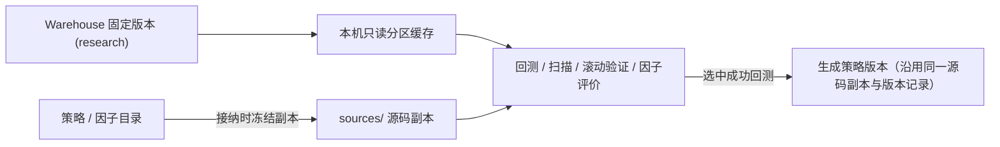
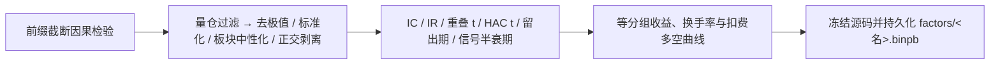
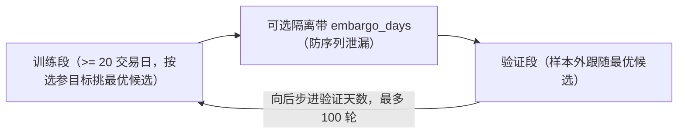

# Lab 研究服务

Lab 是由 Terminal 启动并看护的本机 Python 服务，负责策略与因子管理、回测、参数扫描、滚动验证、因子评价与实盘对账。它只读 Warehouse 固定版本，不采集数据也不运行实盘策略；关闭 Terminal 会随之结束 Lab，但不影响远程 Warehouse 与 Trading。

内置因子与策略见[内置因子与策略](catalog.md)，内部架构见[开发者导读](architecture.md)，本机目录与运行方式见[部署与运行](deployment.md)。

## 固定数据版本



- **版本锁定**：所有研究任务在接纳瞬间固定 `research` 统一数据集版本（见[仓库与固定版本](../warehouse/README.md#仓库与固定版本)），扫描全部候选与滚动验证共享同一版本；指定版本不可读时直接失败，绝不回退最新版。
- **可重建缓存**：缓存位于 `<根>/lab/data/lab/warehouse-cache/research/`，可随时删除重建；日线按交易所时间窗拉取，分钟线按合约与交易日按需拉取，保持精确十进制且单日单合约不跨源拼接。
- **断链与快查**：Warehouse 空闲断链时为当前只读请求重连一次并重校证书与协议；缓存未齐全时直接读取固定版本覆盖统计与合约名称表（理由：打开合约列表必须快速返回，不能因拉取全量日线阻塞交互）。

## 主力连续

- **换月规则**：按前一交易日持仓量最大选定主力（限于当日有结算价的当月及后续交割月），只向后换月、次日生效；从 `begin_day` 前一交易日锚定首日主力，到期换月仅依据合约自身最后结算日（最后交易日即切出），不依赖 `end_day`。
- **当时比值复权**：换月瞬间，`ctx.history` 既有开高低收乘以“新旧合约前一日结算价之比”，新合约保持原始价。绝不回溯改写历史时点看到的价格，延长回测区间不改变既有决策；策略自缓存价格不受缩放，可通过 `bar.contract` 感知换月。
- **严谨性**：缺可选主力或换月结算价时直接失败，不做推算；主力连续仅用于信号，全部撮合均落在真实交割月合约上。


| 扩展字段组 | 字段与口径 | 实盘与换月约定 |
| --- | --- | --- |
| 期限结构与近远月 | 在当前主力之后的在市月份中按前日持仓选次主力，提供 `roll_yield`（年化对数展期收益，贴水为正）、`far_close` 及同合约单根收益 `near_return` / `far_return`（换月日不受跳空污染） | 因子评价、回测、预热与 Trading 实盘口径一致；固定月份、末月或次主力缺线时为 `NaN`；不随换月缩放 |
| PIT 基本面 | `receipt_volume`（注册仓单）、`member_long` / `member_short`（前排会员多空汇总）、`inventory_total`（周度总库存）；累加明细行防与合计行重复计数 | 仅在报告日 15:00 后且不早于 `published_ms` 可见，超期回退 `NaN`；纳入预热摘要，Trading 实盘无实时基本面流时留空；不随换月缩放 |

## 策略

策略与因子存放在本机固定目录（路径见[本机数据目录](../development.md#本机数据目录)）；内置模块来自 `research/` 并在 Lab 启动时同步为只读文件。研究与 Trading 共用 `apps/services/common/python/asterion_strategy/`：

```python
from asterion_strategy import Strategy

class MaCross(Strategy):
    """Long while the fast average of closes is above the slow one, short below it."""
    params = {"fast": 5, "slow": 20, "lots": 1}

    def ready(self, ctx):
        need = self.params["slow"]
        return all(len(ctx.history(symbol, "close", need)) == need for symbol in ctx.symbols)

    def on_bar(self, ctx, bar):
        closes = ctx.history(bar.symbol, "close", self.params["slow"])
        if len(closes) < self.params["slow"]:
            return
        up = closes[-self.params["fast"]:].mean() > closes.mean()
        ctx.target(bar.symbol, self.params["lots"] if up else -self.params["lots"])
```

- **发现、调用与依赖边界**：`strategies/` 下公开 `Strategy` 子类即为一个策略（`<模块>.<类>`），可通过 `ctx.factor(fn, symbol, count, ...)` 直接复用因子函数。运行依赖严格限定于同一锁定版本的标准库、NumPy、SciPy 与 `asterion_strategy`（理由：通过评价的因子与策略必须能零改写进入实盘）。
- **回调、历史与下单目标**：`params` 仅支持 `bool` / `int` / `float` / `str`。单品种实现 `on_bar`，多品种组合改写 `on_bars`（休市品种缺席）。`ready(ctx)` 为假时丢弃当期及未执行目标、保留持仓（实盘强制显式实现）；`ctx.history` 返回只读 NumPy 数组，声明 `history_limit` 时启用按 `2 × history_limit` 压缩的有界存储（组合继承子策略最大上限）；目标二选一：`ctx.target`（手数）或 `ctx.weights`（权益占比，最多 64 项）。
- **源码冻结与打包**：运行前先保存编辑器草稿，接纳时将策略模块及传递导入的本地模块（上限 16 MiB，范围与[策略包](../trading/README.md#策略包)一致）复制至 `sources/`，同时记录 Git 提交号与未提交改动摘要；打包直接沿用冻结副本。

`asterion_strategy` 内置的因果原语（完整签名见模块源码与[内置因子与策略](catalog.md)）：

| 类别 | 代表能力 | 执行说明 |
| --- | --- | --- |
| 时序与微结构算子 | 均值/极值/标准差/EMA/秩/Z-Score/相关/期望短缺、滚动 OLS、Kalman 动态对冲、自相关/偏度/峰度/方差比/Hurst/OU 半衰期、范围波动率（Parkinson/GK/YZ）与价差/VWAP 偏离 | Lab 中核心循环自动路由至 C++ `asterion_engine` 并释放 GIL；Trading 透明回退等价 NumPy 实现 |
| 截面与板块工具 | 中国期货板块映射、MAD 去极值、截面 Z-Score/排名、板块中性化、OLS 正交剥离、量仓流动性过滤 | 严格按当前截面因果计算 |
| 组合与风险配置 | 共同观察基类 `AlignedPortfolio`、尾部选品、波动目标配权、板块敞口裁剪、换手平滑、回撤降权、Ledoit–Wolf 收缩协方差、HRP / ERC / 凸 MVO 配权 | 全部仅使用当前及历史窗口 |
| 多子策略合成 | `CombinedStrategy`（支持 `fixed`、`vol_balance`、`hrp`、`erc` 动态分权及板块/死区约束） | 单账户单实例内合成多条低相关策略 |
| 滚动学习与手数 | 滚动岭回归、随机 Fourier 特征及手数换算工具 | 固定随机种子确保完全复现 |

## 因子

因子是 `factors/` 下的公开函数（`<模块>.<函数>`），参数名匹配 K 线/期限/基本面字段时自动接收只读一维数组，其余参数须有默认值，返回同长数组（预热或缺测填 `NaN`）：

```python
import numpy as np

def momentum(close, lookback: int = 20):
    """Return over the last `lookback` bars."""
    result = np.full(len(close), np.nan)
    result[lookback:] = close[lookback:] / close[:-lookback] - 1
    return result
```



| 维度 | 规则与口径 |
| --- | --- |
| 因果与窗口核验 | 每次评价前自动执行 `verify_factor_causality` 前缀检验，存在未来函数直接拒绝；可用 `asterion_strategy.check_factor` 校验短窗口末值一致性（依赖完整前缀的因子应省略 `count` 且不设 `history_limit`） |
| 品种与收益口径 | 支持具体合约、主力连续或交易所代码（自动展开）；前瞻收益支持次根开盘可执行口径（默认 `open[t+1] -> open[t+h+1]`）与收盘对收盘口径 |
| 清洗、正交与合成 | 支持近 20 根量仓掩码过滤（保留平仓价）、MAD 去极值、Z-Score/排名标准化、中国期货板块中性化、波动率归一化及相对基准因子的每日截面 OLS 残差正交；多因子支持秩相关矩阵、等权或无未来函数的历史滚动 IC 加权合成 |
| 统计与衰减 | 按持有期输出 IC 均值/标准差/IR、重叠自由度 t 值、Newey–West HAC t 值、正 IC 占比、留出期对比（样本内出场不跨界）、分组扣费多空收益、换手率与相邻秩自相关隐含半衰期 |
| 频率与异步执行 | 支持日线及 1–60 分钟线；单因子、合成与批量评价均在异步子进程中并行执行，无同步超时上限，可取消并通过 `get_activity` 追踪 |

## 回测

品种支持具体合约或主力连续；合约乘数取固定版本合约表并用成交额交叉核对，最小变动价位取同版本[历史报价单位](../warehouse/README.md#历史最小变动价位)（缺失或冲突即失败）。

| 频率 | 完整性要求 | 特殊处理 |
| --- | --- | --- |
| **日线** | 存续期内每日有明确日历；开市日有日线与结算价；非零成交日有完整 OHLC | 明确零成交无行情日仅逐日结算、不交付 K 线；时间标签记为当日 15:00 |
| **分钟线**（1/5/10/15/30/60） | 满足日线全部要求；除日线明确零成交外必须有分钟线，缺失即失败（不用日线填补） | 按交易时段聚合，缺分钟或不完整周期跳过撮合、策略与预热；分别统计不完整、整段缺记录与零成交分钟 |

- **费用、涨跌停与权重执行**：保证金与手续费取固定版本交易所结算参数（缺失即停），可选 `fee_multiplier` 仅放大手续费以对齐期货公司加收；日线含涨跌停时自动启用封板约束（Tushare 上期所黄金恰差 `0.001` 的 69 条记录按有效价位处理，其余偏差严格报错）。`ctx.weights` 按当时价与保证金率换算整数手并支持保证金上限缩权与小偏离死区；多品种组合在同一时刻先全盘估值、完成全部减仓后再开仓（两轮共用各合约 10% 量限），避免释放额度依赖合约顺序。账本与撮合细则见[回测的账本、费用与撮合](../trading/README.md#回测的账本费用与撮合)。
- **委托与拒绝明细**：同时记录交易日与实际时间（周五夜盘归下周一），风控或资金拒单按合约、手数与原因汇总。

回测与滚动验证自动持久化的归因诊断（`diagnostics`）：

| 诊断组 | 核心输出 |
| --- | --- |
| 交易质量与基础指标 | 总收益、年化收益/波动/夏普/卡玛（显式确认年化期数与零无风险利率时计算）、最大回撤、留出期分段、FIFO 完整回合胜率/盈亏比/盈利因子/持仓天数（换月腿合并为同一回合） |
| 防过拟合与显著性 | 偏度/超额峰度、PSR、按跨实验累计尝试次数校正的 DSR、Newey–West HAC t 检验、Block Bootstrap 95% 置信区间；扫描完成后自动计算 CSCV PBO 过拟合概率 |
| 成本与风险敞口 | 毛盈亏、手续费、估算滑点与净盈亏精确对齐；年化换手、最长水下天数、峰值保证金率与杠杆、均值净敞口、逐日敞口序列与 Top 5 最大回撤区间 |
| 归因与研究血缘 | 等权持有基准、多空拆分、分品种/板块归因、分钟回测日内分时段归因（夜盘/早盘一二/午盘及开盘 15 分钟）、`CombinedStrategy` 子策略贡献、PIT 基本面依赖标记与 `source_evaluation` / `source_runs` 血缘 |

### 回测引擎与换月

`asterion_engine` 将 `core` 的 `Replay` 暴露给 Python：


- 挂单仅在单根 K 线内有效，收盘撤余单并逐日结算；换月按开盘价先平旧月、平完后下一根开新月，未就绪期间暂停换月。
- 参与回放的各交割月结算数据保留至回测结束或摘牌；日线与分钟线仅要求覆盖主力期（含前一日与交接日）及仍持仓日。
- 分钟聚合将开盘前集合竞价并入首个连续交易周期（零成交不计），但集合竞价不可替代缺失的连续交易分钟。

## 参数扫描与滚动验证



| 模式 | 搜索策略 | 边界与说明 |
| --- | --- | --- |
| 网格枚举（`grid`） | 全笛卡尔积，上限 10,000 组 | 可直接接滚动验证 |
| 拉丁超立方（`lhs`） | 按 `max_trials` 分层采样 | 适合中高维参数空间，可直接接滚动验证 |
| 贝叶斯优化（`bayes`） | Matérn-5/2 高斯过程 + GP-EI / Kriging Believer 分批并行 | 仅用于留出日前开发段寻优，不用于滚动验证（防验证段泄漏） |
| 滑点压力测试 | 固定单次候选，仅扫描多档 `slippage_ticks` | 评估成本敏感度与盈亏平衡滑点（滚动汇总须先选单次候选） |
| 批量回测 | 多策略默认参数共用同一条件、数据版本与源码快照 | 条件一致排名可比，排队与取消沿用扫描机制 |

- **留出日与滚动验证**：两者二选一。指定留出日时自动以留出日前数据评选最优候选；滚动验证须显式指定年化期数与零无风险利率，支持 `sharpe` / `dsr` / `calmar` / `total_return` 四种选参目标，全部候选完成后自动生成 `<扫描ID>-rolling` 样本外记录，同时支持 `ctx.target` 与 `ctx.weights`。
- **并发、取消与重启**：默认按处理器核数减一并行；取消扫描或批量评价会清空排队并终止子进程（标为中断，不计入失败）；`get_activity` 实时汇总活跃任务与最近完成项；Lab 重启后遗留运行标为中断，不自动重跑。

## 运行记录

- 列表页按分页读取全量历史（扫描折叠为一行），自定义名称最长 64 字符；策略库仅用当前条件下最新单次结果排名（数据版本不计入条件，避免每日更新清空排名，最新失败退出排名，取消/中断不改结论）。
- 报告“归因与诊断”页在至少 20 个结算日时按需计算 QuantStats 尾部指标（限时 60 秒，沿用原运行年化设置）。
- 所有子进程在导入代码前绑定父进程 Lab，Lab 退出时随之终止；超时或取消任务先回收子进程再返回。

## 实盘与回测对账

- **核对能力**：`reconcile_live` RPC（与命令行 `asterion_lab.reconcile` 共用实现）按实盘实例首尾 K 线窗口与来源源码/参数在同固定版本上重放回测，逐项比对策略输入 K 线、原始合约 K 线、目标决策（标明是否源于 K 线差异）与成交明细，并输出按买卖方向计算的有符号不利滑点分布（均值/中位数/P90/最大跳数）。成交按委托归属到策略实例，与同合约手工成交隔离；预热摘要按批次边界校验，边界不明则中止。
- **盘后无人值守巡检**：`python3 -I -B -m asterion_lab.post_close` 串联 Warehouse 固定版本数据自检（`asterion_lab.audit`）与多账户实盘对账，任一异常即退出非零并向加密凭据配置的 Webhook 推送去重 JSON 告警。
