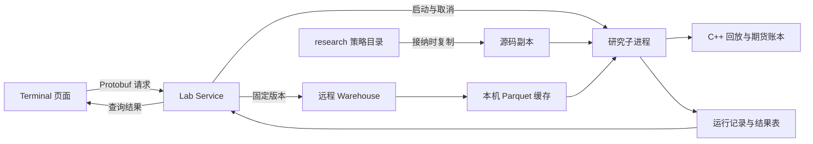
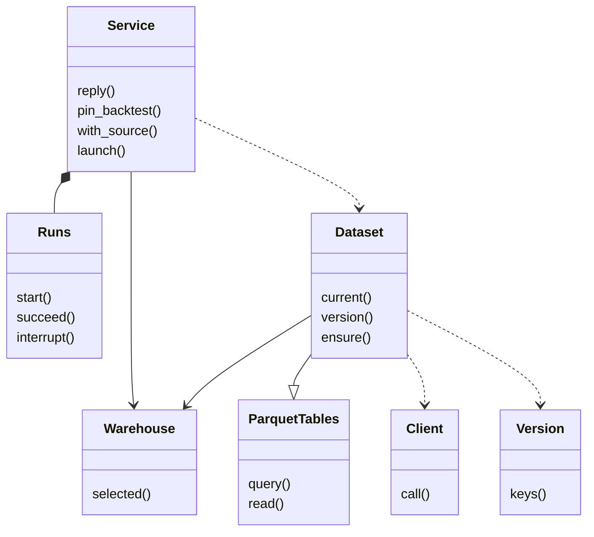
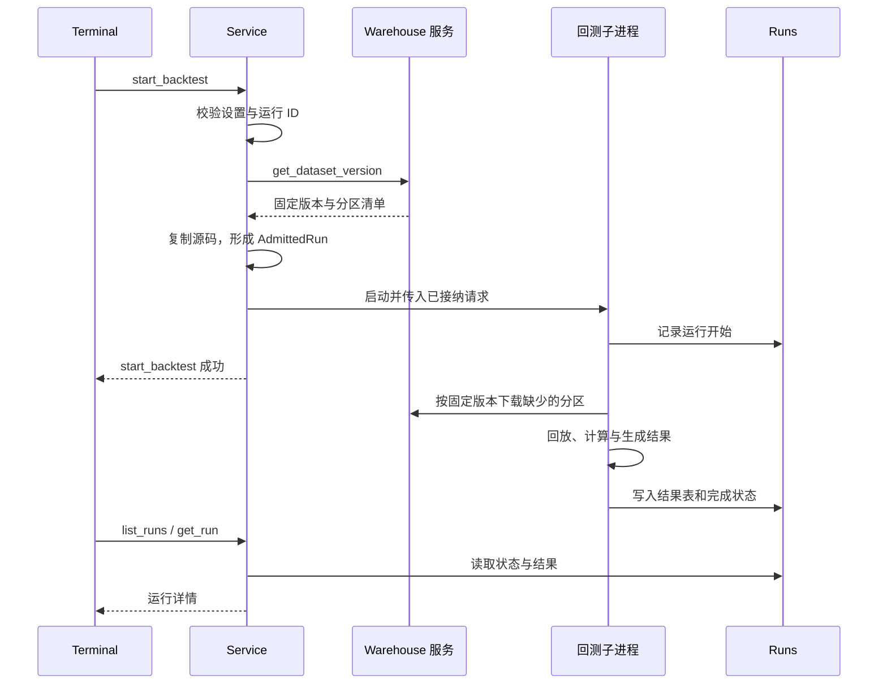

# Lab 开发者导读

功能与研究口径见[Lab](README.md)，目录与运行方式见[部署与运行](deployment.md)。本文说明请求如何固定输入、进入计算进程并形成可读取的结果。

## 服务边界

Lab 是本机研究服务，由 Terminal 启动和看护。它拥有研究记录与可删除的数据缓存；Warehouse 拥有正式数据版本，Trading 拥有账户与实盘策略。理由：研究计算和数据准备不参与交易执行。

- `__main__.py` 接收本机消息并交给 `Service.reply()`，业务调用与健康查询使用独立的 Unix 套接字。
- `Service` 管理请求、扫描排队和子进程生命周期；文件与数据读取交给后台执行，计算放在子进程中，避免阻塞服务响应。
- `Dataset` 只读取固定版本。下载校验完成后才发布缓存文件，避免计算读到不完整分区。
- 回测子进程通过 `asterion_engine` 调用 C++ 回放与账本；因子与报表使用各自的 Python 计算入口。

## 核心类关系

以下为实际 Python 类；模块级的回测、因子和源码操作不表示为类。

`Warehouse` 在这里是远程连接配置的读取器；`Dataset` 是研究数据集客户端，`Version` 描述固定版本的分区清单。它们都不是 Warehouse 服务端的仓库写入器。

## 回测通信时序

请求成功表示运行已接纳，计算完成通过运行查询取得。数据版本与源码副本在接纳时确定，后续采集或编辑不改变这次运行；缺少缓存时仍从原版本补取，不改读最新版本。

扫描只固定一次输入，全部候选共用；候选全部成功后才启动滚动验证。因子评价与回测使用不同计算入口，结果由对应协议消息返回。接口清单见[Lab 通信协议](../protocol.md#9-lab)。

## 生命周期与错误边界

| 情况 | 行为 |
| --- | --- |
| 未配置 Warehouse | 需要数据的请求失败；已有研究记录可继续查看 |
| 分区下载失败 | 本次读取失败，未完成的临时文件清理；完成的缓存保留 |
| 研究子进程启动失败或运行失败 | 保留固定输入和失败原因，后续扫描候选继续；已启动后取消的运行记为中断 |
| 启动请求的等待被取消 | 已启动的子进程继续，Lab 负责记录结果和推进后续任务 |
| 取消扫描 | 取消等待项并终止运行中的候选和滚动验证 |
| Lab 重启 | 先将遗留的运行中记录标为中断，不自动重跑 |
| Terminal 退出 | Lab 随拥有者退出；Warehouse 与 Trading 继续运行 |

## 代码阅读路线

| 顺序 | 入口 | 阅读目标 |
| --- | --- | --- |
| 1 | [__main__.py](../../apps/services/lab/asterion_lab/__main__.py) | 启动参数、消息封帧、拥有者退出 |
| 2 | [service.py](../../apps/services/lab/asterion_lab/service.py) | RPC 分派、输入固定、扫描与子进程调度 |
| 3 | [warehouse_client.py](../../apps/services/lab/asterion_lab/warehouse_client.py)、[warehouse.py](../../apps/services/lab/asterion_lab/warehouse.py) | TLS 请求、固定版本、分区下载和查询 |
| 4 | [repository.py](../../apps/services/lab/asterion_lab/repository.py)、[package.py](../../apps/services/lab/asterion_lab/package.py) | 源码副本、模块编辑与策略打包 |
| 5 | [backtest.py](../../apps/services/lab/asterion_lab/backtest.py)、[rolling.py](../../apps/services/lab/asterion_lab/rolling.py)、[engine](../../apps/services/lab/engine) | 回放输入、目标执行与滚动验证 |
| 6 | [factor.py](../../apps/services/lab/asterion_lab/factor.py)、[report.py](../../apps/services/lab/asterion_lab/report.py)、[runs.py](../../apps/services/lab/asterion_lab/runs.py) | 评价、报表和持久结果 |

验证从 [tests/lab](../../tests/lab) 开始，Python 环境与测试登记见[开发指南](../development.md#测试)。
