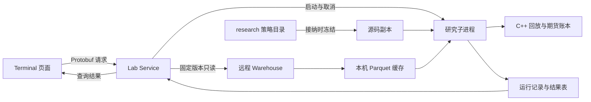
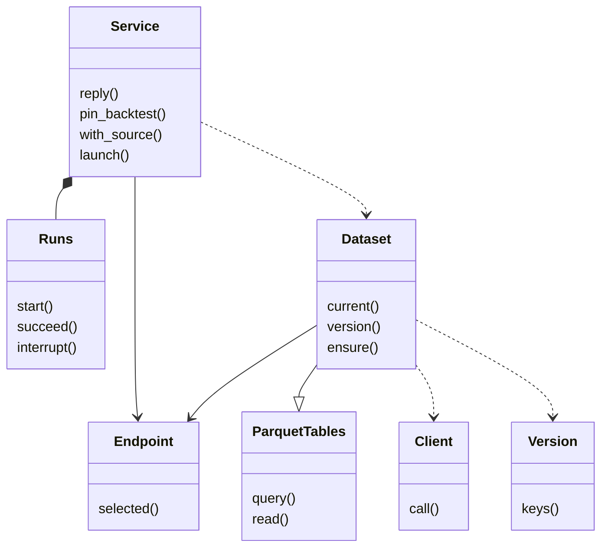
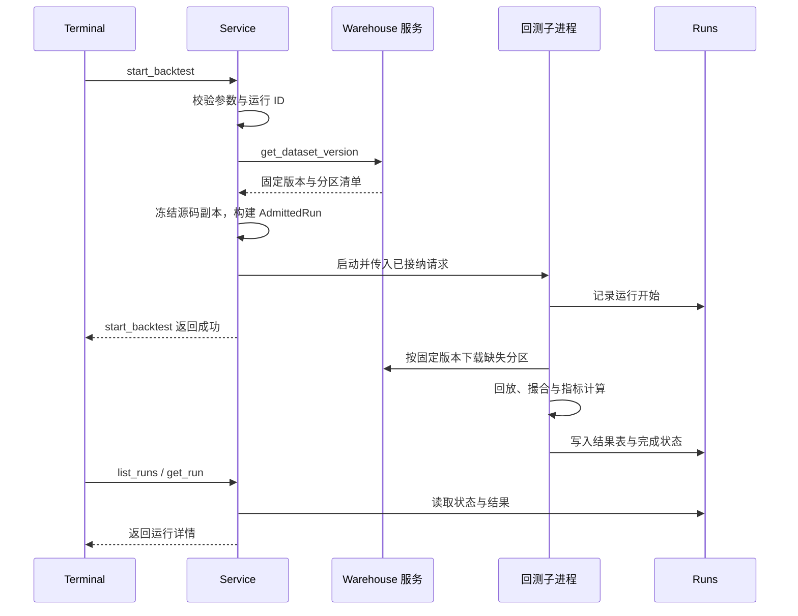

# Lab 开发者导读

研究口径与功能说明见 [Lab](README.md)，本机目录与运行环境见[部署与运行](deployment.md)。本文说明请求如何固定数据与源码输入、调度子进程计算并持久化结果。

## 服务边界

Lab 是由 Terminal 启动并看护的本机 Python 服务，拥有研究记录与可随时删除的数据缓存；Warehouse 拥有正式历史数据集，Trading 拥有实盘账户与策略运行。理由：研究计算与数据准备必须与实盘执行彻底隔离。

- `__main__.py` 接收本机 Protobuf 帧并交由 `Service.reply()` 处理，业务请求与健康探测使用独立的 Unix socket。
- `Service` 负责请求校验、输入固定、扫描队列与子进程生命周期；Warehouse 读取与文件 I/O 交由后台线程池执行，重计算放入独立子进程，避免阻塞服务响应。
- `Dataset` 仅读取固定版本：在单次查询或数据准备期间按线程复用双向 TLS 连接（缺失 16 个及以上分区时并发拉取），对幂等只读请求遇到瞬时 `resource_exhausted` 自动退避重试，并在内存中缓存已解析的版本清单；分区文件在 SHA-256 校验通过后原子落盘，确保计算永不读到残缺文件。
- `Data` 按交易所批量读取日历、合约表与多品种日线，因子评价复用同一份已准备序列，避免按品种重复创建 DuckDB 连接与重复扫描。
- 回测子进程通过 C++ 扩展 `asterion_engine` 调用核心回放与期货账本；因子评价与 QuantStats 报表走各自的 Python 计算入口。

## 核心类关系

下图列出核心 Python 类（模块级回测、因子与源码操作函数不绘制为类）：

`Endpoint` 读取 Terminal 保存的远程 Warehouse 连接配置；`Dataset` 是固定版本研究数据集客户端，`Version` 表示某个固定版本的分区清单。它们均为只读消费端，不含任何仓库写入逻辑。

## 回测通信时序

请求返回成功表示运行已被接纳，最终结果通过轮询查询取得。数据版本与源码副本在接纳瞬间即永久固定，后续采集或源码编辑均不影响本次运行；若缓存缺失仍按原固定版本补拉，不回退到最新版。

参数扫描仅固定一次输入，供全部候选共用；候选启动期间扫描保持活动状态，便于界面持续刷新；全部候选成功后才启动滚动验证。因子评价与回测使用独立计算入口，完整协议清单见[Lab 通信协议](../protocol.md#9-lab)。

## 生命周期与错误边界

| 情况 | 处理行为 |
| --- | --- |
| 未配置 Warehouse | 依赖数据的请求报错；既有研究记录仍可正常浏览 |
| 分区下载失败 | 本次读取报错，清理未完成临时文件，保留已校验缓存 |
| 研究子进程启动或计算失败 | 保留固定输入与失败原因，扫描其余候选继续推进；启动后被取消的运行标为中断 |
| 启动请求等待被取消 | 已启动的子进程继续执行，由 Lab 记录最终状态并推进队列 |
| 取消参数扫描 | 移除等待项并终止全部运行中候选与滚动验证 |
| Lab 重启 | 先将遗留的运行中记录标为中断，不自动重跑 |
| Terminal 退出 | Lab 随拥有者进程自动退出；远程 Warehouse 与 Trading 不受影响 |

## 代码阅读路线

| 顺序 | 入口 | 阅读目标 |
| --- | --- | --- |
| 1 | [__main__.py](../../apps/services/lab/asterion_lab/__main__.py) | 启动参数、Unix socket 封帧与拥有者存活监测 |
| 2 | [service.py](../../apps/services/lab/asterion_lab/service.py)、[sweeps.py](../../apps/services/lab/asterion_lab/sweeps.py)、[warmup.py](../../apps/services/lab/asterion_lab/warmup.py) | RPC 分派、参数扫描/贝叶斯调度、预热 K 线组装与子进程管理 |
| 3 | [warehouse_client.py](../../apps/services/lab/asterion_lab/warehouse_client.py)、[warehouse.py](../../apps/services/lab/asterion_lab/warehouse.py)、[data.py](../../apps/services/lab/asterion_lab/data.py) | mTLS 请求、固定版本清单、并发分区缓存、DuckDB 查询与合约/主力序列准备 |
| 4 | [repository.py](../../apps/services/lab/asterion_lab/repository.py)、[package.py](../../apps/services/lab/asterion_lab/package.py) | 源码冻结副本、模块读写与策略打包 |
| 5 | [backtest.py](../../apps/services/lab/asterion_lab/backtest.py)、[rolling.py](../../apps/services/lab/asterion_lab/rolling.py)、[engine](../../apps/services/lab/engine) | 回放执行、目标换算、滚动验证与 C++ 扩展 |
| 6 | [factor.py](../../apps/services/lab/asterion_lab/factor.py)、[report.py](../../apps/services/lab/asterion_lab/report.py)、[runs.py](../../apps/services/lab/asterion_lab/runs.py) | 因子评价、QuantStats 报表与结果存储 |
| 7 | [reconcile.py](../../apps/services/lab/asterion_lab/reconcile.py)、[reconcile_live.py](../../apps/services/lab/asterion_lab/reconcile_live.py)、[reconcile_diff.py](../../apps/services/lab/asterion_lab/reconcile_diff.py) | 实盘记录读取、回测重放与逐项对账 |

测试位于 [tests/lab](../../tests/lab)，Python 测试环境准备见[开发指南](../development.md#测试)。
