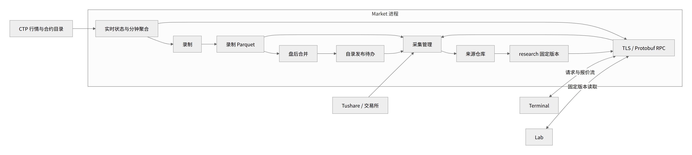
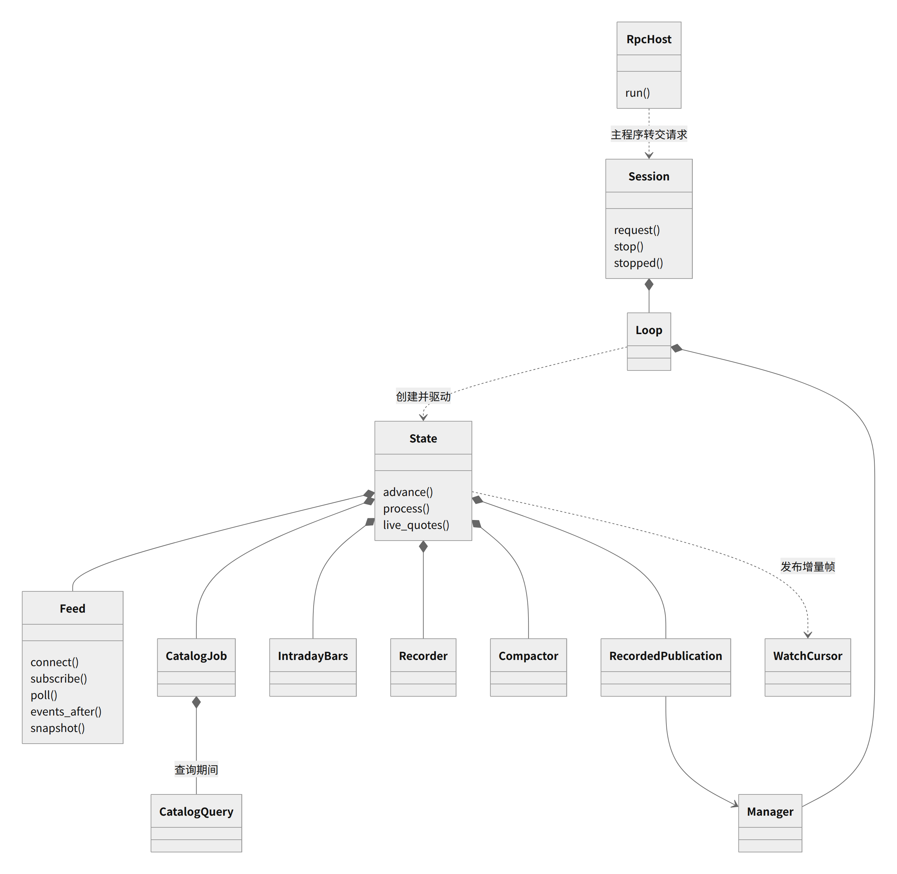
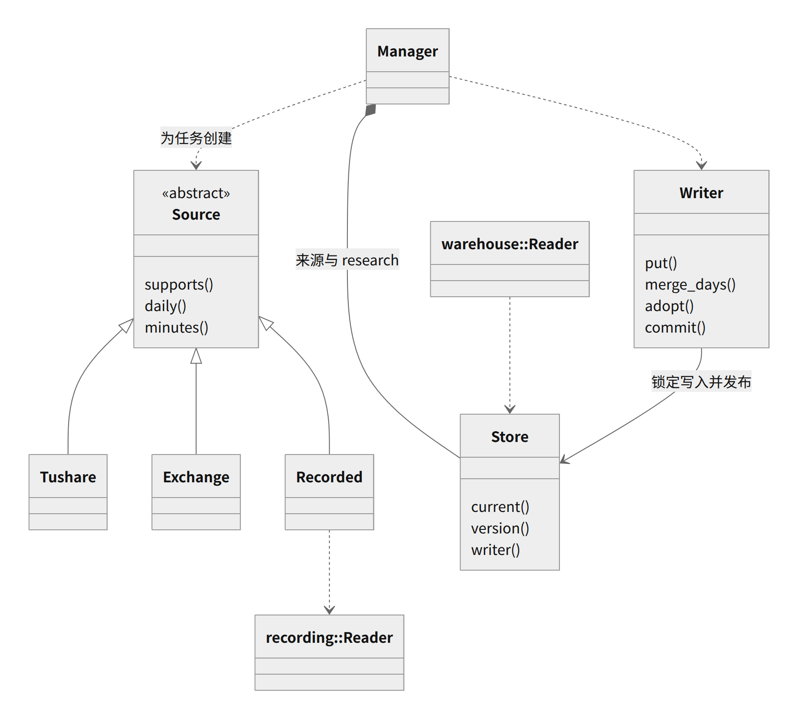
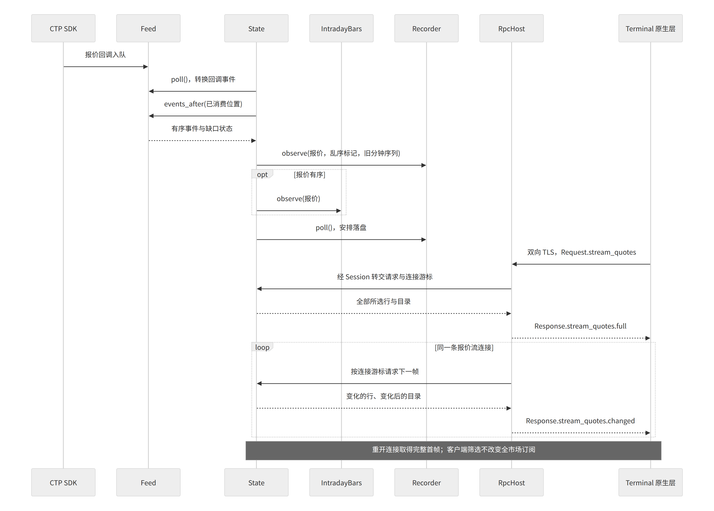
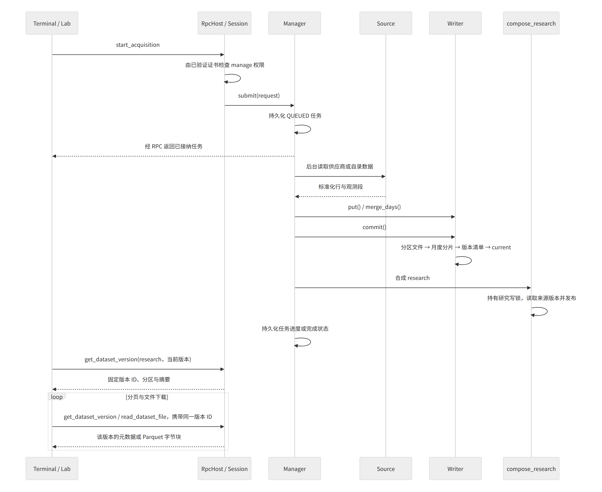

# Market 开发者导读

先读[功能与协议](market.md)，再按本文的图找到代码入口；安装和数据目录见[录制与部署](recording.md)，产品边界见[总体架构](architecture.md)。图中的类名对应当前 C++ 实现，省略私有辅助类和字段。

## 服务边界与数据流

Market 是由 systemd 看护的 Linux C++ 进程，拥有共享行情、录制文件、采集任务和正式仓库。Terminal 与 Lab 是客户端；Trading 独立连接柜台，不经过 Market 获取策略行情。理由：研究和看盘的生命周期不影响交易执行。

[Mermaid 图源](diagrams/market/architecture.mmd)

- 实时报价快照供界面展示，有序行情事件供聚合和录制，避免界面合并报价时丢掉录制输入。
- 行情状态由 `State` 顺序更新；SDK 回调只交付事件，SDK 调用和释放交给其执行器，避免柜台调用拖住状态处理。
- 历史读取、采集、录制写入和合并通过各自的后台执行路径完成。录制与仓库使用不同的 Parquet 执行通道，避免历史查询占住录制写入。
- 合并替换录制文件时与录制历史读取互斥；固定仓库版本引用不可变文件，因此后续合并不会改变研究已选的数据。

## 核心类关系

实心菱形表示拥有，箭头表示使用或调用。`State` 是 `session.cpp` 内部类型，由 `Loop` 的运行过程创建；`WatchCursor` 属于一条连接的待回复对象，只由行情状态路径更新。

[Mermaid 图源](diagrams/market/runtime-classes.mmd)

采集与仓库分开：来源适配器负责供应商数据转换，`Manager` 负责任务与提交，`Store` 负责固定版本。两个 `Reader` 分别读录制归档和正式仓库，不要混淆。

[Mermaid 图源](diagrams/market/warehouse-classes.mmd)

## 实时通信时序

服务启动时自行登录、加载缓存目录并刷新目录，随后订阅全市场；这些操作不依赖客户端打开页面。合约查询使用 CTP 交易接口，入口是 `CatalogQuery`；行情接收入口是 `Feed`。

[Mermaid 图源](diagrams/market/live-sequence.mmd)

`Recorder::observe()` 在分钟聚合前调用，是为了先保留换交易日前的旧分钟序列。报价乱序仍录制，但不推进实时分钟聚合。页面通过原生层取走报价帧；原生层持有 TLS 连接，页面按生成的 Protobuf 类型合并报价。

## 采集、发布与固定版本读取

[Mermaid 图源](diagrams/market/acquisition-sequence.mmd)

录制自动发布复用上述采集路径：`Compactor` 报告完成日期，`RecordedPublication` 将日期保存到 `recordings/unpublished.json`，再提交 `recorder` 任务。任务成功且期间没有再次合并才移除待办；失败保留待办并延后再试，重启重新读取待办。理由：录制文件已存在后，研究发布可以独立补做。

`research` 的选择规则只维护在[功能文档](market.md#仓库与固定版本)。`Writer::adopt()` 用硬链接引用选中的分区，旧版本仍引用原文件；无内容变化不生成新版本。

## 生命周期与错误边界

| 情况 | 行为与代码入口 |
| --- | --- |
| 客户端关闭 | 释放该连接与报价流游标；服务仍录制，已接纳的采集继续，见 `main.cpp` |
| 行情中断 | 中断分钟观测、结束录制段；重连后继续，见 `State::advance()` |
| SDK 入口丢事件 | 结束本次服务运行，由 systemd 重启，见 `Feed::poll()` 与 `State::advance()` |
| 磁盘积压 | 录制丢弃积压区间并报告丢失计数，行情继续，见 `Recorder::flush()` |
| 交易日结束 | 收尾分钟落盘、盘后合并、提交发布待办，见 `Recorder`、`Compactor`、`RecordedPublication` |
| 服务正常停止 | 停止接纳、结束后台资源、写完录制缓冲，见 `main.cpp` 与 `State` 析构 |
| 服务重新启动 | 恢复合并日志、读取发布待办；旧采集任务标为中断，见 `Session::Loop`、`Manager` |

## 代码阅读路线

| 顺序 | 入口 | 阅读目标 |
| --- | --- | --- |
| 1 | [main.cpp](../apps/services/market/main.cpp)、[settings.cpp](../apps/services/market/settings.cpp) | 配置、数据目录锁、TLS 身份、权限和停止流程 |
| 2 | [session.cpp](../apps/services/market/session.cpp) | 请求分流、状态所有权与各模块衔接 |
| 3 | [ctp_feed.cpp](../apps/services/common/market/ctp/ctp_feed.cpp)、[catalog_job.hpp](../apps/services/market/catalog_job.hpp) | 回调与状态分离、目录刷新、全市场订阅 |
| 4 | [intraday_bars.cpp](../core/src/futures/intraday_bars.cpp)、[recorder.cpp](../apps/services/market/recording/recorder.cpp) | 累计成交量、分钟完整性、录制观测段 |
| 5 | [compaction.cpp](../apps/services/market/recording/compaction.cpp)、[recorded_publication.cpp](../apps/services/market/acquisition/recorded_publication.cpp) | 归档替换与发布恢复 |
| 6 | [manager.cpp](../apps/services/market/acquisition/manager.cpp)、[source.hpp](../apps/services/market/acquisition/source.hpp) | 来源扩展、任务生命周期与批量提交 |
| 7 | [store.cpp](../apps/services/market/warehouse/store.cpp)、[research.cpp](../apps/services/market/warehouse/research.cpp) | 不可变版本、月度分片、来源合成 |
| 8 | [通信协议](protocol.md)、[market.proto](../protocol/proto/asterion/market.proto) | 客户端契约与固定版本读取 |

改动后的行为验证从 [tests/market](../tests/market) 对应测试开始；跨客户端与重启行为看 [concurrency_process.py](../tests/market/concurrency_process.py)，真实行情验收入口是 [ctp_market.py](../tests/acceptance/ctp_market.py)。协议或上述所有权发生变化时，同步更新对应图与说明。
