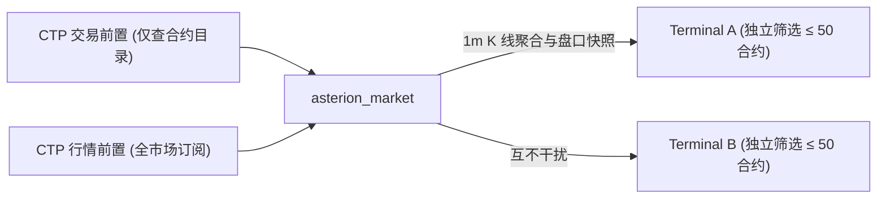

# Market 行情服务

`asterion_market` 是 Linux 上的一个 C++ 服务，只做一件事：连接 CTP，把全市场的实时报价和当日分钟线分发给 Terminal。它不含下单代码，也不读写历史数据，和 Warehouse 没有任何通信。安装和配置见 [Market 部署](deployment.md)。

## 实时行情

- **启动与全市场订阅**：启动后主动登录 CTP、读取期货合约目录并订阅全市场（启动先用数据目录中的 `ctp-catalog.pb` 缓存订阅，重连或换日时重读目录并补订新合约）。异常合约跳过并记日志，其余照常订阅；被拒订合约每 5 分钟重试，失败数进入通知中心。
- **报价字段与时间口径**：
  - 包含最新价、五档、开高低、昨结算、昨收、涨跌停、持仓量、成交量、交易日、均价；缺失值保持缺失不补零；郑商所均价按合约乘数归一。
  - 报价时间由 `UpdateTime` 配离接收时刻最近的北京自然日（日盘收到的昨夜缓存归入上一自然日）；交易日取会话交易日并随更晚交易日前移（郑商所夜盘自然日归一到下一工作日）。理由：大商所夜盘 `ActionDay` 填交易日、郑商所夜盘 `TradingDay` 填自然日，原样使用会导致时间超前或交易日落后。Trading 的柜台报价查询采用同一规则。
- **当日 1 分钟线**：按 `core/config/futures-sessions.json` 交易时段聚合，开盘前 5 分钟集合竞价并入首分钟，各小节闭市秒并入上一交易分钟；成交量取累计量差值（跨日无间断观测时首笔含集合竞价整笔计入）。断线、断档或累计量回退时标为不完整；服务启动前的分钟不补。1 分钟涨速 = 最新价相对 60 秒前的变化。
- **多客户端隔离**：客户端不能控制柜台连接或全市场订阅；每条 `stream_quotes` 流独立筛选最多 50 个合约，慢客户端或断开只影响自身。

### 连接恢复与错误边界

| 情况 | 行为与代码入口 |
| --- | --- |
| 连接、登录或重连超时 30 秒 | 结束当前会话，5 秒后重连，避免长期卡在连接中 |
| 柜台未初始化或前置未就绪（CTP 7 / 8） | 10 秒后重试；目录连接中断或超时同此 |
| 登录或认证被明确拒绝 | 停止自动重试，须修正主机凭据后重启（避免锁账号） |
| 其余目录失败 | 每 5 分钟重试；保留已有合约，不断开行情流 |
| 行情中断 | 中断当前分钟观测，重连后继续（`Live::apply()`） |
| SDK 事件队列溢出 | 立即退出并由 systemd 重启，丢观测不冒充完整（`Feed::poll()`） |
| 客户端关闭 | 释放该连接及其报价流（`service.cpp`） |
| 服务正常停止（SIGTERM） | 报价流发出最后一帧后退出（`main.cpp`） |

## 账户

Market 使用单独的行情账户，不得配置实盘交易账户，理由见[交易规则](../safety.md)。它登录行情前置接收报价，登录交易前置只为查询合约目录；开发时可用 SimNow。

## 客户端

- **连接**：在“设置 → 关于”复制客户端证书指纹并登记到 Market 主机，再在“设置 → 行情服务”填写主机、端口与服务端指纹（TLS 1.3 双向固定指纹）。Market 无管理操作，登记客户端均可读取。
- **本机配置**：Terminal 在 `terminal/data/market.json` 保存地址、服务端指纹与自选（最多 50 合约），修改不影响服务和其他客户端。
- **消费协议**：看盘用 `stream_quotes`（首帧 `full` 全量替换，后续 `changed` 按合约更新，带目录时替换目录，断线重开流）；一次性读取用 `get_board`，见[通信协议](../protocol.md#7-market)。分时图按 `core/config/futures-sessions.json` 排横轴，未列出品种按已观测分钟排列。
- **状态提示**：状态栏显示连接、登录与重连；超时或柜台拒绝原因进入通知中心（CTP 7 / 8 常见于结算切日或非开放时段，不代表凭据错误）。

模块测试见 [tests/market](../../tests/market)，真实行情验收入口是 [ctp_market.py](../../tests/acceptance/ctp_market.py)。
