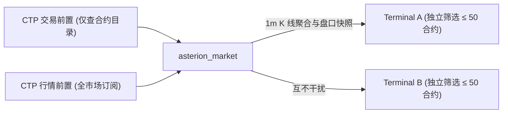

# Market 行情服务

`asterion_market` 是运行在 Linux 主机上的单一 C++ 服务，专注一件事：连接 CTP 并向 Terminal 分发全市场实时报价与当日 1 分钟线。它不含下单代码，也不读写历史数据，与 Warehouse 无任何通信。安装与配置见[Market 部署](deployment.md)。

## 实时行情

- **启动与全市场订阅**：服务启动后主动登录 CTP、读取期货合约目录并订阅全市场（启动先加载数据目录中的 `ctp-catalog.pb` 缓存快速订阅，重连或换日时刷新目录并补订新合约）。异常合约跳过并记日志，其余照常订阅；被拒订的合约每 5 分钟重试一次，失败计数上报通知中心。
- **报价字段与时间口径**：
  - 推送最新价、五档盘口、开高低、昨结算、昨收、涨跌停、持仓量、成交量、交易日与均价；缺失字段保持缺失不补零；郑商所均价按合约乘数归一化。
  - 报价时间取 `UpdateTime` 匹配离接收时刻最近的北京自然日（日盘收到的昨夜缓存归入上一自然日）；交易日取会话交易日并随更晚交易日前移（郑商所夜盘自然日归入下一工作日）。理由：大商所夜盘 `ActionDay` 填交易日、郑商所夜盘 `TradingDay` 填自然日，原样使用会导致时间超前或交易日滞后。Trading 的柜台报价查询遵循同一规则。
- **当日 1 分钟线**：按 `core/config/futures-sessions.json` 的交易时段聚合，开盘前 5 分钟集合竞价并入首分钟，各小节闭市秒并入上一交易分钟；成交量取累计量差值（跨日连续观测时首笔含集合竞价整笔计入）。断线、断档或累计量回退的分钟标记为不完整；服务启动前的分钟不回补。1 分钟涨速为最新价相对 60 秒前的涨跌幅。
- **多客户端隔离**：客户端无法干预柜台连接或全市场订阅；每条 `stream_quotes` 流独立筛选（最多 50 个合约），慢客户端或断线只影响自身。

### 连接恢复与错误边界

| 情况 | 行为与代码入口 |
| --- | --- |
| 连接、登录或重连超 30 秒 | 保持 `RECONNECTING` 状态并保留超时原因，结束当前会话后按退避间隔（5s → 10s → 30s → 60s）重试，避免休市或断网期间状态闪烁与高频刷日志 |
| 柜台未初始化或前置未就绪（CTP 7/8） | 保持 `RECONNECTING` 状态，按退避间隔（10s 起至 60s）重试；目录连接中断或超时自动重试 |
| 登录或认证被明确拒绝 | 停止自动重试，须修正主机凭据后重启，避免锁定账号 |
| 其余目录查询失败 | 每 5 分钟重试；保留已有合约目录，不断开行情流 |
| 行情断线 | 中断当前分钟观测，重连后继续（`Live::apply()`） |
| SDK 事件队列溢出 | 进程立即退出并交由 systemd 重启，绝不以丢观测的流冒充完整（`Feed::poll()`） |
| 客户端断开 | 释放该连接及其报价流（`service.cpp`） |
| 收到 SIGTERM 正常停止 | 报价流发出最后一帧后退出（`main.cpp`） |

## 账户

Market 使用独立行情账户，严禁配置实盘交易账户（理由见[交易规则](../safety.md)）。它登录行情前置接收报价，登录交易前置仅用于查询合约目录；开发阶段可使用 SimNow。

## 客户端

- **连接方式**：在 Terminal 的“设置 → 关于”复制客户端证书指纹并登记到 Market 主机，再在“设置 → 行情服务”填写主机、端口与服务端指纹（TLS 1.3 双向固定指纹）。Market 无管理类写操作，已登记客户端均可读取。
- **本机配置**：Terminal 在 `terminal/data/market.json` 保存地址、服务端指纹与自选列表（最多 50 个合约），修改不影响服务或其他客户端。
- **消费协议**：看盘使用 `stream_quotes`（首帧 `full` 全量替换，后续 `changed` 按合约更新，带目录时替换目录，断线重开流）；一次性读取使用 `get_board`，详见[通信协议](../protocol.md#7-market)。分时图按 `core/config/futures-sessions.json` 排列横轴，未列出品种按实际观测分钟排列。
- **状态提示**：状态栏区分 Terminal ↔ Market 服务断连（红色“中断”）与 Market ↔ CTP 柜台状态（正常连接中/重连中不报红，凭据拒登或缺少 SDK 等终态故障报红）；休市时段可恢复的柜台超时与 CTP 7/8 仅在状态栏静默展示原因，交易时段内降级为通知中心警告且恢复前仅提示一次。

模块测试见 [tests/market](../../tests/market)，真实行情验收入口为 [ctp_market.py](../../tests/acceptance/ctp_market.py)。
