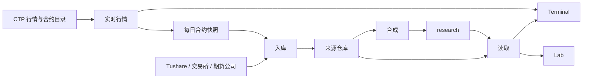
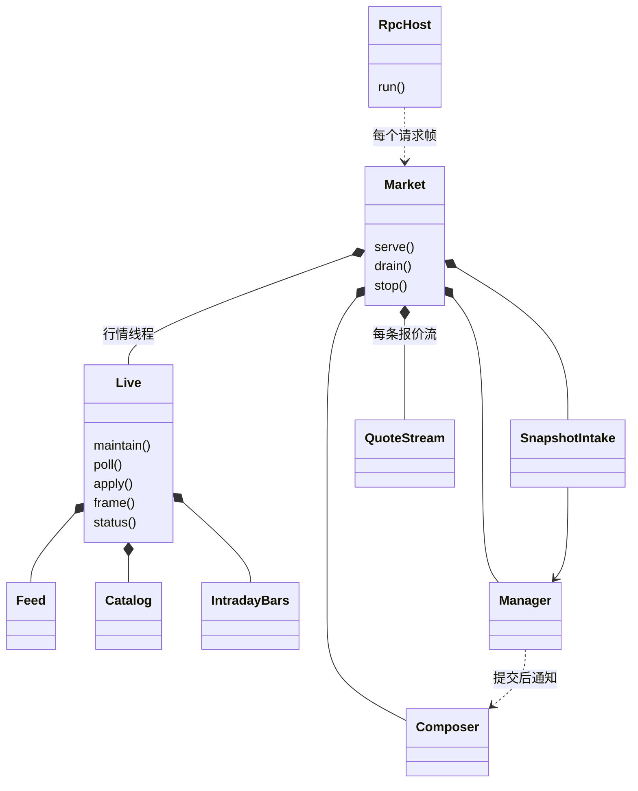
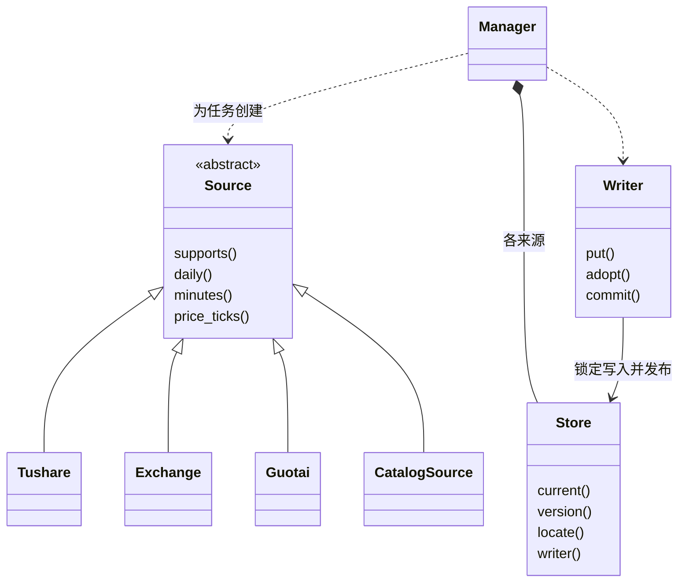
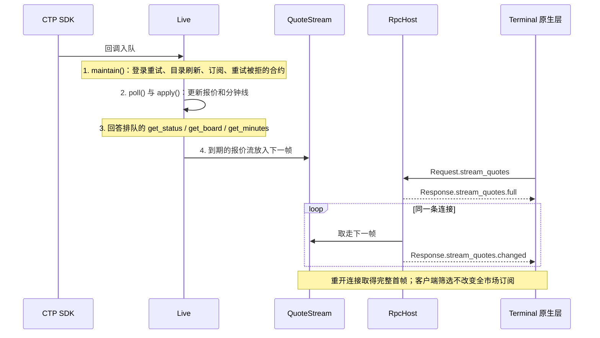
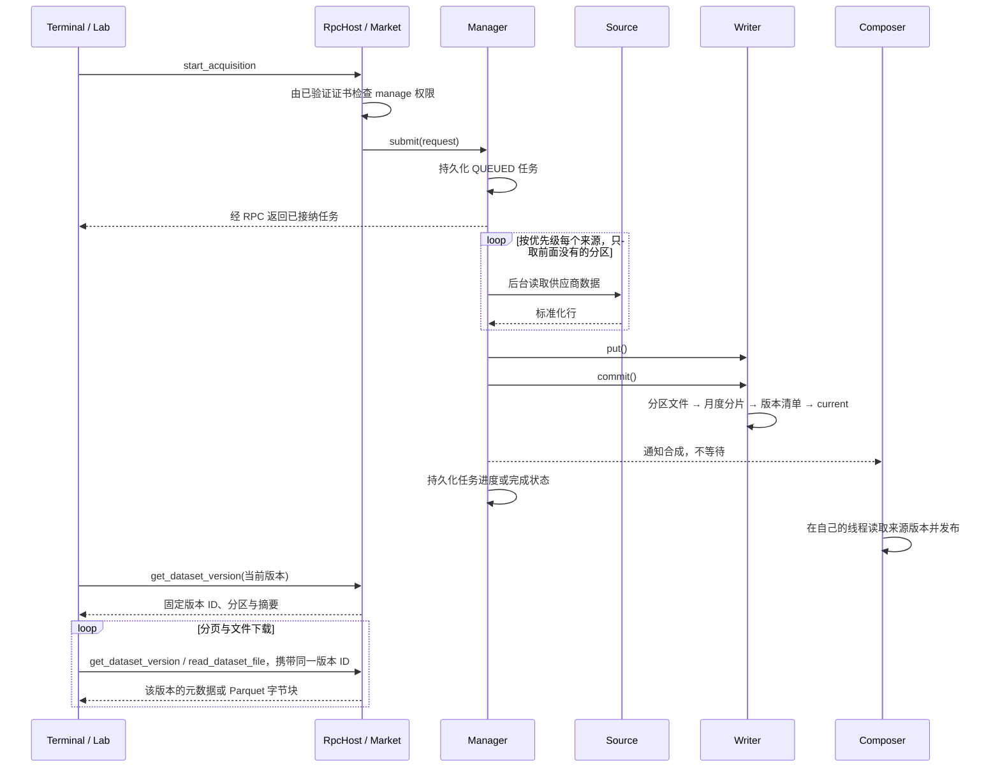

# Market 开发者导读

先读[功能与协议](README.md)，再按本文的图找到代码入口；安装和数据目录见[部署](deployment.md)，产品边界见[总体架构](../architecture.md)。图中的类名对应当前 C++ 实现，省略私有辅助类和字段。

## 服务边界与数据流

Market 是由 systemd 看护的 Linux C++ 进程，拥有共享行情、合约快照、采集任务和正式仓库。Terminal 与 Lab 是客户端；Trading 独立连接柜台，不经过 Market 获取策略行情。理由：研究和看盘的生命周期不影响交易执行。

箭头只往右走，后面的模块不调用前面的模块。Market 不录制 Tick 和分钟线，理由见[产品说明](../product.md)。

| 模块 | 代码 | 只回答 | 不管 |
| --- | --- | --- | --- |
| 实时行情 | `live`、`catalog.hpp` | 现在的报价和今天的分钟线是什么 | 历史数据 |
| 入库 | `acquisition/` | 这个来源这一天的数据取回来了吗 | 研究该用哪份 |
| 合成 | `warehouse/composer`、`warehouse/research` | 研究该用哪份 | 数据从哪取、怎么取 |
| 读取 | `warehouse/reader`、`market.cpp` | 这个固定版本里有什么 | 数据缺了怎么办 |

- 实时行情的构建目标（`asterion_market_live`）不链接入库和仓库，违反时编译失败。
- 每个来源只写自己的仓库，`research` 只由合成写入，Lab 只读 `research`。
- 行情状态只由行情线程更新；SDK 回调只把事件放进队列，SDK 调用和释放交给其执行器，避免柜台调用拖住行情线程。

## 核心类关系

RPC 接入负责收发帧；行情线程拥有 `Live`；`SnapshotIntake` 在自己的线程里把已结束交易日的合约快照入库；`Composer` 在自己的线程里更新 `research`。每个调用走哪条路径，只由 `market.cpp` 的 `route()` 决定。可能耗时的扫描单独排队，理由：Lab 下载和任务查询不等它们。

| 调用 | 路径 | 权限 |
| --- | --- | --- |
| `get_status`、`get_board`、`get_minutes` | 行情线程 | `read` |
| `stream_quotes` | 行情线程持续生成报价帧 | `read` |
| `start_acquisition`、`cancel_acquisition` | 读取线程 | `manage` |
| 摘要、覆盖、参考表、版本历史与比较 | 分析线程 | `read` |
| 其余调用 | 读取线程 | `read` |

来源适配器负责供应商数据转换，`Manager` 负责任务与提交，`Store` 负责固定版本。客户端看不到来源：协议只有一份数据集。

## 实时通信时序

服务启动时自行登录、读取目录缓存并刷新目录，随后订阅全市场；这些操作不依赖客户端打开页面。合约查询使用 CTP 交易接口，入口是 `CatalogQuery`；行情接收入口是 `Feed`。

报价乱序不推进实时分钟聚合。页面通过原生层取走报价帧；原生层持有 TLS 连接，页面按生成的 Protobuf 类型合并报价。

## 采集、发布与固定版本读取

每日合约快照也走上述路径：`SnapshotIntake` 只看磁盘，发现交易日已结束且未入库就提交任务，只用 `ctp` 来源；失败的日期一小时后再试，不影响其他日期。

`research` 的来源选择规则见[功能文档](README.md#仓库与固定版本)。来源顺序只在 `sources_of` 维护，`Manager` 和合成共用。`Writer::adopt()` 用硬链接引用选中的分区，旧版本仍引用原文件；无内容变化不生成新版本。`Composer` 在启动时和每次来源提交后运行，运行期间的通知合并为一次，所以任务完成后 `research` 稍后才更新；合成失败不影响任务，一分钟后重试。

## 生命周期与错误边界

| 情况 | 行为与代码入口 |
| --- | --- |
| 客户端关闭 | 释放该连接与它的报价流；已接纳的采集继续，见 `market.cpp` |
| 行情中断 | 中断分钟观测；重连后继续，见 `Live::apply()` |
| SDK 事件队列溢出 | 终止本次服务运行，由 systemd 重启，见 `Feed::poll()` 与 `Market` 的行情线程 |
| 服务正常停止 | 报价流发出最后一帧、关闭行情、再结束后台任务，见 `main.cpp` 与 `market.cpp` |
| 服务重新启动 | 旧采集任务标为中断，损坏的任务文件只影响它自己，见 `Manager` |

## 代码阅读路线

| 顺序 | 入口 | 阅读目标 |
| --- | --- | --- |
| 1 | [main.cpp](../../apps/services/market/main.cpp)、[settings.cpp](../../apps/services/market/settings.cpp) | 配置、数据目录锁、TLS 身份、权限和停止流程 |
| 2 | [market.cpp](../../apps/services/market/market.cpp) | 调用路径表、行情线程的一轮、报价流 |
| 3 | [live.cpp](../../apps/services/market/live.cpp)、[ctp_feed.cpp](../../apps/services/common/market/ctp/ctp_feed.cpp)、[catalog.hpp](../../apps/services/market/catalog.hpp) | 登录与目录刷新、全市场订阅、报价帧 |
| 4 | [manager.cpp](../../apps/services/market/acquisition/manager.cpp)、[source.hpp](../../apps/services/market/acquisition/source.hpp)、[snapshot_intake.cpp](../../apps/services/market/acquisition/snapshot_intake.cpp) | 来源扩展、任务生命周期与批量提交 |
| 5 | [store.cpp](../../apps/services/market/warehouse/store.cpp)、[research.cpp](../../apps/services/market/warehouse/research.cpp)、[composer.cpp](../../apps/services/market/warehouse/composer.cpp) | 不可变版本、月度分片、来源合成 |
| 6 | [通信协议](../protocol.md)、[market.proto](../../protocol/proto/asterion/market.proto) | 客户端契约与固定版本读取 |

模块测试见 [tests/market](../../tests/market)；跨客户端与重启行为看 [concurrency_process.py](../../tests/market/concurrency_process.py)，真实行情验收入口是 [ctp_market.py](../../tests/acceptance/ctp_market.py)。
