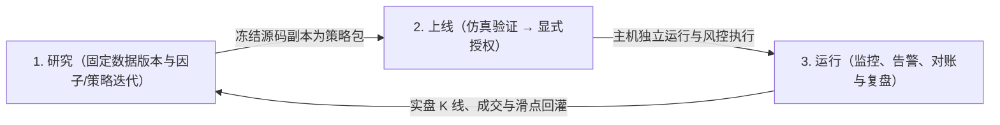

# 产品说明

Asterion Terminal 是面向中国期货市场的个人量化工作台，服务于日线至分钟级的中低频系统化研究与实盘交易。策略与因子使用 Python 编写，同一份代码可不经改写地运行于回测、仿真柜台与实盘；C++ 内核确保每一笔委托都经过显式授权与硬风控、先记录后发送，并可与柜台逐日对账。

产品追求单人可驾驭的机构级严谨度，遵循“桌面研究发布、服务主机自主运行”的边界：桌面端专注看盘、数据管理、研究迭代、策略发布与盘中监控；Linux 服务主机承担实时行情分发、统一版本化历史数据与账户独立执行。关闭桌面端不影响已授权策略运行，实盘运行与盘后数据核验均可脱离人工值守完成并输出对账与告警。

架构与进程分工见[架构](architecture.md)，下单必须遵守的约束见[交易规则](safety.md)，推进顺序与待完成事项见[开发计划](plan.md)。

## 使用者

面向独立量化交易者，由单人完成数据准备、因子与策略研究、上线审查、运行监控与事后复盘——熟悉编程，日常结合外部 AI 助手编写代码与分析研究结果。产品不面向团队，不提供团队工作区、组织审批流、多租户或角色权限。

## 三个循环

产品聚焦于打通以下三个循环。每一项功能取舍，都先回答一个问题：它能否让其中某个循环更快、更严谨或更可靠？

| 循环 | 使用者做什么 | 做好的标准 |
| --- | --- | --- |
| 研究 | 围绕真实历史数据开展因子评价、策略编写、回测、防过拟合体检与多策略合成，配合外部 AI 持续迭代 | 改一行代码到看到结果：日线数秒、一年分钟线数分钟；每日可完成数十次实验；每次结论均可追溯到固定数据版本、冻结源码、参数与研究血缘 |
| 上线 | 将成功回测冻结为不可变策略包，先在仿真柜台验证，达标后以小资金上实盘 | 同一份代码不改写；发布不等于启动或授权；账户显式授权且策略预热就绪后才允许执行 |
| 运行 | 一屏监控账户与策略状态、必要时手工干预，盘后完成对账与复盘 | 实时掌握净值、目标与实际仓位、委托、风控占用与连接状态；暂停新增、停止并撤单、平仓分开确认；脱机异常自动告警，实盘 K 线与成交可逐笔回放对照回测 |

## 范围

| 维度 | 支持范围 |
| --- | --- |
| 市场 | 中国境内期货交易所的期货合约 |
| 平台 | macOS（Apple Silicon）桌面端；Linux x86_64 桌面端及无界面服务器（承担实时行情、历史仓库与实盘执行） |
| 数据 | 统一、不可变、严格 PIT（按可知时点对齐）的中国期货结构化数据集，覆盖三类数据：日线与 1 分钟线量价（及衍生主力连续与期限结构）、交易所规则与每日结算参数（日历、合约表、保证金、手续费、涨跌停、历史最小变动价位）、期货结构化基本面（仓单、会员持仓、库存周报及按需扩展的现货与社会库存）。全部采用真实来源，多源融合与补缺收敛在仓库内部 |
| 研究 | 面向单品种择时/CTA、多品种截面因子与风险溢价、期限结构与 PIT 基本面、统计配对、多策略风险平价组合及轻量滚动/面板统计学习；覆盖因子评价与合成、事件驱动回测（含保证金、手续费、涨跌停、逐日结算与主力换月）、参数扫描与滚动验证、防过拟合与归因体检，以及从因子到实盘的完整血缘追溯 |
| 交易 | 直连 CTP 柜台（先仿真后实盘），仅限价单；支持单品种固定合约、主力连续自动换月与多品种跨时段组合。自动化策略与手工看盘下单共用同一 C++ 风控与账本路径；单账户单策略实例运行，多策略在研究层合成为单一组合，或按独立账户进程物理隔离；支持盘后自动巡检与脱机告警 |
| AI 协同 | 作为外部 AI 助手的一等研究后端：策略与因子采用普通本地源码目录便于任意编辑器与 AI 直接读写，因子评价、回测诊断与实盘对账提供结构化摘要导出，支持假设生成、上线前对抗式审查与盘后归因复盘，并以本地可复现回测证伪 |

## 不做

- **AI 直接交易与非结构化文本驱动**：不内建聊天窗口或 Agent 编排器；绝不让 LLM 参与实时信号生成、自动报单或替代 C++ 硬风控；不做新闻、公告、研报或社媒舆情等非结构化文本语义提取。
- **高频与微结构方向**：决策粒度保持在 1 分钟及以上，不作低延迟承诺；当前不录制也不在历史仓库中维护 Tick 与逐笔盘口数据。
- **主观炒单终端**：提供一体化看盘、手工下单与应急干预，但不追求复杂画线、指标模板或主观条件单等纯手工炒单功能。
- **多市场与多形态扩张**：在期货闭环稳定前不扩展股票、期权与境外市场；不做 Web、移动端、Windows 客户端及独立 Notebook 客户端。
- **团队与平台化功能**：不做团队协作、审批流、多租户、资金托管、跟单及社交功能。

## 原则

- **研究速度优先**：研究循环不够快，产品就失去核心价值；任何拖慢研究循环的机制都必须有充分理由。
- **同一份策略到处运行**：回测、仿真柜台与实盘共用同一套策略接口与数值口径，不为特定环境改写策略。
- **安全靠内核，不靠限制策略语言**：策略只输出目标仓位或权重；授权、风控、先记录后发送、换月合规与对账全部由 C++ 内核强制把关。
- **复现靠自动记录**：数据采用不可变固定版本与严格 PIT 口径；每次运行自动保存数据版本、冻结源码、参数、研究血缘与引擎版本，平时收在详情中不干扰主视图。
- **真实优先**：每个阶段均以真实数据或仿真柜台验收；夹具只用于自动化测试，不能替代真实环境验证。
