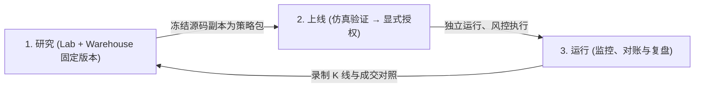

# 产品说明

Asterion Terminal 是面向中国期货市场的个人量化工作台。策略用 Python 编写，同一份代码可不经改写地运行于回测、仿真柜台与实盘；C++ 内核确保每一笔委托都经过授权与风控、先记录后发送，并可与柜台逐日对账。

系统遵循“桌面研究发布、服务主机自主运行”的边界：Market 常驻远程分发实时行情；Warehouse 按需采集并管理历史数据，以 Tushare 为主、交易所及公开来源补缺，内部完成来源选择，对外只暴露一份统一数据集与固定接口；本机 Lab 专注 Python 研究并按固定版本读数；Terminal 负责看盘、研究、发布与监控；Trading 在交易主机独立加载已部署策略包运行，关闭 Terminal 不影响已授权交易。决策粒度为 1 分钟及以上，现有历史数据源已能满足研究需要，研究与实盘的一致性可通过比对 Trading 自行录制的 K 线来验证。

推进顺序与待完成事项见[开发计划](plan.md)，下单必须遵守的约束见[交易规则](safety.md)。

## 使用者

面向独立量化交易者，由单人完成数据准备、策略研究、上线决策、运行监控与事后复盘——熟悉编程，日常结合 AI 助手编写策略与分析结果。产品不面向团队，不提供团队工作区、组织审批流、多租户或客户端角色权限。

## 三个循环

产品聚焦于打通以下三个循环。每一项功能取舍，都先回答一个问题：它能否让其中某个循环更快或更可靠？

| 循环 | 使用者做什么 | 做好的标准 |
| --- | --- | --- |
| 研究 | 编写策略或因子、选定数据与参数、运行回测或因子评价，看图比较并迭代 | 改一行代码到看到结果：日线数秒、一年分钟线数分钟；每日可完成数十次实验；每次结果都可追溯到数据版本、源码副本与参数 |
| 上线 | 将某次成功回测冻结为策略版本，先在仿真柜台验证，达标后以小资金上实盘 | 同一份代码不改写；发布不等于启动或授权；交易主机完成现场预热且账户授权有效才允许执行 |
| 运行 | 监控策略与账户状态、处置异常并事后复盘 | 一屏掌握目标仓位、实际仓位、委托、盈亏、风控占用与连接状态；暂停新增、停止并撤单、平仓分开确认；每日与柜台对账一致 |

## 范围

| 维度 | 支持范围 |
| --- | --- |
| 市场 | 中国境内期货交易所的期货合约 |
| 平台 | macOS（Apple Silicon）桌面端；Linux x86_64 桌面端及无界面服务器（承担全天行情分发与实盘运行） |
| 数据 | 日线与分钟线历史以 Tushare 为主、公开来源补缺；不录制 Tick；仅采用真实数据源 |
| 策略 | 策略与因子存放于固定目录，可在 Terminal 内新建、编辑和删除（内置项只读并随安装包更新）；从成功回测的冻结源码副本打包发布（附来源运行与配置），由 Trading 看护子进程；预热采用 Trading 自录 K 线或启动时显式提交的固定版本历史，策略按自身状态判断就绪 |
| 回测 | 事件驱动，支持日线与分钟线；包含保证金、手续费、逐日结算、主力换月与并行参数扫描 |
| 评估 | 绩效指标、回撤、交易明细、参数敏感性、样本外与滚动验证、实盘与回测对照 |
| 执行 | CTP 柜台（先仿真后实盘），仅限价单；每账户运行一个策略实例，多策略在研究层合成为单一组合权重策略，或按独立账户进程物理隔离 |

## 不做

- Web、移动端、Windows 客户端及独立 Notebook 客户端；策略和研究代码可用任意编辑器编写，在 Terminal 内运行与查看。
- 团队协作、审批流、多租户、资金托管、跟单及社交功能。
- 高频与低延迟承诺：决策粒度保持在 1 分钟及以上。
- 期权、股票与境外市场（在期货闭环稳定前不扩展）。
- 新闻、公告等非结构化文本的语义提取；AI 优先服务于研究循环中的策略编写与结果分析。

## 原则

- **研究速度优先**：研究循环不够快，产品就失去核心价值；任何拖慢研究循环的机制都必须有充分理由。
- **同一份策略到处运行**：回测、仿真柜台与实盘共用同一套策略接口，不为特定环境改写策略。
- **安全靠内核，不靠限制策略语言**：策略只输出目标仓位或权重；授权、风控、记录、报单与对账全部由 C++ 内核强制把关。
- **复现靠自动记录**：每次运行自动保存数据版本、源码副本、参数与引擎版本，平时收在详情中不干扰主视图。
- **真实优先**：每个阶段均以真实数据或仿真柜台验收；夹具只用于自动化测试，不能替代真实环境验证。
