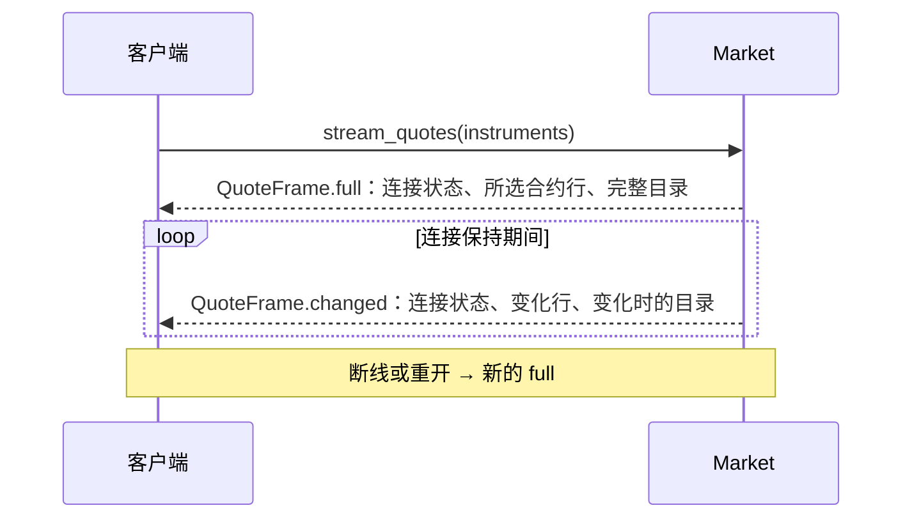
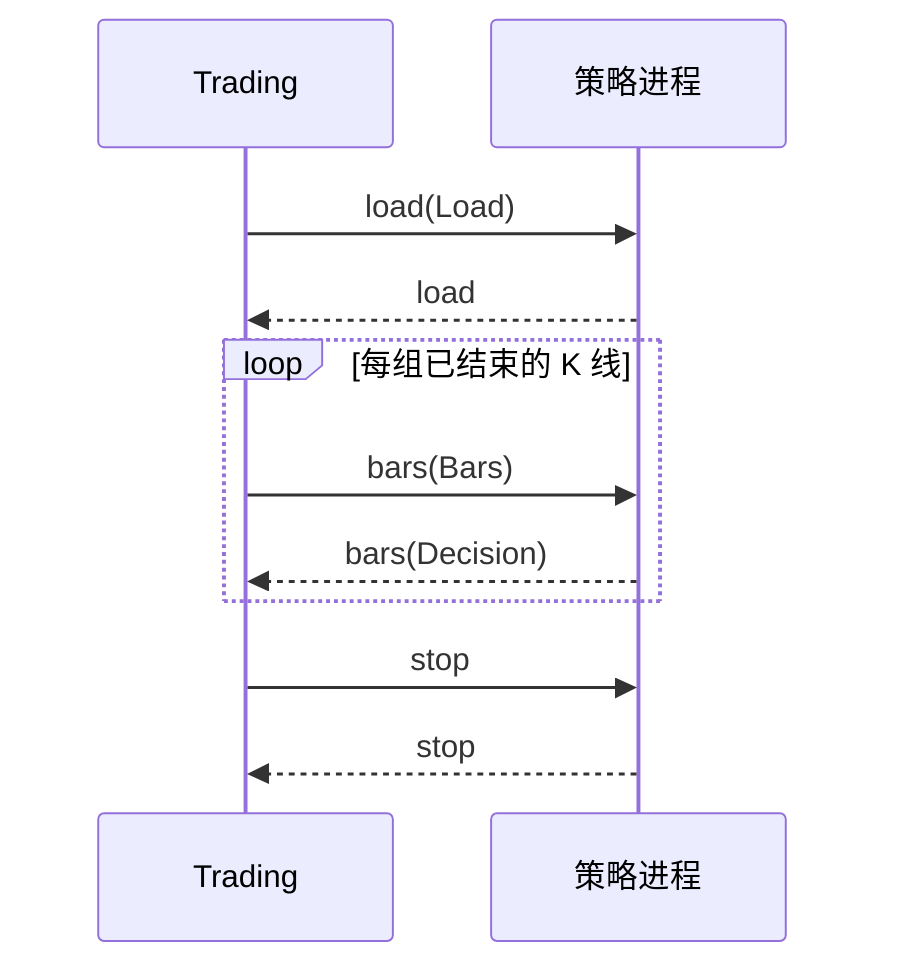

# 通信协议设计

本文说明 Terminal、Lab、Market、Warehouse、Trading 与策略子进程之间的消息格式、命名规范及各服务操作清单。全部消息定义位于 [protocol/proto/asterion/](../protocol/proto/asterion/)，C++、Python 与 TypeScript 代码均由此生成。

## 1. 传输

| 连接 | 传输方式 | 身份认证 |
| --- | --- | --- |
| Terminal → Market | TCP + TLS 1.3 双向认证 | 双方证书指纹固定；Market 主机登记 Terminal 证书 |
| Terminal → Warehouse、Lab → Warehouse | TCP + TLS 1.3 双向认证 | 双方证书指纹固定；Warehouse 主机登记 Terminal 证书 |
| Terminal → Trading | TCP + TLS 1.3 双向认证 | 双方证书指纹固定；Trading 主机登记 Terminal 证书 |
| Terminal → Lab | 本机 Unix socket | 套接字目录仅当前用户可读写 |
| Trading → 策略子进程 | 本机私有 Unix socket | 由 Trading 启动并管理的子进程 |

每条消息采用“4 字节大端长度前缀 + Protobuf 字节”封帧。Terminal 发往 Market、Warehouse、Trading 的请求由 C++ 原生层转发，TLS 私钥不离开原生层；发往 Lab 的请求由 Electron 主进程通过本机套接字转发。

## 2. 消息封套

Market、Warehouse、Lab 与 Trading 的 RPC 均采用各自的 `Request` 与 `Response`：

```proto
message Request {
  uint64 id = 1;
  oneof call { ... }
}
message Response {
  uint64 id = 1;
  oneof result {
    common.Error error = 2;
    ...
  }
}
```

- `id` 由调用方分配并由回复原样带回；原生层为远程服务请求递增分配编号。
- **请求与结果同名同号**：请求 `call` 为 `get_dataset_version = 21` 时，成功回复的 `result` 字段同样为 `get_dataset_version = 21`，调用方无需维护额外映射表。
- 失败时 `result` 为 `error`，与成功结果互斥。
- 封套不携带版本号和服务名。理由：连接本身已确定对端服务，逐包携带纯属冗余。
- **协议核对**：
  - Market、Warehouse 的 `get_status` 与 Trading 的 `get_health` 均返回 `protocol`（构建时该服务 `.proto` 文件的内容哈希）。Terminal 与服务独立安装，若哈希不一致，常规业务报错并提示升级至同一版本；两端同时拒绝含未知字段的消息，不做跨版本常规业务兼容。理由：被静默丢弃的未知字段可能导致服务端执行与使用者确认内容不符的委托或风控政策。
  - Trading 另将不依赖业务字段的紧急制动契约固化在 [emergency.proto](../protocol/proto/asterion/emergency.proto)（哈希为 `emergency_protocol`）。常规 `protocol` 不一致时，Terminal 禁用下单、授权、改政策与启策略等常规操作，切入紧急控制模式，仍可通过 `get_emergency` 与 `emergency_control` 执行停止策略、撤单和撤销授权；两项请求自桌面入口至原生转发均走独立的紧急通道。正常升级仍应在收盘后或无持仓、无挂单时两端配套完成（见[升级与备份](trading/deployment.md#升级与备份)）。
  - 三个远程服务报告的版本号仅用于展示，不参与兼容性核对。理由：文档、界面或内部实现改动都会变更版本号，按版本号比对会造成误报。

## 3. 命名

| 对象 | 规范 | 示例 |
| --- | --- | --- |
| 包名 | 服务名，或 `common`、`emergency` | `market`、`warehouse`、`lab`、`trading`、`strategy` |
| 操作名 | `动词_名词` | `get_status`、`get_dataset_version`、`start_acquisition` |
| 动词 | `get` 读单项，`list` 读列表，`read` 读字节，`start`/`cancel` 控制任务，`stream` 持续接收 | — |
| 参数消息 | 操作名的 PascalCase；无参数用 `common.Empty`；单标识可用 `TaskId` 等轻量消息 | `GetDatasetVersion` |
| 结果消息 | 返回对象本身 | `DatasetVersion`、`AcquisitionTask` |
| 枚举值 | 枚举名前缀加值，0 为 `UNSPECIFIED` | `TASK_STATE_RUNNING` |
| 时间戳 | `_ms` 结尾，Unix UTC 毫秒 | `started_ms` |
| 日期 | `_day` 结尾，`YYYY-MM-DD` | `trading_day`、`first_day` |
| 手数 | `lots` 或 `_lots` 结尾 | `max_order_lots` |

具体字段格式与边界约束以 `.proto` 注释及服务端输入校验为准。

## 4. 公共类型

定义在 [common.proto](../protocol/proto/asterion/common.proto)。

| 类型 | 含义 |
| --- | --- |
| `Decimal` | 精确十进制文本（如 `"3456.5"`）；消息缺席表示未知，`"0"` 表示已知为零 |
| `Instrument` | 交易所与柜台合约代码（如 `SHFE` + `rb2701`） |
| 合约字符串 | 仓库规范合约标识 `EXCHANGE/product/YYYY-MM`；品种为 `EXCHANGE/product` |
| 交易日 | `YYYY-MM-DD`；柜台原样成交时间 `trade_time` 除外 |
| `Error` | `ErrorCode` 与诊断文本 |
| `Period` | 1、5、10、15、30、60 分钟，以及日、周、月、季、年 |
| `Side`、`Offset` | 买卖方向与开平标志 |
| `Costs`、`RiskLimits` | 每手保证金/手续费及名义金额费率；单笔、单合约、总持仓及在途委托上限 |

价格、金额与可带小数的数量使用 `Decimal`；整数手数、成交量与计数使用协议声明的整数类型。统计与图表指标可使用浮点数，不得用于权威账本计算。

## 5. 错误

下表省略枚举值前缀 `ERROR_CODE_`，实际消息使用 `.proto` 中的完整枚举名。

| `ErrorCode` | 含义 | 调用方处理 |
| --- | --- | --- |
| `INVALID_REQUEST` | 请求参数不合法 | 修正参数，不重试 |
| `PERMISSION_DENIED` | 当前客户端证书无权访问 | 提示使用者 |
| `NOT_FOUND` | 指定的版本、任务或委托不存在 | 提示使用者 |
| `CONFLICT` | 与当前状态冲突（如任务 ID 重复或政策版本过期） | 先读取最新状态 |
| `RESOURCE_EXHAUSTED` | 服务容量已满（如报价流或采集队列上限） | 稍后重试 |
| `UNAVAILABLE` | 服务或其依赖暂时不可用 | 稍后重试 |
| `CANCELLED` | 操作已被取消 | 无需处理 |
| `RECOVERY_REQUIRED` | 账本异常，须使用者在柜台核实后恢复 | 按交易页提示处置 |
| `OPERATION_FAILED` | 操作执行失败，原因见诊断文本 | 提示使用者 |
| `INTERNAL_ERROR` | 服务内部错误 | 查看服务日志 |

写操作回复丢失时，必须先按标识读取当前状态，绝不直接重发。理由：重发可能造成重复执行。

## 6. 分页和流

- **分页**：版本分区、版本历史与采集任务采用游标分页——请求传入 `after_*`（首页为空），回复带回 `next_*`（末页为空），每页条数由服务端决定；`get_table_rows`、`get_orders`、`get_day`、`list_runs` 等使用 `offset`（及 `limit` / `total`）翻页。
- **流**：仅 `stream_quotes` 持续返回多帧（共享同一 `id` 直至连接关闭）。首帧为 `full`，后续为 `changed` 或新的 `full`；断线重开流后首帧再次为 `full`。理由：TCP 保证帧序且不丢帧，无需额外帧序号。

## 7. Market

定义在 [market.proto](../protocol/proto/asterion/market.proto)，行为说明见 [Market](market/README.md)。所有已登记客户端均可调用。

| 操作 | 参数 | 结果 |
| --- | --- | --- |
| `get_status` | — | 服务版本、协议哈希、启动时间、行情连接状态、目录状态、订阅数、最后报价时间、乱序报价数、订阅失败数 |
| `get_board` | — | 当前全部合约行与完整目录（与报价流首帧结构相同） |
| `stream_quotes` | 筛选合约列表（留空表示全市场，最多 50 个） | 持续推送 `QuoteFrame` |
| `get_minutes` | `Instrument` | 本进程观测到的当前交易日分钟线 |

### 报价流



客户端收到 `full` 时整体替换本地内容；收到 `changed` 时按 `Instrument` 替换整行，若携带目录则同步替换目录。合约集合变动时，Market 主动下发新的 `full`。

`Feed.error` 说明服务端主动断开连接的原因（如连接或登录超时），柜台错误码保留在 `ctp_error`；目录加载失败时 `CatalogStatus.error` 包含失败阶段与柜台原始说明。

## 8. Warehouse

定义在 [warehouse.proto](../protocol/proto/asterion/warehouse.proto)，行为说明见 [Warehouse](warehouse/README.md)。

| 操作 | 参数 | 结果 |
| --- | --- | --- |
| `get_status` | — | 服务版本、协议哈希、启动时间、磁盘可用空间 |
| `get_dataset_version` | 版本（留空为当前）、表、交易所、分页游标 | 版本元数据与一页分区清单 |
| `read_dataset_file` | 版本、分区键、字节偏移 | 一块原始 Parquet 字节、文件总大小与 SHA-256 |
| `get_dataset_summary` | 版本（留空为当前） | 各表分区数、行数与日期范围；按交易日历给出应有最新交易日、缺失天数与来源无数据天数 |
| `get_table_rows` | 版本、参考表（合约表/交易日历/结算参数/历史报价单位/仓单/会员持仓/库存周报）、交易所、偏移 | 一页至多 100 行（按日期或生效起始日降序，合约表按合约序），值均为文本，另附总行数 |
| `list_dataset_versions` | 分页游标 | 从当前版本往回的一页版本，每项含相对父版本的新增/替换/删除分区数及变更表列表 |
| `compare_dataset_versions` | 目标版本与基准版本 | 新增、替换、删除的分区数及变更表列表 |
| `get_dataset_coverage` | 版本 | 各品种总合约数与在市合约数，以及日线/分钟线的已采、采全、在市采全、缺口、待更新合约数、首末日期与合并缺口 |
| `get_product_coverage` | 版本、品种（留空为全部） | 各合约上市/下市日与在市状态，以及日线/分钟线的已有、应有、待更新、来源无数据与缺口统计 |
| `get_acquisition_options` | — | `AcquisitionOptions.tables`：每张可采表及其支持的交易所列表 |
| `start_acquisition` | 表，以及交易所+日期区间或品种/合约+可选区间 | 已接纳的任务对象 |
| `get_acquisition_task` | 任务 ID | 任务当前状态与进度 |
| `list_acquisition_tasks` | 分页游标 | 一页任务，按创建时间降序，每页 20 条 |
| `cancel_acquisition` | 任务 ID | 发出取消后的任务状态 |
| `start_update` | — | 为每张已采表提交补至昨日的任务（已有排队或运行任务的表跳过），返回已接纳任务列表 |

`DatasetRef.version` 留空时默认解析为当前版本；回复返回实际版本号，后续分页与分区下载必须携带同一版本号。

## 9. Lab

定义在 [lab.proto](../protocol/proto/asterion/lab.proto)，行为说明见 [Lab](lab/README.md)。Lab 仅接受本机 Terminal 连接。

| 操作 | 参数 | 结果 |
| --- | --- | --- |
| `get_health` | — | 服务是否启动就绪，供 Terminal 的 Lab 看护模块检查 |
| `get_dataset_summary` | — | 当前研究数据集摘要（与 Warehouse `DatasetSummary` 一致） |
| `list_stored_contracts` | 合约（留空为全部）、版本（留空为当前） | 各合约已入库的日线与分钟线日期范围 |
| `get_chart_bars` | 合约、周期、版本 | K 线序列与 MACD 指标 |
| `list_strategies` | 策略目录路径 | 策略列表、因子列表与导入失败模块信息 |
| `read_source` / `save_source` / `delete_source` | 模块路径（保存另含内容与新建标志） | 模块内容 / — / — |
| `build_package` | 成功回测的 `run_id`，或策略目录与策略标识（二选一） | 可发布至 Trading 的 `strategy.Package` |
| `build_warmup` | 柜台合约、历史标识（主力连续另含候选交割月）、周期、固定版本、最大根数 | 供 Trading 回放的 `strategy.Warmup`（含 SHA-256 摘要） |
| `evaluate_factor` | 评价 ID、因子、参数、品种、起止日、持有期、分组数、标准化方式、附加因子与合成方式、留出日 | 因子评价完整结果（Lab 同步持久化） |
| `list_factor_results` / `get_factor_result` | — / 评价 ID | 已保存评价列表（按时间降序，省略逐日明细、样本内分期和相关性矩阵，保留分组换手率与留出期统计）/ 单次评价完整结果 |
| `start_backtest` | 回测配置 | —（返回即表示已接纳并记录） |
| `list_runs` | 分页、策略筛选、搜索词、排序字段与方向 | 合并参数扫描后的运行摘要、是否还有下一页及策略筛选项 |
| `list_recent_runs` | — | 每个策略最近三次单次运行的摘要 |
| `get_run_summary` / `get_run` / `get_run_report` | 运行 ID | 运行摘要 / 运行详情（含权益、每日资金与成交） / QuantStats 指标 |
| `cancel_run` | 运行 ID | — |
| `start_sweep` / `get_sweep` / `cancel_sweep` | 扫描配置 / 扫描 ID / 扫描 ID | — / 扫描下各次运行与滚动验证摘要 / — |
| `delete_run` / `delete_factor_result` | 运行 ID / 评价 ID | 删除已结束运行或评价及其结果与源码副本（删除扫描成员会连带删除整个扫描） |
| `rename_run` | 运行 ID、名称 | 为运行设置名称（空名称恢复显示编号） |

- 回测与因子评价在接纳时由 Lab 固定研究数据版本与源码副本（范围与策略包一致：主模块及目录内传递导入的本地模块）。结果的 `pinned` 字段记录数据版本、Git 提交号及未提交改动摘要，因子结果另存评价时的模块源码。理由：前端请求只表达计算意图，由 Lab 在接纳瞬间统一固定版本，确保参数扫描的全部候选读取完全一致的数据。
- Lab 传给计算子进程的 `AdmittedRun`、`RollingRun` 与 `AdmittedFactor` 均在请求基础上附加固定版本与源码副本路径；它们定义在 `lab.proto` 中，仅供 Lab 内部使用。

## 10. Trading

定义在 [trading.proto](../protocol/proto/asterion/trading.proto)，行为说明见[交易与风控](trading/README.md)，交易约束见[交易规则](safety.md)。每个 Trading 进程仅管理一个 CTP 账户。

| 操作 | 参数 | 结果 |
| --- | --- | --- |
| `get_health` | — | 服务版本、协议与紧急协议哈希、账户开通/恢复/就绪状态，以及各工作环节停滞时长 |
| `get_account` | — | `Account`（账户身份与当前 `session`） |
| `open_account` | `Policy` | `Account`（开通后自动连接柜台） |
| `connect_broker` / `disconnect_broker` | — | `Account` |
| `query_costs` | — | `Account`（柜台回报费率随后写入 `session.costs`） |
| `send_command` | `Command` | `Account` |
| `get_orders` | 分页参数 | `Orders`（当日委托，按新到旧排序，附总数） |
| `get_day` | 交易日（留空为柜台当日）、分页参数；指定日期且 `oldest_first` 按追加顺序读取成交，便于导出锁定首响总数与快照 | `Day`（成交分页与总数、最后同步的资金/持仓/撤单快照、全部有记录交易日） |
| `get_catalog` | 是否强制刷新 | `ContractCatalog`（Trading 本账户柜台同步的在市合约目录） |
| `get_strategies` | — | `Strategies`（已发布策略包列表与当前/最近实例状态） |
| `publish_strategy` | `strategy.Package` | `Strategies` |
| `start_strategy` | `strategy.Instance` | `Strategies` |
| `stop_strategy` / `flatten_strategy` | 实例 ID | `Strategies` |
| `pause_strategy` | 实例 ID、是否暂停新增 | `Strategies` |
| `get_recorded_bars` | 周期、合约（可选）、起始时间、条数上限 | `RecordedBars`（Trading 本地录制的实时 K 线） |
| `get_strategy_run` | 实例 ID（留空为当前或最近实例）、起始序号、条数上限 | `StrategyRun`（实例配置、逐批输入与决策及实例事件） |
| `get_emergency` | — | `emergency.State`（独立于常规协议哈希的授权状态、活动策略 ID 与可撤挂单） |
| `emergency_control` | `emergency.Control`（撤销授权、撤单或停止策略） | 执行后的 `emergency.State` |

- `Account` 包含主机配置的账户身份与柜台信息（不含密码与授权码）；开通后的运行态在 `session` 中返回，涵盖风控政策及修订号（含四项可选资金/撤单硬限额）、柜台连接状态、授权时间戳、资金（含 `pre_balance`、`deposit`、`withdraw`、盯市 `dynamic_equity` 与净值高水位 `peak_equity`）、当前触发的硬风控项 `risk_breaches`、当日各合约撤单统计、持仓（今昨手数及柜台持仓成本/盈亏/占用保证金）、在途委托、委托/成交总数、未确认委托、费率与账本用量。账户命令直接返回完整 `Account`，委托与成交明细另行分页读取，避免历史记录增长拖慢状态刷新。
- 所有改变交易状态的操作统一封装在 `Command` 中：下单、撤单、授权、撤销授权、核实未确认委托、修改风控政策。`Command` 必须携带 `account_id` 与 `policy_revision`，与当前状态不符时返回 `CONFLICT`。理由：确保服务端执行的始终是使用者刚刚核对过的账户与政策版本。
- `request_id` 随命令持久化到账本，重复请求语义见[交易记录、断线与恢复](trading/README.md#交易记录断线与恢复)。回复丢失时必须先调 `get_account` 确认，严禁直接重发。
- `authorized_ms` 非空表示账户已授权；撤销授权、修改风控政策、账本进入恢复或 Trading 重启后即失效。
- 策略实例状态依次流经 `STARTING`、`WARMING`、`READY`，终态为 `STOPPED`、`FAILED` 或 `INTERRUPTED`。

## 11. 策略进程

定义在 [strategy.proto](../protocol/proto/asterion/strategy.proto)。Trading 为每个策略实例启动一个 Python 子进程，通过私有 Unix socket 按一问一答交换 `strategy.Request` 与 `strategy.Response`，消息不带 `id`。理由：通道只有一个调用方，回复与请求严格一一顺序对应。



- `Instance` 指定策略包名与版本、固定合约（`instruments`）或主力连续序列（`series`，含品种与升序在市交割月列表）、周期、参数及权重预算（`WeightLimits`：总权重、净权重及可选的保证金率上限与最小调仓偏离）。`resume_from` 指定已结束实例 ID 时，启动前先重放该实例记录的 K 线。
- `Load` 携带 `Instance` 以及按顺序生成的策略符号（固定合约为 `EXCHANGE/product/YYYY-MM`，主力连续为 `EXCHANGE/product`）。策略侧看到的 `bar.symbol` 与提交目标均使用该规范符号，与回测完全一致；`Bars` 与 `Decision` 中仍保留具体交割月的柜台合约，主力换月首根 K 线附带 `roll_ratio` 供策略侧执行当时比值复权。
- `Bars` 为同一时刻结束的一组 K 线，按 `Instance` 中的顺序排列；该时刻休市或无报价的合约缺席，不补造 K 线。
- `Decision` 中每项 `Target` 表示目标手数或目标权重，同一批只能使用其中一种；`ready` 为假时目标仅记录、不执行。
- 策略进程出错时回复 `error`，Trading 随即终止该实例并撤掉其挂单。

Lab 打包策略同样使用 `strategy.Package` 与 `strategy.ParameterValue`。从回测打包时，`Manifest.research` 会保存来源运行 ID、参数、周期、研究品种、数据版本与权重预算；Terminal 用作启动表单初值，但实际交易合约仍须使用者核对确认。

## 12. 演进

项目尚未对外发布，客户端与服务端需使用同一版本的协议配套部署。协议变更同样影响持久化 Protobuf 文件（如采集任务与目录缓存），当前不提供旧格式迁移。
