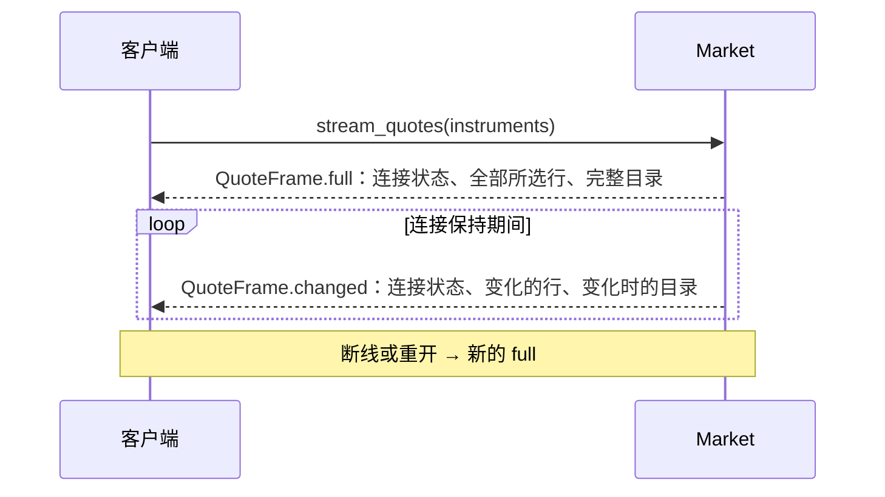
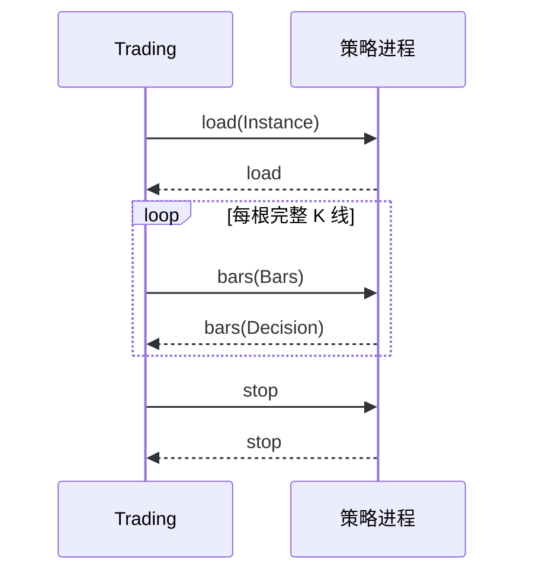

# 通信协议设计

本文规定 Terminal、Lab、Market、Trading 和策略进程之间消息的格式和命名规则，并列出各服务提供的操作。消息定义在 [protocol/proto/asterion/](../protocol/proto/asterion/)，C++、Python 和 TypeScript 代码都从这些定义生成。

## 1. 传输

| 连接 | 传输 | 身份 |
| --- | --- | --- |
| Terminal → Market、Lab → Market | TCP + TLS 1.3 双向认证 | 双方证书指纹固定；Market 按客户端证书授予 `read` 或 `manage` 权限 |
| Terminal → Trading | TCP + TLS 1.3 双向认证 | 同上；交易主机登记 Terminal 的证书 |
| Terminal → Lab | 本机 Unix 套接字 | 套接字目录只有当前用户可读写 |
| Trading → 策略进程 | 子进程标准输入输出 | 由 Trading 启动的子进程 |

每条消息是 4 字节大端长度加 Protobuf 字节。Terminal 页面通过原生层发送消息，私钥只在原生层。

## 2. 消息封套

每个服务有一个 `Request` 和一个 `Response`：

```proto
message Request {
  uint64 id = 1;
  oneof call { ... }
}
message Response {
  uint64 id = 1;
  oneof result {
    common.Error error = 2;
    ...
  }
}
```

- `id` 由调用方选择，回复带回同一个值。原生层为每个连接递增编号。
- **请求和结果同名同号**：请求的 `call` 是 `get_dataset_version = 21`，成功的结果就是 `get_dataset_version = 21`。调用方不需要另外的对照表。
- 失败时 `result` 是 `error`，不会同时有结果。
- 封套里没有版本号和服务名。理由：服务和客户端一起发布；连接本身已经确定了对方是哪个服务。

## 3. 命名

| 对象 | 规则 | 例子 |
| --- | --- | --- |
| 包 | 服务名，或 `common` | `market`、`lab`、`trading`、`strategy` |
| 操作 | 动词_名词 | `get_status`、`list_datasets`、`start_acquisition` |
| 动词 | `get` 读一项，`list` 读一组，`read` 读字节，`start`/`cancel` 改变任务，`stream` 持续接收 | |
| 参数消息 | 操作名的 PascalCase；无参数用 `common.Empty`；只有一个标识用 `TaskId` 这类消息 | `GetDatasetVersion` |
| 结果消息 | 返回的东西本身 | `DatasetVersion`、`AcquisitionTask` |
| 枚举值 | 枚举名前缀加值，0 为 `UNSPECIFIED` | `TASK_STATE_RUNNING` |
| 时间 | `_ms` 结尾，Unix UTC 毫秒 | `started_ms` |
| 日期 | `_day` 结尾，`YYYY-MM-DD` | `trading_day`、`first_day` |
| 手数 | `lots` 或 `_lots` 结尾 | `max_order_lots` |

注释只写名字说不清的原因，每处一行，用英文，和代码一致。

## 4. 公共类型

定义在 [common.proto](../protocol/proto/asterion/common.proto)。

| 类型 | 含义 |
| --- | --- |
| `Decimal` | 精确十进制文本，如 `"3456.5"`。消息不存在表示未知；`"0"` 表示已知的零 |
| `Instrument` | 交易所与柜台合约代码，如 `SHFE` + `rb2701` |
| 合约字符串 | 仓库的合约标识 `EXCHANGE/product/YYYY-MM`；品种为 `EXCHANGE/product` |
| `Error` | `ErrorCode` 与诊断文本 |
| `Period` | 1、5、10、15、30、60 分钟，日、周、月、季、年 |
| `Side`、`Offset` | 买卖方向与开平 |
| `Costs`、`RiskLimits` | 每手保证金与手续费、按名义金额的费率；单笔与总手数和在途委托上限 |

所有价格、数量和金额都用 `Decimal`，不经过浮点数。成交量用 `int64`，因为柜台给出的就是整数手。理由：一种写法贯穿所有服务，日志和 ProtoJSON 里也能直接读出数值。

## 5. 错误

| `ErrorCode` | 含义 | 调用方怎么做 |
| --- | --- | --- |
| `INVALID_REQUEST` | 参数不合法 | 修正参数，不重试 |
| `PERMISSION_DENIED` | 当前证书没有这个权限 | 提示用户 |
| `NOT_FOUND` | 指定的版本、任务或委托不存在 | 提示用户 |
| `CONFLICT` | 与现有状态冲突，如任务 ID 已存在 | 先读取现状 |
| `RESOURCE_EXHAUSTED` | 服务容量已满，如报价流连接数 | 稍后再试 |
| `UNAVAILABLE` | 服务或其依赖暂时不可用 | 稍后再试 |
| `CANCELLED` | 操作被取消 | 无 |
| `RECOVERY_REQUIRED` | 需要用户在柜台核实后恢复 | 按交易页提示操作 |
| `OPERATION_FAILED` | 操作执行失败，原因在诊断文本 | 提示用户 |
| `INTERNAL_ERROR` | 服务内部错误 | 查看服务日志 |

写操作的回复丢失时，先按标识读取当前状态，不直接重发。理由：重发可能重复执行。

## 6. 分页和流

- **分页**：请求带 `after_*`，第一页为空；回复带 `next_*`，为空表示最后一页。每页大小由服务决定。只有数量没有上限的列表才分页：版本的分区、版本历史和采集任务。
- **流**：只有 `stream_quotes` 连续回复，同一个 `id` 返回多帧，直到连接关闭。第一帧是 `full`，之后是 `changed` 或新的 `full`。断线后重新开流，首帧又是 `full`。理由：TCP 保证顺序不丢帧，所以帧上不需要序号。

## 7. Market

定义在 [market.proto](../protocol/proto/asterion/market.proto)。行为说明见 [Market](market.md)。除标明 `manage` 的操作外，只需要 `read` 权限。

| 操作 | 参数 | 结果 |
| --- | --- | --- |
| `get_status` | — | 服务版本、启动时间、行情连接、目录、订阅数、最后报价时间、乱序报价数、录制进度 |
| `get_board` | — | 当前全部合约行与完整目录，与报价流首帧相同 |
| `stream_quotes` | 要看的合约，不填表示全部，最多 50 个 | 连续的 `QuoteFrame` |
| `get_minutes` | `Instrument` | 本进程观测到的当前交易日分钟线 |
| `list_datasets` | — | 每个来源的当前版本 |
| `get_dataset_version` | 来源与版本、表、交易所、分页游标 | 版本信息与一页分区 |
| `read_dataset_file` | 来源与版本、分区、偏移 | 一块原始 Parquet 字节、整个文件的大小和 SHA-256 |
| `get_dataset_summary` | 来源与版本 | 各表的分区数、行数和日期范围 |
| `list_dataset_versions` | 来源、分页游标 | 从当前版本往前的一页版本，每个都带与上一版相比新增、替换、删除的分区数 |
| `compare_dataset_versions` | 来源、两个版本 | 前者相比后者新增、替换、删除的分区数 |
| `get_dataset_coverage` | 来源与版本 | 品种 × 月份的日线天数和开市天数；合约 × 月份的分钟线天数，研究数据集另给其中取自自录的天数 |
| `compare_minutes` | — | Tushare 与自录当前版本分钟线的差异汇总 |
| `get_minute_differences` | 合约、交易日 | 两个来源不一致的每一分钟 |
| `list_sources` | — | 可采集的来源、表、交易所，及当前证书能否管理 |
| `start_acquisition` | 任务参数（`manage`） | 已接纳的任务 |
| `get_acquisition_task` | 任务 ID | 任务现状 |
| `list_acquisition_tasks` | 分页游标 | 一页任务 |
| `cancel_acquisition` | 任务 ID（`manage`） | 取消请求发出时的任务现状 |

版本参数 `DatasetRef` 的 `version` 为空时表示当前版本；回复带回实际版本，后续分页和下载都使用这个版本。

### 报价流



客户端收到 `full` 时替换全部内容；收到 `changed` 时按 `Instrument` 替换整行，带目录时替换目录。合约集合变化时 Market 发送新的 `full`。

## 8. Lab

定义在 [lab.proto](../protocol/proto/asterion/lab.proto)。行为说明见 [Lab](lab.md)。Lab 只接受本机 Terminal 的连接。

| 操作 | 参数 | 结果 |
| --- | --- | --- |
| `get_health` | — | 是否已启动完成；Terminal 守护进程用它判断 Lab 是否可用 |
| `get_dataset_summary` | — | 研究数据当前版本的摘要，与 Market 的 `DatasetSummary` 相同 |
| `list_stored_contracts` | 合约，不填表示全部 | 每个合约的日线和分钟线范围 |
| `get_chart_bars` | 合约、周期、版本 | K 线与 MACD |
| `get_dominant_series` | 品种、起止日、是否按交易换月、复权方式 | 主力连续的逐日价格和换月 |
| `get_trading_sessions` | 品种、起止日 | 每个交易日的日盘、夜盘时段和依据 |
| `list_strategies` | 策略目录 | 策略、因子、导入失败的模块 |
| `read_source` / `save_source` / `delete_source` | 模块路径 | 模块内容 / — / — |
| `build_package` | 策略目录与策略 | 发布到 Trading 的策略包 |
| `evaluate_factor` | 因子、参数、品种、起止日、持有期、分组 | 因子评估结果 |
| `start_backtest` | 回测设置 | —，接受即已记录 |
| `list_runs` / `get_run` / `get_run_report` | — / 运行 ID / 运行 ID | 运行列表 / 运行详情 / QuantStats 指标 |
| `cancel_run` | 运行 ID | — |
| `start_sweep` / `get_sweep` / `cancel_sweep` | 扫描设置 / 扫描 ID / 扫描 ID | — / 扫描的各次运行 / — |

- 回测和因子评估在接受时由 Lab 选定研究数据版本和代码提交，结果里的 `pinned` 写明这三项。理由：界面的请求只描述要算什么；读哪一版由 Lab 在同一时刻决定，扫描的每次运行都相同。
- Lab 交给子进程的是 `AdmittedRun`、`RollingRun` 和 `AdmittedFactor`：界面的请求加上 Lab 选定的版本和代码副本。它们也定义在 lab.proto 里，但只在 Lab 内部使用。

## 9. Trading

定义在 [trading.proto](../protocol/proto/asterion/trading.proto)。行为说明见 [交易](trading.md)，交易规则见 [交易安全](safety.md)。一个 Trading 进程只管一个 CTP 账户。

| 操作 | 参数 | 结果 |
| --- | --- | --- |
| `get_health` | — | 账户是否已开通、是否需要恢复、是否可以交易，及各工作环节多久没有进展 |
| `get_account` | — | `Account` |
| `open_account` | `Policy` | `Account`，开通后自动连接柜台 |
| `connect_broker` / `disconnect_broker` | — | `Account` |
| `query_costs` | — | `Account`，柜台回报的费率随后出现在 `session.costs` |
| `send_command` | `Command` | `Account` |
| `get_strategies` | — | `Strategies`：已发布的策略包和当前实例 |
| `publish_strategy` | `strategy.Package` | `Strategies` |
| `start_strategy` | `strategy.Instance` | `Strategies` |
| `stop_strategy` / `flatten_strategy` | 实例 ID | `Strategies` |
| `pause_strategy` | 实例 ID、是否暂停 | `Strategies` |

- `Account` 是主机配置的账户和柜台（不含密码和认证码），`session` 是开通后的账户状态：政策及其版本、柜台连接状态、授权时间、资金、持仓、委托、成交、未确认委托、费率和账本用量。账户相关的操作都返回整个 `Account`。理由：页面每次拿到的都是同一份完整状态，不需要合并局部回复。
- 会改变交易状态的操作都放在 `Command` 里：下单、撤单、授权、撤销授权、确认未回报委托、修改政策。`Command` 带 `account_id` 和 `policy_revision`，与当前账户或政策不符时返回 `CONFLICT`。理由：用户核对的是哪个账户、哪版政策，执行的就只能是它。
- 每个 `request_id` 只执行一次，重复使用返回 `CONFLICT`。回复丢失时先 `get_account` 读取结果，不重发。
- `authorized_ms` 存在表示已授权。授权在撤销、修改政策或 Trading 重启后失效。
- 策略实例的状态依次为 `STARTING`、`WARMING`、`READY`，结束于 `STOPPED`、`FAILED` 或 `INTERRUPTED`。

## 10. 策略进程

定义在 [strategy.proto](../protocol/proto/asterion/strategy.proto)。Trading 为每个策略实例启动一个 Python 子进程，经标准输入输出交换 `strategy.Request` 和 `strategy.Response`，一问一答，没有 `id`。理由：管道只有一个调用方，回复按顺序对应请求。



- `Instance` 写明策略包名和版本、合约、周期、参数和权重上限。`resume_from` 指向一个已结束的实例，启动时先重放它记录的 K 线。
- `Bars` 是所有合约同一时刻结束的一组 K 线，按 `Instance` 中的合约顺序排列。
- `Decision` 的每个 `Target` 是一个合约的目标手数或目标权重；同一批只能用其中一种。`ready` 为假时目标只记录、不执行。
- 策略进程出错时回复 `error`，Trading 结束这个实例。

Lab 打包策略时也使用 `strategy.Package` 和 `strategy.ParameterValue`。

## 11. 演进

项目未发布，协议只有当前一版：改字段时同时修改所有服务和客户端，删掉的字段不保留编号。持久化的 Protobuf 文件（采集任务、目录缓存）格式随协议一起变化，旧文件按无效文件处理。
