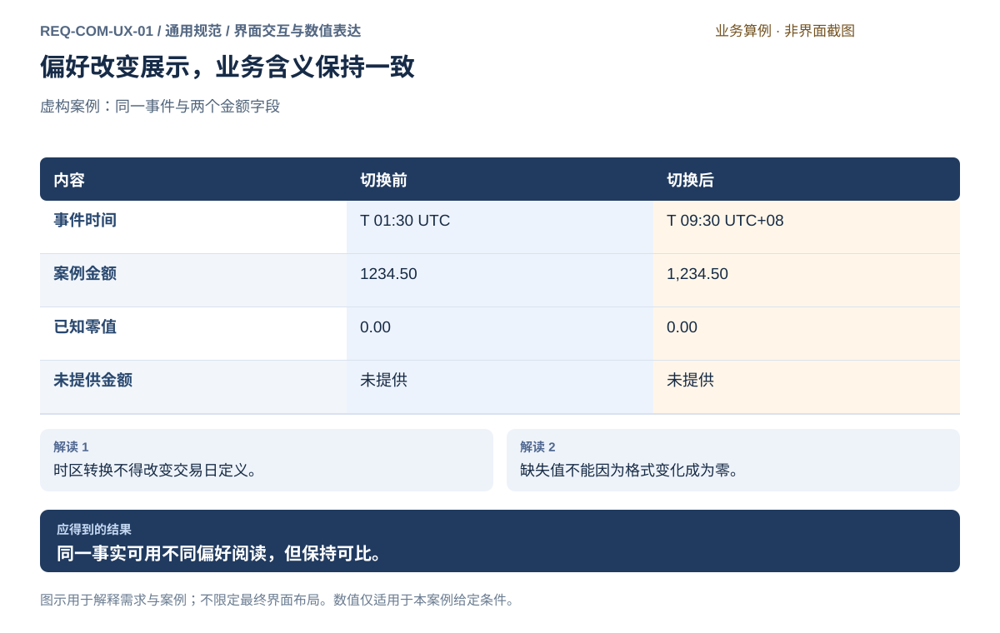
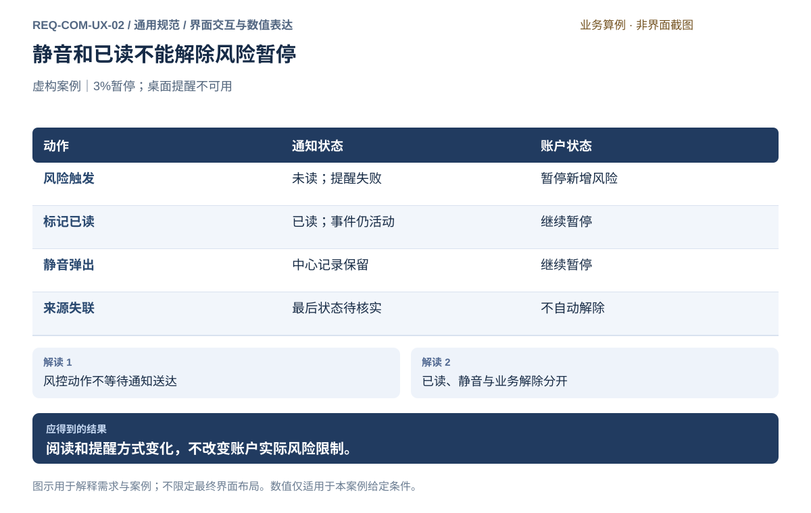
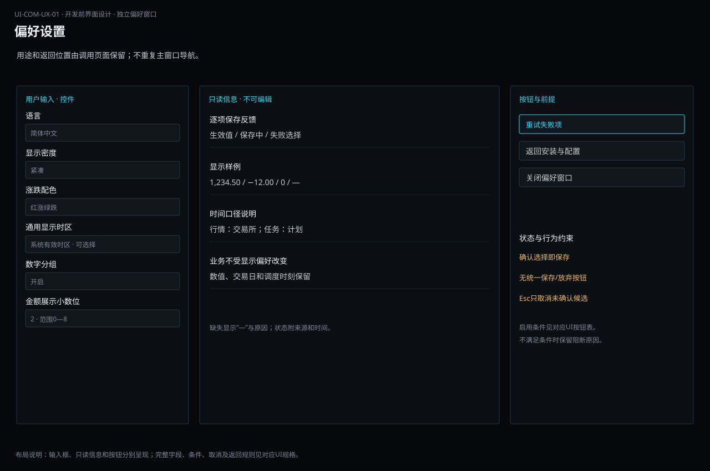
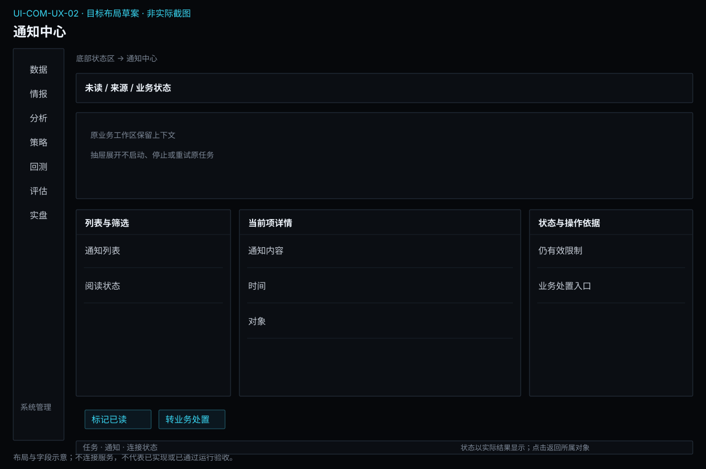

# 界面交互与数值表达

[返回上级](README.md) · [需求总纲](../README.md) · [实际界面](screens.md) · [跨模块流程](../workflows/README.md)

需求交付版 · 2026-10-18。细化规格已编制，用户逐项签认与产品验收分别记录；目标设计不代表已经实现，实际入口与差距见本页界面对应。

**归属：** 通用规范 / 界面交互与数值表达。本页集中保存业务需求、详细功能、案例、界面对应和验收；通用规则见[通用规范](README.md)。

## 需求导航

- [REQ-COM-UX-01 一致理解语言、时间和数值并可用键盘操作](#req-com-ux-01)
- [REQ-COM-UX-02 统一查看通知并保持业务告警与处置独立](#req-com-ux-02)

## UI设计在需求文档中的位置

**已确认要求：** UI设计属于需求说明的组成部分；新增和调整界面须参考并延续已有Terminal风格。一级导航与七个核心业务模块一一对应，二级导航与其子模块对应；各子模块可以承载多项页面规格。导航、归属及全局入口以[主界面设计](ui-designs.md#target-navigation)为准，不为不同模块另建视觉风格。

界面规格和图放在所属子模块的UI条目下，与功能FR、操作旅程JRN和验收条件相互关联；本节集中维护公共设计规则。具体控件实现和样式令牌引用[Terminal界面规范](../../terminal.md)，不在每份需求中复制一套CSS参数。需求阅读网页的排版和业务算例图用于说明文档，不是产品界面风格。

| 每项UI规格应包含 | 具体内容 |
| --- | --- |
| 页面目的与任务 | 服务哪些用户操作、关联FR、完成后得到什么对象或结果 |
| 入口与返回 | 当前实际入口、拟议入口、携带的账户/研究/数据上下文；返回后保留什么 |
| 信息布局 | 标题、筛选/工具栏、主内容、详情、操作区及状态反馈的位置；与相邻页面如何协作 |
| 字段与数据 | 名称、含义、类型、单位、来源、必填/默认/范围、只读与可编辑、缺失表达 |
| 动作与交互 | 按钮前提和后果、选择/展开/跳转、排序筛选、保存方式、异步反馈、取消和离开行为 |
| 状态与异常 | 该任务适用的加载、首次空态、无匹配、部分结果、失败、权限不足、陈旧及结果未知；分别说明后续入口 |
| 界面图与操作案例 | 展示要做成的布局和关键状态，说明一次具体操作前后的变化；图中的数值和账户为明确标注的示例 |
| 验收与对应状态 | 功能AC、键盘和布局检查、与实际界面的差距；设计完成、实现完成及运行验收分别记录 |

完整的新工作台应有主要布局图，以及会改变操作选择的关键状态示例；小范围控件调整可以用局部设计图加状态表表达。业务流程图、数值案例图和一句“沿用现有风格”都不能替代这些页面信息。不要求给每条FR单独创建页面，也不要求穷举没有实际业务差异的视觉组合。

## 延续现有Terminal的视觉和交互

参考顺序：现行[Terminal界面规范](../../terminal.md)、[实际截图及入口说明](screens.md)、对应业务的公共控件和布局。截图反映所记录日期的实际状态；软件变动后重新核对。需求规定目标业务行为，截图不限制未来功能范围，也不能把现有不正确的业务行为当成必须保留的设计。

| 方面 | 设计约束 |
| --- | --- |
| 整体风格 | 近黑深色背景、信息优先、紧凑技术终端；使用细边框和轻微明度差分区，避免大面积装饰、厚阴影和卡片堆叠 |
| 色彩与层次 | 延续画布、面板、浮层、字段背景及文字层级；青蓝用于操作/选中/焦点，行情涨跌沿用用户配色偏好，警告和错误采用现有语义并同时提供文字 |
| 字体与数值 | 使用现有系统字体；数值等宽，价格和金额按列对齐，单位及精度清楚，缺失与零保持区别 |
| 密度与间距 | 延续当前紧凑/舒适密度和统一控件尺度、行高、留白与圆角；不为每个模块另定一套尺寸 |
| 按钮与输入 | 复用现有按钮、输入框、选择框、表格和页签表现；主操作采用现有青色描边和淡底，不以满屏高亮争夺注意力 |
| 下拉与浮层 | 不透明底色，当前值、悬停、焦点、禁用可辨；优先向下，空间不足向上，长列表滚动；Esc取消并返回合理焦点 |
| 导航与布局 | 延续标题栏、窄侧栏、工作区和底部状态区；一级为七个业务模块，二级为子模块；系统管理为辅助入口，偏好独立窗口、任务中心抽屉，详情保留所属模块上下文 |
| 操作习惯 | 沿用同类控件的展开、选择、返回和保存方式；偏好设置选择即保存，不额外引入保存/放弃表单；交易动作仍按其独立授权与确认规则 |
| 窗口适配 | 针对macOS Apple Silicon和Linux x86_64桌面；窗口缩窄时明确区域伸缩、表格滚动和操作区位置，重要账户及状态不可被截掉；不设计移动端替代布局 |
| 文案与反馈 | 简明业务文案，中英文含义一致；内部实现细节进入诊断详情，不占据主要操作区；不把源代码提示文字当产品指导语 |

实现对齐入口为[现有主题令牌](../../../apps/clients/terminal/src/ui/theme/tokens.css)与[公共控件样式](../../../apps/clients/terminal/src/ui/theme/style.css)。图稿引用这些语义的当前取值，避免随意另配一套相近颜色；具体技术实现留在代码和设计规范中。不能仅把浅色草图换成深底，就声称完成了Terminal风格对齐。

### 现状、目标和设计完成的边界

- 实际截图保持原样并标明核对范围；未实现部分使用“目标设计/未实现”标签，不涂改截图伪装成实际能力。
- 目标设计可以扩展功能，并说明从目标模块入口怎样到达、复用哪些区域、增加哪些操作，以及为何需要改变布局。
- 简化线框用于讨论信息位置和状态，不作为最终控件尺寸或完整视觉验收依据。当前两张运行目标图仍属于操作示意，完整页面设计状态保持待评审。
- 页面评审应同时核对关联FR/AC、正常操作和关键异常、样式及组件一致性、中英文长文本、键盘焦点、两种密度和约定桌面窗口范围；记录未覆盖项，不能只凭一张静态正常态截图宣布完成。
- 核心交易场景额外检查账户/模式/授权是否持续可辨，加载或失联是否误显示正常，停止、撤单、平仓是否各有明确后果。视觉表现不得改变业务状态或越过执行检查。

## 公共通知与业务告警

通知中心是公共呈现入口，不是新业务模块。数据负责来源中断和质量问题，情报负责事件订阅及证据冲突，研究模块负责实验失败与结果提示，实盘负责账户风险事件，系统负责运行与调度异常；每个来源负责触发证据、活动/解除状态及处理入口。

通知维护未读/已读、提醒渠道及允许的静音偏好。通知渠道交付失败不改变业务结果；用户已读不表示问题解决；来源失联时保留最后状态并标明待核实。事件身份用于关联重复投递，实质变化保留更新，不能只按标题或文本合并。

实盘风险触发后先按政策阻断，与是否通知成功无关。应用内保留事件与业务跳转，风险状态在实盘持续可见；标记已读、清除筛选、静音或关闭窗口均不能解除账户限制。需要恢复、撤单或其他操作时进入所属业务独立确认。

首期通知渠道范围为应用内及本机桌面提醒。未授权或未实现外部消息渠道时不发送邮件、聊天或第三方推送；渠道、聚合、容量和保留细节见本页DEC决定及系统交付范围。

## REQ-COM-UX-01 一致理解语言、时间和数值并可用键盘操作

**领域：** 通用规范 / 界面交互与数值表达　 **建议优先级：** P1核心必要　 **需求状态：** 交付规格已编制（源自已确认定位；细节待用户签认）

### 目标与场景

语言与显示偏好应帮助使用者理解研究和交易信息，而不会改变业务含义。涉及时间、金额和数量时必须保留口径，常用操作应可通过键盘完成并清楚呈现当前位置。

**使用者与场景：** 在中文或英文环境下查看跨时区资料，并使用键盘工作的个人使用者。

**触发条件：** 修改偏好、比较资料或通过键盘完成日常操作。

### 前置条件

- 业务数据具有明确的时间和单位含义。
- 使用者可以查看当前显示偏好。

### 输入与含义

| 输入           | 含义与单位                           | 约束                                                         |
| -------------- | ------------------------------------ | ------------------------------------------------------------ |
| 界面语言       | 中文或英文展示                       | 切换语言不改动合约标识、原始业务值或账户身份。               |
| 显示时区与格式 | 时间展示时区和数值分组、小数显示方式 | 不能改变交易日归属或计算精度；高风险确认保留必要单位与精度。 |

### 正常操作与反馈

1. 使用者查看当前语言、时区和格式。
2. 选择新偏好并查看同一案例的显示变化。
3. 确认后相关内容采用一致口径。
4. 通过键盘在可操作项目间移动并识别焦点。
5. 完成选择、确认或取消，系统保留清晰反馈。

### 业务规则

- 中文与英文表达同一业务含义，缺少翻译不能直接暴露不可理解的标识。
- 业务时间显示时区；交易日与日历日期分别表达。
- 显示舍入只影响展示，不能改写价格、金额及计算结果。
- 未提供的数据与零值明确区分，负数不依赖颜色单独表达。
- 键盘焦点可见；弹出选择支持选择、取消和返回原操作位置。
- 危险确认不能由偏好切换、焦点移动或误触默认键直接代替。

### 输出与状态影响

- 一致生效的显示偏好。
- 可理解且可键盘访问的关键操作反馈。

### 异常与继续方式

| 发生什么             | 应怎样表现                       | 使用者如何继续                   |
| -------------------- | -------------------------------- | -------------------------------- |
| 时间缺少可靠时区信息 | 标明时间口径未确认，不猜测转换。 | 取得明确口径后再作跨时区比较。   |
| 输入格式无法明确解释 | 指出无法解析的输入，不猜测数值。 | 使用者按展示的格式说明重新输入。 |

### 案例：时区转换不改变业务时间

**虚构案例条件：** 虚构案例：同一事件为案例日 T 01:30 UTC，即 T 日 09:30 UTC+08:00；数值 1234.50 为案例金额，另一项数值未提供。

1. 从 UTC 显示切换为 UTC+08:00。
2. 切换语言和数值分组显示。

**预期结果：**

- 同一事件变为 09:30；金额仍为 1234.50；未提供项不变成 0。

### 可观察验收条件

| 编号               | 给定                      | 当               | 则                                           |
| ------------------ | ------------------------- | ---------------- | -------------------------------------------- |
| REQ-COM-UX-01-AC01 | 事件时间为 T 日 01:30 UTC | 切换到 UTC+08:00 | 显示 T 日 09:30，并标明时区，事件身份不变。  |
| REQ-COM-UX-01-AC02 | 一项金额为零而另一项缺失  | 切换语言与格式   | 两种状态仍可区分，原始数值不变。             |
| REQ-COM-UX-01-AC03 | 使用键盘操作选择项        | 移动、选择并取消 | 焦点始终可见，取消后返回原位置且不改变原值。 |

### 决定与配置约束

- **DEC-COM-UX-01-01**：**规格决定**。简体中文和英文；时间保存原始时区，行情显示交易所时区，任务显示计划时区，均明确标识。macOS Cmd/Linux Ctrl加1—7对应业务模块，偏好Cmd/Ctrl+,；Tab/Shift+Tab、Enter、Esc遵守控件语义，不新增语言。

### 详细功能

### FR-COM-UX-01-01 选择并即时保存中英文显示偏好

**目标与结果：** 语言选择只改变界面文字，不改变账户、合约、价格或授权含义。沿用实际偏好界面的即时保存方式，不增加保存/放弃按钮。

**触发：** 系统管理 → 安装与配置 → 偏好设置 → 语言。

**输入与约束：** 简体中文和English两个选项；初始显示已保存的语言，实际当前值以界面为准。

**目标操作与反馈：**

1. 展开语言下拉菜单。
2. 选择简体中文或English，界面随选择更新并即时保存。
3. 核对关键按钮语言和业务身份；保存失败时读取明确提示。

**异常与边界：**

- 翻译缺失时明确显示未能完整应用，不将内部标识冒充正常文字。
- 语言切换不清空研究草稿，也不修改待确认委托内容。

**验收条件：**

- **FR-COM-UX-01-01-AC01**：选择英文后关键按钮和说明保持一致，账户和合约身份不变。
- **FR-COM-UX-01-01-AC02**：Esc关闭未确认的菜单选择时保留原值；已选定的语言无需再点保存。

**界面对应：** [UI-COM-UX-01 偏好设置](#ui-com-ux-01)；[UI-SYS-SET-01 首次准备](../modules/system/setup.md#ui-sys-set-01)。

### FR-COM-UX-01-02 区分显示时区与业务交易日

**目标与结果：** 使用者可按习惯阅读时间，同时知道事件发生、接收与交易日的不同口径。时区偏好只改变展示，不重算交易归属或把未知时间猜成确定事实。

**触发：** 时间详情查看；统一显示时区选择属于待设计能力，当前偏好页面无此控件。

**输入与约束：** 时区初始候选来自系统时区并明确显示；事件原时区和交易日由可靠来源提供，缺失值没有猜测默认。

**目标操作与反馈：**

1. 选择目标时区并查看同一事件的前后对照。
2. 确认显示时区后保存，相关时间字段显示适用口径。
3. 在事件详情同时查看原始时间依据与交易日。

**异常与边界：**

- 来源时间没有可靠时区时标为口径未确认，禁止伪造转换。
- 跨午夜后的日历日期改变不自动改变来源确认的交易日。

**验收条件：**

- **FR-COM-UX-01-02-AC01**：T 日 01:30 UTC 转为 UTC+08 后为 T 日 09:30，事件身份不变。
- **FR-COM-UX-01-02-AC02**：夜盘示例的交易日保持来源给定值，并与显示日历日期分别标注。

**界面对应：** [UI-COM-UX-01 偏好设置](#ui-com-ux-01)；[UI-SYS-REC-02 事件与诊断](../modules/system/records.md#ui-sys-rec-02)。

### FR-COM-UX-01-03 明确数值单位、精度和缺失状态

**目标与结果：** 研究和交易必须能够区分有效零值、负值、未提供与失效信息。显示格式应改善阅读，同时保留价格、金额和数量的实际精度，不能影响风险判断和真实委托。

**触发：** 查看行情、账户和导出中的数值；统一分组/小数偏好属于待设计能力，当前偏好页面无此控件。

**输入与约束：** 候选分组格式和金额展示位数需与字段精度一致；没有来源值显示缺失，价格精度不能由统一金额格式强制覆盖。

**目标操作与反馈：**

1. 查看金额、价格、数量、零值和缺失值示例。
2. 修改显示偏好后检查单位、负号与必要精度。
3. 保存后应用到显示，关键确认仍展示完整有效价格和数量。

**异常与边界：**

- 解析不明确的数值输入明确拒绝，不猜测逗号含义。
- 颜色不能独自表达亏损或异常；缺失不能格式化为零。

**验收条件：**

- **FR-COM-UX-01-03-AC01**：1234.50 可显示为 1,234.50，但真实数值与计算结果不变。
- **FR-COM-UX-01-03-AC02**：零金额与未提供金额外观可区分，负数带符号且不只依赖颜色。

**界面对应：** [UI-COM-UX-01 偏好设置](#ui-com-ux-01)；[UI-SYS-REC-03 导出资料](../modules/system/records.md#ui-sys-rec-03)。

### FR-COM-UX-01-04 统一选择菜单的可读背景和展开位置

**目标与结果：** 语言、显示密度、涨跌配色及筛选等选择菜单应具有一致、清晰的展开状态。菜单覆盖内容时仍然可读，位置按可用空间决定，选项较多时在菜单内部滚动而不遮住操作依据。

**触发：** 点击或键盘展开偏好、资源和任务筛选中的选择项。

**输入与约束：** 选择值与候选列表来自对应字段；默认向下展开，只有下方空间不足时向上，均受可见工作区限制。

**目标操作与反馈：**

1. 打开菜单后以不透明表面、边界和可见选中项展示。
2. 移动或键盘选择选项，长列表在限定高度内滚动。
3. 确认后更新字段并收起；取消后保留原值和触发位置焦点。

**异常与边界：**

- 上下都不足时限制菜单高度并内部滚动，不能把选项放到窗口外。
- 禁用项保留原因且不可选；菜单遮挡下的按钮不能被穿透点击。

**验收条件：**

- **FR-COM-UX-01-04-AC01**：菜单展开后底层文字不会透过背景干扰选项阅读。
- **FR-COM-UX-01-04-AC02**：下方有足够空间时向下，不同选择框仅因空间差异向上，当前选中项始终可定位。

**界面对应：** [UI-COM-UX-01 偏好设置](#ui-com-ux-01)；[UI-SYS-RUN-02 任务中心](../modules/system/tasks-nodes.md#ui-sys-run-02)；[UI-SYS-RUN-03 运行资源](../modules/system/tasks-nodes.md#ui-sys-run-03)。

### FR-COM-UX-01-05 通过键盘完成导航并保持可见焦点

**目标与结果：** 常用桌面操作应能在不使用鼠标的情况下完成。焦点顺序与页面阅读顺序一致，用户能知道正在操作什么，关闭弹层后不会失去上下文或意外触发交易。

**触发：** 使用 Tab、方向键、回车或 Esc 在页面、表单和选择菜单中操作。

**输入与约束：** 初始焦点落在页标题后的首个主要可操作项；危险操作不默认获焦。快捷键集合属设计草案，不覆盖输入中的编辑键。

**目标操作与反馈：**

1. 用 Tab 顺序经过导航、主要内容和页内操作。
2. 在选择菜单内用方向键移动并以回车确认，Esc 取消。
3. 关闭对话框后回到触发控件，继续完成原任务。

**异常与边界：**

- 交易输入框回车不直接发送真实委托。
- 不可用操作可说明原因，焦点不可跳入隐藏背景或被永久困住。

**验收条件：**

- **FR-COM-UX-01-05-AC01**：无需鼠标可以选择语言、取消修改并返回原选择框。
- **FR-COM-UX-01-05-AC02**：弹层开启时焦点限定其有效范围，关闭后回到触发处且焦点可见。

**界面对应：** [UI-COM-UX-01 偏好设置](#ui-com-ux-01)；[UI-SYS-SET-01 首次准备](../modules/system/setup.md#ui-sys-set-01)；[UI-SYS-REC-01 资料、备份与恢复](../modules/system/records.md#ui-sys-rec-01)。

### FR-COM-UX-01-06 离开未保存草稿前作明确选择

**目标与结果：** 对确实具有待保存草稿的备份、导出方案，离开时明确保存、放弃或继续编辑。当前偏好界面为即时保存，不适用此草稿流程；备份和通用导出界面仍待设计。

**触发：** 修改待设计的备份或导出草稿后离开；不适用于即时保存的偏好下拉项。

**输入与约束：** 草稿与已保存值分别记录；秘密字段不进入普通草稿恢复，业务委托确认按交易要求独立处理。

**目标操作与反馈：**

1. 编辑后显示未保存状态和保存入口。
2. 尝试离开时展示涉及的设置及三个明确选项。
3. 选择保存并成功后继续离开，放弃恢复原值，继续编辑保留现场。

**异常与边界：**

- 校验或保存失败时留在原页并指向问题字段，不执行原跳转。
- 没有改动时不显示多余离开确认；运行中的后台任务不因离开草稿停止。

**验收条件：**

- **FR-COM-UX-01-06-AC01**：有待保存的备份或导出草稿时，离开须作明确选择；即时保存的偏好不增加离开确认。
- **FR-COM-UX-01-06-AC02**：放弃只清除本次草稿，已保存设置及后台任务状态保持不变。

**界面对应：** [UI-SYS-REC-01 资料、备份与恢复](../modules/system/records.md#ui-sys-rec-01)；[UI-SYS-REC-03 导出资料](../modules/system/records.md#ui-sys-rec-03)；[UI-SYS-RUN-01 个人工作总览](../modules/system/tasks-nodes.md#ui-sys-run-01)。

### FR-COM-UX-01-07 危险动作明确对象后再确认

**目标与结果：** 删除资料、移除保存凭据及停止本地运行具有不同后果，确认应精确到所选对象与影响。用户能够安全取消，确认按钮不得依赖模糊的“确定”或默认焦点造成误操作。

**触发：** 选择删除资料、移除凭据保存项或停止本地运行等有明确后果的动作。

**输入与约束：** 从已选择对象生成身份、数量和后果摘要；危险动作不继承其他对象的旧确认，批量对象数量必须可见。

**目标操作与反馈：**

1. 查看确认标题中的具体动作与对象。
2. 阅读将删除、保留或仍可能继续发生的内容。
3. 选择明确命名的动作后执行，或取消回到原对象。

**异常与边界：**

- 对象范围变化后原确认失效，必须重新核对。
- Esc 取消；初始焦点放在返回或安全说明处，不以默认回车执行危险操作。

**验收条件：**

- **FR-COM-UX-01-07-AC01**：删除研究甲的确认不能用于稍后新增选中的研究乙。
- **FR-COM-UX-01-07-AC02**：取消停止本地运行时不发出停止动作，重新确认后实际影响有结果反馈。

**界面对应：** [UI-SYS-REC-01 资料、备份与恢复](../modules/system/records.md#ui-sys-rec-01)；[UI-COM-SEC-01 凭据与访问用途](security.md#ui-com-sec-01)；[UI-SYS-RUN-03 运行资源](../modules/system/tasks-nodes.md#ui-sys-run-03)。

## REQ-COM-UX-02 统一查看通知并保持业务告警与处置独立

**领域：** 通用规范 / 界面交互与数值表达　 **建议优先级：** P1核心必要　 **需求状态：** 交付规格已编制（定位与模块已确认；细节待用户签认）

### 目标与场景

让用户在通知中心看到需要关注的事件，知道来源、状态和处理入口，且不让通知设置改变业务安全行为。

**使用者与场景：** 兼顾期货研究、实盘和运行维护的个人用户。

**触发条件：** 业务模块确认事件或告警并执行其必要控制，独立产生可追溯通知。

### 前置条件

- 对象、所属业务模块和允许操作的范围明确。
- 涉及运行、费用或资料变更的条件已由用户明确配置；案例仅供评审。

### 输入与含义

| 输入     | 含义与单位                                             | 约束                                                               |
| -------- | ------------------------------------------------------ | ------------------------------------------------------------------ |
| 业务事件 | 来源模块、对象、事件身份、严重程度、触发证据与发生时间 | 业务模块决定产生、更新及解除，不能从任意日志级别推断必须阻断交易。 |
| 通知状态 | 未读/已读、渠道尝试、静音偏好、最后同步时间            | 已读和静音属于呈现状态，不等于事件解除或风险恢复。                 |
| 处置引用 | 相关业务页面、权限和下一步                             | 通知仅导航或标记阅读，不越过所属模块的操作确认。                   |

### 正常操作与反馈

1. 业务模块确认事件或告警并执行其必要控制，独立产生可追溯通知。
2. 在通知中心按来源、对象、严重程度和未读状态查看。
3. 打开详情核对触发证据，跳转对应业务处理。
4. 标记已读或调整允许的提醒方式；真实解除状态随业务确认更新。

### 业务规则

- 事件、告警和强制控制并非同义；任务完成可通知，风险达到限制须由实盘执行阻断，不等待用户读消息或通知送达。
- 业务拥有活动/解除/待核实状态；通知拥有未读/已读及渠道结果，静音与已读不能解除业务限制。
- 桌面通知权限被拒或服务失败时，通知中心保留记录并说明渠道状态；只确认交给通知服务不能冒称用户已读。
- 同一事件身份的重复投递不形成多个独立事件，实质变化保留发生次序和新时间；不能按相同文字吞掉不同事件。
- 必要风险状态在业务页面持续可见；静音只影响允许的声光/弹出方式，不隐藏关键限制、日志或处置入口。
- 来源离线时显示最后状态和时效未知，不能自动标为解除。
- 首期以应用内通知及本机桌面提醒为范围；外部邮件、消息机器人等渠道另行明确，不默认向第三方发送。

### 输出与状态影响

- 让用户在通知中心看到需要关注的事件，知道来源、状态和处理入口，且不让通知设置改变业务安全行为。
- 可追溯的操作结果、责任归属、时间与异常说明。

### 异常与继续方式

| 发生什么         | 应怎样表现                             | 使用者如何继续                             |
| ---------------- | -------------------------------------- | ------------------------------------------ |
| 桌面通知权限拒绝 | 中心保留事件并显示该渠道未送达或未启用 | 用户可调整权限；业务控制继续执行。         |
| 事件来源无法联系 | 保留最后已知状态及时间，标记待核实     | 恢复后向原业务查询，不因消息已读自动解除。 |

### 案例：静音和已读不能解除风险暂停

**虚构案例条件：** 虚构案例：账户权益97000相对基准100000达到3%暂停条件。桌面提醒被拒，用户随后在通知中心标记已读并静音。

1. 实盘先按规则暂停新增风险。
2. 通知中心显示告警与渠道失败。
3. 标记已读和静音后查看账户状态。

**预期结果：**

- 账户持续暂停新增风险，告警已读不解除。
- 应用内保留一个事件；相同事件重复到达不增加第二个告警。

### 可观察验收条件

| 编号               | 给定                     | 当                   | 则                           |
| ------------------ | ------------------------ | -------------------- | ---------------------------- |
| REQ-COM-UX-02-AC01 | 达到3%暂停且桌面提醒失败 | 提交新的增加风险请求 | 实盘仍拒绝，与通知成功无关。 |
| REQ-COM-UX-02-AC02 | 活动告警被标已读并静音   | 查看账户             | 仍为暂停，业务状态未改变。   |
| REQ-COM-UX-02-AC03 | 同一事件重复投递         | 查看通知列表         | 一个事件，保留更新记录。     |

### 决定与配置约束

- **DEC-COM-UX-02-01**：**规格决定**。信息/警告/阻断三级，同对象同原因聚合并显示次数及最近时点；应用内默认启用、桌面提醒默认关闭，非关键提醒可静音但源限制不可隐藏。通知默认90日，源事件不随之删除。

### 详细功能

### FR-COM-UX-02-01 聚合通知并按业务身份定位

**目标与结果：** 统一关注入口而不重复维护业务事实。

**触发：** 打开通知中心并筛选。

**输入与约束：** 来源模块、对象身份、事件身份、严重性、发生/更新时间。

**目标操作与反馈：**

1. 打开通知中心并筛选。
2. 查看详情与业务来源，识别同事件更新。
3. 跳转权威业务页面核对。

**异常与边界：**

- 重复事件按身份识别，不只按标题去重。
- 通知中心不从日志自行决定账户风险状态。

**验收条件：**

- **FR-COM-UX-02-01-AC01**：同一事件两次到达显示一个事件及其更新。
- **FR-COM-UX-02-01-AC02**：两个不同对象同文字告警仍是两个事件。

**界面对应：** [UI-COM-UX-02 通知中心](#ui-com-ux-02)。

### FR-COM-UX-02-02 区分阅读状态与业务告警状态

**目标与结果：** 避免已读被误解为处置完成。

**触发：** 标记已读并查看活动状态。

**输入与约束：** 未读/已读、活动/解除/待核实、最后业务确认时间。

**目标操作与反馈：**

1. 标记已读并查看活动状态。
2. 打开业务处置入口，按权限独立操作。
3. 业务确认后更新真实状态。

**异常与边界：**

- 已读不恢复交易、不修改限额或取消任务。
- 来源失联不自动解除告警。

**验收条件：**

- **FR-COM-UX-02-02-AC01**：3%暂停告警已读后仍暂停。
- **FR-COM-UX-02-02-AC02**：解除只能来自所属业务确认。

**界面对应：** [UI-COM-UX-02 通知中心](#ui-com-ux-02)；[UI-LIV-RUN-05 运行核对、处置与恢复审查](../modules/live/operations.md#ui-liv-run-05)。

### FR-COM-UX-02-03 设置提醒方式并解释渠道失败

**目标与结果：** 使提醒可控且不影响业务动作。

**触发：** 查看提醒权限和偏好。

**输入与约束：** 应用内/本机桌面渠道、权限、静音范围、尝试结果。

**目标操作与反馈：**

1. 查看提醒权限和偏好。
2. 按允许范围静音弹出，保留中心记录和业务状态。
3. 查看失败或未启用原因并选择是否调整。

**异常与边界：**

- 通知失败不取消风控阻断。
- 交给桌面服务不等于用户已看见；不默认启用外部消息渠道。

**验收条件：**

- **FR-COM-UX-02-03-AC01**：拒绝桌面权限时应用内仍可查看告警。
- **FR-COM-UX-02-03-AC02**：静音不能隐藏账户限制或解除控制。

**界面对应：** [UI-COM-UX-02 通知中心](#ui-com-ux-02)。

### FR-COM-UX-02-04 跟踪事件更新并完成业务跳转

**目标与结果：** 通知既可追踪又不直接越权处置。

**触发：** 查看触发、更新和解除依据。

**输入与约束：** 事件更新次序、来源时间、业务链接、可确认的处理结果。

**目标操作与反馈：**

1. 查看触发、更新和解除依据。
2. 跳转对应模块处理或查看失败。
3. 返回中心刷新业务状态与阅读状态。

**异常与边界：**

- 过期页面不能用旧通知恢复账户。
- 通知动作不能直接重发交易或自动补跑任务。

**验收条件：**

- **FR-COM-UX-02-04-AC01**：已解除事件保留原触发依据。
- **FR-COM-UX-02-04-AC02**：不同时间收到的更新不会把较新业务确认覆盖成旧状态。

**界面对应：** [UI-COM-UX-02 通知中心](#ui-com-ux-02)。

## 界面设计与实际对应

## UI-COM-UX-01 偏好设置

**业务目标：** 设置语言、时区和数值显示，并通过实际示例理解键盘、下拉菜单与保存行为；显示偏好不改变业务事实。

**对应情况：实际界面已核对。** 仅有语言、显示密度、涨跌配色，修改即保存；时区和统一未保存离开确认不在当前偏好界面中。

**实际入口：** 左下设置图标或 ⌘, → 偏好设置

[查看实际界面及对应说明](../prototype.html#UI-COM-UX-01)

- [偏好设置：截图、字段和操作](screens.md#screen-settings)

### 页面形态与目标布局

**设计状态：** 目标规格已编制，含布局、字段、动作和关键状态；尚未获得逐项产品签认或实现验收。现状对应证据保持上文说明，图稿不是运行截图。

**界面形态：** 独立设置窗口内页。

**目标到达路径：** 系统管理 → 安装与配置 → 偏好设置。这是已确认导航下的目标入口，实际对应仍见上方证据。

| 区域 | 要显示的内容 |
| --- | --- |
| 顶部上下文 | 偏好设置 |
| 列表、分类或步骤区 | 偏好分类及返回安装与配置 |
| 主要工作区 | 语言 / 显示密度 / 涨跌配色 |
| 选中项详情或检查区 | 即时保存结果 / 失败原因 |
| 主要动作区 | 选择即保存 |

**区域联动与返回：** 选择列表或步骤只更新当前对象及详情，不隐式启动业务；图表与明细使用同一输入或结果上下文。离开并返回保留已确认的对象和查询条件，未保存草稿按本页保存语义处理。异步提交后用请求/任务身份定位实际状态，不能把操作按钮点击当作成功。

**窗口与空间：** 沿用独立设置窗口或上下文对话框，正文区域必要时滚动；身份、当前步骤和主要动作保持可达，不再套一套主窗口侧栏。

**状态设计范围：** 以本页状态/异常和验收为准，正常操作、首次无对象、筛选无匹配、请求中、失败及该业务的未知状态分别说明；不适用状态需说明原因，不套用虚构成功数据。字段类型、默认值和动作前提见下文；关键状态按本页交付约定及模块状态图检查。[返回界面设计总览](ui-designs.md)。

### 目标操作规格（设计草案，非已实现界面）

**目标入口与返回：** 系统管理 → 安装与配置 → 偏好设置。保留独立偏好窗口与选择即保存；关闭窗口返回原工作区，点击“返回安装与配置”回到系统管理。

| 字段/区域 | 输入、默认与约束 |
| --- | --- |
| 语言与显示 | 中文/英文、时间和数值表达；显示变更不更改账本精度、交易日或策略参数。 |
| 保存与生效 | 当前选择、已保存值、实际生效和失败原因分别可辨；不把选择成功当保存成功。 |

**动作与结果：**

- 选择后显示明确生效结果；保存失败保留可恢复输入。
- 下拉列表使用一致的不透明背景、选中和焦点态；优先下方，空间不足向上且保持可见。

**状态与反馈：** 下拉展开/收起、悬停、选中、禁用、焦点可辨；Esc关闭列表不丢当前已确认设置。

**操作案例：** 切换显示语言后账户金额值不变，交易状态不能因翻译变成未知或已授权。

偏好选择后即保存，沿用现有交互，不增加“保存/放弃”步骤。保存失败保留可辨认的原生效值和本次失败选择，用户可明确重新选择或重试；离开页面不把失败结果标为已保存。键盘焦点、缺失数值和语言遵守通用规范。

### 业务验收要求（待验收，不代表截图已证明实现）

- **UI-COM-UX-01-AC01**：三个下拉项与实际软件名称、选项一致，选择后即时保存，不展示不存在的保存/放弃按钮。
- **UI-COM-UX-01-AC02**：菜单展开不透明，优先向下，空间不足向上或滚动；Esc关闭且不改变选择。
- **UI-COM-UX-01-AC03**：语言保存失败明确提示；时区及草稿离开确认若后续纳入需求，须另行设计并与实际实现同步。

### 字段与操作交付约定

以下补齐页面关键字段的类型、初始值与边界；已有功能条目的输入规则仍适用。进入已有对象时加载实际保存值，新建时未明确给默认的必填项为空，不能借用案例数值。只读缺失统一显示“—”并提供原因。

| 字段组 | 类型与单位 | 初始值、检查及变化影响 |
| --- | --- | --- |
| 语言 | 简体中文/English枚举 | 显示已保存选择，变更即保存；失败回显原生效与失败选择 |
| 密度与配色 | 紧凑/舒适、涨跌配色枚举 | 沿用现有选项，文字/符号同时表达方向 |
| 保存反馈 | 逐项状态和错误原因 | 不额外显示保存按钮，不改变业务数值或清空草稿 |

**操作顺序：** 使用“选择即保存”完成本页任务；先选择固定对象并补齐必填项，再检查范围和影响，最后提交有副作用的动作。查看、筛选和返回不隐式执行业务；保存、发布、启动、授权和撤单各自显示实际结果，不能合并为一个成功提示。本页是即时保存例外：选择即提交该偏好，不出现额外确认/保存按钮。

| 关键状态 | 信息与允许操作 | 禁止或返回行为 |
| --- | --- | --- |
| 首次为空或无匹配 | 显示当前语言范围，提供创建/补齐或清除筛选入口；只读详情说明来源 | 不填示例数据，不把无权限显示为无记录 |
| 输入错误或前提缺失 | 在“密度与配色”等具体字段旁说明问题，保留其他输入，焦点移至首个错误 | 依赖错误项的动作不可提交，返回不丢草稿 |
| 加载、运行或部分结果 | 保留对象身份和最后可靠时间，展示实际阶段/覆盖；可查看“保存反馈”已有证据 | 未完成不能显示全量成功，不能用加载中的空表覆盖已知事实 |
| 失败或结果未知 | 已明确失败可修正输入后独立提交；可能已受理则查询原请求/对象；展示未决范围 | 未核实前不重复有副作用的操作，不把取消页面当取消业务 |
| 离开及返回 | 已保存对象可由原身份重开，未保存编辑提供保存/放弃/留在当前页；关闭抽屉只改变展示 | 即时偏好不套草稿确认；秘密取消后不留普通表单缓存 |

**交互验收案例：** 在本页选择一个有效对象，改变“语言”后核对旧预览是否失效；制造“密度与配色”缺项或不可用，确认原因与阻断；补齐后完成主要动作，核对“保存反馈”与关联对象结果，再离开返回。只读字段通过隔离测试回复制造状态，不在实际界面篡改业务事实。适用的具体成功结果仍以本页原有案例及AC为准。

关键状态的视觉呈现见[状态设计约定](../common/ui-designs.md#state-designs)及本模块状态图；状态与动作按本表及关联FR逐项验收，静态图不冒充已执行交互。

### 对应功能需求

- [FR-COM-UX-01-01 选择并即时保存中英文显示偏好](#fr-com-ux-01-01)
- [FR-COM-UX-01-02 区分显示时区与业务交易日](#fr-com-ux-01-02)
- [FR-COM-UX-01-03 明确数值单位、精度和缺失状态](#fr-com-ux-01-03)
- [FR-COM-UX-01-04 统一选择菜单的可读背景和展开位置](#fr-com-ux-01-04)
- [FR-COM-UX-01-05 通过键盘完成导航并保持可见焦点](#fr-com-ux-01-05)

## UI-COM-UX-02 通知中心

**业务目标：** 让用户在通知中心看到需要关注的事件，知道来源、状态和处理入口，且不让通知设置改变业务安全行为。

**对应情况：待设计。** 完整工作台尚无实际截图对应；已有设置、任务或业务页面不等同于本条全部能力。

**实际入口：** 当前无完整对应入口；目标入口：通知中心（待设计）。

当前没有对应的实际界面截图；下方目标设计不表示已经实现或操作成功。

### 页面形态与目标布局

**设计状态：** 目标规格已编制，含布局、字段、动作和关键状态；尚未获得逐项产品签认或实现验收。现状对应证据保持上文说明，图稿不是运行截图。

**界面形态：** 底部抽屉视图。

**目标到达路径：** 底部状态区 → 通知中心。这是已确认导航下的目标入口，实际对应仍见上方证据。

| 区域 | 要显示的内容 |
| --- | --- |
| 顶部上下文 | 未读 / 来源 / 业务状态 |
| 列表、分类或步骤区 | 通知列表 / 阅读状态 |
| 主要工作区 | 通知内容 / 时间 / 对象 |
| 选中项详情或检查区 | 仍有效限制 / 业务处置入口 |
| 主要动作区 | 标记已读 / 转业务处置 |

**区域联动与返回：** 选择列表或步骤只更新当前对象及详情，不隐式启动业务；图表与明细使用同一输入或结果上下文。离开并返回保留已确认的对象和查询条件，未保存草稿按本页保存语义处理。异步提交后用请求/任务身份定位实际状态，不能把操作按钮点击当作成功。

**窗口与空间：** 从底部展开并保留原工作区；列表及详情独立滚动，关闭抽屉不取消业务，返回所属业务时收起抽屉。

**状态设计范围：** 以本页状态/异常和验收为准，正常操作、首次无对象、筛选无匹配、请求中、失败及该业务的未知状态分别说明；不适用状态需说明原因，不套用虚构成功数据。字段类型、默认值和动作前提见下文；关键状态按本页交付约定及模块状态图检查。[返回界面设计总览](ui-designs.md)。

### 目标交互设计（待实现）

目标采用现有Terminal的紧凑列表、筛选和详情区。入口位置待实现时对齐实际菜单；以下为字段、动作和状态规格，不改绘实际截图。

**字段与信息：**

- 来源模块、对象、事件身份、严重程度、触发证据、发生/更新时间。
- 活动/解除/待核实与未读/已读分别显示。
- 应用内记录、桌面渠道状态、权限、静音范围及最后业务同步时间。

**动作与反馈：**

- 筛选并打开详情；标记已读；调整允许的提醒方式。
- 跳转业务模块独立处置；返回刷新真实状态。

**状态与异常：**

- 无通知与筛选无匹配分开；来源不可达说明状态时效。
- 提醒失败、已读、静音不会改变账户控制；关键限制保持可见。

### 业务验收要求（待验收，不代表截图已证明实现）

- **UI-COM-UX-02-AC01**：3%暂停在通知失败和已读后仍生效。
- **UI-COM-UX-02-AC02**：同一事件重复到达不增加独立告警。
- **UI-COM-UX-02-AC03**：业务解除和通知已读分别可见，未引入直接发单入口。

### 字段与操作交付约定

以下补齐页面关键字段的类型、初始值与边界；已有功能条目的输入规则仍适用。进入已有对象时加载实际保存值，新建时未明确给默认的必填项为空，不能借用案例数值。只读缺失统一显示“—”并提供原因。

| 字段组 | 类型与单位 | 初始值、检查及变化影响 |
| --- | --- | --- |
| 通知集合 | 对象/级别/时间/阅读状态 | 信息/警告/阻断，默认应用内启用 |
| 详情与原因 | 来源事件、次数、限制状态 | 只读业务限制，已读不等于解除 |
| 偏好与处置 | 桌面提醒/静音、返回业务 | 桌面默认关闭，静音不隐藏阻断状态，不在通知内恢复交易 |

**操作顺序：** 使用“标记已读 / 转业务处置”完成本页任务；先选择固定对象并补齐必填项，再检查范围和影响，最后提交有副作用的动作。查看、筛选和返回不隐式执行业务；保存、发布、启动、授权和撤单各自显示实际结果，不能合并为一个成功提示。

| 关键状态 | 信息与允许操作 | 禁止或返回行为 |
| --- | --- | --- |
| 首次为空或无匹配 | 显示当前通知集合范围，提供创建/补齐或清除筛选入口；只读详情说明来源 | 不填示例数据，不把无权限显示为无记录 |
| 输入错误或前提缺失 | 在“详情与原因”等具体字段旁说明问题，保留其他输入，焦点移至首个错误 | 依赖错误项的动作不可提交，返回不丢草稿 |
| 加载、运行或部分结果 | 保留对象身份和最后可靠时间，展示实际阶段/覆盖；可查看“偏好与处置”已有证据 | 未完成不能显示全量成功，不能用加载中的空表覆盖已知事实 |
| 失败或结果未知 | 已明确失败可修正输入后独立提交；可能已受理则查询原请求/对象；展示未决范围 | 未核实前不重复有副作用的操作，不把取消页面当取消业务 |
| 离开及返回 | 已保存对象可由原身份重开，未保存编辑提供保存/放弃/留在当前页；关闭抽屉只改变展示 | 即时偏好不套草稿确认；秘密取消后不留普通表单缓存 |

**交互验收案例：** 在本页选择一个有效对象，改变“通知集合”后核对旧预览是否失效；制造“详情与原因”缺项或不可用，确认原因与阻断；补齐后完成主要动作，核对“偏好与处置”与关联对象结果，再离开返回。只读字段通过隔离测试回复制造状态，不在实际界面篡改业务事实。适用的具体成功结果仍以本页原有案例及AC为准。

关键状态的视觉呈现见[状态设计约定](../common/ui-designs.md#state-designs)及本模块状态图；状态与动作按本表及关联FR逐项验收，静态图不冒充已执行交互。

### 对应功能需求

- [FR-COM-UX-02-01 聚合通知并按业务身份定位](#fr-com-ux-02-01)
- [FR-COM-UX-02-02 区分阅读状态与业务告警状态](#fr-com-ux-02-02)
- [FR-COM-UX-02-03 设置提醒方式并解释渠道失败](#fr-com-ux-02-03)
- [FR-COM-UX-02-04 跟踪事件更新并完成业务跳转](#fr-com-ux-02-04)
- [FR-INT-SRV-02-02 创建订阅和条件提醒](../modules/intelligence/services.md#fr-int-srv-02-02)
- [FR-LIV-RUN-06-02 识别告警并检查触发依据](../modules/live/operations.md#fr-liv-run-06-02)

