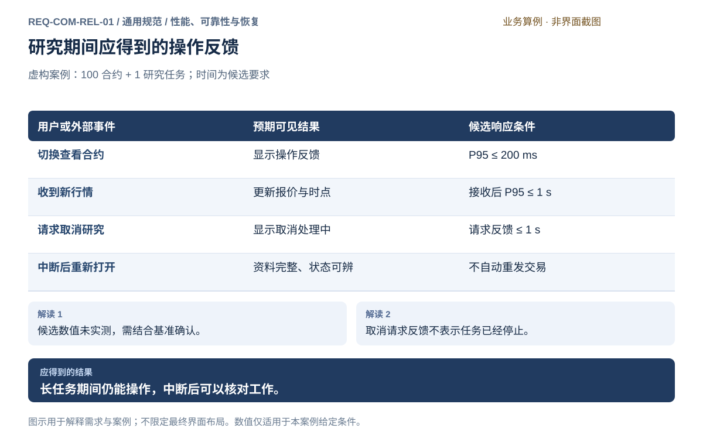

# 性能、可靠性与恢复

[返回上级](README.md) · [需求总纲](../README.md) · [界面阅读指南](screens.md) · [跨模块流程](../workflows/README.md)

开发前需求与设计规格 · 2026-10-20。定义目标功能、操作流程、界面和验收判据；规格决定、运行配置与外部条件分别记录。

**归属：** 通用规范 / 性能、可靠性与恢复。本页集中保存业务需求、详细功能、案例、界面对应和验收；通用规则见[通用规范](README.md)。

## 需求导航

- [REQ-COM-REL-01 研究期间保持交互响应并在中断后正确恢复](#req-com-rel-01)

## REQ-COM-REL-01 研究期间保持交互响应并在中断后正确恢复

**领域：** 通用规范 / 性能、可靠性与恢复　 **建议优先级：** P1核心必要　 **需求状态：** 开发前设计规格（具体决定与运行配置见本条DEC）

### 目标与场景

长时研究期间仍须保持关键操作可用，中断后能核对已保存资料与未完成工作。响应目标绑定设备和负载。

**使用者与场景：** 研究与观察行情并行的个人使用者。

**触发条件：** 长任务中操作，或中断后重新打开。

### 前置条件

- 设备、资料规模和负载明确；编制阈值经确认后用于验收。
- 行情与任务可识别；案例表示预期。

### 输入与含义

| 输入     | 含义与单位                       | 约束                                             |
| -------- | -------------------------------- | ------------------------------------------------ |
| 并行工作 | 合约观察范围及研究任务           | 资源需求与任务归属明确；超过支持容量须说明影响。 |
| 用户操作 | 切换查看对象、请求取消或重新打开 | 请求反馈与业务完成分别表达。                     |

### 正常操作与反馈

1. 使用者观察行情并启动长时研究。
2. 研究期间仍可切换查看对象并获得操作反馈。
3. 新行情持续显示接收时间与数据时效。
4. 使用者请求取消，先看到请求反馈，再确认实际停止。
5. 中断后重新打开，核对资料和未完成工作。

### 业务规则

- 编制基准为 16 GB 内存、SSD、1920×1080；观察 100 合约并运行 2 项研究。
- 编制目标：常用交互反馈的第 95 百分位不超过 200 ms。
- 编制目标：接收后行情展示延迟的第 95 百分位不超过 1 s；上游传输另计。
- 编制目标：取消请求反馈不超过 1 s；实际停止时限按下列任务停止指标执行。
- 研究计算不能以冻结交互掩盖繁忙；未完成操作继续显示其状态。
- 中断后已确认保存的资料保持完整，未完成工作可识别，不自动重发交易。

### 输出与状态影响

- 与任务完成状态区分的操作反馈。
- 明确的行情时效和恢复结果。

### 异常与继续方式

| 发生什么             | 应怎样表现                               | 使用者如何继续                       |
| -------------------- | ---------------------------------------- | ------------------------------------ |
| 并行工作超过确认容量 | 说明受限任务和等待状态，不伪装成已开始。 | 减少并行工作或更换运行位置。         |
| 上游行情延迟         | 保留数据时点，区分接收前延迟与展示延迟。 | 检查来源，不将陈旧数据称作实时数据。 |

### 案例：长时研究中的操作与中断恢复

**虚构案例条件：** 虚构案例：100 个合约与 1 个研究任务并行；时间为编制要求。

1. 研究期间切换合约并观察新行情。
2. 请求取消后等待停止确认。
3. 发生中断后重新打开核对资料。

**预期结果：**

- 响应满足确认后的目标；停止确认前显示取消处理中。
- 已保存资料完整，未完成工作可识别。

### 可观察验收条件

| 编号                | 给定                       | 当                         | 则                                                          |
| ------------------- | -------------------------- | -------------------------- | ----------------------------------------------------------- |
| REQ-COM-REL-01-AC01 | 环境、负载和编制阈值已确认 | 研究期间切换合约并接收行情 | 交互反馈 P95 不超过 200 ms，接收后展示延迟 P95 不超过 1 s。 |
| REQ-COM-REL-01-AC02 | 同一确认环境下研究正在运行 | 请求取消                   | 1 s 内反馈请求已收到；实际停止前仍显示取消处理中。          |
| REQ-COM-REL-01-AC03 | 已确认保存资料后运行中断   | 重新打开                   | 资料完整，未完成工作可识别，交易指令没有自动重发。          |

### 决定与配置约束

- **DEC-COM-REL-01-01**：**规格决定**。参考设备、数据规模、采样方法和连续运行时间采用本页非功能基线；指标是本次编制的验收目标，用于约束目标行为及其验收设计。

- **DEC-COM-REL-01-02**：**规格决定**。交互P95≤200ms，接收后展示P95≤1s，取消反馈≤1s；可控计算阶段取消≤30s，来源阻塞等待≤配置超时且上限60s，无法确认停止保持未知。其他查询/恢复容量见NFR条目。

### 详细功能

### FR-COM-REL-01-01 并行研究期间保持关键交互响应

**目标与结果：** 研究计算期间，查看合约、切换任务和打开关键说明应继续可操作。软件反馈收到操作与业务完成分开，性能目标绑定明确负载，不用立即响应冒充后台工作已结束。

**触发：** 运行研究时在总览、行情与任务页执行常用查看操作。

**输入与约束：** 编制基准为 16 GB 内存、SSD、100 合约与两项研究并行；处理器、资料规模与阈值见下方固定基线。

**目标操作与反馈：**

1. 启动研究并保留行情观察。
2. 切换合约或任务，看到操作反馈和当前状态。
3. 等待必要内容加载，期间仍可返回其他可用信息。

**异常与边界：**

- 超过容量时说明等待或受限任务，不伪装成同时已运行。
- 繁忙不能冻结全部交互，也不通过隐藏任务使页面显得空闲。

**验收条件：**

- **FR-COM-REL-01-01-AC01**：确认后的基准下，常用交互反馈编制 P95 不超过 200 ms。
- **FR-COM-REL-01-01-AC02**：交互已响应但任务未完成时仍显示真实运行状态，不出现完成误导。

**界面对应：** [UI-SYS-RUN-01 个人工作总览](../modules/system/tasks-nodes.md#ui-sys-run-01)；[UI-SYS-RUN-02 任务中心](../modules/system/tasks-nodes.md#ui-sys-run-02)；[UI-LIV-RUN-02 行情总览与自选](../modules/live/operations.md#ui-liv-run-02)。

### FR-COM-REL-01-02 呈现行情时效而不掩盖上游延迟

**目标与结果：** 行情展示速度与来源本身是否及时是两个事实。使用者观察报价时应能区分接收前延迟、接收后展示延迟和未更新，研究负载不能让旧值看起来像实时值。

**触发：** 研究运行期间接收新行情，或来源更新停止。

**输入与约束：** 数据时间、接收时间、可信时钟与展示反馈；编制接收后展示延迟 P95 不超过 1 s，环境和统计口径见本页验收基线。

**目标操作与反馈：**

1. 观察新报价及其数据时间。
2. 来源停止更新时保留最后有效时间并标明状态。
3. 恢复后按新观测重新判断时效，不改写旧消息时点。

**异常与边界：**

- 来源缺少可信时间时说明时效证据不足，不构造精确延迟。
- 上游延迟不算作本地渲染耗时，也不能因本地很快就称数据实时。

**验收条件：**

- **FR-COM-REL-01-02-AC01**：确认基准下新收到行情按编制时限展示，旧时间不被查看动作刷新。
- **FR-COM-REL-01-02-AC02**：断流后同一报价带原时间和失效说明，恢复真实观测后才更新。

**界面对应：** [UI-LIV-RUN-02 行情总览与自选](../modules/live/operations.md#ui-liv-run-02)；[UI-SYS-RUN-01 个人工作总览](../modules/system/tasks-nodes.md#ui-sys-run-01)；[UI-SYS-REC-02 事件与诊断](../modules/system/records.md#ui-sys-rec-02)。

### FR-COM-REL-01-03 及时反馈取消请求并保留停止等待

**目标与结果：** 取消较重的研究应迅速得到请求反馈，但真正停止可能受当前阶段影响。使用者可以继续观察过程，系统不能为了满足响应数字而提前宣称已停止。

**触发：** 任务中心对支持取消的研究发起取消并确认。

**输入与约束：** 目标任务与真实阶段；编制请求反馈不超过 1 s，实际停止时限按下列任务停止指标执行，没有统一伪造倒计时。

**目标操作与反馈：**

1. 提交取消后显示请求已收到与取消处理中。
2. 持续显示最后有效阶段和仍在等待的停止结果。
3. 停止确认后更新状态与实际保留范围。

**异常与边界：**

- 联系中断时从处理中转为结果待核实，不能自动再造任务。
- 请求重复点击不会产生多个取消记录或删除阶段资料。

**验收条件：**

- **FR-COM-REL-01-03-AC01**：确认基准下取消请求在编制 1 s 内得到明确反馈。
- **FR-COM-REL-01-03-AC02**：超过请求反馈时限也不提前显示已取消；实际确认前保留处理中或待核实状态。

**界面对应：** [UI-SYS-RUN-02 任务中心](../modules/system/tasks-nodes.md#ui-sys-run-02)；[UI-SYS-REC-02 事件与诊断](../modules/system/records.md#ui-sys-rec-02)。

### FR-COM-REL-01-04 中断后保留已保存资料并核对原工作

**目标与结果：** 重新打开软件后，使用者能够找回已经确认保存的资料，区分完整结果与中断工作。恢复界面与恢复交易权限是不同事务，不能因重启自动重发交易或悄悄复制研究。

**触发：** 运行中断、设备重启或应用重新打开后进入工作总览。

**输入与约束：** 已确认保存的资料、任务身份、原运行位置和最后已知结果；未保存草稿按明确保留规则处理，秘密不恢复到普通输入。

**目标操作与反馈：**

1. 总览列出保留资料与待核实工作。
2. 进入任务或事件详情查询原工作，而不是立即重新启动。
3. 基于确认结果继续查看、明确取消或创建独立新工作。

**异常与边界：**

- 无法读取资料时保留原文件并说明损坏或权限原因，不自动清理。
- 远程仍运行的任务按原身份查询，本地重启不触发远程重跑。

**验收条件：**

- **FR-COM-REL-01-04-AC01**：中断前已确认保存的研究内容保持完整，阶段产物仍标明范围。
- **FR-COM-REL-01-04-AC02**：重启核对过程中自动重发交易次数为零，原未知状态直到有证据才更新。

**界面对应：** [UI-SYS-RUN-01 个人工作总览](../modules/system/tasks-nodes.md#ui-sys-run-01)；[UI-SYS-RUN-02 任务中心](../modules/system/tasks-nodes.md#ui-sys-run-02)；[UI-SYS-REC-01 资料、备份与恢复](../modules/system/records.md#ui-sys-rec-01)；[UI-SYS-REC-02 事件与诊断](../modules/system/records.md#ui-sys-rec-02)。

## 目标界面设计

本子模块通过以下业务界面呈现，不单独增加产品菜单：

- [UI-SYS-RUN-01 个人工作总览](../modules/system/tasks-nodes.md#ui-sys-run-01)
- [UI-SYS-RUN-02 任务中心](../modules/system/tasks-nodes.md#ui-sys-run-02)
- [UI-LIV-RUN-02 行情总览与自选](../modules/live/operations.md#ui-liv-run-02)
- [UI-SYS-REC-02 事件与诊断](../modules/system/records.md#ui-sys-rec-02)
- [UI-SYS-REC-01 资料、备份与恢复](../modules/system/records.md#ui-sys-rec-01)

## 可执行的非功能验收基线

以下数值是开发前的**质量目标**，用于容量估算和验收设计；指标调整须说明适用负载和业务影响并评审，不能悄悄放宽指标或删掉失败样本。超出参考容量可明确拒绝，不承诺无限扩容。

### 环境与测量

- **MAC参考环境：** Apple M1、16GiB内存、本地SSD至少50GiB空闲、1920×1080显示；系统版本与安装包身份在GATE-RELEASE锁定并记录。Linux参考环境为Intel i5-12400、16GiB内存、SSD和同分辨率，系统发行版与内核同样记录。两平台分别给结论，不互借结果。
- **输入：** 100个真实合约身份的隔离夹具、1000万根1分钟K线、20个特征、10万条任务/业务索引记录；行情每秒1000条持续输入，2项研究并行。夹具仅用于测试；真实来源端到端联调单独报告，夹具不得进入用户正式行情。
- **方法：** 预热5分钟，稳定采样30分钟，至少1000次交互、100次查询和100次取消；测量采用单调时钟，记录p50/p95/p99、最大值、失败数和样本数；超时样本计失败，不从分位统计中删除。数据/渲染测本地接收至展示，供应商传输另计；不同主机的时间比较要记录时钟偏差。
- **持续性：** 用同一负载连续运行8小时，并另执行一次跨交易日业务验收；30分钟性能样本不能替代持续运行。全程保留CPU、常驻内存、磁盘占用、队列、丢弃/缺口以及交易控制反馈。
- **故障：** 网络中断、关键写入失败、进程中止、磁盘满和未知外部结果只在隔离资料/测试柜台环境注入。真实账户不得用于制造故障。

## NFR-UX-01 交互与可访问操作

**环境与负载：** MAC与Linux参考环境，100合约且2项研究并行。

**通过标准：** 常用查看/切换的本地反馈p95≤200ms；接收后行情展示p95≤1s；键盘可完成主要任务，中英文无缺键，缺失/警告/方向不能仅靠颜色识别。

**测量与证据：** 输入事件到首个正确反馈、接收到对应行/图表更新；分别记录加载反馈和最终内容。

**超限与失败：** 超限显示繁忙及实际进度，不冻结全部界面；字段出错保持值并将焦点定位首个错误。

**验收执行要求：** 按[验收设计](../delivery.md#delivery-acceptance)记录固定输入、环境、测量方法、预期与观测值，并关联本项判据。

## NFR-DAT-01 查询与加工容量

**环境与负载：** 固定1000万根K线及1000次可重复范围查询，冷热缓存分开。

**通过标准：** 已建索引的10万行范围查询首页1000行p95≤2s；同量完整读取p95≤5s；100万行聚合/质量任务≤120s；超过范围分页或明确拒绝。

**测量与证据：** 从服务接纳有效请求到结果可消费，索引构建单列；输出覆盖/缺口及数值同时正确才通过。

**超限与失败：** 部分数据明确范围；失败保留原输入/快照，不能用截断结果满足时限。

**验收执行要求：** 按[验收设计](../delivery.md#delivery-acceptance)记录固定输入、环境、测量方法、预期与观测值，并关联本项判据。

## NFR-RUN-01 任务容量与真实取消

**环境与负载：** 参考环境默认1、最多2项研究并行，100次有限参数批次；同时发起取消。

**通过标准：** 本地取消反馈≤1s；可控计算阶段实际停止≤30s；外部阻塞阶段须显式超时且上限60s。超过仍无法证实时显示待核实，不能标已取消。

**测量与证据：** 分别测收到请求、执行停止、产物登记及队列释放；重复点击只有一个业务取消意图。

**超限与失败：** 超过能力明确排队/拒绝，不悄悄丢任务；迟到结果按原任务及尝试核对。

**验收执行要求：** 按[验收设计](../delivery.md#delivery-acceptance)记录固定输入、环境、测量方法、预期与观测值，并关联本项判据。

## NFR-LIV-01 交易控制隔离与失效阻断

**环境与负载：** 2项研究加满行情负载；注入风险插件缺失、时效过期、授权撤销和归属冲突。

**通过标准：** 本地撤权/暂停收到并生效≤1s；约束生效后被禁止的新增外部发送数为0。用户查看风险和订单状态的本地反馈p95≤200ms。

**测量与证据：** 以执行边界的生效记录和外部测试适配器发送计数核对；生效前已发在途独立保留，不用UI变色推断已停止。

**超限与失败：** 外部柜台时间无伪造保证；未知发送保留占用和核对入口。安全查询/撤单按独立条件保留。

**验收执行要求：** 按[验收设计](../delivery.md#delivery-acceptance)记录固定输入、环境、测量方法、预期与观测值，并关联本项判据。

## NFR-DUR-01 已确认保存与关键写入原子性

**环境与负载：** 草稿、固定快照、策略包、任务接纳、交易意图和账本在确认前后中止进程。

**通过标准：** 进程异常条件下已确认持久保存对象丢失数0；未经确认对象可以未完成但不能被读取为完整；关键交易记录失败后的新增发送数0。

**测量与证据：** 逐对象记录确认点，重启后校验内容/依赖/流水；故障盘物理损毁不在零丢失保证内，依已验证备份恢复。

**超限与失败：** 保留损坏/不支持文件，显示对象与原因；不删除、转换或以空目录伪装恢复成功。

**验收执行要求：** 按[验收设计](../delivery.md#delivery-acceptance)记录固定输入、环境、测量方法、预期与观测值，并关联本项判据。

## NFR-REC-01 重启与备份恢复可核对

**环境与负载：** 参考环境、10万条索引；50GiB完整备份及独立目标目录，已知磁盘空间充足。

**通过标准：** 服务可用后60s内显示已保存目录和未决任务；50GiB完整恢复/校验≤30分钟；还原后任何自动发单/自动接管次数0。

**测量与证据：** 测本地恢复阶段，不计用户输入/网络不可达等待；比对备份清单、内容摘要、引用及排除项，未完成恢复不切工作位置。

**超限与失败：** 外部未明事实继续待核对；缺空间先拒绝，不覆盖原工作目录。

**验收执行要求：** 按[验收设计](../delivery.md#delivery-acceptance)记录固定输入、环境、测量方法、预期与观测值，并关联本项判据。

## NFR-SEC-01 秘密和用途隔离

**环境与负载：** 两桌面安全存储可用及不可用场景；日志/诊断/报告/备份/错误反馈分别采集。

**通过标准：** 明文秘密出现在普通文件、日志、导出或聊天证据的次数0；交易登录秘密持久保存次数0；无外发授权的材料发送次数0。

**测量与证据：** 使用专用测试秘密标记检索全部输出；核对Keychain/Secret Service失败反馈及取消行为。

**超限与失败：** 安全存储不可用则不提供允许保存的假成功；可会话输入但不得绕过用途许可。

**验收执行要求：** 按[验收设计](../delivery.md#delivery-acceptance)记录固定输入、环境、测量方法、预期与观测值，并关联本项判据。

## NFR-OPS-01 持续运行与可解释容量

**环境与负载：** 参考负载连续8小时，包含暂停/取消、断线恢复和通知故障。

**通过标准：** 无崩溃、无静默丢失已接纳任务或关键账本；去除可解释缓存/数据增长后，最后2小时常驻内存中位数不超过稳定首2小时的120%；峰值总常驻内存≤12GiB。

**测量与证据：** 记录服务与桌面总量、稳定区间、缓存容量及每次队列拒绝；长期磁盘数据增长和内存泄漏分开。

**超限与失败：** 容量不足排队或拒绝新计算，保留交易控制与诊断；通知故障不阻止风险限制。

**验收执行要求：** 按[验收设计](../delivery.md#delivery-acceptance)记录固定输入、环境、测量方法、预期与观测值，并关联本项判据。

## NFR-UI-01 窗口与布局一致性

**环境与负载：** macOS/Linux，1280×800及1920×1080窗口，中文/英文，紧凑/舒适密度。

**通过标准：** 七模块和系统入口可达；关键账户/模式/动作不被裁切；允许表格内部横向滚动，无整页不可操作溢出；下拉不透明、下优先、焦点可见。

**测量与证据：** 逐58项UI检查目标布局、键盘路径、空态/错误状态及恢复；文字放大时关键操作仍能滚动到达。

**超限与失败：** 局部收拢详情但保留返回；不能因窄窗口隐藏业务阻断原因或将未知状态仅画为颜色。

**验收执行要求：** 按[验收设计](../delivery.md#delivery-acceptance)记录固定输入、环境、测量方法、预期与观测值，并关联本项判据。

## NFR-REP-01 研究复核与数值一致性

**环境与负载：** 同固定输入、方法、插件及参数的独立运行；记录训练随机源及执行环境。

**通过标准：** 确定性事件、订单、手数及Decimal账本精确相等；统计浮点满足绝对1e-10加相对1e-8容差。不同非确定性训练只允许按已声明方法评价分布，不能用其替代账本精确性。

**测量与证据：** 逐项对比固定身份、事件顺序、输出字段和误差；数据修订后须另建实验，不把更换输入当复现。

**超限与失败：** 超过容差保留两份结果与差异，不能以自动重算覆盖失败证据。

**验收执行要求：** 按[验收设计](../delivery.md#delivery-acceptance)记录固定输入、环境、测量方法、预期与观测值，并关联本项判据。

