# 实际界面与操作说明

[返回需求总纲](../README.md) · [打开界面浏览](../prototype.html) · 核对日期：2026-10-18

界面以当前运行的 Terminal 为准。主窗口为 1440 × 940 逻辑像素，设置窗口为 760 × 540；下图为 macOS 实际窗口截图，保留原有文字、布局、数据缺失和禁用状态。截图不是重新绘制的需求原型，也不证明尚未操作的业务已经通过验收。

业务需求按 REQ / FR 编号组织；58 个 UI 编号是需求与实际界面的对应条目，不代表有58个产品页面。未实现的能力继续保留需求，注明待设计；不能因为软件尚无界面就删除量化需求，也不能用虚构界面表示已经具备。

## 导航和模块的关系

| 实际入口             | 下级内容与职责                                    |
| -------------------- | ------------------------------------------------- |
| 自选                 | 自选、最近浏览、报价与图表                        |
| 合约                 | 合约图表、相关合约、盘口和详情                    |
| 市场                 | 分类报价、实时行情/历史行情、行情连接             |
| 数据                 | 历史数据、历史数据仓库、全市场数据                |
| 研究                 | 回测、因子；配置、记录、结果与比较在各自页签内    |
| 交易                 | CTP账户；连接、授权、下单、策略运行及账户活动     |
| 设置（独立窗口）     | 偏好设置、连接与部署、CTP账户、数据源、插件、关于 |
| 任务中心（底部抽屉） | 后台任务及返回对应业务页面                        |

上述六入口是核对日期的实际实现证据。目标导航已确认调整为七个业务模块及系统管理辅助入口，详见[主界面设计](ui-designs.md#target-navigation)。二级导航对应各业务子模块；截图保持原样，不能将尚未实现的菜单绘入实拍，也不能用现有菜单约束目标设计。

## 如何阅读证据

- **实际界面已核对**：在当前应用中打开并查看对应状态。
- **部分对应**：只有部分字段、入口或流程已经对应；差距在各 UI 条目中说明。
- **源码已核对，运行待验证**：条件分支存在于当前源码，本轮未具备数据或账户条件进入。
- **待设计**：完整业务工作台没有实际对应界面；关联截图仅提供上下文。

当前没有历史数据、研究任务和CTP账户。本轮只做页面导航、查看和截图，没有设置凭据、下载数据、运行实验、登录柜台、授权或发单。首次准备不通过清空用户环境重新触发。Linux界面未实看，截图仅作为macOS基线。

## 当前可复核的操作路径

1. **准备历史数据**：设置 → 数据源查看凭据状态；数据 → 全市场数据核对基础表；数据 → 历史数据选择合约和周期；数据 → 历史数据仓库查看已保存版本。无合约表时保留阻断提示。
2. **准备研究**：研究 → 回测 → 新建回测 → 选择历史数据；无数据时通过“前往下载数据”补齐前提。后两步为“参数与交易规则”“确认运行”，未完成数据选择不能越过。
3. **因子研究**：研究 → 因子，选择输入与因子参数；没有日线时先去数据 → 全市场数据。回测和因子各有记录及比较区，不能误称已有项目管理工作台。
4. **准备交易**：交易无账户时使用“管理 CTP 账户”；设置 → CTP账户登记；回到交易核对账户与柜台环境、连接、明确允许发送委托。后三项本轮未执行。
5. **日常设置与任务**：⌘, 打开独立设置；偏好只有语言、显示密度和涨跌配色；任务中心从左下图标/底部任务数量打开，以抽屉呈现。

## 通用界面规则

现有近黑背景、青色强调、窄主导航、紧凑表格和底部状态区是视觉基线。设置使用独立窗口。下拉面板应不透明、当前值和焦点可辨认，优先下方展开，空间不足时向上；键盘和取消行为需保持一致。当前偏好下拉修改即保存，不应设计不存在的“保存偏好/放弃修改”流程。

界面中的缺失数据保持缺失，不能把零、未连接、无记录、失败和结果不明混为一种状态。交易连接、行情连接、任务服务和发送授权分别解释。原型浏览仅切换实际截图和说明，不模拟下载、授权、下单成功或凭据输入。

## 逐个界面

- [自选](#screen-watchlist)
- [合约](#screen-contract)
- [市场](#screen-market)
- [历史数据](#screen-data-history)
- [历史数据仓库](#screen-data-records)
- [全市场数据](#screen-data-tables)
- [回测记录](#screen-research-backtest)
- [新建回测](#screen-research-new)
- [因子](#screen-research-factor)
- [CTP 交易](#screen-trading)
- [偏好设置](#screen-settings)
- [连接与部署](#screen-settings-connections)
- [CTP 账户](#screen-settings-ctp)
- [数据源](#screen-settings-sources)
- [插件](#screen-settings-plugins)
- [关于](#screen-settings-about)
- [任务中心](#screen-tasks)

### 自选

**进入：** 主导航 → 自选（⌘1）

**布局：** 顶部合约搜索；自选/最近浏览页签；左侧报价表，右侧图表。

[浏览实际截图](../prototype.html#watchlist) · [查看原尺寸](../screens/actual-watchlist.png)

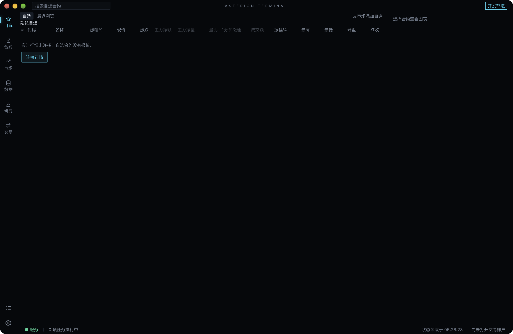

**截图状态：** 实时行情未连接，自选合约没有报价。

**字段与信息：** 代码；名称；涨幅%；现价；涨跌；主力净额；主力净量；量比；1分钟涨速；成交额；振幅%；最高；最低；开盘；昨收。

**操作名称：** 自选；最近浏览；去市场添加自选；连接行情。

**操作流程：**

1. 进入自选查看已关注合约。
2. 未连接时使用“连接行情”前往行情入口。
3. 从市场添加合约后返回自选。
4. 选择合约查看图表。

**核对范围：** 本次仅核对未连接状态；行情、图表及双击详情需有效行情连接后验证。

**当前界面来源：** [QuoteWorkspaces.tsx](../../../apps/clients/terminal/plugins/futures-market/QuoteWorkspaces.tsx)。

### 合约

**进入：** 主导航 → 合约（⌘2）

**布局：** 左侧自选列表；中间主图和相关合约；右侧合约详情。

[浏览实际截图](../prototype.html#contract) · [查看原尺寸](../screens/actual-contract.png)

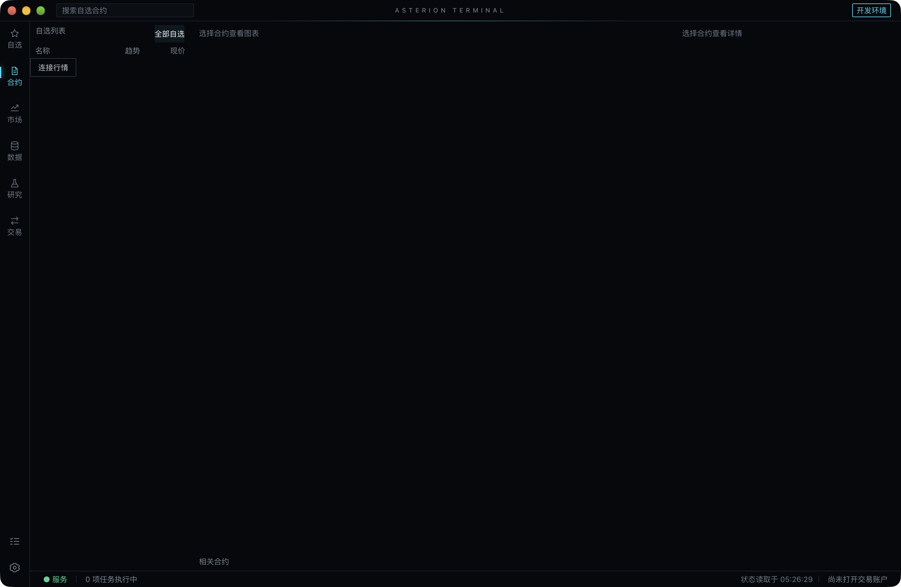

**截图状态：** 未选择合约，图表和详情分别提示选择合约。

**字段与信息：** 名称；走势；现价；当前合约；相关合约。

**操作名称：** 连接行情；全部自选。

**操作流程：**

1. 进入合约。
2. 先从自选列表选择明确合约。
3. 中间查看图表及相关合约。
4. 右侧查看该合约详情。

**核对范围：** 本次没有已订阅合约，不展示虚构盘口或成交。

**当前界面来源：** [QuoteWorkspaces.tsx](../../../apps/clients/terminal/plugins/futures-market/QuoteWorkspaces.tsx)。

### 市场

**进入：** 主导航 → 市场（⌘3）

**布局：** 顶部搜索、市场分类、实时/历史切换；当前未登录时显示行内连接表单。

[浏览实际截图](../prototype.html#market) · [查看原尺寸](../screens/actual-market.png)

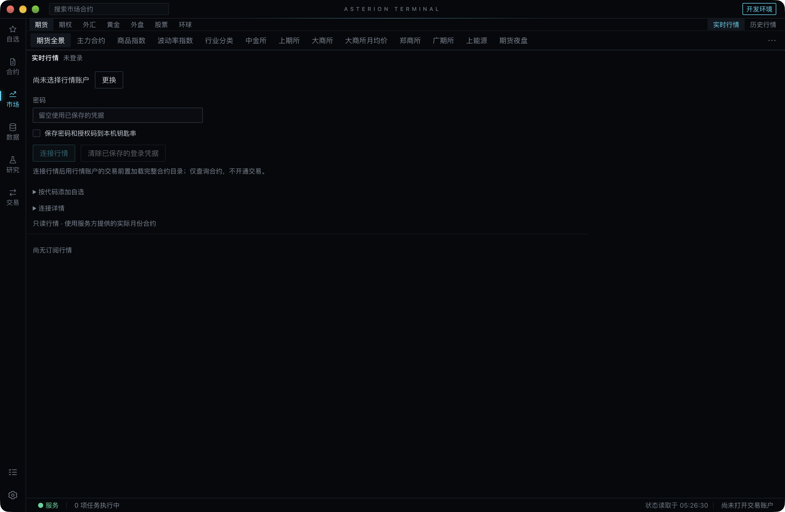

**截图状态：** 未登录；尚未选择行情账户；尚无订阅行情。

**字段与信息：** 行情账户；密码；保存密码和授权码到本机钥匙串；行情分类；行情模式。

**操作名称：** 更换；连接行情；清除已保存的登录凭据；按代码添加自选；连接详情。

**操作流程：**

1. 选择已登记行情账户。
2. 按需在本地输入行情凭据。
3. 明确选择是否保存行情凭据后连接。
4. 加载合约目录并选择合约。
5. 通过分类、自选和图表观察行情。

**核对范围：** 本次未连接外部行情。截图出现的非期货分类不表示本项目支持相应交易业务；支持范围仍限期货。

**当前界面来源：** [MarketPanel.tsx](../../../apps/clients/terminal/plugins/futures-market/MarketPanel.tsx)、[QuoteWorkspaces.tsx](../../../apps/clients/terminal/plugins/futures-market/QuoteWorkspaces.tsx)。

### 历史数据

**进入：** 主导航 → 数据 → 历史数据（⌘4）

**布局：** 上方数据源；左侧新建下载表单；右侧下载任务、已下载数据集；数据说明可展开。

[浏览实际截图](../prototype.html#data-history) · [查看原尺寸](../screens/actual-data-history.png)

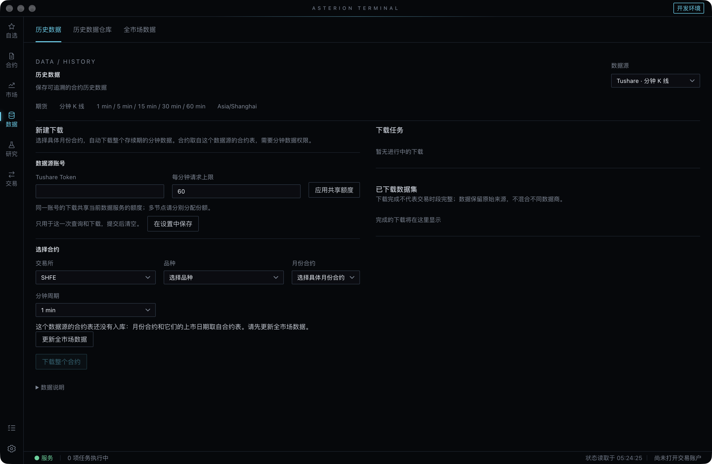

**截图状态：** 合约表尚未入库，月份合约未选，下载按钮不可用；暂无下载任务和数据集。

**字段与信息：** 数据源；Tushare Token；每分钟请求上限；交易所；品种；月份合约；分钟周期。

**操作名称：** 应用共享额度；在设置中保存；更新全市场数据；下载整个合约；数据说明。

**操作流程：**

1. 选择数据源。
2. 缺合约表时前往全市场数据准备合约表。
3. 回到历史数据选择交易所、品种、具体月份合约和分钟周期。
4. 核对账号权限与共享额度。
5. 点击“下载整个合约”。
6. 在右侧查看任务和完成的数据集。

**核对范围：** 本次只核对表单及阻断状态，未填写 Token、应用额度或下载。当前入口按合约存续期下载，不存在单独的“历史取数计划”主页面。

**当前界面来源：** [HistoricalDownloads.tsx](../../../apps/clients/terminal/plugins/data-workbench/HistoricalDownloads.tsx)。

### 历史数据仓库

**进入：** 主导航 → 数据 → 历史数据仓库

**布局：** 上方筛选和查询；下方每个数据版本一行，行内展开使用情况、数据或后续下载。

[浏览实际截图](../prototype.html#data-records) · [查看原尺寸](../screens/actual-data-records.png)

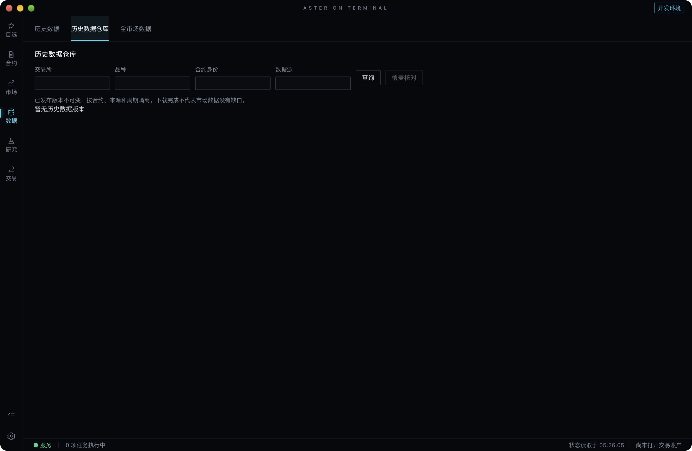

**截图状态：** 暂无历史数据版本；覆盖核对所需品种/日线条件不满足时不可用。

**字段与信息：** 交易所；品种；合约身份；数据源。

**操作名称：** 查询；覆盖核对；使用情况；查看数据；下载后续数据；用于回测；补齐缺口。

**操作流程：**

1. 按交易所、品种、合约身份和数据源筛选。
2. 点击查询。
3. 有版本后在该行查看数据或使用情况。
4. 需要增量时展开下载后续数据。
5. 按品种核对覆盖，针对缺失交易日进入补齐缺口。
6. 选定版本可进入回测。

**核对范围：** 空状态已实看；版本行及其操作由当前源码核对，尚无数据可进行运行验证。没有独立快照发布、修订对照或存储管理页。

**当前界面来源：** [ArchivedDataPanel.tsx](../../../apps/clients/terminal/plugins/data-workbench/ArchivedDataPanel.tsx)、[HistoryUpdatePanel.tsx](../../../apps/clients/terminal/plugins/data-workbench/HistoryUpdatePanel.tsx)。

### 全市场数据

**进入：** 主导航 → 数据 → 全市场数据

**布局：** 上方更新表单；下方已入库数据覆盖表；分区数据在表格下方查看。

[浏览实际截图](../prototype.html#data-tables) · [查看原尺寸](../screens/actual-data-tables.png)

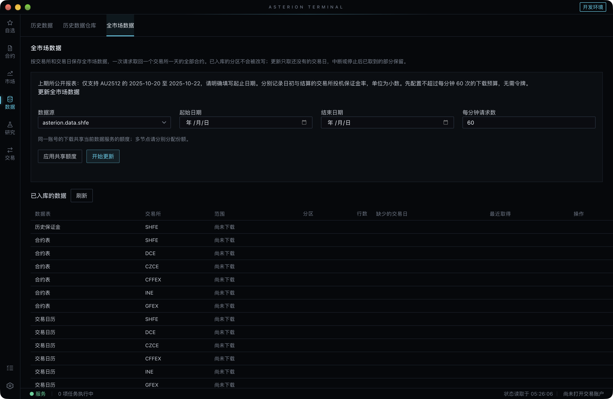

**截图状态：** 当前选择上期所公开报表来源；覆盖列表显示尚未下载。

**字段与信息：** 数据源；起始日期；结束日期；每分钟请求数；数据表；交易所；范围；分区；行数；缺少的交易日；最近取得。

**操作名称：** 应用共享额度；开始更新；刷新。

**操作流程：**

1. 选择数据源。
2. 按该来源支持范围设置日期与数据类别。
3. 核对账号及请求预算。
4. 点击开始更新。
5. 在任务和覆盖列表核对实际取得范围。
6. 有分区后查看表格内容。

**核对范围：** 截图仅代表所选来源；Tushare 等来源会显示不同字段/表类型。未执行更新。基础资料从此入口管理，不额外设置“数据资料与标准”主模块。

**当前界面来源：** [MarketTables.tsx](../../../apps/clients/terminal/plugins/data-workbench/MarketTables.tsx)。

### 回测记录

**进入：** 主导航 → 研究 → 回测（⌘5）

**布局：** 顶部回测/因子页签及任务服务状态；回测记录；下方回测实验比较。

[浏览实际截图](../prototype.html#research-backtest) · [查看原尺寸](../screens/actual-research-backtest.png)

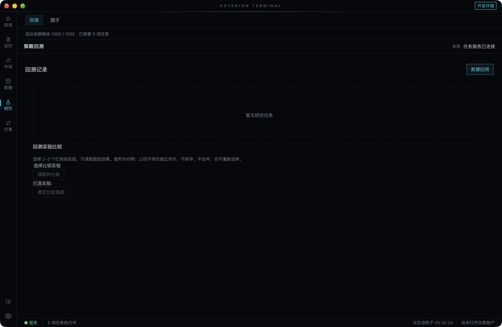

**截图状态：** 暂无研究任务；无可比较实验。

**字段与信息：** 运行位置；任务服务状态；活动名额；已保管任务数；选择比较实验；已选实验。

**操作名称：** 新建回测；读取并比较；清空比较选择。

**操作流程：**

1. 进入研究的回测页签。
2. 从记录查看指定任务。
3. 新研究点击新建回测。
4. 已有完成实验时选2–3个进行比较。

**核对范围：** 记录空状态已核对；结果、比较与导出需已有完成任务后验证。此处没有独立研究项目管理入口。

**当前界面来源：** [Backtest.tsx](../../../apps/clients/terminal/plugins/research/Backtest.tsx)、[BacktestComparison.tsx](../../../apps/clients/terminal/plugins/research/BacktestComparison.tsx)。

### 新建回测

**进入：** 研究 → 回测 → 新建回测

**布局：** 三步表单：选择历史数据 → 参数与交易规则 → 确认运行；返回回测记录按钮位于上方。

[浏览实际截图](../prototype.html#research-new) · [查看原尺寸](../screens/actual-research-new.png)

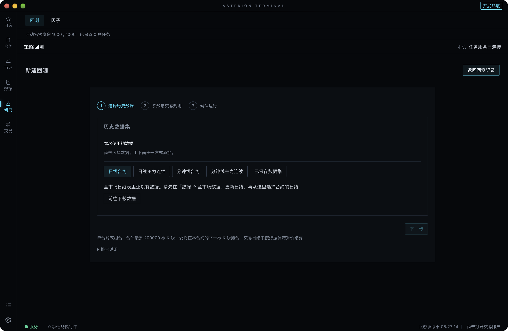

**截图状态：** 尚未选择数据；全市场日线表为空；下一步不可用。

**字段与信息：** 本次使用的数据；日线合约；日线主力连续；分钟线合约；分钟线主力连续；已保存数据集。

**操作名称：** 返回回测记录；前往下载数据；下一步；撮合说明。

**操作流程：**

1. 从回测记录点击新建回测。
2. 选择历史数据及具体合约范围。
3. 数据有效后进入参数与交易规则。
4. 配置策略、资金、成本与必要风险限制。
5. 在确认运行步骤核对摘要。
6. 提交后通过任务中心或回测记录查看进度。

**核对范围：** 第一步已实看；选择有效数据后出现的保存当前选择/保存数据集、使用已保存数据集以及第二、三步均依据源码核对，因无数据未实际执行。不得描述为已完成业务验收。

**当前界面来源：** [Backtest.tsx](../../../apps/clients/terminal/plugins/research/Backtest.tsx)、[HistoryAvailability.tsx](../../../apps/clients/terminal/plugins/research/HistoryAvailability.tsx)、[SavedDatasets.tsx](../../../apps/clients/terminal/src/ui/SavedDatasets.tsx)。

### 因子

**进入：** 主导航 → 研究 → 因子

**布局：** 顶部 K 线/全市场数据表切换；主区域纵向排列因子设置、分析记录及日线因子比较，需要向下滚动。

[浏览实际截图](../prototype.html#research-factor) · [查看原尺寸](../screens/actual-research-factor.png)

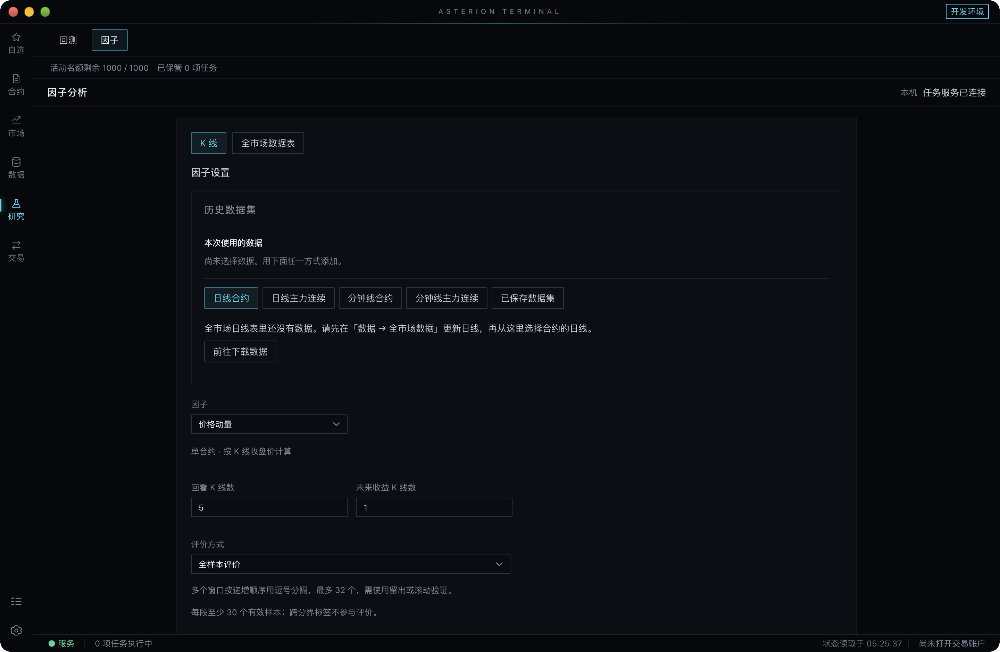

**截图状态：** 没有日线数据、没有分析记录；提示先到数据 → 全市场数据更新日线。

**字段与信息：** 输入类型（K 线/全市场数据表）；历史数据集；本次使用的数据；因子；回看 K 线数；未来收益 K 线数；评价方式。

**操作名称：** 前往下载数据；开始分析；计算说明；读取并比较；清空比较选择。

**操作流程：**

1. 选择历史数据。
2. 选择因子、回看窗口和未来收益窗口。
3. 选择评价方式并核对有效样本要求。
4. 开始分析。
5. 任务完成后读取结果。
6. 选2–3个完成实验作比较。

**核对范围：** 仅核对当前可见表单和空状态。没有独立“多因子合成”页面；完整多因子组合需求继续待实现。

**当前界面来源：** [Factor.tsx](../../../apps/clients/terminal/plugins/research/Factor.tsx)、[FactorForm.tsx](../../../apps/clients/terminal/plugins/research/FactorForm.tsx)。

### CTP 交易

**进入：** 主导航 → 交易（⌘6）

**布局：** 无账户时显示管理入口；有账户时账户列表与所选账户详情；账户内分阶段连接、授权、下单。

[浏览实际截图](../prototype.html#trading) · [查看原尺寸](../screens/actual-trading.png)

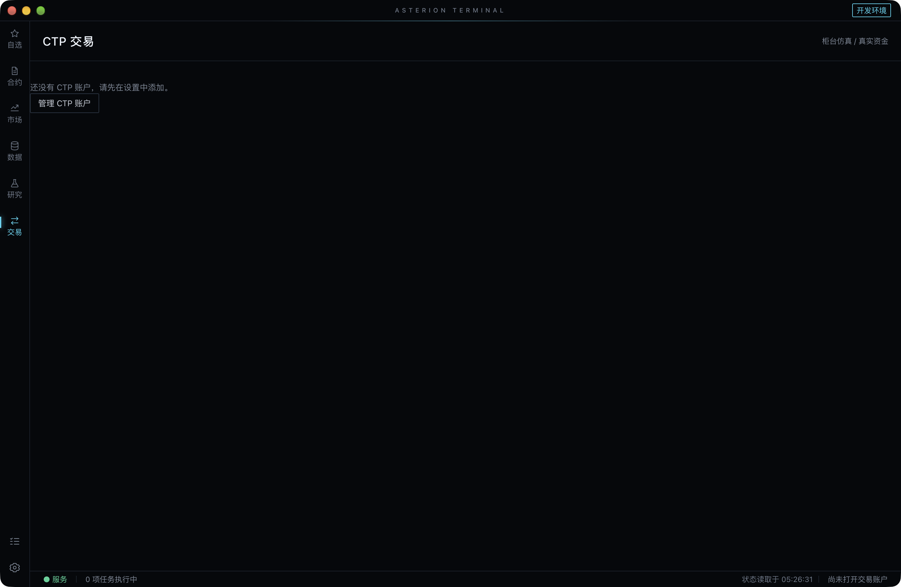

**截图状态：** 还没有 CTP 账户，请先在设置中添加。

**字段与信息：** 账户；柜台环境；交易密码；授权码；合约；开平仓；委托手数；限价。

**操作名称：** 管理 CTP 账户；连接账户；允许发送委托；手动下单；策略运行；持仓；委托；成交；费率；风控。

**操作流程：**

1. 通过设置登记CTP账户。
2. 回到交易选择账户并配置合约与风控。
3. 核对柜台环境并连接。
4. 明确允许发送委托。
5. 在账户内进入手动下单或策略运行。
6. 委托、成交、持仓、费率和风控均在同一账户上下文查看。

**核对范围：** 截图仅证明无账户入口。账户内字段、分阶段操作按源码核对；未创建账户、登录、授权或发单。不存在单独委托中心、风险中心、策略主导航。

**当前界面来源：** [LivePanel.tsx](../../../apps/clients/terminal/plugins/trading/LivePanel.tsx)、[ActivityTabs.tsx](../../../apps/clients/terminal/plugins/trading/ActivityTabs.tsx)、[StrategyRun.tsx](../../../apps/clients/terminal/plugins/trading/StrategyRun.tsx)。

### 偏好设置

**进入：** 左下设置图标或 ⌘, → 偏好设置

**布局：** 独立设置窗口；左侧六个分类；右侧三行即时生效的下拉设置。

[浏览实际截图](../prototype.html#settings) · [查看原尺寸](../screens/actual-settings.png)

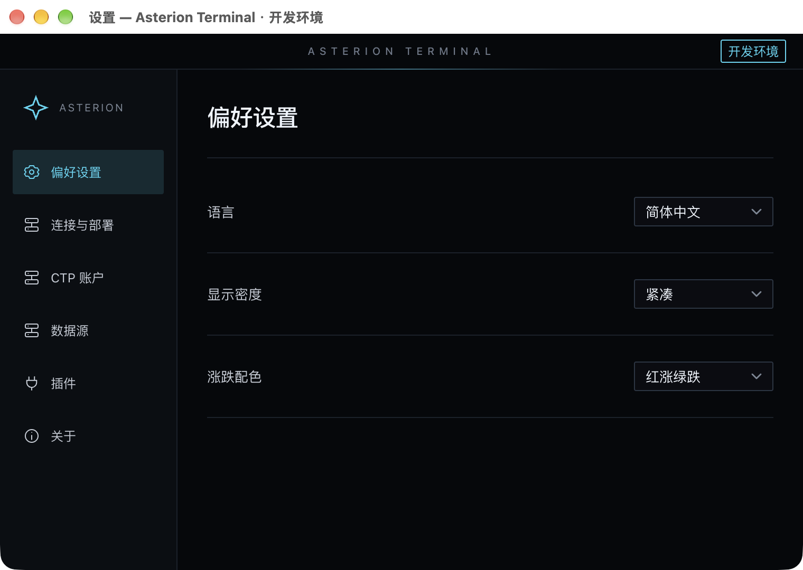

**截图状态：** 当前值为简体中文、紧凑、红涨绿跌。

**字段与信息：** 语言（简体中文/English）；显示密度（紧凑/舒适）；涨跌配色（红涨绿跌/绿涨红跌）。

**操作名称：** 语言选择；显示密度选择；涨跌配色选择。

**操作流程：**

1. 打开独立设置窗口。
2. 选择偏好设置。
3. 修改对应下拉项即保存。
4. 关闭设置窗口返回原工作区。

**核对范围：** 本轮仅查看，未更改用户偏好。当前没有保存/放弃按钮、时区选择或语言草稿离开确认；文档不得虚构这些控件。

**当前界面来源：** [Settings.tsx](../../../apps/clients/terminal/src/settings/Settings.tsx)。

### 连接与部署

**进入：** 设置 → 连接与部署

**布局：** 当前运行位置/机器管理页签；各服务显示运行位置和状态，并提供管理入口。

[浏览实际截图](../prototype.html#settings-connections) · [查看原尺寸](../screens/actual-settings-connections.png)

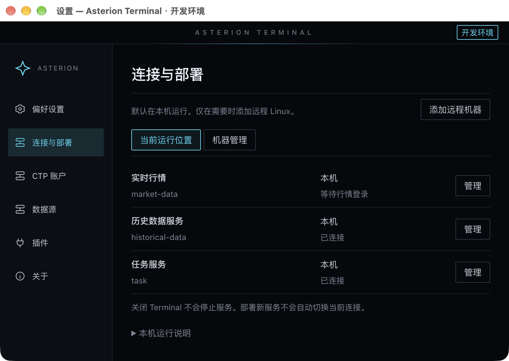

**截图状态：** 本机历史数据服务和任务服务已连接；实时行情等待行情登录。

**字段与信息：** 实时行情；历史数据服务；任务服务；当前位置；连接状态。

**操作名称：** 添加远程机器；当前运行位置；机器管理；管理；本机运行说明。

**操作流程：**

1. 查看当前运行位置。
2. 按具体服务进入管理。
3. 需要维护机器时切到机器管理。
4. 只有需要远程Linux时才添加远程机器。
5. 部署完成后明确选择服务连接。

**核对范围：** 未执行部署、切换、停止或重启服务；连接可见不等于远程部署已验证。

**当前界面来源：** [Connections.tsx](../../../apps/clients/terminal/src/settings/Connections.tsx)、[NodeServices.tsx](../../../apps/clients/terminal/src/settings/NodeServices.tsx)。

### CTP 账户

**进入：** 设置 → CTP 账户

**布局：** 账户列表/空状态；添加或编辑账户表单。

[浏览实际截图](../prototype.html#settings-ctp) · [查看原尺寸](../screens/actual-settings-ctp.png)

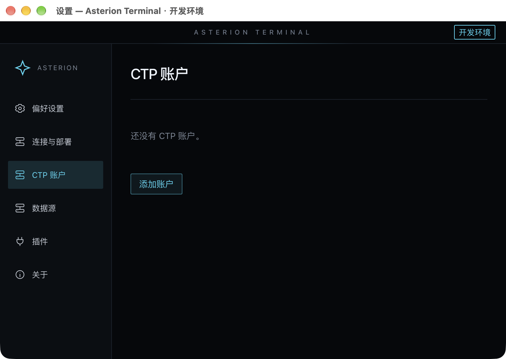

**截图状态：** 还没有 CTP 账户。

**字段与信息：** 账户名称；经纪商代码；投资者账号；AppID；交易前置；行情前置。

**操作名称：** 添加账户；保存账户；取消；用于行情；编辑账户；删除账户。

**操作流程：**

1. 打开CTP账户分类。
2. 添加账户并填写开户机构提供的信息。
3. 保存登记信息。
4. 按需选择用于行情。
5. 交易连接及授权在交易工作区独立完成。

**核对范围：** 仅实看空状态；添加表单及已有账户操作依据源码。没有保存真实账户或凭据。登记账户不等于开启交易权限。

**当前界面来源：** [CtpConnections.tsx](../../../apps/clients/terminal/src/settings/CtpConnections.tsx)。

### 数据源

**进入：** 设置 → 数据源

**布局：** 按数据提供方显示状态、提供的数据和配置入口。

[浏览实际截图](../prototype.html#settings-sources) · [查看原尺寸](../screens/actual-settings-sources.png)

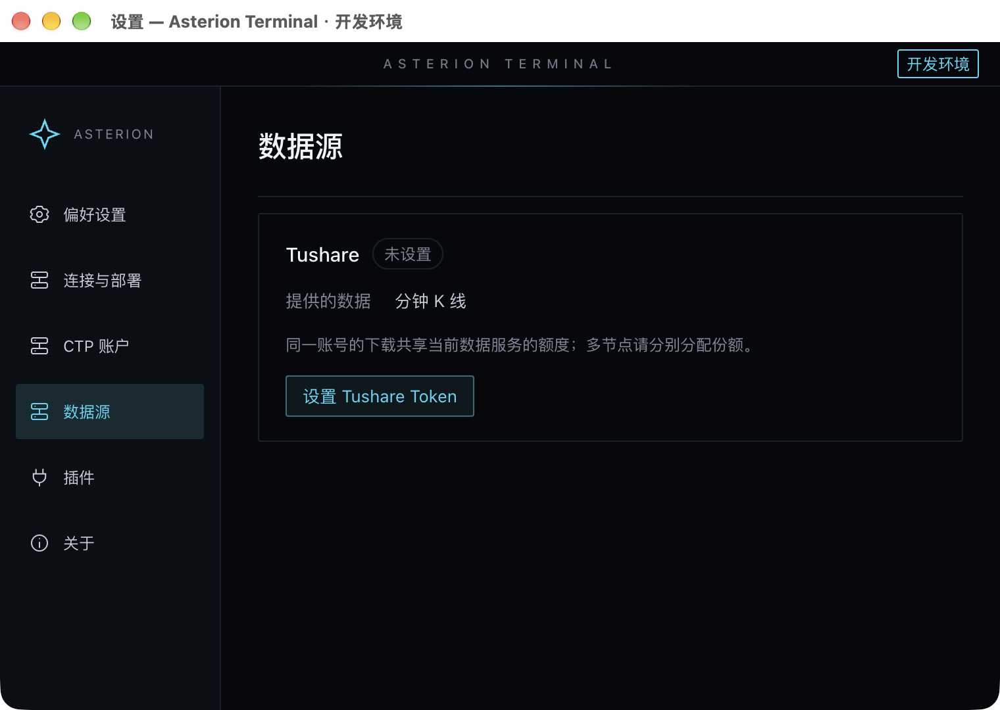

**截图状态：** Tushare 未设置。

**字段与信息：** 提供方；凭据设置状态；提供的数据；共享额度说明。

**操作名称：** 设置 Tushare Token。

**操作流程：**

1. 打开数据源分类。
2. 选择设置Tushare Token。
3. 用户在本地完成凭据设置。
4. 回到数据工作区配置具体查询或下载。

**核对范围：** 未输入或保存Token；没有独立的通用凭据中心。行情凭据和交易登录另有各自用途。

**当前界面来源：** [DataSources.tsx](../../../apps/clients/terminal/src/settings/DataSources.tsx)。

### 插件

**进入：** 设置 → 插件

**布局：** 数据服务和任务服务分别显示启用插件；下方列当前发行版内置能力。

[浏览实际截图](../prototype.html#settings-plugins) · [查看原尺寸](../screens/actual-settings-plugins.png)

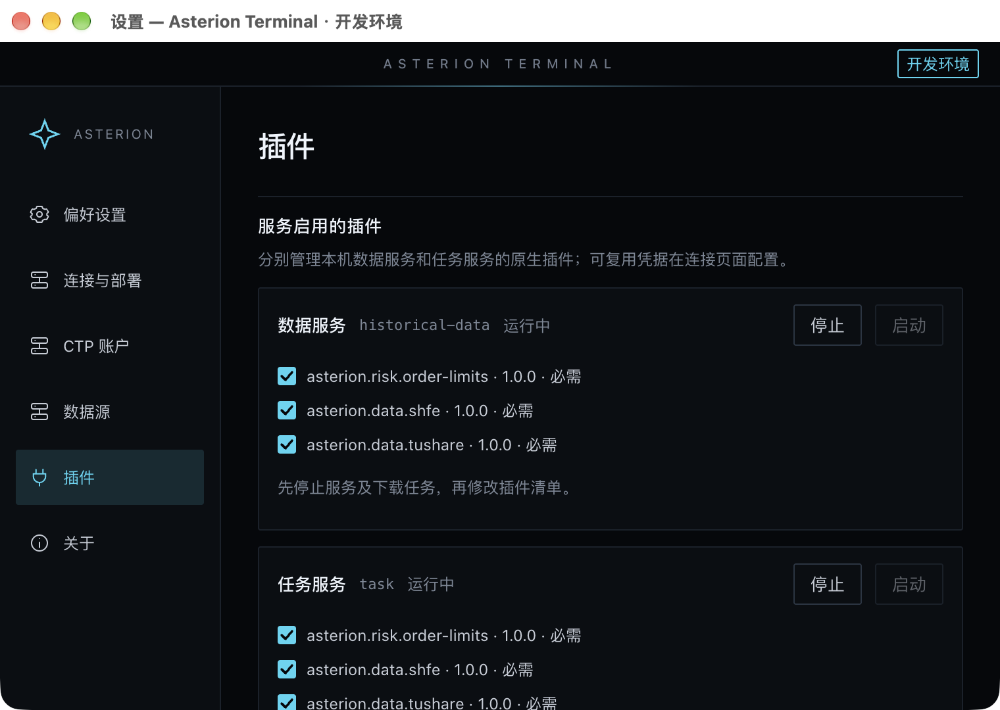

**截图状态：** 数据服务、任务服务正在运行；显示必要插件。

**字段与信息：** 服务名称；服务状态；插件标识；插件版本；必需标记。

**操作名称：** 停止；启动；插件勾选。

**操作流程：**

1. 查看服务及启用插件。
2. 变更前阅读服务和任务停止要求。
3. 仅在明确维护操作中修改插件并重新启动。
4. 回看服务状态。

**核对范围：** 本次只查看，未停止服务或修改插件；截图中版本是实际插件标识，不是需求文档版本。

**当前界面来源：** [NativePlugins.tsx](../../../apps/clients/terminal/src/settings/NativePlugins.tsx)。

### 关于

**进入：** 设置 → 关于

**布局：** 产品名称、版本、安装包更新说明和可展开的诊断信息。

[浏览实际截图](../prototype.html#settings-about) · [查看原尺寸](../screens/actual-settings-about.png)

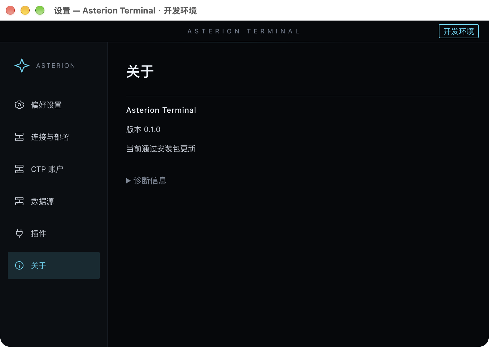

**截图状态：** 显示Asterion Terminal、版本0.1.0及当前通过安装包更新。

**字段与信息：** 产品名称；版本；更新方式；诊断信息。

**操作名称：** 诊断信息。

**操作流程：**

1. 进入关于。
2. 核对版本。
3. 按需展开诊断信息。
4. 依据具体故障提供必要的非秘密信息。

**核对范围：** 仅核对折叠状态；这里没有全局事件检索、诊断打包或通用导出中心。

**当前界面来源：** [Settings.tsx](../../../apps/clients/terminal/src/settings/Settings.tsx)。

### 任务中心

**进入：** 左下任务图标或底部任务数量

**布局：** 主窗口底部抽屉，保留上方业务工作区。

[浏览实际截图](../prototype.html#tasks) · [查看原尺寸](../screens/actual-tasks.png)

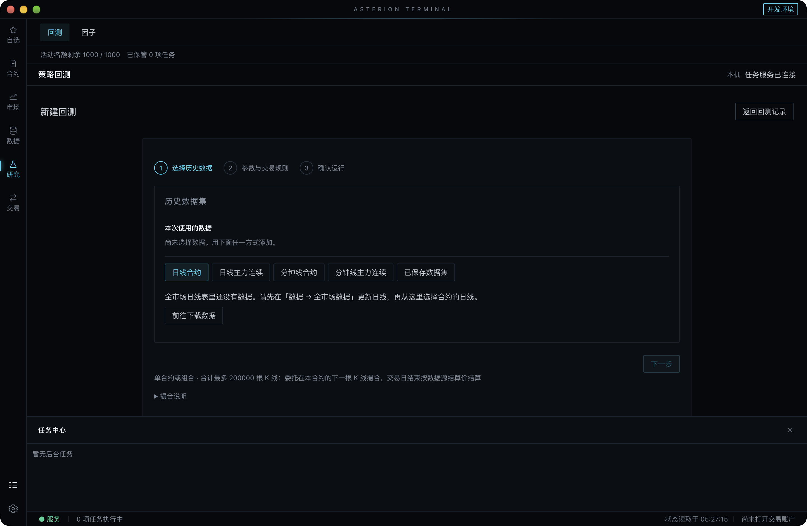

**截图状态：** 暂无后台任务。

**字段与信息：** 任务类型；任务状态；任务摘要。

**操作名称：** 打开任务中心；关闭任务中心；选择具体任务。

**操作流程：**

1. 从任务图标或任务数量打开抽屉。
2. 有任务时查看类型与状态。
3. 选择任务进入对应业务工作区。
4. 关闭抽屉继续原工作。

**核对范围：** 空状态已核对；没有创建测试任务，因此任务行导航、取消和失联状态只核对源码，未进行实际任务验收。

**当前界面来源：** [App.tsx](../../../apps/clients/terminal/src/App.tsx)。

## 更新要求

界面名称、导航、字段或操作改变时，同步更新本章、对应UI条目、截图、界面浏览和阅读版。截图只保留当前基线；重新采集时覆盖同名图，不积累旧版页面。新增能力须先明确需求，再在实际结构中完成设计与实现；完成前不能把待设计标记改成已实现。
