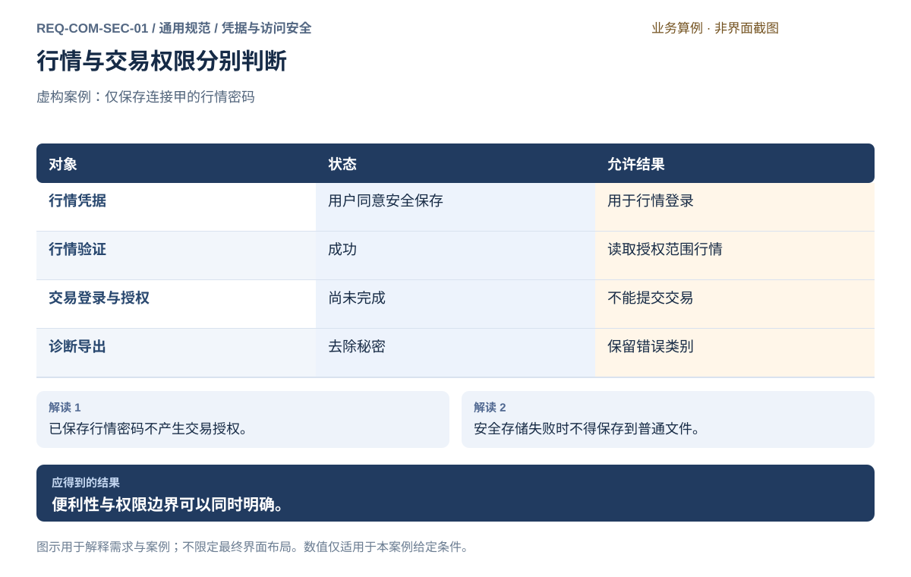
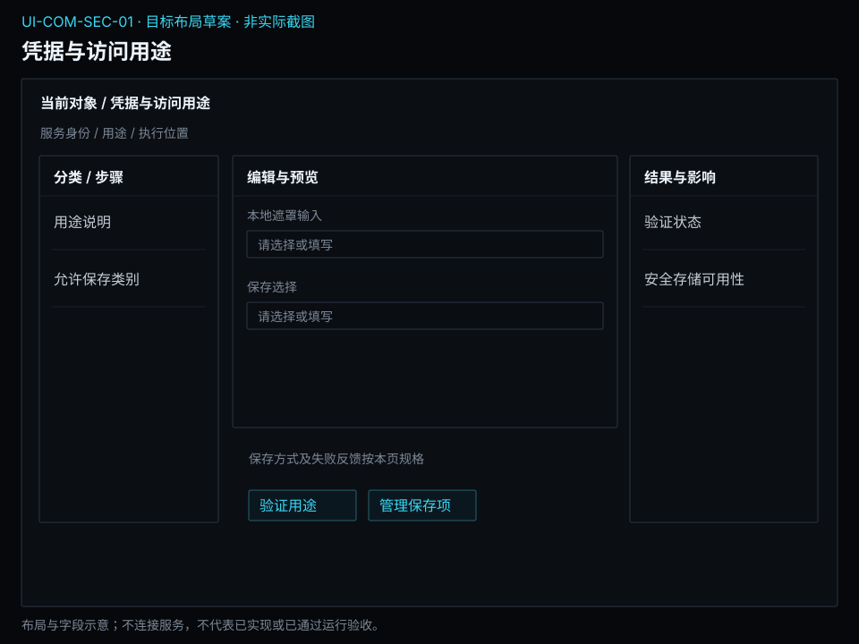

# 凭据与访问安全

[返回上级](README.md) · [需求总纲](../README.md) · [界面阅读指南](screens.md) · [跨模块流程](../workflows/README.md)

开发前需求与设计规格 · 2026-10-20。定义目标功能、操作流程、界面和验收判据；规格决定、运行配置与外部条件分别记录。

**归属：** 通用规范 / 凭据与访问安全。本页集中保存业务需求、详细功能、案例、界面对应和验收；通用规则见[通用规范](README.md)。

## 需求导航

- [REQ-COM-SEC-01 保护凭据并区分行情与交易权限](#req-com-sec-01)

## REQ-COM-SEC-01 保护凭据并区分行情与交易权限

**领域：** 通用规范 / 凭据与访问安全　 **建议优先级：** P0安全必要　 **需求状态：** 开发前设计规格（具体决定与运行配置见本条DEC）

### 目标与场景

使用者应能明确决定是否保存行情凭据，并知道权限被用于什么目的。研究和行情访问不能隐含交易授权，凭据也不能通过普通资料、日志或导出文件泄漏。

**使用者与场景：** 配置数据连接、行情登录和交易权限的个人使用者。

**触发条件：** 输入凭据、选择保存凭据、重新登录或撤销访问。

### 前置条件

- 使用者有权使用相应数据或账户。
- 凭据用途、所属连接和权限范围已明确。

### 输入与含义

| 输入           | 含义与单位                       | 约束                                                   |
| -------------- | -------------------------------- | ------------------------------------------------------ |
| 行情登录凭据   | 行情账户密码或授权码等秘密       | 本地输入；仅在用户明确选择时存入系统安全凭据存储。     |
| 交易登录与授权 | 独立用于交易身份核验的秘密和许可 | 不能复用已保存行情凭据，也不能因行情已登录而默认授权。 |

### 正常操作与反馈

1. 使用者查看连接用途和所需权限。
2. 本地输入对应凭据，系统隐藏秘密内容。
3. 使用者明确决定是否保存允许保存的行情秘密。
4. 系统说明实际保存结果并完成相应用途的验证。
5. 使用者查看已保存凭据的所属连接与用途。
6. 使用者可移除已保存凭据并撤销相应访问。

### 业务规则

- macOS 使用 Keychain，Linux 使用 Secret Service 安全凭据存储。
- 保存选项不预先替使用者作出同意；不保存时仅按必要生命周期使用。
- 系统安全存储不可用时不得退回普通配置或界面存储。
- 密码与授权码不进入源文件、普通备份、日志和诊断导出。
- 行情授权、交易授权和资料访问分别表达；权限缺失时拒绝相应操作。
- 移除本地保存项不等于服务方账户已注销，应说明实际影响。

### 输出与状态影响

- 可识别所属连接与用途的凭据保存状态。
- 独立的行情和交易授权结果。

### 异常与继续方式

| 发生什么           | 应怎样表现                                 | 使用者如何继续                           |
| ------------------ | ------------------------------------------ | ---------------------------------------- |
| 系统安全存储被锁定 | 报告未保存，不转存普通文件。               | 使用者解锁后重试，或明确选择本次不保存。 |
| 凭据已失效         | 说明相应用途验证失败，不重复尝试其他用途。 | 使用者重新输入合法凭据并再次验证。       |

### 案例：保存行情凭据不产生交易权限

**虚构案例条件：** 虚构案例：使用者保存连接甲的行情密码，尚未进行交易登录与授权。

1. 明确选择保存行情密码。
2. 完成行情验证后尝试进入交易提交。

**预期结果：**

- 行情凭据显示已安全保存；交易仍缺少独立登录与授权；诊断导出不含该密码。

### 可观察验收条件

| 编号                | 给定                   | 当           | 则                                         |
| ------------------- | ---------------------- | ------------ | ------------------------------------------ |
| REQ-COM-SEC-01-AC01 | 只保存并验证了行情凭据 | 请求交易     | 要求独立交易登录及授权，不复用行情秘密。   |
| REQ-COM-SEC-01-AC02 | 安全存储不可用         | 选择保存     | 明确显示未保存，普通配置中没有凭据。       |
| REQ-COM-SEC-01-AC03 | 连接出现认证错误       | 导出诊断资料 | 可以定位失败用途，但内容没有密码或授权码。 |

### 决定与配置约束

- **DEC-COM-SEC-01-01**：**规格决定**。不允许持久保存交易登录秘密。仅行情登录密码与授权码经用户明确选择保存在macOS Keychain或Linux Secret Service，其他用途只保存非秘密引用或会话输入；不复用行情凭据登录交易。

### 详细功能

### FR-COM-SEC-01-01 按用途填写凭据并核对权限

**目标与结果：** 使用者输入秘密之前先确认其用途、连接和权限范围。行情登录、账户查询和交易授权分开表达，避免把已连接行情理解为可以向真实账户交易。

**触发：** 凭据管理选择新增用途，或来源与账户页进入相应用途说明。

**输入与约束：** 连接身份、用途和秘密字段；秘密只在本地应用输入，默认空白，不回显历史值。离线界面浏览不收集凭据。

**目标操作与反馈：**

1. 选择明确连接和行情或交易用途。
2. 查看所需权限说明后在正式产品的本地保护输入中提供相应凭据。
3. 验证后分别显示用途结果，返回原来源或账户上下文。

**异常与边界：**

- 行情验证成功不会自动完成交易登录或授权。
- 凭据失效时仅说明相关用途失败，不能尝试复用于其他用途。

**验收条件：**

- **FR-COM-SEC-01-01-AC01**：已保存行情密码仍不能使交易账户显示已授权。
- **FR-COM-SEC-01-01-AC02**：秘密输入只作用于明确的连接用途，不进入普通配置、日志、导出或离线说明。

**界面对应：** [UI-COM-SEC-01 凭据与访问用途](#ui-com-sec-01)；[UI-DAT-ACQ-01 数据来源与连接](../modules/data/acquisition.md#ui-dat-acq-01)；[UI-LIV-RUN-01 账户连接与交易授权](../modules/live/operations.md#ui-liv-run-01)。

### FR-COM-SEC-01-02 明确选择将行情凭据保存到系统安全存储

**目标与结果：** 使用者可以自行选择是否保留行情密码或授权码，系统必须反馈真实保存结果。便利性不意味着可以默认同意或在安全存储失败后改存普通文件。

**触发：** 行情用途验证时选择保存，或凭据管理打开对应连接。

**输入与约束：** 保存选择默认不勾选；允许对象限明确的行情密码和授权码。macOS 使用 Keychain，Linux 使用 Secret Service。

**目标操作与反馈：**

1. 查看保存范围及下次使用方式。
2. 用户明确勾选保存后提交对应安全存储操作。
3. 显示已保存、未保存或需要解锁，并保留连接用途说明。

**异常与边界：**

- 安全存储不可用时不能退回普通配置、界面存储或导出文件。
- 选择本次不保存后，秘密仅按必要生命周期使用，不留作下次自动使用。

**验收条件：**

- **FR-COM-SEC-01-02-AC01**：未选择保存时关闭相关使用后没有普通配置中的秘密。
- **FR-COM-SEC-01-02-AC02**：安全存储被锁定时显示未保存，可由用户解锁后重试或继续不保存。

**界面对应：** [UI-COM-SEC-01 凭据与访问用途](#ui-com-sec-01)。

### FR-COM-SEC-01-03 移除保存项并区分本地与外部授权

**目标与结果：** 使用者可撤回本地保存决定，但须知道移除保存项、断开当前访问和注销服务方账户是不同结果。操作记录可以证明发生了什么，不保留被移除的秘密内容。

**触发：** 凭据管理选中已保存的行情用途并点击移除保存项。

**输入与约束：** 只读展示连接、用途、保存状态和最近使用时间；没有已保存项时操作不可用，不显示秘密明文。

**目标操作与反馈：**

1. 核对将移除的本地保存项及当前访问是否受影响。
2. 明确确认后移除，显示实际结果。
3. 需要结束当前访问时转到来源或账户页执行独立动作。

**异常与边界：**

- 移除失败保留原状态并提示权限或解锁条件，不声称已删除。
- 移除本地项不表示服务方授权已撤销，不自动注销外部账户。

**验收条件：**

- **FR-COM-SEC-01-03-AC01**：移除成功后该用途显示未保存，下次访问需按授权规则重新提供。
- **FR-COM-SEC-01-03-AC02**：操作记录只含连接用途与结果，没有密码或授权码内容。

**界面对应：** [UI-COM-SEC-01 凭据与访问用途](#ui-com-sec-01)；[UI-DAT-ACQ-01 数据来源与连接](../modules/data/acquisition.md#ui-dat-acq-01)；[UI-LIV-RUN-01 账户连接与交易授权](../modules/live/operations.md#ui-liv-run-01)。

### FR-COM-SEC-01-04 在记录与分享资料中排除秘密

**目标与结果：** 个人资料需要复核和分享，但秘密不应随错误、普通备份或导出扩散。使用者在导出预览可以了解保密边界，账号脱敏选择也不能覆盖密码始终排除的规则。

**触发：** 查看事件详情、创建备份或导出诊断及资料时。

**输入与约束：** 按实际对象读取必要身份与问题类别；密码、授权码和秘密密钥始终排除，账户标识按所选保密规则处理。

**目标操作与反馈：**

1. 预览准备输出的资料类别和身份字段。
2. 检查保密说明，按需隐藏账户标识。
3. 生成本地文件并显示保留项与排除项，不自动发送。

**异常与边界：**

- 无法保证某字段不含秘密时停止该导出并指出需处理项目，不输出未检查内容。
- 诊断失败不能通过显示完整认证请求来排错。

**验收条件：**

- **FR-COM-SEC-01-04-AC01**：认证错误报告包含用途和错误类别，但没有秘密字符串。
- **FR-COM-SEC-01-04-AC02**：普通备份与研究导出均不包含保存的行情密码或授权码。

**界面对应：** [UI-COM-SEC-01 凭据与访问用途](#ui-com-sec-01)；[UI-SYS-REC-01 资料、备份与恢复](../modules/system/records.md#ui-sys-rec-01)；[UI-SYS-REC-02 事件与诊断](../modules/system/records.md#ui-sys-rec-02)；[UI-SYS-REC-03 导出资料](../modules/system/records.md#ui-sys-rec-03)。

### FR-COM-SEC-01-05 明确计划任务的凭据前提

**目标与结果：** 定时任务只有在其运行位置具备允许用途的有效凭据时才可执行。

**触发：** 配置数据/情报计划、切换节点或安全存储锁定。

**输入与约束：** 凭据类别、用途、运行位置、可访问状态；仅行情密码及授权码允许由用户显式选择存入系统安全存储；其他用途使用非秘密引用或本次会话输入，不提供持久保存选项。

**目标操作与反馈：**

1. 按任务位置检查凭据引用及权限，不显示秘密；明确本机凭据不会自动复制到远程。
2. 类别未获准持久保存时仅允许用户本地提供的当前会话使用，不承诺无人值守可用；需要持久凭据的计划显示未就绪。
3. 触发时重新检查，缺失/过期/锁定则阻止执行并记录原因，用户补齐后明确决定后续新触发。

**异常与边界：**

- 不得将LLM或数据令牌写普通配置以绕开限制；不得借计划功能新增允许保存类别。
- 解锁/重新授权不自动补发错过交易命令；补跑非交易任务遵循原计划政策。

**操作案例：** LLM会话令牌失效后，夜间计划显示未执行及原因；不得把前一晚的秘密导出到任务参数。

**验收条件：**

- **FR-COM-SEC-01-05-AC01**：远程任务无法访问本机安全凭据时明确拒绝而不复制秘密。
- **FR-COM-SEC-01-05-AC02**：计划触发时凭据锁定，任务显示凭据不可用且外部调用数为0。

**界面对应：** [UI-COM-SEC-01](#ui-com-sec-01)；[UI-SYS-RUN-04](../modules/system/tasks-nodes.md#ui-sys-run-04)。

## 目标界面设计

## UI-COM-SEC-01 凭据与访问用途

**业务目标：** 按连接和用途管理凭据保存决定，分清行情访问与交易授权，并避免秘密进入普通资料；秘密只在用户本地按用途输入。

### 页面形态与目标布局

**规格范围：** 本条定义目标布局、字段、动作和业务状态，设计图与以下操作规则共同作为开发依据。

**界面形态：** 上下文对话框。

**目标到达路径：** 数据来源、实盘账户或情报方案 → 凭据与访问用途。从业务详情进入时携带固定对象身份和返回位置。

| 区域 | 要显示的内容 |
| --- | --- |
| 顶部上下文 | 服务身份 / 用途 / 执行位置 |
| 列表、分类或步骤区 | 用途说明 / 允许保存类别 |
| 主要工作区 | 本地遮罩输入 / 保存选择 |
| 选中项详情或检查区 | 验证状态 / 安全存储可用性 |
| 主要动作区 | 验证用途 / 管理保存项 |

**区域联动与返回：** 输入、只读展示与动作按下方分表定义；选中对象、查询条件及返回位置保持一致，导航不隐式执行业务。保存、取消及离开适用本页的具体规则。

**窗口与空间：** 使用所属业务打开的本地上下文对话框，正文区域必要时滚动；服务身份、用途、秘密遮罩与取消入口保持可达，不重复主窗口侧栏。

**状态设计范围：** 只采用下方状态表及关联FR适用于本页的状态；缺失值、来源时效、阻断原因与可执行下一步必须明确。字段与动作按本页交付约定核对。

### 目标操作规格

1. 由来源、账户或方案携带明确用途进入本地凭据对话框，核对服务与执行位置。
2. 输入所需秘密或选择同用途允许的行情引用，再独立验证用途。
3. 仅在允许类别和明确选择下保存至安全存储；完成或取消返回原流程并清除本次秘密输入。

**操作案例：** 计划位置无法取得允许用途凭据时仍未就绪；行情验证成功不能变成交易授权。

### 业务验收要求

- **UI-COM-SEC-01-AC01**：凭据仅在所属来源、账户或情报方案的本地用途对话框输入；页面只显示秘密遮罩和非秘密引用。
- **UI-COM-SEC-01-AC02**：安全存储不可用时显示未保存，普通配置、备份和诊断中没有秘密。
- **UI-COM-SEC-01-AC03**：移除行情保存项后交易权限不受虚假继承，界面清楚说明外部授权未注销。

### 字段与操作交付约定

凭据对话框由明确的来源、账户或方案发起。秘密只在本地遮罩输入，普通草稿、列表、诊断、备份与导出不保存秘密。

#### 用户输入

| 字段 | 类型、默认值与必填条件 | 合法范围及变更影响 |
| --- | --- | --- |
| 用途所需秘密 | 服务方声明的密码/授权码/令牌等遮罩输入，初始为空 | 对该用途必需的字段均非空；格式和长度按提供方明确规则，不能擅自裁剪或改写秘密；不存在通用示例密码 |
| 使用已保存行情项 | 本机允许类别的非秘密引用单选，默认不选；可选 | 只匹配同一来源、账户和行情用途；不能在交易用途列出或复用行情秘密 |
| 保存行情密码/授权码 | 勾选框默认不勾选，仅允许行情类别且安全存储可用时显示 | 每次保存须明确选择；交易登录、历史/模型等未允许类别不提供持久保存选项 |
| 临时显示输入 | 按住显示，默认遮罩；可选 | 仅显示本次本地输入，松开或失焦立即遮罩，不展示安全存储中的既有秘密 |

#### 只读展示

| 信息 | 来源与含义 | 缺失或陈旧时 |
| --- | --- | --- |
| 服务、来源/账户、用途、执行位置 | 调用流程传入的固定上下文 | 上下文不完整拒绝验证；改变用途须退出并由新用途重新进入 |
| 安全存储与保存项 | macOS Keychain / Linux Secret Service可用性，非秘密引用与类别 | 锁定或不可用时不可保存，不降级到配置文件；明确仅会话可用 |
| 验证与访问结果 | 对该用途的验证结果、时间及限制 | 无可靠响应显示待核实；行情可用不代表交易授权或其他用途可用 |

#### 按钮与动作

| 动作 | 启用条件 | 结果及失败反馈 |
| --- | --- | --- |
| 验证此用途 | 上下文完整，必需秘密或允许引用可用，没有未决验证 | 仅验证指定服务和用途；失败显示脱敏原因，不能回显秘密或授予交易权限 |
| 保存允许的行情项 | 用户明确勾选、安全存储可用且类别允许 | 单独展示保存结果及引用；验证成功不能冒充保存成功，失败不写普通配置 |
| 移除本地保存项 | 选中明确引用且显示用途、影响 | 确认后仅移除本机保存项；说明外部账户/授权及已建立访问未因此自动注销，需要转原业务独立操作 |
| 完成并返回 | 用途获得明确结果 | 返回调用对象及非秘密结果，清除对话框秘密输入；不自动启用交易或计划 |
| 取消 / Esc关闭 | 始终可用 | 清除本次秘密输入和临时展示，不保存草稿；已完成的独立保存操作不因关闭被虚假撤销 |

#### 适用状态与离开

| 状态 | 页面行为 |
| --- | --- |
| 未提供 / 必需字段缺失 | 指向具体服务方字段；不以示例值、其他用途秘密补齐 |
| 验证中 / 验证待核实 | 显示指定用途和位置；不能重复提交或推断授权成功 |
| 仅会话可用 / 已安全保存 | 分别显示凭据寿命和存储结果，不承诺远程或计划可取用 |
| 存储锁定 / 失效 / 保存失败 | 显示明确原因，允许用户解锁或重新本地输入；不降级明文保存 |

本页不出现普通“保存草稿/放弃/继续编辑”离开框。取消立即清除本次秘密；返回保留调用对象、用途和非秘密验证结果。需要持久凭据但类别不允许或目标位置无法取得时，计划保持未就绪，用户必须回所属业务明确解决，不能复制秘密到任务参数。

### 对应功能需求

- [FR-COM-UX-01-07 危险动作明确对象后再确认](interaction.md#fr-com-ux-01-07)
- [FR-COM-SEC-01-01 按用途填写凭据并核对权限](#fr-com-sec-01-01)
- [FR-COM-SEC-01-02 明确选择将行情凭据保存到系统安全存储](#fr-com-sec-01-02)
- [FR-COM-SEC-01-03 移除保存项并区分本地与外部授权](#fr-com-sec-01-03)
- [FR-COM-SEC-01-04 在记录与分享资料中排除秘密](#fr-com-sec-01-04)
- [FR-COM-SEC-01-05 明确计划任务的凭据前提](#fr-com-sec-01-05)
- [FR-SYS-SET-02-04 保护配置秘密并关联变更记录](../modules/system/setup.md#fr-sys-set-02-04)
- [FR-SYS-RUN-01-03 取消研究并区分请求与实际停止](../modules/system/tasks-nodes.md#fr-sys-run-01-03)
- [FR-SYS-RUN-01-04 核实失联任务并决定后续工作](../modules/system/tasks-nodes.md#fr-sys-run-01-04)
- [FR-SYS-RUN-02-04 明确停止指定位置的工作并核对影响](../modules/system/tasks-nodes.md#fr-sys-run-02-04)
- [FR-SYS-REC-01-04 预览删除后果并明确确认](../modules/system/records.md#fr-sys-rec-01-04)
- [FR-SYS-REC-03-02 选择账户脱敏与策略内容保密范围](../modules/system/records.md#fr-sys-rec-03-02)
- [FR-DAT-ACQ-01-01 登记数据来源及其授权范围](../modules/data/acquisition.md#fr-dat-acq-01-01)

