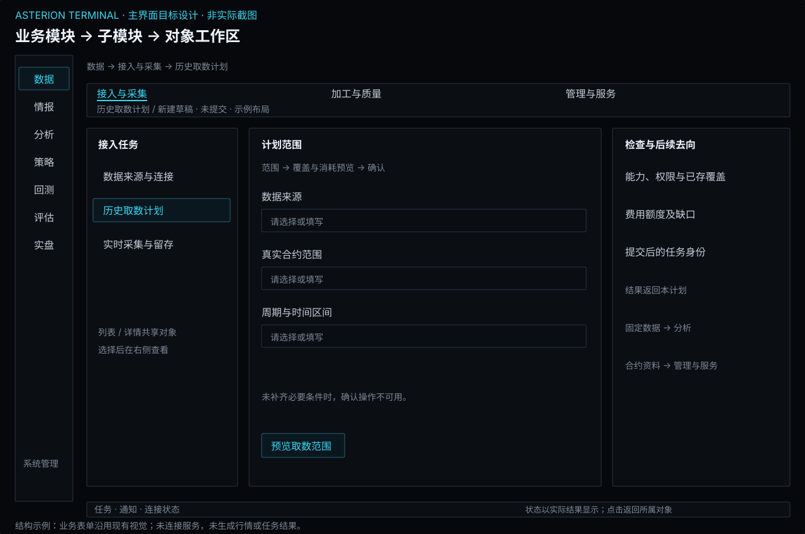
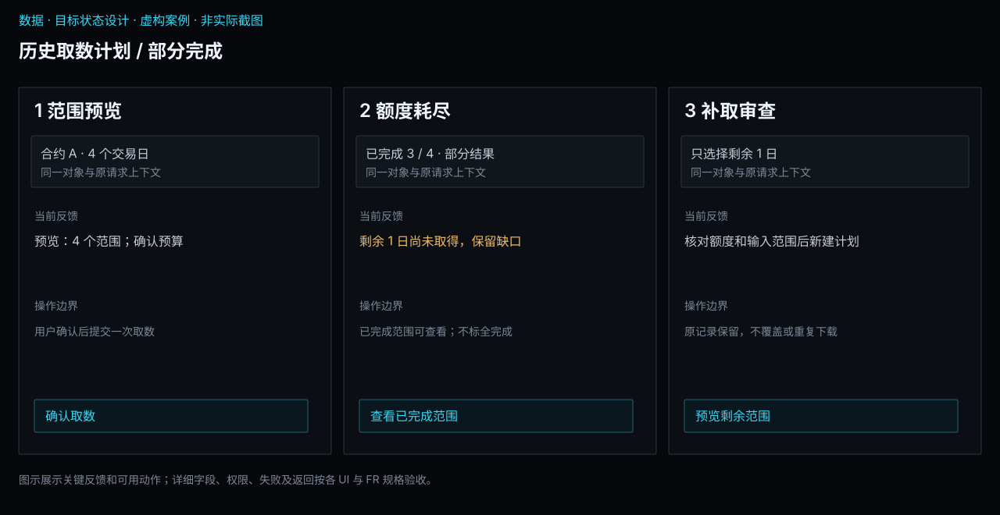
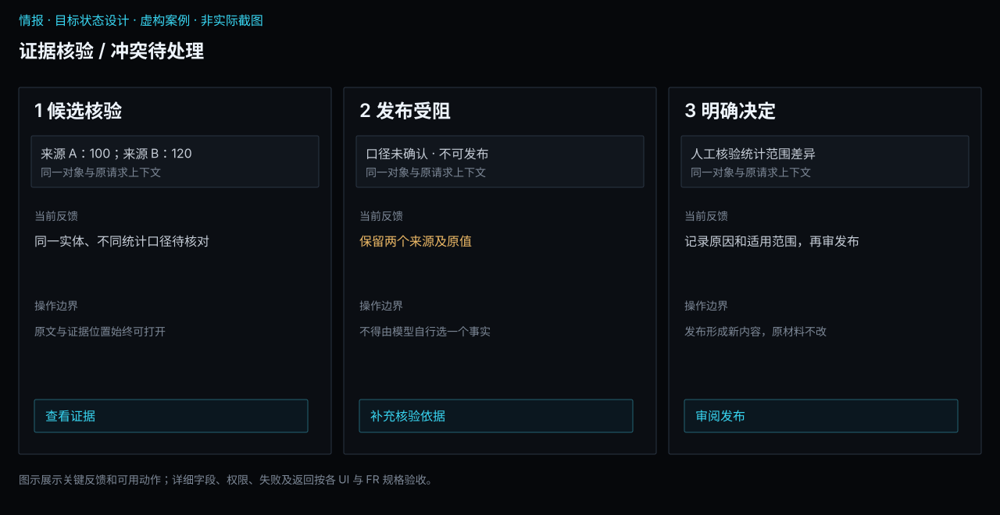
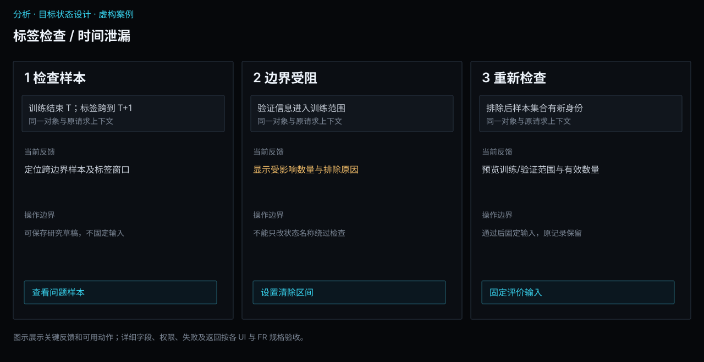
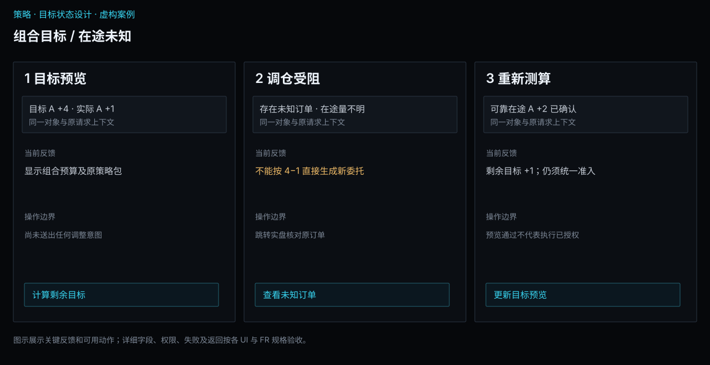
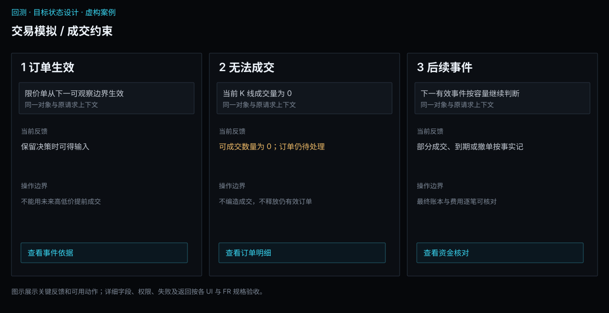
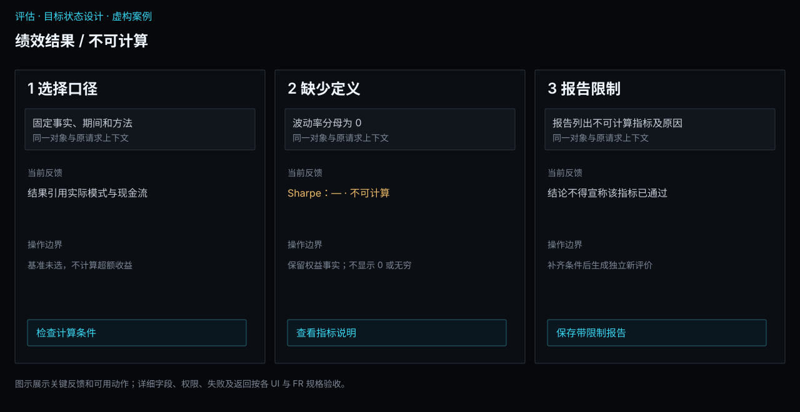
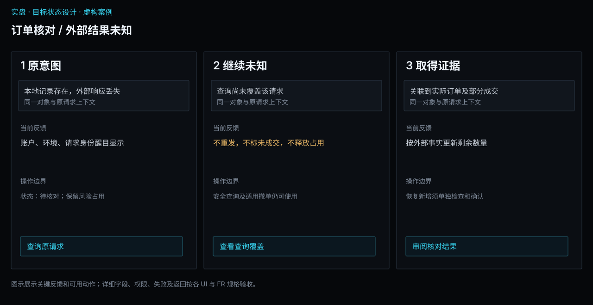
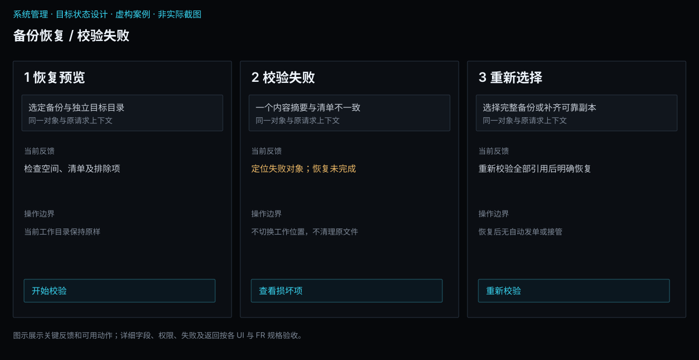
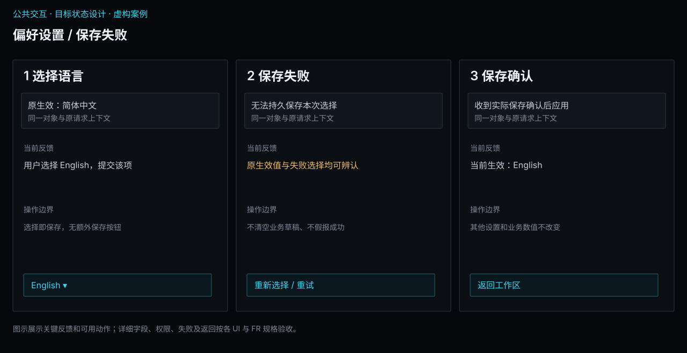

# 界面设计总览

[返回需求总纲](../README.md) · [统一UI设计规范](interaction.md#ui-design-contract) · [实际界面证据](screens.md)

2026-10-18 · 需求交付版目标设计，尚未逐项签认或实现验收。本文回答需要设计哪些界面、以什么形态承载、从哪里到达、主要区域是什么；每项详细字段、操作、状态、图和验收仍在所属子模块唯一维护。

## 主界面与业务模块的对应

**已确认的导航设计：** 左侧一级入口依次为数据、情报、分析、策略、回测、评估、实盘；底部独立放置系统管理辅助入口。各模块上方的二级导航对应其子模块，具体对象、列表、编辑、结果和详情在子模块工作区内展开。58项UI需求是这些工作区及弹窗、抽屉的规格，不是58个独立窗口。

延续现有深色主题、窄侧栏、紧凑表格、青蓝强调、标题栏和底部状态区；导航组织以本节为准。现有六入口截图仅用于说明实现差距和视觉基线。

| 一级入口 | 二级导航显示名（按顺序） | 页面归属与边界 |
| --- | --- | --- |
| 数据 | 接入与采集 / 加工与质量 / 管理与服务 | 来源连接、历史下载、实时采集归接入；加工与检查归质量；合约基础资料、目录、快照与访问归管理 |
| 情报 | 信息提取 / 情报核验 / 事件服务 | 处理原始材料、核验证据、查询订阅发布事件 |
| 分析 | 数据探索 / 特征与因子 / 有效性评价与筛选 | 研究问题与统计、变量与标签、证据评价和候选筛选 |
| 策略 | 策略逻辑 / 组合与仓位 / 策略管理与交付 | 规则与模型在逻辑内切换；组合政策和固定交付分别归属其子模块 |
| 回测 | 实验管理 / 交易与账户模拟 | 前者管理方案和运行；后者检查事件、成交、资金与结算；完整绩效评价转评估 |
| 评估 | 绩效与归因 / 风险与压力 / 稳健性与综合评价 | 统一消费回测、模拟和实盘事实；报告归综合评价 |
| 实盘 | 准备与运行 / 订单与成交 / 账户与核对 | 行情总览、自选、图表归准备与运行中的行情观察；执行及账户事实分别归后两项 |
| 系统管理（辅助） | 安装与配置 / 任务与节点 / 资料与诊断 | 配置索引链接回业务配置的唯一归属；调度、节点、日志及资料维护集中组织 |

导航使用上述简写；对应子模块的完整需求名称和职责不变。例如“实验管理”对应“回测设计与实验管理”，“任务与节点”对应“任务调度与运行节点”。不引入额外的研究、交易、风控或可视化一级入口。

### 主窗口的操作与状态

- **选中与到达：** 一级入口始终可见，并显示当前模块；二级页签明确选中项。首次进入模块默认第一项；会话内返回恢复上次子模块、筛选及选中对象。未准备数据或账户时仍可进入，显示原因与补齐入口，不用隐藏菜单表达不可用。
- **对象上下文：** 二级导航下显示研究/数据集/实验或账户、环境及运行模式；详情显示对象标题和返回入口。切换导航只改变展示，不启动计算、授权、停止任务或重发订单。未保存编辑遵循明确保存/放弃/留在当前页；偏好选择即保存。
- **跨模块交接：** 数据“用于分析”进入分析并携带固定输入；分析候选进入策略；策略包进入回测；回测与实盘结果进入评估。目的模块显式显示输入及缺项；返回来源保留原选择，不复制维护另一份对象。数据也可直接用于回测或实盘，导航顺序不强制串行流程。
- **行情与资料：** 实盘 → 准备与运行中提供行情总览、自选及合约图表视图；行情观察仅要求行情条件，不要求交易授权或先创建交易账户。合约交易规则、日历等权威资料仍在数据 → 管理与服务维护；图表详情链接至该资料。
- **辅助入口：** 系统管理位于侧栏底部，与七个业务入口视觉分组。偏好保持独立窗口；配置索引跳回数据来源、实盘账户或情报方案维护，不能重复保存同一配置。首次准备向导完成后进入数据工作区，此后可以从安装与配置重新检查。
- **全局状态：** 底部保留任务、通知及连接状态。任务、工作总览和诊断可由系统管理打开同一抽屉；通知从底部打开；同一时刻只展开一个抽屉。关闭抽屉不取消业务，详情能回到对象所属模块。连接状态跳到相应来源或账户，不能把行情连接和交易授权合为一个状态。
- **键盘与空间：** 保持已有键盘与焦点习惯；目标导航快捷键须与七入口逐项绑定并在界面展示，不沿用实际截图中的六入口序号作为目标规范。二级导航窄时可水平滚动、当前项始终可见；列表与详情局部滚动，账户及运行模式和主要动作保持可达。

### 导航验收

逐一打开七个业务入口和系统管理，核对二级项、当前选中、空态及返回位置；通过“数据 → 分析 → 策略 → 回测 → 评估”和“实盘结果 → 评估”核对固定身份及来源返回。没有交易账户时可进入行情观察；切换模块、关闭抽屉或查看评估均不得产生交易动作。分别以键盘和窄窗口检查选中项、焦点、滚动及关键状态可达。详细业务验收仍以各页关联的FR/AC为准。

## 清单的读法

- **沿用并补齐**：已有明确界面基础，补齐本页需求及状态；不宣称全部行为已实现。
- **扩展现有界面**：既有页面只覆盖一部分，增加局部区域或对象详情。
- **新增目标界面**：没有完整实际对应，在已确认模块导航下增加视图；详细布局仍待评审。
- 每项均有目标布局图。布局图说明区域和字段位置，采用现有主题；完整交互原型和关键异常状态图是否齐备仍要逐项核对，不能用图数量代替设计验收。

## 数据

| 界面及详细设计 | 处理方式 / 形态 | 目标入口 | 主要布局 |
| --- | --- | --- | --- |
| [UI-DAT-ACQ-01 数据来源与连接](../modules/data/acquisition.md#ui-dat-acq-01) | 扩展现有界面；模块内配置工作区 | 数据 → 接入与采集 → 数据来源与连接 | 来源列表 / 连接状态；身份与授权范围 / 能力表；最近核对 / 缺失能力 |
| [UI-DAT-ACQ-02 历史取数计划](../modules/data/acquisition.md#ui-dat-acq-02) | 扩展现有界面；分步表单或账户操作区 | 数据 → 接入与采集 → 历史取数计划 | 范围 → 预览 → 确认；合约 / 周期 / 起止日期；已有覆盖 / 费用额度 / 缺口 |
| [UI-DAT-ACQ-03 实时采集与留存](../modules/data/acquisition.md#ui-dat-acq-03) | 新增目标界面；列表与详情工作区 | 数据 → 接入与采集 → 实时采集与留存 | 计划列表 / 消费依赖；合约 / 接收时点 / 保存状态；中断区间 / 影响对象 |
| [UI-DAT-PRC-01 加工规则与质量检查](../modules/data/processing.md#ui-dat-prc-01) | 新增目标界面；编辑与试算工作区 | 数据 → 加工与质量 → 加工规则与质量检查 | 规则顺序 / 适用范围；处理参数 / 前后数据预览；质量问题 / 定位证据 |
| [UI-DAT-SRV-01 合约、日历与基础资料](../modules/data/management.md#ui-dat-srv-01) | 扩展现有界面；列表与详情工作区 | 数据 → 管理与服务 → 合约、日历与基础资料 | 合约目录 / 日历；代码 / 名称 / 交易规则；规则来源 / 有效区间 |
| [UI-DAT-SRV-02 数据目录与修订对照](../modules/data/management.md#ui-dat-srv-02) | 扩展现有界面；并排核对详情 | 数据 → 管理与服务 → 数据目录与修订对照 | 状态A / 覆盖与质量；状态B / 覆盖与质量；差异字段 / 受影响引用 |
| [UI-DAT-SRV-03 数据集、快照与存储](../modules/data/management.md#ui-dat-srv-03) | 扩展现有界面；列表与详情工作区 | 数据 → 管理与服务 → 数据集、快照与存储 | 数据集及成员列表；固定身份 / 质量 / 覆盖；引用依赖 / 存储占用 |
| [UI-DAT-SRV-04 数据查询与订阅](../modules/data/management.md#ui-dat-srv-04) | 新增目标界面；编辑与试算工作区 | 数据 → 管理与服务 → 数据查询与订阅 | 字段 / 合约 / 时间条件；查询样本或订阅观测；单位时点 / 缺口 / 拒绝项 |

## 情报

| 界面及详细设计 | 处理方式 / 形态 | 目标入口 | 主要布局 |
| --- | --- | --- | --- |
| [UI-INT-EXT-01 材料与提取工作台](../modules/intelligence/extraction.md#ui-int-ext-01) | 新增目标界面；并排核对详情 | 情报 → 信息提取 → 材料与提取工作台 | 原文 / 段落 / 附件；提取字段 / 候选状态；原文证据 / 缺失字段 |
| [UI-INT-EXT-02 处理方案与质量评测](../modules/intelligence/extraction.md#ui-int-ext-02) | 新增目标界面；配置与分析结果工作区 | 情报 → 信息提取 → 处理方案与质量评测 | 方法参数 / 评测集合；质量分布 / 错误分类；标注对照 / 消耗记录 |
| [UI-INT-VER-01 标准化与实体核对](../modules/intelligence/verification.md#ui-int-ver-01) | 新增目标界面；并排核对详情 | 情报 → 情报核验 → 标准化与实体核对 | 原始实体 / 原始单位时间；候选映射 / 标准化值；歧义及来源依据 |
| [UI-INT-VER-02 证据核验与发布](../modules/intelligence/verification.md#ui-int-ver-02) | 新增目标界面；并排核对详情 | 情报 → 情报核验 → 证据核验与发布 | 来源陈述 / 证据链；一致项 / 冲突项 / 必需字段；发布条件 / 人工复核 |
| [UI-INT-SRV-01 事件库与时点查询](../modules/intelligence/services.md#ui-int-srv-01) | 新增目标界面；列表与详情工作区 | 情报 → 事件服务 → 事件库与时点查询 | 事件列表 / 状态；事件演变 / 证据时间线；发布时间 / 更正撤回 |
| [UI-INT-SRV-02 情报查询与订阅](../modules/intelligence/services.md#ui-int-srv-02) | 新增目标界面；分步表单或账户操作区 | 情报 → 事件服务 → 情报查询与订阅 | 查询条件 → 订阅 → 记录；事件范围 / 历史或事后模式；交付记录 / 缺口 / 费用 |

## 分析

| 界面及详细设计 | 处理方式 / 形态 | 目标入口 | 主要布局 |
| --- | --- | --- | --- |
| [UI-ANA-EDA-01 研究问题与样本计划](../modules/analysis/exploration.md#ui-ana-eda-01) | 新增目标界面；分步表单或账户操作区 | 分析 → 数据探索 → 研究问题与样本计划 | 问题 → 样本 → 评价计划；假设 / 固定样本 / 事前标准；训练留出范围 / 缺项 |
| [UI-ANA-EDA-02 数据探索与统计工作台](../modules/analysis/exploration.md#ui-ana-eda-02) | 新增目标界面；配置与分析结果工作区 | 分析 → 数据探索 → 数据探索与统计工作台 | 变量 / 分组 / 过滤；分布与时序 / 条件比较；有效样本 / 排除原因 |
| [UI-ANA-FTR-01 特征与因子定义及计算](../modules/analysis/features.md#ui-ana-ftr-01) | 扩展现有界面；编辑与试算工作区 | 分析 → 特征与因子 → 特征与因子定义及计算 | 输入字段 / 变换顺序；表达式或方法表单 / 输出预览；窗口 / 单位 / 可得时点 |
| [UI-ANA-FTR-02 目标标签与样本时间检查](../modules/analysis/features.md#ui-ana-ftr-02) | 新增目标界面；编辑与试算工作区 | 分析 → 特征与因子 → 目标标签与样本时间检查 | 目标类型 / 时间规则；观察与标签时间线；重叠 / 泄漏 / 排除原因 |
| [UI-ANA-EVL-01 有效性评价与证据下钻](../modules/analysis/evaluation.md#ui-ana-evl-01) | 扩展现有界面；配置与分析结果工作区 | 分析 → 有效性评价与筛选 → 有效性评价与证据下钻 | 评价方法 / 样本过滤；IC / 分层 / 稳定性结果；有效样本 / 原始行下钻 |
| [UI-ANA-EVL-02 候选筛选与研究交接](../modules/analysis/evaluation.md#ui-ana-evl-02) | 新增目标界面；列表与详情工作区 | 分析 → 有效性评价与筛选 → 候选筛选与研究交接 | 候选与选择记录；证据对比 / 冗余与限制；冻结内容 / 策略缺项 |

## 策略

| 界面及详细设计 | 处理方式 / 形态 | 目标入口 | 主要布局 |
| --- | --- | --- | --- |
| [UI-STR-LOG-01 策略规则、混合决策与逻辑试算](../modules/strategy/logic.md#ui-str-log-01) | 新增目标界面；编辑与试算工作区 | 策略 → 策略逻辑 → 策略规则、混合决策与逻辑试算 | 规则 / 输入 / 状态；规则编辑 / 固定样例试算；参数 / 单位 / 错误定位 |
| [UI-STR-LOG-02 模型方案、训练与预测映射](../modules/strategy/logic.md#ui-str-log-02) | 新增目标界面；编辑与试算工作区 | 策略 → 策略逻辑 → 模型方案、训练与预测映射 | 特征 / 标签 / 方法；训练配置 / 预测到目标映射；训练截止 / 拟合证据 |
| [UI-STR-PRT-01 组合构建、资金与调仓](../modules/strategy/portfolio.md#ui-str-prt-01) | 新增目标界面；编辑与试算工作区 | 策略 → 组合与仓位 → 组合构建、资金与调仓 | 策略成员 / 预算分配；权重 / 整数目标 / 调仓预览；保证金 / 限额 / 归属冲突 |
| [UI-STR-DLV-01 交易候选与交接检查](../modules/strategy/delivery.md#ui-str-dlv-01) | 新增目标界面；列表与详情工作区 | 策略 → 策略管理与交付 → 交易候选与交接检查 | 候选列表 / 评估引用；完整性 / 验证 / 用途准备；缺项 / 限制 / 后续入口 |
| [UI-STR-DLV-02 策略包、参数方案与交付](../modules/strategy/delivery.md#ui-str-dlv-02) | 新增目标界面；列表与详情工作区 | 策略 → 策略管理与交付 → 策略包、参数方案与交付 | 策略包及参数方案；依赖内容 / 消费能力检查；验证依据 / 被引用情况 |

## 回测

| 界面及详细设计 | 处理方式 / 形态 | 目标入口 | 主要布局 |
| --- | --- | --- | --- |
| [UI-BKT-EXP-01 回测方案与验证计划](../modules/backtest/experiments.md#ui-bkt-exp-01) | 扩展现有界面；分步表单或账户操作区 | 回测 → 实验管理 → 回测方案与验证计划 | 输入 → 模拟条件 → 确认；数据 / 时序 / 成本 / 风险；验证计划 / 能力缺项 |
| [UI-BKT-EXP-02 实验批次与运行记录](../modules/backtest/experiments.md#ui-bkt-exp-02) | 扩展现有界面；列表与详情工作区 | 回测 → 实验管理 → 实验批次与运行记录 | 批次 / 全部尝试；实验条件 / 状态 / 结果；差异 / 失败 / 复核入口 |
| [UI-BKT-SIM-01 事件、决策与订单成交明细](../modules/backtest/simulation.md#ui-bkt-sim-01) | 新增目标界面；列表与详情工作区 | 回测 → 交易与账户模拟 → 事件、决策与订单成交明细 | 事件序列 / 决策定位；信号 → 意图 → 订单 → 成交；当时可得输入 / 撮合假设 |
| [UI-BKT-SIM-02 持仓、资金与结算核对](../modules/backtest/simulation.md#ui-bkt-sim-02) | 新增目标界面；并排核对详情 | 回测 → 交易与账户模拟 → 持仓、资金与结算核对 | 持仓批次 / 数量变化；资金变动 / 费用 / 保证金；数量与金额守恒 / 异常 |

## 评估

| 界面及详细设计 | 处理方式 / 形态 | 目标入口 | 主要布局 |
| --- | --- | --- | --- |
| [UI-EVA-PER-01 绩效与收益归因](../modules/evaluation/performance.md#ui-eva-per-01) | 沿用并补齐；配置与分析结果工作区 | 评估 → 绩效与归因 → 绩效与收益归因 | 方法 / 基准 / 期间；权益与收益 / 贡献拆分；现金流 / 费用 / 明细 |
| [UI-EVA-RSK-01 损失路径与风险暴露](../modules/evaluation/risk.md#ui-eva-rsk-01) | 新增目标界面；配置与分析结果工作区 | 评估 → 风险与压力 → 损失路径与风险暴露 | 风险维度 / 聚合口径；回撤路径 / 敞口 / 资金风险；极值时点 / 持仓依据 |
| [UI-EVA-RSK-02 情景压力与资金承受能力](../modules/evaluation/risk.md#ui-eva-rsk-02) | 新增目标界面；配置与分析结果工作区 | 评估 → 风险与压力 → 情景压力与资金承受能力 | 冲击条件 / 规则假设；情景损失 / 保证金缺口；适用限制 / 动态验证入口 |
| [UI-EVA-VAL-01 稳健性与综合评价](../modules/evaluation/validation.md#ui-eva-val-01) | 扩展现有界面；配置与分析结果工作区 | 评估 → 稳健性与综合评价 → 稳健性与综合评价 | 全部尝试 / 留出使用记录；分段 / 扰动 / 样本外比较；证据充分性 / 未决限制 |
| [UI-EVA-VAL-02 跨环境一致性与偏差归因](../modules/evaluation/validation.md#ui-eva-val-02) | 新增目标界面；并排核对详情 | 评估 → 稳健性与综合评价 → 跨环境一致性与偏差归因 | 历史模拟 / 固定定义；实时模拟或实盘 / 实际事实；数量 / 价格 / 费用 / 残差 |
| [UI-EVA-VAL-03 评价结论与统一报告](../modules/evaluation/validation.md#ui-eva-val-03) | 新增目标界面；列表与详情工作区 | 评估 → 稳健性与综合评价 → 评价结论与统一报告 | 章节 / 证据索引；报告正文 / 方法与限制；未决项 / 发布条件 |

## 实盘交易

| 界面及详细设计 | 处理方式 / 形态 | 目标入口 | 主要布局 |
| --- | --- | --- | --- |
| [UI-LIV-RUN-01 账户连接与交易授权](../modules/live/operations.md#ui-liv-run-01) | 沿用并补齐；分步表单或账户操作区 | 实盘 → 准备与运行 → 账户连接与交易授权 | 账户列表 / 各自状态；核对环境 → 连接 → 授权；开市检查 / 结算及风险缺项 |
| [UI-LIV-RUN-02 行情总览与自选](../modules/live/operations.md#ui-liv-run-02) | 扩展现有界面；行情工作区 | 实盘 → 准备与运行 → 行情总览与自选 | 分类行情 / 自选列表；主图 / 辅图 / 周期切换；报价状态 / 真实合约入口 |
| [UI-LIV-RUN-03 合约图表、盘口与成交](../modules/live/operations.md#ui-liv-run-03) | 扩展现有界面；行情工作区 | 实盘 → 准备与运行 → 合约图表、盘口与成交 | 自选 / 同品种相关合约；价格图表 / 周期 / 指标；报价 / 五档 / 成交明细 |
| [UI-LIV-RUN-04 实盘准备、授权与策略运行](../modules/live/operations.md#ui-liv-run-04) | 扩展现有界面；编辑与试算工作区 | 实盘 → 准备与运行 → 实盘准备、授权与策略运行 | 准备项 / 实例列表；固定条件 / 模拟起点 / 运行链；授权 / 执行归属 / 风险 |
| [UI-LIV-RUN-05 运行核对、处置与恢复审查](../modules/live/operations.md#ui-liv-run-05) | 新增目标界面；并排核对详情 | 实盘 → 准备与运行 → 运行核对、处置与恢复审查 | 原运行 / 意图 / 在途；当前账户事实 / 待核对差异；恢复条件 / 处置后果 |
| [UI-LIV-EXE-01 手动下单工作台](../modules/live/execution.md#ui-liv-exe-01) | 沿用并补齐；分步表单或账户操作区 | 实盘 → 订单与成交 → 手动下单工作台 | 账户列表 / 当前选中；合约 / 开平 / 手数 / 限价；资金 / 可平量 / 准入结果 |
| [UI-LIV-EXE-02 委托、成交与撤单](../modules/live/execution.md#ui-liv-exe-02) | 沿用并补齐；列表与详情工作区 | 实盘 → 订单与成交 → 委托、成交与撤单 | 委托与成交页签；订单 / 累计成交 / 剩余 / 费用；原意图 / 外部确认 / 撤单结果 |
| [UI-LIV-EXE-03 断线与未知结果核对](../modules/live/execution.md#ui-liv-exe-03) | 扩展现有界面；并排核对详情 | 实盘 → 订单与成交 → 断线与未知结果核对 | 可靠意图 / 最后明确状态；外部查询 / 关联订单与成交；未决占用 / 恢复前提 |
| [UI-LIV-ACC-01 账户资金与持仓](../modules/live/accounts.md#ui-liv-acc-01) | 沿用并补齐；列表与详情工作区 | 实盘 → 账户与核对 → 账户资金与持仓 | 资金摘要 / 状态；合约 / 今昨仓 / 可平量；冻结及保证金 / 口径来源 |
| [UI-LIV-ACC-02 成交结算核对与差异处理](../modules/live/accounts.md#ui-liv-acc-02) | 新增目标界面；并排核对详情 | 实盘 → 账户与核对 → 成交结算核对与差异处理 | 本地订单成交及金额；柜台成交 / 结算及费用；匹配差异 / 未解决事项 |
| [UI-LIV-ACC-03 账户风险规则与生效管理](../modules/live/accounts.md#ui-liv-acc-03) | 扩展现有界面；分步表单或账户操作区 | 实盘 → 账户与核对 → 账户风险规则与生效管理 | 政策项目 / 适用范围；限额 / 阈值 / 基准 / 单位；变更影响 / 在途 / 授权 |

## 系统管理

| 界面及详细设计 | 处理方式 / 形态 | 目标入口 | 主要布局 |
| --- | --- | --- | --- |
| [UI-SYS-SET-01 首次准备](../modules/system/setup.md#ui-sys-set-01) | 沿用并补齐；分步表单或账户操作区 | 系统管理 → 安装与配置 → 首次准备 | 位置 → 用途 → 条件；资料目录 / 本地研究与交易；缺项 / 补齐入口 |
| [UI-SYS-SET-02 配置索引与生效状态](../modules/system/setup.md#ui-sys-set-02) | 新增目标界面；模块内配置工作区 | 系统管理 → 安装与配置 → 配置索引与生效状态 | 偏好 / 来源 / 节点 / 业务配置；已保存与实际生效值；影响范围 / 维护入口 |
| [UI-SYS-RUN-01 个人工作总览](../modules/system/tasks-nodes.md#ui-sys-run-01) | 新增目标界面；底部抽屉视图 | 系统管理 → 任务与节点 → 个人工作总览 | 活动 / 受阻 / 未决；任务与运行摘要；缺项与业务返回入口 |
| [UI-SYS-RUN-02 任务中心](../modules/system/tasks-nodes.md#ui-sys-run-02) | 扩展现有界面；底部抽屉视图 | 系统管理 → 任务与节点 → 任务中心 | 任务列表 / 所属节点；实际阶段 / 部分结果 / 触发来源；取消状态 / 失败及未知 |
| [UI-SYS-RUN-03 运行资源](../modules/system/tasks-nodes.md#ui-sys-run-03) | 扩展现有界面；模块内配置工作区 | 系统管理 → 任务与节点 → 运行资源 | 机器列表 / 当前位置；服务与能力 / 当前活动；账户归属 / 维护影响 |
| [UI-SYS-RUN-04 定时计划与触发记录](../modules/system/tasks-nodes.md#ui-sys-run-04) | 新增目标界面；模块内配置工作区 | 系统管理 → 任务与节点 → 定时计划与触发记录 | 计划列表 / 下次触发；日历与时间 / 重叠错过政策；实际触发 / 任务关联 |
| [UI-SYS-REC-01 资料、备份与恢复](../modules/system/records.md#ui-sys-rec-01) | 新增目标界面；模块内配置工作区 | 系统管理 → 资料与诊断 → 资料、备份与恢复 | 资料 / 备份 / 恢复；内容清单 / 路径 / 依赖检查；校验 / 缺项 / 保留说明 |
| [UI-SYS-REC-02 事件与诊断](../modules/system/records.md#ui-sys-rec-02) | 扩展现有界面；底部抽屉视图 | 系统管理 → 资料与诊断 → 事件与诊断 | 事件列表 / 业务关联；意图与结果时间线；诊断详情 / 安全导出 |
| [UI-SYS-REC-03 导出资料](../modules/system/records.md#ui-sys-rec-03) | 扩展现有界面；上下文对话框 | 系统管理 → 资料与诊断 → 导出资料 | 范围 → 预览 → 保存；字段 / 格式 / 目标文件；限制 / 脱敏 / 排除项 |

## 公共界面

| 界面及详细设计 | 处理方式 / 形态 | 目标入口 | 主要布局 |
| --- | --- | --- | --- |
| [UI-COM-UX-01 偏好设置](interaction.md#ui-com-ux-01) | 沿用并补齐；独立设置窗口内页 | 系统管理 → 安装与配置 → 偏好设置 | 偏好分类及返回安装与配置；语言 / 显示密度 / 涨跌配色；即时保存结果 / 失败原因 |
| [UI-COM-UX-02 通知中心](interaction.md#ui-com-ux-02) | 新增目标界面；底部抽屉视图 | 底部状态区 → 通知中心 | 通知列表 / 阅读状态；通知内容 / 时间 / 对象；仍有效限制 / 业务处置入口 |
| [UI-COM-SEC-01 凭据与访问用途](security.md#ui-com-sec-01) | 扩展现有界面；上下文对话框 | 数据来源、实盘账户或情报方案 → 凭据与访问用途 | 用途说明 / 允许保存类别；本地遮罩输入 / 保存选择；验证状态 / 安全存储可用性 |

## 逐页设计完成的判定

一项界面只有在入口与返回、字段约束、正常操作、关键异常、保存/取消及异步反馈都能按关联FR/AC解释，图稿也已明确可操作布局时，才能标为设计已评审。代码实现、运行验证仍是另两个状态。当前58张图均为目标布局，逐页字段和关键状态已补充；原有两张运行状态示意继续作为具体案例，17张实际截图继续作为现状证据。

详细图放在子模块UI条目中，索引只负责导航。页面增删或归属变更时同步本清单，不另建可以覆盖正文的功能目录。视觉和控件实现沿用Terminal主题及公共组件。

## 关键状态设计

每项UI已在所属正文补齐字段类型/初始值/约束、主要动作和首次空态、输入错误、加载/部分、失败/未知、离开返回的交付约定。以下状态图展示会改变用户操作选择的具体案例；不是把所有异常都画成同一个错误对话框。看图后还需按对应UI/FR检查真实行为。

### 数据：历史取数计划 / 部分完成

### 情报：证据核验 / 冲突待处理

### 分析：标签检查 / 时间泄漏

### 策略：组合目标 / 在途未知

### 回测：交易模拟 / 成交约束

### 评估：绩效结果 / 不可计算

### 实盘：订单核对 / 外部结果未知

### 系统管理：备份恢复 / 校验失败

### 公共交互：偏好设置 / 保存失败

