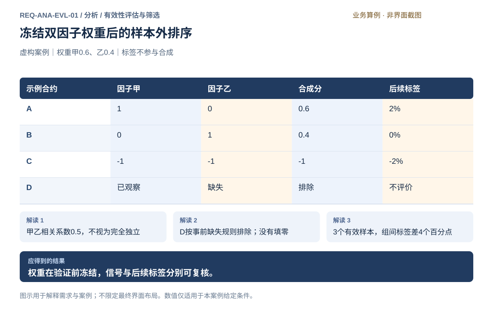
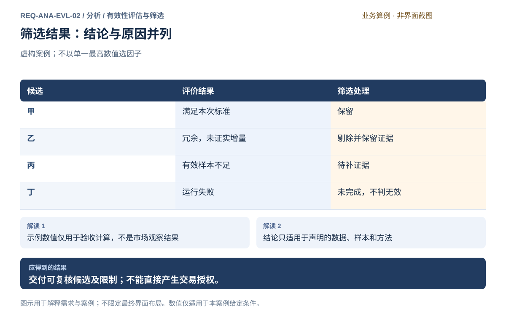
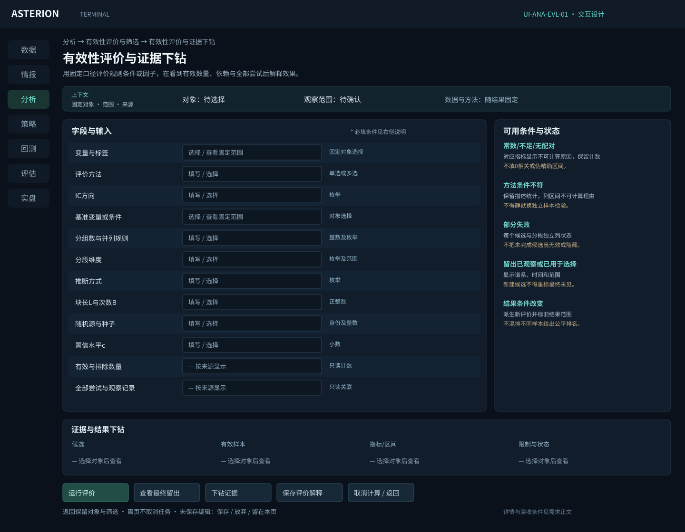
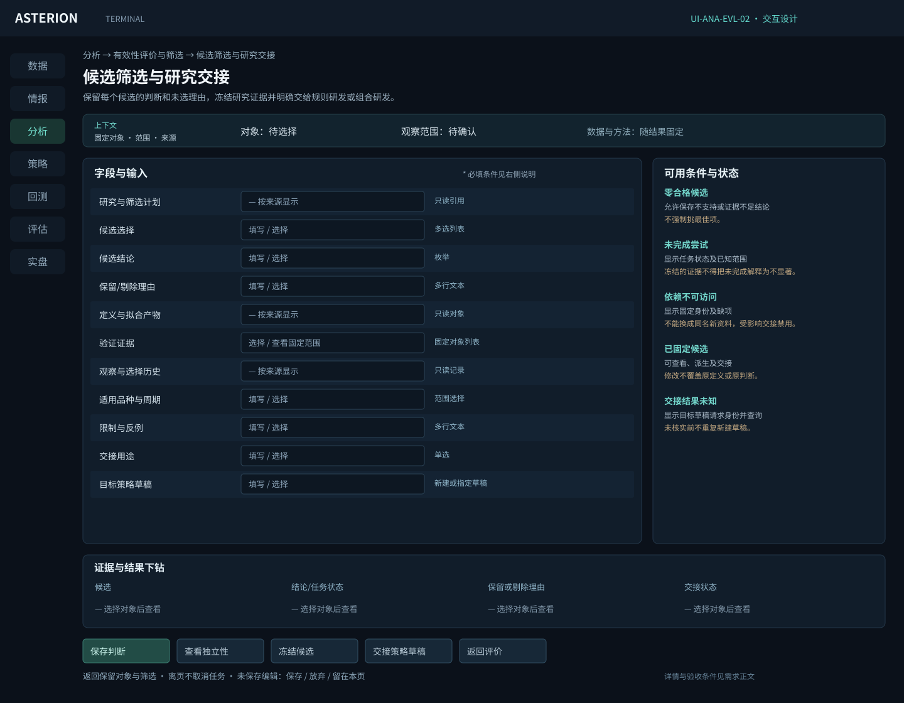

# 有效性评估与筛选

[返回上级](README.md) · [需求总纲](../../README.md) · [界面规范](../../common/ui-designs.md) · [跨模块流程](../../workflows/README.md)

开发前产品需求规格。本页定义目标功能、界面操作、业务规则及验收条件。

**归属：** 分析 / 有效性评估与筛选。本页集中保存业务需求、详细功能、案例、界面对应和验收；通用规则见[通用规范](../../common/README.md)。

## 需求导航

- [REQ-ANA-EVL-01 评价规则条件、单因子与多因子的有效性](#req-ana-evl-01)
- [REQ-ANA-EVL-02 筛选候选并交接可复核研究结论](#req-ana-evl-02)

## 子模块详细设计

本子模块评价的是变量、条件或研究假设；完整账户收益、订单成交、保证金与策略风险的历史模拟属于独立回测模块。分层标签差可以作为诊断证据，不能直接命名为可交易多空组合净收益。

| 评价维度   | 规则策略研究                         | 因子及多因子研究                | 共同解释                           |
| ---------- | ------------------------------------ | ------------------------------- | ---------------------------------- |
| 基本效果   | 事件结果分布、方向命中、相对基准差异 | IC/秩IC、分层关系、预测跨度衰减 | 方法、方向、有效样本和目标含义     |
| 稳定性     | 分阶段/品种/波动状态的条件表现       | 分时间/品种/状态的方向和覆盖    | 不能只显示全期平均掩盖反例         |
| 敏感性     | 条件阈值与窗口邻域                   | 参数、变换、权重邻域            | 搜索范围、试验数量、失败项         |
| 冗余与增量 | 加入条件前后同口径比较               | 相关、消融、特征加入后的增量    | 相同样本和验证计划；模型依赖需声明 |
| 可信范围   | 事件重叠与触发时点                   | 截面成员、时间依赖、拟合边界    | 多重尝试、留出使用和不确定性       |

### 评价口径与统计限制

IC必须说明是在同一时点跨合约，还是同一合约跨时间计算。汇总要说明逐时点等权或按样本权重，不能把合约和日期直接堆叠后不解释。秩相关需说明并列排名方法。常数、有效数不足或标准差为零等情况显示未定义；ICIR等比值不能通过填零掩盖零分母。

分层需显示分组规则、组内数量、并列分值处理和未入组样本。跨品种因子需要可比的目标单位、当时成员和真实可得的资料。相关矩阵每个单元格显示实际共同样本数，因覆盖不同形成的指标不能直接排名。

显著性或置信区间仅在方法适用且假设已声明时提供。时间相关、重复事件、重叠收益标签和多重比较应进入推断设计；没有适用方法时只报告描述统计。不得用一个固定样本数或IC阈值保证稳定有效。

### 选择流程与状态

1. 确定主指标、基准、判断逻辑及开发验证和最终留出的用途，保存到研究计划。
2. 比较相同口径的候选；不可比条件先列差异，用户明确选择共同范围或分别解读。
3. 查看分段、反例、冗余与增量，而非仅按最佳指标排序。
4. 保存全部候选的判断：支持、不支持、证据不足；任务未完成单列，不等于无效。
5. 对入选候选冻结定义与证据。进入最终留出前确认其尚未被用于选择；最终结果用于验收，不能一边查看一边反复改参后仍称独立。
6. 明确交接用途并创建策略草稿；未通过验证也可继续研发，但状态不可伪装。

人工选择可以保留一个尚未证实的变量供继续研究，但必须保留“证据不足”状态。筛选方法若使用模型拟合或特征重要性，必须绑定相同训练折、基准模型、处理和评价样本；这些诊断工具不意味着本模块承担完整策略模型运行。

### 界面与联动

评价页顶部是固定输入、目标和样本角色，主体显示效果、稳定性、冗余与增量，侧栏为口径和限制，下方可展开逐合约、时点或事件明细。比较图同时显示有效数量，空值和未完成结果不能画成零。

候选页采用列表：定义身份、评价状态、证据范围、保留/剔除/待补理由、适用条件、交接状态。选择一行查看其训练与验证使用记录；“冻结候选”前显示完整性检查；“交接策略草稿”显示目标用途和待补交易规则，不使用“开始交易”按钮。

| 交接包内容 | 消费方必须知道的事实                                   |
| ---------- | ------------------------------------------------------ |
| 变量与处理 | 具体内容身份、参数、单位、依赖、输出键和可得时间       |
| 拟合与合成 | 训练范围、固定统计量、方向、权重和适用区间             |
| 研究证据   | 数据快照、标签、样本计划、评价结果、失败项和使用记录   |
| 结论限制   | 支持/否定/不足、适用品种与周期、未覆盖状态和反例       |
| 后续用途   | 规则研发或组合研发；资金、成交、成本、风险仍待策略明确 |

策略接收后只保存引用；如果依赖资料被修订，提示存在新快照但继续保留原证据。旧候选不自动切换“最新”定义或结果，来源缺失则明确阻断依赖该证据的验证，不能悄悄另选数据。

## REQ-ANA-EVL-01 评价规则条件、单因子与多因子的有效性

**领域：** 分析 / 有效性评估与筛选　 **建议优先级：** P1核心必要　 **需求性质：** 目标功能与验收规格

### 目标与场景

对固定变量和假设检验方向、强度、样本支持、稳定性与增量价值，区分统计标签表现和可交易账户结果。

**使用者与场景：** 个人量化研究者，建立或迭代多因子选品种、排序和方向判断方案时。

**触发条件：** 用户从因子实验或研究计划创建多因子方案。

### 前置条件

- 因子定义、输入资料和合约身份可辨识，具有合法来源及可知时间依据。
- 研究范围、训练与验证边界已明确，所选处理与评价方法在已评审支持范围内。

### 输入与含义

| 输入               | 含义与单位                                         | 约束                                                       |
| ------------------ | -------------------------------------------------- | ---------------------------------------------------------- |
| 时点样本与合约口径 | 逐时点候选、资格、实际月份及连续信号价格规则。     | 依据当时可知事实，不用全期结果筛样本；调整价不充当成交价。 |
| 因子与处理         | 具体定义、方向、缺失异常处理、标准化和可选中性化。 | 不默认填零；中性化须有明确暴露事实和可用样本，不强制采用。 |
| 合成方案           | 训练确定的合成方法、权重、拟合资料和生效区间。     | 拟合不使用验证标签；进入验证前冻结，修改后成为新候选。     |
| 评价目标           | 预测跨度、IC或秩IC、分层收益、覆盖与相关性口径。   | 所有指标带实际样本与方向定义；标签收益不等同扣费账户收益。 |

### 正常操作与反馈

1. 选择已固定的特征、标签、样本计划和评价基准。
2. 检查处理及合成权重来自训练资料，验证前保持冻结。
3. 运行规则条件统计、IC/秩IC、分层与冗余分析。
4. 按日期、品种、状态和窗口检查稳定性及不完整范围。
5. 查看逐样本依据并记录支持、反例或证据不足，交由筛选形成候选。

### 业务规则

- 截面标准化只能使用该时点可知成员；需要学习的变换仅在训练范围拟合并固定。
- 缺失、异常和零值不同；处理前后覆盖及排除原因可追溯，不静默替换真实行情。
- 中性化对象、暴露单位和资料时点明确；事实不足则所选处理不可执行，不自动换方法。
- IC、分层收益和相关性采用明确样本；高相关不证明独立增益，样本变化不能隐藏。
- 合成权重和方向须固定到验证阶段；看过验证后改权重应记录该信息已参与选择。
- 标准化、中性化、合成与评价方法按本模块计算契约及已声明插件能力选择；不支持的方法不可选。
- IC在同一时点跨合约计算和在同一合约跨时间计算分别标注；不能混成一个未解释的数值。
- 多次尝试与重叠样本会影响不确定性；未采用适用的推断方法时只报告描述统计，不显示伪精确置信度。

### 输出与状态影响

- 有效性、稳定性、冗余与增量评价及逐样本证据。
- 训练和验证角色、尝试记录、未覆盖范围和结论限制。

### 异常与继续方式

| 发生什么                                         | 应怎样表现                                                         | 使用者如何继续                                             |
| ------------------------------------------------ | ------------------------------------------------------------------ | ---------------------------------------------------------- |
| 某合约缺少所选因子值，或中性化所需暴露事实不足。 | 按事前明确的规则排除或阻止相应处理，列原因与覆盖变化，不填零凑齐。 | 补足可靠资料，或显式修改处理后建立新方案。                 |
| 验证表现不佳后用户调整合成权重。                 | 保存新候选及使用过的验证信息，旧方案与结果保留。                   | 用未参与此轮选择的新资料验证，不能重命名原区间为独立证据。 |

### 案例：训练冻结双因子权重后验证排序

**虚构案例条件：** 虚构案例：训练期确定因子甲权重0.6、乙0.4，进入案例验证日T前冻结。先按预定完整因子样本规则排除缺乙的示例合约D，再在A/B/C当时截面按样本标准差标准化；不采用中性化。处理后甲为1、0、-1，乙为0、1、-1。T后的标签收益为2%、0%、-2%，仅用于评价。

1. 按0.6×甲＋0.4×乙得到A为0.6、B为0.4、C为-1；D不参与合成或评价。
2. A/B/C的甲乙相关系数为0.5；合成排序A、B、C与标签排序一致，秩IC为1。
3. 案例高分组仅A、低分组仅C，标签收益差为2%－(-2%)＝4个百分点；样本仅3个，不构成稳健盈利证明。

**预期结果：**

- 冻结权重仍为0.6/0.4，D显示缺因子乙而不是零分。
- 有效样本3个、秩IC为1、组间标签差4个百分点，均标小样本且未计交易成本。

### 可观察验收条件

| 编号                | 给定                            | 当                      | 则                                                             |
| ------------------- | ------------------------------- | ----------------------- | -------------------------------------------------------------- |
| REQ-ANA-EVL-01-AC01 | 案例权重已在验证前冻结。        | 读取T日已知因子并合成。 | A、B、C分别为0.6、0.4、-1，验证标签不参与合成。                |
| REQ-ANA-EVL-01-AC02 | D缺少乙且规则要求完整因子样本。 | 形成当日信号。          | D明确排除，有效成员3个，不以零分加入。                         |
| REQ-ANA-EVL-01-AC03 | 案例标签为2%、0%、-2%。         | 查看分层与秩IC。        | 秩IC为1，组间差4个百分点，样本数和未扣费性质同时可见。         |
| REQ-ANA-EVL-01-AC04 | 已查看验证结果后更改权重。      | 保存新候选。            | 旧方案保留，原验证信息标为已参与选择，不再称新候选的独立证据。 |

### 决定与配置约束

- **DEC-ANA-EVL-01-01**：**规格决定**。支持Pearson/Spearman、IC时序、分层表现、条件命中率、分段稳定性、相关冗余；基准与分段由研究计划显式选择，不默认借未来样本构造基准。

- **DEC-ANA-EVL-01-02**：**规格决定**。时间依赖推断采用[移动块重采样契约](README.md#resampling-contract)，固定联合时间索引、区间算法、块长、次数与随机源；全部比较次数必须可见。未具备适用证据时只报告描述性统计，不给虚假显著性结论。

### 详细功能

### FR-ANA-EVL-01-01 检查IC分层及因子相关冗余

**目标与结果：** 让用户知道各因子的预测方向、样本证据和重复信息，避免仅凭一项最好指标挑因子。

**触发：** 处理预览通过后选择训练评价及冗余诊断。

**输入与约束：** 评价目标、IC或秩IC口径、分层规则、相关性方法、实际共同样本及评价区间。

**目标操作与反馈：**

1. 查看各因子的有效样本、IC或秩IC及分层标签收益。
2. 核对因子相关性所用共同样本，定位高相关或方向相反的因子。
3. 记录保留剔除理由和覆盖差异，供合成方案选择。

**异常与边界：**

- 常数列和样本不足标未定义，不填零相关。
- 分层标签收益未扣交易成本，不能宣称为可交易组合收益。

**验收条件：**

- **FR-ANA-EVL-01-01-AC01**：案例甲乙在A/B/C的相关系数为0.5，相关样本数为3。
- **FR-ANA-EVL-01-01-AC02**：合成高低组标签差4个百分点同时显示每组仅1个成员及未扣费。

**界面对应：** [UI-ANA-EVL-01 有效性评价与证据下钻](#ui-ana-evl-01)。

### FR-ANA-EVL-01-02 对冻结合成信号进行样本外验证

**目标与结果：** 把未参与选择的资料用于评价，明确训练优势能否在后段成立及证据局限。

**触发：** 方案冻结后点击验证设置并运行评价。

**输入与约束：** 固定方案、验证边界、预热、标签跨度和信息使用记录；模拟统计不要求实盘交易授权。

**目标操作与反馈：**

1. 检查验证独立性及标签时间关系。
2. 运行固定方案，比较训练和验证的覆盖、IC与分层结果。
3. 记录支持、反例或不足；若改方案说明验证已参与选择。

**异常与边界：**

- 标签重叠和滚动区间重复不得增加独立样本数量。
- 验证资料已经用于挑权重时不能重命名为新的独立验证。

**验收条件：**

- **FR-ANA-EVL-01-02-AC01**：案例分数0.6、0.4、-1对应标签2%、0%、-2%，秩IC为1且有效样本3。
- **FR-ANA-EVL-01-02-AC02**：看验证后改权重时，原验证被明确标已使用并要求新的独立证据。

**界面对应：** [UI-ANA-EVL-01 有效性评价与证据下钻](#ui-ana-evl-01)；[UI-SYS-RUN-02 任务中心](../system/tasks-nodes.md#ui-sys-run-02)。

### FR-ANA-EVL-01-03 运行因子评价并核对有效样本

**目标与结果：** 用户能从指标回到真实参与的成员、特征与目标，判断统计结果是否可信。

**触发：** 完成输入检查后点击运行评价。

**输入与约束：** 固定快照、定义身份、参数、资格和评价范围；重复点击不重复提交同次请求。

**目标操作与反馈：**

1. 审阅条件并提交，得到独立运行记录。
2. 运行完成后查看有效样本量和分段评价。
3. 选择日期或成员，检查因子值、目标及排除原因。

**异常与边界：**

- 失败或取消不伪造完整指标，仍保留运行记录。
- 常数信号的相关性标未定义，不能以零代替。

**验收条件：**

- **FR-ANA-EVL-01-03-AC01**：案例4个观测中1个缺目标，结果为3个有效、2个命中、66.67%。
- **FR-ANA-EVL-01-03-AC02**：逐样本查看能定位未命中的T3和目标缺失的T4。

**界面对应：** [UI-ANA-EVL-01 有效性评价与证据下钻](#ui-ana-evl-01)；[UI-SYS-RUN-02 任务中心](../system/tasks-nodes.md#ui-sys-run-02)。

### FR-ANA-EVL-01-04 评价规则条件相对基准的增量

**目标与结果：** 让规则策略研究不依赖单一IC指标。

**触发：** 选择固定条件与基准。

**输入与约束：** 条件定义、目标、基准、事件数量和判断口径。

**目标操作与反馈：**

1. 选择固定条件与基准。
2. 比较结果分布、命中率、覆盖和差异。
3. 按阶段核对并解释限制。

**异常与边界：**

- 基准与条件样本时间/目标口径必须可比。
- 命中率不等于收益率，未知目标排除并显示。

**验收条件：**

- **FR-ANA-EVL-01-04-AC01**：4个事件中1个无目标，2个方向命中，显示2/3约66.67%。
- **FR-ANA-EVL-01-04-AC02**：未扣费的结果不会标为账户净收益。

**界面对应：** [UI-ANA-EVL-01 有效性评价与证据下钻](#ui-ana-evl-01)。

### FR-ANA-EVL-01-05 检查分段稳定性和参数敏感性

**目标与结果：** 判断结果是否依赖特定市场阶段或单点参数。

**触发：** 选择预先声明的分段与邻域。

**输入与约束：** 预定日期/品种/状态分组、参数邻域、主指标。

**目标操作与反馈：**

1. 选择预先声明的分段与邻域。
2. 同时查看效果、覆盖和不确定性。
3. 记录方向反转、弱样本与失效范围。

**异常与边界：**

- 缺失分段不当作零表现。
- 看到结果后新增分段标为探索性诊断。

**验收条件：**

- **FR-ANA-EVL-01-05-AC01**：全期正向但某段反向时报告保留反例。
- **FR-ANA-EVL-01-05-AC02**：参数邻域部分失败时不宣称全邻域稳健。

**界面对应：** [UI-ANA-EVL-01 有效性评价与证据下钻](#ui-ana-evl-01)。

### FR-ANA-EVL-01-06 检查冗余及加入后的增量价值

**目标与结果：** 识别同一信息的重复表达而不只按相关阈值删除。

**触发：** 查看特征相关与覆盖。

**输入与约束：** 候选特征集、共同样本、基准方法及固定模型（如使用）。

**目标操作与反馈：**

1. 查看特征相关与覆盖。
2. 在相同时间划分下比较基准与增加变量的结果。
3. 记录是否有足够增量证据。

**异常与边界：**

- 高相关不必然等于无增量；阈值由计划声明。
- 模型重要性依赖模型与样本，不能称固有因果贡献。

**验收条件：**

- **FR-ANA-EVL-01-06-AC01**：样本范围不同的两个指标先标不可直接比较。
- **FR-ANA-EVL-01-06-AC02**：消融比较可回到同一折和同一基准配置。

**界面对应：** [UI-ANA-EVL-01 有效性评价与证据下钻](#ui-ana-evl-01)。

### FR-ANA-EVL-01-07 记录多重尝试与统计推断条件

**目标与结果：** 防止大量搜索得到的偶然显著被当成确定规律。

**触发：** 查看尝试清单和重复证据。

**输入与约束：** 已执行的参数与变量尝试、样本依赖、检验方法和主假设。

**目标操作与反馈：**

1. 查看尝试清单和重复证据。
2. 声明多重比较及时间依赖处理方式；移动块区间按[统一计算契约](README.md#resampling-contract)生成，显示全部候选和未调整多重选择的限制。
3. 显示描述结果、推断条件和结论限制。

**异常与边界：**

- 没有适用推断方法时只报告描述统计。
- 不默认交易日或合约观测相互独立；失败尝试同样计入记录。

**验收条件：**

- **FR-ANA-EVL-01-07-AC01**：20个尝试只一个较好时仍显示20项及选择过程。
- **FR-ANA-EVL-01-07-AC02**：重复查看留出后调参会使该区间标为参与选择。

**界面对应：** [UI-ANA-EVL-01 有效性评价与证据下钻](#ui-ana-evl-01)。

## REQ-ANA-EVL-02 筛选候选并交接可复核研究结论

**领域：** 分析 / 有效性评估与筛选　 **建议优先级：** P1核心必要　 **需求性质：** 目标功能与验收规格

### 目标与场景

同时保留有效与无效证据，按预定标准筛选变量或假设，向策略交接固定候选而不授予交易资格。

**使用者与场景：** 个人期货量化研究用户，兼顾规则策略与多因子研究。

**触发条件：** 打开评价结果并检查可比条件和完整性。

### 前置条件

- 选择真实来源的固定数据快照；示例数据只用于文档和测试。
- 研究用途、时间范围和样本角色明确，测试留出资料不参与探索和选择。

### 输入与含义

| 输入       | 含义与单位                               | 约束                                                 |
| ---------- | ---------------------------------------- | ---------------------------------------------------- |
| 评价计划   | 主指标、基准、样本角色、门槛及否定条件   | 未确认门槛可作探索，不伪装成验证通过                 |
| 候选与尝试 | 所有已执行候选、参数、失败和取消         | 不得删除不理想结果后只汇报最优试验                   |
| 选择依据   | 有效性、稳定性、冗余、增量价值与使用限制 | 方法依赖模型时绑定具体模型和拟合范围，不声称普适最佳 |

### 正常操作与反馈

1. 打开评价结果并检查可比条件和完整性。
2. 按预定标准逐项判断支持、不支持或证据不足。
3. 记录保留和剔除理由，核对相关冗余及增量证据。
4. 冻结候选定义、处理、参数、证据和用途范围。
5. 显式交接到策略草稿，补齐信号、仓位、成交、成本与风险规则。

### 业务规则

- 候选名单可为空，不强制输出排名第一的变量。
- 看过结果后重选参数，使相应验证区间成为已参与选择的资料。
- 一次选择会固定证据引用；修改定义产生新的候选，旧研究结果不回写。
- 研究候选可用于继续研究，但证据不足时不能标为已通过验证。

### 输出与状态影响

- 有理由的保留与剔除名单。
- 固定候选包、阶段结论、适用范围及策略草稿引用。

### 异常与继续方式

| 发生什么             | 应怎样表现                             | 使用者如何继续                   |
| -------------------- | -------------------------------------- | -------------------------------- |
| 部分候选失败或取消   | 标明未完成范围，禁止声称全空间比较完成 | 用户补跑失败项或明确缩小结论范围 |
| 证据缺失或不具独立性 | 允许保存不足结论，阻止标记验证通过     | 安排未参与选择的新证据           |

### 案例：保留、剔除和未完成都要解释

**虚构案例条件：** 虚构研究：甲乙高度冗余且乙没有已证实的增量价值；丙样本不足；丁任务失败。筛选依据已事前声明。

1. 记录甲为当前候选。
2. 乙保留计算结果但从候选集剔除。
3. 丙记证据不足，丁记未完成。

**预期结果：**

- 候选集仅有甲，不把丙和丁当作无效因子。
- 交接甲只创建策略草稿，不生成持仓、委托或授权。

### 可观察验收条件

| 编号                | 给定                   | 当           | 则                                 |
| ------------------- | ---------------------- | ------------ | ---------------------------------- |
| REQ-ANA-EVL-02-AC01 | 四个候选中有失败与不足 | 保存筛选结论 | 保留甲乙丙丁四项及不同理由         |
| REQ-ANA-EVL-02-AC02 | 候选已冻结             | 修改处理参数 | 形成新候选并保留原证据             |
| REQ-ANA-EVL-02-AC03 | 候选没有风险配置       | 交接策略     | 可保存草稿，不能直接运行回测或实盘 |

### 决定与配置约束

- **DEC-ANA-EVL-02-01**：**运行配置**。用户在看到验证结果前填写评价指标、方向、阈值和稳定性条件；系统不提供交易收益/IC默认合格线。新增或改变标准记录已使用的信息并重新指定未使用留出。

### 详细功能

### FR-ANA-EVL-02-01 解释信号结果并转化为策略研究草稿

**目标与结果：** 使统计关系成为可审查的研究证据，而不是自动生成收益承诺或交易。

**触发：** 因子结果点击记录解释或建立策略研究。

**输入与约束：** 所选信号、有效范围、分段结果和限制；转换需用户明确开平、仓位与成本规则。

**目标操作与反馈：**

1. 阅读样本量、稳定性及未定义指标说明。
2. 保存支持或反对假设的解释。
3. 选择进入回测草稿，补足交易规则后重新校验。

**异常与边界：**

- 标签收益不冒充扣费账户收益，不能直接进入实盘。
- 没有成交或风控规则时仅保存草稿，不允许回测执行。

**验收条件：**

- **FR-ANA-EVL-02-01-AC01**：从66.67%命中率进入回测后仍要求成本和风险条件。
- **FR-ANA-EVL-02-01-AC02**：新回测保留信号研究来源，但没有虚构成交或授权。

**界面对应：** [UI-ANA-EVL-02 候选筛选与研究交接](#ui-ana-evl-02)。

### FR-ANA-EVL-02-02 交接冻结信号并保留研究来源

**目标与结果：** 让组合构建能准确使用一份信号，而不是依赖可变名称或把标签收益当仓位。

**触发：** 多因子页选审阅结论并点击配置组合。

**输入与约束：** 固定因子定义、处理、权重、数据与生效范围，以及逐时点信号和已知限制。

**目标操作与反馈：**

1. 审阅训练选择、验证结论和未覆盖条件。
2. 选定要交接的方案，显示完整来源及后续目标用途。
3. 进入组合草稿，另行定义资金、权重到手数规则和风险预算。

**异常与边界：**

- 缺少必要定义或有效信号时只能保存研究草稿，不能产生确定组合目标。
- 交接不生成账户授权、不下单，也不自动把信号分值当名义权重。

**验收条件：**

- **FR-ANA-EVL-02-02-AC01**：组合页可返回原因子、权重和验证证据。
- **FR-ANA-EVL-02-02-AC02**：0.6的信号分数不会未经规则直接变为60%资金或保证金占用。

**界面对应：** [UI-ANA-EVL-02 候选筛选与研究交接](#ui-ana-evl-02)；[UI-STR-PRT-01 组合构建、资金与调仓](../strategy/portfolio.md#ui-str-prt-01)。

### FR-ANA-EVL-02-03 形成有理由的候选与剔除名单

**目标与结果：** 不把不可判断与已否定混为一谈。

**触发：** 逐项审阅指标与反例。

**输入与约束：** 固定评价计划、候选证据、支持/否定/不足结论。

**目标操作与反馈：**

1. 逐项审阅指标与反例。
2. 选择保留、剔除或待补证据并说明。
3. 保存全体候选及未完成范围。

**异常与边界：**

- 允许全部未通过或候选为空。
- 手动保留不改写失败指标或验证状态。

**验收条件：**

- **FR-ANA-EVL-02-03-AC01**：甲乙丙丁案例四项均可追溯。
- **FR-ANA-EVL-02-03-AC02**：没有样本的候选不得自动获得低分并称无效。

**界面对应：** [UI-ANA-EVL-02 候选筛选与研究交接](#ui-ana-evl-02)。

### FR-ANA-EVL-02-04 冻结候选和独立验证使用记录

**目标与结果：** 确保交接后知道当时实际选择了什么。

**触发：** 查看交接前完整性检查。

**输入与约束：** 定义、样本、参数、拟合、证据、结论和适用条件。

**目标操作与反馈：**

1. 查看交接前完整性检查。
2. 确认冻结候选。
3. 修改时派生新候选并标记已看过的验证资料。

**异常与边界：**

- 按[信息使用与研究谱系契约](README.md#information-use-contract)关联新研究、修订快照和频率变换；仅重命名数据段不能恢复其独立性。
- 冻结候选不是强制宣称验证通过。

**验收条件：**

- **FR-ANA-EVL-02-04-AC01**：修改权重不覆盖旧候选。
- **FR-ANA-EVL-02-04-AC02**：已用于选参的区间不能标最终未见留出。

**界面对应：** [UI-ANA-EVL-02 候选筛选与研究交接](#ui-ana-evl-02)。

### FR-ANA-EVL-02-05 交接规则特征集与多因子信号

**目标与结果：** 满足两种策略研发入口并保留分析边界。

**触发：** 选择规则研发或组合研发用途。

**输入与约束：** 特征/信号定义、结果引用、用途、局限和策略草稿。

**目标操作与反馈：**

1. 选择规则研发或组合研发用途。
2. 核对候选包及缺项。
3. 创建有来源的策略草稿。

**异常与边界：**

- 信号合成权重不自动变成资金权重。
- 完整模拟需要另行配置成交、成本、保证金与风险。

**验收条件：**

- **FR-ANA-EVL-02-05-AC01**：特征集可用于规则草稿，合成信号可用于组合草稿。
- **FR-ANA-EVL-02-05-AC02**：交接后不产生委托或账户授权。

**界面对应：** [UI-ANA-EVL-02 候选筛选与研究交接](#ui-ana-evl-02)。

### FR-ANA-EVL-02-06 将研究候选交给策略而不直接作为交易方案

**目标与结果：** 规则条件与因子结论具有明确交接对象，因子有效不等于完整策略有效。

**触发：** 从候选选择创建策略草稿。

**输入与约束：** 固定因子/规则条件、处理和拟合内容、时间可得语义、样本外证据、使用限制及未决项。

**目标操作与反馈：**

1. 选择规则条件或多因子候选，显示将交付的定义和证据。
2. 创建策略草稿，列明尚需定义的预测/评分到目标映射、触发时点、组合预算和退出行为。
3. 返回策略完成固定包，完整回测及评估后方可进入相应实盘准备；保存双向引用。

**异常与边界：**

- 研究结论不可作为账户授权，也不能仅凭单因子IC生成可交易标志。
- 依赖未固定时只创建缺项草稿，不隐式使用“最新”模型。

**操作案例：** 评分排序已经有效，但尚未决定多空阈值和调仓；交接生成策略草稿，真实订单数保持0。

**验收条件：**

- **FR-ANA-EVL-02-06-AC01**：多因子候选交接后没有仓位规则时显示缺项且不可交付运行。
- **FR-ANA-EVL-02-06-AC02**：因子验证与完整策略验证分别显示，后者缺失不会被前者顶替。

**界面对应：** [UI-ANA-EVL-02](#ui-ana-evl-02)；[UI-STR-DLV-02](../strategy/delivery.md#ui-str-dlv-02)。

## 界面设计与操作规格

## UI-ANA-EVL-01 有效性评价与证据下钻

**业务目标：** 用固定口径评价规则条件或因子，在看到有效数量、依赖与全部尝试后解释效果。

**目标到达路径：** 分析 → 有效性评价与筛选 → 有效性评价与证据下钻。

**界面布局：** 顶部固定定义、标签和样本；中央效果/分段/冗余/增量页签；下方证据明细；右侧提供移动块区间参数及适用性。

### 字段与操作交付约定

新建对象中未指定默认值的必填字段为空；进入已有对象加载其固定值。只读缺失显示“—”和原因，案例数值不得作为用户数据。时间字段显示时区、交易日归属与精度，金额和比例在字段旁标单位。

| 字段 | 类型 | 默认值、约束与反馈 |
| --- | --- | --- |
| 变量与标签 | 固定对象选择 | 必须绑定同一计划与样本角色。 |
| 评价方法 | 单选或多选 | 条件命中、Pearson、Spearman、IC时序、分层、冗余或消融；只列已声明方法。 |
| IC方向 | 枚举 | 截面或同合约跨时间；汇总权重和样本范围随结果保存。 |
| 基准变量或条件 | 对象选择 | 相对或消融比较必选，未选择不生成增量结论。 |
| 分组数与并列规则 | 整数及枚举 | 分层必填，显示每组成员数和未入组原因。 |
| 分段维度 | 枚举及范围 | 品种、日期、交易时段或事前状态条件；不借未来信息分组。 |
| 推断方式 | 枚举 | 仅描述或移动块百分位区间；不自动给显著有效标签。 |
| 块长L与次数B | 正整数 | 按统一重采样契约检查连续片段和分位支持。 |
| 随机源与种子 | 身份及整数 | 任务固定前必填，抽样起点随结果保存。 |
| 置信水平c | 小数 | 0<c<1，无默认通过门槛；区间标未作多重选择调整。 |
| 有效与排除数量 | 只读计数 | 配对、常数、缺失、跨界分别列示。 |
| 全部尝试与观察记录 | 只读关联 | 含失败、取消和已用留出，不仅列胜出候选。 |

### 动作与反馈

| 按钮或操作 | 可用条件 | 结果与失败处理 |
| --- | --- | --- |
| 运行评价 | 固定输入、方法和所需参数完整 | 创建评价任务，结果与条件同时固定。 |
| 查看最终留出 | 已明确选择其范围且确认信息使用影响 | 结果呈现时记录已观察；取消后续选择不撤销观察。 |
| 下钻证据 | 已选指标、分组或相关单元格 | 展示其实际配对、定义、单位及排除行。 |
| 保存评价解释 | 已存在结果且填写理由 | 保存支持、不支持或证据不足，不授予策略运行资格。 |
| 取消计算／返回 | 运行中可请求取消 | 保留已得部分及实际覆盖；返回不隐式取消任务。 |

### 关键状态

| 状态 | 显示与继续方式 | 约束 |
| --- | --- | --- |
| 常数/不足/无配对 | 对应指标显示不可计算原因，保留计数 | 不填0相关或伪精确区间。 |
| 方法条件不符 | 保留描述统计，列区间不可计算理由 | 不得静默换独立样本检验。 |
| 部分失败 | 每个候选与分段独立列状态 | 不把未完成候选当无效或隐藏。 |
| 留出已观察或已用于选择 | 显示谱系、时间和范围 | 新建候选不得重标最终未见。 |
| 结果条件改变 | 派生新评价并标旧结果范围 | 不混排不同样本给出公平排名。 |

### 跨模块联动与返回

向 UI-ANA-EVL-02 交付固定评价、全部候选和限制；需要完整成交与账户验证时交策略/回测准备草稿。回到特征或样本页携带原引用，修改不得改写已评价结果。

有保存、创建或导出请求在途时显示请求身份；结果不明先查询，避免重复提交。离开页面不等于取消任务。关闭抽屉或返回保留当前对象、筛选、选中行与滚动位置；不能把已展示信息或已固定结果作为未保存草稿撤销。

### 业务验收要求

- **UI-ANA-EVL-01-AC01**：四观测一缺目标两命中，报告2/3约66.67%。
- **UI-ANA-EVL-01-AC02**：常数列相关标未定义。

**交互验收案例：** 四观测一缺标签，命中2次时显示2/3；移动块抽样中所有品种使用同一时间行，切换独立品种抽样不得仍标该方法。

### 对应功能需求

- [FR-ANA-EVL-01-01 检查IC分层及因子相关冗余](#fr-ana-evl-01-01)
- [FR-ANA-EVL-01-02 对冻结合成信号进行样本外验证](#fr-ana-evl-01-02)
- [FR-ANA-EVL-01-03 运行因子评价并核对有效样本](#fr-ana-evl-01-03)
- [FR-ANA-EVL-01-04 评价规则条件相对基准的增量](#fr-ana-evl-01-04)
- [FR-ANA-EVL-01-05 检查分段稳定性和参数敏感性](#fr-ana-evl-01-05)
- [FR-ANA-EVL-01-06 检查冗余及加入后的增量价值](#fr-ana-evl-01-06)
- [FR-ANA-EVL-01-07 记录多重尝试与统计推断条件](#fr-ana-evl-01-07)

## UI-ANA-EVL-02 候选筛选与研究交接

**业务目标：** 保留每个候选的判断和未选理由，冻结研究证据并明确交给规则研发或组合研发。

**目标到达路径：** 分析 → 有效性评价与筛选 → 候选筛选与研究交接。

**界面布局：** 左侧全部候选清单；中央候选证据与差异；右侧筛选计划和信息使用；底部保存判断、冻结候选、交接策略草稿。

### 字段与操作交付约定

新建对象中未指定默认值的必填字段为空；进入已有对象加载其固定值。只读缺失显示“—”和原因，案例数值不得作为用户数据。时间字段显示时区、交易日归属与精度，金额和比例在字段旁标单位。

| 字段 | 类型 | 默认值、约束与反馈 |
| --- | --- | --- |
| 研究与筛选计划 | 只读引用 | 显示主指标、方向、阈值与确认时间。 |
| 候选选择 | 多选列表 | 默认显示全部，过滤不删除失败或未选候选。 |
| 候选结论 | 枚举 | 支持、不支持、证据不足；任务未完成单列运行状态。 |
| 保留/剔除理由 | 多行文本 | 每次选择变更必填，原理由保持可查。 |
| 定义与拟合产物 | 只读对象 | 内容身份、参数、权重、训练范围可展开。 |
| 验证证据 | 固定对象列表 | 包含样本范围、指标、压力及全部尝试关联。 |
| 观察与选择历史 | 只读记录 | 新谱系或修订快照仍检查重叠。 |
| 适用品种与周期 | 范围选择 | 不得超出证据声称范围，未覆盖内容显式标注。 |
| 限制与反例 | 多行文本 | 证据不足或反例不可留空掩盖。 |
| 交接用途 | 单选 | 规则研发或组合研发，交接不产生实盘授权。 |
| 目标策略草稿 | 新建或指定草稿 | 只能引用固定候选，已有固定包不能被覆盖。 |

### 动作与反馈

| 按钮或操作 | 可用条件 | 结果与失败处理 |
| --- | --- | --- |
| 保存判断 | 已选候选且理由完整 | 按候选保存结论与证据，不自动冻结。 |
| 查看独立性 | 已选候选 | 展开谱系、已观察/已用于选择范围及外部观察声明。 |
| 冻结候选 | 定义、依赖、证据引用和限制完整 | 冻结允许证据不足的研究候选，但保留该结论，不能冒充验证通过。 |
| 交接策略草稿 | 候选已固定且用途明确 | 创建或打开草稿，带入定义及证据，不把分数解释为资金权重。 |
| 返回评价 | 始终可用 | 恢复原候选和比较筛选；未保存判断提示保存、放弃或留页。 |

### 关键状态

| 状态 | 显示与继续方式 | 约束 |
| --- | --- | --- |
| 零合格候选 | 允许保存不支持或证据不足结论 | 不强制挑最佳项。 |
| 未完成尝试 | 显示任务状态及已知范围 | 冻结的证据不得把未完成解释为不显著。 |
| 依赖不可访问 | 显示固定身份及缺项 | 不能换成同名新资料，受影响交接禁用。 |
| 已固定候选 | 可查看、派生及交接 | 修改不覆盖原定义或原判断。 |
| 交接结果未知 | 显示目标草稿请求身份并查询 | 未核实前不重复新建草稿。 |

### 跨模块联动与返回

交接策略逻辑或组合页时带入候选、定义、拟合产物、研究限制、样本角色；资金、仓位和交易规则由目标页显式补充。取消目标页编辑返回本页保留交接引用。

有保存、创建或导出请求在途时显示请求身份；结果不明先查询，避免重复提交。离开页面不等于取消任务。关闭抽屉或返回保留当前对象、筛选、选中行与滚动位置；不能把已展示信息或已固定结果作为未保存草稿撤销。

### 业务验收要求

- **UI-ANA-EVL-02-AC01**：甲乙丙丁四种结论均保留。
- **UI-ANA-EVL-02-AC02**：信号0.6不自动变成60%账户仓位。

**交互验收案例：** 甲保留、乙剔除、丙证据不足、丁未完成均可见；交接0.6评分后策略草稿的资金权重必须仍待明确填写。

### 对应功能需求

- [FR-ANA-EDA-01-05 保存研究工作状态并派生可复核试验](exploration.md#fr-ana-eda-01-05)
- [FR-ANA-EVL-02-01 解释信号结果并转化为策略研究草稿](#fr-ana-evl-02-01)
- [FR-ANA-EVL-02-02 交接冻结信号并保留研究来源](#fr-ana-evl-02-02)
- [FR-ANA-EVL-02-03 形成有理由的候选与剔除名单](#fr-ana-evl-02-03)
- [FR-ANA-EVL-02-04 冻结候选和独立验证使用记录](#fr-ana-evl-02-04)
- [FR-ANA-EVL-02-05 交接规则特征集与多因子信号](#fr-ana-evl-02-05)
- [FR-ANA-EVL-02-06 将研究候选交给策略而不直接作为交易方案](#fr-ana-evl-02-06)

