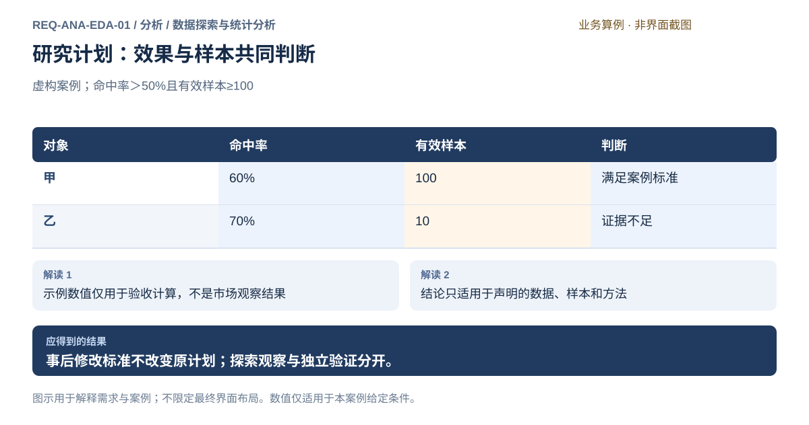
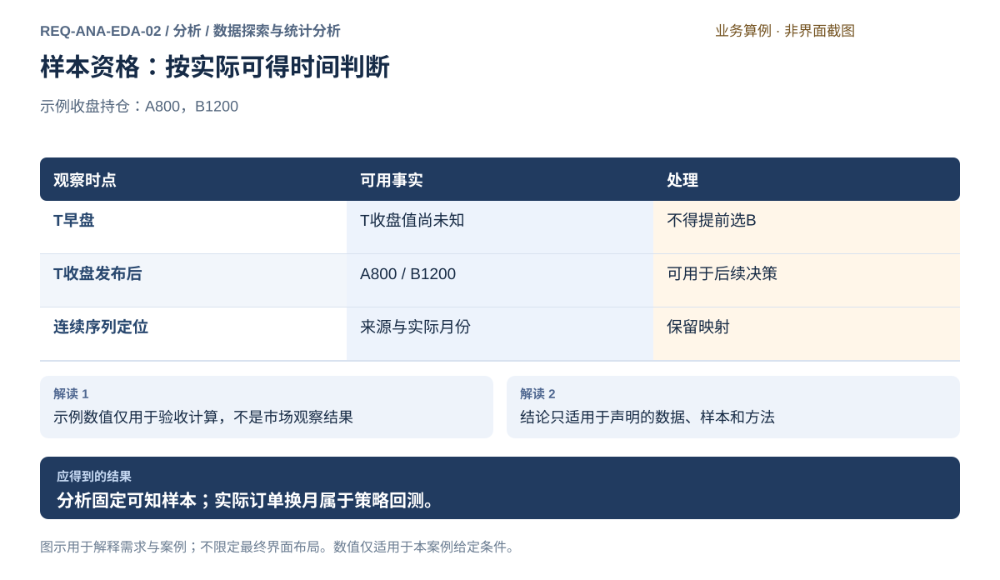
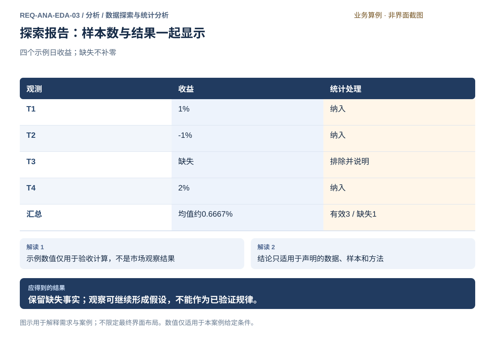
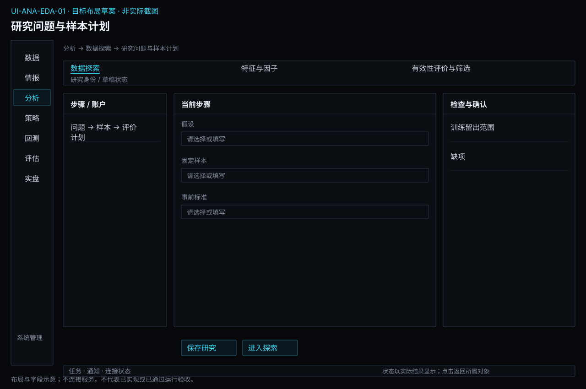
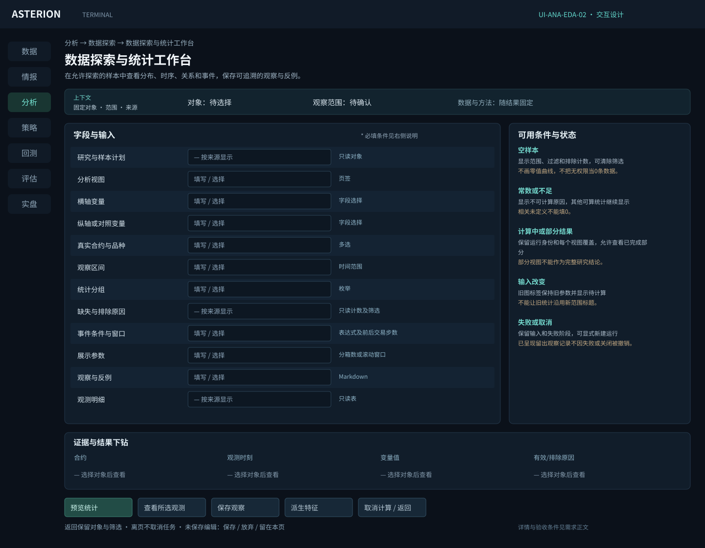

# 数据探索与统计分析

[返回上级](README.md) · [需求总纲](../../README.md) · [界面规范](../../common/ui-designs.md) · [跨模块流程](../../workflows/README.md)

开发前产品需求规格。本页定义目标功能、界面操作、业务规则及验收条件。

**归属：** 分析 / 数据探索与统计分析。本页集中保存业务需求、详细功能、案例、界面对应和验收；通用规则见[通用规范](../../common/README.md)。

## 需求导航

- [REQ-ANA-EDA-01 建立研究项目并记录可检验假设](#req-ana-eda-01)
- [REQ-ANA-EDA-02 固定探索样本、时间角色和连续序列解释](#req-ana-eda-02)
- [REQ-ANA-EDA-03 探索分布、时间结构和条件关系](#req-ana-eda-03)

## 子模块详细设计

目标是理解样本、发现结构并提出问题。研究计划和样本选择在探索前完成；目标不是自动找出“最赚钱”的指标。基础数据修复在数据模块进行，分析保留发现问题的证据。

| 能力组         | 必须支持的工作                                       | 结果中必须解释的口径                   |
| -------------- | ---------------------------------------------------- | -------------------------------------- |
| 研究问题与样本 | 草稿、假设、可否定条件、样本角色、历史资格和输入固定 | 事前还是事后解释；允许查看的区间       |
| 分布与覆盖     | 有效/缺失/异常数量、分位数、分布、离群观测下钻       | 单位、有效数、排除规则、统计方法       |
| 时间结构       | 滚动统计、自相关、日夜盘与季节性分组                 | 交易日日历、窗口、频率、预热与时间对齐 |
| 变量关系       | 共同样本相关矩阵、散点、滞后关系                     | 截面或时序、滞后方向、共同样本量       |
| 事件与条件     | 触发条件、事件前后窗口、基准与重叠诊断               | 条件实际可得时间、事件数、标签完整性   |
| 观察报告       | 保存选择、统计、图表、事实/解释/假设及反例           | 不确定性、选择次数与尚未检验范围       |

### 交互布局与操作约定

工作台上方显示问题、快照、时间范围与样本角色；左侧为变量、分组和过滤条件；中央按“分布、时序、关系、事件”切换；下方显示联动明细，侧边说明口径和排除原因。具体视图能力按方法清单提供，不显示无法运行的假图。

修改统计条件先标记待计算，执行后才替换当前结果；不能让旧图沿用新条件标题。切换纯展示方式不必重算，改变样本或方法则创建新分析运行。选中图形中的点、区间或矩阵单元格，明细必须显示同一输入快照的观测，不偷偷切到最新数据。

保存报告同时保存筛选、单位、方法、样本数与输入引用。关闭未保存编辑时明确保存或放弃；取消编辑不取消后台运行，取消任务是独立动作。导出报告须保留样本、方法、缺失与局限说明，不带凭据。

### 典型研究路径

规则研究可以先看“波动上升后，突破事件的后续分布是否不同”，再构造波动和突破变量；多因子研究可以先看“期限结构和动量的覆盖及关系”，再决定是否构建两个因子。两条路线都先记录观察范围，探索并不直接宣布假设有效。

时间季节性按期货交易日和日夜盘划分，不能把夜盘自然日期误作交易日。跨品种分析优先使用已明确量纲的收益或标准化变量，价格水平的差异不能直接被解释成相关交易机会。零价、负价和分母为零要按所选统计定义处理，不能强制套用不适用的对数收益。

### 数据对象与边界

| 对象     | 最低字段                                        | 校验或解释                           |
| -------- | ----------------------------------------------- | ------------------------------------ |
| 样本选择 | 快照、合约/品种、开始结束、频率、交易日历、角色 | 筛选不能越过允许探索范围             |
| 统计配置 | 变量、单位、方法、窗口、分组、滞后、基准        | 同一指标名称对应明确公式和样本       |
| 观察明细 | 合约、时点、来源值、是否参与、排除原因          | 结果与图形可回溯，缺失和值0分开      |
| 观察记录 | 问题、证据引用、事实、解释、下一假设            | 事后解释必须标明；不直接设置交易条件 |

空样本、样本不足、常数变量、未完成窗口和真实极端值是不同状态。图中异常点既可以导致数据核查，也可以成为研究对象；系统不得替研究者删除真实市场事件。评价阶段能直接引用报告与快照，不能只接收静态图片而丢失输入依据。

## REQ-ANA-EDA-01 建立研究项目并记录可检验假设

**领域：** 分析 / 数据探索与统计分析　 **建议优先级：** P1核心必要　 **需求性质：** 目标功能与验收规格

### 目标与场景

用户围绕具体问题组织数据、实验和结论，先说明要验证什么及何时判定不成立。研究记录使失败结果也可复查，减少只记住表现最好实验的选择偏差。

**使用者与场景：** 个人研究用户，在开启新研究方向或继续已有研究时。

**触发条件：** 用户提出一个需要用期货历史数据验证的假设。

### 前置条件

- 研究对象属于期货范围。
- 用户能描述预期机制及拟使用的数据，不要求已具备全部数据。

### 输入与含义

| 输入               | 含义与单位                                         | 约束                                                   |
| ------------------ | -------------------------------------------------- | ------------------------------------------------------ |
| 研究问题与假设     | 希望解释或预测的现象，以及可被结果否定的预期。     | 需区分已知事实、研究假设和主观解释。                   |
| 观察范围与评价方法 | 候选品种、频率、研究区间、评价指标及训练验证安排。 | 未确定项允许明确待定，但不能作为已固定实验条件。       |
| 决策标准           | 何种结果支持、否定或不足以判断假设。               | 修改标准应保留原因和适用实验，不回改旧实验的预定标准。 |

### 正常操作与反馈

1. 用户创建项目并写明问题、动机和可检验假设。
2. 用户列出数据需求、评价口径、主要风险和判断标准。
3. 用户将后续实验归入该问题，保留尝试的目的及相互关系。
4. 查看结果时对照原假设记录支持、否定或证据不足。
5. 需要改变方向时记录新假设或修订理由，并继续关联后续实验。

### 业务规则

- 项目是研究组织单位，不意味着多个实验自动共享相同输入或评价口径。
- 失败、取消和不支持假设的结果不得因结论不理想而静默消失。
- 事后提出的解释必须与事前假设区分，不冒充预先验证的规则。
- 描述可以完善，但已执行实验的实际条件及当时判断标准保持可追溯。

### 输出与状态影响

- 含问题、假设、评价计划及相关实验的研究记录。
- 能追溯到具体证据的阶段结论与下一项研究问题。

### 异常与继续方式

| 发生什么                               | 应怎样表现                                             | 使用者如何继续                                   |
| -------------------------------------- | ------------------------------------------------------ | ------------------------------------------------ |
| 用户尚无法给出完整判断标准。           | 允许保存探索性研究，并标明标准待定，不称为验证性结论。 | 用户补充标准后新建明确的验证实验。               |
| 用户查看结果后改变支持假设的判断标准。 | 保留原标准及当时结论，将新标准标明为后续修订。         | 用户记录修改理由，并以尚未使用的证据开展新验证。 |

### 案例：按事前标准评价分析证据

**虚构案例条件：** 虚构案例：要求验证段方向命中率大于50%，且有效样本至少100。阈值只是案例约定。

1. 甲命中60/100，乙命中7/10。
2. 分别检查效果与样本数量。

**预期结果：**

- 甲符合本次案例标准；乙虽命中率70%但证据不足。
- 不得根据乙结果把最低样本数改成10并回写原标准。

### 可观察验收条件

| 编号                | 给定                                   | 当                   | 则                                           |
| ------------------- | -------------------------------------- | -------------------- | -------------------------------------------- |
| REQ-ANA-EDA-01-AC01 | 计划要求命中率大于50%且有效样本至少100 | 查看甲60/100与乙7/10 | 甲满足，乙样本不足；两者均保留               |
| REQ-ANA-EDA-01-AC02 | 已查看乙结果                           | 把样本要求改成10     | 保留原标准和修改原因，新要求不能冒充事前标准 |

### 决定与配置约束

- **DEC-ANA-EDA-01-01**：**规格决定**。研究以独立问题组织，策略思路、品种、周期为标签和筛选维度；目录不强制绑定某种策略或市场。

- **DEC-ANA-EDA-01-02**：**规格决定**。支持Markdown笔记、来源链接及已登记材料/图表引用；不增加任意本地市场数据文件导入。

### 详细功能

### FR-ANA-EDA-01-01 建立项目并记录可检验研究假设

**目标与结果：** 围绕明确问题组织尝试，区分事实、假设与事后解释。

**触发：** 研究项目页点击新建项目。

**输入与约束：** 项目名、研究问题、预期机制和范围；不把示例内容作为真实用户默认。

**目标操作与反馈：**

1. 输入问题和假设，标明依赖哪些真实资料。
2. 填写拟研究的品种、频率与限制。
3. 保存项目，看到独立项目记录及待准备事项。

**异常与边界：**

- 标准未定可保存探索草稿，但不能称验证性研究已成立。
- 取消新建时可明确丢弃未保存内容，不影响已有项目。

**验收条件：**

- **FR-ANA-EDA-01-01-AC01**：项目保存后能分别读到问题、假设和范围。
- **FR-ANA-EDA-01-01-AC02**：空问题不能保存为完整研究计划，输入内容仍保留。

**界面对应：** [UI-ANA-EDA-01 研究问题与样本计划](#ui-ana-eda-01)。

### FR-ANA-EDA-01-02 事前声明评价标准与验证安排

**目标与结果：** 在看结果之前记录何时支持、否定或证据不足，减少事后选标准。

**触发：** 项目内点击编辑评价计划。

**输入与约束：** 指标定义、阈值、训练验证范围及判断逻辑；阈值由用户确认，不暗设收益目标。

**目标操作与反馈：**

1. 选择主要评价指标并说明计算口径。
2. 明确阈值和必须同时满足的条件。
3. 确认计划后关联后续实验，并保留计划当时内容。

**异常与边界：**

- 阈值单位错误或区间重叠时定位字段，不提交无效计划。
- 已有结果后改标准必须说明理由，原计划仍随原实验可查。

**验收条件：**

- **FR-ANA-EDA-01-02-AC01**：甲60/100同时满足案例命中率和样本要求，乙7/10因样本不足不满足。
- **FR-ANA-EDA-01-02-AC02**：修改最低样本数后原计划与原因仍可见。

**界面对应：** [UI-ANA-EDA-01 研究问题与样本计划](#ui-ana-eda-01)。

### FR-ANA-EDA-01-03 将实验归入问题并记录尝试目的

**目标与结果：** 用户能看到成功、失败和取消的所有相关尝试，不只留下最优结果。

**触发：** 项目点击关联实验或从新实验选择所属项目。

**输入与约束：** 实验身份、项目与尝试说明；只关联用户实际选择的记录。

**目标操作与反馈：**

1. 选择相关实验并核对输入摘要。
2. 填写该尝试要改变或验证什么。
3. 保存关联，在项目时间序列中查看条件、运行结果和结论。

**异常与边界：**

- 实验失败或取消仍可关联，不伪造绩效。
- 移除项目关联不删除实验资料，操作后可从实验记录重新关联。

**验收条件：**

- **FR-ANA-EDA-01-03-AC01**：项目同时列出成功与失败实验，并清楚区分运行结果。
- **FR-ANA-EDA-01-03-AC02**：改变关联不改动任何实验输入、成本或计算结果。

**界面对应：** [UI-ANA-EDA-01 研究问题与样本计划](#ui-ana-eda-01)；[UI-SYS-RUN-02 任务中心](../system/tasks-nodes.md#ui-sys-run-02)。

### FR-ANA-EDA-01-04 记录阶段结论和后续研究方向

**目标与结果：** 把判断与证据连接起来，并保留假设被否定的记录。

**触发：** 项目查看结果后点击记录结论。

**输入与约束：** 支持、否定或证据不足的判断，关联实验及理由；结论范围不得超过证据。

**目标操作与反馈：**

1. 选定证据并对照原评价计划。
2. 说明支持与反例，标记需要补充的数据。
3. 保存阶段结论，可继续新假设或准备候选。

**异常与边界：**

- 没有验证标准时结论标为探索观察，不自动升级为可交易策略。
- 后续改写结论保留历史理由和引用，不抹除不利结果。

**验收条件：**

- **FR-ANA-EDA-01-04-AC01**：乙命中率70%但样本不足可保存证据不足结论。
- **FR-ANA-EDA-01-04-AC02**：新假设不会改变原实验与原计划。

**界面对应：** [UI-ANA-EDA-01 研究问题与样本计划](#ui-ana-eda-01)。

### FR-ANA-EDA-01-05 保存研究工作状态并派生可复核试验

**目标与结果：** 研究草稿、固定输入和已执行结果各自清楚，继续工作不改写旧试验。

**触发：** 保存研究、重新打开或基于既有结果继续研究。

**输入与约束：** 问题、样本、方法、参数、训练验证范围、关联任务及结论；草稿允许缺项并列出。

**目标操作与反馈：**

1. 保存草稿并报告成功/失败；未成功前保留编辑内容且不显示已保存。
2. 重新打开时恢复草稿引用和未决项，查询既有任务，不自动重新计算。
3. 基于结果改变样本或方法时派生新试验并记录变化理由，保留原输入、结果和选择记录。

**异常与边界：**

- 删除或不可访问依赖时明确缺项，不将名称相同的新资料自动绑定。
- 看过留出后调整方案须标明选择污染，不恢复为未看过。

**操作案例：** 看过因子结果后改变窗口，系统新建试验草稿并沿用“该区间已用于选择”的记录。

**验收条件：**

- **FR-ANA-EDA-01-05-AC01**：修改草稿参数不改变既有实验的固定条件及结果。
- **FR-ANA-EDA-01-05-AC02**：退出前保存失败再次打开只能看到最后确认保存内容，界面不能声称失败内容已持久保存。

**界面对应：** [UI-ANA-EDA-01](#ui-ana-eda-01)；[UI-ANA-EVL-02](evaluation.md#ui-ana-evl-02)。

## REQ-ANA-EDA-02 固定探索样本、时间角色和连续序列解释

**领域：** 分析 / 数据探索与统计分析　 **建议优先级：** P1核心必要　 **需求性质：** 目标功能与验收规格

### 目标与场景

在探索前固定输入及可观察范围，记录每个历史时点的样本资格、连续价格解释与信息可得性；完整换月交易处置由策略回测负责。

**使用者与场景：** 个人研究用户，为因子评价或策略回测确定标的集合时。

**触发条件：** 用户选择多个合约、动态样本筛选或连续合约序列。

### 前置条件

- 合约身份、历史数据范围及可用性证据已明确。
- 样本资格和连续序列依据能说明观察时间和可知时点。

### 输入与含义

| 输入               | 含义与单位                             | 约束                             |
| ------------------ | -------------------------------------- | -------------------------------- |
| 固定输入与角色     | 数据快照、探索/训练/验证/留出范围      | 留出结果不能参与探索             |
| 成员资格与连续序列 | 历史成员、流动性依据、调整和原合约映射 | 只用当时已知事实；不产生模拟成交 |

### 正常操作与反馈

1. 选择固定数据快照和探索/训练/验证/留出角色。
2. 声明品种范围、历史成员资格、日历与频率。
3. 核对连续序列方法、原合约映射及当时可得资料。
4. 查看覆盖与排除原因，固定研究输入。
5. 遇到缺失事实回到数据模块处理，新的输入产生新的分析运行。

### 业务规则

- 当日收盘后才知道的事实不能驱动当日早盘样本资格。
- 连续调整价必须注明用途；价格水平调整不能当作真实交易盈利。
- 连续序列的来源、调整方法、切换时点及实际月份可追溯。
- 探索性图表不能预览最终留出结果后仍称未见资料。
- 连续序列由数据模块生产；分析固定其引用，实际持仓和交易换月由策略回测处理。

### 输出与状态影响

- 固定样本引用、时间角色、连续序列解释与覆盖报告。

### 异常与继续方式

| 发生什么             | 应怎样表现                           | 使用者如何继续               |
| -------------------- | ------------------------------------ | ---------------------------- |
| 历史资格所需资料缺失 | 列出受影响日期和成员，不猜测当时资格 | 补足资料或显式收缩研究范围   |
| 连续序列映射不完整   | 阻止依赖该映射的统计                 | 回数据模块检查并选择完整快照 |

### 案例：收盘事实不能提前筛选早盘样本

**虚构案例条件：** 示例T日收盘持仓A=800、B=1200，该事实在收盘后可得；研究采用前一日持仓较大的合约。

1. T早盘只能使用更早已知事实。
2. T收盘后才可将B用于后续时点资格。

**预期结果：**

- T早盘不能使用T收盘的1200。
- 选择连续序列时保留真实月份映射；成交换月另交策略。

### 可观察验收条件

| 编号                | 给定                  | 当            | 则                                 |
| ------------------- | --------------------- | ------------- | ---------------------------------- |
| REQ-ANA-EDA-02-AC01 | T收盘持仓在收盘后发布 | 筛选T早盘样本 | 该持仓值不可用于当时资格           |
| REQ-ANA-EDA-02-AC02 | 选择连续序列          | 定位某时点    | 可回到来源快照、调整方法及实际月份 |
| REQ-ANA-EDA-02-AC03 | 调整分析范围          | 提交计算      | 重新核对覆盖，不沿用旧范围检查结论 |

### 决定与配置约束

- **DEC-ANA-EDA-02-01**：**运行配置**。样本必须显式填写最低历史长度、成交量/持仓量资格及过滤时点；最低长度不小于最长预热和标签所需覆盖，缺参数阻止固定严格样本。

### 详细功能

### FR-ANA-EDA-02-01 定义历史时点的样本资格

**目标与结果：** 说明每个时点哪些合约可参与及原因，避免使用全期结果提前选样本。

**触发：** 研究问题与样本计划中展开历史成员资格。

**输入与约束：** 候选合约、最短历史、滞后成交或持仓条件及可知时间；阈值不隐含默认。

**目标操作与反馈：**

1. 选择候选范围及资格条件。
2. 预览各日期可用输入与成员数量。
3. 查看纳入、排除原因并确认规则。

**异常与边界：**

- 可知时间未知的字段不能当作事前资格事实。
- 预热不足只排除受影响样本并说明；不得从全期收益反推成员。

**验收条件：**

- **FR-ANA-EDA-02-01-AC01**：T收盘后的持仓信息不能影响T早盘资格。
- **FR-ANA-EDA-02-01-AC02**：用户能逐日查到每个合约被排除的具体规则。

**界面对应：** [UI-ANA-EDA-01 研究问题与样本计划](#ui-ana-eda-01)。

### FR-ANA-EDA-02-02 提交前核对样本与规则所需事实

**目标与结果：** 让用户在启动前定位时间对齐、范围与规则证据不足，而不是得到貌似完整的结果。

**触发：** 研究样本计划点击检查输入。

**输入与约束：** 固定快照、日期、资格、连续序列映射与可得时间；本检查不替用户改换数据。

**目标操作与反馈：**

1. 汇总实验所需合约、时段和字段。
2. 查看通过条件与阻止项，逐项定位输入或来源。
3. 补足资料或调整实验后重新检查，通过后确认固定输入。

**异常与边界：**

- 未知事实不得靠猜测、补零或静默更换来源通过。
- 返回修改范围会使之前的检查结论失效，需重新核对。

**验收条件：**

- **FR-ANA-EDA-02-02-AC01**：缺少历史规则时显示受影响合约日和无法完成的计算。
- **FR-ANA-EDA-02-02-AC02**：检查通过只表示所列输入条件满足，不等于研究结论已成立。

**界面对应：** [UI-ANA-EDA-01 研究问题与样本计划](#ui-ana-eda-01)；[UI-DAT-SRV-02 数据目录与修订对照](../data/management.md#ui-dat-srv-02)。

### FR-ANA-EDA-02-03 固定多因子样本池与连续合约依据

**目标与结果：** 让每个评价时点的成员和实际月份都有事前依据，避免用事后活跃度或存续结果选样本。

**触发：** 研究样本计划选择成员及合约口径。

**输入与约束：** 固定资料、可知时间、上市和流动性资格、连续信号与实际月份映射；阈值由用户明确确认。

**目标操作与反馈：**

1. 选择候选合约及所用数据状态。
2. 按日期预览纳入排除原因、规则可知时间和月份切换。
3. 确认样本及连续价格口径，固定到本方案。

**异常与边界：**

- 历史事实缺可知时间时标依据不足，不能猜成事前已知。
- 连续调整价只用于声明的信号计算；成员退出不自动删除组合已有持仓。

**验收条件：**

- **FR-ANA-EDA-02-03-AC01**：案例日T收盘后获知的持仓事实不能用于T早盘筛选。
- **FR-ANA-EDA-02-03-AC02**：任一信号能回到具体合约月份、资料状态与当时成员。

**界面对应：** [UI-ANA-EDA-01 研究问题与样本计划](#ui-ana-eda-01)；[UI-DAT-SRV-02 数据目录与修订对照](../data/management.md#ui-dat-srv-02)。

## REQ-ANA-EDA-03 探索分布、时间结构和条件关系

**领域：** 分析 / 数据探索与统计分析　 **建议优先级：** P1核心必要　 **需求性质：** 目标功能与验收规格

### 目标与场景

将观察变成可复核的问题和统计证据，区分异常数据、真实极端行情与偶然关系。

**使用者与场景：** 个人期货量化研究用户，兼顾规则策略与多因子研究。

**触发条件：** 选择探索样本并查看覆盖和质量摘要。

### 前置条件

- 选择真实来源的固定数据快照；示例数据只用于文档和测试。
- 研究用途、时间范围和样本角色明确，测试留出资料不参与探索和选择。

### 输入与含义

| 输入       | 含义与单位                             | 约束                                                                       |
| ---------- | -------------------------------------- | -------------------------------------------------------------------------- |
| 分析范围   | 合约、交易日、频率、会话与样本角色     | 只从允许探索的样本中取数，统计显示实际有效数量                             |
| 统计口径   | 收益、价格、波动、持仓变化及单位       | 价格水平不能不加说明地跨品种混算；收益分母为零或非正价格情形按明确方法处理 |
| 分组与事件 | 品种、日夜盘、季节、波动状态、事件窗口 | 条件只能使用当时可知的信息；事件重叠另报                                   |

### 正常操作与反馈

1. 选择探索样本并查看覆盖和质量摘要。
2. 选定变量与统计口径，查看分布、时间曲线和分组统计。
3. 点选异常点或分组，联动定位原始样本及排除原因。
4. 比较基准和条件样本，保存观察及可能的解释。
5. 把观察登记为新假设，另定验证计划。

### 业务规则

- 未定义统计量显示原因，不能以零代替。
- 不根据看到的收益重新标记此前未知的市场状态。
- 基础数据错误交回数据模块；真实极端行情不得作为脏数据静默删除。
- 相关关系不自动推导因果或可交易收益。

### 输出与状态影响

- 可追溯统计报告、选区与图表配置。
- 包含反例和未检验解释的假设记录。

### 异常与继续方式

| 发生什么         | 应怎样表现                                   | 使用者如何继续             |
| ---------------- | -------------------------------------------- | -------------------------- |
| 筛选后无有效样本 | 显示每一步样本数与排除原因，不绘制虚假平线   | 调整范围后重新运行         |
| 发现价格突跳     | 展示换月、来源修订与原始观测证据，不自动平滑 | 提交数据核查或保留真实事件 |

### 案例：缺失值不能当零纳入分布

**虚构案例条件：** 四个示例日收益为1%、-1%、缺失、2%；价格和收益均为验收用虚构数值。

1. 按完整收益样本计算均值。
2. 点选缺失所在日期，查看其原因。

**预期结果：**

- 有效样本3个，缺失1个；平均收益为2/3%，约0.6667%。
- 若把缺失补零会错误得到0.5%；系统不得这样处理。

### 可观察验收条件

| 编号                | 给定               | 当           | 则                                      |
| ------------------- | ------------------ | ------------ | --------------------------------------- |
| REQ-ANA-EDA-03-AC01 | 四行中一行缺失     | 计算均值     | 显示3个有效值、1个排除值和约0.6667%均值 |
| REQ-ANA-EDA-03-AC02 | 某列所有有效值相同 | 计算相关系数 | 显示未定义及常数列原因                  |
| REQ-ANA-EDA-03-AC03 | 在图中选择日期     | 查看明细     | 定位同一快照的合约、时点和值            |

### 决定与配置约束

- **DEC-ANA-EDA-03-01**：**规格决定**。探索提供日、星期、月份、交易时段及已核验情报类型分组；组内显示样本数与排除原因，不足时保留描述并标不可比较。

### 详细功能

### FR-ANA-EDA-03-01 查看分布与有效样本覆盖

**目标与结果：** 在解释统计量前知道数据支持范围。

**触发：** 选择变量与范围并预览覆盖。

**输入与约束：** 固定快照、变量、合约、日期、单位及样本角色。

**目标操作与反馈：**

1. 选择变量与范围并预览覆盖。
2. 查看有效/缺失数量、分位数与分布。
3. 点击分位区间追溯样本。

**异常与边界：**

- 缺失不补零；空集合不显示均值。
- 分母为零或负价导致收益定义不适用时明确阻断该统计。

**验收条件：**

- **FR-ANA-EDA-03-01-AC01**：1%、-1%、缺失、2%得到有效3、均值约0.6667%。
- **FR-ANA-EDA-03-01-AC02**：同一筛选下表格与图形使用同一有效样本。

**界面对应：** [UI-ANA-EDA-02 数据探索与统计工作台](#ui-ana-eda-02)。

### FR-ANA-EDA-03-02 分析时间结构与市场状态

**目标与结果：** 检查规律的时间变化，避免全期均值掩盖阶段差异。

**触发：** 选定时间统计与窗口。

**输入与约束：** 收益/波动变量、滞后阶数、滚动窗、日夜盘及交易日日历。

**目标操作与反馈：**

1. 选定时间统计与窗口。
2. 查看时序、滚动统计、自相关与季节分组。
3. 下钻窗口并记录观察。

**异常与边界：**

- 不足窗口保留缺失。
- 状态划分使用当时可得信息，事后状态需标探索描述。

**验收条件：**

- **FR-ANA-EDA-03-02-AC01**：跨夜盘按交易日日历归组，不按自然日错误切断。
- **FR-ANA-EDA-03-02-AC02**：修改窗口产生新分析记录而非修改已固定结果。

**界面对应：** [UI-ANA-EDA-02 数据探索与统计工作台](#ui-ana-eda-02)。

### FR-ANA-EDA-03-03 检查相关、滞后关系与共同样本

**目标与结果：** 使变量关系有明确的对齐和样本依据。

**触发：** 选择变量对和对齐规则。

**输入与约束：** 变量对、时序/截面口径、滞后方向与相关方法。

**目标操作与反馈：**

1. 选择变量对和对齐规则。
2. 查看相关矩阵、共同样本数与散点。
3. 点选单元格查看成员和日期。

**异常与边界：**

- 常数列相关未定义。
- 不同变量对可以有不同有效数，矩阵必须显示每对数量。

**验收条件：**

- **FR-ANA-EDA-03-03-AC01**：三对完整值外有一行缺失时，相关只使用三对并显示排除行。
- **FR-ANA-EDA-03-03-AC02**：滞后+1与-1的含义可从时间预览辨认。

**界面对应：** [UI-ANA-EDA-02 数据探索与统计工作台](#ui-ana-eda-02)。

### FR-ANA-EDA-03-04 开展事件与条件统计

**目标与结果：** 提出规则策略的可检验条件而不冒充成交回测。

**触发：** 选择事件和条件。

**输入与约束：** 可得时点明确的事件、前后窗口、基准、重叠政策。

**目标操作与反馈：**

1. 选择事件和条件。
2. 查看事件数、重叠数、结果分布与基准差异。
3. 追溯事件时间并保存假设。

**异常与边界：**

- 同一行情段重复触发不能冒充独立事件。
- 标签结果标未模拟成交和费用。

**验收条件：**

- **FR-ANA-EDA-03-04-AC01**：两个事件窗口重叠时同时显示事件2和重叠关系。
- **FR-ANA-EDA-03-04-AC02**：收盘可知条件不能触发同日开盘事件。

**界面对应：** [UI-ANA-EDA-02 数据探索与统计工作台](#ui-ana-eda-02)。

### FR-ANA-EDA-03-05 定位异常并交接数据核查

**目标与结果：** 区分来源问题、换月跳变与真实极端行情。

**触发：** 点选异常数据。

**输入与约束：** 异常点、输入快照、来源证据及用户说明。

**目标操作与反馈：**

1. 点选异常数据。
2. 查看原值、换月和修订说明。
3. 登记核查问题并引用数据管理入口。

**异常与边界：**

- 分析页面不直接改写基础数据。
- 修复形成新数据快照，原分析引用保持。

**验收条件：**

- **FR-ANA-EDA-03-05-AC01**：异常记录能定位到原合约时点。
- **FR-ANA-EDA-03-05-AC02**：核查后原报告没有被新数据静默重算。

**界面对应：** [UI-ANA-EDA-02 数据探索与统计工作台](#ui-ana-eda-02)。

### FR-ANA-EDA-03-06 保存探索报告与研究假设

**目标与结果：** 把图表观察连同限制交给下一步。

**触发：** 选择需保存的观察。

**输入与约束：** 图表配置、筛选、快照、统计方法、证据与假设。

**目标操作与反馈：**

1. 选择需保存的观察。
2. 标明事实、解释和待检验假设。
3. 保存报告并创建特征研究引用。

**异常与边界：**

- 不把探索区间改称未见留出。
- 图表导出不能代替可追溯数据引用。

**验收条件：**

- **FR-ANA-EDA-03-06-AC01**：重新打开报告恢复范围、单位和排除数量。
- **FR-ANA-EDA-03-06-AC02**：由观察创建假设仍显示尚未验证。

**界面对应：** [UI-ANA-EDA-02 数据探索与统计工作台](#ui-ana-eda-02)。

## 界面设计与操作规格

## UI-ANA-EDA-01 研究问题与样本计划

**业务目标：** 在查看结果之前固定研究问题、可否定条件、样本角色和判断计划，并能继续已有研究。

**目标到达路径：** 分析 → 数据探索 → 研究问题与样本计划。

**界面布局：** 左侧研究目录；中央按问题、样本、评价计划三步编辑；右侧显示覆盖和信息使用检查；底部独立保存草稿与确认计划。

### 字段与操作交付约定

新建对象中未指定默认值的必填字段为空；进入已有对象加载其固定值。只读缺失显示“—”和原因，案例数值不得作为用户数据。时间字段显示时区、交易日归属与精度，金额和比例在字段旁标单位。

| 字段 | 类型 | 默认值、约束与反馈 |
| --- | --- | --- |
| 研究标题 | 文本 | 新建为空，保存草稿必填；重名不替换已有研究。 |
| 研究假设 | 多行文本 | 描述机制和预期方向；可留空保存草稿，进入验证计划前必填。 |
| 否定条件 | 多行文本 | 写明什么观察使假设不成立，不以“结果不好”替代。 |
| 来源引用 | 对象多选 | 可关联数据、情报和研究笔记；缺失引用显示对象身份。 |
| 父研究 | 只读对象或显式关联 | 派生自动关联；新建检查同源资料的历史信息使用。 |
| 固定数据快照 | 对象选择 | 无默认最新；更换使样本检查和统计预览失效。 |
| 样本角色与区间 | 时间区间表 | 逐行选择探索、训练、开发验证、最终留出，显示时区和交易日历；重叠须明确处理。 |
| 主指标 | 方法选择 | 无默认盈利标准；保存定义、单位和计算方向。 |
| 通过方向与阈值 | 枚举及数值 | 验证前必填，数值单位随指标显示；更改派生新计划并记录理由。 |
| 最低样本与稳定性条件 | 整数及多行规则 | 按研究显式填写，不能把通用样本数当可靠保证。 |
| 外部观察声明 | 范围表及确认 | 登记已在其他工具看过的资料；未确认时显示独立性限制。 |
| 备注与标签 | Markdown及文本列表 | 可选；备注编辑不改变已固定实验输入。 |

### 动作与反馈

| 按钮或操作 | 可用条件 | 结果与失败处理 |
| --- | --- | --- |
| 保存草稿 | 标题有效，无保存请求在途 | 允许其他项待定；返回研究身份及保存时间，失败保留编辑内容。 |
| 检查样本计划 | 已选固定快照及角色区间 | 只读核对覆盖、时间、标签边界与信息使用；按字段定位问题。 |
| 确认计划并探索 | 允许探索范围有可读数据且无时间冲突 | 固定计划后进入探索页；最终留出不随普通图表自动加载。 |
| 记录阶段结论 | 已选择研究及证据 | 保存支持、不支持或证据不足及理由，不能回写事前标准。 |
| 返回研究目录 | 无未处理保存结果 | 未保存编辑提供保存、放弃、留在本页；放弃不删除固定计划。 |

### 关键状态

| 状态 | 显示与继续方式 | 约束 |
| --- | --- | --- |
| 无研究 | 显示新建入口与资料要求 | 不展示示例结果为真实统计。 |
| 草稿缺项 | 可保存标题和问题，缺项逐字段显示 | 缺验证标准只能探索，不能标为验证计划。 |
| 信息重叠 | 展示原研究、已观察区间和用途 | 新名字、快照修订或频率改变不清除观察历史。 |
| 保存结果不明 | 保留请求身份，提供查询保存结果 | 确认前禁用重复保存；关闭页面不撤销已受理保存。 |
| 已固定计划 | 只读查看并可派生新计划 | 编辑不得覆盖已执行实验的条件。 |

### 跨模块联动与返回

进入 UI-ANA-EDA-02 携带研究、计划、快照、允许探索区间；跳到数据补缺后返回原研究与字段，不自动扩大时间范围。

有保存、创建或导出请求在途时显示请求身份；结果不明先查询，避免重复提交。离开页面不等于取消任务。关闭抽屉或返回保留当前对象、筛选、选中行与滚动位置；不能把已展示信息或已固定结果作为未保存草稿撤销。

### 业务验收要求

- **UI-ANA-EDA-01-AC01**：甲60/100满足案例标准，乙7/10样本不足。
- **UI-ANA-EDA-01-AC02**：结果后改标准保留原值与原因。

**交互验收案例：** 查看研究甲留出后以同源修订快照新建研究乙，检查重叠提示；在研究乙改主指标，原研究与原标准必须仍可查。

### 对应功能需求

- [FR-ANA-EDA-01-01 建立项目并记录可检验研究假设](#fr-ana-eda-01-01)
- [FR-ANA-EDA-01-02 事前声明评价标准与验证安排](#fr-ana-eda-01-02)
- [FR-ANA-EDA-01-03 将实验归入问题并记录尝试目的](#fr-ana-eda-01-03)
- [FR-ANA-EDA-01-04 记录阶段结论和后续研究方向](#fr-ana-eda-01-04)
- [FR-ANA-EDA-01-05 保存研究工作状态并派生可复核试验](#fr-ana-eda-01-05)
- [FR-ANA-EDA-02-01 定义历史时点的样本资格](#fr-ana-eda-02-01)
- [FR-ANA-EDA-02-02 提交前核对样本与规则所需事实](#fr-ana-eda-02-02)
- [FR-ANA-EDA-02-03 固定多因子样本池与连续合约依据](#fr-ana-eda-02-03)
- [FR-SYS-SET-01-04 完成准备后进入明确的工作入口](../system/setup.md#fr-sys-set-01-04)
- [FR-SYS-RUN-01-01 提交长任务并在任务中心定位](../system/tasks-nodes.md#fr-sys-run-01-01)
- [FR-EVA-PER-01-04 核对指标口径并记录解释限制](../evaluation/performance.md#fr-eva-per-01-04)
- [FR-DAT-SRV-01-04 将合约及规则上下文用于后续任务](../data/management.md#fr-dat-srv-01-04)
- [FR-DAT-PRC-01-04 按明确规则生产连续合约序列](../data/processing.md#fr-dat-prc-01-04)

## UI-ANA-EDA-02 数据探索与统计工作台

**业务目标：** 在允许探索的样本中查看分布、时序、关系和事件，保存可追溯的观察与反例。

**目标到达路径：** 分析 → 数据探索 → 数据探索与统计工作台。

**界面布局：** 顶部固定研究和快照；左侧变量与过滤器；中央分布/时序/关系/事件页签；下方联动观测明细；右侧单位、排除及口径。

### 字段与操作交付约定

新建对象中未指定默认值的必填字段为空；进入已有对象加载其固定值。只读缺失显示“—”和原因，案例数值不得作为用户数据。时间字段显示时区、交易日归属与精度，金额和比例在字段旁标单位。

| 字段 | 类型 | 默认值、约束与反馈 |
| --- | --- | --- |
| 研究与样本计划 | 只读对象 | 由入口携带，不可在图内更换而隐去上下文。 |
| 分析视图 | 页签 | 分布、时序、关系、事件；默认分布，切换仅在相同计算结果可复用时不重算。 |
| 横轴变量 | 字段选择 | 按字段类型列候选，显示单位；无默认首列。 |
| 纵轴或对照变量 | 字段选择 | 关系视图必选；配对样本由两列共同有效行确定。 |
| 真实合约与品种 | 多选 | 初始为计划允许范围；缩小范围立即标记结果待重算。 |
| 观察区间 | 时间范围 | 不得超出允许探索区间；查看留出须经信息使用确认。 |
| 统计分组 | 枚举 | 不分组、品种、交易日、周、月、交易时段；选择后展示每组有效数量。 |
| 缺失与排除原因 | 只读计数及筛选 | 有效、缺失、排除分别显示，点击数量下钻对应行。 |
| 事件条件与窗口 | 表达式及前后交易步数 | 事件视图必填，正负窗口含义明确；条件只能依赖当时可得输入。 |
| 展示参数 | 分箱数或滚动窗口 | 分箱为正整数；滚动窗口为正整数交易步数，完整窗口才给值。 |
| 观察与反例 | Markdown | 保存时必须关联当前运行、变量、范围和图表配置。 |
| 观测明细 | 只读表 | 合约、交易日、事件时刻、可得时刻、变量值、单位、有效性及原因。 |

### 动作与反馈

| 按钮或操作 | 可用条件 | 结果与失败处理 |
| --- | --- | --- |
| 预览统计 | 变量、范围及所选视图参数有效 | 创建有身份的分析运行；修改条件后旧图保留但标明旧条件。 |
| 查看所选观测 | 已选择点、区间或矩阵单元格 | 明细使用同一快照与相同过滤条件，不读取最新资料替换。 |
| 保存观察 | 已有可解释结果及观察文本 | 保存图表配置、输入引用和反例；不自动判为有效因子。 |
| 派生特征 | 已选变量与研究问题 | 进入特征草稿，带入定义建议及来源引用，不自动运行。 |
| 取消计算／返回 | 任务运行中可请求取消；返回始终可用 | 取消须等待终态；返回保留筛选与选中点，离页不取消任务。 |

### 关键状态

| 状态 | 显示与继续方式 | 约束 |
| --- | --- | --- |
| 空样本 | 显示范围、过滤和排除计数，可清除筛选 | 不画零值曲线，不把无权限当0条数据。 |
| 常数或不足 | 显示不可计算原因，其他可算统计继续显示 | 相关未定义不能填0。 |
| 计算中或部分结果 | 保留运行身份和每个视图覆盖，允许查看已完成部分 | 部分视图不能作为完整研究结论。 |
| 输入改变 | 旧图标签保持旧参数并显示待计算 | 不能让旧统计沿用新范围标题。 |
| 失败或取消 | 保留输入和失败阶段，可显式新建运行 | 已呈现留出观察记录不因失败或关闭被撤销。 |

### 跨模块联动与返回

从异常观测跳转数据质量页携带快照、合约、时间和字段；从观察派生 UI-ANA-FTR-01 携带研究身份，返回恢复原图的选择与滚动位置。

有保存、创建或导出请求在途时显示请求身份；结果不明先查询，避免重复提交。离开页面不等于取消任务。关闭抽屉或返回保留当前对象、筛选、选中行与滚动位置；不能把已展示信息或已固定结果作为未保存草稿撤销。

### 业务验收要求

- **UI-ANA-EDA-02-AC01**：四行示例均值约0.6667%，有效3、缺失1。
- **UI-ANA-EDA-02-AC02**：图表选择与表格使用同一输入与范围。

**交互验收案例：** 改变时间过滤后先核对旧图仍标原范围；计算完成点选一组样本，图与明细数量一致，缺失行能单独查看。

### 对应功能需求

- [FR-ANA-EDA-03-01 查看分布与有效样本覆盖](#fr-ana-eda-03-01)
- [FR-ANA-EDA-03-02 分析时间结构与市场状态](#fr-ana-eda-03-02)
- [FR-ANA-EDA-03-03 检查相关、滞后关系与共同样本](#fr-ana-eda-03-03)
- [FR-ANA-EDA-03-04 开展事件与条件统计](#fr-ana-eda-03-04)
- [FR-ANA-EDA-03-05 定位异常并交接数据核查](#fr-ana-eda-03-05)
- [FR-ANA-EDA-03-06 保存探索报告与研究假设](#fr-ana-eda-03-06)

