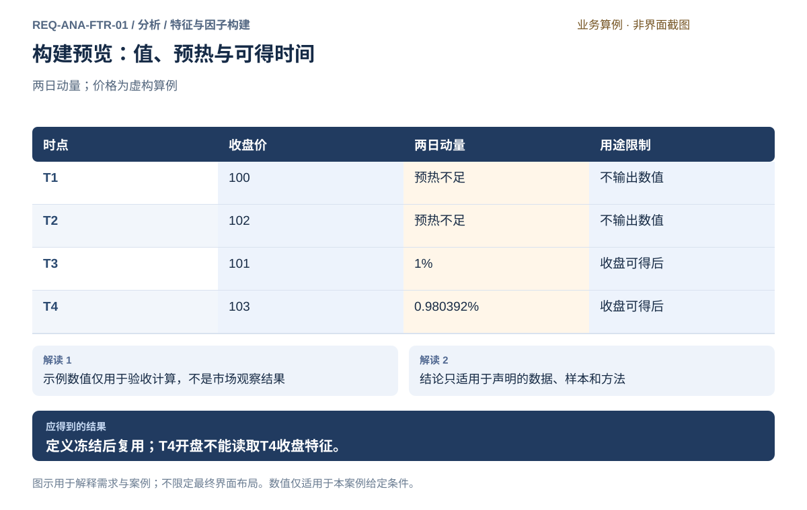
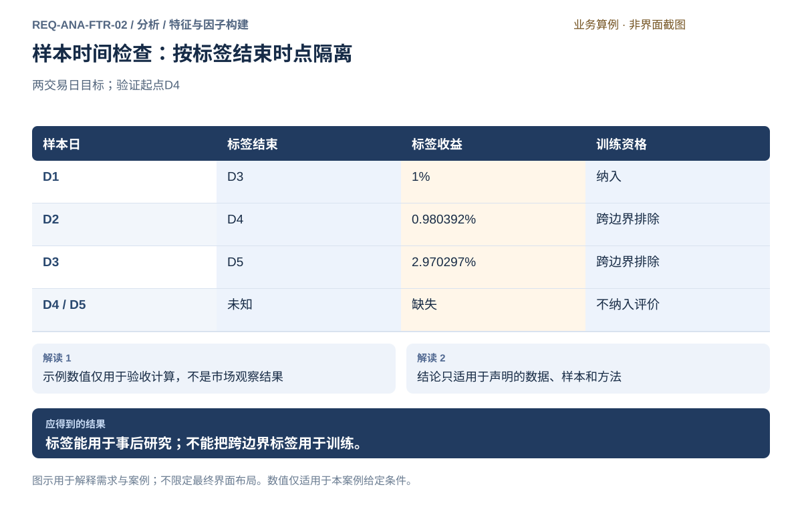
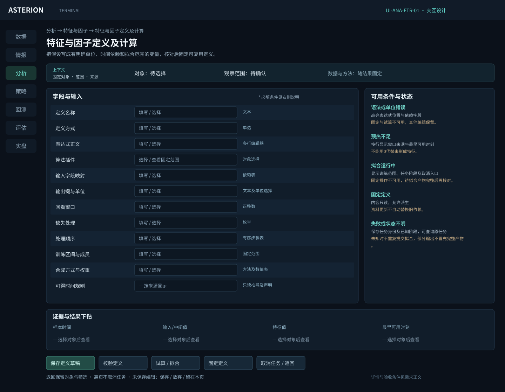
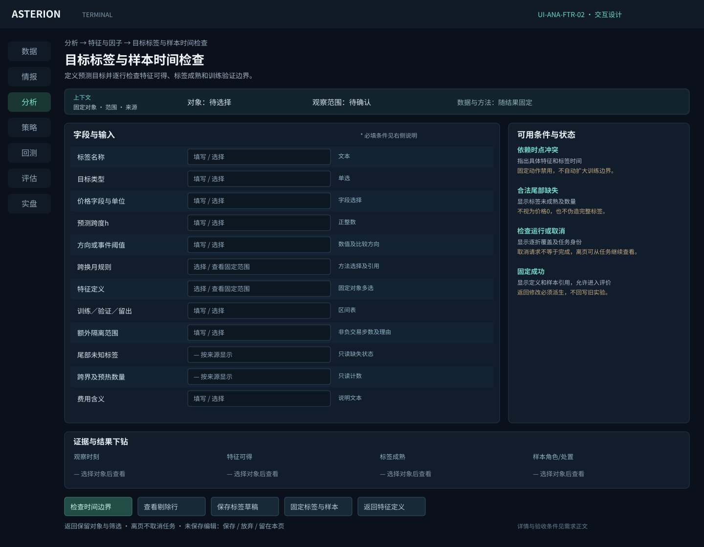

# 特征与因子构建

[返回上级](README.md) · [需求总纲](../../README.md) · [实际界面](../../common/screens.md) · [跨模块流程](../../workflows/README.md)

需求交付版 · 2026-10-18。细化规格已编制，用户逐项签认与产品验收分别记录；目标设计不代表已经实现，实际入口与差距见本页界面对应。

**归属：** 分析 / 特征与因子构建。本页集中保存业务需求、详细功能、案例、界面对应和验收；通用规则见[通用规范](../../common/README.md)。

## 需求导航

- [REQ-ANA-FTR-01 定义、计算和复用特征与因子](#req-ana-ftr-01)
- [REQ-ANA-FTR-02 定义研究目标、标签和样本时间边界](#req-ana-ftr-02)

## 子模块详细设计

目标是产出可计算、可复核、在决策时可获得的变量，同时定义事后评价的目标。特征与标签共享样本键但拥有不同时间语义，不能混在同一可用输入清单中。

| 能力组     | 需求范围                                                 | 必须保存的结果                               |
| ---------- | -------------------------------------------------------- | -------------------------------------------- |
| 变量定义   | 内置指标、统计量、经济因子与用户定义表达式/可信插件      | 名称、解释、内容身份、输入、输出、单位与参数 |
| 变换       | 滞后、差分、滚动、当时截面排名、训练拟合缩放及可选中性化 | 顺序、所用样本与拟合参数；缺失/估计标记      |
| 多周期依赖 | 日线/分钟组合、发布时间与完成周期检查                    | 依赖图的输入时点和每次计算的可得时间         |
| 信号合成   | 事前指定或训练确定的方向与权重                           | 冻结参数、训练来源、适用区间与约束           |
| 标签与样本 | 未来目标、跨度、真实日历、跨换月含义与边界排除           | 每行目标起止、结果、样本角色与排除理由       |
| 计算与复用 | 预览、计算、覆盖核对、定义及结果固定                     | 数据模块中的结果引用和消费者所需的完整定义   |

### 对象、字段与校验

| 对象     | 字段                                                 | 必须满足的约束                                     |
| -------- | ---------------------------------------------------- | -------------------------------------------------- |
| 特征定义 | 输入字段/变量、算法、参数、窗口、单位、输出键        | 未知字段、依赖循环、错误单位或输出键冲突均阻止运行 |
| 时间规则 | 事件时间、实际可得时间、决策时间、日历、完整周期政策 | 所有输入可得时间不晚于输出用于决策的时点           |
| 拟合产物 | 训练区间、成员、方法、参数、随机性设置（若算法需要） | 验证和留出不参与拟合；每折独立记录                 |
| 标签定义 | 目标、起点终点、持有跨度、合约/价格及费用说明        | 未来标签只用于评价，不能参与同期输入和样本资格     |
| 结果引用 | 快照、定义、参数、有效/无效行、数据资产引用          | 缺失、预热不足、错误和真实零分别表达               |

### 时间语义与拟合顺序

固定样本划分 → 在每个训练窗口拟合需要学习的处理 → 固定处理参数 → 应用于该窗口对应的验证资料。滚动均值等历史计算可以使用验证时刻之前允许可得的原始观测，但不能读取未来标签或改变已冻结的模型参数。

截面排名使用同一时点当时可得的成员和值，不等于用全期间资料拟合标准化。是否需要拟合、拟合使用哪些行必须由方法声明。中性化暴露缺失或样本不足时，应阻断所选处理并解释；不得静默改成不做中性化。

例如训练值1、3，选择总体标准差缩放：均值2、标准差1；验证值5变换为3。若把验证值加入拟合，均值变成3，已经污染训练条件。此处选择总体标准差仅用于算例，界面必须显示实际方法使用的自由度口径。

标签剔除按每行实际起止时间计算。固定持有两天和事件终止型标签不能一律套相同隔离天数；若增加隔离区间，必须说明依赖范围和理由。尾部未知标签保留缺失，不用已有最后价格凑满未来窗口。

### 拟议界面与操作

定义工作区显示变量清单与依赖，中央编辑当前定义和参数，右侧显示时间/单位检查，下方给出输入、中间值、输出、是否有效和原因。错误定位到字段或表达式位置；保存草稿与登记可运行定义是不同动作。采用表达式和可信插件两种已列能力，不内嵌完整IDE。

标签工作区上方配置目标，下方并排显示特征可得时刻、标签开始/结束及样本角色。选择训练/验证边界后立即预览跨界行和每段有效数量。点击剔除数量可查看具体行，不能只出现“存在泄漏”的笼统报错。

所有数值预览都有输入范围与估计/精确标记；未运行时不填入虚构结果。长任务显示实际完成范围；取消或失败后的局部结果可以诊断但不得当作完整可复用产物。已固定结果由数据模块保管和提供查询，分析页面仅管理其定义和用途。

## 事件情报特征输入

使用情报构建特征时须固定已发布集合、记录身份、可用时间、事件关联与修订规则。例如统计过去七天的计划减产事件，应明确按信息可用时间入窗、如何去重同一事件、如何处理更正及未知数量。分析拥有计算定义和统计检验；情报只提供语义及证据。事后加工的历史材料必须保留模式标识，不能在严格实际可得实验中提前使用。

## REQ-ANA-FTR-01 定义、计算和复用特征与因子

**领域：** 分析 / 特征与因子构建　 **建议优先级：** P1核心必要　 **需求状态：** 交付规格已编制（定位与模块已确认；细节待用户签认）

### 目标与场景

把研究思路转换成时间语义明确的变量；计算定义、处理参数和输入身份可以复算，指标值不直接充当账户仓位。

**使用者与场景：** 个人期货量化研究用户，兼顾规则策略与多因子研究。

**触发条件：** 从研究问题新建特征定义或选择已有定义。

### 前置条件

- 选择真实来源的固定数据快照；示例数据只用于文档和测试。
- 研究用途、时间范围和样本角色明确，测试留出资料不参与探索和选择。

### 输入与含义

| 输入       | 含义与单位                                     | 约束                                                     |
| ---------- | ---------------------------------------------- | -------------------------------------------------------- |
| 定义与依赖 | 名称、经济解释、公式或可信插件、输入字段及参数 | 登记内容身份，依赖无环；算法由插件提供                   |
| 时间与输出 | 回看窗口、预热、可得时点、输出键与单位         | 标明使用完整还是进行中周期，禁止引用预测时刻之后的输入   |
| 变换与合成 | 滞后、排名、缩放、可选中性化及合成权重         | 仅声明实际支持的方法；训练拟合参数与当时截面变换分别记录 |

### 正常操作与反馈

1. 从研究问题新建特征定义或选择已有定义。
2. 填写公式、输入依赖、参数、单位与可得时间。
3. 在允许的样本上预览逐步计算和缺失原因。
4. 确认处理顺序，拟合所需参数后记录固定训练范围。
5. 提交计算，核对覆盖并保存可复用定义和结果引用。

### 业务规则

- 允许技术、统计、期限结构与持仓等不同变量，指标库不等于全部研究能力。
- 相同定义可由分析、回测与实盘消费者复用；不得各写一套含义不同的同名公式。
- 特征组合权重表示信号合成，资金分配属于策略模块。
- 保存结果调用数据管理与服务，分析不另建存储与分发体系。

### 输出与状态影响

- 固定的变量定义、参数、依赖、可得性说明和计算结果引用。
- 逐样本输入、中间值、输出与排除原因。

### 异常与继续方式

| 发生什么           | 应怎样表现                               | 使用者如何继续                   |
| ------------------ | ---------------------------------------- | -------------------------------- |
| 窗口不足或分母为零 | 对应输出标无效并定位，其他合格输出可继续 | 补足历史或显式修改研究定义       |
| 拟合或插件计算失败 | 记录失败阶段和已完成范围，禁止静默换算法 | 修正定义或资源后由用户发起新运行 |

### 案例：特征使用已完成周期并单独记录可得时间

**虚构案例条件：** 示例T1～T4收盘价100、102、101、103；定义两日简单动量 P(t)/P(t-2)-1。

1. T1、T2预热不足，不产生动量值。
2. T3输出101/100-1；T4输出103/102-1。
3. T4的结果必须等T4收盘数据实际可得后才能用于决策。

**预期结果：**

- T3为1%，T4约0.980392%；两行预热无效。
- 不能用T4收盘计算的值决定T4开盘订单。

### 可观察验收条件

| 编号                | 给定                   | 当             | 则                          |
| ------------------- | ---------------------- | -------------- | --------------------------- |
| REQ-ANA-FTR-01-AC01 | 价格100、102、101、103 | 计算两日动量   | 只输出T3的1%和T4约0.980392% |
| REQ-ANA-FTR-01-AC02 | 计算要求T4收盘数据     | 查询T4开盘特征 | 拒绝提供该未来值            |
| REQ-ANA-FTR-01-AC03 | 同名定义修改窗口       | 查看旧研究     | 旧研究仍引用原内容和参数    |

### 决定与配置约束

- **DEC-ANA-FTR-01-01**：**规格决定**。采用表达式加可信算法插件；表达式只在声明的业务字段和算子范围内计算，不提供系统脚本或Notebook运行。

- **DEC-ANA-FTR-01-02**：**规格决定**。首批滞后、差分/收益、滚动均值/标准差/极值、横截面排名、截尾、标准化、品种组去均值和固定权重/训练内线性合成；拟合参数仅训练内计算。

### 详细功能

### FR-ANA-FTR-01-01 登记并辨认自定义因子定义

**目标与结果：** 让用户使用自己的计算思路，知道当前实验采用哪份定义而非只认一个名称。

**触发：** 因子实验页点击登记定义或查看所选定义。

**输入与约束：** 名称、用途、输入字段、参数说明和用户提供的计算定义；语言和提供方式待评审，不预设内嵌编辑器。

**目标操作与反馈：**

1. 填写定义说明并按未来确认的方式提供计算内容。
2. 检查输入、输出及参数约束，查看错误定位。
3. 校验后登记独立身份；在实验中选择并查看定义摘要。

**异常与边界：**

- 同名定义仍以具体内容身份区分，更新不修改旧实验引用。
- 输入字段未知或输出形式不符时保留草稿，不能作为有效定义运行。

**验收条件：**

- **FR-ANA-FTR-01-01-AC01**：用户可查看自己登记的定义、参数意义及输入要求。
- **FR-ANA-FTR-01-01-AC02**：校验失败显示具体字段和原因，不能只提示保存失败。

**界面对应：** [UI-ANA-FTR-01 特征与因子定义及计算](#ui-ana-ftr-01)。

### FR-ANA-FTR-01-02 声明缺失异常与因子处理条件

**目标与结果：** 明确标准化和可选中性化何时适用，使处理后的因子值仍能解释并追溯覆盖变化。

**触发：** 多因子页选择处理规则并点击预览处理。

**输入与约束：** 因子方向、缺失异常政策、标准化口径及可选中性化暴露；具体首批方法待评审，无隐含填零。

**目标操作与反馈：**

1. 检查原值覆盖和异常，确认处理顺序。
2. 选择支持的处理，核对当时可知成员与中性化暴露事实。
3. 查看处理前后值和排除原因；需要学习的参数仅在训练拟合。

**异常与边界：**

- 零值与缺失分开；暴露或样本不足时不能默默取消中性化。
- 截面计算使用当时可知数据，拟合型处理不得读取验证标签。

**验收条件：**

- **FR-ANA-FTR-01-02-AC01**：D缺乙且完整样本规则已定时，D被排除而非获得零分。
- **FR-ANA-FTR-01-02-AC02**：选择中性化但暴露资料不足时显示具体缺项并阻止该处理。

**界面对应：** [UI-ANA-FTR-01 特征与因子定义及计算](#ui-ana-ftr-01)。

### FR-ANA-FTR-01-03 训练确定并冻结合成权重

**目标与结果：** 使进入验证的合成定义、方向及权重保持明确，不随验证表现暗中改变。

**触发：** 多因子页选择合成方式并点击训练后冻结。

**输入与约束：** 训练区间、支持的合成方式、权重约束和选择准则；当前支持固定权重与训练内线性合成，具体参数显式输入，其他方法未声明能力时不可选。

**目标操作与反馈：**

1. 核对训练输入及拟合型处理范围。
2. 按选定方式取得权重并查看具体数值、约束和训练证据。
3. 确认冻结定义与生效范围，再开放独立验证。

**异常与边界：**

- 拟合失败或权重不满足约束时保留草稿，不自动改用另一方法。
- 冻结后修改任何因子或权重形成新候选，旧方案和结果保留。

**验收条件：**

- **FR-ANA-FTR-01-03-AC01**：案例验证使用冻结甲0.6乙0.4，不能被后续标签调整。
- **FR-ANA-FTR-01-03-AC02**：重新打开方案能核对权重来源、训练范围和具体定义身份。

**界面对应：** [UI-ANA-FTR-01 特征与因子定义及计算](#ui-ana-ftr-01)。

### FR-ANA-FTR-01-04 计算技术、统计与经济含义变量

**目标与结果：** 支持超出内置指标菜单的研究表达。

**触发：** 选择或登记计算定义。

**输入与约束：** 计算定义、单位、参数、依赖和输入快照。

**目标操作与反馈：**

1. 选择或登记计算定义。
2. 预览依赖和参数约束。
3. 计算并逐样本核对结果。

**异常与边界：**

- 只列实际可用插件能力，不伪装支持任意算法。
- 依赖循环、未知字段和单位不兼容时拒绝运行。

**验收条件：**

- **FR-ANA-FTR-01-04-AC01**：两日动量示例T3为1%，T4约0.980392%。
- **FR-ANA-FTR-01-04-AC02**：计算失败提供定义及出错范围，不能返回成功零值。

**界面对应：** [UI-ANA-FTR-01 特征与因子定义及计算](#ui-ana-ftr-01)。

### FR-ANA-FTR-01-05 控制多周期依赖与特征可得时间

**目标与结果：** 使离线计算值在拟使用时刻确实可知。

**触发：** 查看依赖时间线。

**输入与约束：** 日/分钟周期、输入发布时间、延迟、完整周期政策。

**目标操作与反馈：**

1. 查看依赖时间线。
2. 选择决策时点和完成周期规则。
3. 核对各输入最后可用观测。

**异常与边界：**

- 数据事件时间与实际可得时间分别记录。
- 禁止把当天最终日线值向前填入早盘；不支持进行中周期时明确拒绝。

**验收条件：**

- **FR-ANA-FTR-01-05-AC01**：09:31查询不能取得当天收盘日线特征。
- **FR-ANA-FTR-01-05-AC02**：同一消费时刻的输入选择可复算。

**界面对应：** [UI-ANA-FTR-01 特征与因子定义及计算](#ui-ana-ftr-01)。

### FR-ANA-FTR-01-06 冻结计算定义并复用结果

**目标与结果：** 使分析和下游消费者使用同一含义。

**触发：** 核对计算预览与覆盖。

**输入与约束：** 定义身份、依赖、拟合参数、输出键、适用范围。

**目标操作与反馈：**

1. 核对计算预览与覆盖。
2. 确认固定定义和参数。
3. 通过数据模块保存结果引用并交给评价。

**异常与边界：**

- 结果存储、引用和删除保护由数据模块负责。
- 任何输入或定义变化生成新运行，不覆盖旧证据。

**验收条件：**

- **FR-ANA-FTR-01-06-AC01**：回到已完成运行能读到当时公式和参数。
- **FR-ANA-FTR-01-06-AC02**：引用中的结果不能从分析页直接删除绕过保护。

**界面对应：** [UI-ANA-FTR-01 特征与因子定义及计算](#ui-ana-ftr-01)。

## REQ-ANA-FTR-02 定义研究目标、标签和样本时间边界

**领域：** 分析 / 特征与因子构建　 **建议优先级：** P1核心必要　 **需求状态：** 交付规格已编制（定位与模块已确认；细节待用户签认）

### 目标与场景

为解释或预测问题定义可核对的结果变量，隔离特征信息与未来标签，避免训练和验证边界泄漏。

**使用者与场景：** 个人期货量化研究用户，兼顾规则策略与多因子研究。

**触发条件：** 进入目标与样本设置，选择目标类型和跨度。

### 前置条件

- 选择真实来源的固定数据快照；示例数据只用于文档和测试。
- 研究用途、时间范围和样本角色明确，测试留出资料不参与探索和选择。

### 输入与含义

| 输入     | 含义与单位                             | 约束                                           |
| -------- | -------------------------------------- | ---------------------------------------------- |
| 目标     | 收益、方向、波动或用户定义结果         | 标记是否含费用；没有成交模拟不能标为账户净收益 |
| 标签区间 | 起止时刻、日历跨度、实际合约映射       | 使用实际交易日和会话；持有期间换月口径必须明确 |
| 样本角色 | 探索训练、开发验证、最终留出及滚动窗口 | 按标签实际结束时间检查交叉，不只比较行日期     |

### 正常操作与反馈

1. 进入目标与样本设置，选择目标类型和跨度。
2. 预览特征决策时点、标签起点和结束点。
3. 声明未完成标签、预热和重叠样本处理。
4. 预览每段样本数量及边界排除名单。
5. 确认后生成关联特征、标签与样本角色的固定引用。

### 业务规则

- 历史研究可计算未来标签，标签禁止参与当期特征和样本资格。
- 最后若干行未来结果不可得时明确排除，不填零。
- 训练标签延伸入验证范围的行必须从相应训练折剔除。
- 有重叠窗口时显示唯一观测与重叠关系，不能宣称全部样本相互独立。

### 输出与状态影响

- 目标定义和逐行标签起止时间。
- 样本角色及预热、无标签、跨边界排除清单。

### 异常与继续方式

| 发生什么                           | 应怎样表现                               | 使用者如何继续                 |
| ---------------------------------- | ---------------------------------------- | ------------------------------ |
| 收益分母为零或定义不适用于非正价格 | 显示目标定义不适用，不产出无限或伪造收益 | 更换适用的目标定义并创建新运行 |
| 验证前没有足够训练数据             | 保留计划草稿，列出缺口                   | 调整窗口或补足数据             |

### 案例：跨越验证起点的训练标签必须排除

**虚构案例条件：** 五个示例交易日D1～D5收盘价100、102、101、103、104。标签为两交易日后简单收益；验证从D4开始。

1. D1标签结束D3，收益1%。
2. D2标签结束D4，收益约0.980392%；D3标签结束D5，收益约2.970297%。
3. D4与D5无完整标签；D2、D3不能进入这个训练折。

**预期结果：**

- 训练仅保留标签在验证前结束的D1。
- D2/D3显示跨边界排除；D4/D5显示未来目标缺失。

### 可观察验收条件

| 编号                | 给定                 | 当                 | 则                         |
| ------------------- | -------------------- | ------------------ | -------------------------- |
| REQ-ANA-FTR-02-AC01 | 验证从D4开始         | 生成D1～D3训练标签 | D2、D3因标签跨入验证被排除 |
| REQ-ANA-FTR-02-AC02 | D4、D5未来价格不可得 | 生成目标           | 缺失不填零，不参与评价分母 |
| REQ-ANA-FTR-02-AC03 | 固定相同定义和快照   | 重新查看样本       | 逐行时间及排除原因一致     |

### 决定与配置约束

- **DEC-ANA-FTR-02-01**：**规格决定**。标签支持固定未来交易步数收益、方向及阈值事件；跨度为必填正整数，重叠和结束时点逐样本记录，跨训练/验证边界样本按计划清除。

### 详细功能

### FR-ANA-FTR-02-01 定义预测目标与训练预处理

**目标与结果：** 明确预测多久后的什么结果，并防止拟合处理吸收未来验证信息。

**触发：** 选择因子后进入评价目标与分段设置。

**输入与约束：** 目标类型、起止时点、跨度、拟合范围和处理规则；无成交成本的标签必须明确说明。

**目标操作与反馈：**

1. 选择预测跨度并预览特征和标签的时间关系。
2. 指定训练和验证区间，声明需要拟合的处理。
3. 检查预热、目标缺失和标签重叠，再确认评价条件。

**异常与边界：**

- 标签不能参与同期特征计算；未来可知字段阻止相应评价。
- 预热不足和未来标签缺失分别标记，不能补值凑样本。

**验收条件：**

- **FR-ANA-FTR-02-01-AC01**：验证数据不进入预处理拟合，结果可查训练范围。
- **FR-ANA-FTR-02-01-AC02**：最后一个目标未知的样本不进入分母，并保留排除原因。

**界面对应：** [UI-ANA-FTR-02 目标标签与样本时间检查](#ui-ana-ftr-02)。

### FR-ANA-FTR-02-02 预览目标标签的起止时间与口径

**目标与结果：** 把未来结果定义成可核对对象。

**触发：** 选择目标并查看时间示意。

**输入与约束：** 目标类型、持有跨度、日历、价格定义和合约映射。

**目标操作与反馈：**

1. 选择目标并查看时间示意。
2. 预览每行起点、终点和值。
3. 确认未扣成本或其他费用假设。

**异常与边界：**

- 无目标值行不进入评价分母。
- 跨换月目标不能把调整价跳变当真实成交收益。

**验收条件：**

- **FR-ANA-FTR-02-02-AC01**：五日两日标签产生3个已知目标与2个缺失。
- **FR-ANA-FTR-02-02-AC02**：目标值和未来时间不会被登记成可用输入特征。

**界面对应：** [UI-ANA-FTR-02 目标标签与样本时间检查](#ui-ana-ftr-02)。

### FR-ANA-FTR-02-03 隔离重叠标签与验证边界

**目标与结果：** 避免行日期分开但未来目标仍泄漏。

**触发：** 选择时间划分。

**输入与约束：** 训练/开发验证/留出边界、逐行标签结束、滚动安排。

**目标操作与反馈：**

1. 选择时间划分。
2. 检查跨边界标签和重复评价范围。
3. 确认各折剔除明细后固定计划。

**异常与边界：**

- 按实际信息区间剔除，不假定固定间隔适合全部事件标签。
- 只有有明确依赖依据时设置附加间隔，不虚构万能安全天数。

**验收条件：**

- **FR-ANA-FTR-02-03-AC01**：验证始于D4时，标签结束D4和D5的训练行均排除。
- **FR-ANA-FTR-02-03-AC02**：重复滚动覆盖同一样本不增加唯一独立样本数。

**界面对应：** [UI-ANA-FTR-02 目标标签与样本时间检查](#ui-ana-ftr-02)。

### FR-ANA-FTR-02-04 按训练窗口拟合处理并应用于验证

**目标与结果：** 使验证反映未参与学习的资料。

**触发：** 查看哪些处理需要拟合。

**输入与约束：** 处理顺序、每折训练范围、拟合统计量与固定参数。

**目标操作与反馈：**

1. 查看哪些处理需要拟合。
2. 仅用该折训练资料拟合。
3. 把相同参数应用于验证并记录结果。

**异常与边界：**

- 截面当时排名与跨期拟合标准化明确区分。
- 留出数据不得参与缺失填补参数、缩放、降维或筛选拟合。

**验收条件：**

- **FR-ANA-FTR-02-04-AC01**：训练值1、3按总体标准差得到均值2、标准差1；验证值5变换为3。
- **FR-ANA-FTR-02-04-AC02**：加入验证值不得回改训练均值为3。

**界面对应：** [UI-ANA-FTR-02 目标标签与样本时间检查](#ui-ana-ftr-02)。

## 界面设计与实际对应

## UI-ANA-FTR-01 特征与因子定义及计算

**业务目标：** 特征与因子定义及计算，保留输入、过程、结果及限制之间的可追溯关系。

**对应情况：部分对应。** 当前为因子分析表单及记录；任意自定义因子/信号编写与调试界面待设计。

**实际入口：** 主导航 → 研究 → 因子

[查看实际界面及对应说明](../../prototype.html#UI-ANA-FTR-01)

- [因子：截图、字段和操作](../../common/screens.md#screen-research-factor)

### 页面形态与目标布局

**设计状态：** 目标规格已编制，含布局、字段、动作和关键状态；尚未获得逐项产品签认或实现验收。现状对应证据保持上文说明，图稿不是运行截图。

**界面形态：** 编辑与试算工作区。

**目标到达路径：** 分析 → 特征与因子 → 特征与因子定义及计算。这是已确认导航下的目标入口，实际对应仍见上方证据。

| 区域 | 要显示的内容 |
| --- | --- |
| 顶部上下文 | 因子定义 / 固定输入 |
| 列表、分类或步骤区 | 输入字段 / 变换顺序 |
| 主要工作区 | 表达式或方法表单 / 输出预览 |
| 选中项详情或检查区 | 窗口 / 单位 / 可得时点 |
| 主要动作区 | 校验 / 试算 / 固定定义 |

**区域联动与返回：** 选择列表或步骤只更新当前对象及详情，不隐式启动业务；图表与明细使用同一输入或结果上下文。离开并返回保留已确认的对象和查询条件，未保存草稿按本页保存语义处理。异步提交后用请求/任务身份定位实际状态，不能把操作按钮点击当作成功。

**窗口与空间：** 复用现有主窗口框架。宽度缩小时优先收拢辅助详情，表格在内容区横向滚动；主操作和关键上下文不能被页面裁切。重新展开详情仍指向原选中对象。

**状态设计范围：** 以本页状态/异常和验收为准，正常操作、首次无对象、筛选无匹配、请求中、失败及该业务的未知状态分别说明；不适用状态需说明原因，不套用虚构成功数据。字段类型、默认值和动作前提见下文；关键状态按本页交付约定及模块状态图检查。[返回界面设计总览](../../common/ui-designs.md)。

### 目标交互设计（待实现）

沿用当前Terminal紧凑表格、深色背景、青色强调及底部任务反馈。模块划分不直接决定菜单；实际截图仅说明已有入口。

**字段与信息：**

- 定义名、公式/插件、输入依赖、参数与单位
- 回看窗口、预热、输出键和可得时点
- 拟合范围、变换顺序、合成权重与覆盖

**动作与反馈：**

- 校验定义
- 逐步预览
- 计算结果
- 固定定义并用于评价

**状态与异常：**

- 草稿或校验失败：定位公式/字段错误
- 预热不足：保留行与原因
- 计算失败/取消/结果不明：不得显示完整成功
- 已固定：参数只读，修改创建新定义

### 业务验收要求（待验收，不代表截图已证明实现）

- **UI-ANA-FTR-01-AC01**：动量T3为1%、T4约0.980392%。
- **UI-ANA-FTR-01-AC02**：日线收盘值不能用于同日早盘特征。

### 字段与操作交付约定

以下补齐页面关键字段的类型、初始值与边界；已有功能条目的输入规则仍适用。进入已有对象时加载实际保存值，新建时未明确给默认的必填项为空，不能借用案例数值。只读缺失统一显示“—”并提供原因。

| 字段组 | 类型与单位 | 初始值、检查及变化影响 |
| --- | --- | --- |
| 定义与输入 | 表达式或可信插件、字段 | 名称/表达式/输入必填，非法算子定位原位置 |
| 窗口与拟合 | 正整数窗口、训练区间 | 窗口≥1；预热、缺失及拟合范围必选 |
| 输出 | 类型、单位、可得时点 | 必须声明；计算结果先预览，发布后固定身份 |

**操作顺序：** 使用“校验 / 试算 / 固定定义”完成本页任务；先选择固定对象并补齐必填项，再检查范围和影响，最后提交有副作用的动作。查看、筛选和返回不隐式执行业务；保存、发布、启动、授权和撤单各自显示实际结果，不能合并为一个成功提示。

| 关键状态 | 信息与允许操作 | 禁止或返回行为 |
| --- | --- | --- |
| 首次为空或无匹配 | 显示当前定义与输入范围，提供创建/补齐或清除筛选入口；只读详情说明来源 | 不填示例数据，不把无权限显示为无记录 |
| 输入错误或前提缺失 | 在“窗口与拟合”等具体字段旁说明问题，保留其他输入，焦点移至首个错误 | 依赖错误项的动作不可提交，返回不丢草稿 |
| 加载、运行或部分结果 | 保留对象身份和最后可靠时间，展示实际阶段/覆盖；可查看“输出”已有证据 | 未完成不能显示全量成功，不能用加载中的空表覆盖已知事实 |
| 失败或结果未知 | 已明确失败可修正输入后独立提交；可能已受理则查询原请求/对象；展示未决范围 | 未核实前不重复有副作用的操作，不把取消页面当取消业务 |
| 离开及返回 | 已保存对象可由原身份重开，未保存编辑提供保存/放弃/留在当前页；关闭抽屉只改变展示 | 即时偏好不套草稿确认；秘密取消后不留普通表单缓存 |

**交互验收案例：** 在本页选择一个有效对象，改变“定义与输入”后核对旧预览是否失效；制造“窗口与拟合”缺项或不可用，确认原因与阻断；补齐后完成主要动作，核对“输出”与关联对象结果，再离开返回。只读字段通过隔离测试回复制造状态，不在实际界面篡改业务事实。适用的具体成功结果仍以本页原有案例及AC为准。

关键状态的视觉呈现见[状态设计约定](../../common/ui-designs.md#state-designs)及本模块状态图；状态与动作按本表及关联FR逐项验收，静态图不冒充已执行交互。

### 对应功能需求

- [FR-ANA-FTR-01-01 登记并辨认自定义因子定义](#fr-ana-ftr-01-01)
- [FR-ANA-FTR-01-02 声明缺失异常与因子处理条件](#fr-ana-ftr-01-02)
- [FR-ANA-FTR-01-03 训练确定并冻结合成权重](#fr-ana-ftr-01-03)
- [FR-ANA-FTR-01-04 计算技术、统计与经济含义变量](#fr-ana-ftr-01-04)
- [FR-ANA-FTR-01-05 控制多周期依赖与特征可得时间](#fr-ana-ftr-01-05)
- [FR-ANA-FTR-01-06 冻结计算定义并复用结果](#fr-ana-ftr-01-06)
- [FR-BKT-EXP-01-03 安排训练留出与滚动验证](../backtest/experiments.md#fr-bkt-exp-01-03)
- [FR-DAT-SRV-02-04 固定研究所用快照并核对引用](../data/management.md#fr-dat-srv-02-04)

## UI-ANA-FTR-02 目标标签与样本时间检查

**业务目标：** 目标标签与样本时间检查，保留输入、过程、结果及限制之间的可追溯关系。

**对应情况：待设计。** 当前没有对应工作台。下述字段与动作是拟议需求，不代表软件已经实现。

**实际入口：** 当前没有独立入口；目标交互见本条设计。

当前没有对应的实际界面截图；下方目标设计不表示已经实现或操作成功。

### 页面形态与目标布局

**设计状态：** 目标规格已编制，含布局、字段、动作和关键状态；尚未获得逐项产品签认或实现验收。现状对应证据保持上文说明，图稿不是运行截图。

**界面形态：** 编辑与试算工作区。

**目标到达路径：** 分析 → 特征与因子 → 目标标签与样本时间检查。这是已确认导航下的目标入口，实际对应仍见上方证据。

| 区域 | 要显示的内容 |
| --- | --- |
| 顶部上下文 | 标签定义 / 样本计划 |
| 列表、分类或步骤区 | 目标类型 / 时间规则 |
| 主要工作区 | 观察与标签时间线 |
| 选中项详情或检查区 | 重叠 / 泄漏 / 排除原因 |
| 主要动作区 | 检查时间 / 保存标签 |

**区域联动与返回：** 选择列表或步骤只更新当前对象及详情，不隐式启动业务；图表与明细使用同一输入或结果上下文。离开并返回保留已确认的对象和查询条件，未保存草稿按本页保存语义处理。异步提交后用请求/任务身份定位实际状态，不能把操作按钮点击当作成功。

**窗口与空间：** 复用现有主窗口框架。宽度缩小时优先收拢辅助详情，表格在内容区横向滚动；主操作和关键上下文不能被页面裁切。重新展开详情仍指向原选中对象。

**状态设计范围：** 以本页状态/异常和验收为准，正常操作、首次无对象、筛选无匹配、请求中、失败及该业务的未知状态分别说明；不适用状态需说明原因，不套用虚构成功数据。字段类型、默认值和动作前提见下文；关键状态按本页交付约定及模块状态图检查。[返回界面设计总览](../../common/ui-designs.md)。

### 目标交互设计（待实现）

沿用当前Terminal紧凑表格、深色背景、青色强调及底部任务反馈。模块划分不直接决定菜单；实际截图仅说明已有入口。

**字段与信息：**

- 目标含义、起止价格、跨度、费用说明
- 特征可得/标签起止/样本角色时间表
- 各折训练和验证边界、跨界与重叠统计

**动作与反馈：**

- 预览标签
- 检查时间边界
- 查看剔除明细
- 确认样本定义

**状态与异常：**

- 目标缺失：不补零
- 跨界：拒绝把泄漏行纳入训练
- 不足以验证：保存计划但不标通过

### 业务验收要求（待验收，不代表截图已证明实现）

- **UI-ANA-FTR-02-AC01**：D2和D3标签跨入D4验证区间时从训练剔除。
- **UI-ANA-FTR-02-AC02**：验证值不参与标准化拟合。

### 字段与操作交付约定

以下补齐页面关键字段的类型、初始值与边界；已有功能条目的输入规则仍适用。进入已有对象时加载实际保存值，新建时未明确给默认的必填项为空，不能借用案例数值。只读缺失统一显示“—”并提供原因。

| 字段组 | 类型与单位 | 初始值、检查及变化影响 |
| --- | --- | --- |
| 标签类型与跨度 | 收益/方向/阈值、交易步数 | 必选类型，跨度为正整数，阈值单位明确 |
| 观察与结果时间 | 逐样本起止和可得时点 | 只读检查；标签跨边界不能混入训练 |
| 重叠政策 | 清除/隔离范围 | 固定区间并预览移除数；不能只改标记掩盖泄漏 |

**操作顺序：** 使用“检查时间 / 保存标签”完成本页任务；先选择固定对象并补齐必填项，再检查范围和影响，最后提交有副作用的动作。查看、筛选和返回不隐式执行业务；保存、发布、启动、授权和撤单各自显示实际结果，不能合并为一个成功提示。

| 关键状态 | 信息与允许操作 | 禁止或返回行为 |
| --- | --- | --- |
| 首次为空或无匹配 | 显示当前标签类型与跨度范围，提供创建/补齐或清除筛选入口；只读详情说明来源 | 不填示例数据，不把无权限显示为无记录 |
| 输入错误或前提缺失 | 在“观察与结果时间”等具体字段旁说明问题，保留其他输入，焦点移至首个错误 | 依赖错误项的动作不可提交，返回不丢草稿 |
| 加载、运行或部分结果 | 保留对象身份和最后可靠时间，展示实际阶段/覆盖；可查看“重叠政策”已有证据 | 未完成不能显示全量成功，不能用加载中的空表覆盖已知事实 |
| 失败或结果未知 | 已明确失败可修正输入后独立提交；可能已受理则查询原请求/对象；展示未决范围 | 未核实前不重复有副作用的操作，不把取消页面当取消业务 |
| 离开及返回 | 已保存对象可由原身份重开，未保存编辑提供保存/放弃/留在当前页；关闭抽屉只改变展示 | 即时偏好不套草稿确认；秘密取消后不留普通表单缓存 |

**交互验收案例：** 在本页选择一个有效对象，改变“标签类型与跨度”后核对旧预览是否失效；制造“观察与结果时间”缺项或不可用，确认原因与阻断；补齐后完成主要动作，核对“重叠政策”与关联对象结果，再离开返回。只读字段通过隔离测试回复制造状态，不在实际界面篡改业务事实。适用的具体成功结果仍以本页原有案例及AC为准。

关键状态的视觉呈现见[状态设计约定](../../common/ui-designs.md#state-designs)及本模块状态图；状态与动作按本表及关联FR逐项验收，静态图不冒充已执行交互。

### 对应功能需求

- [FR-ANA-FTR-02-01 定义预测目标与训练预处理](#fr-ana-ftr-02-01)
- [FR-ANA-FTR-02-02 预览目标标签的起止时间与口径](#fr-ana-ftr-02-02)
- [FR-ANA-FTR-02-03 隔离重叠标签与验证边界](#fr-ana-ftr-02-03)
- [FR-ANA-FTR-02-04 按训练窗口拟合处理并应用于验证](#fr-ana-ftr-02-04)

