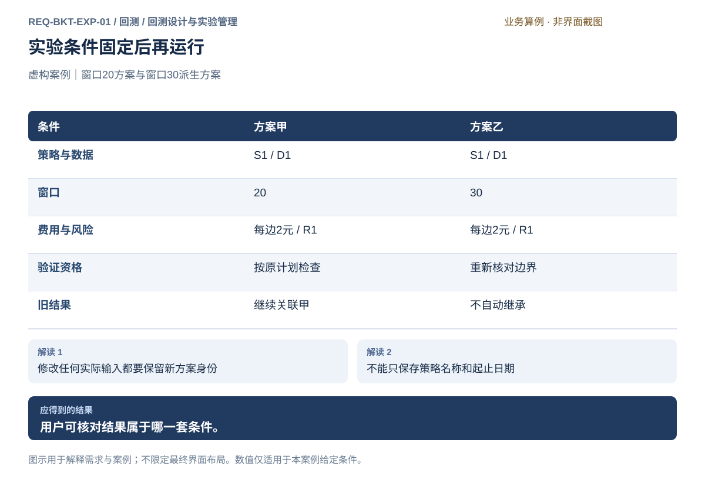
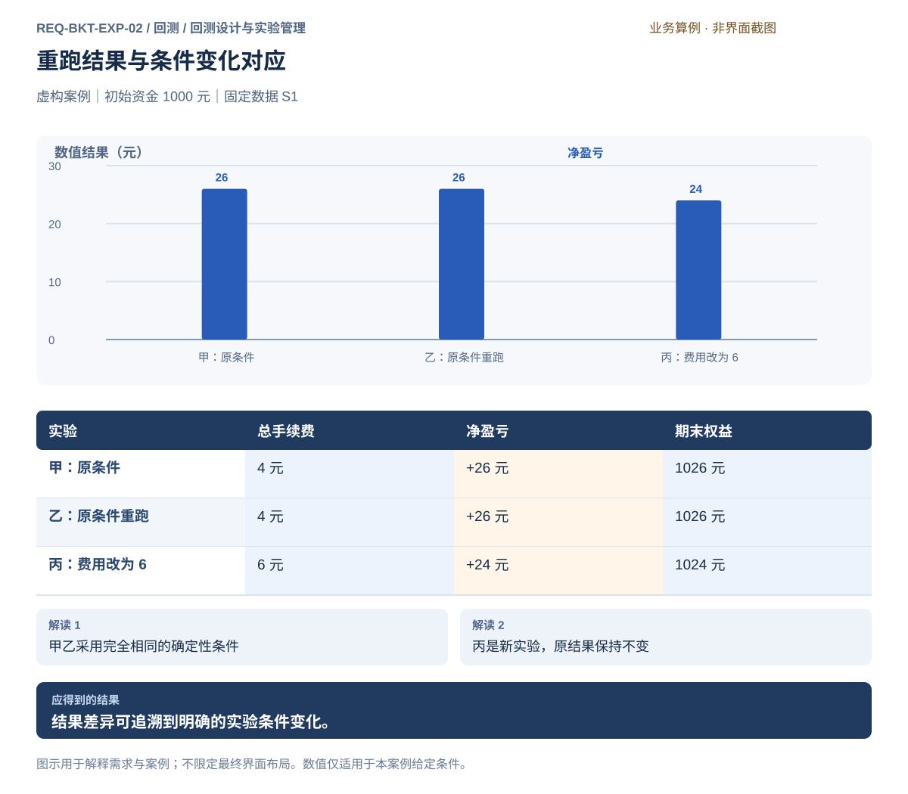
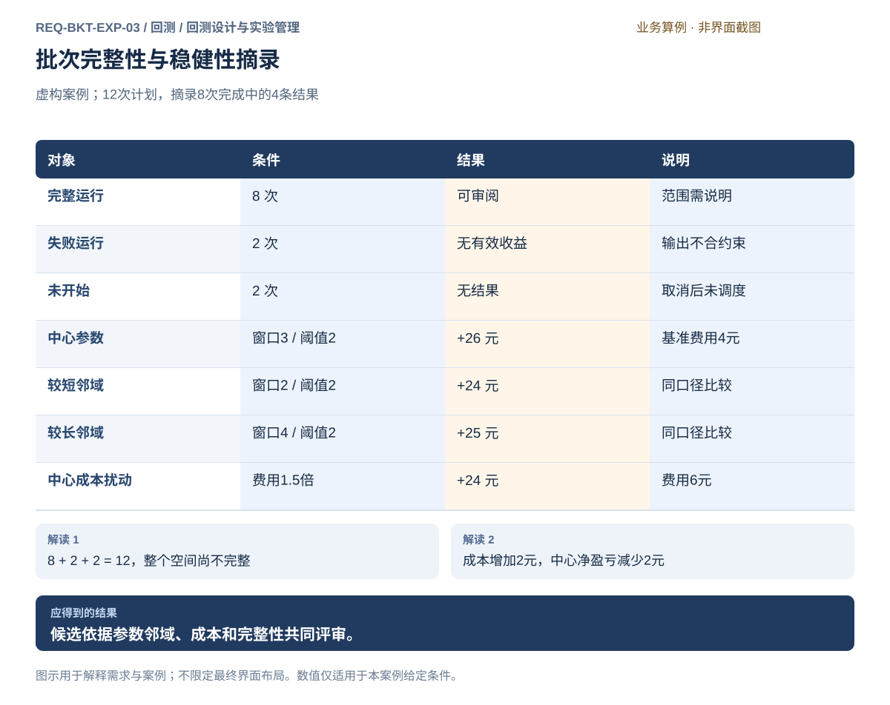
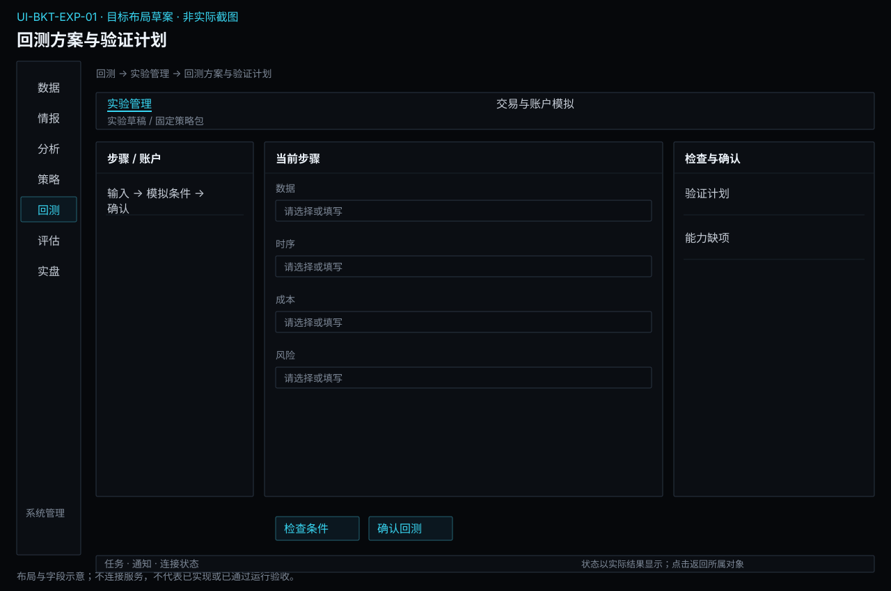
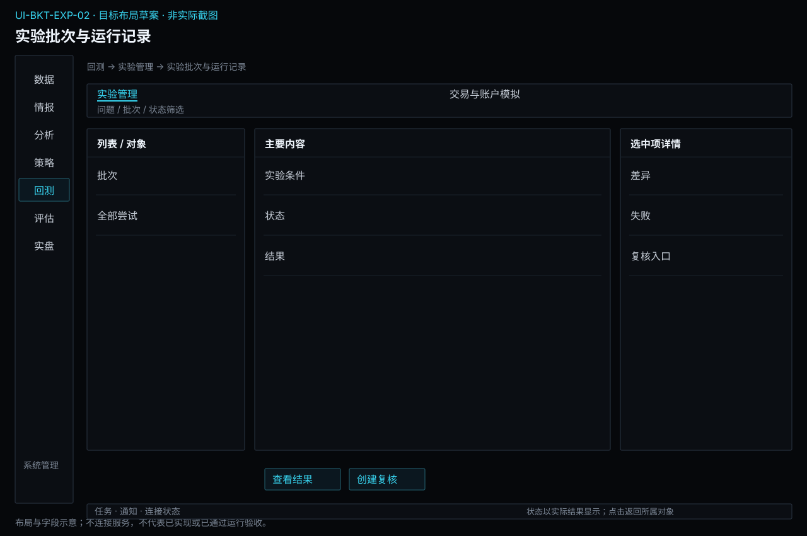

# 回测设计与实验管理

[返回上级](README.md) · [需求总纲](../../README.md) · [实际界面](../../common/screens.md) · [跨模块流程](../../workflows/README.md)

需求交付版 · 2026-10-18。细化规格已编制，用户逐项签认与产品验收分别记录；目标设计不代表已经实现，实际入口与差距见本页界面对应。

**归属：** 回测 / 回测设计与实验管理。本页集中保存业务需求、详细功能、案例、界面对应和验收；通用规则见[通用规范](../../common/README.md)。

## 需求导航

- [REQ-BKT-EXP-01 固定回测输入、模拟条件与验证计划](#req-bkt-exp-01)
- [REQ-BKT-EXP-02 运行回测并保留可复核的实验条件与结果](#req-bkt-exp-02)
- [REQ-BKT-EXP-03 组织有限批量实验并保留完整尝试记录](#req-bkt-exp-03)

## 目标与职责

把研究问题转为固定实验条件，管理一次或一批运行。评估提出评价问题、方法和选择准则；本页将其落实为固定执行计划（区间、参数、折次和运行清单），互相引用，不在看过结果后覆盖原计划。历史模拟细则见[交易与账户模拟](simulation.md)，结论见[独立评估](../evaluation/validation.md)。

## 对象与字段

| 对象           | 必需内容                                                        | 生命周期与限制                                           |
| -------------- | --------------------------------------------------------------- | -------------------------------------------------------- |
| 方案草稿       | 名称、研究问题、固定策略/数据引用、实际参数、范围与区间         | 可编辑；变更后原检查失效；保存不启动                     |
| 模拟条件       | 事件顺序、预热、成交、费用、保证金、必要风险、换月、期末处置    | 事实与假设分别标识，单位和历史生效范围明确               |
| 验证计划       | 训练/开发验证/最终留出、滚动窗口、标签成熟、指标与选择准则      | 参数选择权限和信息使用历史可见；计划改变新建实验         |
| 批次清单       | 参数组合、情景、折次、随机重复用途、预算和排除原因              | 提交前展开；清单与数量固定，不能静默增减                 |
| 运行记录       | 独立身份、固定输入、环境/插件内容身份、随机条件、阶段与结果引用 | 原条件重跑也产生独立记录；无必要性不新增内部格式版本计数 |
| 尝试与选择记录 | 看到的结果、选择理由、候选内容、前后决定和时间                  | 保留未选、失败与取消；评估模块读取同一记录               |

## 正常操作

1. 从固定策略包创建方案，选择已发布数据快照；依赖缺失时定位数据或策略入口。
2. 确认历史合约范围、回测和预热区间，检查可得时间、真实月份及数据精度。
3. 设置成交和账户假设，检查费用/保证金覆盖；绑定必要风险配置和可用插件。
4. 先安排训练与留出、模型可用时点及评价规则，再开始参数选择。跨界标签按实际依赖排除，不能套任意固定隔离天数。
5. 预览全部运行：参数组合 × 情景 × 滚动折 × 明确重复次数。训练任务与回测次数分列，避免漏算资源。
6. 审阅缺项、假设和预算后提交；观察逐次状态与真实阶段。选择完整或明确标识的阶段结果进入评价。
7. 补跑、改参、换数据均派生新记录；原条件不可访问时说明不能复现，不静默下载最新资料。

## 状态与失败处理

| 状态/事件             | 用户看到什么                     | 允许的下一步                             |
| --------------------- | -------------------------------- | ---------------------------------------- |
| 草稿未检查或条件改变  | 定位缺项或过期检查               | 编辑、保存、重新检查；不可直接运行       |
| 缺风险能力/数据不支持 | 缺失对象和原因                   | 修正后重新确认，不提供绕过执行           |
| 提交结果未知          | 原提交身份和核实状态             | 查询原请求；禁止通过重复提交猜测结果     |
| 排队/运行             | 阶段、已知进度与资源消耗         | 观察或请求取消；不能编辑实际输入         |
| 取消请求已发          | 正在确认实际停止，已完成结果保留 | 等待终态，不能把按钮点击当已停止         |
| 部分成功              | 所有候选状态与完整性合计         | 审阅完整项；明确未完成范围，新建补跑草稿 |
| 原条件重跑            | 旧记录与新运行分开               | 对照输入与结果差异，不覆盖旧证据         |

## 界面与交接设计

方案页采用现有分步表单风格；步骤中固定显示“数据/策略、时间与验证、模拟与风险、审阅提交”。时间线呈现训练、预热、标签结束、模型可用、验证边界，表格提供精确日期，不能仅靠颜色解释。批次页以逐项表格和详情为主，展示计划数量、完成/失败/未开始及总数核对；成本敏感性结论跳转评价页，不在批次页另存一份。

所有回测子模块沿用[通用交互](../../common/interaction.md)的语言、键盘、焦点和不透明下拉规范。保存、检查、提交、取消与重跑动作分开；业务状态和错误以文字表达，不只靠颜色。数字缺失、有效零和不适用分别显示。

## 固定模拟账户约束

在实验方案内配置必要账户限制、指标口径、触发/恢复行为和风险插件；引用[共用交易约束](../../product.md#execution-risk-semantics)中的规则定义。策略约束与模拟账户限制分别展示，参数与实盘不同允许存在但必须显式说明，不能为了得到好结果隐去拒绝。模拟条件完整后仍检查数据与其他依赖；不使用真实交易授权作为模拟运行前提。

## REQ-BKT-EXP-01 固定回测输入、模拟条件与验证计划

**领域：** 回测 / 回测设计与实验管理　 **建议优先级：** P0安全必要　 **需求状态：** 交付规格已编制（源自已确认定位；细节待用户签认）

### 目标与场景

将固定策略包、数据、历史规则、成交与账户假设、风险条件和验证安排组成可审阅的实验方案；运行前说明可模拟范围及证据限制。

**使用者与场景：** 个人研究用户，在创建新回测或修改策略参数时。

**触发条件：** 用户提交策略和准备评估的参数组合。

### 前置条件

- 已有策略模块交付的固定策略包，决策输入、参数与状态约定明确。
- 数据、合约规则和必要风险配置已准备，所需风险能力可用；未知成本有待确认状态。

### 输入与含义

| 输入                 | 含义与单位                                                 | 约束                                                                       |
| -------------------- | ---------------------------------------------------------- | -------------------------------------------------------------------------- |
| 固定策略包与实际参数 | 逻辑、模型、组合政策、事件和状态的固定引用及本次参数取值。 | 决策时间和输入可得性明确；参数搜索记录每次实际配置，不覆盖输入包。         |
| 成本与成交假设       | 手续费、滑点、保证金及成交限制的单位和适用范围。           | 区分来源事实和用户假设；缺失费用不能默认为零。                             |
| 资金与风险           | 初始资金、仓位上限和需要执行的风险条件。                   | 必须显式配置且所需风险能力可用；缺少配置或能力不可用时，拒绝执行任何回测。 |
| 固定数据与验证计划   | 快照、可得时点、预热、训练、验证、留出和滚动窗口。         | 计划绑定实际数据与决策依赖，时间划分不自动证明独立。                       |

### 正常操作与反馈

1. 选择固定策略包、实际参数、数据快照和真实合约范围。
2. 设定回测与预热区间，核对信号数据和成交数据的精度与覆盖。
3. 选择已定义的成交、费用、保证金、换月及必要风险规则，展开各自依据和生效范围。
4. 安排训练、开发验证、最终留出和滚动窗口，确认选择准则及信息使用状态。
5. 审阅完整条件，缺项定位后补齐；有效方案提交给实验管理，不在编辑中自动运行。

### 业务规则

- 使用收盘数据的决策不能默认在同一收盘前成交。
- 成交费用须按声明的单边、双边、每手或比例口径计算。
- 限价、流动性与涨跌停等约束的建模范围必须可见，不宣称精确还原市场队列。
- 风险拒绝、减仓、停止和资金不足应产生可解释结果；不能静默跳过限制。
- 样本退出不能静默抹去已有模拟持仓，持仓处置须由策略规则决定。
- 换月记录应说明旧月份、新月份、切换时点和交易成本归属。
- 运行使用固定输入；资料更新和草稿编辑不能改变已提交条件。
- 模型训练和特征拟合仅使用各时点已可得资料；已有全期模型不能回用于更早区间。
- 评价问题、方法和准则引用评估定义；本模块固定具体执行区间、参数与运行清单，不另维护可冲突的评价结论。

### 输出与状态影响

- 固定实验方案与依赖清单。
- 运行资格、能力缺口和验证计划。

### 异常与继续方式

| 发生什么                                       | 应怎样表现                                                 | 使用者如何继续                                         |
| ---------------------------------------------- | ---------------------------------------------------------- | ------------------------------------------------------ |
| 所选区间手续费单位未知，且用户未提供显式假设。 | 阻止回测并指出缺失日期和单位。                             | 用户补充可靠费用资料或明确记录研究假设后重新确认。     |
| 策略提出的模拟委托超过已配置仓位或资金限制。   | 拒绝该模拟委托并记录原因，不静默改小手数冒充原目标已执行。 | 用户根据风险条件调整策略，或显式修改限制并建立新实验。 |

### 案例：一个方案固定四类条件

**虚构案例条件：** 虚构案例：策略包 S1、数据快照 D1、参数窗口20。回测区间分为训练段T1～T60和留出段T61～T80；另有足够的此前预热数据。费用假设每边每手2元，风险配置R1可用。

1. 冻结参数、数据、时段、模拟规则和风险条件。
2. 把窗口20改为30时保存新方案，重新检查预热和验证边界。

**预期结果：**

- 原方案与运行引用仍为窗口20。
- 新方案不继承旧方案的验证结论，只有新检查通过才能提交。

### 可观察验收条件

| 编号                | 给定                                     | 当               | 则                                                 |
| ------------------- | ---------------------------------------- | ---------------- | -------------------------------------------------- |
| REQ-BKT-EXP-01-AC01 | 固定方案窗口20已用于运行。               | 用户改为窗口30。 | 生成新方案，原条件与证据保持；新方案需重新检查。   |
| REQ-BKT-EXP-01-AC02 | 风险配置缺失或必要风险能力不可用。       | 用户提交回测。   | 拒绝执行，模拟不要求实盘授权但不能绕过风险。       |
| REQ-BKT-EXP-01-AC03 | 验证标签跨越训练截止或模型使用未来资料。 | 检查验证计划。   | 指出具体区间与依赖，阻止作为有效独立验证方案提交。 |

### 决定与配置约束

- **DEC-BKT-EXP-01-01**：**规格决定**。交付1分钟及日线驱动，下一根可观察边界生效、保守K线撮合、有限参与率；历史规则须有生效区间，缺证据只能显式使用研究假设，不声称复原真实成交。

- **DEC-BKT-EXP-01-02**：**运行配置**。支持固定留出与滚动前推；训练/验证区间、清除隔离、窗口及预算由用户事前填写，无隐式最优默认，提交前显示全部试验范围。

- **DEC-BKT-EXP-01-03**：**规格决定**。消费固定规则/模型/混合包及有限状态初始化；训练仅按固定计划在训练窗口执行，目的环境必须声明相同算子、算法及输入语义，不支持即拒绝。

### 详细功能

### FR-BKT-EXP-01-01 选择固定策略包并核对参数与依赖

**目标与结果：** 使每次回测引用策略模块交付的明确内容，避免回测内部再维护一套策略定义。

**触发：** 新建回测时选择策略包。

**输入与约束：** 固定策略包、参数方案、输入能力和依赖清单；需要改变逻辑或模型时返回策略模块派生候选。

**目标操作与反馈：**

1. 选择固定策略包，查看规则、模型、组合政策和参数。
2. 核对回测环境是否具备所需能力。
3. 保存策略包引用，再配置历史数据、成交、费用和风险条件。

**异常与边界：**

- 缺少必要依赖时阻止运行，不自动换成同名策略。
- 回测中的参数搜索产生独立参数配置；选中后通过策略管理固定成候选，不能覆盖输入包。

**验收条件：**

- **FR-BKT-EXP-01-01-AC01**：重新打开回测能定位固定逻辑、模型和参数。
- **FR-BKT-EXP-01-01-AC02**：策略模块创建新候选后原回测仍引用原包。

**界面对应：** [UI-BKT-EXP-01 回测方案与验证计划](#ui-bkt-exp-01)。

### FR-BKT-EXP-01-02 配置必要风控并确认运行资格

**目标与结果：** 所有回测都必须在明确风险条件和可用风险能力下执行。

**触发：** 资金风控区域填写条件后点击检查输入。

**输入与约束：** 初始资金、仓位或资金限制、风险判断及失败处置；模拟无需真实交易授权。 固定实际规则内容、参数与风险插件身份，复用共用规则定义；参数与实盘不同须显式说明。

**目标操作与反馈：**

1. 填写必要风险参数并核对金额单位。
2. 检查风险能力是否可用及策略目标是否满足条件。
3. 查看通过项与阻止项，只有满足必要条件才可进入运行审阅。

**异常与边界：**

- 缺配置或风险能力不可用时拒绝任何回测，不能切换试跑绕过。
- 超过限制的模拟委托记录拒绝原因，不静默缩量冒称原目标成交。

**验收条件：**

- **FR-BKT-EXP-01-02-AC01**：风险条件不全时开始回测禁用且列出可定位缺项。
- **FR-BKT-EXP-01-02-AC02**：完整风险条件下模拟回测不要求账户实盘授权。
- **FR-BKT-EXP-01-02-AC03**：即使策略已声明仓位预算，缺模拟账户风险配置或所需插件仍拒绝回测；不要求到独立风控页面补配置。

**界面对应：** [UI-BKT-EXP-01 回测方案与验证计划](#ui-bkt-exp-01)。

### FR-BKT-EXP-01-03 安排训练留出与滚动验证

**目标与结果：** 在运行前明确哪些资料可选参、哪些用于独立检验。

**触发：** 回测方案中编辑验证计划。

**输入与约束：** 时间区间、预热、预测跨度、滚动步长及选优准则；阈值和边界由用户确认。

**目标操作与反馈：**

1. 标出训练和验证区间并查看时间关系。
2. 检查预热、标签跨界及重叠处理。
3. 保存固定验证计划，带入回测草稿；特征与标签定义仍引用分析模块。

**异常与边界：**

- 训练验证泄漏或时间倒置时阻止保存为有效验证计划。
- 滚动验证重复日期不得在汇总中重复计为独立收益。
- 取消计划编辑保留原已确认计划，不改写已有实验。

**验收条件：**

- **FR-BKT-EXP-01-03-AC01**：时间线能显示训练、预热与每轮验证边界。
- **FR-BKT-EXP-01-03-AC02**：计划变更后新实验采用新条件，原计划仍可查。

**界面对应：** [UI-BKT-EXP-01 回测方案与验证计划](#ui-bkt-exp-01)；[UI-ANA-FTR-01 特征与因子定义及计算](../analysis/features.md#ui-ana-ftr-01)。

### FR-BKT-EXP-01-04 核对数据覆盖并固定完整实验方案

**目标与结果：** 使每个结果关联可复现条件及可模拟能力。

**触发：** 点击检查方案或提交。

**输入与约束：** 固定数据、策略和参数、预热、样本、历史规则、模拟模型、风险、随机条件及运行环境身份。

**目标操作与反馈：**

1. 展开实际输入清单及覆盖缺口。
2. 区分来源事实、显式假设和不支持能力。
3. 全部必要条件满足后固定方案并创建独立运行。

**异常与边界：**

- 禁止自动使用最新数据、同名模型或零费用替代缺项。
- 输入改变不能复用原确认；有随机性时保存种子及非确定性限制。

**验收条件：**

- **FR-BKT-EXP-01-04-AC01**：数据D1更新为D2不改变已提交D1实验。
- **FR-BKT-EXP-01-04-AC02**：分钟数据不足以支持逐笔排队时，能力不匹配明确阻止该模型运行。

**界面对应：** [UI-BKT-EXP-01 回测方案与验证计划](#ui-bkt-exp-01)。

### FR-BKT-EXP-01-05 事前固定模拟能力与不可识别的成交假设

**来源与确认：** 2026-10-18全面审查及用户授权补充；详细行为草案待评审，未实现、未执行产品验收。

**目标与结果：** 结果明确受哪些历史信息和模拟假设约束，无法识别的路径不伪装成事实。

**触发：** 配置回测交易模拟条件。

**输入与约束：** 支持的订单类型、触发/成交时序、数据粒度、可用量、费用结算、换月、期末处置及必要风险。

**目标操作与反馈：**

1. 显示支持矩阵与所选数据能观察到的事实；逐项配置不可直接观察部分的明确假设。
2. 预检策略输出是否在支持范围，标明不支持操作及发生位置。
3. 将假设固定到实验结果；改变假设产生独立试验，交评估做敏感性比较。

**异常与边界：**

- 同根K线先后触发顺序不可由OHLC证明；没有事前约定不能按最优路径处理。
- 策略请求不支持订单时明确失败，不能静默转换市价单或丢弃。

**操作案例：** 分钟最高与最低都触及阈值，选择已支持且明确展示的处理假设后运行；不得将推定顺序标为真实逐笔顺序。

**验收条件：**

- **FR-BKT-EXP-01-05-AC01**：同根同时触及止盈止损且未定义处理约定时实验不能开始，已有草稿保留。
- **FR-BKT-EXP-01-05-AC02**：结果报告能查看实际采用的区间内路径假设和不确定性。

**界面对应：** [UI-BKT-EXP-01](#ui-bkt-exp-01)；[UI-BKT-SIM-01](simulation.md#ui-bkt-sim-01)。

## REQ-BKT-EXP-02 运行回测并保留可复核的实验条件与结果

**领域：** 回测 / 回测设计与实验管理　 **建议优先级：** P1核心必要　 **需求状态：** 交付规格已编制（源自已确认定位；细节待用户签认）

### 目标与场景

用户能够启动、观察和取消回测，并知道结果对应的确切输入与假设。重复运行应能解释结果一致或差异的原因，失败与取消不能伪装成完整实验。

**使用者与场景：** 个人研究用户，运行单次回测或复核先前研究结果时。

**触发条件：** 已确认的实验条件被提交执行，或用户选择按原条件重新验证。

### 前置条件

- 输入数据、策略定义、参数、成本和风险条件已经明确。
- 所需数据可访问且符合实验输入条件，运行资源可用性得到检查。

### 输入与含义

| 输入         | 含义与单位                                 | 约束                                                 |
| ------------ | ------------------------------------------ | ---------------------------------------------------- |
| 固定实验条件 | 数据状态、策略内容、参数、假设和评价范围。 | 运行开始后不随外部资料或编辑操作静默改变。           |
| 随机性说明   | 策略或评价是否使用随机过程及其固定条件。   | 有随机性时记录可复核条件，无法保证确定性时明确解释。 |
| 运行控制     | 用户提交、取消或显式重新运行的意图。       | 重新运行产生独立记录，不覆盖原结果。                 |

### 正常操作与反馈

1. 用户确认实验条件并启动，得到独立运行记录。
2. 系统报告等待、运行、完成、失败或取消状态及已知进度。
3. 用户可以请求取消并看到实际停止结果。
4. 成功完成后查看固定输入说明、结果摘要与详细交易记录。
5. 需要复核时选择原条件或明确修改条件，比较独立运行的差异。

### 业务规则

- 完整结果只在运行成功且结果可读取时成立；部分结果须明确其终止位置。
- 输入缺失或不一致不得以新数据替代而继续声称原条件复现。
- 相同确定性条件应得到相同业务结果；数值容差若必要须事先定义。
- 取消和失败不删除已保存实验记录，后续重跑不掩盖原失败原因。

### 输出与状态影响

- 可观察的运行状态、失败原因或取消结果。
- 绑定固定条件的完整结果及独立重跑记录。

### 异常与继续方式

| 发生什么                     | 应怎样表现                                                         | 使用者如何继续                                           |
| ---------------------------- | ------------------------------------------------------------------ | -------------------------------------------------------- |
| 复核所需的原数据已不可访问。 | 明确说明无法按原条件复现，不自动下载不同内容替代。                 | 用户重新取得并核对原证据，或明确改用新数据建立不同实验。 |
| 执行中断，尚未形成完整结果。 | 记录中断位置和已知原因，不把部分计算显示为成功，也不自动重新运行。 | 用户排除中断原因后显式创建独立重跑，原运行记录保留。     |

### 案例：相同条件重跑与修改条件分开记录

**虚构案例条件：** 虚构案例：示例合约 A 的确定性策略使用固定数据 S1，初始资金 1000 元，无资金出入。实验甲净盈亏 26 元；实验乙保持全部条件；实验丙只把总手续费由 4 元改为 6 元，毛盈亏仍为 30 元。

1. 甲与乙各自完成，记录条件一致。
2. 丙作为新实验运行，记录费用变更。

**预期结果：**

- 甲、乙期末权益均为 1026 元。
- 丙净盈亏 24 元、期末权益 1024 元；差异可解释为费用增加 2 元。

### 可观察验收条件

| 编号                | 给定                       | 当                   | 则                                                             |
| ------------------- | -------------------------- | -------------------- | -------------------------------------------------------------- |
| REQ-BKT-EXP-02-AC01 | 甲和乙确定性条件完全相同。 | 两次成功运行。       | 案例业务结果均为净盈亏 26 元、期末权益 1026 元，运行记录独立。 |
| REQ-BKT-EXP-02-AC02 | 丙仅增加 2 元手续费。      | 比较结果。           | 净盈亏降为 24 元、期末权益 1024 元，并可找到费用差异。         |
| REQ-BKT-EXP-02-AC03 | 回测尚未完成。             | 用户取消且停止成功。 | 状态为已取消，不能显示为完整成功结果；原运行记录仍可查看。     |

### 决定与配置约束

- **DEC-BKT-EXP-02-01**：**规格决定**。相同确定性输入的事件、订单和Decimal账本精确相等；分析浮点结果采用绝对误差1e-10加相对误差1e-8的比较规格，数值不稳定方法另显式声明。非确定性训练固定种子及环境并报告分布，不能以均值相近掩盖账本差异。

- **DEC-BKT-EXP-02-02**：**规格决定**。保留固定输入身份/内容摘要、策略与参数、费用风险规则、全部尝试、事件订单成交和资金流水、状态/限制及方法环境；导出依权限按范围选择，秘密排除。

### 详细功能

### FR-BKT-EXP-02-01 审阅固定条件并提交独立回测

**目标与结果：** 在运行前形成可复核的明确条件，避免误用正在变化的草稿。

**触发：** 配置检查通过后点击审阅并运行。

**输入与约束：** 数据身份、策略内容、参数、成本、风险、随机性条件与区间；任何修改需重新核对。 运行位置须明确选择；切换资源后重新检查必要依赖。

**目标操作与反馈：**

1. 展开完整条件摘要，核对与研究计划的关系。
2. 确认提交，得到唯一运行记录和实际接受状态。
3. 可进入任务中心或留在配置页查看该次运行。

**异常与边界：**

- 重复点击不新建重复请求；网络未知时先查该次状态，不自动重发。
- 提交失败保留草稿及原因，不显示虚假的运行成功。

**验收条件：**

- **FR-BKT-EXP-02-01-AC01**：运行记录包含被确认的条件，而非后续编辑的值。
- **FR-BKT-EXP-02-01-AC02**：开始后修改草稿只能用于新实验，不能改动正在运行的条件。

**界面对应：** [UI-BKT-EXP-02 实验批次与运行记录](#ui-bkt-exp-02)；[UI-BKT-EXP-01 回测方案与验证计划](#ui-bkt-exp-01)；[UI-SYS-RUN-02 任务中心](../system/tasks-nodes.md#ui-sys-run-02)；[UI-SYS-RUN-03 运行资源](../system/tasks-nodes.md#ui-sys-run-03)。

### FR-BKT-EXP-02-02 观察执行并显式取消回测

**目标与结果：** 用户能区分等待、计算、取消中和最终结果，离开页面不会丢失任务。

**触发：** 回测详情点击查看进度或请求取消。

**输入与约束：** 具体运行身份；进度只有可靠依据时展示百分比。

**目标操作与反馈：**

1. 查看当前阶段和已处理范围。
2. 需要停止时点击取消，看到请求已受理或不可取消原因。
3. 等待终态，查看已取消、完成或失败及保留资料。

**异常与边界：**

- 取消请求遇到已完成则显示实际完成，不伪写取消成功。
- 关闭已安装应用窗口不自动停止后台运行，返回后可继续查看。

**验收条件：**

- **FR-BKT-EXP-02-02-AC01**：运行中离开页面后任务中心仍可定位该实验。
- **FR-BKT-EXP-02-02-AC02**：取消终态不能显示完整成功绩效，原运行和原因保留。

**界面对应：** [UI-BKT-EXP-02 实验批次与运行记录](#ui-bkt-exp-02)；[UI-SYS-RUN-02 任务中心](../system/tasks-nodes.md#ui-sys-run-02)；[UI-EVA-PER-01 绩效与收益归因](../evaluation/performance.md#ui-eva-per-01)。

### FR-BKT-EXP-02-03 保存完整结果及可复核证据

**目标与结果：** 使用户确认结果确实完成并知道复核需要哪些资料。

**触发：** 回测完成后进入结果分析并查看实验条件。

**输入与约束：** 结果、固定条件、执行说明与资料可用性；不把摘要导出当独立复现包。

**目标操作与反馈：**

1. 确认结果完整性及终止范围。
2. 查看输入、定义、参数、成本和风险摘要。
3. 选择导出说明与证据，明确包含和不包含的内容。

**异常与边界：**

- 结果读取失败时保留实验身份，不展示缓存旧结果冒充本次。
- 部分结果显式标注边界，不能导出为完整成功报告。

**验收条件：**

- **FR-BKT-EXP-02-03-AC01**：结果页可核对原输入身份与最终账户结果。
- **FR-BKT-EXP-02-03-AC02**：导出预览明确是否含原始数据、计算定义和执行资料。

**界面对应：** [UI-BKT-EXP-02 实验批次与运行记录](#ui-bkt-exp-02)；[UI-EVA-PER-01 绩效与收益归因](../evaluation/performance.md#ui-eva-per-01)；[UI-SYS-REC-03 导出资料](../system/records.md#ui-sys-rec-03)。

### FR-BKT-EXP-02-04 按原条件重跑或派生新实验

**目标与结果：** 把复核与修改参数的探索分开，保留结果差异的来由。

**触发：** 结果页点击原条件重跑或派生新实验。

**输入与约束：** 原实验及其数据、定义和参数可用性；新快照或新参数需显式选择。

**目标操作与反馈：**

1. 选择原条件或修改条件模式。
2. 核对原资料可访问性及变更摘要。
3. 提交独立新运行，完成后比较原实验与新结果。

**异常与边界：**

- 原资料缺失时拒绝声称原条件复现，不偷换为最新数据。
- 失败重跑也保留原记录；有随机性时说明重现条件。

**验收条件：**

- **FR-BKT-EXP-02-04-AC01**：案例原条件两次均为净26元、期末1026元且记录独立。
- **FR-BKT-EXP-02-04-AC02**：总费改为6元时新结果净24元、期末1024元并显示费用差异。

**界面对应：** [UI-BKT-EXP-02 实验批次与运行记录](#ui-bkt-exp-02)；[UI-EVA-PER-01 绩效与收益归因](../evaluation/performance.md#ui-eva-per-01)；[UI-BKT-EXP-01 回测方案与验证计划](#ui-bkt-exp-01)；[UI-EVA-VAL-01 稳健性与综合评价](../evaluation/validation.md#ui-eva-val-01)。

### FR-BKT-EXP-02-05 复核固定实验并辨认不可重复部分

**来源与确认：** 2026-10-18全面审查及用户授权补充；详细行为草案待评审，未实现、未执行产品验收。

**目标与结果：** 研究者能区分相同条件的复算与改变条件的新研究，随机过程被如实说明。

**触发：** 从完成或中断实验选择复核。

**输入与约束：** 完整固定输入、策略、规则和算法身份、随机状态/种子（适用时）、运行环境及输出精度约定。

**目标操作与反馈：**

1. 检查固定依赖可访问性及受支持结构，列出复核所需能力。
2. 用户明确创建独立复核运行，保存原记录；逐项比较信号、订单、账本与汇总结果。
3. 输出一致、存在差异或不可判定及证据；不能保证确定性的过程明确范围，不伪造完全复现结论。

**异常与边界：**

- 缺依赖或损坏文件明确拒绝，不自动下载最新替代或转换旧内容。
- 随机种子相同不单独证明环境与输入相同；LLM原始输出作为固定输入引用。

**操作案例：** 复核任务发现缺原费用规则，显示不可复核并定位依赖，不以当前规则覆盖原结果。

**验收条件：**

- **FR-BKT-EXP-02-05-AC01**：固定确定性样例复核得到相同订单和账本事实；差异能够定位首个分歧事件。
- **FR-BKT-EXP-02-05-AC02**：缺少原模型时复核拒绝而原结果可按已有事实查看。

**界面对应：** [UI-BKT-EXP-02](#ui-bkt-exp-02)；[UI-BKT-SIM-01](simulation.md#ui-bkt-sim-01)。

## REQ-BKT-EXP-03 组织有限批量实验并保留完整尝试记录

**领域：** 回测 / 回测设计与实验管理　 **建议优先级：** P1核心必要　 **需求状态：** 交付规格已编制（源自已确认定位；细节待用户签认）

### 目标与场景

明确参数、情景、折数及随机重复产生的总运行次数，控制预算并保留逐项状态，为绩效与稳健性验证提供完整证据。

**使用者与场景：** 研究规则策略或多因子方案的个人使用者，在比较参数、检查成本敏感性与准备独立验证时。

**触发条件：** 使用者为已定义逻辑设置多项参数取值，或为已有候选创建稳健性检验计划。

### 前置条件

- 逻辑内容、固定数据、费用、风险条件及训练验证安排已经明确。
- 每个候选回测均具备必要风险配置和可用能力，试验预算及需要确认的外部消耗已说明。

### 输入与含义

| 输入           | 含义与单位                                     | 约束                                                       |
| -------------- | ---------------------------------------------- | ---------------------------------------------------------- |
| 参数空间与情景 | 各参数的有限取值、组合方式及成本扰动幅度       | 明确候选总数、被排除组合和重复条件；不能静默扩大搜索空间。 |
| 运行预算与范围 | 运行次数上限、并行约束及有依据的资源估算       | 估算与实际分开；未知成本不写零，超过确认预算须重新确认。   |
| 评价与选择计划 | 训练选择准则、参数邻域、成本情景与独立验证区间 | 验证信息不得用于先验选优后仍称独立；每轮选择保留所见结果。 |

### 正常操作与反馈

1. 使用者列出参数取值及扰动情景，预览完整候选清单和数量。
2. 系统检查重复条件、非法组合、数据与风险前提，并说明预算依据。
3. 使用者确认范围后提交批次，查看每个候选的排队、运行和结果。
4. 发生局部失败或请求取消时保留各候选实际状态和完整结果，未完成不进入公平排名。
5. 将全部候选、条件与状态交给独立评估模块；修改范围另建批次，不覆盖已提交清单。

### 业务规则

- 参数候选和成本情景的组合数量必须先预览，提交后不随草稿编辑静默变化。
- 同一完整实验条件重复出现时提示合并候选或明确独立重复用途；不把重复结果当独立证据。
- 一个候选失败不抹除其他候选的结果；影响共同前提的失败必须阻止尚不满足条件的运行。
- 取消区分停止新调度、取消请求和实际停止，已完成结果保留，未完成不伪装成功。
- 邻域范围及扰动幅度在审阅结果前声明，缺少相邻点不能宣称已经验证稳健。
- 训练、验证与最终留出信息分别管理；看过验证结果再选优必须记录其参与选择。
- 批次只组织研究，不自动启动策略或交易；风险不可用的候选回测明确拒绝。
- 多个滚动折与随机重复也计入运行规模；不能只统计参数个数。
- 实验管理记录尝试与选择事件；验证子模块解释这些记录对独立性的影响，不另维护冲突的记录副本。

### 输出与状态影响

- 固定清单、预算依据与实际消耗。
- 逐项运行状态、完整性说明和所有尝试记录，供评估模块引用。

### 异常与继续方式

| 发生什么                         | 应怎样表现                                                 | 使用者如何继续                                           |
| -------------------------------- | ---------------------------------------------------------- | -------------------------------------------------------- |
| 一个候选输出不满足定义约束。     | 该候选明确失败并定位原因，其他前提有效的独立候选可继续。   | 保留失败证据，修改内容后另建明确批次，不覆盖原结果。     |
| 取消时仍有候选未开始或正在运行。 | 停止新增调度，运行项等待取消结果，保留已完成项及实际消耗。 | 需要继续时从明确未完成范围建立新草稿，再确认条件与预算。 |

### 案例：十二次计划中的部分结果与稳健性

**虚构案例条件：** 虚构案例：窗口取 2、3、4，阈值取 1、2，共 6 个参数候选；成本情景为基准与 1.5 倍，共 12 次回测。预算上限 12 次；假定每次估算 2 计算分钟，共 24 计算分钟，不是实际耗时承诺。各次风险条件满足。批次停止时 8 次完成、2 次输出约束失败、2 次未开始。 本例完成运行的基准总费用均为4元，扰动为6元；阈值2在窗口2/3/4的毛盈亏分别为28/30/29元，两种成本下共6次完成；窗口3/阈值1毛盈亏24元，两种成本下另2次完成。

1. 查看完整空间与预算后确认批次，记录所有 12 次条件。
2. 完整的阈值2邻域中，窗口2/3/4基准净盈亏分别24/26/25元，1.5倍费用下为22/24/23元。中心毛盈亏30元，基准总费用4元、扰动6元，净盈亏分别26元和24元。窗口3/阈值1的两次完整结果为20元和18元。
3. 用户取消其余工作；窗口2/阈值1的两种成本情景失败，窗口4/阈值1的两种情景未开始。其他完整结果保留，表中仅摘录四条。

**预期结果：**

- 8 完成 + 2 失败 + 2 未开始 = 12，不能称整个空间已经完整验证。
- 中心案例成本增加2元后净盈亏减少2元；邻域和成本结果同时展示，不只展示26元最高值。
- 候选选择记录注明采用了哪些结果，进入另行安排的独立验证而非自动交易。

### 可观察验收条件

| 编号                | 给定                             | 当               | 则                                                                     |
| ------------------- | -------------------------------- | ---------------- | ---------------------------------------------------------------------- |
| REQ-BKT-EXP-03-AC01 | 三个窗口、两个阈值和两个成本情景 | 预览批次         | 显示6个参数候选、12次运行及24计算分钟的案例估算，不将其当实测耗时。    |
| REQ-BKT-EXP-03-AC02 | 八次完成、两次失败、两次未开始   | 查看批次结果     | 总数为12，失败与未开始没有收益数值，也不进入已完成排名。               |
| REQ-BKT-EXP-03-AC03 | 中心毛盈亏30元且费用由4元增至6元 | 比较成本扰动     | 净盈亏由26元变24元，费用口径和差额可核对。                             |
| REQ-BKT-EXP-03-AC04 | 同条件结果已被多次查看并参与重选 | 保存新的选择决定 | 原选择与信息使用记录保留，不能把已参与选择的验证段重新称为未使用证据。 |

### 决定与配置约束

- **DEC-BKT-EXP-03-01**：**规格决定**。有限笛卡尔网格；默认并行1、上限2，默认单批最多100次，超出须拆分明确批次并展示累计尝试。时间预算必填，取消后保留完成/失败/未开始范围。

### 详细功能

### FR-BKT-EXP-03-01 展开参数空间并预览候选数量和预算

**目标与结果：** 批量研究前使用者应看到完整候选及消耗，而不是提交后才发现组合数量扩大。重复条件、非法组合和成本情景单独列明，允许明确收缩范围后重新确认。

**触发：** 量化逻辑或回测草稿进入批量实验，填写参数取值及扰动情景后点击预览。

**输入与约束：** 有限参数取值、组合方式、成本倍率、运行上限和资源估算依据；没有依据的时长或费用为未知，不用零表示。

**目标操作与反馈：**

1. 填写各参数取值和场景，展开逐候选清单。
2. 检查重复与非法条件，查看排除理由及影响数量。
3. 核对运行次数和预算，调整后重新生成预览。

**异常与边界：**

- 六个参数候选乘两个成本场景显示十二次运行，不以单次比较代替批次。
- 范围变化使旧确认失效；超预算不静默截断或扩容。

**验收条件：**

- **FR-BKT-EXP-03-01-AC01**：窗口3值、阈值2值、成本2值准确得到6候选12次运行。
- **FR-BKT-EXP-03-01-AC02**：案例每次估算2计算分钟时合计24计算分钟，并明确非实际耗时。

**界面对应：** [UI-BKT-EXP-02 实验批次与运行记录](#ui-bkt-exp-02)；[UI-BKT-EXP-01 回测方案与验证计划](#ui-bkt-exp-01)。

### FR-BKT-EXP-03-02 提交批次并处理独立失败与取消

**目标与结果：** 使用者一次确认候选范围后，可逐项跟踪执行，区分完整结果、失败和未开始。批次部分成功仍应有使用价值，但不能把未完成候选隐去后宣称全面验证。

**触发：** 批量页预览通过后确认提交，运行中查看候选或请求取消。

**输入与约束：** 固定候选清单、共同数据和风险条件、预算与运行位置；每个回测都须具备风险能力，同次重复点击不重复创建批次。

**目标操作与反馈：**

1. 确认固定清单后提交并查看逐候选状态。
2. 打开失败项定位错误，其他前提有效的候选继续独立处理。
3. 请求取消后停止新调度，等待运行项确认并核对实际结果。

**异常与边界：**

- 共同风险条件失效时阻止依赖它的后续回测，不只标一条告警。
- 取消结果未确认时保持处理中或待核实，不删除已完成结果。

**验收条件：**

- **FR-BKT-EXP-03-02-AC01**：8完成、2失败、2未开始明确合计12，后两类没有伪造收益。
- **FR-BKT-EXP-03-02-AC02**：提交结果不明时查询原批次，不通过重复提交重新执行同一组。

**界面对应：** [UI-BKT-EXP-02 实验批次与运行记录](#ui-bkt-exp-02)；[UI-SYS-RUN-02 任务中心](../system/tasks-nodes.md#ui-sys-run-02)。

## 界面设计与实际对应

## UI-BKT-EXP-01 回测方案与验证计划

**业务目标：** 固定输入与历史假设，检查通过后提交实验。

**对应情况：部分对应。** 已有三步回测表单；固定策略包、完整历史规则与验证时间线仍待设计。

**实际入口：** 研究 → 回测 → 新建回测

[查看实际界面及对应说明](../../prototype.html#UI-BKT-EXP-01)

- [新建回测：截图、字段和操作](../../common/screens.md#screen-research-new)

### 页面形态与目标布局

**设计状态：** 目标规格已编制，含布局、字段、动作和关键状态；尚未获得逐项产品签认或实现验收。现状对应证据保持上文说明，图稿不是运行截图。

**界面形态：** 分步表单或账户操作区。

**目标到达路径：** 回测 → 实验管理 → 回测方案与验证计划。这是已确认导航下的目标入口，实际对应仍见上方证据。

| 区域 | 要显示的内容 |
| --- | --- |
| 顶部上下文 | 实验草稿 / 固定策略包 |
| 列表、分类或步骤区 | 输入 → 模拟条件 → 确认 |
| 主要工作区 | 数据 / 时序 / 成本 / 风险 |
| 选中项详情或检查区 | 验证计划 / 能力缺项 |
| 主要动作区 | 检查条件 / 确认回测 |

**区域联动与返回：** 选择列表或步骤只更新当前对象及详情，不隐式启动业务；图表与明细使用同一输入或结果上下文。离开并返回保留已确认的对象和查询条件，未保存草稿按本页保存语义处理。异步提交后用请求/任务身份定位实际状态，不能把操作按钮点击当作成功。

**窗口与空间：** 复用现有主窗口框架。宽度缩小时优先收拢辅助详情，表格在内容区横向滚动；主操作和关键上下文不能被页面裁切。重新展开详情仍指向原选中对象。

**状态设计范围：** 以本页状态/异常和验收为准，正常操作、首次无对象、筛选无匹配、请求中、失败及该业务的未知状态分别说明；不适用状态需说明原因，不套用虚构成功数据。字段类型、默认值和动作前提见下文；关键状态按本页交付约定及模块状态图检查。[返回界面设计总览](../../common/ui-designs.md)。

### 目标交互设计（待实现）

沿用现有Terminal的视觉、表格、详情和错误反馈规范。实际截图保持原样；以下区域、字段和动作是目标交互规格，须实现后验收。

**字段与信息：**

- 顶部：方案名称、固定策略包、实际参数、数据快照及引用状态。
- 左侧步骤：输入与区间、成交与账户、必要风险、验证计划、提交审阅。
- 主区：合约范围、预热、训练/验证/留出时间线、模型可用条件、费用/保证金/期末规则。
- 侧栏：覆盖缺口、假设与来源、能力限制；底部：检查结果和实际运行数量。
- 固定模拟风险规则、参数、插件可用性及与目标实盘条件的差异。

**动作与反馈：**

- 保存草稿；字段改变标为未检查。
- 检查方案并跳转到具体缺项。
- 有效方案提交一次；提交结果不明时查询原请求。
- 打开依赖只读详情；修改策略返回策略模块派生。
- 在实验内配置并检查必要风险条件，无须独立风控模块。

**状态与异常：**

- 空态：先选择固定策略与数据。
- 缺依赖或无风险能力：提交禁用并定位原因。
- 草稿有效：可提交；已提交：条件只读，修改新建方案。
- 提交结果未明：显示核实中，不以重试按钮重复创建。

### 业务验收要求（待验收，不代表截图已证明实现）

- **UI-BKT-EXP-01-AC01**：D1或窗口20被修改时不回写既有结果。
- **UI-BKT-EXP-01-AC02**：缺风险配置/能力拒绝；费用未知不默认为零。
- **UI-BKT-EXP-01-AC03**：预热、标签跨界和训练/留出关系可查看；未来模型不能用于历史预测。

### 字段与操作交付约定

以下补齐页面关键字段的类型、初始值与边界；已有功能条目的输入规则仍适用。进入已有对象时加载实际保存值，新建时未明确给默认的必填项为空，不能借用案例数值。只读缺失统一显示“—”并提供原因。

| 字段组 | 类型与单位 | 初始值、检查及变化影响 |
| --- | --- | --- |
| 固定输入 | 策略包、数据快照、初始资金 | 必选固定身份；人民币、空仓、资金正值 |
| 模拟条件 | 时序/成交/费用/保证金/风险 | 全部必填，有来源或明确研究假设；不支持拒绝 |
| 验证计划 | 留出/滚动、隔离/预算 | 先定计划再运行，范围/总次数确认后提交 |

**操作顺序：** 使用“检查条件 / 确认回测”完成本页任务；先选择固定对象并补齐必填项，再检查范围和影响，最后提交有副作用的动作。查看、筛选和返回不隐式执行业务；保存、发布、启动、授权和撤单各自显示实际结果，不能合并为一个成功提示。

| 关键状态 | 信息与允许操作 | 禁止或返回行为 |
| --- | --- | --- |
| 首次为空或无匹配 | 显示当前固定输入范围，提供创建/补齐或清除筛选入口；只读详情说明来源 | 不填示例数据，不把无权限显示为无记录 |
| 输入错误或前提缺失 | 在“模拟条件”等具体字段旁说明问题，保留其他输入，焦点移至首个错误 | 依赖错误项的动作不可提交，返回不丢草稿 |
| 加载、运行或部分结果 | 保留对象身份和最后可靠时间，展示实际阶段/覆盖；可查看“验证计划”已有证据 | 未完成不能显示全量成功，不能用加载中的空表覆盖已知事实 |
| 失败或结果未知 | 已明确失败可修正输入后独立提交；可能已受理则查询原请求/对象；展示未决范围 | 未核实前不重复有副作用的操作，不把取消页面当取消业务 |
| 离开及返回 | 已保存对象可由原身份重开，未保存编辑提供保存/放弃/留在当前页；关闭抽屉只改变展示 | 即时偏好不套草稿确认；秘密取消后不留普通表单缓存 |

**交互验收案例：** 在本页选择一个有效对象，改变“固定输入”后核对旧预览是否失效；制造“模拟条件”缺项或不可用，确认原因与阻断；补齐后完成主要动作，核对“验证计划”与关联对象结果，再离开返回。只读字段通过隔离测试回复制造状态，不在实际界面篡改业务事实。适用的具体成功结果仍以本页原有案例及AC为准。

关键状态的视觉呈现见[状态设计约定](../../common/ui-designs.md#state-designs)及本模块状态图；状态与动作按本表及关联FR逐项验收，静态图不冒充已执行交互。

### 对应功能需求

- [FR-BKT-EXP-01-01 选择固定策略包并核对参数与依赖](#fr-bkt-exp-01-01)
- [FR-BKT-EXP-01-02 配置必要风控并确认运行资格](#fr-bkt-exp-01-02)
- [FR-BKT-EXP-01-03 安排训练留出与滚动验证](#fr-bkt-exp-01-03)
- [FR-BKT-EXP-01-04 核对数据覆盖并固定完整实验方案](#fr-bkt-exp-01-04)
- [FR-BKT-EXP-01-05 事前固定模拟能力与不可识别的成交假设](#fr-bkt-exp-01-05)
- [FR-BKT-EXP-02-01 审阅固定条件并提交独立回测](#fr-bkt-exp-02-01)
- [FR-BKT-EXP-02-04 按原条件重跑或派生新实验](#fr-bkt-exp-02-04)
- [FR-BKT-EXP-03-01 展开参数空间并预览候选数量和预算](#fr-bkt-exp-03-01)
- [FR-BKT-SIM-01-02 配置决策与模拟成交规则](simulation.md#fr-bkt-sim-01-02)
- [FR-BKT-SIM-01-03 区分连续信号价与实际交易价](simulation.md#fr-bkt-sim-01-03)
- [FR-BKT-SIM-02-03 预览换月日程和无法成交处置](simulation.md#fr-bkt-sim-02-03)
- [FR-BKT-SIM-03-01 配置并核对费用适用口径](simulation.md#fr-bkt-sim-03-01)
- [FR-LIV-RUN-03-02 配置并检查独立模拟验证](../live/operations.md#fr-liv-run-03-02)
- [FR-EVA-RSK-02-02 评估延迟与流动性情景的路径影响](../evaluation/risk.md#fr-eva-rsk-02-02)
- [FR-EVA-VAL-01-05 保留重复试验和选择记录再进入独立验证](../evaluation/validation.md#fr-eva-val-01-05)
- [FR-DAT-SRV-01-02 查询指定日期的生效规则](../data/management.md#fr-dat-srv-01-02)
- [FR-DAT-SRV-02-03 比较数据修订并识别受影响实验](../data/management.md#fr-dat-srv-02-03)
- [FR-DAT-SRV-02-04 固定研究所用快照并核对引用](../data/management.md#fr-dat-srv-02-04)
- [FR-STR-LOG-01-04 固定内容身份并交接可追溯实验引用](../strategy/logic.md#fr-str-log-01-04)

## UI-BKT-EXP-02 实验批次与运行记录

**业务目标：** 预览所有运行，观察状态并保留完整条件。

**对应情况：部分对应。** 已有回测列表与参数入口；统一批次预算、逐候选状态及清单工作台待设计。

**实际入口：** 研究 → 回测 → 新建回测；研究 → 回测

[查看实际界面及对应说明](../../prototype.html#UI-BKT-EXP-02)

- [新建回测：截图、字段和操作](../../common/screens.md#screen-research-new)
- [回测记录：截图、字段和操作](../../common/screens.md#screen-research-backtest)

### 页面形态与目标布局

**设计状态：** 目标规格已编制，含布局、字段、动作和关键状态；尚未获得逐项产品签认或实现验收。现状对应证据保持上文说明，图稿不是运行截图。

**界面形态：** 列表与详情工作区。

**目标到达路径：** 回测 → 实验管理 → 实验批次与运行记录。这是已确认导航下的目标入口，实际对应仍见上方证据。

| 区域 | 要显示的内容 |
| --- | --- |
| 顶部上下文 | 问题 / 批次 / 状态筛选 |
| 列表、分类或步骤区 | 批次 / 全部尝试 |
| 主要工作区 | 实验条件 / 状态 / 结果 |
| 选中项详情或检查区 | 差异 / 失败 / 复核入口 |
| 主要动作区 | 查看结果 / 创建复核 |

**区域联动与返回：** 选择列表或步骤只更新当前对象及详情，不隐式启动业务；图表与明细使用同一输入或结果上下文。离开并返回保留已确认的对象和查询条件，未保存草稿按本页保存语义处理。异步提交后用请求/任务身份定位实际状态，不能把操作按钮点击当作成功。

**窗口与空间：** 复用现有主窗口框架。宽度缩小时优先收拢辅助详情，表格在内容区横向滚动；主操作和关键上下文不能被页面裁切。重新展开详情仍指向原选中对象。

**状态设计范围：** 以本页状态/异常和验收为准，正常操作、首次无对象、筛选无匹配、请求中、失败及该业务的未知状态分别说明；不适用状态需说明原因，不套用虚构成功数据。字段类型、默认值和动作前提见下文；关键状态按本页交付约定及模块状态图检查。[返回界面设计总览](../../common/ui-designs.md)。

### 目标交互设计（待实现）

沿用现有Terminal的视觉、表格、详情和错误反馈规范。实际截图保持原样；以下区域、字段和动作是目标交互规格，须实现后验收。

**字段与信息：**

- 顶部：批次范围、预算上限、已确认清单与实际消耗。
- 主表：参数、情景、折次、重复用途、运行身份、状态、进度、失败原因。
- 详情：固定输入、开始/停止时点、完整/部分结果及关联任务。

**动作与反馈：**

- 展开参数空间与全部运行次数。
- 确认范围后提交；打开单项结果。
- 取消批次并等待各运行终态。
- 从选定失败项创建独立草稿，重新确认后运行。
- 选取完整结果进入绩效与稳健性评审。

**状态与异常：**

- 超过预算：禁止提交，不截断清单。
- 排队/运行：进度没有依据时显示阶段而非虚构百分比。
- 取消处理中：已完成保留，未开始停止调度。
- 部分完成/失败/已停止：各类计数合计一致，未完成不填收益。

### 业务验收要求（待验收，不代表截图已证明实现）

- **UI-BKT-EXP-02-AC01**：3窗口×2阈值×2成本＝12次；预算8则不提交。
- **UI-BKT-EXP-02-AC02**：8完成、2失败、2未开始合计12，未完成收益为不可用。
- **UI-BKT-EXP-02-AC03**：原条件重跑建立独立运行，旧失败原因保持。

### 字段与操作交付约定

以下补齐页面关键字段的类型、初始值与边界；已有功能条目的输入规则仍适用。进入已有对象时加载实际保存值，新建时未明确给默认的必填项为空，不能借用案例数值。只读缺失统一显示“—”并提供原因。

| 字段组 | 类型与单位 | 初始值、检查及变化影响 |
| --- | --- | --- |
| 批次定义 | 有限参数网格、任务上限 | 默认最多100次、并发1且上限2，预算必填 |
| 运行记录 | 尝试身份、条件、阶段、产物 | 只读，失败/取消/未开始均保留 |
| 对比选择 | 固定实验多选 | 条件差异先提示，结果不全不能排名为最优 |

**操作顺序：** 使用“查看结果 / 创建复核”完成本页任务；先选择固定对象并补齐必填项，再检查范围和影响，最后提交有副作用的动作。查看、筛选和返回不隐式执行业务；保存、发布、启动、授权和撤单各自显示实际结果，不能合并为一个成功提示。

| 关键状态 | 信息与允许操作 | 禁止或返回行为 |
| --- | --- | --- |
| 首次为空或无匹配 | 显示当前批次定义范围，提供创建/补齐或清除筛选入口；只读详情说明来源 | 不填示例数据，不把无权限显示为无记录 |
| 输入错误或前提缺失 | 在“运行记录”等具体字段旁说明问题，保留其他输入，焦点移至首个错误 | 依赖错误项的动作不可提交，返回不丢草稿 |
| 加载、运行或部分结果 | 保留对象身份和最后可靠时间，展示实际阶段/覆盖；可查看“对比选择”已有证据 | 未完成不能显示全量成功，不能用加载中的空表覆盖已知事实 |
| 失败或结果未知 | 已明确失败可修正输入后独立提交；可能已受理则查询原请求/对象；展示未决范围 | 未核实前不重复有副作用的操作，不把取消页面当取消业务 |
| 离开及返回 | 已保存对象可由原身份重开，未保存编辑提供保存/放弃/留在当前页；关闭抽屉只改变展示 | 即时偏好不套草稿确认；秘密取消后不留普通表单缓存 |

**交互验收案例：** 在本页选择一个有效对象，改变“批次定义”后核对旧预览是否失效；制造“运行记录”缺项或不可用，确认原因与阻断；补齐后完成主要动作，核对“对比选择”与关联对象结果，再离开返回。只读字段通过隔离测试回复制造状态，不在实际界面篡改业务事实。适用的具体成功结果仍以本页原有案例及AC为准。

关键状态的视觉呈现见[状态设计约定](../../common/ui-designs.md#state-designs)及本模块状态图；状态与动作按本表及关联FR逐项验收，静态图不冒充已执行交互。

### 对应功能需求

- [FR-BKT-EXP-02-01 审阅固定条件并提交独立回测](#fr-bkt-exp-02-01)
- [FR-BKT-EXP-02-02 观察执行并显式取消回测](#fr-bkt-exp-02-02)
- [FR-BKT-EXP-02-03 保存完整结果及可复核证据](#fr-bkt-exp-02-03)
- [FR-BKT-EXP-02-04 按原条件重跑或派生新实验](#fr-bkt-exp-02-04)
- [FR-BKT-EXP-02-05 复核固定实验并辨认不可重复部分](#fr-bkt-exp-02-05)
- [FR-BKT-EXP-03-01 展开参数空间并预览候选数量和预算](#fr-bkt-exp-03-01)
- [FR-BKT-EXP-03-02 提交批次并处理独立失败与取消](#fr-bkt-exp-03-02)
- [FR-EVA-VAL-01-04 比较参数邻域与成本扰动的稳健性](../evaluation/validation.md#fr-eva-val-01-04)
- [FR-EVA-VAL-01-05 保留重复试验和选择记录再进入独立验证](../evaluation/validation.md#fr-eva-val-01-05)

