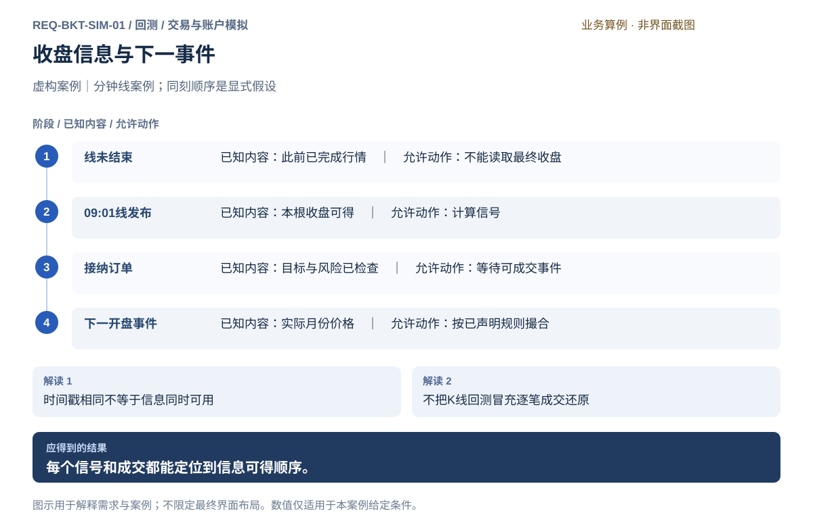
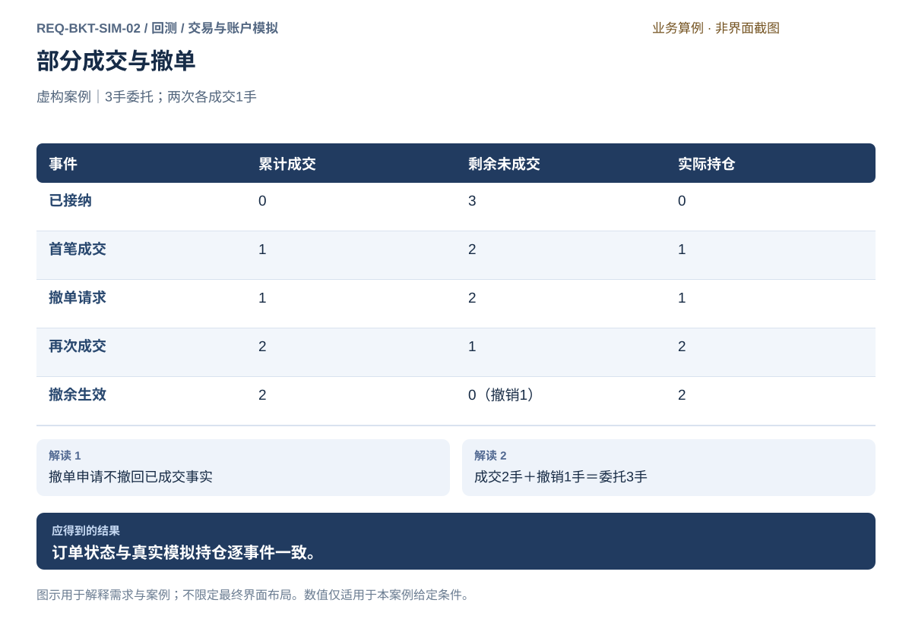
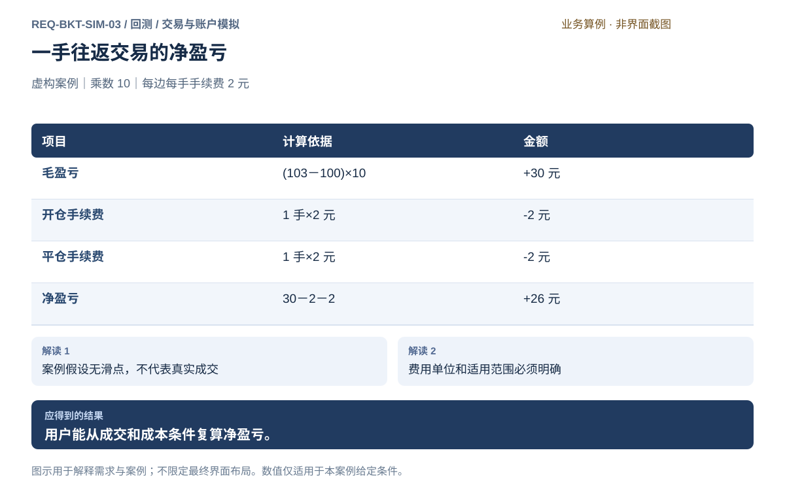
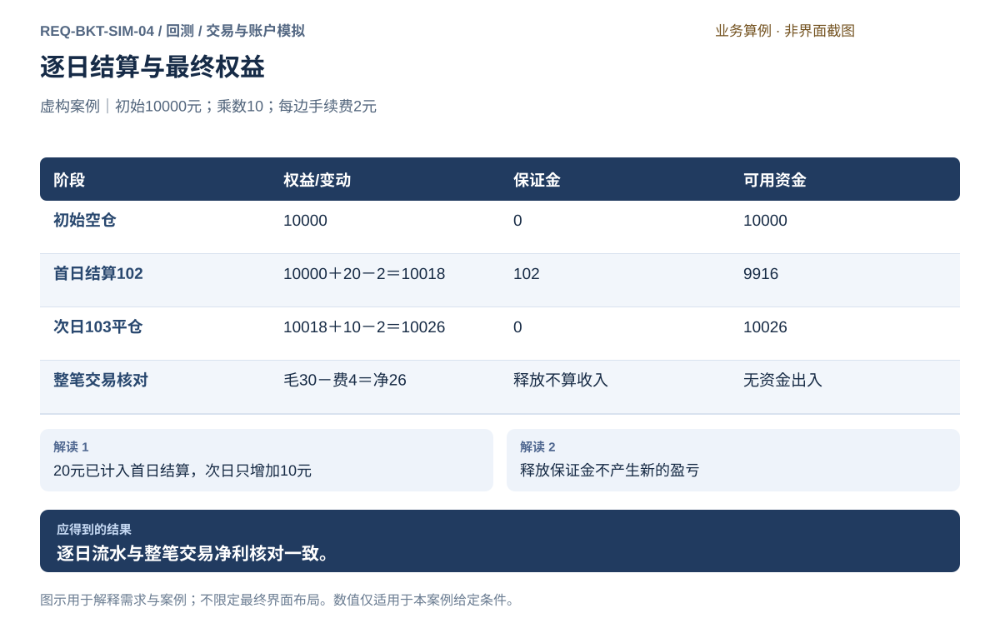
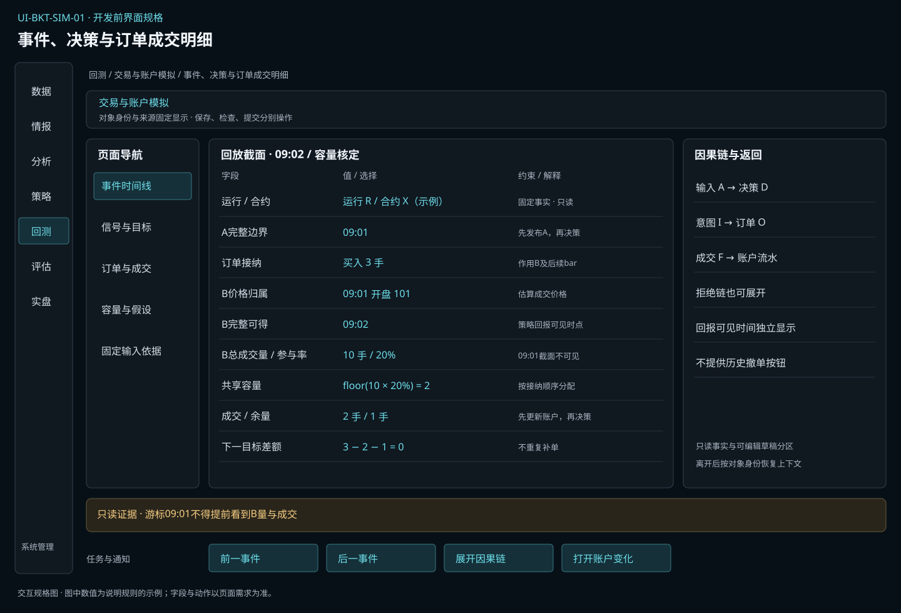
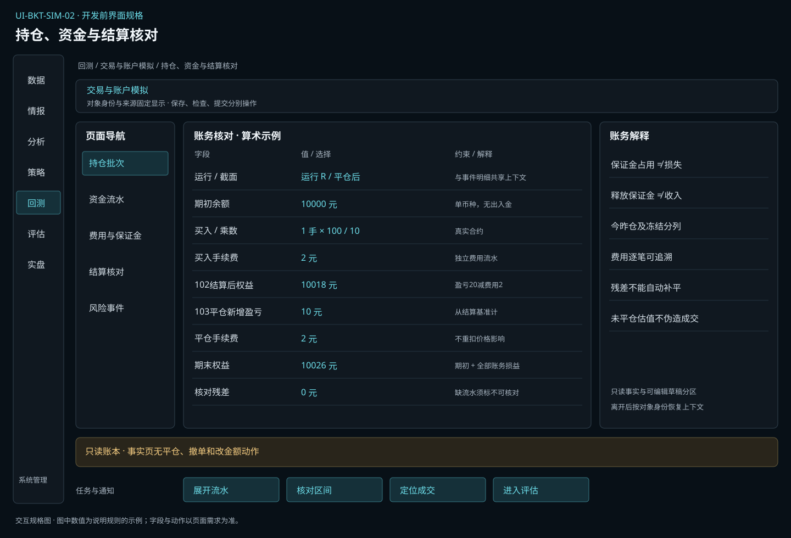

# 交易与账户模拟

[返回上级](README.md) · [需求总纲](../../README.md) · [界面规格](../../common/ui-designs.md) · [跨模块流程](../../workflows/README.md)

开发前需求规格 · 2026-10-20。定义目标功能、使用流程、界面行为与验收条件；数值案例仅用于核对规则，不作为用户配置默认值。

**归属：** 回测 / 交易与账户模拟。本页集中保存业务需求、详细功能、案例、界面设计和验收；通用规则见[通用规范](../../common/README.md)。

## 需求导航

- [REQ-BKT-SIM-01 按历史可得信息推进事件与策略决策](#req-bkt-sim-01)
- [REQ-BKT-SIM-02 模拟订单生命周期、成交约束与换月](#req-bkt-sim-02)
- [REQ-BKT-SIM-03 按适用口径核算费用与成交价格影响](#req-bkt-sim-03)
- [REQ-BKT-SIM-04 维护持仓、资金、结算与风险事件](#req-bkt-sim-04)

## 目标与内部能力

模拟固定策略在历史可得信息和已声明市场条件下产生的交易与账户演变。用户提出的“订单与成交、交易成本、资金与持仓”完整放在本子模块中，并补齐时序和风险边界。

| 能力               | 核心责任                                     | 可观察证据                              |
| ------------------ | -------------------------------------------- | --------------------------------------- |
| 历史事件与信息时序 | 日历、事件先后、预热、模型可用时间           | 输入可得时点 → 决策 → 订单 → 可成交事件 |
| 订单与成交         | 准入、生命周期、流动性、延迟、换月           | 原意图、逐次状态、实际成交及未成交原因  |
| 交易成本           | 费用生效规则、开平类别、价差/滑点/冲击       | 逐成交费用、价格依据及成本归因          |
| 资金、持仓与结算   | 批次、资金流水、权益、保证金、冻结和逐日结算 | 每次变动前后与来源，结算和期末核对      |
| 风险与合约约束     | 资金不足、风险限额、到期和强平处置           | 规则判断、处置订单及剩余风险            |

## 对象与关键字段

| 对象       | 关键字段                                                      | 不变量                                                |
| ---------- | ------------------------------------------------------------- | ----------------------------------------------------- |
| 历史事件   | 事件时间、可得时间、交易日、时区、同刻顺序、来源              | 不允许策略读取尚未可得数据                            |
| 模拟订单   | 身份、来源目标、真实月份、方向/开平、类型、手数、价格、有效期 | 成交量＋撤销/到期量＋有效剩余量＝委托量；拒绝单无成交 |
| 成交       | 身份、关联订单、时间、数量、价格、撮合依据、费用              | 同一事实只入账一次，量不超过订单有效剩余              |
| 持仓批次   | 合约、方向、今昨、数量、开仓与结算基准、策略归属              | 不自动跨月份或多空净额合并；平仓受可平量约束          |
| 资金流水   | 原因、关联事实、金额、币种、舍入、变动前后                    | 准确金额；原始流水不可被报告或草稿编辑改写            |
| 结算与估值 | 结算/估值时点、价格依据、权益、保证金、冻结、可用资金         | 结算结转不额外创造损益，保证金不是费用                |
| 风险事件   | 规则与输入、拒绝/减仓/停止意图、实际成交和剩余暴露            | 请求处置不等于风险已解除                              |

## 逐事件操作与责任顺序

模拟策略仅在完整bar边界决策，支持1分钟和日线。所有事件记录“市场/价格归属时间”和“策略可见时间”；两者不可合并为一个含糊的成交时间。下一bar开盘仅是可选估算价格，不表示策略能在开盘获知该bar最终成交量或成交回报。

对结束于 `t` 的bar，每个边界按以下固定顺序处理：

1. 接收已可得历史事实及生效规则，保留来源和时间；刚结束bar的订单应按其价格归属时点适用的规则核算，不把新生效费率回写过去。
2. 仅对按事件阶段在该bar可执行阶段前已接纳、已达到生效bar且未在开始前撤销/到期的订单（允许准入与开盘时间戳相同，但准入阶段须在前），使用此时才完整可得的OHLCV核定成交资格和共享容量。容量为 `floor(V×ρ)` 手，`ρ∈(0,1]`；V须为归一化单边成交手数，来源口径不明则拒绝。按订单接纳顺序及订单固定身份分配，所有订单合计不得超容量。价格归属该bar，成交、费用、持仓及资金回报在本步骤完成后才对策略可见。
3. 更新已成交账户、日终结算与估值（仅使用此时已可得的价格），发布刚完成bar以及可得事件/模型；缺失结算依据按失败或事前显式估值规则处理。
4. 以该可见快照消费事件和定时条件，再执行一次策略决策。多个事件按可得时间、稳定来源流身份、该流顺序号、唯一变化/记录身份排序；序号只在同流内可比，同一变化只消费一次，更正以新变化身份在其可得后消费；规则优先级固定。
5. 检查新目标、必要风险及可信在途；接纳的新订单与撤单从后续bar生效，不能回到刚结束bar分配容量。对刚结清的部分成交余量，撤单仅取消尚未成交部分。日内有效单在所属交易日最后一个bar核定后到期，不能进入下一交易日。

委托模拟延迟以非负整数bar配置，0表示最早下一bar可执行，L表示再等待L个完整bar；限价与市价使用同一生效规则。边界时点恰相同的“完成上一bar”与“下一bar开盘”仍按上述阶段区分。若bar或所需字段晚于名义收盘才可得，不能倒填此前决策；按下一具备完整输入的边界处理并记录延迟。风险冻结按接纳状态持续保留，直到成交/撤单/到期事实明确释放。

**有限价格与路径假设：** 令滑点为非负整数`s`、有效最小价位为`Δ`。市价模拟取后续有效bar开盘：买入`open+s×Δ`、卖出`open−s×Δ`。限价买单若该开盘估价不高于限价L则用该估价；否则仅在`low<L−s×Δ`时按L估价。限价卖单若开盘估价不低于L则用该估价；否则仅在`high>L+s×Δ`时按L估价。被动单恰好触及不成交；估价必须位于该bar的`[low,high]`和适用涨跌停范围内且满足价位步长，否则该bar不成交。所有分支仍受共享容量和停牌限制，不声明真实队列或确定成交概率。

策略止盈/止损仅按完整bar边界的显式规则判断；bar内高低点不能创造盘中决策。相互依赖的入场和退出不得在同一bar通过假定有利路径连续成交。需要区分同bar内先触止盈还是止损的策略请求因缺少支持的数据粒度而拒绝，不能静默转成有利顺序。对已接纳且相互冲突的订单，必须事前有唯一目标及互斥政策；缺政策则拒绝接纳，而非在成交后挑结果。

策略拥有“目标仓位规则”，本模块拥有“模拟实际持仓”。首次回测从空仓开始；预热只更新策略状态。模型策略按固定训练定义逐折执行，特征拟合与标签成熟必须落在各折允许范围，模型可用前不能预测。

## 账户核对与金额案例

在本次无资金出入、单一币种范围内，**期末权益＝期初权益＋期间所有账务损益**。若采用逐日结算，已结转盈亏进入余额，未结算持仓盈亏采用更新后的结算基准；不能再把从开仓算起的全部浮盈加到账户上。可用资金按所选账户规则由权益扣减保证金及其他非重叠冻结，需列出公式和重叠处理，不能跨市场假定一种通用抵扣优惠。

虚构例一：初始10000元，买1手100元、乘数10，每边费2元；结算102元时权益10018元，保证金假设102元、无其他冻结，可用9916元；次日103元平仓再增加10元、扣费2元，期末10026元。释放保证金只增加可用性，不增加权益。

虚构例二：基准买100卖103，实际模拟买101卖102，乘数10、手续费4元。基准毛利30元、成交价格影响20元、实际毛利10元、净利6元。20元已通过实际成交价体现，不能再从6元扣除。

## 失败与结束语义

| 情形                       | 必须表现的结果                                                     |
| -------------------------- | ------------------------------------------------------------------ |
| 资金不足或风控拒绝         | 保留订单意图、拒绝原因与未变持仓，可按既定策略继续；不伪装引擎崩溃 |
| 必要风险能力丢失或输入破坏 | 停止受影响执行并记运行失败，保留阶段证据；不得跳过能力             |
| 涨跌停、无容量或停牌       | 按固定有效期继续等待或到期；触价不保证成交                         |
| 换月一腿失败               | 保留实际敞口、已发生成本和未完成原因；不假造两腿同时成功           |
| 缺结算价或估值依据         | 定位数据缺口；无受支持显式假设则失败，不静默代价                   |
| 到期涉及实物交割           | 本规格不支持；运行前检查明确处置，无法完成时保留未处理证据           |
| 期末未平仓                 | 按声明规则估值或尝试平仓，成交仍受约束；未成交不能按理想末价消失   |
| 用户取消                   | 停止计算并保存实际位置，取消不触发额外平仓或完整绩效结论           |

## 界面设计

“事件、决策与订单成交明细”以时间线与订单表联动，点击信号查看输入和模型，点击成交定位账户变化；“持仓、资金与结算核对”以同一实验、交易日和事件为上下文切换持仓、流水、成本和风险。两页都是只读证据检查，不能提供真实下单按钮；复制条件回到实验设计，不原地改写事实。事件与账本页面通过同一运行身份、事件和交易日联动。

## 风险触发的模拟结果

依据固定规则和模拟状态执行必要检查，将拒绝、暂停、撤单申请、平仓意图、部分成交及剩余敞口分别记入结果。风险算法不可用属于运行失败，不能伪装为一次正常拒单后继续完成实验。历史涨跌停、流动性和事件顺序可能使处置无法完成，不能补造理想平仓。规则含义见[共用交易约束](../../product.md#execution-risk-semantics)；模拟产物交评估解释风险和执行差异。

## REQ-BKT-SIM-01 按历史可得信息推进事件与策略决策

**领域：** 回测 / 交易与账户模拟　 **建议优先级：** P1核心必要　 **文档性质：** 开发前需求规格

### 目标与场景

使每个预测、信号和目标都可追溯到当时已可得的数据；区分发生、可得、决策、报单和成交时点，禁止未来信息穿越。

**使用者与场景：** 个人期货量化研究用户。

**触发条件：** 配置或复核历史模拟时。

### 前置条件

- 固定数据、交易日历与策略包可用。
- 事件精度与先后规则已由实验方案声明。

### 输入与含义

| 输入           | 含义与单位                                 | 约束                                   |
| -------------- | ------------------------------------------ | -------------------------------------- |
| 时间与交易日   | 事件时间、可得时间、所属交易日及同刻先后。 | 不以电脑运行时间或自然日替代历史时钟。 |
| 决策和模型依赖 | 特征、标签、拟合、训练截止与模型可用时点。 | 只在依赖可得后参与本次决策。           |
| 信号与执行价格 | 连续信号序列、真实月份、报价与结算价。     | 研究调整价不能作为成交或结算依据。     |

### 正常操作与反馈

1. 装载固定日历、合约及事件，检查覆盖和时间精度。
2. 按可得时点释放输入，预热期间只建立允许的状态。
3. 仅在完整bar边界消费已可得事件与定时条件并决策，记录输入、模型、目标及原因。
4. 把交易意图交给模拟撮合，记录最早可成交时点。
5. 逐项复核信号、订单与成交所见信息。

### 业务规则

- 同一时间戳内采用明确且可复现的事件先后，不能借时间精度不足推断更早成交。
- 只拥有OHLC时，无法判断先触及止盈还是止损；必须声明所支持的路径假设或拒绝该依赖，不选择收益更好的顺序。
- 预热观察不能偷偷产生计入正式回测前的持仓；本规格从空仓开始，预热只更新策略状态。
- 夜盘和节假日采用固定交易日历；合约规则按历史生效时点适用。
- 训练标签只有成熟后可用；滚动模型每折单独拟合，不用最终全期模型重写早期预测。

### 输出与状态影响

- 按事件排序的决策与依赖证据。
- 模型、信号和实际月份价格的使用记录。

### 异常与继续方式

| 发生什么                   | 应怎样表现                               | 使用者如何继续                               |
| -------------------------- | ---------------------------------------- | -------------------------------------------- |
| 可得时间或规则覆盖缺失。   | 拒绝受影响的运行，定位字段、日期及能力。 | 补充资料或明确记录允许的研究假设后另建实验。 |
| 某模型在拟预测时尚不可用。 | 阻止使用，不自动换同名模型或未来模型。   | 调整固定计划或使用当时可得的模型重新运行。   |

### 案例：收盘之后才能使用收盘信息

**虚构案例条件：** A为09:00～09:01，B为09:01～09:02，均在结束时完整可得；A收盘100，B开盘101、总量10手，参与率20%，无滑点。边界09:01基于A产生买3手意图并通过风险检查。

| 时点/阶段 | 价格与容量归属 | 策略允许看到的状态 |
| --- | --- | --- |
| 09:01，A完成 | A的旧单先结清，再发布A收盘100 | 读取A及已核对账户，产生3手订单；B最终量未知 |
| B期间 | B开盘101可作为将来估价的价格归属；容量尚未确定 | 订单为已接纳/在途3手；不得提前显示买2手、费用或B成交量10 |
| 09:02，B完成 | 容量floor(10×20%)=2，最多成交2手，成交估价101归属B | 先发布成交2、在途1及账户费用/持仓，再允许基于B决策 |
| 09:02，新决策 | 若目标仍3手，则3−实际2−可信在途1=0 | 不重复补单；若撤余1，取消从后续bar生效，不能抹掉B内2手成交 |

若B为零量，09:02应发布“本bar未成交”，持仓仍0、可信在途3；若B缺失则显示输入缺口，不能把未知容量解释为0。分钟内09:01:20可得情报最早在09:02被消费，不能改变B内已经固定的订单路径。

**验收判定：** 价格归属可为09:01，但回报可见时间必须为09:02；逐事件回放在09:01截面不得包含B成交量、2手成交或其派生账户状态。

### 可观察验收条件

| 编号                | 给定                                 | 当             | 则                                                 |
| ------------------- | ------------------------------------ | -------------- | -------------------------------------------------- |
| REQ-BKT-SIM-01-AC01 | 决策依赖某根收盘。                   | 该根尚未完成。 | 不能生成依赖其最终收盘的有效信号。                 |
| REQ-BKT-SIM-01-AC02 | 训练标签结束时点晚于训练截止。       | 运行滚动训练。 | 该标签不能进入训练；缺少有效样本则该轮失败并说明。 |
| REQ-BKT-SIM-01-AC03 | OHLC同根触及止盈和止损且无路径依据。 | 模拟平仓。     | 只在完整bar边界检查退出；要求判别bar内先后则拒绝，不选择有利路径。 |

### 决定与配置约束

- **DEC-BKT-SIM-01-01**：**规格决定**。执行[完整bar模拟时序](#bar-execution-contract)：旧单容量与成交核定、账本与完整bar发布、边界决策、新单准入依次发生；下一bar开盘估价与该bar结束才可见的容量/回报分离。

### 详细功能

### FR-BKT-SIM-01-01 查看历史事件与信息可得顺序

**目标与结果：** 从决策回溯到实际可见输入。

**触发：** 配置时间规则或打开事件明细。

**输入与约束：** 事件/可得/决策/成交时间、交易日、时区和同刻先后。

**目标操作与反馈：**

1. 核对预热和正式模拟边界。
2. 按事件查看当时输入和策略目标。
3. 定位信号后最早可成交事件。

**异常与边界：**

- 预热不产生正式持仓，夜盘不按自然日推断。
- 缺时间依据不得伪造盘中精度。

**验收条件：**

- **FR-BKT-SIM-01-01-AC01**：未完成分钟线不能被读取为最终收盘。
- **FR-BKT-SIM-01-01-AC02**：同一时刻的决策、订单和成交先后可复核。

**界面对应：** [UI-BKT-SIM-01 事件、决策与订单成交明细](#ui-bkt-sim-01)。

### FR-BKT-SIM-01-02 配置决策与模拟成交规则

**目标与结果：** 确保回测什么时候知道信息、什么时候成交以及哪些情形不能成交是明确的。

**触发：** 策略选择后展开成交模型设置。

**输入与约束：** 决策时点、允许成交时点、订单方式、流动性与无法成交规则；不暗设无限流动性。

**目标操作与反馈：**

1. 选择完整bar周期，展示下一bar价格归属、容量核定和回报可见三个时点。
2. 声明限价、滑点、成交量和涨跌停等建模范围。
3. 预览一个订单的时间线，确认假设与未覆盖限制。

**异常与边界：**

- 使用收盘信息不能在获得信息前成交。
- 限制无依据时标假设或不支持，不能把模型宣传为真实排队成交。

**验收条件：**

- **FR-BKT-SIM-01-02-AC01**：A收盘后接纳的订单仅占用B及后续bar容量；B开盘可作估价，B成交回报及账户变化不早于B完整可得，回放A边界不得读到它们。
- **FR-BKT-SIM-01-02-AC02**：无可成交行情时报告未成交与持仓事实，不虚构价格填补。

**界面对应：** [UI-BKT-EXP-01 回测方案与验证计划](experiments.md#ui-bkt-exp-01)；[UI-BKT-SIM-01 事件、决策与订单成交明细](#ui-bkt-sim-01)。

### FR-BKT-SIM-01-03 区分连续信号价与实际交易价

**目标与结果：** 让研究连续序列的计算方式明确，同时避免调整价被当成成交。

**触发：** 回测配置点击连续合约口径。

**输入与约束：** 信号序列形式、价格调整方法、实际月份与时间口径；每项方法由用户明确选择。

**目标操作与反馈：**

1. 选择连续序列及调整解释。
2. 并列查看信号值和对应实际月份价格。
3. 确认仅信号使用调整序列，交易按实际月份解释。

**异常与边界：**

- 未知调整依据时不展示确定连续收益。
- 价格水平调整不产生账户盈亏；实际月份缺价时不能用调整价代替。

**验收条件：**

- **FR-BKT-SIM-01-03-AC01**：切换调整方法会更新信号解释，并标为新实验条件。
- **FR-BKT-SIM-01-03-AC02**：成交记录仍显示实际月份与来源价格，不出现虚构调整成交。

**界面对应：** [UI-BKT-EXP-01 回测方案与验证计划](experiments.md#ui-bkt-exp-01)；[UI-BKT-SIM-01 事件、决策与订单成交明细](#ui-bkt-sim-01)。

### FR-BKT-SIM-01-04 按历史截止执行滚动拟合与模型使用

**目标与结果：** 避免未来模型污染历史预测。

**触发：** 运行含模型策略的滚动方案。

**输入与约束：** 策略训练定义、训练截止、标签成熟点、拟合依赖和模型可用时点。

**目标操作与反馈：**

1. 逐折核对训练样本和标签成熟。
2. 仅在训练内拟合处理并训练模型。
3. 模型可用后预测，记录该折模型、样本和失败原因。

**异常与边界：**

- 固定全期模型不能倒推早期结果；失败不借用下一折模型。
- 训练算法定义归策略；回测保存逐折实际产物及引用。

**验收条件：**

- **FR-BKT-SIM-01-04-AC01**：超过训练截止才成熟的标签排除并说明。
- **FR-BKT-SIM-01-04-AC02**：每次预测都能定位到当时可用的模型，失败折无伪造收益。

**界面对应：** [UI-BKT-SIM-01 事件、决策与订单成交明细](#ui-bkt-sim-01)。

## REQ-BKT-SIM-02 模拟订单生命周期、成交约束与换月

**领域：** 回测 / 交易与账户模拟　 **建议优先级：** P1核心必要　 **文档性质：** 开发前需求规格

### 目标与场景

将策略意图转成受市场和账户条件限制的订单与成交；订单状态、剩余数量及换月两条腿的实际结果都可解释。

**使用者与场景：** 个人期货量化研究用户。

**触发条件：** 配置或复核历史模拟时。

### 前置条件

- 订单类型、撮合规则和数据精度相匹配。
- 资金与风险检查可用，真实月份可识别。

### 输入与含义

| 输入         | 含义与单位                                 | 约束                                               |
| ------------ | ------------------------------------------ | -------------------------------------------------- |
| 订单意图     | 方向、开平、手数、限价、有效期、目标来源。 | 数量及价格符合所选规则，意图不等于成交。           |
| 流动性与限制 | 可成交价格、容量、停牌、涨跌停和延迟假设。 | 触价或到限价不等于一定成交，缺失不视为无限流动性。 |
| 换月安排     | 旧新月份、两腿顺序、触发依据和失败处置。   | 决策依据在当时可得，实际月份分别记账。             |

### 正常操作与反馈

1. 接收策略意图并检查价格、手数、开平资格、资金和风险。
2. 接纳后生成订单身份，逐事件判断是否可成交和成交数量。
3. 每次成交仅更新一次订单、持仓与资金，展示剩余数量。
4. 处理撤单、到期和剩余量，保留撤单确认前已发生的成交。
5. 换月分别处理平旧和开新，并显示中间敞口及未完成原因。

### 业务规则

- 累计成交量不超过委托量；平仓不超过可平持仓，减仓不暗中反向开仓。
- 撤单请求与撤单生效分开；已成交部分不因撤单被删除。
- 不支持的订单类型明确拒绝，不自动变成市价单。
- 部分成交后是否继续、撤销或到期由固定订单有效条件决定。
- 共享成交容量时按声明的分配顺序处理，不能让多个订单各占全部容量。
- 换月不保证两腿同时完成；无法成交不回填旧价格或研究连续价。

### 输出与状态影响

- 订单状态、逐次成交、拒绝/到期/撤单原因。
- 换月各腿成交和实际敞口。

### 异常与继续方式

| 发生什么                       | 应怎样表现                             | 使用者如何继续                             |
| ------------------------------ | -------------------------------------- | ------------------------------------------ |
| 涨跌停或无有效对手侧成交依据。 | 保持未成交或按有效期到期，不伪造成交。 | 查看原因；改假设须另建实验。               |
| 换月平旧完成而开新失败。       | 如实保留空仓或已形成的敞口与费用。     | 按固定处置规则继续或停止，报告换月未完成。 |

### 案例：三手订单部分成交后撤销剩余

**虚构案例条件：** 虚构案例：买开3手，首个允许撮合事件只有1手可成交；随后撤单生效前又成交1手，最后撤销剩余1手。

1. 记录第一笔1手，剩余2手。
2. 记录撤单请求后的第二笔1手，最后确认撤余1手。

**预期结果：**

- 累计成交2手、实际持仓2手、撤余1手。
- 费用按两次真实模拟成交计，不按3手全额假装成交。

### 可观察验收条件

| 编号                | 给定               | 当         | 则                                         |
| ------------------- | ------------------ | ---------- | ------------------------------------------ |
| REQ-BKT-SIM-02-AC01 | 三手案例。         | 撤销完成。 | 总成交2手、撤余1手，持仓与成交一致。       |
| REQ-BKT-SIM-02-AC02 | 平仓量大于可平量。 | 检查订单。 | 按规则拒绝并解释，不生成负持仓或反向开仓。 |
| REQ-BKT-SIM-02-AC03 | 换月仅一腿成交。   | 查看结果。 | 两腿状态和中间敞口可见，不显示整体完成。   |

### 决定与配置约束

- **DEC-BKT-SIM-02-01**：**规格决定**。市价模拟、限价、撤单、当日有效按[完整bar模拟时序](#bar-execution-contract)；共享容量为floor(完整bar单边成交手数×参与率)，按接纳顺序分配，部分成交保留余量；换月按真实合约计划，不按连续复权价成交。

### 详细功能

### FR-BKT-SIM-02-01 逐事件追踪订单、部分成交和撤单

**目标与结果：** 让委托量、成交量、撤销量及持仓一致。

**触发：** 打开订单，或策略在完整边界产生模拟撤单意图；结果明细页不修改历史。

**输入与约束：** 订单身份、方向开平、数量、有效期及事件顺序。

**目标操作与反馈：**

1. 查看受理或拒绝。
2. 逐笔查看成交与剩余量。
3. 区分撤单申请和生效，核对终态。

**异常与边界：**

- 成交事实只入账一次，累计成交不超过委托。
- 平仓不足明确拒绝，不自动反向开仓。

**验收条件：**

- **FR-BKT-SIM-02-01-AC01**：3手案例成交2、撤余1、持仓2。
- **FR-BKT-SIM-02-01-AC02**：撤单生效前成交仍计入，撤单不会清除已发生费用。

**界面对应：** [UI-BKT-SIM-01 事件、决策与订单成交明细](#ui-bkt-sim-01)。

### FR-BKT-SIM-02-02 应用有限流动性与交易限制

**目标与结果：** 按支持的市场假设决定能否成交。

**触发：** 后续bar完成并可得，核定此前已接纳订单的成交。

**输入与约束：** 完整bar的OHLCV、单边成交手数口径、参与率ρ、涨跌停、停牌、延迟和订单类型；容量与成交回报只在该bar完整可得后发布。

**目标操作与反馈：**

1. 核对数据与撮合模型能力。
2. 按严格触价规则、floor(V×ρ)及固定订单顺序分配共享容量，记录价格归属时点与回报可见时点。
3. 记录未成交、部分成交或到期原因。

**异常与边界：**

- 触及限价不保证成交，零成交与缺失行情不同。
- 多个订单不得重复占用同一份已分配容量。

**验收条件：**

- **FR-BKT-SIM-02-02-AC01**：可分配容量1手时3手委托最多成交1手。
- **FR-BKT-SIM-02-02-AC02**：不支持的订单类型明确拒绝而非降级。

**界面对应：** [UI-BKT-SIM-01 事件、决策与订单成交明细](#ui-bkt-sim-01)。

### FR-BKT-SIM-02-03 预览换月日程和无法成交处置

**目标与结果：** 在运行前明确何时换月以及切换失败时如何保留真实风险。

**触发：** 回测配置点击预览换月。

**输入与约束：** 决策依据、知晓时点、实施时点及无法成交时处置规则；不自动指定平仓或强制切换。

**目标操作与反馈：**

1. 选择换月依据及实施时间。
2. 查看旧月份、新月份与依据数值。
3. 核对已有持仓如何退出及新月份无法成交时的处理，再确认日程。

**异常与边界：**

- 新月份无成交依据则标换月未完成，不拿旧价格填补。
- 样本退出不删除持仓；处置规则缺失时不能执行依赖该规则的回测。

**验收条件：**

- **FR-BKT-SIM-02-03-AC01**：案例T收盘A800手B1200手，切换最早按已声明规则在T+1实施。
- **FR-BKT-SIM-02-03-AC02**：未能换月的记录仍显示原持仓及阻止原因。

**界面对应：** [UI-BKT-EXP-01 回测方案与验证计划](experiments.md#ui-bkt-exp-01)；[UI-BKT-SIM-01 事件、决策与订单成交明细](#ui-bkt-sim-01)。

## REQ-BKT-SIM-03 按适用口径核算费用与成交价格影响

**领域：** 回测 / 交易与账户模拟　 **建议优先级：** P0安全必要　 **文档性质：** 开发前需求规格

### 目标与场景

区分手续费现金扣减与价差、滑点、冲击带来的成交价格影响，记录来源、生效时点、开平类别和舍入口径，使成本可复算且不重复扣减。

**使用者与场景：** 个人研究用户，在创建新回测或修改策略参数时。

**触发条件：** 用户提交策略和准备评估的参数组合。

### 前置条件

- 已有策略模块交付的固定策略包，决策输入、参数与状态约定明确。
- 数据、合约规则和必要风险配置已准备，所需风险能力可用；未知成本有待确认状态。

### 输入与含义

| 输入         | 含义与单位                                                   | 约束                                               |
| ------------ | ------------------------------------------------------------ | -------------------------------------------------- |
| 费用规则     | 每手或比例、单边或往返、开仓/平今/平昨、生效日、币种和舍入。 | 未知费用不当作零，缺依据允许用户明确填写研究假设。 |
| 成交价格模型 | 基准价、买卖方向、价差、滑点与市场冲击。                     | 说明输入报价已包含哪些影响，禁止重复叠加。         |

### 正常操作与反馈

1. 选择历史适用费用资料或显式研究假设。
2. 按实际成交价格、手数、开平类别与适用时点核算费用。
3. 记录基准价与模拟成交价差，现金手续费另记一次。
4. 汇总成本归因并复算账户净变动。

### 业务规则

- 撮合价格已反映滑点时，净盈亏不能再次扣同笔滑点。
- 比例费用按声明基数和单位计算；平今/平昨资格来自持仓批次及交易日。
- 来源事实和研究假设分开显示；显式零费用场景可以研究，但不可冒称真实净收益。
- 保证金占用不是手续费，也不是直接损失；换月两腿按实际成交分别核算。
- 费用变化可能改变资金准入及后续成交，压力实验需重跑完整账户路径。

### 输出与状态影响

- 逐成交费用与价格影响明细。
- 与账本可核对的成本汇总及假设说明。

### 异常与继续方式

| 发生什么                 | 应怎样表现                         | 使用者如何继续                     |
| ------------------------ | ---------------------------------- | ---------------------------------- |
| 费用缺少单位或生效范围。 | 阻止使用该条件运行，不默认零费用。 | 补充依据或显式研究假设并重新确认。 |

### 案例：同一往返交易的费用与净盈亏

**虚构案例条件：** 虚构案例：示例合约 A 乘数为每手 10 单位，买开 1 手价格 100 元，卖平价格 103 元；手续费假设每手每边 2 元，暂不计滑点，资金和风险条件满足。

1. 计算毛盈亏：(103－100)×10×1＝30 元。
2. 开仓和平仓费用各 2 元，合计 4 元。

**预期结果：**

- 净盈亏为 26 元。
- 报告同时说明价格、乘数、手数和每边费用假设。

### 可观察验收条件

| 编号                | 给定                       | 当               | 则                                           |
| ------------------- | -------------------------- | ---------------- | -------------------------------------------- |
| REQ-BKT-SIM-03-AC01 | 案例交易与费用条件已确认。 | 完成该往返交易。 | 毛盈亏 30 元、总手续费 4 元、净盈亏 26 元。  |
| REQ-BKT-SIM-03-AC02 | 滑点已计入成交价。         | 汇总净收益。     | 仅另扣实际手续费，滑点归因不二次扣账。       |
| REQ-BKT-SIM-03-AC03 | 存在平今与平昨不同费率。   | 计算平仓费用。   | 按实际持仓批次和交易日匹配，费用依据可追溯。 |

### 决定与配置约束

- **DEC-BKT-SIM-03-01**：**交付准入**。费用支持按手/金额及开、平今、平昨差异；来源规则记录生效时间、最小金额单位及舍入方式，缺规则要求显式研究假设。真实规则必须通过GATE-DATA或GATE-TRADE验证。

### 详细功能

### FR-BKT-SIM-03-01 配置并核对费用适用口径

**目标与结果：** 让用户明确每笔成本和资金占用来自哪里，能复算净结果。

**触发：** 回测配置点击成本与保证金。

**输入与约束：** 费用单位、每边或往返、开仓/平今/平昨、生效日期、来源或显式假设；未知不默认零。

**目标操作与反馈：**

1. 选择费用依据或明确记录研究假设。
2. 核对适用时间、开平类别、金额/比例单位和舍入规则。
3. 预览一笔成交与往返交易的费用。

**异常与边界：**

- 费用单位或日期缺失时阻止回测，保留其他配置。
- 明确零费用场景标为研究假设，不能把缺资料当零。

**验收条件：**

- **FR-BKT-SIM-03-01-AC01**：每边每手2元的一手往返总费用4元。
- **FR-BKT-SIM-03-01-AC02**：毛盈亏30元扣4元后净26元，计算与成本摘要一致。

**界面对应：** [UI-BKT-EXP-01 回测方案与验证计划](experiments.md#ui-bkt-exp-01)；[UI-BKT-SIM-02 持仓、资金与结算核对](#ui-bkt-sim-02)。

### FR-BKT-SIM-03-02 区分价格影响和现金费用并防止重复扣减

**目标与结果：** 用同一组账务事实解释净收益和成本。

**触发：** 查看成交成本明细或压力情景。

**输入与约束：** 基准价、实际模拟价、价差滑点冲击组成、手续费及舍入。

**目标操作与反馈：**

1. 查看基准价到成交价的变化和已包含因素。
2. 按成交事实计算手续费并记账一次。
3. 把成本归因与账本净变动核对。

**异常与边界：**

- 已计入成交价的滑点仅作归因，不再扣现金。
- 费用提高影响资金准入时必须重跑，不仅从原结果减差额。

**验收条件：**

- **FR-BKT-SIM-03-02-AC01**：基准买100卖103、实际买101卖102、乘数10、手续费4，实际毛10净6；不能再扣20元滑点。
- **FR-BKT-SIM-03-02-AC02**：已用买卖报价含价差时不得再重复加一份相同价差。

**界面对应：** [UI-BKT-SIM-02 持仓、资金与结算核对](#ui-bkt-sim-02)。

## REQ-BKT-SIM-04 维护持仓、资金、结算与风险事件

**领域：** 回测 / 交易与账户模拟　 **建议优先级：** P1核心必要　 **文档性质：** 开发前需求规格

### 目标与场景

用可核对的模拟账本表达持仓、权益、保证金和可用资金，按历史规则结算并处理风险事件；模拟账本不接管真实账户事实。

**使用者与场景：** 个人期货量化研究用户。

**触发条件：** 配置或复核历史模拟时。

### 前置条件

- 初始资金、空仓起点、结算规则及风险配置固定。
- 所需合约乘数、结算价格和保证金依据可用。

### 输入与含义

| 输入           | 含义与单位                                   | 约束                                                               |
| -------------- | -------------------------------------------- | ------------------------------------------------------------------ |
| 初始与账务条件 | 资金、币种、空仓起点、费用和资金出入口径。   | 本规格同币种、无外部资金出入；其他情况明确不支持，不能按一比一换汇。 |
| 持仓与估值     | 方向、批次、今昨、开仓成本、结算基准及数量。 | 交易盈亏归因与逐日结算流水分开，不重复计入。                       |
| 保证金与风险   | 占用、订单冻结、可用资金、风险阈值及处置。   | 未定义优惠或组合保证金不得自动减免。                               |

### 正常操作与反馈

1. 从已确认初始资金与空仓开始。
2. 订单接纳与成交更新冻结、持仓、费用及现金流水。
3. 按固定估值事件计算权益、占用和可用资金。
4. 到结算事件结转当日盈亏并更新结算基准，保留对账关系。
5. 发生风险事件按已配置规则拒绝新增或尝试减仓；期末按明确规则保留或尝试平仓。

### 业务规则

- 资金金额使用准确十进制口径，展示舍入不改变账务和风险判断。
- 模拟账本唯一拥有账户事实；绩效报告从账本读取，不自己重算另一份持仓。
- 保证金与冻结只改变资金可用性，不直接当作损益；不可用资金不显示为零现金。
- 保证金不足不保证强平成功；无法成交时保留风险暴露、原因与未完成状态。
- 缺失必要风险插件时启动拒绝；运行中风险能力失效则停止依赖它的执行并标运行失败。
- 到期、缺结算数据和期末不能静默清空持仓、生成理想平仓价或额外补充资金。

### 输出与状态影响

- 逐事件持仓、资金流水、权益与占用。
- 结算核对、风险事件与未平仓说明。

### 异常与继续方式

| 发生什么                             | 应怎样表现                                             | 使用者如何继续                                         |
| ------------------------------------ | ------------------------------------------------------ | ------------------------------------------------------ |
| 结算价缺失且无已声明受支持估值假设。 | 运行在该点失败并保留阶段记录，不用最新价格代替结算价。 | 补齐依据后显式创建独立实验。                           |
| 强平订单受成交限制无法执行。         | 保留持仓和未消除风险，报告不宣称风险已解除。           | 按固定规则继续观察或结束不完整实验，条件修改另建运行。 |

### 案例：结算后平仓不重复计入盈亏

**虚构案例条件：** 虚构案例：初始10000元，无资金出入；买开1手100元、乘数10，每边手续费2元；当日结算102元，次日103元平仓。保证金假设为结算名义金额10%，无其他冻结。

1. 首日手续费2元，结算盈亏20元，结算后权益10018元、占用102元、可用9916元。
2. 次日平仓较前结算增加10元，再扣2元手续费，释放102元保证金。

**预期结果：**

- 期末空仓权益10026元，可用资金10026元。
- 整笔交易毛利30元、费4元；不能把已结算20元再加一次。

### 可观察验收条件

| 编号                | 给定                     | 当                           | 则                                                       |
| ------------------- | ------------------------ | ---------------------------- | -------------------------------------------------------- |
| REQ-BKT-SIM-04-AC01 | 给定结算案例。           | 完成首日结算。               | 权益10018、保证金102、可用9916元，未结算盈亏基准重置。   |
| REQ-BKT-SIM-04-AC02 | 次日103元平仓。          | 核对期末账本。               | 权益10026元，保证金0；合计净利26元，不重复计算首日20元。 |
| REQ-BKT-SIM-04-AC03 | 期末仍有持仓且无法平仓。 | 生成报告。                   | 列示估值依据和未平仓影响，不虚构末价成交。               |
| REQ-BKT-SIM-04-AC04 | 无必要风险配置或能力。   | 提交或继续依赖该能力的运行。 | 启动拒绝或运行失败，不能跳过风控。                       |

### 决定与配置约束

- **DEC-BKT-SIM-04-01**：**运行配置**。保证金、结算、风险动作及期末估值/退出政策逐实验固定；无可用价格不假定强平成功，保证金不足先拒新增并记录事件。无政策不能运行。

- **DEC-BKT-SIM-04-02**：**规格决定**。采用人民币、空仓初始账户、无外部出入金、不模拟实物交割；其他情形明确不支持。到期和期末未平风险显式报告，不编造平仓成交。

### 详细功能

### FR-BKT-SIM-04-01 维护模拟持仓与可平批次

**目标与结果：** 区分方向、今昨和真实合约，支持正确平仓与费用。

**触发：** 成交或交易日结转。

**输入与约束：** 合约、方向、开平、数量、批次、成本和结算基准。

**目标操作与反馈：**

1. 成交后更新对应批次。
2. 交易日结转记录今昨变化。
3. 平仓匹配可平批次并保留归属。

**异常与边界：**

- 连续合约不直接持仓；退出样本池不删除持仓。
- 未声明净额规则时不能合并多空或跨策略相反目标。

**验收条件：**

- **FR-BKT-SIM-04-01-AC01**：可平1手却要求平2手时明确拒绝。
- **FR-BKT-SIM-04-01-AC02**：换月旧新月份及费用独立可查。

**界面对应：** [UI-BKT-SIM-02 持仓、资金与结算核对](#ui-bkt-sim-02)。

### FR-BKT-SIM-04-02 核对资金、保证金和逐日结算

**目标与结果：** 使现金流水、权益和占用可复算。

**触发：** 成交、估值或结算事件。

**输入与约束：** 初始资金、成交及手续费、结算价、历史保证金及冻结规则。 保证金来源、适用日期、交易所基准与账户实际要求分别说明。

**目标操作与反馈：**

1. 展示每次资金变化的事实来源。
2. 按结算规则结转并更新持仓基准。
3. 对照权益、占用、冻结和可用资金。

**异常与边界：**

- 保证金释放不是收入，逐日盈亏不与全程盈亏重复入账。
- 缺结算依据不得静默用最新价替代。
- 交易所基准与账户实际保证金不能混称；超出依据范围必须补齐或明确假设。

**验收条件：**

- **FR-BKT-SIM-04-02-AC01**：案例首日权益10018占用102可用9916。
- **FR-BKT-SIM-04-02-AC02**：次日平仓后权益10026，逐日合计与交易净利26一致。

**界面对应：** [UI-BKT-SIM-02 持仓、资金与结算核对](#ui-bkt-sim-02)。

### FR-BKT-SIM-04-03 记录资金不足和风险处置结果

**目标与结果：** 表现真实模拟约束及未解除风险。

**触发：** 订单准入或账户触发风险条件。

**输入与约束：** 固定必要风险规则、可用能力、权益占用及可成交条件。

**目标操作与反馈：**

1. 记录拒绝或风险触发的依据。
2. 按预先配置规则停止新增或产生减仓意图。
3. 跟踪实际成交与剩余风险，不把申请当完成。

**异常与边界：**

- 缺风险能力不能继续放行，未配置处置不能临时发明。
- 风险拒绝是业务事件；引擎失效是运行失败，两者不能混淆。

**验收条件：**

- **FR-BKT-SIM-04-03-AC01**：资金不足拒单后持仓不增加，原因可追溯。
- **FR-BKT-SIM-04-03-AC02**：涨跌停使强平未成交时仍显示持仓和风险暴露。
- **FR-BKT-SIM-04-03-AC03**：固定模拟状态为持仓2、在途1、上限5时，新增3手按6手拒绝；同规则和有效状态下与实盘准入含义一致。

**界面对应：** [UI-BKT-SIM-02 持仓、资金与结算核对](#ui-bkt-sim-02)。

### FR-BKT-SIM-04-04 处理到期与回测结束时未平仓

**目标与结果：** 避免期末理想化清仓或删除损失。

**触发：** 合约到期、数据截止或回测结束。

**输入与约束：** 最后交易约束、预定换月/退出/结束政策和有效估值依据。

**目标操作与反馈：**

1. 在运行前明确保留估值或尝试平仓规则。
2. 到边界按规则处理，核对剩余订单和持仓。
3. 报告已平仓损益、未平仓估值和无法处理部分。

**异常与边界：**

- 本规格不模拟实物交割；需要交割才能继续的方案不支持。
- 取消任务不自动清仓；失败或取消不能伪装为完整期末结果。

**验收条件：**

- **FR-BKT-SIM-04-04-AC01**：期末不能成交时保留未平仓而非生成末价成交。
- **FR-BKT-SIM-04-04-AC02**：数据缺失导致无法估值时明确不完整，不能填零。

**界面对应：** [UI-BKT-SIM-02 持仓、资金与结算核对](#ui-bkt-sim-02)。

## 界面设计

## UI-BKT-SIM-01 事件、决策与订单成交明细

**业务目标：** 追踪当时可见信息到目标、订单和成交。

### 页面形态与目标布局

**设计约束：** 页面布局、字段、动作及状态应与下述规范一致；具体字段与操作表是页面验收依据。

**界面形态：** 列表与详情工作区。

**导航入口：** 回测 → 交易与账户模拟 → 事件、决策与订单成交明细。

| 区域 | 要显示的内容 |
| --- | --- |
| 顶部上下文 | 实验 / 时间范围 / 事件类型 |
| 列表、分类或步骤区 | 事件序列 / 决策定位 |
| 主要工作区 | 信号 → 意图 → 订单 → 成交 |
| 选中项详情或检查区 | 当时可得输入 / 撮合假设 |
| 主要动作区 | 定位事件 / 查看原始依据 |

**区域联动与返回：** 本页只读查看固定运行事实，选择事件、合约或交易日同步更新时间线与详情。与另一模拟事实页互跳时携带运行、交易日和事件截面，返回恢复原筛选与选中项；离开不取消运行，不出现保存或历史撤单确认。

**窗口与空间：** 采用统一主窗口布局。宽度缩小时优先收拢辅助详情，表格在内容区横向滚动；主操作和关键上下文不能被页面裁切。重新展开详情仍指向原选中对象。

**状态与反馈依据：** 字段、动作、异常、离开及返回行为按本页下表验收，视觉反馈遵循[通用界面设计](../../common/ui-designs.md)。

### 操作与交互

页面采用[通用交互规范](../../common/interaction.md)，数值、缺失值、错误、焦点及键盘操作保持一致。

**字段与信息：**

- 顶部：实验身份、模拟规则与结果完整性。
- 左侧：交易日、合约、事件类型与订单状态筛选。
- 主区：事件时间线和订单表，显示可得时点、决策、数量、累计成交与剩余量。
- 右侧：信号输入、模型引用、撮合依据、拒绝/撤单/到期原因与关联成交。

**动作与反馈：**

- 选择信号定位输入和模型。
- 选择订单展开全部状态事件。
- 定位撤单生效前成交及换月另一腿。
- 跳转资金持仓明细，保持同一实验和事件。
- 需要改变撮合或时间规则时返回方案页派生新实验，明细保持只读。

**状态与异常：**

- 无信号/无订单/有订单无成交分别显示。
- 时间精度不足：展示实际精度及假设。
- 部分结果：显示停止边界，不声称覆盖全程。

### 验收标准

- **UI-BKT-SIM-01-AC01**：三手订单累计成交2、撤余1、实际持仓2。
- **UI-BKT-SIM-01-AC02**：分钟线内路径未知时显示假设或不支持，不伪造逐笔顺序。
- **UI-BKT-SIM-01-AC03**：进入明细不改变运行和模拟账本。

### 字段与操作规格

本页只读检查固定运行事实；筛选与回放游标可调整，不能编辑信号、订单、价格或撤销已记录成交。

| 字段 | 类型/单位 | 必填 | 初始值 | 合法值与关联检查 | 编辑权限 |
| --- | --- | --- | --- | --- | --- |
| 运行身份 | 固定身份 | 是 | 来源页选择或空 | 必须可访问；含失败/取消运行，标出覆盖 | 选择可编辑 |
| 交易日 | 日期 | 查询时 | 运行首个有记录交易日 | 运行覆盖内，按交易日历而非自然日切断夜盘 | 查询可编辑 |
| 合约筛选 | 真实合约多选 | 否 | 全部 | 只选运行中合约；连续信号序列另列 | 查询可编辑 |
| 事件类型 | 枚举多选 | 否 | 全部 | 输入、边界、决策、意图、拒绝、订单、成交、撤单、到期 | 查询可编辑 |
| 时间范围 | 带时区起止时间 | 否 | 所选交易日 | 起点≤终点；保留源数据精度 | 查询可编辑 |
| 回放游标 | 可见时间及阶段序号 | 否 | 首个事件 | 只可定位已保存阶段，不能伪造tick间路径 | 查询可编辑 |
| 事件发生/可得时间 | 时间 | 自动 | — | 两列分开，无法确定时说明原因 | 只读 |
| 价格归属/回报可见时间 | 时间及bar身份 | 成交时 | — | 开盘估价归属与bar结束可见不可混同 | 只读 |
| 规则/模型身份 | 固定身份 | 决策时 | — | 展示训练截止、模型可用时间和选中分支 | 只读 |
| 目标数量/在途快照 | 有符号整数/手 | 决策时 | — | 来自当时可见快照；无效目标与零分开 | 只读 |
| 订单身份/方向/开平 | 固定身份/枚举 | 订单时 | — | 链接来源意图和拒绝原因 | 只读 |
| 委托/成交/剩余数量 | 非负整数/手 | 订单时 | — | 成交≤委托，部分成交逐笔展开 | 只读 |
| 限价/模拟成交价 | Decimal/元每单位 | 适用时 | — | 显示真实合约、步长、滑点及价格依据 | 只读 |
| bar量V/参与率ρ/剩余容量 | 手、百分比、手 | 容量核定时 | — | 整bar完成前对策略视图隐藏，核定后合计不可超floor(V×ρ) | 只读 |
| 订单状态/拒绝原因 | 枚举及文字 | 自动 | — | 意图、接纳、部分成交、全成、撤销、到期、拒绝分别显示 | 只读 |

| 按钮 | 可用前提 | 结果与后续 |
| --- | --- | --- |
| 查询/清除筛选 | 已选运行、时间合法 | 只更新可见记录，不改变实验 |
| 定位前/后事件 | 存在相邻已保存事件 | 按可见时间和阶段移动；同步因果链与账户快照 |
| 展开因果链 | 选中事件/订单 | 从输入→决策→意图→订单→成交逐层查看，拒绝链也保留 |
| 打开账户变化 | 选中有账务关联事件 | 携带运行、交易日、事件身份进入UI-BKT-SIM-02 |
| 打开策略/数据依据 | 固定引用可读 | 只读查看原包、快照及规则；返回原事件 |
| 复制条件新建 | 固定方案可解析 | 前往UI-BKT-EXP-01新草稿，原事件与记录不改 |

**状态与导航：** 无运行提示先选实验；有运行但无订单时显示“该覆盖内未产生订单”并允许检查决策与拒绝，不能虚构空交易结果。加载失败保留运行身份/最后可靠数据并重查，只读页不提供业务提交重试。运行中/取消的部分证据显示截止边界，后续时间不可回放；无完整bar数据时V未知而非0。返回保留筛选、游标和展开链；离开无保存确认，也不取消运行。需取消运行时回批次页按明确动作操作，禁止在历史明细人工撤单。

**交互验收：** 回放09:01截面不显示B最终量10或成交2；移动到09:02的容量核定阶段才出现其成交回报。跳到账户页后再返回，仍定位同一成交及回放阶段。

### 对应功能需求

- [FR-BKT-EXP-01-05 事前固定模拟能力与不可识别的成交假设](experiments.md#fr-bkt-exp-01-05)
- [FR-BKT-EXP-02-05 复核固定实验并辨认不可重复部分](experiments.md#fr-bkt-exp-02-05)
- [FR-BKT-SIM-01-01 查看历史事件与信息可得顺序](#fr-bkt-sim-01-01)
- [FR-BKT-SIM-01-02 配置决策与模拟成交规则](#fr-bkt-sim-01-02)
- [FR-BKT-SIM-01-03 区分连续信号价与实际交易价](#fr-bkt-sim-01-03)
- [FR-BKT-SIM-01-04 按历史截止执行滚动拟合与模型使用](#fr-bkt-sim-01-04)
- [FR-BKT-SIM-02-01 逐事件追踪订单、部分成交和撤单](#fr-bkt-sim-02-01)
- [FR-BKT-SIM-02-02 应用有限流动性与交易限制](#fr-bkt-sim-02-02)
- [FR-BKT-SIM-02-03 预览换月日程和无法成交处置](#fr-bkt-sim-02-03)

## UI-BKT-SIM-02 持仓、资金与结算核对

**业务目标：** 解释每个账户变动、成本和风险处置。

### 页面形态与目标布局

**设计约束：** 页面布局、字段、动作及状态应与下述规范一致；具体字段与操作表是页面验收依据。

**界面形态：** 并排核对详情。

**导航入口：** 回测 → 交易与账户模拟 → 持仓、资金与结算核对。

| 区域 | 要显示的内容 |
| --- | --- |
| 顶部上下文 | 实验 / 结算日 / 合约 |
| 列表、分类或步骤区 | 持仓批次 / 数量变化 |
| 主要工作区 | 资金变动 / 费用 / 保证金 |
| 选中项详情或检查区 | 数量与金额守恒 / 异常 |
| 主要动作区 | 选择时点 / 查看结算依据 |

**区域联动与返回：** 本页只读查看固定运行事实，选择事件、合约或交易日同步更新时间线与详情。与另一模拟事实页互跳时携带运行、交易日和事件截面，返回恢复原筛选与选中项；离开不取消运行，不出现保存或历史撤单确认。

**窗口与空间：** 采用统一主窗口布局。宽度缩小时优先收拢辅助详情，表格在内容区横向滚动；主操作和关键上下文不能被页面裁切。重新展开详情仍指向原选中对象。

**状态与反馈依据：** 字段、动作、异常、离开及返回行为按本页下表验收，视觉反馈遵循[通用界面设计](../../common/ui-designs.md)。

### 操作与交互

页面采用[通用交互规范](../../common/interaction.md)，数值、缺失值、错误、焦点及键盘操作保持一致。

**字段与信息：**

- 顶部：实验身份、交易日、权益、占用、冻结和可用资金。
- 主区分页：持仓批次、资金流水、逐日结算、成本明细、风险事件。
- 明细：变动前后、币种与单位、合约乘数、价格依据、费率、生效日期和来源。
- 底部：期末持仓、残留风险与核对差额。
- 准入拒绝、风险触发、模拟处置意图、成交及残余风险。

**动作与反馈：**

- 选择交易日核对结算前后。
- 从费用或持仓变化跳转原成交。
- 打开风险事件查看规则、拒绝或减仓实际结果。
- 导出所选范围及完整性说明。
- 定位触发时模拟状态与规则；不把申请当实际完成。

**状态与异常：**

- 空仓有效零与未知估值明确分开。
- 结算依据缺失：显示失败边界。
- 强平未成交：保留风险和持仓。
- 未核对差额：展示差额，不伪造平衡项。

### 验收标准

- **UI-BKT-SIM-02-AC01**：案例首日10018/102/9916，次日空仓权益10026。
- **UI-BKT-SIM-02-AC02**：价格影响不重复扣费，保证金释放不计收入。
- **UI-BKT-SIM-02-AC03**：取消或期末不能隐式生成平仓。

### 字段与操作规格

本页展示同一运行、交易日、事件截面的模拟账本，全部金额与数量事实只读。用户只能选择范围、核对视图和派生新实验。

| 字段 | 类型/单位 | 必填 | 初始值 | 合法值与关联检查 | 编辑权限 |
| --- | --- | --- | --- | --- | --- |
| 运行身份 | 固定身份 | 是 | 来源页选中或空 | 与事件明细一致，部分运行明确标识 | 选择可编辑 |
| 交易日 | 日期 | 是 | 来源日或首个有记录日 | 使用固定日历，不能把夜盘拆错交易日 | 查询可编辑 |
| 事件截面 | 可见时间及阶段 | 是 | 来源事件或日终 | 仅已保存截面，区分结算前后 | 查询可编辑 |
| 合约/持仓方向 | 真实合约/多空枚举 | 否 | 全部 | 按账户持仓语义分列，不擅自多空净额 | 查询可编辑 |
| 今仓/昨仓/可平/冻结 | 非负整数/手 | 自动 | — | 每类可展开批次；冻结不得重复扣减 | 只读 |
| 成交成本/结算基准 | Decimal/元每单位 | 有持仓时 | — | 明确基准日期与规则，不用最新价静默替代 | 只读 |
| 期初余额/权益 | Decimal/元 | 自动 | — | 币种人民币，来源为上一账务截面 | 只读 |
| 平仓/结算盈亏 | Decimal/元 | 自动 | — | 区分结转与未结转，不重复入账 | 只读 |
| 持仓未结盈亏 | Decimal/元 | 有持仓时 | — | 按更新后结算基准与明确估值价 | 只读 |
| 手续费 | 非负Decimal/元 | 自动 | — | 逐成交费率/按手规则与舍入可展开；已含价差不能重扣 | 只读 |
| 持仓保证金 | 非负Decimal/元 | 自动 | — | 保证金占用与损益分列，释放不是收入 | 只读 |
| 在途冻结 | 非负Decimal/元 | 自动 | — | 与保证金是否重叠按固定账户规则展示 | 只读 |
| 期末权益/可用资金 | Decimal/元 | 自动 | — | 展示对应公式及非重叠扣项，负值保留 | 只读 |
| 账务核对残差 | Decimal/元 | 自动 | — | 期末权益减期初权益减期间账务损益；精确账本须为0 | 只读 |
| 风险指标/阈值/处置 | 有单位值、规则引用、事件链 | 风险事件时 | — | 拒绝、申请、成交及未消除风险分别显示 | 只读 |
| 期末未平仓 | 数量/估值及限制 | 结束时 | — | 未成交不得伪造平仓，估值依据缺失标不完整 | 只读 |

| 按钮 | 可用前提 | 结果与后续 |
| --- | --- | --- |
| 切换持仓/流水/结算/风险 | 已选运行 | 同一截面联动切换，不重置日期和合约 |
| 展开金额依据 | 选中金额或残差 | 展示来源流水、公式、费率及价格身份 |
| 定位成交/风险事件 | 存在关联事件 | 携带运行、日期、事件返回UI-BKT-SIM-01 |
| 核对期初到期末 | 已选完整账务范围 | 列出各变动与残差；缺流水标不可核对，不能自动平账 |
| 进入评估 | 有可用产物且覆盖明确 | 传运行、期间、币种、未平仓及模式限制到评估 |
| 派生新实验 | 原条件可解析 | 打开新方案草稿，原账户事实只读保留 |

**状态与导航：** 首次无运行显示选择入口；空仓是持仓数量0且资金账本仍可查，不能把空仓显示成无账户。查询失败保留身份及可靠时间，不用0覆盖金额。取消/失败运行仅展示其截止范围，缺结算价标无法完成估值；核对残差非0定位流水，不提供“自动补差额”。无修改权限的只读页不弹保存，也无撤单或平仓按钮；取消查询仅停止等待，不取消实验。返回保存运行、交易日、截面与选中流水；从评估返回仍定位相同账务范围。

**交互验收：** 初始10000元、1手100、乘数10、每边费用2，102结算应权益10018；103平仓后10026。释放保证金不能再增加权益，期初加账务变动应与期末相等；缺结算流水必须显示不可核对而非残差0。

### 对应功能需求

- [FR-BKT-SIM-03-01 配置并核对费用适用口径](#fr-bkt-sim-03-01)
- [FR-BKT-SIM-03-02 区分价格影响和现金费用并防止重复扣减](#fr-bkt-sim-03-02)
- [FR-BKT-SIM-04-01 维护模拟持仓与可平批次](#fr-bkt-sim-04-01)
- [FR-BKT-SIM-04-02 核对资金、保证金和逐日结算](#fr-bkt-sim-04-02)
- [FR-BKT-SIM-04-03 记录资金不足和风险处置结果](#fr-bkt-sim-04-03)
- [FR-BKT-SIM-04-04 处理到期与回测结束时未平仓](#fr-bkt-sim-04-04)

