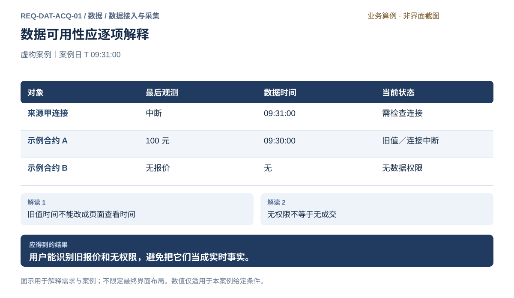
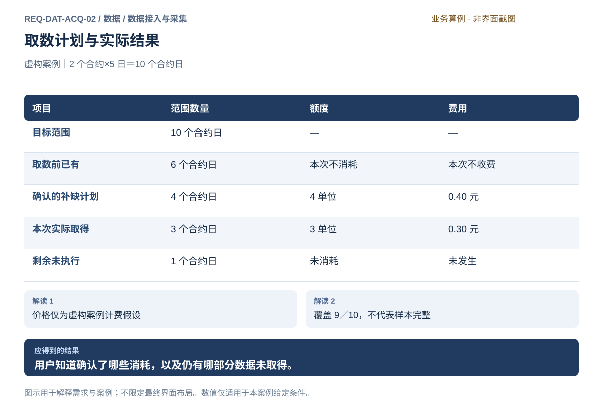
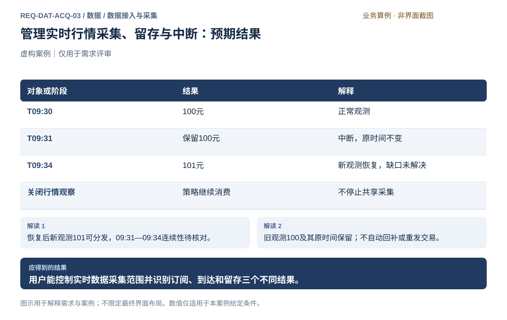
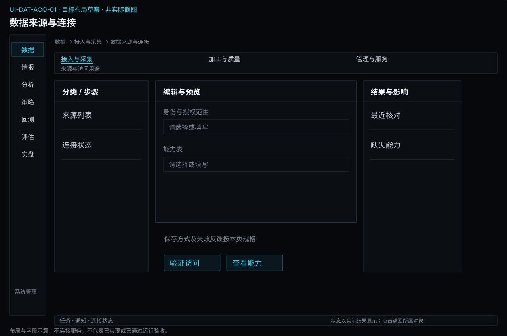
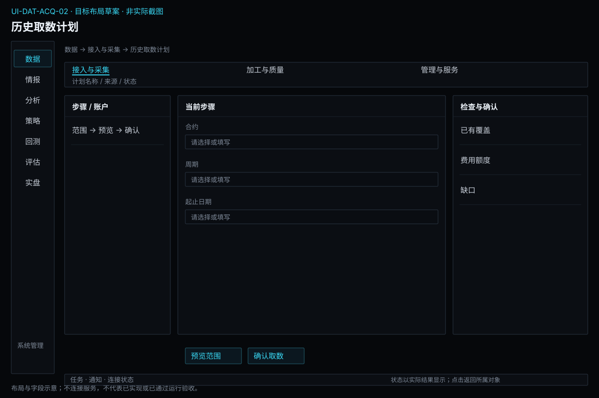
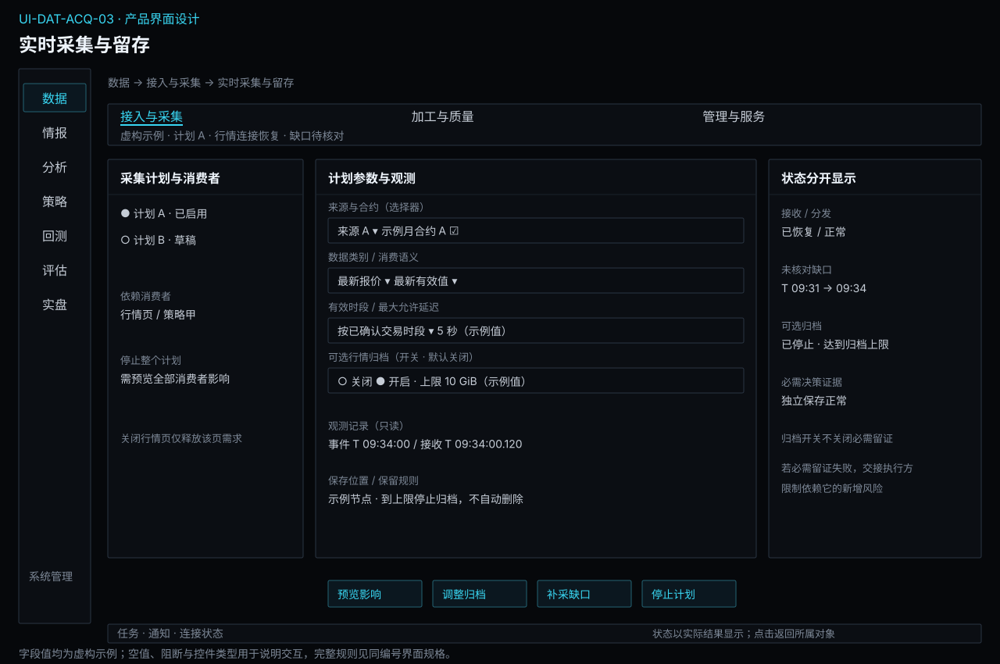

# 数据接入与采集

[返回上级](README.md) · [需求总纲](../../README.md) · [实际界面](../../common/screens.md) · [跨模块流程](../../workflows/README.md)

需求交付版 · 2026-10-18。细化规格已编制，用户逐项签认与产品验收分别记录；目标设计不代表已经实现，实际入口与差距见本页界面对应。

**归属：** 数据 / 数据接入与采集。本页集中保存业务需求、详细功能、案例、界面对应和验收；通用规则见[通用规范](../../common/README.md)。

## 需求导航

- [REQ-DAT-ACQ-01 确认真实数据来源、授权与连接可用性](#req-dat-acq-01)
- [REQ-DAT-ACQ-02 确认历史数据获取范围与费用后执行取数](#req-dat-acq-02)
- [REQ-DAT-ACQ-03 管理实时行情采集、留存与中断](#req-dat-acq-03)

## 1. 数据接入与采集：需求与设计

### 1.1 使用目标和内部能力

使用者从这里回答“来源是否能提供、这次要取得什么、实际取得多少、还缺什么”。它同时服务历史研究准备和实时量化运行，不负责判断策略好坏，也不把来源返回成功当作数据已经可以研究。

| 内部能力 | 必须完成的工作                                                     | 交付物                             | 对应功能             |
| -------- | ------------------------------------------------------------------ | ---------------------------------- | -------------------- |
| 来源接入 | 配置授权；核对类别、粒度、市场、日期范围和权限；检查连接和实际数据 | 来源能力及核对结果                 | FR-DAT-ACQ-01-01～04 |
| 历史采集 | 首次下载、增量更新、指定缺口补采、显式重取；先核对范围及消耗       | 固定取数计划、原始记录、分范围结果 | FR-DAT-ACQ-02-01～04 |
| 实时采集 | 按来源与对象订阅；报告受理、到达、时效和中断                       | 来源观测及采集状态                 | FR-DAT-ACQ-03-01～02 |
| 留存控制 | 明确哪些实时类别需要保存、保存位置、起止范围和依赖；处理写入失败   | 保存确认及未保存区间               | FR-DAT-ACQ-03-03     |

**采集范围：** 实时行情、历史行情、研究需要的全市场数据表，以及合约和日历等基础资料的来源获取。各类别实际可取得的字段、频率与历史长度以来源能力为准；不能因为统称“行情”就承诺完整逐笔、盘口深度或全部历史。提供方插件解释来源协议与原始语义，接入机制不内置某一家供应商的业务规则。

### 1.2 来源能力和配置内容

以下是业务对象字段要求，不表示当前界面已提供所有输入框。

| 信息组     | 必须表达的字段                                                        | 编辑与校验要求                                                         |
| ---------- | --------------------------------------------------------------------- | ---------------------------------------------------------------------- |
| 来源身份   | 提供方、接入方式、运行节点、适用市场、能力核对时间                    | 同一提供方的不同服务或授权范围不能混淆；运行节点影响实际访问和存储位置 |
| 数据能力   | 数据类别、支持周期、可请求对象、最早/最晚范围、历史补取能力           | 不支持与尚未核验分开；只允许提交已确认支持的组合                       |
| 来源语义   | 时间戳含义、时区、交易日口径、单位、累计量/区间量、空响应和无成交语义 | 依赖这些语义的加工必须有依据；无法确认的部分交接为未知                 |
| 授权       | 凭据是否配置、授权对象、有效状态及最近拒绝原因                        | 只展示状态，不展示秘密；按项目凭据政策保存，行情授权不得复用为交易登录 |
| 消耗       | 请求计数单位、速率限制、共享额度、可知费用、估算依据                  | 未知不写零；并发任务共用实际来源预算；页面预览不能预留或保证未来额度   |
| 连接与数据 | 当前连接状态、最后成功响应、对象订阅结果、最近观测                    | 连接检查不隐含订阅全部对象或启动收费下载；有消耗的检查须说明           |

修改来源授权只影响后续明确提交的工作；已提交任务绑定的授权与范围不能在执行中静默切换。原授权失效时报告该任务失败或受阻，用户更新配置后重新预览剩余工作。切换来源必须保留原来源身份，不拼接为一份来源不明的历史。

### 1.3 历史取数计划

**计划输入。** 来源、数据类别、合约或表集合、周期、起止范围、日期口径、获取方式、保存节点及消耗确认。合约集合在提交时展开并固定；“某品种全部合约”不能在执行期间随目录更新改变。指定范围须与提供方粒度相容；只能下载完整生命周期的来源，要先展示实际请求范围，不能把用户的小范围请求偷偷扩大。

**范围预览。** 将目标按来源支持的请求单元分解，列出已保存、拟新增、拟重取和不能请求的部分。已有覆盖表示保存过哪些内容；质量是否满足用途另行判断。增量的“最新结束时间”在本次计划内固定，不在运行中追逐当前时间。重取生成独立观测或修订，不覆盖已有实验输入。

| 操作阶段 | 用户操作                       | 系统反馈与完成条件                                                  |
| -------- | ------------------------------ | ------------------------------------------------------------------- |
| 选择     | 选来源、类别、对象、周期及范围 | 展示能力限制和所需基础资料；无合约目录时明确阻止依赖合约的提交      |
| 预览     | 选择补缺、增量或重取并查看范围 | 按对象/日期列请求分块、已有覆盖、未知项和消耗；范围变化使原确认失效 |
| 确认     | 核对范围及已知/未知费用，提交  | 创建一次计划；确认反馈未到前不能把重复点击变成多个任务              |
| 执行     | 在当前页或任务中心查看进度     | 同一任务状态；区分已请求、已取得、已保存和未执行，显示已知消耗      |
| 取消     | 请求停止后续工作               | 先显示取消中；当前请求可能仍返回数据或消耗额度，结果归属必须核对    |
| 收尾     | 审阅结果，选择补采或交给加工   | 只有明确保存的内容能进入后续；剩余部分另建计划，不默认整任务重跑    |

**结果清单必须覆盖整个确认范围。** 以不重叠的终态分区记录：取得并保存、来源明确无数据、请求失败、取得但保存失败、结果待核对、未执行。终态分区并集等于确认范围；数量比较只在同一计数单位下进行，不能把请求数、合约日和记录条数相加。来源空响应可登记为事实，但是否符合“确实无交易/无记录”的预期由质量检查决定。

遇到权限拒绝和额度用尽时停止相应无效请求，不无条件重试。网络超时若不能判定来源是否已经计费，应保留消耗未知及结果待核对；显式继续也须说明可能重复请求的成本。数据采集的继续不触发任何交易命令。

### 1.4 实时采集与留存

实时计划包含来源、合约集合、数据类别、有效时段、消费方依赖、留存选择和保存节点。订阅受理、观测到达、对外分发、持久保存是四个独立事实；每个合约分别报告，不能用一个“运行中”覆盖整个计划。

| 情况                           | 正确反馈                                                 | 后续动作                                                             |
| ------------------------------ | -------------------------------------------------------- | -------------------------------------------------------------------- |
| 来源已连接，A订阅受理，B无权限 | A等待/已有观测，B拒绝及原因                              | 修正B条件后单独确认，不中断A                                         |
| 已订阅但交易时段没有更新       | 最近事件、接收时间和来源健康证据；时效结论按来源规则判断 | 无成交、断流或原因未知分别表达，不仅凭未更新断言断线                 |
| 连接中断后恢复                 | 保留原值原时间，记录疑似缺口，展示恢复后首条观测         | 来源有可靠序号才能据此核对连续性；否则连续性未知                     |
| 分发正常但磁盘写入失败         | 分发状态正常、留存失败、最后已保存位置、未保存范围       | 用户处理存储并显式继续；不自动删旧数据腾空间                         |
| 用户关闭行情页                 | 解除该页面消费需求                                       | 策略或独立留存计划仍需要时继续采集；不能把页面生命周期当采集生命周期 |
| 用户停止整个计划               | 先列出策略、页面、留存等影响，再确认停止                 | 发布停止事实给消费方；交易侧按自己的规则处置                         |

留存后的记录仍有来源、时间与连续性限制；随后加工和历史发布不能抹去这些限制。分钟K线补采即使填满时间区间，也不能声称补回丢失的全部实时事件。来源不支持某粒度历史补取时，缺口保留为不可补或待核验。

### 1.5 界面落位和案例

当前“历史数据”页承担合约分钟取数，“全市场数据”页承担表数据更新，设置中的“数据源”承担凭据入口，市场相关界面承担实时连接和行情观察。统一来源能力、通用计划预览和独立实时采集/留存管理尚未完整具备。

建议在现有取数表单旁补充**范围与消耗预览**，在当前任务结果中补充**成功及未完成范围**；实时采集详情由现有市场连接状态进入，复用同一来源配置和任务展示，不新增与设置重复的凭据表单。上述新增区域均为拟议设计，见[界面落位表](README.md#data-ui-design)。

案例图及逐步结果见[历史额度不足：最终9/10合约日](#req-dat-acq-02)和[实时中断：恢复新报价但缺口仍在](#req-dat-acq-03)。前者验收范围与消耗，后者验收采集、分发、留存分离，不能相互替代。

## 情报原始材料的接入

来源范围扩展到获授权公告、资讯与研报。用户核对来源、材料类别、更新范围、使用限制与费用后采集；材料正文、附件、来源发布时间、获取时间和固定内容身份分别保留。内容重复可复用原件，但不能丢失来源或获取记录；跨来源是否同一事件由情报判断。后续来源修订形成新材料引用，不覆盖已被研究使用的原件。首批来源和抓取方式待评审，不默认全网采集或购买服务。

## REQ-DAT-ACQ-01 确认真实数据来源、授权与连接可用性

**领域：** 数据 / 数据接入与采集　 **建议优先级：** P0安全必要　 **需求状态：** 交付规格已编制（源自已确认定位；细节待用户签认）

### 目标与场景

用户能判断看到的数据来自哪里、是否有访问权限以及当前是否持续更新。系统须把连接成功与数据可用分开，避免旧报价、来源空值或权限不足被误解为真实市场状态。

**使用者与场景：** 个人用户，在启用行情来源、开始研究取数或观察交易市场时。

**触发条件：** 用户配置来源、建立连接，或已连接来源发生状态变化。

### 前置条件

- 用户拥有来源所需授权，凭据在本地输入并受保护。
- 来源覆盖范围和数据类型有可检查说明。

### 输入与含义

| 输入       | 含义与单位                               | 约束                                                             |
| ---------- | ---------------------------------------- | ---------------------------------------------------------------- |
| 来源与授权 | 服务提供方、访问身份及获授权的数据范围。 | 不得借用行情授权推定具备交易授权；凭据不进入报告或普通配置正文。 |
| 关注数据   | 需要观察的合约、行情类别和适用时段。     | 来源不支持或账户无权访问时明确说明，不以其他来源无提示替代。     |

### 正常操作与反馈

1. 用户选择来源，了解覆盖、授权要求和使用限制。
2. 用户提供本地凭据并请求连接，系统返回连接与授权结果。
3. 用户选择关注合约，检查最近数据时间、接收时间及更新状态。
4. 连接或数据状态变化时系统保留最后观测并明确标注，不把停止更新伪装为价格不变。

### 业务规则

- 来源身份、市场数据时间与本机接收时间应能够区分。
- 已连接但无权限、休市、无成交和数据中断是不同状态；证据不足时不猜原因。
- 最后已知值可以用于回看，但须携带时间和停止更新标识。
- 用户更换来源时明确新来源及范围，研究中固定的数据不得被实时连接替换。

### 输出与状态影响

- 各来源的连接、授权、覆盖与更新状态。
- 带来源和时间的实际观测，或具体的不可用原因。

### 异常与继续方式

| 发生什么                           | 应怎样表现                                         | 使用者如何继续                                                   |
| ---------------------------------- | -------------------------------------------------- | ---------------------------------------------------------------- |
| 连接正常，但所选合约没有数据权限。 | 显示该合约无访问权限，不显示为价格零或市场无成交。 | 用户补充授权或显式选择另一合法来源。                             |
| 行情连接中断且仍有旧值。           | 保留旧值及原时间并标明中断，不伪造更新。           | 用户检查连接，恢复后核对新观测时间；交易处置按独立交易规则执行。 |

### 案例：连接成功不等于报价持续可用

**虚构案例条件：** 虚构案例：案例日 T，来源甲对示例合约 A 有权限，对 B 无权限。A 在 09:30:00 收到 100 元报价，09:31:00 连接中断。

1. 用户同时关注 A 与 B。
2. 中断后再次查看数据状态。

**预期结果：**

- A 保留 100 元及 09:30:00 原时间，标为连接中断。
- B 显示无数据权限，没有数值报价。
- 来源甲最后连接变化时间为 09:31:00。

### 可观察验收条件

| 编号                | 给定                            | 当                  | 则                                                   |
| ------------------- | ------------------------------- | ------------------- | ---------------------------------------------------- |
| REQ-DAT-ACQ-01-AC01 | 来源连通但 B 无权限。           | 用户查看 B。        | 显示无数据权限，不能显示零价或冒充无成交。           |
| REQ-DAT-ACQ-01-AC02 | A 已有 09:30:00 的 100 元报价。 | 09:31:00 断开连接。 | 旧报价时间不变且显示中断，连接状态不能仍称正常更新。 |
| REQ-DAT-ACQ-01-AC03 | 用户更换为另一获授权来源。      | 新数据到达。        | 来源身份可见且旧研究数据保持原有身份。               |

### 决定与配置约束

- **DEC-DAT-ACQ-01-01**：**交付准入**。实时行情和历史日线/分钟各至少一个真实获授权提供方；能力表必须逐项列市场、数据类别、频率、可得时点、费用和查询限额并通过样本验证。具体提供方及授权记录纳入GATE-DATA，未核实不宣称支持。

- **DEC-DAT-ACQ-01-02**：**运行配置**。来源声明预期发布节奏；实时盘中无更新阈值、历史数据应到时间与可容忍延迟须按类别配置，正值且显示单位。未配置时只能显示最后观测及“时效未判定”，不能供要求时效的执行使用。

### 详细功能

### FR-DAT-ACQ-01-01 登记数据来源及其授权范围

**目标与结果：** 让用户清楚某项授权覆盖哪些市场与数据类别，且保护凭据。

**触发：** 来源页点击添加来源并查看授权说明。

**输入与约束：** 来源名称、数据类别、授权身份与说明；服务提供方由用户选择，首批名单待评审。

**目标操作与反馈：**

1. 选择来源并核对可访问类别和覆盖范围。
2. 从来源页进入本地凭据管理完成授权，返回原来源查看脱敏身份与核验结果。
3. 保存来源说明，看到尚未连接或待核验状态。

**异常与边界：**

- 不收集原型中的真实凭据；正式产品凭据不进入普通配置或导出。
- 行情授权不能被显示为交易授权；取消添加不形成有效连接。

**验收条件：**

- **FR-DAT-ACQ-01-01-AC01**：未完成授权的来源不显示可取数。
- **FR-DAT-ACQ-01-01-AC02**：授权详情能分别说明行情与历史权限，不出现明文凭据。

**界面对应：** [UI-DAT-ACQ-01 数据来源与连接](#ui-dat-acq-01)；[UI-COM-SEC-01 凭据与访问用途](../../common/security.md#ui-com-sec-01)。

### FR-DAT-ACQ-01-02 核对连接与数据更新健康度

**目标与结果：** 分别识别连接建立、鉴权成功与实际数据到达，避免单一绿色状态误导。

**触发：** 来源行点击检查连接或查看状态变化。

**输入与约束：** 所选来源、已授权身份及检查范围；检查不订购未授权数据。

**目标操作与反馈：**

1. 发起检查，显示正在连接和授权核验。
2. 连接后查看最近数据时间、接收时间与状态依据。
3. 展开检查记录，定位授权、网络或无数据原因。

**异常与边界：**

- 没有权限时保留来源配置，提示补充授权，不不断重试。
- 连接成功但没有数据不得称行情正常；休市依据不足时标为原因待确认。

**验收条件：**

- **FR-DAT-ACQ-01-02-AC01**：已连接但合约无权限同时展示连接正常和无权限两个事实。
- **FR-DAT-ACQ-01-02-AC02**：连接中断后原数据时间不变，状态立即区分为旧值。

**界面对应：** [UI-DAT-ACQ-01 数据来源与连接](#ui-dat-acq-01)。

### FR-DAT-ACQ-01-03 按合约识别数据是否可用

**目标与结果：** 让用户区分无权限、无观测、旧值和已确认的正常更新。

**触发：** 来源详情选择关注合约后查看数据状态表。

**输入与约束：** 合约、数据类别及已知时段依据；数据时间与接收时间分别保留。

**目标操作与反馈：**

1. 选择合约和数据类别。
2. 读取带来源、数据时间和接收时间的最近观测。
3. 展开不可用原因与适用范围，决定检查连接或更换获授权来源。

**异常与边界：**

- 无报价不以零值代替；无成交与未收到观测不互相推定。
- 旧报价可回看，但不能被重新盖上当前时间冒充新值。

**验收条件：**

- **FR-DAT-ACQ-01-03-AC01**：案例A的100元旧值保持09:30时间，断线时间另列09:31。
- **FR-DAT-ACQ-01-03-AC02**：案例B无权限时没有数字报价，且可进入授权说明。

**界面对应：** [UI-DAT-ACQ-01 数据来源与连接](#ui-dat-acq-01)；[UI-DAT-SRV-01 合约、日历与基础资料](management.md#ui-dat-srv-01)。

### FR-DAT-ACQ-01-04 显式更换或断开数据来源

**目标与结果：** 让用户理解来源变更影响哪些实时观察，而不改写固定研究资料。

**触发：** 来源详情点击更换来源或断开。

**输入与约束：** 当前来源、替换来源及受影响的观察和取数任务；替换来源须另有授权。

**目标操作与反馈：**

1. 查看受影响对象与正在进行的取数工作。
2. 确认断开或选择替换来源。
3. 查看各对象的新来源与连接状态；需要恢复时显式连接。

**异常与边界：**

- 断开不取消或删除已保存数据；正在取数的实际结果按任务记录。
- 更换来源不授予交易权限，也不改写已固定实验输入。

**验收条件：**

- **FR-DAT-ACQ-01-04-AC01**：断开后来源明确显示未连接，旧值仍带原来源时间。
- **FR-DAT-ACQ-01-04-AC02**：更换后新观测显示新来源，旧实验仍引用原快照。

**界面对应：** [UI-DAT-ACQ-01 数据来源与连接](#ui-dat-acq-01)；[UI-SYS-RUN-02 任务中心](../system/tasks-nodes.md#ui-sys-run-02)。

### FR-DAT-ACQ-01-05 接入情报材料并登记来源及获取状态

**目标与结果：** 为情报提供有来源、时间与固定内容的原始材料。

**触发：** 在数据来源中配置材料来源、范围及必要费用预算。

**输入与约束：** 获授权公告、新闻、研报来源；材料类型、来源发布时间、获取时间、内容标识与使用范围。

**目标操作与反馈：**

1. 在数据来源中配置材料来源、范围及必要费用预算。
2. 获取原件、附件与来源元信息，按内容识别重复材料但保留各次获取出处。
3. 将成功材料及失败范围交接情报，后续修订作为新材料关联。

**异常与边界：**

- 没有来源能力时明确不可用，不以本地CSV/JSON伪造市场资料。
- 采集成功与语义处理成功独立；不从标题猜情报状态。

**验收条件：**

- **FR-DAT-ACQ-01-05-AC01**：同一内容两次获取不产生两个独立原件，来源获取记录保留。
- **FR-DAT-ACQ-01-05-AC02**：来源未给发布时间时标未知，不能用下载时间冒充。
- **FR-DAT-ACQ-01-05-AC03**：情报提取失败不改写材料获取状态。

**界面对应：** [UI-DAT-ACQ-01 数据来源与连接](#ui-dat-acq-01)。

### FR-DAT-ACQ-01-06 核对来源能力清单与任务可执行范围

**来源与确认：** 2026-10-18全面审查及用户授权补充；详细行为草案待评审，未实现、未执行产品验收。

**目标与结果：** 让来源可连接与可提供所需数据成为两个独立结果，取数前知道缺少什么。

**触发：** 新增来源、权限变化或创建取数计划。

**输入与约束：** 来源身份、授权用途、市场/合约、数据类别、频率、历史区间、历史规则及时间字段；能力依据来自提供方说明或实际响应并记录核对时间。

**目标操作与反馈：**

1. 展示能力表，分别标支持、不支持、未核实及依据；日线授权不推出分钟或逐笔权限。
2. 将所选计划逐项与能力表核对；输出满足项、缺项、费用/额度依据和允许动作。
3. 来源能力变化后标出受影响计划；保留旧任务采用的依据，不改写已取得材料。

**异常与边界：**

- 无法确认历史范围时不得宣称全量可取；允许保存草稿，取得依据后重新预览。
- 不以本地文件导入、虚构行情或换来源隐式填补缺项；任何替代来源由用户重新选择。

**操作案例：** 来源S可取日线但分钟权限未核实；用户保存分钟计划后核实权限，只有预览满足条件才可开始。

**验收条件：**

- **FR-DAT-ACQ-01-06-AC01**：仅支持日线的来源面对分钟请求时，在发起取数前拒绝并指出频率不支持。
- **FR-DAT-ACQ-01-06-AC02**：来源未提供历史保证金规则时，相关回测准备显示缺项，而非使用当前规则冒充历史。

**界面对应：** [UI-DAT-ACQ-01](#ui-dat-acq-01)；[UI-DAT-ACQ-02](#ui-dat-acq-02)。

## REQ-DAT-ACQ-02 确认历史数据获取范围与费用后执行取数

**领域：** 数据 / 数据接入与采集　 **建议优先级：** P1核心必要　 **需求状态：** 交付规格已编制（源自已确认定位；细节待用户签认）

### 目标与场景

用户在获取历史数据前能够确认要什么、缺什么以及可能消耗多少额度或费用。执行结果须明确成功范围与未取得部分，避免把请求结束误认为研究样本已完整。

**使用者与场景：** 个人研究用户，为明确研究问题准备历史样本时。

**触发条件：** 用户选择合约、数据种类和历史区间并申请获取。

### 前置条件

- 目标来源支持相应数据且用户具备授权。
- 用户已明确本次研究范围；可计费或消耗额度的操作须取得确认。

### 输入与含义

| 输入     | 含义与单位                                   | 约束                                                   |
| -------- | -------------------------------------------- | ------------------------------------------------------ |
| 目标范围 | 合约集合、数据种类、频率及日期或交易日区间。 | 时间口径必须明确；跨午夜交易日不能只按自然日名称理解。 |
| 获取策略 | 补取缺失数据或显式重新获取指定范围。         | 已保存数据默认不被覆盖；重取须说明会形成新观测或修订。 |
| 消耗确认 | 来源额度、可能费用及估算的不确定性。         | 未知费用不能写为零；超过确认范围需再次确认。           |

### 正常操作与反馈

1. 用户定义范围与来源，系统检查已有覆盖和需获取部分。
2. 系统展示拟请求范围、已知额度消耗、费用估算或未知项。
3. 用户确认后开始，能够看到已完成范围及待处理部分。
4. 用户可取消后续请求；结束时查看成功、失败、来源无数据与未执行范围。
5. 用户针对失败部分决定重新获取，或调整研究样本。

### 业务规则

- 获取范围不能因一次请求不便而静默扩大，新增付费范围须重新确认。
- 费用估算与实际结算分开；估算依赖的计费假设可见。
- 取消停止后续工作，已确认取得的数据保持，不假定取消能退还已消耗额度。
- 成功请求但返回空内容只说明该次来源响应，不证明交易日不存在。

### 输出与状态影响

- 确认过的取数范围和消耗说明。
- 按范围划分的获取结果以及可继续处理的未完成部分。

### 异常与继续方式

| 发生什么                             | 应怎样表现                                             | 使用者如何继续                                   |
| ------------------------------------ | ------------------------------------------------------ | ------------------------------------------------ |
| 来源计费依据不明，无法确认本次费用。 | 将费用列为未知，不启动需要费用确认的请求。             | 用户取得可靠计费说明并重新预览，或放弃本次获取。 |
| 执行期间额度不足，尚有未请求范围。   | 停止新的受限请求，列出已取得和未执行范围，不伪报完整。 | 用户补充额度后显式继续，或缩小研究范围。         |

### 案例：先补缺再确认取数消耗

**虚构案例条件：** 虚构案例：示例合约 A、B 各需案例日 T1 至 T5 的日数据，共 10 个合约日；已有 6 个。假设每取一个合约日消耗 1 单位额度、收费 0.10 元。预览时余 4 单位，但执行前另一个已授权请求消耗了共享额度中的 1 单位。

1. 预览缺少 4 个合约日，估算消耗 4 单位、费用 0.40 元。
2. 用户确认后取得 3 个，另 1 个因额度用尽未请求。

**预期结果：**

- 本次取得 3 个合约日；已有覆盖合计 9 个。
- 实际示例消耗 3 单位、0.30 元，剩余 1 个待用户处理。

### 可观察验收条件

| 编号                | 给定                         | 当               | 则                                               |
| ------------------- | ---------------------------- | ---------------- | ------------------------------------------------ |
| REQ-DAT-ACQ-02-AC01 | 10 个目标合约日中已有 6 个。 | 选择补缺并预览。 | 拟取数为 4 个，案例估算为 4 单位额度及 0.40 元。 |
| REQ-DAT-ACQ-02-AC02 | 用户尚未确认收费范围。       | 范围预览完成。   | 不能产生本次付费请求。                           |
| REQ-DAT-ACQ-02-AC03 | 只成功取得 3 个缺失合约日。  | 额度用尽。       | 报告覆盖 9／10，剩余 1 个未执行，不能称完整。    |

### 决定与配置约束

- **DEC-DAT-ACQ-02-01**：**交付准入**。提供方费用和额度按已核验规则估算；计费依据不明仍禁止付费请求。已知计费规则但总量不能可靠估算时显示“不确定”与限额，用户明确本次预算且系统可保证不超出授权范围后才能提交；未知费用不能显示为零。

- **DEC-DAT-ACQ-02-02**：**规格决定**。历史范围默认按交易日选择；确认页同时展示实际起止时刻、时区、夜盘归属及闭开边界。需要自然日的材料来源独立标记，不复用行情交易日规则。

### 详细功能

### FR-DAT-ACQ-02-01 定义历史取数范围并查看已有覆盖

**目标与结果：** 在付费或消耗额度前明确需要哪些合约日与数据频率。

**触发：** 取数计划页选择范围并点击分析覆盖。

**输入与约束：** 来源、合约集合、数据类别、频率、日期口径及起止范围；日期无隐含扩大。

**目标操作与反馈：**

1. 选取合约并明确自然日或交易日口径。
2. 输入范围，选择补缺或显式重取。
3. 查看目标数量、已有范围和拟请求部分，必要时修改。

**异常与边界：**

- 开始晚于结束或来源不支持频率时逐字段提示。
- 跨午夜时段依交易日依据解释；依据不足不自行猜测日期归属。

**验收条件：**

- **FR-DAT-ACQ-02-01-AC01**：目标10个合约日且已有6个时，补缺范围显示4个。
- **FR-DAT-ACQ-02-01-AC02**：切换重取时明确列出将重新请求的已有范围，不覆盖旧资料。

**界面对应：** [UI-DAT-ACQ-02 历史取数计划](#ui-dat-acq-02)；[UI-DAT-SRV-02 数据目录与修订对照](management.md#ui-dat-srv-02)。

### FR-DAT-ACQ-02-02 审阅并确认取数消耗

**目标与结果：** 把授权范围、计费依据和费用不确定性作为开始取数前的明确决定。

**触发：** 完成范围预览后点击审阅消耗。

**输入与约束：** 拟请求范围、来源计费口径、可用额度及费用估算；未知值不可填写为零。

**目标操作与反馈：**

1. 查看按范围计算的请求量和额度估算。
2. 展开费用单价、计费时间及不确定项。
3. 确认具体计划后才启用开始取数；范围变更须重新预览。

**异常与边界：**

- 无法确认费用的受费请求不得启动。
- 共享额度可能变化，确认不承诺锁定额度；不得超出确认范围自动扩取。

**验收条件：**

- **FR-DAT-ACQ-02-02-AC01**：每合约日0.10元、4个合约日的估算为0.40元。
- **FR-DAT-ACQ-02-02-AC02**：确认后改日期或来源，旧确认失效且没有请求被发出。

**界面对应：** [UI-DAT-ACQ-02 历史取数计划](#ui-dat-acq-02)。

### FR-DAT-ACQ-02-03 启动取数并控制后续请求

**目标与结果：** 用户能看到执行事实并取消尚未发生的请求，不误解为撤销已经计费的取数。

**触发：** 计划确认后点击开始取数，运行中可请求取消。

**输入与约束：** 已确认计划及授权；重复点击同一次启动不创建相同并行取数。

**目标操作与反馈：**

1. 点击开始后得到独立任务及已执行范围。
2. 查看成功、失败和待处理数量及可知消耗。
3. 点击取消，确认停止后续请求，查看最终已取得与未执行范围。

**异常与边界：**

- 离开页面不等于取消；已安装软件关闭窗口不停止后台任务。
- 取消不删除已取得资料，也不保证退回已发生费用。

**验收条件：**

- **FR-DAT-ACQ-02-03-AC01**：取消完成后仍可查看已取得范围和实际消耗。
- **FR-DAT-ACQ-02-03-AC02**：启动处理中再次点击不会产生第二份相同任务。

**界面对应：** [UI-DAT-ACQ-02 历史取数计划](#ui-dat-acq-02)；[UI-SYS-RUN-02 任务中心](../system/tasks-nodes.md#ui-sys-run-02)。

### FR-DAT-ACQ-02-04 核对部分结果并显式继续未完成范围

**目标与结果：** 按确认范围核对实际保存、空响应、失败、结果待核对和未执行部分，只为剩余工作重新预览计划。

**触发：** 取数结果点击查看未完成或为剩余范围建计划。

**输入与约束：** 原计划、逐范围结果及原消耗；失败、空响应和未执行分别处理。

**目标操作与反馈：**

1. 查看各范围结果和具体原因。
2. 选定需要继续的部分，生成新计划。
3. 重新检查权限、额度和费用并确认，再启动新任务。

**异常与边界：**

- 来源空响应不证明该日无市场数据，不自动补零。
- 额度不足不循环重试；新计划不得把已取得数据当缺失重复计费。

**验收条件：**

- **FR-DAT-ACQ-02-04-AC01**：目标10合约日已有6、本次取得并保存3且剩余1未执行时，显示覆盖9/10；确认范围的结果分类不重不漏，空响应不能冒充质量完整。
- **FR-DAT-ACQ-02-04-AC02**：继续未完成部分时保留已有内容，重新核对范围与消耗；来源结果或计费未知须明示，不默认整任务重跑。

**界面对应：** [UI-DAT-ACQ-02 历史取数计划](#ui-dat-acq-02)；[UI-DAT-SRV-02 数据目录与修订对照](management.md#ui-dat-srv-02)；[UI-SYS-RUN-02 任务中心](../system/tasks-nodes.md#ui-sys-run-02)。

## REQ-DAT-ACQ-03 管理实时行情采集、留存与中断

**领域：** 数据 / 数据接入与采集　 **建议优先级：** P1核心必要　 **需求状态：** 交付规格已编制（定位与模块已确认；细节待用户签认）

### 目标与场景

用户能控制实时数据采集范围并识别订阅、到达和留存三个不同结果。

**使用者与场景：** 个人期货量化研究与实盘交易用户。

**触发条件：** 用户需要为行情观察或量化策略启用、调整或停止实时采集和留存。

### 前置条件

- 对象、用途与来源明确；所需访问权限已核对。
- 所依赖资料不可用时明确阻止相应操作，不用虚构记录替代。

### 输入与含义

| 输入                       | 含义与单位                                         | 约束                                                               |
| -------------------------- | -------------------------------------------------- | ------------------------------------------------------------------ |
| 创建实时采集计划并核对范围 | 把来源连接与具体采集对象区分，明确采集和留存范围。 | 来源、合约集合、数据类别、启用时段、订阅限额、留存选择及可知费用。 |
| 监控采集时效与断流区间     | 说明真实数据是否到达，定位中断对观察和研究的影响。 | 各对象事件时间、接收时间、连接与订阅反馈、有效交易时段。           |
| 调整采集与留存并处理影响   | 明确谁需要数据，避免停止观察误停策略数据。         | 采集计划、消费方、留存状态、待补范围。                             |

### 正常操作与反馈

1. 核对来源能力、对象权限、有效时段及需要的消费语义。
2. 选择合约、类别和留存方式，预览共享采集、消费依赖与消耗后确认。
3. 逐对象核对订阅、观测、分发和保存状态；中断时保留原时间与待核对缺口。
4. 调整或停止前审阅全部影响；需要补采时创建独立历史计划并重新确认。

### 业务规则

- 实时链路完成必要身份与字段检查后可分发，不等待历史快照发布。
- 原始观测、实时有效值与经过检查的历史数据集分别标识。
- 停止一个消费方不影响其他有效订阅；停止整个计划需列影响。

### 输出与状态影响

- 明确的采集范围和消费依赖；每个对象的订阅、观测、分发、保存证据。
- 已保存、未保存及中断范围，恢复证据和显式补采计划；不自动触发交易动作。

### 异常与继续方式

| 发生什么                       | 应怎样表现                                           | 使用者如何继续                                             |
| ------------------------------ | ---------------------------------------------------- | ---------------------------------------------------------- |
| B订阅被来源拒绝，A订阅已受理。 | 按对象显示结果，A是否更新仍看观测证据；B不产生报价。 | 核验B授权后重新预览，不影响A已明确状态。                   |
| 磁盘空间不足，实时连接仍正常。 | 单列留存失败和未保存起点，分发状态独立显示。         | 处理存储后显式继续留存；历史缺口是否能补取需核验来源能力。 |

### 案例：管理实时行情采集、留存与中断案例

**虚构案例条件：** 虚构案例：A在T09:30报价100，T09:31断线，T09:34恢复收到101；行情页与策略甲共用采集。

1. 在来源页核对权限，进入实时采集。
2. 确认A订阅及留存，查看两个消费方。
3. 观察中断与恢复，再为缺口创建取数草稿。

**预期结果：**

- 恢复后新观测101可分发，09:31—09:34连续性待核对。
- 旧观测100及其原时间保留；不自动回补或重发交易。

### 可观察验收条件

| 编号                | 给定                                                                                | 当                         | 则                                                          |
| ------------------- | ----------------------------------------------------------------------------------- | -------------------------- | ----------------------------------------------------------- |
| REQ-DAT-ACQ-03-AC01 | 虚构案例：A在T09:30报价100，T09:31断线，T09:34恢复收到101；行情页与策略甲共用采集。 | 创建实时采集计划并核对范围 | A已订阅而B无权限时分别展示状态，不为B生成报价。             |
| REQ-DAT-ACQ-03-AC02 | 虚构案例：A在T09:30报价100，T09:31断线，T09:34恢复收到101；行情页与策略甲共用采集。 | 监控采集时效与断流区间     | T09:31断线后100元仍带T09:30时间，T09:34恢复不消除缺口提示。 |
| REQ-DAT-ACQ-03-AC03 | 虚构案例：A在T09:30报价100，T09:31断线，T09:34恢复收到101；行情页与策略甲共用采集。 | 调整采集与留存并处理影响   | 停止行情页订阅不会取消策略仍需的采集。                      |

### 决定与配置约束

- **DEC-DAT-ACQ-03-01**：**规格决定**。实时报价、成交价量及来源提供的盘口，参考负载100合约；来源实际订阅上限小于参考负载时明示能力限制并单独验收，不能以性能通过替代来源能力。时效阈值按用途配置。

- **DEC-DAT-ACQ-03-02**：**规格决定**。实时留存默认关闭，启用须选类别、合约、容量和留存规则；历史原始及固定快照不自动删除。容量达到上限时停止该留存并告警，不暗中删除业务数据。

### 详细功能

### FR-DAT-ACQ-03-01 创建实时采集计划并核对范围

**目标与结果：** 把来源连接与具体采集对象区分，明确采集和留存范围。

**触发：** 在UI-DAT-ACQ-03选择对象后发起“创建实时采集计划并核对范围”。

**输入与约束：** 来源、合约集合、数据类别、启用时段、订阅限额、留存选择及可知费用。

**目标操作与反馈：**

1. 选择已核验来源和合约，查看提供方支持的数据粒度。
2. 预览新增订阅、已有共享采集、留存位置及费用。
3. 明确确认并启用计划，逐对象核对已订阅和实际收到数据。

**异常与边界：**

- 连接正常但订阅被拒绝时仅标该对象失败，不能报整组采集正常。
- 仅分发与同时留存分别确认；没有留存不声称历史可回放。

**验收条件：**

- **FR-DAT-ACQ-03-01-AC01**：A已订阅而B无权限时分别展示状态，不为B生成报价。
- **FR-DAT-ACQ-03-01-AC02**：范围或留存方式变更后旧确认失效。

**界面对应：** [UI-DAT-ACQ-03 实时采集与留存](#ui-dat-acq-03)；[UI-DAT-ACQ-01 数据来源与连接](#ui-dat-acq-01)。

### FR-DAT-ACQ-03-02 监控采集时效与断流区间

**目标与结果：** 说明真实数据是否到达，定位中断对观察和研究的影响。

**触发：** 在UI-DAT-ACQ-03选择对象后发起“监控采集时效与断流区间”。

**输入与约束：** 各对象事件时间、接收时间、连接与订阅反馈、有效交易时段。

**目标操作与反馈：**

1. 查看各合约最后观测及接收时点。
2. 断流时保留旧值并记录缺口起点，不能推测休市。
3. 恢复后核对首条新观测，列出待检查的中断区间。

**异常与边界：**

- 来源无序号或回补依据时不能证明事件连续；标连续性未知。
- 恢复连接不等于补齐缺口，更不能触发交易指令重发。

**验收条件：**

- **FR-DAT-ACQ-03-02-AC01**：T09:31断线后100元仍带T09:30时间，T09:34恢复不消除缺口提示。
- **FR-DAT-ACQ-03-02-AC02**：无权限、休市、无成交和中断按证据分别显示。

**界面对应：** [UI-DAT-ACQ-03 实时采集与留存](#ui-dat-acq-03)。

### FR-DAT-ACQ-03-03 调整采集与留存并处理影响

**目标与结果：** 明确谁需要数据，避免停止观察误停策略数据。

**触发：** 在UI-DAT-ACQ-03选择对象后发起“调整采集与留存并处理影响”。

**输入与约束：** 采集计划、消费方、留存状态、待补范围。

**目标操作与反馈：**

1. 查看行情页、策略等依赖方及留存需求。
2. 停止单个消费方仅解除其订阅；停止整项采集须确认全部受影响对象。
3. 核对实际停止状态和已保存范围；需要回补时转历史计划预览。

**异常与边界：**

- 被策略依赖时不得用关闭行情页面代替停止采集授权。
- 磁盘满应明确留存失败及未保存起点；若分发仍正常则分别显示，不能笼统显示健康。

**验收条件：**

- **FR-DAT-ACQ-03-03-AC01**：停止行情页订阅不会取消策略仍需的采集。
- **FR-DAT-ACQ-03-03-AC02**：未保存区间进入缺口记录，旧数据不删除，回补需重新确认范围与消耗。

**界面对应：** [UI-DAT-ACQ-03 实时采集与留存](#ui-dat-acq-03)；[UI-DAT-ACQ-02 历史取数计划](#ui-dat-acq-02)；[UI-DAT-SRV-04 数据查询与订阅](management.md#ui-dat-srv-04)。

## 界面设计与实际对应

## UI-DAT-ACQ-01 数据来源与连接

**业务目标：** 登记合法来源，分别核对授权、连接与实际数据可用性；本页为目标设计草案。

**对应情况：部分对应。** 来源配置分布在设置 → 数据源、设置 → CTP 账户及市场连接区；统一能力/权限矩阵待设计。 情报材料接入、基础解析或情报数据访问尚待设计。

**实际入口：** 设置 → 数据源；主导航 → 市场（⌘3）

[查看实际界面及对应说明](../../prototype.html#UI-DAT-ACQ-01)

- [数据源：截图、字段和操作](../../common/screens.md#screen-settings-sources)
- [市场：截图、字段和操作](../../common/screens.md#screen-market)

### 页面形态与目标布局

**设计状态：** 目标规格已编制，含布局、字段、动作和关键状态；尚未获得逐项产品签认或实现验收。现状对应证据保持上文说明，图稿不是运行截图。

**界面形态：** 模块内配置工作区。

**目标到达路径：** 数据 → 接入与采集 → 数据来源与连接。这是已确认导航下的目标入口，实际对应仍见上方证据。

| 区域 | 要显示的内容 |
| --- | --- |
| 顶部上下文 | 来源与访问用途 |
| 列表、分类或步骤区 | 来源列表 / 连接状态 |
| 主要工作区 | 身份与授权范围 / 能力表 |
| 选中项详情或检查区 | 最近核对 / 缺失能力 |
| 主要动作区 | 验证访问 / 查看能力 |

**区域联动与返回：** 选择列表或步骤只更新当前对象及详情，不隐式启动业务；图表与明细使用同一输入或结果上下文。离开并返回保留已确认的对象和查询条件，未保存草稿按本页保存语义处理。异步提交后用请求/任务身份定位实际状态，不能把操作按钮点击当作成功。

**窗口与空间：** 使用主窗口内的模块配置工作区；分类、编辑和结果区域独立滚动，保留模块导航与主要动作。凭据输入按用途打开上下文对话框。

**状态设计范围：** 以本页状态/异常和验收为准，正常操作、首次无对象、筛选无匹配、请求中、失败及该业务的未知状态分别说明；不适用状态需说明原因，不套用虚构成功数据。字段类型、默认值和动作前提见下文；关键状态按本页交付约定及模块状态图检查。[返回界面设计总览](../../common/ui-designs.md)。

### 目标交互设计（待实现）

以下为目标交互规格，原有实际入口和截图保持。 情报材料相关字段和动作是新增待设计能力，不代表当前截图已具备。

**字段与信息：**

- 新增目标信息：情报材料来源、授权用途、材料类型、更新范围、原始发布时间/获取时间、内容标识与采集结果。

**动作与反馈：**

- 配置材料来源并预览范围与费用；取得材料后前往情报处理。

**状态与异常：**

- 材料已取得与情报待处理分别显示；来源时间未知不以获取时间代替。

### 业务验收要求（待验收，不代表截图已证明实现）

- **UI-DAT-ACQ-01-AC01**：连接正常和合约无权限可同时显示。
- **UI-DAT-ACQ-01-AC02**：断线后100元仍标原T09:30时间，T09:31仅为连接变化时间。
- **UI-DAT-ACQ-01-AC03**：离开来源配置不触发断开；行情访问权限不能被当作交易授权。
- **UI-DAT-ACQ-01-AC04**：材料已取得与情报待处理分别显示；来源时间未知不以获取时间代替。

### 字段与操作交付约定

以下补齐页面关键字段的类型、初始值与边界；已有功能条目的输入规则仍适用。进入已有对象时加载实际保存值，新建时未明确给默认的必填项为空，不能借用案例数值。只读缺失统一显示“—”并提供原因。

| 字段组 | 类型与单位 | 初始值、检查及变化影响 |
| --- | --- | --- |
| 来源与用途 | 单选来源、用途枚举 | 新建不预选；至少一个明确用途，行情/历史/材料权限分列 |
| 连接与能力 | 只读状态、时间、能力集合 | 未知显示—及原因；检查连接不发起付费取数 |
| 凭据引用 | 用途绑定的安全引用 | 只显示配置状态；输入走凭据对话框，取消不产生有效授权 |

**操作顺序：** 使用“验证访问 / 查看能力”完成本页任务；先选择固定对象并补齐必填项，再检查范围和影响，最后提交有副作用的动作。查看、筛选和返回不隐式执行业务；保存、发布、启动、授权和撤单各自显示实际结果，不能合并为一个成功提示。

| 关键状态 | 信息与允许操作 | 禁止或返回行为 |
| --- | --- | --- |
| 首次为空或无匹配 | 显示当前来源与用途范围，提供创建/补齐或清除筛选入口；只读详情说明来源 | 不填示例数据，不把无权限显示为无记录 |
| 输入错误或前提缺失 | 在“连接与能力”等具体字段旁说明问题，保留其他输入，焦点移至首个错误 | 依赖错误项的动作不可提交，返回不丢草稿 |
| 加载、运行或部分结果 | 保留对象身份和最后可靠时间，展示实际阶段/覆盖；可查看“凭据引用”已有证据 | 未完成不能显示全量成功，不能用加载中的空表覆盖已知事实 |
| 失败或结果未知 | 已明确失败可修正输入后独立提交；可能已受理则查询原请求/对象；展示未决范围 | 未核实前不重复有副作用的操作，不把取消页面当取消业务 |
| 离开及返回 | 已保存对象可由原身份重开，未保存编辑提供保存/放弃/留在当前页；关闭抽屉只改变展示 | 即时偏好不套草稿确认；秘密取消后不留普通表单缓存 |

**交互验收案例：** 在本页选择一个有效对象，改变“来源与用途”后核对旧预览是否失效；制造“连接与能力”缺项或不可用，确认原因与阻断；补齐后完成主要动作，核对“凭据引用”与关联对象结果，再离开返回。只读字段通过隔离测试回复制造状态，不在实际界面篡改业务事实。适用的具体成功结果仍以本页原有案例及AC为准。

关键状态的视觉呈现见[状态设计约定](../../common/ui-designs.md#state-designs)及本模块状态图；状态与动作按本表及关联FR逐项验收，静态图不冒充已执行交互。

### 对应功能需求

- [FR-COM-SEC-01-01 按用途填写凭据并核对权限](../../common/security.md#fr-com-sec-01-01)
- [FR-COM-SEC-01-03 移除保存项并区分本地与外部授权](../../common/security.md#fr-com-sec-01-03)
- [FR-SYS-SET-01-03 按研究与交易分别完成准备清单](../system/setup.md#fr-sys-set-01-03)
- [FR-SYS-REC-03-03 遵守来源导出限制并保留数据解释](../system/records.md#fr-sys-rec-03-03)
- [FR-DAT-ACQ-01-01 登记数据来源及其授权范围](#fr-dat-acq-01-01)
- [FR-DAT-ACQ-01-02 核对连接与数据更新健康度](#fr-dat-acq-01-02)
- [FR-DAT-ACQ-01-03 按合约识别数据是否可用](#fr-dat-acq-01-03)
- [FR-DAT-ACQ-01-04 显式更换或断开数据来源](#fr-dat-acq-01-04)
- [FR-DAT-ACQ-01-05 接入情报材料并登记来源及获取状态](#fr-dat-acq-01-05)
- [FR-DAT-ACQ-01-06 核对来源能力清单与任务可执行范围](#fr-dat-acq-01-06)
- [FR-DAT-ACQ-03-01 创建实时采集计划并核对范围](#fr-dat-acq-03-01)

## UI-DAT-ACQ-02 历史取数计划

**业务目标：** 先确认范围、已有覆盖和消耗，再执行取数及处理未完成部分。

**对应情况：部分对应。** 历史分钟按具体月份合约下载；全市场表按来源与日期更新。统一费用估算、预算确认工作台待设计。

**实际入口：** 主导航 → 数据 → 历史数据（⌘4）；主导航 → 数据 → 全市场数据

[查看实际界面及对应说明](../../prototype.html#UI-DAT-ACQ-02)

- [历史数据：截图、字段和操作](../../common/screens.md#screen-data-history)
- [全市场数据：截图、字段和操作](../../common/screens.md#screen-data-tables)

### 页面形态与目标布局

**设计状态：** 目标规格已编制，含布局、字段、动作和关键状态；尚未获得逐项产品签认或实现验收。现状对应证据保持上文说明，图稿不是运行截图。

**界面形态：** 分步表单或账户操作区。

**目标到达路径：** 数据 → 接入与采集 → 历史取数计划。这是已确认导航下的目标入口，实际对应仍见上方证据。

| 区域 | 要显示的内容 |
| --- | --- |
| 顶部上下文 | 计划名称 / 来源 / 状态 |
| 列表、分类或步骤区 | 范围 → 预览 → 确认 |
| 主要工作区 | 合约 / 周期 / 起止日期 |
| 选中项详情或检查区 | 已有覆盖 / 费用额度 / 缺口 |
| 主要动作区 | 预览范围 / 确认取数 |

**区域联动与返回：** 选择列表或步骤只更新当前对象及详情，不隐式启动业务；图表与明细使用同一输入或结果上下文。离开并返回保留已确认的对象和查询条件，未保存草稿按本页保存语义处理。异步提交后用请求/任务身份定位实际状态，不能把操作按钮点击当作成功。

**窗口与空间：** 复用现有主窗口框架。宽度缩小时优先收拢辅助详情，表格在内容区横向滚动；主操作和关键上下文不能被页面裁切。重新展开详情仍指向原选中对象。

**状态设计范围：** 以本页状态/异常和验收为准，正常操作、首次无对象、筛选无匹配、请求中、失败及该业务的未知状态分别说明；不适用状态需说明原因，不套用虚构成功数据。字段类型、默认值和动作前提见下文；关键状态按本页交付约定及模块状态图检查。[返回界面设计总览](../../common/ui-designs.md)。

### 目标操作规格（设计草案，非已实现界面）

**目标入口与返回：** 数据 → 接入与采集 → 历史取数计划。完成后返回原计划，保留范围、预览与任务身份。

| 字段/区域 | 输入、默认与约束 |
| --- | --- |
| 来源与范围 | 必选真实来源、明确合约/表、频率与起止时间；时间区间起点不晚于终点，无默认付费范围。 |
| 覆盖与费用 | 只读展示已有、缺失、未知范围，金额单位、额度、核对时点及计费依据；免费需有依据，未知不显示0。 |
| 执行方式 | 补缺或显式重取，必选且展示将影响对象；启动确认绑定本次参数与成本摘要。 |

**动作与结果：**

- 预览只查询条件和消耗，不能默认发起收费数据请求。
- 确认并开始仅在能力、额度及费用可核对后可用；改范围使旧确认失效。
- 停止后续请求需等待实际确认；未完成范围单列，继续前重新预览。

**状态与反馈：** 草稿、预览中、待确认、运行中、停止处理中、完成/部分/失败各有独立提示；空响应与请求失败分开。

**操作案例：** 10个合约日仅完成9个时显示9/10与缺1，不显示全部完成。

未保存编辑离开时提供保存、放弃、留在当前页；只读查询离开不触发业务动作。异步请求接纳后显示独立任务/请求身份；结果未知时提供查询而非默认重试。键盘焦点、缺失数值和语言遵守通用规范。一级入口与七个业务模块一致，二级入口对应子模块；本页作为子模块内视图，不再增加同名一级入口。

### 业务验收要求（待验收，不代表截图已证明实现）

- **UI-DAT-ACQ-02-AC01**：目标10个已有6个，补缺4个按案例单价估0.40元。
- **UI-DAT-ACQ-02-AC02**：共享额度被另一个已授权任务消耗1单位后，本次取3个，覆盖9/10。
- **UI-DAT-ACQ-02-AC03**：范围修改使确认失效，输入回车不直接发出收费请求。

### 字段与操作交付约定

以下补齐页面关键字段的类型、初始值与边界；已有功能条目的输入规则仍适用。进入已有对象时加载实际保存值，新建时未明确给默认的必填项为空，不能借用案例数值。只读缺失统一显示“—”并提供原因。

| 字段组 | 类型与单位 | 初始值、检查及变化影响 |
| --- | --- | --- |
| 合约与区间 | 真实合约多选、交易日区间 | 至少一合约；起止交易日可相同，映射后实际起点早于终点，展示时区和闭开区间 |
| 周期与覆盖 | 支持周期枚举、只读覆盖 | 周期必须在来源能力内，缺日历先补资料 |
| 预算与预览 | 非负费用/请求额度、预览身份 | 额度由用户明确输入；改变范围使旧预览失效，未知费用不可当零 |

**操作顺序：** 使用“预览范围 / 确认取数”完成本页任务；先选择固定对象并补齐必填项，再检查范围和影响，最后提交有副作用的动作。查看、筛选和返回不隐式执行业务；保存、发布、启动、授权和撤单各自显示实际结果，不能合并为一个成功提示。

| 关键状态 | 信息与允许操作 | 禁止或返回行为 |
| --- | --- | --- |
| 首次为空或无匹配 | 显示当前合约与区间范围，提供创建/补齐或清除筛选入口；只读详情说明来源 | 不填示例数据，不把无权限显示为无记录 |
| 输入错误或前提缺失 | 在“周期与覆盖”等具体字段旁说明问题，保留其他输入，焦点移至首个错误 | 依赖错误项的动作不可提交，返回不丢草稿 |
| 加载、运行或部分结果 | 保留对象身份和最后可靠时间，展示实际阶段/覆盖；可查看“预算与预览”已有证据 | 未完成不能显示全量成功，不能用加载中的空表覆盖已知事实 |
| 失败或结果未知 | 已明确失败可修正输入后独立提交；可能已受理则查询原请求/对象；展示未决范围 | 未核实前不重复有副作用的操作，不把取消页面当取消业务 |
| 离开及返回 | 已保存对象可由原身份重开，未保存编辑提供保存/放弃/留在当前页；关闭抽屉只改变展示 | 即时偏好不套草稿确认；秘密取消后不留普通表单缓存 |

**交互验收案例：** 在本页选择一个有效对象，改变“合约与区间”后核对旧预览是否失效；制造“周期与覆盖”缺项或不可用，确认原因与阻断；补齐后完成主要动作，核对“预算与预览”与关联对象结果，再离开返回。只读字段通过隔离测试回复制造状态，不在实际界面篡改业务事实。适用的具体成功结果仍以本页原有案例及AC为准。

关键状态的视觉呈现见[状态设计约定](../../common/ui-designs.md#state-designs)及本模块状态图；状态与动作按本表及关联FR逐项验收，静态图不冒充已执行交互。

### 对应功能需求

- [FR-DAT-SRV-01-04 将合约及规则上下文用于后续任务](management.md#fr-dat-srv-01-04)
- [FR-DAT-SRV-02-02 请求质量核对并定位问题证据](management.md#fr-dat-srv-02-02)
- [FR-DAT-ACQ-01-06 核对来源能力清单与任务可执行范围](#fr-dat-acq-01-06)
- [FR-DAT-ACQ-02-01 定义历史取数范围并查看已有覆盖](#fr-dat-acq-02-01)
- [FR-DAT-ACQ-02-02 审阅并确认取数消耗](#fr-dat-acq-02-02)
- [FR-DAT-ACQ-02-03 启动取数并控制后续请求](#fr-dat-acq-02-03)
- [FR-DAT-ACQ-02-04 核对部分结果并显式继续未完成范围](#fr-dat-acq-02-04)
- [FR-DAT-ACQ-03-03 调整采集与留存并处理影响](#fr-dat-acq-03-03)

## UI-DAT-ACQ-03 实时采集与留存

**业务目标：** 明确实时采集范围、消费方与留存选择，分别核对订阅、观测、保存和中断状态。

**对应情况：待设计。** 目前相关入口是市场的实时行情连接和订阅。独立采集计划、留存管理、消费依赖和中断补采工作台尚无对应页面。

**实际入口：** 主导航 → 市场（⌘3）

[查看实际界面及对应说明](../../prototype.html#UI-DAT-ACQ-03)

- [市场：截图、字段和操作](../../common/screens.md#screen-market)

### 页面形态与目标布局

**设计状态：** 目标规格已编制，含布局、字段、动作和关键状态；尚未获得逐项产品签认或实现验收。现状对应证据保持上文说明，图稿不是运行截图。

**界面形态：** 列表与详情工作区。

**目标到达路径：** 数据 → 接入与采集 → 实时采集与留存。这是已确认导航下的目标入口，实际对应仍见上方证据。

| 区域 | 要显示的内容 |
| --- | --- |
| 顶部上下文 | 来源 / 采集计划 / 数据类型 |
| 列表、分类或步骤区 | 计划列表 / 消费依赖 |
| 主要工作区 | 合约 / 接收时点 / 保存状态 |
| 选中项详情或检查区 | 中断区间 / 影响对象 |
| 主要动作区 | 检查计划 / 明确启动 |

**区域联动与返回：** 选择列表或步骤只更新当前对象及详情，不隐式启动业务；图表与明细使用同一输入或结果上下文。离开并返回保留已确认的对象和查询条件，未保存草稿按本页保存语义处理。异步提交后用请求/任务身份定位实际状态，不能把操作按钮点击当作成功。

**窗口与空间：** 复用现有主窗口框架。宽度缩小时优先收拢辅助详情，表格在内容区横向滚动；主操作和关键上下文不能被页面裁切。重新展开详情仍指向原选中对象。

**状态设计范围：** 以本页状态/异常和验收为准，正常操作、首次无对象、筛选无匹配、请求中、失败及该业务的未知状态分别说明；不适用状态需说明原因，不套用虚构成功数据。字段类型、默认值和动作前提见下文；关键状态按本页交付约定及模块状态图检查。[返回界面设计总览](../../common/ui-designs.md)。

### 目标操作规格（设计草案，非已实现界面）

**目标入口与返回：** 数据 → 接入与采集 → 实时采集与留存。行情页可携带合约创建采集计划，返回时保留原合约与筛选。

| 字段/区域 | 输入、默认与约束 |
| --- | --- |
| 采集对象 | 必选来源、真实合约集、数据类型；不默认订阅全市场。 |
| 消费与留存 | 分别列消费方、订阅和留存开关；新计划默认不启动，留存用途和容量条件须明确。 |
| 时效与缺口 | 只读最后事件/接收/保存时间、交易日、断流区间与可补范围，时间不可用显示原因。 |

**动作与结果：**

- 检查显示权限与能力缺项；开始需明确确认，接纳不等于已收到行情。
- 修改或停止先显示受影响消费方；停止采集不能伪装为策略已停止。
- 补采缺口转历史计划并携带区间，不把重新连上当作补齐。

**状态与反馈：** 未启动、连接中、接收正常、断流、接收正常但保存失败分别展示；零成交与断流不同。

**操作案例：** 09:31至09:34断流，09:35恢复后仍保留该缺口；策略不能把它读为连续行情。

未保存编辑离开时提供保存、放弃、留在当前页；只读查询离开不触发业务动作。异步请求接纳后显示独立任务/请求身份；结果未知时提供查询而非默认重试。键盘焦点、缺失数值和语言遵守通用规范。一级入口与七个业务模块一致，二级入口对应子模块；本页作为子模块内视图，不再增加同名一级入口。

### 业务验收要求（待验收，不代表截图已证明实现）

- **UI-DAT-ACQ-03-AC01**：恢复后保留中断区间，不把接收新报价等同补齐。
- **UI-DAT-ACQ-03-AC02**：停止确认展示全部消费方，取消时不发出停止请求。
- **UI-DAT-ACQ-03-AC03**：无权限对象没有报价；保存失败不隐藏。

### 字段与操作交付约定

以下补齐页面关键字段的类型、初始值与边界；已有功能条目的输入规则仍适用。进入已有对象时加载实际保存值，新建时未明确给默认的必填项为空，不能借用案例数值。只读缺失统一显示“—”并提供原因。

| 字段组 | 类型与单位 | 初始值、检查及变化影响 |
| --- | --- | --- |
| 订阅对象 | 来源/类别/合约集合 | 至少一真实合约，权限不足逐项说明 |
| 留存计划 | 开关、容量/时长 | 默认关闭；启用必填保存范围和上限，不能隐含覆盖 |
| 时效与缺口 | 原始/接收/保存时间及区间 | 只读，断流保留旧时间；停止前展示消费者及留存影响 |

**操作顺序：** 使用“检查计划 / 明确启动”完成本页任务；先选择固定对象并补齐必填项，再检查范围和影响，最后提交有副作用的动作。查看、筛选和返回不隐式执行业务；保存、发布、启动、授权和撤单各自显示实际结果，不能合并为一个成功提示。

| 关键状态 | 信息与允许操作 | 禁止或返回行为 |
| --- | --- | --- |
| 首次为空或无匹配 | 显示当前订阅对象范围，提供创建/补齐或清除筛选入口；只读详情说明来源 | 不填示例数据，不把无权限显示为无记录 |
| 输入错误或前提缺失 | 在“留存计划”等具体字段旁说明问题，保留其他输入，焦点移至首个错误 | 依赖错误项的动作不可提交，返回不丢草稿 |
| 加载、运行或部分结果 | 保留对象身份和最后可靠时间，展示实际阶段/覆盖；可查看“时效与缺口”已有证据 | 未完成不能显示全量成功，不能用加载中的空表覆盖已知事实 |
| 失败或结果未知 | 已明确失败可修正输入后独立提交；可能已受理则查询原请求/对象；展示未决范围 | 未核实前不重复有副作用的操作，不把取消页面当取消业务 |
| 离开及返回 | 已保存对象可由原身份重开，未保存编辑提供保存/放弃/留在当前页；关闭抽屉只改变展示 | 即时偏好不套草稿确认；秘密取消后不留普通表单缓存 |

**交互验收案例：** 在本页选择一个有效对象，改变“订阅对象”后核对旧预览是否失效；制造“留存计划”缺项或不可用，确认原因与阻断；补齐后完成主要动作，核对“时效与缺口”与关联对象结果，再离开返回。只读字段通过隔离测试回复制造状态，不在实际界面篡改业务事实。适用的具体成功结果仍以本页原有案例及AC为准。

关键状态的视觉呈现见[状态设计约定](../../common/ui-designs.md#state-designs)及本模块状态图；状态与动作按本表及关联FR逐项验收，静态图不冒充已执行交互。

### 对应功能需求

- [FR-DAT-SRV-03-02 订阅实时数据并查看分发状态](management.md#fr-dat-srv-03-02)
- [FR-DAT-ACQ-03-01 创建实时采集计划并核对范围](#fr-dat-acq-03-01)
- [FR-DAT-ACQ-03-02 监控采集时效与断流区间](#fr-dat-acq-03-02)
- [FR-DAT-ACQ-03-03 调整采集与留存并处理影响](#fr-dat-acq-03-03)

