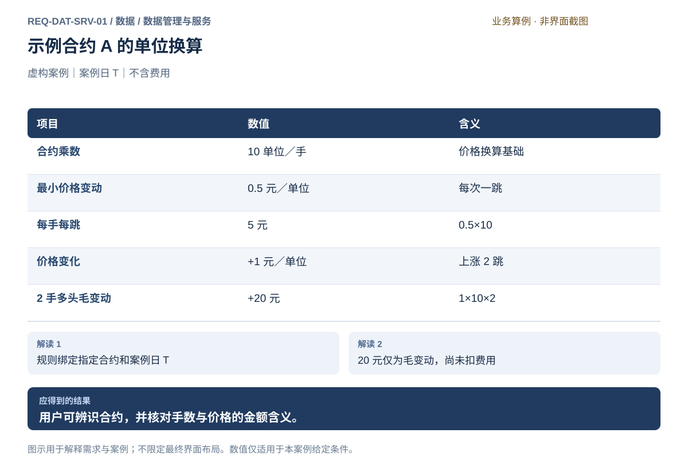
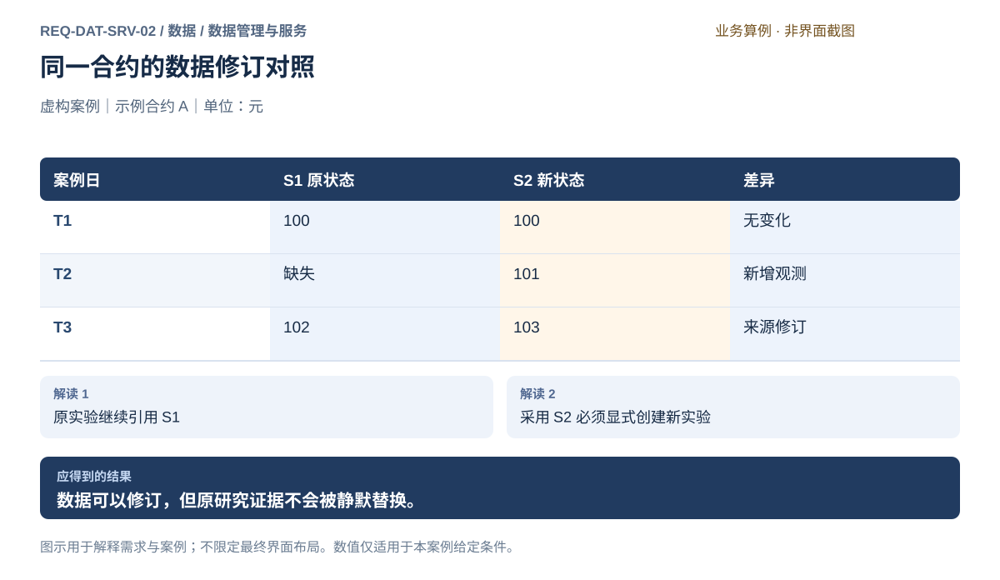
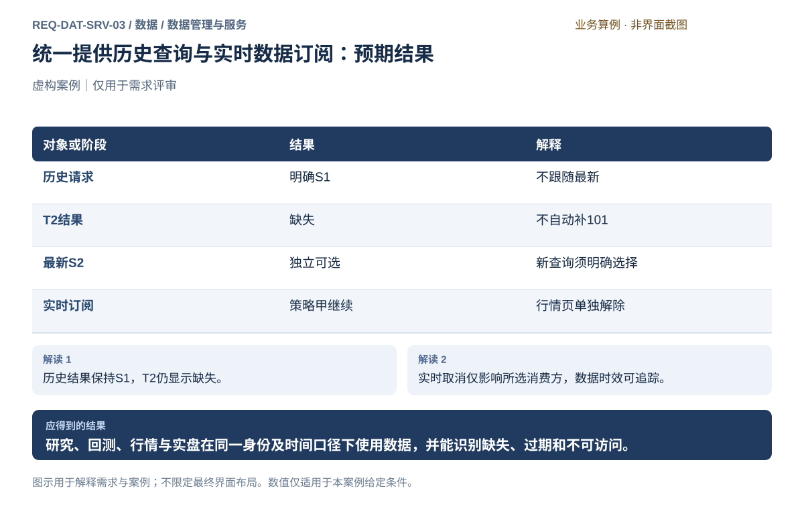
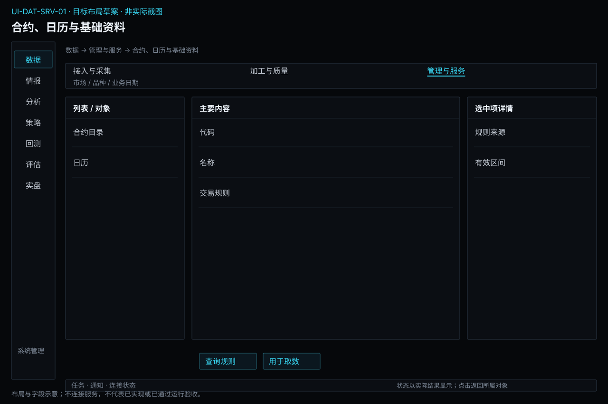
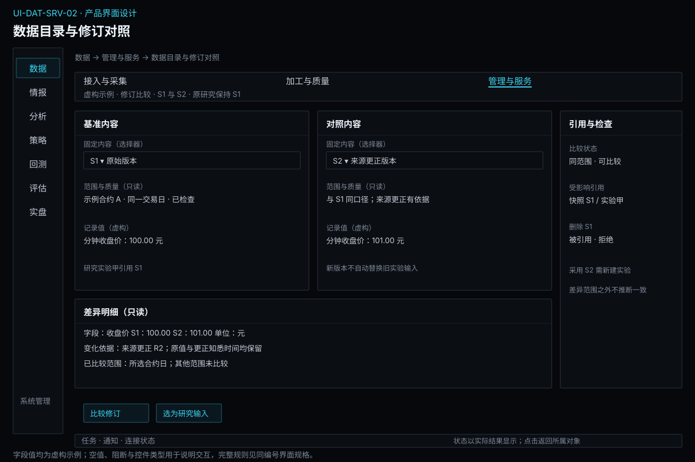
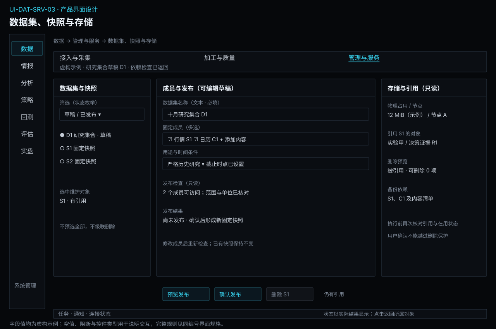
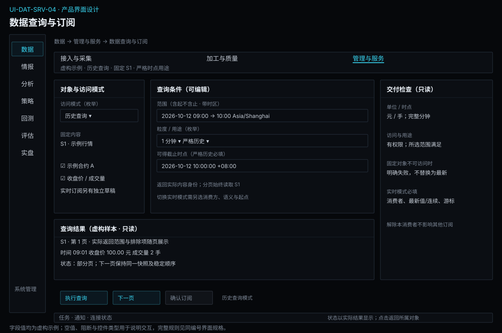

# 数据管理与服务

[返回上级](README.md) · [需求总纲](../../README.md) · [实际界面](../../common/screens.md) · [跨模块流程](../../workflows/README.md)

需求交付版 · 2026-10-18。细化规格已编制，用户逐项签认与产品验收分别记录；目标设计不代表已经实现，实际入口与差距见本页界面对应。

**归属：** 数据 / 数据管理与服务。本页集中保存业务需求、详细功能、案例、界面对应和验收；通用规则见[通用规范](../../common/README.md)。

## 需求导航

- [REQ-DAT-SRV-01 识别交易合约并查询适用交易规则](#req-dat-srv-01)
- [REQ-DAT-SRV-02 管理数据目录、质量证据与固定快照](#req-dat-srv-02)
- [REQ-DAT-SRV-03 统一提供历史查询与实时数据订阅](#req-dat-srv-03)

## 1. 数据管理与服务：需求与设计

### 1.1 使用目标和内部能力

使用者从这里回答“有什么、在哪里、依据是什么、哪个版本可用、谁正在用、怎样安全维护”。资产目录和访问服务属于同一子模块：目录登记固定内容及限制，读取服务按照同一身份交付，避免另建一份访问侧数据目录。

| 内部能力     | 必须完成的工作                                         | 对应功能             |
| ------------ | ------------------------------------------------------ | -------------------- |
| 基础资料     | 合约、品种、来源映射、交易日历、时段及规则生效范围     | FR-DAT-SRV-01-01～06 |
| 目录与修订   | 检索、覆盖、实际保存位置、质量报告、版本比较和使用情况 | FR-DAT-SRV-02-01～04 |
| 数据集与快照 | 组织成员及用途，检查依赖，发布固定输入                 | FR-DAT-SRV-02-05     |
| 存储维护     | 占用、可访问性、引用与删除保护，向备份流程提供依赖清单 | FR-DAT-SRV-02-06     |
| 历史读取     | 按固定对象和明确时间/字段语义查询、分页及交给研究      | FR-DAT-SRV-03-01、03 |
| 实时分发     | 登记消费方、共享采集、传递观测与状态、独立解除订阅     | FR-DAT-SRV-03-02、03 |

### 1.2 基础资料设计

| 对象           | 必需内容                                                                | 使用规则                                                       |
| -------------- | ----------------------------------------------------------------------- | -------------------------------------------------------------- |
| 品种与合约     | 市场、品种、完整交割月、有效代码、名称、上市/到期范围、状态             | 当前名称取已加载目录；缺失名称可显示代码，但身份不能靠名称猜测 |
| 来源映射       | 来源对象、标准身份、有效区间、依据及修订                                | 一对多或代码复用须消歧，不能自动选第一项                       |
| 日历与时段     | 市场/品种、交易日、对应自然日期的时段、休市及特殊调整                   | 夜盘和跨午夜按资料解释，不能统一套自然日规则                   |
| 合约与结算规则 | 最小价格变动、乘数、数量约束及适用生效区间；费用/保证金资料的来源和层次 | 来源参考规则不能冒充账户实际费率或交易风控政策                 |
| 时间与修订证据 | 生效区间、来源公布/可得证据、取得时间、修订内容身份                     | 查询“当时有效”和“当时已知”分别表达，未知不得补造               |

基础资料通过合法数据提供方取得，接入与采集负责获取，管理与服务负责登记并提供统一查询。基础资料冲突影响的合约和日期需单独标识，不把整个市场默认为可用或全部不可用。已固定实验继续使用自己的资料身份；新修订供新任务显式选择。

### 1.3 目录、层次与修订比较

目录需区分**来源记录、标准化数据、派生序列、数据集快照**；这是内容层次，不是四套仓库或四个一级模块。目录每项包含身份、类型、来源、合约/表、频率、时间范围、记录数、保存节点与位置、占用、最近取得时间、关联质量报告、依赖及被引用情况。最早与最晚日期只是外包范围，存在中间缺口时必须同时展示。

检索先选类别、来源、市场、品种、合约或表，再缩小周期和范围；结果默认展示与当前任务有关的列，身份、单位和状态含义保持一致。选择一项后查看数据、覆盖证据、加工依据和使用情况；这些入口读取同一目录事实，不触发隐式重新下载或重新加工。

修订比较先选择同口径的两个内容身份，区分新增、删除、字段更正、基础资料或规则变更。比较范围与未比较部分可见；不能只比较行数后声称内容一致。影响分析列出直接引用的快照和实验，解释变化范围；保留旧实验结果，重新验证由用户发起新实验。

### 1.4 数据集草稿和快照发布

数据集是一组为明确用途选定的数据及条件；草稿允许修改，发布后的快照固定。人读名称用于识别，真实引用使用不可变内容身份及依赖，不能将可改名称当作实验输入。

| 草稿内容                            | 发布时检查                                 | 发布后保留                       |
| ----------------------------------- | ------------------------------------------ | -------------------------------- |
| 名称、用途、合约/表集合、频率和范围 | 名称可读；目标成员均已解析到确定身份       | 名称与内容身份分开               |
| 成员版本及选择范围                  | 成员可读取，范围和字段实际存在             | 精确成员清单及内容摘要           |
| 资料与加工依赖                      | 身份、日历、规则与加工链完整               | 可复核的依赖引用                 |
| 用途条件和质量限制                  | 必要条件满足；已检查、未知、未检查范围明确 | 原质量报告和明确接受的非必要限制 |
| 目标节点和空间                      | 所需内容可访问，提交所需存储可用           | 保存位置和实际发布确认           |

目标操作为：选择固定版本 → 创建/修改草稿 → 检查成员和必要条件 → 预览发布清单 → 确认发布 → 返回快照身份。发布边界内需要保证全体必要成员和清单已经持久保存且可读，才允许消费方看见“已发布”；失败保留草稿或未发布结果，不暴露一半成功的快照。

发布反馈中断时显示结果待核对，并查询同一次发布的确定结果，不能再次点击就默认创建另一份快照。S2发布不会更新引用S1的实验；用户希望改用S2时显式新建或重新配置实验。快照不是数据备份，也不保证引用的存储永久在线。

### 1.5 本地存储、引用保护与恢复

本地存储是必需能力；绑定远程数据节点时，同样展示实际归属和可访问性，不能因客户端在macOS就把远程占用标成本机占用。存储后端实现属于插件，不在产品需求中预先指定必须使用某种数据库、对象存储或湖仓格式。

| 操作       | 行为设计                                                           | 保护条件                                                                      |
| ---------- | ------------------------------------------------------------------ | ----------------------------------------------------------------------------- |
| 查看占用   | 按节点、数据类别和内容显示占用及可用空间                           | 共享内容的物理占用不因被多个快照引用而重复累加；逻辑成员大小另列              |
| 保存内容   | 内容、目录和保存确认一致后标已保存                                 | 写入失败保留旧数据，报告范围；不自动换位置或淘汰已有数据                      |
| 检查可用性 | 区分目录可见与字节实际可访问、完整                                 | 不可访问不等于已删除；受影响读取明确失败                                      |
| 删除       | 用户选择明确对象，先预览引用、在用状态和可释放空间                 | 仍被实验/快照/活动任务使用则拒绝；执行时再次核对，防止预览后新增引用          |
| 备份与恢复 | 给日常维护流程提供内容、目录及依赖闭包清单；恢复后核对身份和完整性 | 跨数据/任务引用需一起保存；不把目录备份当成数据已备份，不静默转换或覆盖原资料 |

取消采集或加工不会自动删除已取得数据；解除引用也不会自动清理内容。删除只针对已确认无引用且不在使用的对象，实际完成后报告结果。业务资料不自动清理；实时留存启用时显式设置容量与规则，诊断日志遵守系统交付范围，不能将诊断清理套用到数据快照或账本。

### 1.6 历史查询和实时分发

**历史查询请求：** 固定快照/内容身份、对象、字段、频率、起止范围及端点、时区、用途条件。返回实际身份、字段单位、实际范围、质量限制、时间证据、分页位置和完整/部分/空结果原因。分页保持相同快照和稳定顺序；发布新数据不能改变下一页的输入。指定对象损坏或丢失时失败，不回退到“最新”。

对探索性“最新”查询，开始读取时先解析成具体内容身份并在该次查询内固定；进入回测或研究前仍需明确保存该身份和条件。查询不隐含下载、付费、清洗或重算，缺少数据给出可跳转的补采/加工入口。

**实时订阅请求：** 消费方、来源、合约、类别、时效要求和消费语义。消费语义至少区分“只需最新有效值”和“需要逐事件连续”；提供方不支持逐事件证据时不能承诺后一种。接入与采集拥有上游连接和原始订阅，本模块拥有消费方订阅及分发；一个消费方退出只释放自己的需求。

慢消费者不能让所有消费方被迫等待或积压无界。最新值显示可以按明确语义合并更新，仍保留观测时间；要求事件连续的消费者处理落后时必须收到缺失/滞后状态，不能静默丢弃后继续标连续正常。数据状态传递给策略与风险，是否停策略、撤单或调整仓位由所属业务决定，本模块不代行。

### 1.7 界面落位和案例

当前“全市场数据”提供基础表更新和覆盖信息，“历史数据仓库”提供检索、版本、使用情况、查看数据及用于回测等入口。研究的历史数据选择已有“保存当前选择 → 保存数据集”和“已保存数据集 → 使用已保存数据集”；这些有数据时的操作已核对源码，未实际执行保存。建议在仓库的版本详情内补充统一来源/质量证据，沿现有使用情况入口补充修订影响；统一草稿及质量发布检查、存储维护和消费订阅详情作为待实现扩展，避免创造第二份数据目录。

案例见[来源修订与固定研究输入](#req-dat-srv-02)、[查询与订阅的实际身份](#req-dat-srv-03)。例如实验甲固定S1，发布S2后仍读取S1；删除S1必须展示实验甲引用并拒绝。用户解除行情页面订阅后，策略甲的订阅及上游必要采集保持。

## 材料与情报的统一保存和服务

目录纳入原件、解析结果、候选与已发布情报，但展示不同业务状态时标明责任方。候选供情报工作流访问，正式消费按情报发布、用途及时间规则过滤；数据不能自行确认实体映射、核验或发布。统一存储提供可靠保存、内容引用、时点访问和固定研究集合，情报模块定义事件关系与可用性。保存失败不返回可用结果，依赖删除沿用现有保护，不静默删除原件或研究证据。

## REQ-DAT-SRV-01 识别交易合约并查询适用交易规则

**领域：** 数据 / 数据管理与服务　 **建议优先级：** P1核心必要　 **需求状态：** 交付规格已编制（源自已确认定位；细节待用户签认）

### 目标与场景

用户能够准确识别准备研究或交易的合约，理解价格、手数和金额的换算。合约规则必须带适用日期及来源，避免把同名品种、连续序列或失效规则误当成可交易合约。

**使用者与场景：** 个人研究与交易用户，在建立研究样本、查看行情或准备委托时。

**触发条件：** 用户按代码、名称或市场搜索合约，或从研究结果进入合约资料。

### 前置条件

- 已选择有权访问的合约资料来源。
- 用户指定当前查询时点或历史规则日期。

### 输入与含义

| 输入     | 含义与单位                               | 约束                                                           |
| -------- | ---------------------------------------- | -------------------------------------------------------------- |
| 合约标识 | 市场、品种及交割月份共同确定的合约身份。 | 同名或同代码结果必须区分市场；连续序列不能替代交割合约。       |
| 规则日期 | 需要查询的交易日及规则生效阶段。         | 不默认用今天的规则覆盖历史日期；未提供日期时明确标示当前规则。 |

### 正常操作与反馈

1. 用户输入检索条件，得到带市场、月份和存续状态的候选合约。
2. 用户选定合约与日期，查看乘数、最小价格变动、交易时段和交割限制。
3. 系统区分有来源的规则、尚未取得的字段及不适用事项。
4. 用户可查看规则来源和生效区间，并在后续研究或交易中引用该合约身份。

### 业务规则

- 价格单位、合约乘数和手数单位须联合解释，不只展示孤立数值。
- 暂停、到期或不允许当前账户交易的状态不等同于合约不存在。
- 历史规则变更应按生效区间区分；无法确认的日期不得拼接成确定规则。
- 用于解释的金额估算须列出假设，不等同于实际保证金、成交费用或盈利保证。
- 合约映射、交易日历与时段资料由数据管理与服务统一管理；来源更新经过采集与质量检查后形成可追溯修订。
- 保留规则生效时间与有证据支持的可获得时间；未知可获得时间不能声称支持严格时点研究。

### 输出与状态影响

- 一个无歧义的合约身份及指定日期的规则资料。
- 资料来源、缺失项及影响后续操作的限制说明。

### 异常与继续方式

| 发生什么                                             | 应怎样表现                                             | 使用者如何继续                                                     |
| ---------------------------------------------------- | ------------------------------------------------------ | ------------------------------------------------------------------ |
| 检索结果包含多个同名或同代码合约，身份尚未唯一确定。 | 分别列出市场与月份，暂不将任何一个用作计算或委托标的。 | 用户明确选择完整合约身份后继续。                                   |
| 两个来源对同日乘数提供不同值。                       | 标示冲突及各自来源，不自动选取更方便的值。             | 用户取得可靠规则证据后重新确认；依赖该规则的计算暂不形成确定结果。 |

### 案例：由价格变动理解一手合约金额

**虚构案例条件：** 虚构案例：示例合约 A 在案例日 T 的乘数为每手 10 单位，最小价格变动为每单位 0.5 元。仅说明单位换算，假设价格由 100 元变为 101 元。

1. 用户查询 A 的案例日 T 规则。
2. 系统计算每手每跳金额为 0.5×10＝5 元；价格上涨 1 元等于 2 跳。

**预期结果：**

- 显示每手每跳 5 元。
- 持有 2 手多头时该价格变化对应毛变动 20 元；不含费用。

### 可观察验收条件

| 编号                | 给定                           | 当                     | 则                                                       |
| ------------------- | ------------------------------ | ---------------------- | -------------------------------------------------------- |
| REQ-DAT-SRV-01-AC01 | 不同市场存在相同检索代码。     | 用户搜索该代码。       | 结果分别显示市场和月份，未经选择不能把两者视为同一合约。 |
| REQ-DAT-SRV-01-AC02 | 案例合约乘数与价格步长已确认。 | 查看上述价格变化解释。 | 每跳每手为 5 元，2 手上涨 2 跳的毛变动为 20 元。         |
| REQ-DAT-SRV-01-AC03 | 历史日期缺少可靠规则。         | 用户查询该日期。       | 显示规则待确认及缺失字段，不用当前规则冒充历史事实。     |

### 决定与配置约束

- **DEC-DAT-SRV-01-01**：**规格决定**。当前交付限定中国境内挂牌期货真实月份合约、人民币；具体市场与品种逐项登记真实来源覆盖，未覆盖项目明确不支持。海外、多币种、期权和实物交割不在当前交付范围。

- **DEC-DAT-SRV-01-02**：**交付准入**。规则必须带来源与生效区间；不同来源冲突保留双方原文及有效时间，人工决定适用证据后再发布。不能确定适用规则时阻断相关执行，GATE-DATA核验样本。

### 详细功能

### FR-DAT-SRV-01-01 检索并确认唯一合约身份

**目标与结果：** 从代码或名称得到明确的市场、品种与月份，防止误选同名合约。

**触发：** 合约检索页输入条件后点击检索。

**输入与约束：** 代码或名称至少一项；市场可用于缩小范围，无依据时不预选市场。

**目标操作与反馈：**

1. 输入关键词并查看匹配的市场、品种、月份与存续状态。
2. 选择一行，在资料区核对完整身份及来源。
3. 点击确认合约，返回原任务并携带完整身份。

**异常与边界：**

- 无匹配时保留条件，提供清空筛选，不自动换成相近合约。
- 多匹配必须选择；连续序列明确标记为研究对象，不能确认成委托标的。

**验收条件：**

- **FR-DAT-SRV-01-01-AC01**：相同代码属于两个市场时显示两行，未选择不能确认。
- **FR-DAT-SRV-01-01-AC02**：返回取数或研究任务后完整市场与月份仍可见。

**界面对应：** [UI-DAT-SRV-01 合约、日历与基础资料](#ui-dat-srv-01)。

### FR-DAT-SRV-01-02 查询指定日期的生效规则

**目标与结果：** 让用户找到目标交易日真正适用的乘数、步长、交易时段和限制。

**触发：** 已选合约后修改规则日期并点击查询。

**输入与约束：** 合约身份、日期及需要时的生效阶段；当前日期候选值须明确来源于用户选择。

**目标操作与反馈：**

1. 选择日期，查看生效区间和规则来源。
2. 展开同日不同阶段或规则变更，确认对应时点。
3. 将确认的规则依据带回研究配置。

**异常与边界：**

- 规则缺失显示未知，不将最新规则回填历史。
- 来源冲突并列展示；依赖冲突字段的计算暂不可确定。

**验收条件：**

- **FR-DAT-SRV-01-02-AC01**：改变日期后显示的规则来源和生效范围随之更新。
- **FR-DAT-SRV-01-02-AC02**：冲突乘数不能被静默择一，受影响计算明确不可用。

**界面对应：** [UI-DAT-SRV-01 合约、日历与基础资料](#ui-dat-srv-01)；[UI-BKT-EXP-01 回测方案与验证计划](../backtest/experiments.md#ui-bkt-exp-01)。

### FR-DAT-SRV-01-03 计算价格步长与手数的金额含义

**目标与结果：** 把价格单位、乘数和手数关联起来，帮助用户核对风险输入。

**触发：** 合约资料区展开金额换算并输入价格变化和手数。

**输入与约束：** 已确认乘数、最小变动价位、价格差及正整数手数；不预填真实持仓。

**目标操作与反馈：**

1. 核对规则日期及金额单位。
2. 输入方向、手数和价格差，查看跳数与毛金额。
3. 查看未包含的费用和保证金说明，再返回任务。

**异常与边界：**

- 规则未知或价格差不符合步长时指出字段，不给确定金额。
- 这是解释计算，不创建持仓、不发送委托，也不承诺收益。

**验收条件：**

- **FR-DAT-SRV-01-03-AC01**：乘数10、步长0.5、价格上涨1、2手多头显示2跳和20元毛变化。
- **FR-DAT-SRV-01-03-AC02**：改为2手空头显示负20元，费用仍单独标为未计入。

**界面对应：** [UI-DAT-SRV-01 合约、日历与基础资料](#ui-dat-srv-01)。

### FR-DAT-SRV-01-04 将合约及规则上下文用于后续任务

**目标与结果：** 选中合约后直接准备取数或研究，减少重复输入引起的身份错误。

**触发：** 资料页点击用于取数或用于研究。

**输入与约束：** 明确的合约身份；已有日期和规则依据按原含义携带，不推定用户已同意任何成本。

**目标操作与反馈：**

1. 核对即将携带的市场、月份与日期。
2. 选择目标任务，进入预填的范围或研究草稿。
3. 在目标页确认数据和用途，再执行该任务自己的校验。

**异常与边界：**

- 到期合约可用于历史研究，不能因此自动成为可交易标的。
- 来源无历史权限时可带回身份，但目标页仍阻止无授权取数。

**验收条件：**

- **FR-DAT-SRV-01-04-AC01**：前往取数页后仅生成草稿，不产生网络请求或费用。
- **FR-DAT-SRV-01-04-AC02**：前往研究页后保持指定月份，不被自动替换为连续合约。

**界面对应：** [UI-DAT-SRV-01 合约、日历与基础资料](#ui-dat-srv-01)；[UI-DAT-ACQ-02 历史取数计划](acquisition.md#ui-dat-acq-02)；[UI-ANA-EDA-01 研究问题与样本计划](../analysis/exploration.md#ui-ana-eda-01)。

### FR-DAT-SRV-01-05 查看交易日历与跨午夜时段

**目标与结果：** 为采集、质量检查及回测提供同一交易日依据。

**触发：** 在UI-DAT-SRV-01选择对象后发起“查看交易日历与跨午夜时段”。

**输入与约束：** 合约、查询日期、时区、日历来源及修订身份。

**目标操作与反馈：**

1. 选择合约与日期，展开当日有效时段。
2. 同时查看自然时间、所属交易日及休市依据。
3. 确认资料身份，将其带给加工或研究任务。

**异常与边界：**

- 缺少历史时段时显示未知，不按自然日猜测夜盘归属。
- 已固定实验继续引用原日历；新日历不重算旧实验。

**验收条件：**

- **FR-DAT-SRV-01-05-AC01**：案例中T日前一自然日21:00归属T交易日，显示原始时间与交易日两个字段。
- **FR-DAT-SRV-01-05-AC02**：日历缺失时对应区间完整性无法确认。

**界面对应：** [UI-DAT-SRV-01 合约、日历与基础资料](#ui-dat-srv-01)。

### FR-DAT-SRV-01-06 核对来源代码映射和资料修订

**目标与结果：** 避免跨来源代码重名或规则变更造成身份错误。

**触发：** 在UI-DAT-SRV-01选择对象后发起“核对来源代码映射和资料修订”。

**输入与约束：** 提供方、来源代码、交易所、品种、到期月份、生效区间及来源证据。

**目标操作与反馈：**

1. 并列查看来源代码和完整合约身份。
2. 检查映射冲突与规则生效范围。
3. 有明确证据后采用新资料修订，列出受影响数据及实验。

**异常与边界：**

- 多义代码不能猜测归属；依赖其身份的加工与请求阻止继续。
- 不提供任意编造市场资料的入口；人工核对须引用合法来源证据。

**验收条件：**

- **FR-DAT-SRV-01-06-AC01**：两个市场同代码保留两条映射，不能按字符串直接合并。
- **FR-DAT-SRV-01-06-AC02**：T日生效的乘数不覆盖T日前历史规则。

**界面对应：** [UI-DAT-SRV-01 合约、日历与基础资料](#ui-dat-srv-01)。

## REQ-DAT-SRV-02 管理数据目录、质量证据与固定快照

**领域：** 数据 / 数据管理与服务　 **建议优先级：** P0安全必要　 **需求状态：** 交付规格已编制（源自已确认定位；细节待用户签认）

### 目标与场景

用户能够区分可验证完整、已知缺口、来源空响应与未知质量，并据此决定样本是否可用于研究。来源修订后，既有研究仍能指向当时使用的数据，用户可以显式评估新旧差异。

**使用者与场景：** 个人研究用户，在运行实验前检查输入，或收到来源修订后复核结论时。

**触发条件：** 新数据取得、质量核对启动，或用户请求重新获取已有范围。

### 前置条件

- 数据带有可辨识来源、适用范围和取得时间。
- 完整性判断所需交易日历或时段依据可取得；缺少依据时允许结论为未知。

### 输入与含义

| 输入     | 含义与单位                               | 约束                                                   |
| -------- | ---------------------------------------- | ------------------------------------------------------ |
| 检查范围 | 数据集、合约、频率和需要核对的日期。     | 只对明确范围作结论，不将局部通过扩大到全历史。         |
| 质量依据 | 有效时段、字段约束、重复规则及来源说明。 | 无成交记录语义由来源解释，不能机械按固定条数认定缺失。 |
| 修订选择 | 用户选用的已保存数据状态。               | 新修订不覆盖研究已引用的状态。                         |

### 正常操作与反馈

1. 用户选定检查范围，查看来源、覆盖及质量判断依据。
2. 系统列出确认缺口、冲突、重复或尚不能判断的问题及影响范围。
3. 用户决定补取、显式重取、缩小样本，或保留已说明的限制继续研究。
4. 取得修订后系统展示新旧内容差异并分别保存可追溯身份。
5. 用户明确选择用于新实验的数据状态，原实验引用保持不变。

### 业务规则

- 未知不等于完整，零成交与缺失记录不能相互替代。
- 不得用补零、前值填充或推测行情静默修补真实来源。
- 修订内容、来源、取得时间和受影响范围必须可核对。
- 缺口是否阻止实验由该实验的数据条件决定；限制被接受时结果必须保留说明。
- 目录负责呈现质量证据和固定引用；检查与加工由数据加工与质量负责，目录不维护另一套质量规则。

### 输出与状态影响

- 限定范围内的质量结论和问题明细。
- 可区分的新旧数据状态，以及受影响实验的引用说明。

### 异常与继续方式

| 发生什么                                 | 应怎样表现                                             | 使用者如何继续                                           |
| ---------------------------------------- | ------------------------------------------------------ | -------------------------------------------------------- |
| 缺少历史交易时段或来源空记录语义。       | 仅报告已观察覆盖，完整性标为未知。                     | 用户补充可靠依据或采用不依赖该完整性承诺的研究范围。     |
| 不同来源对同一合约日的关键价格存在冲突。 | 分别保留来源内容并显示差异，不拼成一个看似一致的事实。 | 用户核对口径和来源后明确选定研究输入，或暂停受影响实验。 |

### 案例：修订一个收盘值而不改写原实验

**虚构案例条件：** 虚构案例：示例合约 A 的案例日 T1、T2、T3 收盘值原为 100、缺失、102。来源复核后提供 100、101、103；旧数据状态记为 S1，新状态记为 S2。

1. 核对发现 S1 的 T2 缺失。
2. 用户确认重取，得到 S2 并查看 T2 补齐、T3 修订。

**预期结果：**

- S1 保持 100、缺失、102，原实验仍引用 S1。
- S2 为 100、101、103；用户可显式创建引用 S2 的新实验。

### 可观察验收条件

| 编号                | 给定                           | 当             | 则                                           |
| ------------------- | ------------------------------ | -------------- | -------------------------------------------- |
| REQ-DAT-SRV-02-AC01 | S1 在 T2 没有记录。            | 执行质量核对。 | 缺失可见，不能以零价或前值自动补齐。         |
| REQ-DAT-SRV-02-AC02 | 来源修订 T3 并补充 T2。        | 保存 S2。      | 新旧三日值均可核对，原实验仍引用 S1。        |
| REQ-DAT-SRV-02-AC03 | 缺少判断日内完整性的时段依据。 | 查看质量结论。 | 明确显示完整性未知，不因请求成功就显示完整。 |

### 决定与配置约束

- **DEC-DAT-SRV-02-01**：**规格决定**。日线与1分钟及其已声明聚合频率均执行同一质量清单，来源不同不得合并身份；覆盖、交易日历及事件/取得/可得时间分列，逐源核对。

- **DEC-DAT-SRV-02-02**：**规格决定**。严格研究和执行缺关键输入时阻断；描述性探索允许明确排除缺陷样本，输出样本范围与限制。缺口自动前向填充后冒充观测禁止。

### 详细功能

### FR-DAT-SRV-02-01 浏览数据目录和覆盖证据

**目标与结果：** 找到可用于某项研究的数据，并看清范围覆盖与完整性结论的差别。

**触发：** 数据目录页按合约、来源、频率和日期筛选。

**输入与约束：** 筛选条件及所需研究范围；列表保留明确快照身份，不自动选择最新为研究输入。

**目标操作与反馈：**

1. 过滤数据目录并选择一项。
2. 查看来源、取得时间、覆盖区间和质量结论。
3. 按日期展开缺失、空响应或未知范围。

**异常与边界：**

- 未找到目录项时保留筛选，可转取数计划。
- 覆盖日期齐全但日内依据不足时仍标完整性未知。

**验收条件：**

- **FR-DAT-SRV-02-01-AC01**：同一来源的不同快照单独可识别。
- **FR-DAT-SRV-02-01-AC02**：只确认日期覆盖时，界面不得同时显示日内完整。

**界面对应：** [UI-DAT-SRV-02 数据目录与修订对照](#ui-dat-srv-02)。

### FR-DAT-SRV-02-02 请求质量核对并定位问题证据

**目标与结果：** 从笼统警告定位到合约、日期、字段和依据，帮助用户决定是否修复。

**触发：** 选定数据与检查范围后点击核对质量。

**输入与约束：** 快照、范围及交易日历或时段依据；检查规则不应暗含合成行情。

**目标操作与反馈：**

1. 从目录携带固定身份进入加工与质量页，确认范围和可用依据。
2. 运行后按缺失、重复、冲突或未知查看问题。
3. 选择问题，查看原观测和判定依据，决定补取或调整研究范围。

**异常与边界：**

- 无可靠时段依据时不机械按固定根数报完整或缺失。
- 检查不修改观测值，不自动填前值、补零或清除异常行。

**验收条件：**

- **FR-DAT-SRV-02-02-AC01**：发现T2缺失时显示具体合约日，原快照保持缺失。
- **FR-DAT-SRV-02-02-AC02**：缺少时段依据显示未知和缺少什么证据。

**界面对应：** [UI-DAT-SRV-02 数据目录与修订对照](#ui-dat-srv-02)；[UI-DAT-PRC-01 加工规则与质量检查](processing.md#ui-dat-prc-01)；[UI-DAT-ACQ-02 历史取数计划](acquisition.md#ui-dat-acq-02)。

### FR-DAT-SRV-02-03 比较数据修订并识别受影响实验

**目标与结果：** 把新旧来源内容并列，让用户评估研究结论是否需要重新检验。

**触发：** 目录选择两个可比较状态后点击修订对照。

**输入与约束：** 同一范围的两个状态、来源与取得时间；不同来源不能伪称单一来源修订。

**目标操作与反馈：**

1. 选择旧状态S1与新状态S2。
2. 逐日查看新增、删除候选、改值或无变化。
3. 查看哪些实验引用旧状态，再选择是否创建复核实验。

**异常与边界：**

- 对照不覆盖或删除旧资料；来源空响应不能自动删除旧观测。
- 身份或范围不可比时说明差异，仅独立查看。

**验收条件：**

- **FR-DAT-SRV-02-03-AC01**：案例T3由102变103明确列为改值，T2由缺失变101列为新增。
- **FR-DAT-SRV-02-03-AC02**：原实验仍指向S1，选择S2仅进入新实验草稿。

**界面对应：** [UI-DAT-SRV-02 数据目录与修订对照](#ui-dat-srv-02)；[UI-BKT-EXP-01 回测方案与验证计划](../backtest/experiments.md#ui-bkt-exp-01)；[UI-EVA-VAL-01 稳健性与综合评价](../evaluation/validation.md#ui-eva-val-01)。

### FR-DAT-SRV-02-04 固定研究所用快照并核对引用

**目标与结果：** 让研究明确使用某次资料，而不是随来源更新漂移。

**触发：** 目录点击用于研究，或研究配置请求选择快照。

**输入与约束：** 快照身份、范围与质量说明；必要条件未满足时不能形成可运行输入。

**目标操作与反馈：**

1. 核对选择项及质量限制。
2. 确认用途并返回研究草稿，显示固定快照身份。
3. 查看引用说明，后续更新来源时仍能找到该固定状态。

**异常与边界：**

- 原资料不可访问时拒绝声称按原条件运行，不偷换成最新数据。
- 用户接受限制不能绕过实验必要条件；不足范围须补足或调整设计。

**验收条件：**

- **FR-DAT-SRV-02-04-AC01**：数据更新后草稿或已完成实验不会自动更换已确认快照。
- **FR-DAT-SRV-02-04-AC02**：返回原条件复核时可核对来源、范围与快照身份。

**界面对应：** [UI-DAT-SRV-02 数据目录与修订对照](#ui-dat-srv-02)；[UI-ANA-FTR-01 特征与因子定义及计算](../analysis/features.md#ui-ana-ftr-01)；[UI-BKT-EXP-01 回测方案与验证计划](../backtest/experiments.md#ui-bkt-exp-01)。

### FR-DAT-SRV-02-05 定义数据集并发布固定快照

**目标与结果：** 组织有明确用途的数据集草稿，固定成员、加工及资料依赖和质量限制后发布可读取的快照。

**触发：** 在UI-DAT-SRV-03选择对象后发起“定义数据集并发布固定快照”。

**输入与约束：** 名称、用途、合约范围、字段、频率、时间范围、原始/加工身份、规则、质量报告及基础资料依赖。

**目标操作与反馈：**

1. 创建数据集草稿并列出成员及缺项。
2. 检查完整性、内容可访问性、用途条件和全部依赖。
3. 确认发布后得到固定快照，后续修改草稿只能发布另一快照。

**异常与边界：**

- 缺少必要数据或依赖时阻止发布；不拿最新结果替代指定输入。
- 同名数据集可有不同内容快照，但实验引用具体快照而非名称。

**验收条件：**

- **FR-DAT-SRV-02-05-AC01**：必要成员、依赖和发布清单全部持久保存且可读取后才标已发布；失败保留未发布对象，反馈中断时核对原发布结果，不重复创建。
- **FR-DAT-SRV-02-05-AC02**：S2发布后引用S1的实验保持原身份及资料、规则和质量依据；名称相同不使既有输入自动更新。

**界面对应：** [UI-DAT-SRV-03 数据集、快照与存储](#ui-dat-srv-03)；[UI-DAT-SRV-02 数据目录与修订对照](#ui-dat-srv-02)。

### FR-DAT-SRV-02-06 管理存储占用与依赖删除

**目标与结果：** 按节点查看物理占用、可访问性和引用；删除前及执行时核对依赖，不破坏在用或已引用资料。

**触发：** 在UI-DAT-SRV-03选择对象后发起“管理存储占用与依赖删除”。

**输入与约束：** 存储位置、对象身份、占用、依赖和在用状态。

**目标操作与反馈：**

1. 按原始、加工、快照查看占用及引用。
2. 预览删除对象、可释放空间、引用与运行依赖。
3. 仅对无引用且不在用对象明确确认删除；完成后报告实际释放和未处理项。

**异常与边界：**

- 被快照、实验或运行引用的对象拒绝删除；可以取消计划，不能级联抹去依赖。
- 空间不足显式停止受影响写入；不静默清理数据或改写到另一个位置。

**验收条件：**

- **FR-DAT-SRV-02-06-AC01**：删除预览列出引用实验或活动任务并阻止；预览后出现新引用，执行时仍拒绝，不提供静默级联删除。
- **FR-DAT-SRV-02-06-AC02**：共享内容物理占用不随快照引用数重复累加；写入失败不删除旧资料，目录可见但内容不可访问时明确标不可用。

**界面对应：** [UI-DAT-SRV-03 数据集、快照与存储](#ui-dat-srv-03)；[UI-SYS-REC-01 资料、备份与恢复](../system/records.md#ui-sys-rec-01)。

## REQ-DAT-SRV-03 统一提供历史查询与实时数据订阅

**领域：** 数据 / 数据管理与服务　 **建议优先级：** P1核心必要　 **需求状态：** 交付规格已编制（定位与模块已确认；细节待用户签认）

### 目标与场景

研究、回测、行情与实盘在同一身份及时间口径下使用数据，并能识别缺失、过期和不可访问。

**使用者与场景：** 个人期货量化研究与实盘交易用户。

**触发条件：** 在UI-DAT-SRV-04选择对象后发起“按固定身份查询历史数据”。

### 前置条件

- 对象、用途与来源明确；所需访问权限已核对。
- 所依赖资料不可用时明确阻止相应操作，不用虚构记录替代。

### 输入与含义

| 输入                       | 含义与单位                                                   | 约束                                                                   |
| -------------------------- | ------------------------------------------------------------ | ---------------------------------------------------------------------- |
| 按固定身份查询历史数据     | 使研究、回测和图表得到一致的数据语义。                       | 数据集快照或明确来源记录范围、合约、字段、频率、时区、起止端点与用途。 |
| 订阅实时数据并查看分发状态 | 让行情和策略消费同一身份与口径的数据，同时保留各自订阅范围。 | 消费方、来源、合约、数据类型、时效条件及已有采集状态。                 |
| 说明数据可用范围和时间证据 | 让调用方能判断数据是否适合指定研究或实盘用途。               | 来源、快照、质量报告、事件时间、公布时间或可得证据、取得时间和限制。   |

### 正常操作与反馈

1. 选择S1，核对返回身份、范围和质量限制。
2. 查询得到100/缺失/102，不自动换成S2。
3. 查看实时订阅消费方，解除行情页订阅并核对策略仍在消费。

### 业务规则

- 固定查询与实时订阅是不同模式，不把实时变化写回快照。
- 目录、质量报告、基础资料及数据读取使用同一对象身份。
- 按消费方解除订阅；采集启停与新增费用须走采集确认。

### 输出与状态影响

- 历史结果保持S1，T2仍显示缺失。
- 实时取消仅影响所选消费方，数据时效可追踪。

### 异常与继续方式

| 发生什么                                 | 应怎样表现                                             | 使用者如何继续                                         |
| ---------------------------------------- | ------------------------------------------------------ | ------------------------------------------------------ |
| 请求S1时只有S2可访问。                   | 返回S1不可访问，不能自动使用S2。                       | 恢复S1，或明确选择S2用于新的实验输入。                 |
| 逐事件策略消费发生积压，连续性无法保证。 | 向消费方明确报告不可满足连续性要求，不静默降成最新值。 | 由策略或风险流程执行预定处置，核实连续性后再决定恢复。 |

### 案例：统一提供历史查询与实时数据订阅案例

**虚构案例条件：** 虚构案例：实验甲请求S1的A日数据100/缺失/102，目录已有S2的100/101/103；策略甲与行情页订阅A实时行情。

1. 选择S1，核对返回身份、范围和质量限制。
2. 查询得到100/缺失/102，不自动换成S2。
3. 查看实时订阅消费方，解除行情页订阅并核对策略仍在消费。

**预期结果：**

- 历史结果保持S1，T2仍显示缺失。
- 实时取消仅影响所选消费方，数据时效可追踪。

### 可观察验收条件

| 编号                | 给定                                                                                                | 当                         | 则                                               |
| ------------------- | --------------------------------------------------------------------------------------------------- | -------------------------- | ------------------------------------------------ |
| REQ-DAT-SRV-03-AC01 | 虚构案例：实验甲请求S1的A日数据100/缺失/102，目录已有S2的100/101/103；策略甲与行情页订阅A实时行情。 | 按固定身份查询历史数据     | S1请求始终返回S1身份，即使S2已发布。             |
| REQ-DAT-SRV-03-AC02 | 虚构案例：实验甲请求S1的A日数据100/缺失/102，目录已有S2的100/101/103；策略甲与行情页订阅A实时行情。 | 订阅实时数据并查看分发状态 | 行情页面取消订阅不影响策略甲订阅。               |
| REQ-DAT-SRV-03-AC03 | 虚构案例：实验甲请求S1的A日数据100/缺失/102，目录已有S2的100/101/103；策略甲与行情页订阅A实时行情。 | 说明数据可用范围和时间证据 | 要求严格历史可得性而无证据时拒绝声称满足该用途。 |

### 决定与配置约束

- **DEC-DAT-SRV-03-01**：**规格决定**。参考数据为1000万根K线、100合约订阅、2项研究上限；10万行以下预览分页且每页最多1000行。具体响应与持续负载按NFR-DAT-01、NFR-UX-01验收。

### 详细功能

### FR-DAT-SRV-03-01 按固定身份查询历史数据

**目标与结果：** 按固定内容身份交付字段、范围及语义一致的历史数据；查询和分页不隐含下载或更换版本。

**触发：** 在UI-DAT-SRV-04选择对象后发起“按固定身份查询历史数据”。

**输入与约束：** 数据集快照或明确来源记录范围、合约、字段、频率、时区、起止端点与用途。

**目标操作与反馈：**

1. 选择查询模式和固定对象，预览字段单位和时间范围。
2. 检查权限与数据必要条件后查询，结果携带实际对象身份。
3. 查看完整/部分/空结果及原因，再带同一身份进入研究配置。

**异常与边界：**

- 指定快照不可访问时明确失败，不用最新数据顶替。
- 分页或批量分段必须保持同一固定输入；部分结果不能标完整。

**验收条件：**

- **FR-DAT-SRV-03-01-AC01**：S1查询及其后续分页始终保持S1身份和稳定顺序，即使S2已发布；S1不可访问时明确失败，不替换为最新数据。
- **FR-DAT-SRV-03-01-AC02**：空结果区分无匹配、未保存与权限限制；探索查询最新时先固定实际身份，进入实验保留该身份及限制，不隐式补采。

**界面对应：** [UI-DAT-SRV-04 数据查询与订阅](#ui-dat-srv-04)；[UI-DAT-SRV-03 数据集、快照与存储](#ui-dat-srv-03)。

### FR-DAT-SRV-03-02 订阅实时数据并查看分发状态

**目标与结果：** 按消费方管理实时分发，区分最新值与逐事件连续语义；共享上游采集并明确滞后、缺口及独立取消。

**触发：** 在UI-DAT-SRV-04选择对象后发起“订阅实时数据并查看分发状态”。

**输入与约束：** 消费方、来源、合约、数据类型、时效条件及已有采集状态。

**目标操作与反馈：**

1. 查看消费方需求和已有采集。
2. 建立订阅，分别显示订阅受理、最近事件及分发状态。
3. 解除指定订阅，保留其他消费方；需新增采集时回到采集计划确认。

**异常与边界：**

- 数据过期或断流应传递给消费方，不能持续送旧值并称实时。
- 消费者处理落后时显示影响；要求逐事件连续的策略不能静默丢事件或降为最新值。

**验收条件：**

- **FR-DAT-SRV-03-02-AC01**：行情页取消订阅只释放其需求；策略甲或独立留存仍依赖时保持必要采集，不把页面关闭当作停止计划。
- **FR-DAT-SRV-03-02-AC02**：逐事件消费者落后时报告连续性受损或未知，不静默降为最新值；来源断流与原观测时间一起传递，恢复不消除未核对缺口。

**界面对应：** [UI-DAT-SRV-04 数据查询与订阅](#ui-dat-srv-04)；[UI-DAT-ACQ-03 实时采集与留存](acquisition.md#ui-dat-acq-03)。

### FR-DAT-SRV-03-03 说明数据可用范围和时间证据

**目标与结果：** 向消费方提供固定身份、质量、时效和历史可得证据，逐项解释用途条件是否满足。

**触发：** 在UI-DAT-SRV-04选择对象后发起“说明数据可用范围和时间证据”。

**输入与约束：** 来源、快照、质量报告、事件时间、公布时间或可得证据、取得时间和限制。

**目标操作与反馈：**

1. 展开返回结果的来源及加工依据。
2. 核对覆盖、时效、可获得时间与用途必要条件。
3. 不满足条件时列出原因和补采/加工入口；不擅自改变研究或策略条件。

**异常与边界：**

- 未知公布时间不能用本机取得时间冒充历史公布时间。
- 数据模块返回事实及限制；策略停机或交易风控处置由其所属模块执行。

**验收条件：**

- **FR-DAT-SRV-03-03-AC01**：T日18:00可得资料不能用于T日10:00的严格时点决策；无先前合法资料则缺失；公布证据未知不能用取得时间替代。
- **FR-DAT-SRV-03-03-AC02**：来源、质量报告与固定身份能被实验保存；没有日历证据时可查看原记录，但不能声称完整或通过依赖完整性的用途条件。

**界面对应：** [UI-DAT-SRV-04 数据查询与订阅](#ui-dat-srv-04)。

### FR-DAT-SRV-03-04 统一保存与交付材料及已发布情报

**目标与结果：** 让同一材料和情报产物通过统一数据能力被引用。

**触发：** 按情报模块指定的对象及状态保存产物，确认持久结果后才返回成功。

**输入与约束：** 材料身份、基础解析、情报记录与证据、内容引用、发布/撤回状态、用途和时点。

**目标操作与反馈：**

1. 按情报模块指定的对象及状态保存产物，确认持久结果后才返回成功。
2. 提供原件、已发布情报及固定集合的访问，遵守用途与时点条件。
3. 核对依赖及引用，更新目录和访问状态；候选仅供有权限的工作流查看。

**异常与边界：**

- 统一存储不把事件合并、核验和发布决定移到数据模块。
- 访问接口不可将待核验改成已发布；保存失败不产生可消费身份。
- 删除仍遵守既有依赖保护，不静默删除原件或已引用情报。

**验收条件：**

- **FR-DAT-SRV-03-04-AC01**：正式消费排除待核验记录。
- **FR-DAT-SRV-03-04-AC02**：固定集合不随情报重处理改变。
- **FR-DAT-SRV-03-04-AC03**：只有情报流程能够改变业务发布状态；撤回信息按当前/历史查询规则返回。

**界面对应：** [UI-DAT-SRV-04 数据查询与订阅](#ui-dat-srv-04)。

### FR-DAT-SRV-03-05 检查跨模块输入契约并记录交付结果

**来源与确认：** 2026-10-18全面审查及用户授权补充；详细行为草案待评审，未实现、未执行产品验收。

**目标与结果：** 调用方得到可解释的可用输入或明确拒绝，避免同名字段被当作相同口径。

**触发：** 分析、策略、回测或实盘选取数据集/订阅。

**输入与约束：** 固定内容或订阅身份、真实合约、频率、单位、时区/交易日、可得时间、质量限制、用途与消费能力。

**目标操作与反馈：**

1. 消费方声明所需字段、时间语义、允许缺失和粒度；数据侧显示实际条件。
2. 预览满足、明确不匹配及未知项；允许回到加工创建显式派生结果，不就地改源数据。
3. 确认交付后保留输入身份和检查摘要；实时订阅记录起点、连续性及最后确认位置。

**异常与边界：**

- 必要字段、单位或时点依据缺失则拒绝依赖它的计算；不默默补零。
- 订阅中断按既有缺口流程恢复，恢复查询不自动重放交易意图。

**操作案例：** 策略需要每分钟已完成K线，源只提供未完成当分钟聚合；界面列出时间语义不符并拒绝交付为已完成数据。

**验收条件：**

- **FR-DAT-SRV-03-05-AC01**：价格单位不匹配时输入检查失败并定位字段，尚未创建依赖计算。
- **FR-DAT-SRV-03-05-AC02**：同名快照内容不同被当成不同输入，旧实验仍引用原内容。

**界面对应：** [UI-DAT-SRV-04](#ui-dat-srv-04)；[UI-DAT-SRV-03](#ui-dat-srv-03)。

## 界面设计与实际对应

## UI-DAT-SRV-01 合约、日历与基础资料

**业务目标：** 统一查询合约身份、来源代码映射、交易日历及生效规则，为研究与交易提供共同依据。

**对应情况：部分对应。** 合约表、交易日历等从全市场数据查看；规则生效、来源映射和金额换算审查尚无独立页面。

**实际入口：** 主导航 → 数据 → 全市场数据

[查看实际界面及对应说明](../../prototype.html#UI-DAT-SRV-01)

- [全市场数据：截图、字段和操作](../../common/screens.md#screen-data-tables)

### 页面形态与目标布局

**设计状态：** 目标规格已编制，含布局、字段、动作和关键状态；尚未获得逐项产品签认或实现验收。现状对应证据保持上文说明，图稿不是运行截图。

**界面形态：** 列表与详情工作区。

**目标到达路径：** 数据 → 管理与服务 → 合约、日历与基础资料。这是已确认导航下的目标入口，实际对应仍见上方证据。

| 区域 | 要显示的内容 |
| --- | --- |
| 顶部上下文 | 市场 / 品种 / 业务日期 |
| 列表、分类或步骤区 | 合约目录 / 日历 |
| 主要工作区 | 代码 / 名称 / 交易规则 |
| 选中项详情或检查区 | 规则来源 / 有效区间 |
| 主要动作区 | 查询规则 / 用于取数 |

**区域联动与返回：** 选择列表或步骤只更新当前对象及详情，不隐式启动业务；图表与明细使用同一输入或结果上下文。离开并返回保留已确认的对象和查询条件，未保存草稿按本页保存语义处理。异步提交后用请求/任务身份定位实际状态，不能把操作按钮点击当作成功。

**窗口与空间：** 复用现有主窗口框架。宽度缩小时优先收拢辅助详情，表格在内容区横向滚动；主操作和关键上下文不能被页面裁切。重新展开详情仍指向原选中对象。

**状态设计范围：** 以本页状态/异常和验收为准，正常操作、首次无对象、筛选无匹配、请求中、失败及该业务的未知状态分别说明；不适用状态需说明原因，不套用虚构成功数据。字段类型、默认值和动作前提见下文；关键状态按本页交付约定及模块状态图检查。[返回界面设计总览](../../common/ui-designs.md)。

### 目标操作规格（设计草案，非已实现界面）

**目标入口与返回：** 数据 → 管理与服务 → 合约、日历与基础资料。资料详情显示规则适用时间与来源；从行情图表进入时，返回保留真实合约。

| 字段/区域 | 输入、默认与约束 |
| --- | --- |
| 筛选 | 市场、品种、真实合约代码、所查业务时点；代码为标识，名称仅展示。 |
| 规则详情 | 乘数、最小价位、交易时段、交易日、费用/保证金等分别显示值、单位、来源、适用区间及未知原因。 |

**动作与结果：**

- 查询只读；用于取数携带精确合约和日期，进入计划仍需确认。
- 查看历史规则与当前规则明确分开；缺历史依据阻止依赖该规则的使用。

**状态与反馈：** 加载、空目录、无匹配、部分规则、查询失败分别提示；缺名称显示代码。

**操作案例：** 查询历史日期保证金缺失时保持未知，不能用今日值替代。

未保存编辑离开时提供保存、放弃、留在当前页；只读查询离开不触发业务动作。异步请求接纳后显示独立任务/请求身份；结果未知时提供查询而非默认重试。键盘焦点、缺失数值和语言遵守通用规范。一级入口与七个业务模块一致，二级入口对应子模块；本页作为子模块内视图，不再增加同名一级入口。

### 业务验收要求（待验收，不代表截图已证明实现）

- **UI-DAT-SRV-01-AC01**：不同市场同名合约并列且必须选择。
- **UI-DAT-SRV-01-AC02**：历史规则缺失时换算禁用并显示原因。
- **UI-DAT-SRV-01-AC03**：乘数10、价差1、2手多头得到20元毛变化，空头为负20元。

### 字段与操作交付约定

以下补齐页面关键字段的类型、初始值与边界；已有功能条目的输入规则仍适用。进入已有对象时加载实际保存值，新建时未明确给默认的必填项为空，不能借用案例数值。只读缺失统一显示“—”并提供原因。

| 字段组 | 类型与单位 | 初始值、检查及变化影响 |
| --- | --- | --- |
| 合约身份 | 交易所、品种、真实月份 | 代码只读身份，名称可缺失；连续序列不能选为交易合约 |
| 规则及有效期 | 步长/乘数/日历/生效区间 | 带来源与时区，冲突不得静默选一方 |
| 资料筛选 | 市场/品种/到期状态 | 默认全部已授权范围；无结果与无权限分开 |

**操作顺序：** 使用“查询规则 / 用于取数”完成本页任务；先选择固定对象并补齐必填项，再检查范围和影响，最后提交有副作用的动作。查看、筛选和返回不隐式执行业务；保存、发布、启动、授权和撤单各自显示实际结果，不能合并为一个成功提示。

| 关键状态 | 信息与允许操作 | 禁止或返回行为 |
| --- | --- | --- |
| 首次为空或无匹配 | 显示当前合约身份范围，提供创建/补齐或清除筛选入口；只读详情说明来源 | 不填示例数据，不把无权限显示为无记录 |
| 输入错误或前提缺失 | 在“规则及有效期”等具体字段旁说明问题，保留其他输入，焦点移至首个错误 | 依赖错误项的动作不可提交，返回不丢草稿 |
| 加载、运行或部分结果 | 保留对象身份和最后可靠时间，展示实际阶段/覆盖；可查看“资料筛选”已有证据 | 未完成不能显示全量成功，不能用加载中的空表覆盖已知事实 |
| 失败或结果未知 | 已明确失败可修正输入后独立提交；可能已受理则查询原请求/对象；展示未决范围 | 未核实前不重复有副作用的操作，不把取消页面当取消业务 |
| 离开及返回 | 已保存对象可由原身份重开，未保存编辑提供保存/放弃/留在当前页；关闭抽屉只改变展示 | 即时偏好不套草稿确认；秘密取消后不留普通表单缓存 |

**交互验收案例：** 在本页选择一个有效对象，改变“合约身份”后核对旧预览是否失效；制造“规则及有效期”缺项或不可用，确认原因与阻断；补齐后完成主要动作，核对“资料筛选”与关联对象结果，再离开返回。只读字段通过隔离测试回复制造状态，不在实际界面篡改业务事实。适用的具体成功结果仍以本页原有案例及AC为准。

关键状态的视觉呈现见[状态设计约定](../../common/ui-designs.md#state-designs)及本模块状态图；状态与动作按本表及关联FR逐项验收，静态图不冒充已执行交互。

### 对应功能需求

- [FR-LIV-RUN-02-03 查看合约身份和交易属性](../live/operations.md#fr-liv-run-02-03)
- [FR-LIV-EXE-01-02 检查价格数量与有效条件](../live/execution.md#fr-liv-exe-01-02)
- [FR-DAT-SRV-01-01 检索并确认唯一合约身份](#fr-dat-srv-01-01)
- [FR-DAT-SRV-01-02 查询指定日期的生效规则](#fr-dat-srv-01-02)
- [FR-DAT-SRV-01-03 计算价格步长与手数的金额含义](#fr-dat-srv-01-03)
- [FR-DAT-SRV-01-04 将合约及规则上下文用于后续任务](#fr-dat-srv-01-04)
- [FR-DAT-SRV-01-05 查看交易日历与跨午夜时段](#fr-dat-srv-01-05)
- [FR-DAT-SRV-01-06 核对来源代码映射和资料修订](#fr-dat-srv-01-06)
- [FR-DAT-ACQ-01-03 按合约识别数据是否可用](acquisition.md#fr-dat-acq-01-03)
- [FR-STR-PRT-01-02 将目标名义敞口转换为整数手数](../strategy/portfolio.md#fr-str-prt-01-02)

## UI-DAT-SRV-02 数据目录与修订对照

**业务目标：** 定位固定数据状态、检查问题及新旧差异，明确选择研究输入。

**对应情况：部分对应。** 现有历史数据仓库支持版本、数据及使用情况；并排来源修订对照和统一质量目录待设计。

**实际入口：** 主导航 → 数据 → 历史数据仓库

[查看实际界面及对应说明](../../prototype.html#UI-DAT-SRV-02)

- [历史数据仓库：截图、字段和操作](../../common/screens.md#screen-data-records)

### 页面形态与目标布局

**设计状态：** 目标规格已编制，含布局、字段、动作和关键状态；尚未获得逐项产品签认或实现验收。现状对应证据保持上文说明，图稿不是运行截图。

**界面形态：** 并排核对详情。

**目标到达路径：** 数据 → 管理与服务 → 数据目录与修订对照。这是已确认导航下的目标入口，实际对应仍见上方证据。

| 区域 | 要显示的内容 |
| --- | --- |
| 顶部上下文 | 数据对象 / 两个固定状态 |
| 列表、分类或步骤区 | 状态A / 覆盖与质量 |
| 主要工作区 | 状态B / 覆盖与质量 |
| 选中项详情或检查区 | 差异字段 / 受影响引用 |
| 主要动作区 | 比较修订 / 新建复核 |

**区域联动与返回：** 选择列表或步骤只更新当前对象及详情，不隐式启动业务；图表与明细使用同一输入或结果上下文。离开并返回保留已确认的对象和查询条件，未保存草稿按本页保存语义处理。异步提交后用请求/任务身份定位实际状态，不能把操作按钮点击当作成功。

**窗口与空间：** 复用现有主窗口框架。宽度缩小时优先收拢辅助详情，表格在内容区横向滚动；主操作和关键上下文不能被页面裁切。重新展开详情仍指向原选中对象。

**状态设计范围：** 以本页状态/异常和验收为准，正常操作、首次无对象、筛选无匹配、请求中、失败及该业务的未知状态分别说明；不适用状态需说明原因，不套用虚构成功数据。字段类型、默认值和动作前提见下文；关键状态按本页交付约定及模块状态图检查。[返回界面设计总览](../../common/ui-designs.md)。

### 目标操作规格（设计草案，非已实现界面）

**目标入口与返回：** 数据 → 管理与服务 → 数据目录与修订对照。选择数据后进入目录详情或修订比较，返回保留筛选与选中身份。

| 字段/区域 | 输入、默认与约束 |
| --- | --- |
| 目录 | 来源、类型、频率、覆盖、质量、更新时间及固定内容身份。 |
| 修订对照 | 必选两个内容身份，左右各自显示获取/生效时间；同名不可当相同。 |
| 引用影响 | 只读实验、快照和运行依赖；不把历史结果自动标为无效或重新执行。 |

**动作与结果：**

- 比较逐项显示新增/变更/不确定范围。
- 补取转采集，质量复核转加工；复核研究必须显式新建实验。

**状态与反馈：** 无数据、无差异、比较中、部分可比、失败有不同结果。

**操作案例：** 来源更正一日价格，旧回测保持原快照；用户选择新快照建复核。

未保存编辑离开时提供保存、放弃、留在当前页；只读查询离开不触发业务动作。异步请求接纳后显示独立任务/请求身份；结果未知时提供查询而非默认重试。键盘焦点、缺失数值和语言遵守通用规范。一级入口与七个业务模块一致，二级入口对应子模块；本页作为子模块内视图，不再增加同名一级入口。

### 业务验收要求（待验收，不代表截图已证明实现）

- **UI-DAT-SRV-02-AC01**：S1的100/缺失/102与S2的100/101/103逐日可核对。
- **UI-DAT-SRV-02-AC02**：原实验保持S1，只有新实验明确选中才使用S2。
- **UI-DAT-SRV-02-AC03**：日内依据不足显示未知，不以下载成功代替完整性。

### 字段与操作交付约定

以下补齐页面关键字段的类型、初始值与边界；已有功能条目的输入规则仍适用。进入已有对象时加载实际保存值，新建时未明确给默认的必填项为空，不能借用案例数值。只读缺失统一显示“—”并提供原因。

| 字段组 | 类型与单位 | 初始值、检查及变化影响 |
| --- | --- | --- |
| 对照对象 | 两个固定数据身份 | 左右均须选择，不能用同名代替同内容 |
| 差异及影响 | 只读覆盖/质量/依赖列表 | 变更逐字段解释，未计算不显示无差异 |
| 用途选择 | 探索/严格研究/执行枚举 | 默认只读查看；关键缺陷阻断严格用途，接受限制须留记录 |

**操作顺序：** 使用“比较修订 / 新建复核”完成本页任务；先选择固定对象并补齐必填项，再检查范围和影响，最后提交有副作用的动作。查看、筛选和返回不隐式执行业务；保存、发布、启动、授权和撤单各自显示实际结果，不能合并为一个成功提示。

| 关键状态 | 信息与允许操作 | 禁止或返回行为 |
| --- | --- | --- |
| 首次为空或无匹配 | 显示当前对照对象范围，提供创建/补齐或清除筛选入口；只读详情说明来源 | 不填示例数据，不把无权限显示为无记录 |
| 输入错误或前提缺失 | 在“差异及影响”等具体字段旁说明问题，保留其他输入，焦点移至首个错误 | 依赖错误项的动作不可提交，返回不丢草稿 |
| 加载、运行或部分结果 | 保留对象身份和最后可靠时间，展示实际阶段/覆盖；可查看“用途选择”已有证据 | 未完成不能显示全量成功，不能用加载中的空表覆盖已知事实 |
| 失败或结果未知 | 已明确失败可修正输入后独立提交；可能已受理则查询原请求/对象；展示未决范围 | 未核实前不重复有副作用的操作，不把取消页面当取消业务 |
| 离开及返回 | 已保存对象可由原身份重开，未保存编辑提供保存/放弃/留在当前页；关闭抽屉只改变展示 | 即时偏好不套草稿确认；秘密取消后不留普通表单缓存 |

**交互验收案例：** 在本页选择一个有效对象，改变“对照对象”后核对旧预览是否失效；制造“差异及影响”缺项或不可用，确认原因与阻断；补齐后完成主要动作，核对“用途选择”与关联对象结果，再离开返回。只读字段通过隔离测试回复制造状态，不在实际界面篡改业务事实。适用的具体成功结果仍以本页原有案例及AC为准。

关键状态的视觉呈现见[状态设计约定](../../common/ui-designs.md#state-designs)及本模块状态图；状态与动作按本表及关联FR逐项验收，静态图不冒充已执行交互。

### 对应功能需求

- [FR-ANA-EDA-02-02 提交前核对样本与规则所需事实](../analysis/exploration.md#fr-ana-eda-02-02)
- [FR-ANA-EDA-02-03 固定多因子样本池与连续合约依据](../analysis/exploration.md#fr-ana-eda-02-03)
- [FR-EVA-VAL-02-01 固定定义身份、可见信息与运行状态起点](../evaluation/validation.md#fr-eva-val-02-01)
- [FR-EVA-VAL-02-03 按数据逻辑执行和成本归因偏差](../evaluation/validation.md#fr-eva-val-02-03)
- [FR-DAT-SRV-02-01 浏览数据目录和覆盖证据](#fr-dat-srv-02-01)
- [FR-DAT-SRV-02-02 请求质量核对并定位问题证据](#fr-dat-srv-02-02)
- [FR-DAT-SRV-02-03 比较数据修订并识别受影响实验](#fr-dat-srv-02-03)
- [FR-DAT-SRV-02-04 固定研究所用快照并核对引用](#fr-dat-srv-02-04)
- [FR-DAT-SRV-02-05 定义数据集并发布固定快照](#fr-dat-srv-02-05)
- [FR-DAT-PRC-01-02 按来源语义检查质量并定位问题](processing.md#fr-dat-prc-01-02)
- [FR-DAT-ACQ-02-01 定义历史取数范围并查看已有覆盖](acquisition.md#fr-dat-acq-02-01)
- [FR-DAT-ACQ-02-04 核对部分结果并显式继续未完成范围](acquisition.md#fr-dat-acq-02-04)

## UI-DAT-SRV-03 数据集、快照与存储

**业务目标：** 组织数据集、发布固定快照，管理存储占用与引用保护。

**对应情况：部分对应。** 仓库已有版本与使用情况，研究数据选择已有保存当前选择、保存数据集及使用已保存数据集（源码核对，未实际保存）。统一草稿/质量发布检查、存储占用和依赖删除工作台待设计。

**实际入口：** 数据 → 历史数据仓库；研究 → 回测/因子 → 历史数据选择 → 保存当前选择/已保存数据集

[查看实际界面及对应说明](../../prototype.html#UI-DAT-SRV-03)

- [历史数据仓库：截图、字段和操作](../../common/screens.md#screen-data-records)
- [新建回测：截图、字段和操作](../../common/screens.md#screen-research-new)

### 页面形态与目标布局

**设计状态：** 目标规格已编制，含布局、字段、动作和关键状态；尚未获得逐项产品签认或实现验收。现状对应证据保持上文说明，图稿不是运行截图。

**界面形态：** 列表与详情工作区。

**目标到达路径：** 数据 → 管理与服务 → 数据集、快照与存储。这是已确认导航下的目标入口，实际对应仍见上方证据。

| 区域 | 要显示的内容 |
| --- | --- |
| 顶部上下文 | 数据集 / 快照 / 存储 |
| 列表、分类或步骤区 | 数据集及成员列表 |
| 主要工作区 | 固定身份 / 质量 / 覆盖 |
| 选中项详情或检查区 | 引用依赖 / 存储占用 |
| 主要动作区 | 检查发布 / 删除预览 |

**区域联动与返回：** 选择列表或步骤只更新当前对象及详情，不隐式启动业务；图表与明细使用同一输入或结果上下文。离开并返回保留已确认的对象和查询条件，未保存草稿按本页保存语义处理。异步提交后用请求/任务身份定位实际状态，不能把操作按钮点击当作成功。

**窗口与空间：** 复用现有主窗口框架。宽度缩小时优先收拢辅助详情，表格在内容区横向滚动；主操作和关键上下文不能被页面裁切。重新展开详情仍指向原选中对象。

**状态设计范围：** 以本页状态/异常和验收为准，正常操作、首次无对象、筛选无匹配、请求中、失败及该业务的未知状态分别说明；不适用状态需说明原因，不套用虚构成功数据。字段类型、默认值和动作前提见下文；关键状态按本页交付约定及模块状态图检查。[返回界面设计总览](../../common/ui-designs.md)。

### 目标操作规格（设计草案，非已实现界面）

**目标入口与返回：** 数据 → 管理与服务 → 数据集、快照与存储。选择成员进入数据集、快照详情及存储，返回保留原上下文。

| 字段/区域 | 输入、默认与约束 |
| --- | --- |
| 数据集草稿 | 名称、成员身份、用途、必需依赖及质量限制，名称允许编辑但身份不变。 |
| 快照 | 固定内容、成员、发布时间及引用只读；发布前检查缺项。 |
| 存储 | 原始/加工/快照占用、引用、在用情况和预计/实际可释放量。 |

**动作与结果：**

- 保存草稿不等于发布；发布成功才返回可消费快照。
- 删除预览列出全部影响，无引用且不在用才能明确确认；不得把隐藏当删除。

**状态与反馈：** 草稿、检查失败、已发布及依赖不可用分别显示；删除逐项报告。

**操作案例：** 快照被回测引用时删除被拒绝，用户可查看引用而非强制清理。

未保存编辑离开时提供保存、放弃、留在当前页；只读查询离开不触发业务动作。异步请求接纳后显示独立任务/请求身份；结果未知时提供查询而非默认重试。键盘焦点、缺失数值和语言遵守通用规范。一级入口与七个业务模块一致，二级入口对应子模块；本页作为子模块内视图，不再增加同名一级入口。

### 业务验收要求（待验收，不代表截图已证明实现）

- **UI-DAT-SRV-03-AC01**：S2出现不改变实验甲的S1引用。
- **UI-DAT-SRV-03-AC02**：有引用的S1删除预览显示阻断，不能继续强制删除。
- **UI-DAT-SRV-03-AC03**：缺失依赖阻止发布，失败不展示为可查询快照。

### 字段与操作交付约定

以下补齐页面关键字段的类型、初始值与边界；已有功能条目的输入规则仍适用。进入已有对象时加载实际保存值，新建时未明确给默认的必填项为空，不能借用案例数值。只读缺失统一显示“—”并提供原因。

| 字段组 | 类型与单位 | 初始值、检查及变化影响 |
| --- | --- | --- |
| 数据集成员 | 固定身份有序集合 | 至少一个成员，保存草稿与发布分开 |
| 发布与引用 | 状态、内容摘要、依赖 | 只读，发布后修改派生草稿；被引用对象不强制删 |
| 存储操作 | 路径、字节数、删除范围 | 默认无删除选择，先预览再确认，路径不展示秘密 |

**操作顺序：** 使用“检查发布 / 删除预览”完成本页任务；先选择固定对象并补齐必填项，再检查范围和影响，最后提交有副作用的动作。查看、筛选和返回不隐式执行业务；保存、发布、启动、授权和撤单各自显示实际结果，不能合并为一个成功提示。

| 关键状态 | 信息与允许操作 | 禁止或返回行为 |
| --- | --- | --- |
| 首次为空或无匹配 | 显示当前数据集成员范围，提供创建/补齐或清除筛选入口；只读详情说明来源 | 不填示例数据，不把无权限显示为无记录 |
| 输入错误或前提缺失 | 在“发布与引用”等具体字段旁说明问题，保留其他输入，焦点移至首个错误 | 依赖错误项的动作不可提交，返回不丢草稿 |
| 加载、运行或部分结果 | 保留对象身份和最后可靠时间，展示实际阶段/覆盖；可查看“存储操作”已有证据 | 未完成不能显示全量成功，不能用加载中的空表覆盖已知事实 |
| 失败或结果未知 | 已明确失败可修正输入后独立提交；可能已受理则查询原请求/对象；展示未决范围 | 未核实前不重复有副作用的操作，不把取消页面当取消业务 |
| 离开及返回 | 已保存对象可由原身份重开，未保存编辑提供保存/放弃/留在当前页；关闭抽屉只改变展示 | 即时偏好不套草稿确认；秘密取消后不留普通表单缓存 |

**交互验收案例：** 在本页选择一个有效对象，改变“数据集成员”后核对旧预览是否失效；制造“发布与引用”缺项或不可用，确认原因与阻断；补齐后完成主要动作，核对“存储操作”与关联对象结果，再离开返回。只读字段通过隔离测试回复制造状态，不在实际界面篡改业务事实。适用的具体成功结果仍以本页原有案例及AC为准。

关键状态的视觉呈现见[状态设计约定](../../common/ui-designs.md#state-designs)及本模块状态图；状态与动作按本表及关联FR逐项验收，静态图不冒充已执行交互。

### 对应功能需求

- [FR-DAT-SRV-02-05 定义数据集并发布固定快照](#fr-dat-srv-02-05)
- [FR-DAT-SRV-02-06 管理存储占用与依赖删除](#fr-dat-srv-02-06)
- [FR-DAT-SRV-03-01 按固定身份查询历史数据](#fr-dat-srv-03-01)
- [FR-DAT-SRV-03-05 检查跨模块输入契约并记录交付结果](#fr-dat-srv-03-05)
- [FR-DAT-PRC-01-05 核对加工结果并交接发布](processing.md#fr-dat-prc-01-05)

## UI-DAT-SRV-04 数据查询与订阅

**业务目标：** 按固定身份查询历史数据或按消费方订阅实时数据，提供一致的语义和质量说明。

**对应情况：待设计。** 历史查看和行情订阅各在业务入口使用；统一消费方、历史查询与实时分发管理页面待设计。 情报材料接入、基础解析或情报数据访问尚待设计。

**实际入口：** 主导航 → 数据 → 历史数据仓库；主导航 → 市场（⌘3）

[查看实际界面及对应说明](../../prototype.html#UI-DAT-SRV-04)

- [历史数据仓库：截图、字段和操作](../../common/screens.md#screen-data-records)
- [市场：截图、字段和操作](../../common/screens.md#screen-market)

### 页面形态与目标布局

**设计状态：** 目标规格已编制，含布局、字段、动作和关键状态；尚未获得逐项产品签认或实现验收。现状对应证据保持上文说明，图稿不是运行截图。

**界面形态：** 编辑与试算工作区。

**目标到达路径：** 数据 → 管理与服务 → 数据查询与订阅。这是已确认导航下的目标入口，实际对应仍见上方证据。

| 区域 | 要显示的内容 |
| --- | --- |
| 顶部上下文 | 用途 / 输入契约 / 模式 |
| 列表、分类或步骤区 | 字段 / 合约 / 时间条件 |
| 主要工作区 | 查询样本或订阅观测 |
| 选中项详情或检查区 | 单位时点 / 缺口 / 拒绝项 |
| 主要动作区 | 检查输入 / 查询或订阅 |

**区域联动与返回：** 选择列表或步骤只更新当前对象及详情，不隐式启动业务；图表与明细使用同一输入或结果上下文。离开并返回保留已确认的对象和查询条件，未保存草稿按本页保存语义处理。异步提交后用请求/任务身份定位实际状态，不能把操作按钮点击当作成功。

**窗口与空间：** 复用现有主窗口框架。宽度缩小时优先收拢辅助详情，表格在内容区横向滚动；主操作和关键上下文不能被页面裁切。重新展开详情仍指向原选中对象。

**状态设计范围：** 以本页状态/异常和验收为准，正常操作、首次无对象、筛选无匹配、请求中、失败及该业务的未知状态分别说明；不适用状态需说明原因，不套用虚构成功数据。字段类型、默认值和动作前提见下文；关键状态按本页交付约定及模块状态图检查。[返回界面设计总览](../../common/ui-designs.md)。

### 目标交互设计（待实现）

以下为目标交互规格，原有实际入口和截图保持。 情报材料相关字段和动作是新增待设计能力，不代表当前截图已具备。

**字段与信息：**

- 新增目标信息：原件/解析/情报身份、发布与用途条件、实际可得/事后模式、固定集合及引用。

**动作与反馈：**

- 按身份查询，查看发布与时点过滤原因；交接固定研究输入。

**状态与异常：**

- 候选仅供工作流访问；正式消费不返回待核验内容；保存失败不得显示已可用。

### 业务验收要求（待验收，不代表截图已证明实现）

- **UI-DAT-SRV-04-AC01**：指定S1即使存在S2也不更换输入。
- **UI-DAT-SRV-04-AC02**：解除行情页不影响策略甲；过期标识随数据传递。
- **UI-DAT-SRV-04-AC03**：未知历史可得时间阻止声称满足严格时点用途。
- **UI-DAT-SRV-04-AC04**：候选仅供工作流访问；正式消费不返回待核验内容；保存失败不得显示已可用。

### 字段与操作交付约定

以下补齐页面关键字段的类型、初始值与边界；已有功能条目的输入规则仍适用。进入已有对象时加载实际保存值，新建时未明确给默认的必填项为空，不能借用案例数值。只读缺失统一显示“—”并提供原因。

| 字段组 | 类型与单位 | 初始值、检查及变化影响 |
| --- | --- | --- |
| 查询条件 | 字段/合约/时间过滤 | 必选实际字段和范围，页大小1至1000 |
| 订阅条件 | 类别、游标、消费用途 | 声明所需连续性及权限，不因打开页面启动订阅 |
| 结果与缺口 | 返回范围/数量/单位/时点 | 总量和本页量分列，部分结果不能标完整 |

**操作顺序：** 使用“检查输入 / 查询或订阅”完成本页任务；先选择固定对象并补齐必填项，再检查范围和影响，最后提交有副作用的动作。查看、筛选和返回不隐式执行业务；保存、发布、启动、授权和撤单各自显示实际结果，不能合并为一个成功提示。

| 关键状态 | 信息与允许操作 | 禁止或返回行为 |
| --- | --- | --- |
| 首次为空或无匹配 | 显示当前查询条件范围，提供创建/补齐或清除筛选入口；只读详情说明来源 | 不填示例数据，不把无权限显示为无记录 |
| 输入错误或前提缺失 | 在“订阅条件”等具体字段旁说明问题，保留其他输入，焦点移至首个错误 | 依赖错误项的动作不可提交，返回不丢草稿 |
| 加载、运行或部分结果 | 保留对象身份和最后可靠时间，展示实际阶段/覆盖；可查看“结果与缺口”已有证据 | 未完成不能显示全量成功，不能用加载中的空表覆盖已知事实 |
| 失败或结果未知 | 已明确失败可修正输入后独立提交；可能已受理则查询原请求/对象；展示未决范围 | 未核实前不重复有副作用的操作，不把取消页面当取消业务 |
| 离开及返回 | 已保存对象可由原身份重开，未保存编辑提供保存/放弃/留在当前页；关闭抽屉只改变展示 | 即时偏好不套草稿确认；秘密取消后不留普通表单缓存 |

**交互验收案例：** 在本页选择一个有效对象，改变“查询条件”后核对旧预览是否失效；制造“订阅条件”缺项或不可用，确认原因与阻断；补齐后完成主要动作，核对“结果与缺口”与关联对象结果，再离开返回。只读字段通过隔离测试回复制造状态，不在实际界面篡改业务事实。适用的具体成功结果仍以本页原有案例及AC为准。

关键状态的视觉呈现见[状态设计约定](../../common/ui-designs.md#state-designs)及本模块状态图；状态与动作按本表及关联FR逐项验收，静态图不冒充已执行交互。

### 对应功能需求

- [FR-DAT-SRV-03-01 按固定身份查询历史数据](#fr-dat-srv-03-01)
- [FR-DAT-SRV-03-02 订阅实时数据并查看分发状态](#fr-dat-srv-03-02)
- [FR-DAT-SRV-03-03 说明数据可用范围和时间证据](#fr-dat-srv-03-03)
- [FR-DAT-SRV-03-04 统一保存与交付材料及已发布情报](#fr-dat-srv-03-04)
- [FR-DAT-SRV-03-05 检查跨模块输入契约并记录交付结果](#fr-dat-srv-03-05)
- [FR-DAT-ACQ-03-03 调整采集与留存并处理影响](acquisition.md#fr-dat-acq-03-03)

