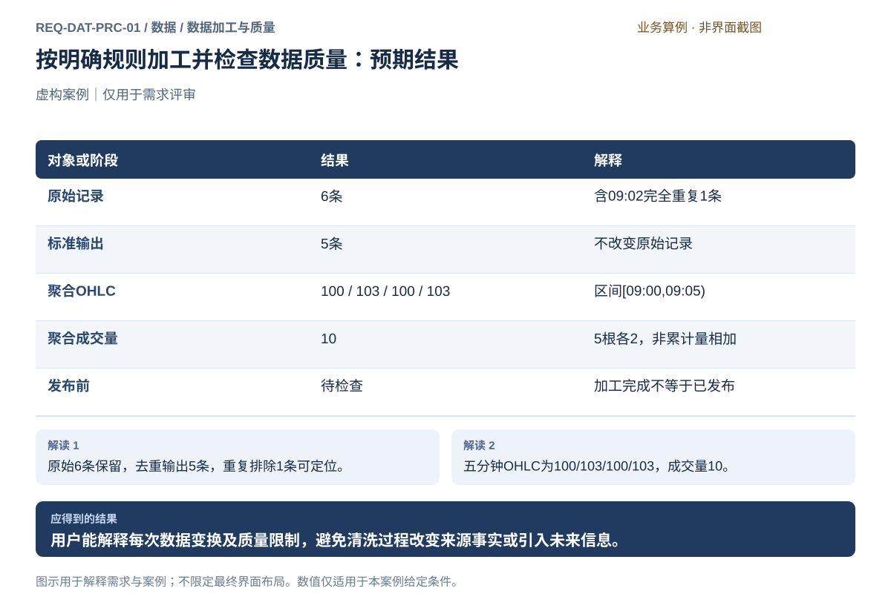
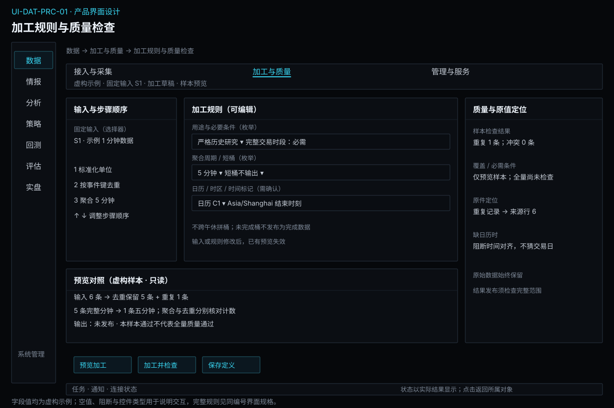

# 数据加工与质量

[返回上级](README.md) · [需求总纲](../../README.md) · [实际界面](../../common/screens.md) · [跨模块流程](../../workflows/README.md)

需求交付版 · 2026-10-18。细化规格已编制，用户逐项签认与产品验收分别记录；目标设计不代表已经实现，实际入口与差距见本页界面对应。

**归属：** 数据 / 数据加工与质量。本页集中保存业务需求、详细功能、案例、界面对应和验收；通用规则见[通用规范](../../common/README.md)。

## 需求导航

- [REQ-DAT-PRC-01 按明确规则加工并检查数据质量](#req-dat-prc-01)

## 1. 数据加工与质量：需求与设计

### 1.1 使用目标和加工顺序

使用者从这里回答“这些数据如何变成所需输入、变了哪些内容、还存在哪些限制”。标准化和质量检查既用于规则策略的时间序列，也用于多因子研究的跨合约、跨表对齐。加工不承担因子定义、收益标签、训练期拟合或样本优选。

一次加工绑定固定输入、基础资料、规则内容和输出用途。建议处理顺序为：**核验输入 → 解释来源语义 → 统一身份/单位/时间 → 区分重复和冲突 → 检查基础质量 → 执行已选聚合或连续规则 → 检查输出 → 生成报告并交接发布**。只执行本次必要步骤，不要求所有数据通过同一条复杂流水线。

| 内部能力     | 用户决定什么                         | 系统必须解释什么                           | 对应功能         |
| ------------ | ------------------------------------ | ------------------------------------------ | ---------------- |
| 标准化与去重 | 选输入、映射和明确规则               | 原值、标准值、去重键、排除理由、无法解释项 | FR-DAT-PRC-01-01 |
| 质量检查     | 选检查范围及用途必要条件             | 预期依据、实际观测、异常位置和未知范围     | FR-DAT-PRC-01-02 |
| 对齐与聚合   | 选时段、端点、目标周期和迟到处理规则 | 每条输入归属、各字段计算和不完整桶         | FR-DAT-PRC-01-03 |
| 连续序列     | 选候选月份、换月依据和价格处理方法   | 当时可得证据、切换记录、原月份映射与限制   | FR-DAT-PRC-01-04 |
| 结果交接     | 核对计数、问题和适用范围             | 输出身份、报告、依赖和未发布状态           | FR-DAT-PRC-01-05 |

### 1.2 加工定义和记录字段

| 信息组 | 必须记录                                                             | 约束                                                       |
| ------ | -------------------------------------------------------------------- | ---------------------------------------------------------- |
| 输入   | 内容身份、来源、数据层次、实际范围、记录数及内容摘要                 | 不能使用运行中会变化的“最新数据”                           |
| 身份   | 市场、品种、完整交割月/唯一合约身份、来源代码映射                    | 仅凭显示代码或名称不能合并；连续研究序列与交易合约类型分开 |
| 数值   | 字段含义、原单位、目标单位、价格精度、合约乘数及生效范围             | 价格和金额以精确十进制语义为准；没有依据不推断单位或乘数   |
| 时间   | 事件时间、时区、交易日、周期起止和闭合规则、可获得时间证据、取得时间 | 每一种时间各有含义；排序正确不等于没有未来信息             |
| 规则   | 有序步骤、参数、基础资料身份、实现内容身份及规则摘要                 | 重复执行应能核对相同输入和规则；修改后产生新的加工定义     |
| 输出   | 标准/派生内容身份、实际覆盖、各阶段计数、关联质量报告                | 原始数据保留；不直接改写已经发布或被引用的结果             |

### 1.3 清洗的允许行为与禁止行为

“清洗”必须具体到操作，不能作为删除异常记录或填平价格的笼统授权。

| 问题                         | 处理设计                                       | 必须留下的依据                               |
| ---------------------------- | ---------------------------------------------- | -------------------------------------------- |
| 同一事件键、内容完全相同     | 按已确认去重键保留一份标准记录                 | 全部来源记录位置、保留记录和重复计数         |
| 同一事件键、内容不同         | 保留原记录并标冲突；有明确更正链才选择修订     | 冲突字段、候选原值、来源更正证据             |
| 非关键字段缺失               | 保留缺失，说明对用途的影响                     | 字段及缺失原因；不显示为零                   |
| 身份、时间或关键单位无法解释 | 将相关记录列为不可用于该输出，保留原始记录     | 阻断原因及可修复的来源/资料条件              |
| 价格跳变或涨跌幅异常         | 标记疑点并给出检查依据                         | 实际原值和适用规则；不能默认削峰或替换成邻值 |
| 确认存在数据缺口             | 记录范围，进入补采或明确缩小样本的流程         | 缺口判定依据、受影响输出与用途               |
| 规则需要前值                 | 明确前值对象、有效时段、最大可接受间隔及可得性 | 被引用记录；不跨交易日、换月或休市无限延用   |

研究中的截尾、去极值、横截面标准化、缺失值统计填补，若依赖样本估计，必须由研究流程限定训练/评价边界；不能在全历史数据清洗时预先拟合后供所有回测使用。来源字段的固定单位换算则属于本模块。

### 1.4 时间对齐、聚合与跨表关联

1. **交易日归属。** 使用固定日历和有效时段解释夜盘及跨午夜，保留自然日期；不能直接把自然日加一作为所有夜盘的交易日。节假日调整按对应资料处理，缺失时标未知。
2. **周期端点。** 先声明来源时间戳是开端还是闭端，再归入目标区间。以本章案例的开端标记为例，`[09:00,09:05)`包含09:00至09:04的五根分钟线，09:05属于下一桶。
3. **字段聚合。** 开盘取首个有效开盘，高/低取极值，收盘取最后有效收盘；区间成交量求和，持仓量取对应末值；成交额只在明确同口径下求和。累计字段先解释重置范围再求差，不能把累计量逐条相加。
4. **时段边界。** 不把午间休市或不同交易时段拼成连续分钟；尾部不足一桶时按已选规则标短桶或不输出，并注明实际跨度。进行中的实时桶必须标未结束。
5. **缺口与迟到。** 输入缺失不能把剩余数据生成的桶标完整。迟到/更正影响已发布结果时生成新结果供比较，不原地改写旧快照；实时阶段说明是否接受迟到及消费者会收到何种更正事件。
6. **跨表对齐。** 以合约身份、字段有效区间和可获得时间连接日行情、结算参数、持仓排名等资料。只按交易日期连接不足以证明盘中可知；当日盘后公布数据不能用于当日盘中决策。

**累计量算例（虚构）。** 某来源明示同一交易日累计量连续：相邻累计值100、103、107对应后两段增量3和4；第一条之前没有基线，不能声称第一段成交量100。若后续变为2，只有来源明确在该点重置才按重置规则处理；否则列为冲突或未知，不能简单把负差截为零。

**对齐算例（虚构）。** T日持仓排名在T日18:00公布。对T日10:00的研究决策，可选最近一份在10:00前已公布且仍适用的资料；若没有则缺失。T日18:30才允许选T日版本。当前下载到这份资料只能证明取得时间，不能自行补出18:00公布证据。

### 1.5 连续合约序列

连续序列的定义至少包括候选合约集合、筛选条件、选择指标、指标可得时点、并列选择规则、换月条件、切换时点、缺少候选时的处理以及价格调整方法。它是研究派生数据，必须能逐段还原到实际月份合约。

例如使用T−1已公布持仓量决定T日合约，必须先核对T−1证据确实在选择时点可得；候选持仓量相同而未定义并列规则时拒绝生成。每次换月保存旧合约、新合约、指标值、证据时间、切换区间及价格处理参数。回溯调整可能使用未来换月信息，必须标注历史可得性限制，不能因价格看起来连续就宣称适用于严格时点回测。

生成研究序列不自动指定策略实际仓位如何换月；交易目标、成本、滑点、撮合及风险仍归研究/交易模块。行情服务和交易执行继续使用真实合约与真实价格。

### 1.6 质量报告与用途条件

报告必须能从汇总展开到问题及原记录，至少包括输入/规则/资料身份、检查范围、预期依据、已检查范围、未检查范围、问题类别、受影响对象、定位信息和处理建议。**报告没有问题**与**所有必要检查均通过**是两个条件，未运行或无法判断不能算通过。

| 维度         | 必须说明                                       | 典型用途限制                               |
| ------------ | ---------------------------------------------- | ------------------------------------------ |
| 覆盖         | 哪些对象和时段预期有记录；已有、缺失和未知范围 | 合约日覆盖满足不代表日内事件连续           |
| 一致性       | 身份、单位、交易日、OHLC关系、累计量语义       | 关键身份或单位冲突阻止有关计算             |
| 唯一性与顺序 | 真重复、同键冲突、乱序、迟到                   | 不以排序或去重掩盖来源丢失                 |
| 时效         | 最后事件与接收时间、有效交易时段、判断依据     | 最新报价可用于观察不代表能满足逐事件策略   |
| 历史可得性   | 已知公布/可得证据及未知范围                    | 严格时点研究不得接受未知证据为通过         |
| 修订与追溯   | 来源修订、加工依赖和受影响输入                 | 新报告只适用于绑定内容，不能覆盖旧实验证据 |

用途条件由消费业务声明，本模块给出逐项满足/不满足/未知的结论。展示、探索研究、严格历史模拟及实时策略可能要求不同；不设计一个适用于全部用途的通用“质量分”。必要条件失败不能靠点击“接受风险”绕过；非必要限制可随输出保留并由研究明确记录。

### 1.7 操作、结果与界面

目标流程为：在历史数据仓库选定版本 → 发起加工或检查 → 固定输入与规则 → 预览原值/结果/排除原因 → 确认执行 → 核对计数及问题 → 交给管理与服务发布。预览只说明样本变换，必须标样本范围，不能声称已对全量数据完成检查。

加工编辑区建议依附选中数据版本展开，包含输入摘要、规则步骤和样本对照；结果区包含执行结果、分阶段计数、问题列表与报告。当前仓库已有覆盖核对和数据查看入口，完整规则编辑、质量工作台和发布交接属于待实现设计。

逐阶段守恒核对适用于各自语义：去重例是6条输入＝5条保留＋1条重复；聚合是5条分钟输入→1条五分钟输出，不能将“输入条数＝最终输出条数＋异常数”作为全部加工的统一公式。失败或取消留下未发布结果与明确范围，不产生貌似完整的新快照。完整图例见[去重与五分钟聚合](#req-dat-prc-01)。

## 材料基础解析与语义提取边界

文件完整性、解码、正文/OCR/表格读取及原件坐标属于本子模块；可读内容中表达的实体、事件、数值含义和观点归[情报提取](../intelligence/extraction.md)。是否使用模型不改变职责。基础解析报告逐页/表的覆盖和失败，不虚构不可读内容；重解析保留原件和已被引用的解析记录。数字读取成功不能等同于证据核验通过。

## REQ-DAT-PRC-01 按明确规则加工并检查数据质量

**领域：** 数据 / 数据加工与质量　 **建议优先级：** P1核心必要　 **需求状态：** 交付规格已编制（定位与模块已确认；细节待用户签认）

### 目标与场景

用户能解释每次数据变换及质量限制，避免清洗过程改变来源事实或引入未来信息。

**使用者与场景：** 个人期货量化研究与实盘交易用户。

**触发条件：** 用户选择固定来源记录或数据版本，需要解释变换、对齐与质量限制后用于研究。

### 前置条件

- 对象、用途与来源明确；所需访问权限已核对。
- 所依赖资料不可用时明确阻止相应操作，不用虚构记录替代。

### 输入与含义

| 输入                         | 含义与单位                                       | 约束                                                                   |
| ---------------------------- | ------------------------------------------------ | ---------------------------------------------------------------------- |
| 定义加工规则并预览变更       | 将来源记录转换为可解释的标准数据，保留原始事实。 | 固定输入、字段映射、单位、时区、身份映射、去重键、加工顺序及规则内容。 |
| 按来源语义检查质量并定位问题 | 给出限定范围、具有判定依据的缺失与异常报告。     | 输入身份、检查范围、字段约束、来源无成交语义、有效时段。               |
| 对齐时间并按交易时段聚合     | 使不同频率的数据具有明确端点与缺口表达。         | 交易日历、时区、事件与可获得时间、目标周期、区间闭合规则、累计量语义。 |
| 按明确规则生产连续合约序列   | 让研究序列可复核，并与可交易月份合约区分。       | 候选月份、选择指标、指标可获得时间、换月条件、切换时点、价格处理方法。 |
| 核对加工结果并交接发布       | 将加工结束、质量结论与数据集发布分开。           | 输入及规则身份、各阶段计数、失败范围、输出内容、质量报告。             |

### 正常操作与反馈

1. 固定输入、基础资料和用途，定义必要的标准化、去重、对齐、聚合或连续规则。
2. 预览样本原值、变换结果及排除原因，确认规则后执行。
3. 核对分阶段计数、问题位置、未知范围和用途必要条件。
4. 保留原始内容，将独立输出、依赖与质量报告交给数据集发布检查。

### 业务规则

- 原始输入保持可追溯，加工生成独立结果；没有静默纠错。
- 规则及基础资料固定；检查报告只适用于其实际输入与范围。
- 数据加工不负责因子拟合、收益标签或策略信号；训练得到的填补与标准化由研究流程限定拟合范围。
- 来源公布时间未知时保留未知；当前下载时间不能证明历史可获得性。

### 输出与状态影响

- 独立加工结果、固定输入和规则身份、各阶段计数及可定位的排除或冲突记录。
- 限定范围的质量报告及用途限制；发布条件不满足时保持未发布结果。

### 异常与继续方式

| 发生什么                 | 应怎样表现                                     | 使用者如何继续                           |
| ------------------------ | ---------------------------------------------- | ---------------------------------------- |
| 同一事件键出现不同价格。 | 列为冲突保留原记录，不能以最后一条覆盖。       | 取得来源更正依据后明确规则并重新预览。   |
| 缺少目标日期的交易时段。 | 完整性未知，依赖时段的聚合与发布条件不能通过。 | 获取可靠日历资料后固定其身份并重新检查。 |

### 案例：按明确规则加工并检查数据质量案例

**虚构案例条件：** 虚构案例：09:00至09:04每分钟一根，共5根，收盘100/101/102/101/103，各量2，每根OHLC等于收盘；另有一条09:02完全重复。

1. 选择6条原始输入，预览明确键去重。
2. 核对5条输出，再按[09:00,09:05)聚合。
3. 审阅质量报告和输入输出计数后，交接数据集发布。

**预期结果：**

- 原始6条保留，去重输出5条，重复排除1条可定位。
- 五分钟OHLC为100/103/100/103，成交量10。

### 可观察验收条件

| 编号                | 给定                                                                                                               | 当                           | 则                                                                                                                         |
| ------------------- | ------------------------------------------------------------------------------------------------------------------ | ---------------------------- | -------------------------------------------------------------------------------------------------------------------------- |
| REQ-DAT-PRC-01-AC01 | 虚构案例：09:00至09:04每分钟一根，共5根，收盘100/101/102/101/103，各量2，每根OHLC等于收盘；另有一条09:02完全重复。 | 定义加工规则并预览变更       | 6条来源记录含1条完全重复时，去重后5条且仍能定位全部6条来源记录。                                                           |
| REQ-DAT-PRC-01-AC02 | 虚构案例：09:00至09:04每分钟一根，共5根，收盘100/101/102/101/103，各量2，每根OHLC等于收盘；另有一条09:02完全重复。 | 按来源语义检查质量并定位问题 | 日历缺失时报告完整性未知，不给100%完整结论。                                                                               |
| REQ-DAT-PRC-01-AC03 | 虚构案例：09:00至09:04每分钟一根，共5根，收盘100/101/102/101/103，各量2，每根OHLC等于收盘；另有一条09:02完全重复。 | 对齐时间并按交易时段聚合     | 案例[09:00,09:05)五根分钟收盘100/101/102/101/103、各成交量2且每根OHLC均等于收盘时，五分钟OHLC为100/103/100/103，成交量10。 |
| REQ-DAT-PRC-01-AC04 | 虚构案例：09:00至09:04每分钟一根，共5根，收盘100/101/102/101/103，各量2，每根OHLC等于收盘；另有一条09:02完全重复。 | 按明确规则生产连续合约序列   | 案例以T-1已可得持仓量选择T日合约时，证据明确到T-1时点。                                                                    |
| REQ-DAT-PRC-01-AC05 | 虚构案例：09:00至09:04每分钟一根，共5根，收盘100/101/102/101/103，各量2，每根OHLC等于收盘；另有一条09:02完全重复。 | 核对加工结果并交接发布       | 6条输入、1条重复、5条输出计数能核对，并可追溯排除记录。                                                                    |

### 决定与配置约束

- **DEC-DAT-PRC-01-01**：**规格决定**。支持1分钟到5/15/30/60分钟和日到周/月聚合；连续规则为显式月份表或前日持仓量选主力，研究价差后复权可选。必检身份、时间、单位、重复、缺口、OHLC及价格步长。

- **DEC-DAT-PRC-01-02**：**规格决定**。身份、价格、时间证据无效和来源权限缺失阻断依赖任务；探索可在显式标记缺口并排除受影响样本后继续。执行所需输入缺失不得以插值补成可交易事实。

### 详细功能

### FR-DAT-PRC-01-01 定义加工规则并预览变更

**目标与结果：** 将来源记录转换为可解释的标准数据，保留原始事实。

**触发：** 在UI-DAT-PRC-01选择对象后发起“定义加工规则并预览变更”。

**输入与约束：** 固定输入、字段映射、单位、时区、身份映射、去重键、加工顺序及规则内容。

**目标操作与反馈：**

1. 选择原始数据和基础资料身份，逐项定义规则。
2. 预览样本的原值、加工后值、排除原因和计数。
3. 确认完整规则后开始加工，结果保存为独立输出。

**异常与边界：**

- 同一事件的完全重复可按明确键去重，值冲突必须单列，不能按最后一条盲选。
- 加工预览不改输入；修改任何规则使旧预览与确认失效。

**验收条件：**

- **FR-DAT-PRC-01-01-AC01**：6条来源记录含1条完全重复时，去重后5条且仍能定位全部6条来源记录。
- **FR-DAT-PRC-01-01-AC02**：同时间不同来源或不同事件身份不得仅按时间戳合并。

**界面对应：** [UI-DAT-PRC-01 加工规则与质量检查](#ui-dat-prc-01)。

### FR-DAT-PRC-01-02 按来源语义检查质量并定位问题

**目标与结果：** 给出限定范围、具有判定依据的缺失与异常报告。

**触发：** 在UI-DAT-PRC-01选择对象后发起“按来源语义检查质量并定位问题”。

**输入与约束：** 输入身份、检查范围、字段约束、来源无成交语义、有效时段。

**目标操作与反馈：**

1. 选择范围，展示实际采用的时段和规则。
2. 检查完整性、重复、冲突、时间顺序、单位及价格关系。
3. 按问题定位原记录；选择补采、修改规则或保留限制。

**异常与边界：**

- 无法确认来源是否省略无成交区间时，缺条不能直接认定缺失。
- 异常价格先标记；没有外部更正证据不自动替换真实价格。

**验收条件：**

- **FR-DAT-PRC-01-02-AC01**：日历缺失时报告完整性未知，不给100%完整结论。
- **FR-DAT-PRC-01-02-AC02**：检查本身不改变输入内容；目录展示同一份报告身份。

**界面对应：** [UI-DAT-PRC-01 加工规则与质量检查](#ui-dat-prc-01)；[UI-DAT-SRV-02 数据目录与修订对照](management.md#ui-dat-srv-02)。

### FR-DAT-PRC-01-03 对齐时间并按交易时段聚合

**目标与结果：** 按固定日历、时间端点和来源量价语义对齐与聚合，并确保跨表关联不引入当时未知资料。

**触发：** 在UI-DAT-PRC-01选择对象后发起“对齐时间并按交易时段聚合”。

**输入与约束：** 交易日历、时区、事件与可获得时间、目标周期、区间闭合规则、累计量语义。

**目标操作与反馈：**

1. 固定交易日历、来源时间戳含义、区间端点及目标周期，预览夜盘和时段边界归属。
2. 按明确规则计算OHLC、区间成交量及末值持仓量；累计量先解释重置与基线，缺口和进行中桶单列。
3. 关联其他表时同时核对身份、有效区间和可获得时间；列出不可用与未知范围，再确认独立输出。

**异常与边界：**

- 不跨休市间隔拼接K线；未结束区间不能标完成。
- 不默认向前填充价格或填零；已知无成交与未知缺失必须不同。

**验收条件：**

- **FR-DAT-PRC-01-03-AC01**：案例五根开端标记分钟线归入[09:00,09:05)，OHLC为100/103/100/103、成交量10；09:05归下一桶；少一根且无合法无成交说明时标不完整。
- **FR-DAT-PRC-01-03-AC02**：来源同交易日累计量100→103→107的后两段增量为3和4；无前基线时首段未知；后续降为2且无重置证据时报告冲突或未知，不截为零。

**界面对应：** [UI-DAT-PRC-01 加工规则与质量检查](#ui-dat-prc-01)。

### FR-DAT-PRC-01-04 按明确规则生产连续合约序列

**目标与结果：** 让研究序列可复核，并与可交易月份合约区分。

**触发：** 在UI-DAT-PRC-01选择对象后发起“按明确规则生产连续合约序列”。

**输入与约束：** 候选月份、选择指标、指标可获得时间、换月条件、切换时点、价格处理方法。

**目标操作与反馈：**

1. 查看研究指定规则以及每次切换所需的历史依据。
2. 预览换月日期、旧新合约映射和价格处理前后差异。
3. 生产独立序列并保存输入、规则、切换记录和适用限制。

**异常与边界：**

- 需要当日收盘后才可知的指标不能用于当日盘中选主力。
- 连续或调整价格不得直接作为真实委托价格；回测执行需映射到真实合约。

**验收条件：**

- **FR-DAT-PRC-01-04-AC01**：案例以T-1已可得持仓量选择T日合约时，证据明确到T-1时点。
- **FR-DAT-PRC-01-04-AC02**：未来换月引起回溯价格调整时产生新快照，并明确其历史时点可用性限制。

**界面对应：** [UI-DAT-PRC-01 加工规则与质量检查](#ui-dat-prc-01)；[UI-ANA-EDA-01 研究问题与样本计划](../analysis/exploration.md#ui-ana-eda-01)。

### FR-DAT-PRC-01-05 核对加工结果并交接发布

**目标与结果：** 逐加工阶段核对输入输出、排除和问题计数，将独立结果与质量依据交给发布检查。

**触发：** 在UI-DAT-PRC-01选择对象后发起“核对加工结果并交接发布”。

**输入与约束：** 输入及规则身份、各阶段计数、失败范围、输出内容、质量报告。

**目标操作与反馈：**

1. 查看输入、输出、重复排除与问题计数。
2. 失败时保留记录和已生成的未发布输出，允许显式新建加工任务。
3. 达到指定用途的必要条件后，将固定输出交给数据集发布检查。

**异常与边界：**

- 规则不完整或加工失败不能发布成完整数据集。
- 接受已知限制不等于允许绕过用途所需的完整性和可获得时间条件。

**验收条件：**

- **FR-DAT-PRC-01-05-AC01**：去重阶段6条输入＝5条保留＋1条重复；聚合阶段5条分钟输入→1条五分钟输出，分别解释计数，不强套同一行数守恒式。
- **FR-DAT-PRC-01-05-AC02**：取消先显示取消中；实际停止前不标已取消，部分输出保持未发布；用途必要条件失败不能以接受警告绕过。

**界面对应：** [UI-DAT-PRC-01 加工规则与质量检查](#ui-dat-prc-01)；[UI-DAT-SRV-03 数据集、快照与存储](management.md#ui-dat-srv-03)；[UI-SYS-RUN-02 任务中心](../system/tasks-nodes.md#ui-sys-run-02)。

### FR-DAT-PRC-01-06 解析材料基础结构并报告可读范围

**目标与结果：** 提供可定位的文本表格和质量证据，供情报理解。

**触发：** 检查文件完整性和格式，执行解码、正文、OCR或表格基础读取。

**输入与约束：** 原件引用、格式、语言、页段/表格坐标、解析方法与结果。

**目标操作与反馈：**

1. 检查文件完整性和格式，执行解码、正文、OCR或表格基础读取。
2. 显示成功页、失败页和定位依据，保留原件与解析记录。
3. 把可读范围交给情报语义提取；重解析产生新结果供比较。

**异常与边界：**

- OCR可使用模型但不负责判断减产是否利多。
- 不能将识别错误数字静默改成看似合理数值。

**验收条件：**

- **FR-DAT-PRC-01-06-AC01**：坏页明确显示，不宣称整篇完整。
- **FR-DAT-PRC-01-06-AC02**：提取出的原文位置能够回到原件。
- **FR-DAT-PRC-01-06-AC03**：文件解析成功不等于情报核验通过。

**界面对应：** [UI-DAT-PRC-01 加工规则与质量检查](#ui-dat-prc-01)。

## 界面设计与实际对应

## UI-DAT-PRC-01 加工规则与质量检查

**业务目标：** 定义可追溯的标准化、清洗对齐和聚合规则，检查质量并交接未发布结果。

**对应情况：待设计。** 已有覆盖核对及数据查看入口；清洗、去重、聚合和连续序列的独立加工与质量工作台尚无对应页面。 情报材料接入、基础解析或情报数据访问尚待设计。

**实际入口：** 主导航 → 数据 → 历史数据仓库

[查看实际界面及对应说明](../../prototype.html#UI-DAT-PRC-01)

- [历史数据仓库：截图、字段和操作](../../common/screens.md#screen-data-records)

### 页面形态与目标布局

**设计状态：** 目标规格已编制，含布局、字段、动作和关键状态；尚未获得逐项产品签认或实现验收。现状对应证据保持上文说明，图稿不是运行截图。

**界面形态：** 编辑与试算工作区。

**目标到达路径：** 数据 → 加工与质量 → 加工规则与质量检查。这是已确认导航下的目标入口，实际对应仍见上方证据。

| 区域 | 要显示的内容 |
| --- | --- |
| 顶部上下文 | 固定输入 / 加工草稿 |
| 列表、分类或步骤区 | 规则顺序 / 适用范围 |
| 主要工作区 | 处理参数 / 前后数据预览 |
| 选中项详情或检查区 | 质量问题 / 定位证据 |
| 主要动作区 | 预览加工 / 运行检查 |

**区域联动与返回：** 选择列表或步骤只更新当前对象及详情，不隐式启动业务；图表与明细使用同一输入或结果上下文。离开并返回保留已确认的对象和查询条件，未保存草稿按本页保存语义处理。异步提交后用请求/任务身份定位实际状态，不能把操作按钮点击当作成功。

**窗口与空间：** 复用现有主窗口框架。宽度缩小时优先收拢辅助详情，表格在内容区横向滚动；主操作和关键上下文不能被页面裁切。重新展开详情仍指向原选中对象。

**状态设计范围：** 以本页状态/异常和验收为准，正常操作、首次无对象、筛选无匹配、请求中、失败及该业务的未知状态分别说明；不适用状态需说明原因，不套用虚构成功数据。字段类型、默认值和动作前提见下文；关键状态按本页交付约定及模块状态图检查。[返回界面设计总览](../../common/ui-designs.md)。

### 目标交互设计（待实现）

以下为目标交互规格，原有实际入口和截图保持。 情报材料相关字段和动作是新增待设计能力，不代表当前截图已具备。

**字段与信息：**

- 新增目标信息：原件引用、正文/OCR/表格解析方法、页段定位、成功/失败范围及质量限制。

**动作与反馈：**

- 预览基础解析；定位不可读页；保留旧引用并显式重新解析。

**状态与异常：**

- 可读、部分可读、不可读与语义核验状态分别呈现。

### 业务验收要求（待验收，不代表截图已证明实现）

- **UI-DAT-PRC-01-AC01**：五分钟聚合案例算术与原始5条一致，重复不重复计量。
- **UI-DAT-PRC-01-AC02**：修改规则使原确认失效，原始输入不改变。
- **UI-DAT-PRC-01-AC03**：未知日历与可得时间不被表述为检查通过。
- **UI-DAT-PRC-01-AC04**：可读、部分可读、不可读与语义核验状态分别呈现。

### 字段与操作交付约定

以下补齐页面关键字段的类型、初始值与边界；已有功能条目的输入规则仍适用。进入已有对象时加载实际保存值，新建时未明确给默认的必填项为空，不能借用案例数值。只读缺失统一显示“—”并提供原因。

| 字段组 | 类型与单位 | 初始值、检查及变化影响 |
| --- | --- | --- |
| 规则链 | 有序规则及参数 | 每步选择有限能力和输入字段，参数单位必填 |
| 输入与样本 | 固定快照、预览范围 | 不可引用变化中的选择；改变输入后清旧试算资格 |
| 质量门槛 | 问题类别、阻断/排除政策 | 关键身份/时间/价格错误不可降为可执行；修复保留原值和证据 |

**操作顺序：** 使用“预览加工 / 运行检查”完成本页任务；先选择固定对象并补齐必填项，再检查范围和影响，最后提交有副作用的动作。查看、筛选和返回不隐式执行业务；保存、发布、启动、授权和撤单各自显示实际结果，不能合并为一个成功提示。

| 关键状态 | 信息与允许操作 | 禁止或返回行为 |
| --- | --- | --- |
| 首次为空或无匹配 | 显示当前规则链范围，提供创建/补齐或清除筛选入口；只读详情说明来源 | 不填示例数据，不把无权限显示为无记录 |
| 输入错误或前提缺失 | 在“输入与样本”等具体字段旁说明问题，保留其他输入，焦点移至首个错误 | 依赖错误项的动作不可提交，返回不丢草稿 |
| 加载、运行或部分结果 | 保留对象身份和最后可靠时间，展示实际阶段/覆盖；可查看“质量门槛”已有证据 | 未完成不能显示全量成功，不能用加载中的空表覆盖已知事实 |
| 失败或结果未知 | 已明确失败可修正输入后独立提交；可能已受理则查询原请求/对象；展示未决范围 | 未核实前不重复有副作用的操作，不把取消页面当取消业务 |
| 离开及返回 | 已保存对象可由原身份重开，未保存编辑提供保存/放弃/留在当前页；关闭抽屉只改变展示 | 即时偏好不套草稿确认；秘密取消后不留普通表单缓存 |

**交互验收案例：** 在本页选择一个有效对象，改变“规则链”后核对旧预览是否失效；制造“输入与样本”缺项或不可用，确认原因与阻断；补齐后完成主要动作，核对“质量门槛”与关联对象结果，再离开返回。只读字段通过隔离测试回复制造状态，不在实际界面篡改业务事实。适用的具体成功结果仍以本页原有案例及AC为准。

关键状态的视觉呈现见[状态设计约定](../../common/ui-designs.md#state-designs)及本模块状态图；状态与动作按本表及关联FR逐项验收，静态图不冒充已执行交互。

### 对应功能需求

- [FR-DAT-SRV-02-02 请求质量核对并定位问题证据](management.md#fr-dat-srv-02-02)
- [FR-DAT-PRC-01-01 定义加工规则并预览变更](#fr-dat-prc-01-01)
- [FR-DAT-PRC-01-02 按来源语义检查质量并定位问题](#fr-dat-prc-01-02)
- [FR-DAT-PRC-01-03 对齐时间并按交易时段聚合](#fr-dat-prc-01-03)
- [FR-DAT-PRC-01-04 按明确规则生产连续合约序列](#fr-dat-prc-01-04)
- [FR-DAT-PRC-01-05 核对加工结果并交接发布](#fr-dat-prc-01-05)
- [FR-DAT-PRC-01-06 解析材料基础结构并报告可读范围](#fr-dat-prc-01-06)

