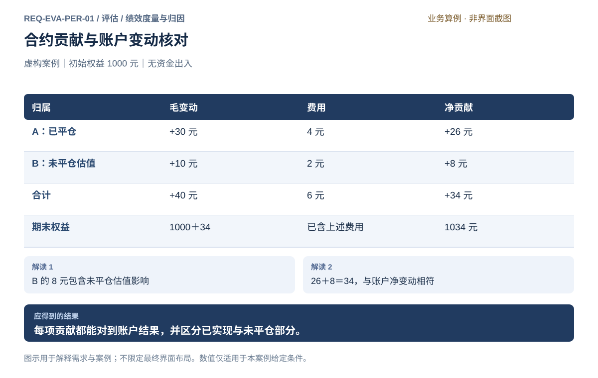

# 绩效度量与归因

[返回上级](README.md) · [需求总纲](../../README.md) · [界面规范](../../common/ui-designs.md) · [跨模块流程](../../workflows/README.md)

开发前产品需求规格。本页定义目标功能、界面操作、业务规则及验收条件。

**归属：** 评估 / 绩效度量与归因。本页集中保存业务需求、详细功能、案例、界面对应和验收；通用规则见[通用规范](../../common/README.md)。

## 需求导航

- [REQ-EVA-PER-01 统一度量绩效并解释收益与成本来源](#req-eva-per-01)

## 目标与对象

在明确对象、资金和区间口径下计算表现，并解释每项收益和成本。回测、模拟、实盘共用评价定义，但事实来源与估值质量分别标识；不能为了同一界面而宣称结果天然可比。

| 对象       | 关键字段                                              | 必须守住的边界                                           |
| ---------- | ----------------------------------------------------- | -------------------------------------------------------- |
| 绩效范围   | 环境、账户/组合/策略、来源切片、截止、实际样本        | 分段起点及跨段持仓明确，已保存结果不随新成交变化         |
| 资金与收益 | 期初/期末权益、外部流入流出、已实现与未平仓影响、费用 | 投资利润与现金净增加分开；保证金不是收益率分母的默认替代 |
| 指标口径   | 公式、采样、年化日历、费用、样本、适用条件            | 收益风险调整指标需同时固定两端口径；未定义不显示零       |
| 基准       | 来源、日期、币种、费用与敞口特征、选定理由            | 事前选取；无合适基准可只评绝对表现，不事后挑弱基准       |
| 归因       | 合约、方向、策略、时间、交易、价格与费用贡献、残差    | 汇总与同范围权益核对，成本不能重复扣减                   |

## 操作流程与解释

1. 先选择来源和对象，检查现金流、估值、成本与样本完整性。
2. 核对权益变化和投资损益，再选择有资料支持的收益率方法。金额利润可计算不代表年化、资金加权或时间加权收益都可计算。
3. 查看权益、交易统计与适当基准；风险曲线引用风险分析的固定结果。
4. 按策略、品种、方向、时间与交易下钻，保留未平仓、未分配成本与残差。
5. 保存解释并进入风险、稳健性或统一报告；需要改数据回到来源，不能直接在报告中修改成交价格。

无现金流例：期初1000元，净利34元，期末1034元，区间收益3.4%。有现金流例：期初1000、期末1534、期间净入金500，则投资利润34；如果缺少所选收益率方法需要的入金时点估值，不能套用3.4%或53.4%。本例只证明金额核对，不预先指定生产收益率默认方法。

同口径策略收益5%、基准3%，算术超额为2个百分点。报告明确采用算术差，不把它混称为相对财富比率或金额。净胜率必须说明闭合交易定义、费用和未平仓排除；样本不足、零分母及负权益下失效的百分比要显示不可用及原因。

## 界面要求

顶部固定来源、对象和截止；中间权益与表现摘要；下方归因表和交易证据。筛选改变范围要更新口径说明，切换环境不能沿用旧账户身份。点击曲线和表格保留同一评价上下文跳转风险或源账本。只读展示不能隐式重新跑实验。表格、空态、焦点、语言与数值遵循通用规范。

## REQ-EVA-PER-01 统一度量绩效并解释收益与成本来源

**领域：** 评估 / 绩效度量与归因　 **建议优先级：** P1核心必要　 **需求性质：** 目标功能与验收规格

### 目标与场景

用户能够从账户权益追溯到交易、费用和未平仓影响，判断策略依靠什么获利以及何时承担风险。统计指标应给出计算口径，不能把毛收益、已平仓收益或局部归因误当成完整账户结果。

**使用者与场景：** 个人研究与交易用户，审阅回测、模拟或实盘表现时。

**触发条件：** 打开固定评价切片，或从回测和交易入口查看绩效。

### 前置条件

- 账户结果、交易记录和成本归属可核对。
- 报告区间、资金出入、估值或结算口径已明确。

### 输入与含义

| 输入           | 含义与单位                                           | 约束                                                     |
| -------------- | ---------------------------------------------------- | -------------------------------------------------------- |
| 评价对象与来源 | 策略/组合/账户、回测/模拟/实盘、来源记录及观察截止。 | 运行中的账户取固定切片；新成交到达不悄悄改变已保存评价。 |
| 报告范围       | 全程、指定日期段或预先定义的验证段。                 | 分段初始权益及跨段持仓处理须明确。                       |
| 归因维度       | 按实际合约、时间或交易观察收益和风险。               | 同一项收益不能在多个合计中重复计入。                     |
| 绩效口径       | 收益、回撤、波动、胜率和持有期等指标的定义。         | 样本不足或不适用时说明原因；未定义不能显示为零。         |

### 正常操作与反馈

1. 用户查看账户初始与期末权益、净变动和回撤等摘要。
2. 用户展开毛盈亏、费用、资金出入及未平仓影响。
3. 用户按实际合约或时间段追溯贡献，查看相关交易与估值依据。
4. 用户检查无法完整归因的项目及指标限制，再形成研究解释。

### 业务规则

- 净收益必须明确是否扣除所有已声明费用，以及是否包含未平仓估值。
- 归因合计须与所声明的账户范围核对，存在残差时显示而非藏入其他收益。
- 合约份额、保证金占用与收益贡献含义不同，不用同一比例替代。
- 胜率需说明统计交易的闭合方式；未平仓不能伪作盈利交易提高胜率。
- 回测、模拟和实盘分别标识；只能在范围、资金、策略与口径可比较时对照，不能拼接成一条未经说明的收益。
- 现金出入与投资盈亏分开，不能把入金当盈利；金额净变动和收益率口径分别说明。
- 权益路径和归因读取来源账本，不在评估模块修订成交、估值或费用事实。
- 风险统计由风险分析生成并被绩效摘要引用，不另算一套回撤；风险调整指标同时绑定收益及风险口径。

### 输出与状态影响

- 带口径的绩效摘要和可下钻的交易证据。
- 可核对的收益贡献合计、未平仓部分及任何尚未解释差额。

### 异常与继续方式

| 发生什么                             | 应怎样表现                                       | 使用者如何继续                                                 |
| ------------------------------------ | ------------------------------------------------ | -------------------------------------------------------------- |
| 只有日期信息，没有盘中成交时间。     | 仅提供日期精度持有期，不能显示精确分钟数。       | 用户取得可靠时间资料后在独立结果中提高精度。                   |
| 归因合计与同范围账户净变动无法核对。 | 显示差额及未解释状态，不增加虚构收益项抹平差额。 | 用户检查范围、资金出入及估值口径，在差额解释前不采信完整归因。 |

### 案例：两份合约贡献核对账户权益

**虚构案例条件：** 虚构案例：初始权益 1000 元，无资金出入。示例合约 A 的已平仓毛盈亏 30 元、费用 4 元；示例合约 B 的未平仓估值增加 10 元、已发生费用 2 元。假设无其他账户变动。

1. A 净贡献为 30－4＝26 元。
2. B 净贡献为 10－2＝8 元。
3. 合计净变动为 34 元。

**预期结果：**

- 期末权益 1034 元，总费用 6 元。
- 报告明确 8 元来自含未平仓估值的 B，不称两笔交易均已实现盈利。

### 可观察验收条件

| 编号                | 给定                   | 当                         | 则                                                       |
| ------------------- | ---------------------- | -------------------------- | -------------------------------------------------------- |
| REQ-EVA-PER-01-AC01 | 案例没有其他账户变动。 | 核对归因。                 | A 26 元加 B 8 元等于账户净变动 34 元，期末权益 1034 元。 |
| REQ-EVA-PER-01-AC02 | B 尚未平仓。           | 查看成交胜率或已实现盈亏。 | B 不被伪装为已完成盈利交易，未平仓影响单独说明。         |
| REQ-EVA-PER-01-AC03 | 某指标缺乏足够样本。   | 查看该指标。               | 显示不适用或未定义及原因，不能填入零值代替。             |

### 决定与配置约束

- **DEC-EVA-PER-01-01**：**规格决定**。总/期间/年化收益、波动率、Sharpe、回撤、胜率、盈亏比、换手、费用；按成员/品种/方向/时段归因。每项记录公式口径、有效样本及不可计算原因。

- **DEC-EVA-PER-01-02**：**运行配置**。年化依据选定交易日历，基准默认未选择、无风险收益必须显式配置；现金流按可得时点估值切段，估值不足时不计算严格时间加权收益。

### 详细功能

### FR-EVA-PER-01-01 查看权益与风险随时间变化

**目标与结果：** 使用户看见回撤路径和资金变化，而非只看期末收益。

**触发：** 结果分析选择报告区间并查看权益图。

**输入与约束：** 实验、时间段、资金出入与估值口径；图形分段初值需说明。 改变区间后重新说明起点，不将局部收益冒充全程。

**目标操作与反馈：**

1. 查看初始权益、期末权益与净变动。
2. 在图中选择日期查看权益和回撤。
3. 缩小范围时同时查看跨段持仓与起点口径。

**异常与边界：**

- 样本不足的年化指标标未定义，不填零。
- 存在资金出入时与投资收益分开，不把入金当获利。

**验收条件：**

- **FR-EVA-PER-01-01-AC01**：案例无资金出入，1000至1034元对应净变动34元。
- **FR-EVA-PER-01-01-AC02**：选择图中日期能看到确切值及其估值口径。

**界面对应：** [UI-EVA-PER-01 绩效与收益归因](#ui-eva-per-01)。

### FR-EVA-PER-01-02 追溯每笔成交及实际成本

**目标与结果：** 用户能从一次盈亏看到开平价格、手数和费用，不把毛胜率当净胜率。

**触发：** 结果选择交易记录或从贡献行进入明细。

**输入与约束：** 实际月份、方向、开平、数量、价格、费用和可用时间精度。 费用按实际成交归属展示，零费用与未知费用明确区分。

**目标操作与反馈：**

1. 筛选合约或日期，选择交易。
2. 查看各次成交和费用归属。
3. 核对闭合交易的毛净盈亏与未闭合部分。

**异常与边界：**

- 未平仓不计成已完成盈利交易。
- 只有日期时仅显示日期精度持有期，不伪造分钟数。

**验收条件：**

- **FR-EVA-PER-01-02-AC01**：案例A开100平103乘数10一手显示毛30、费4、净26元。
- **FR-EVA-PER-01-02-AC02**：未闭合持仓的已发生费用仍计入账户结果。

**界面对应：** [UI-EVA-PER-01 绩效与收益归因](#ui-eva-per-01)。

### FR-EVA-PER-01-03 按合约或时间解释收益贡献

**目标与结果：** 使贡献合计与账户同范围结果核对，明确未平仓和未解释差额。

**触发：** 结果切换合约贡献或时间贡献。

**输入与约束：** 归因范围、维度和资金处理口径；同一收益不重复计入。

**目标操作与反馈：**

1. 选择维度并查看毛变动、费用和净贡献。
2. 展开含未平仓估值的部分及其依据。
3. 核对合计与账户变动，查看任何差额。

**异常与边界：**

- 不能靠虚构其他收益项抹平差额。
- 保证金占用比例与收益贡献比例不同，不混用。

**验收条件：**

- **FR-EVA-PER-01-03-AC01**：A净26、B净8合计34元，与账户变化一致。
- **FR-EVA-PER-01-03-AC02**：B含未平仓估值的贡献明确标注，差额非零时显示未解释。
- **FR-EVA-PER-01-03-AC03**：切换归因维度不改变账户净变动，时间区间与账户核对范围一致。

**界面对应：** [UI-EVA-PER-01 绩效与收益归因](#ui-eva-per-01)。

### FR-EVA-PER-01-04 核对指标口径并记录解释限制

**目标与结果：** 用户知道某个统计值如何得到，以及哪些结论超出证据。

**触发：** 点击绩效指标说明或记录结果解释。

**输入与约束：** 所选指标、样本范围、统计定义及关联研究问题。 说明列明实际样本数量和时间精度，便于后续复核。

**目标操作与反馈：**

1. 查看收益、回撤、胜率等指标定义。
2. 检查样本量、未定义和不适用原因。
3. 把带范围的指标解释保存到固定评价，统一报告引用它；研究项目可引用该评价。

**异常与边界：**

- 结果解释不能修改权威账户数值。
- 不能将毛指标标为净指标，或把局部样本结论扩大为全期。

**验收条件：**

- **FR-EVA-PER-01-04-AC01**：净胜率说明扣费口径及闭合交易数量。
- **FR-EVA-PER-01-04-AC02**：保存解释后结果数值不变，说明与实验身份绑定。

**界面对应：** [UI-EVA-PER-01 绩效与收益归因](#ui-eva-per-01)；[UI-ANA-EDA-01 研究问题与样本计划](../analysis/exploration.md#ui-ana-eda-01)；[UI-SYS-REC-03 导出资料](../system/records.md#ui-sys-rec-03)；[UI-EVA-VAL-03 评价结论与统一报告](validation.md#ui-eva-val-03)。

### FR-EVA-PER-01-05 区分现金流、投资损益和收益率

**目标与结果：** 避免资金进出造成虚假收益。

**触发：** 进入相应评价工作区或打开关联证据。

**输入与约束：** 期初/期末权益、准确时间的净外部资金流、估值和收益率方法。

**目标操作与反馈：**

1. 先核对权益变动与资金流水。
2. 展示剔除外部资金流后的投资损益。
3. 按声明方法和实际资料计算收益率，列明分段估值依据。

**异常与边界：**

- 有现金流时不能直接以期末减期初作为投资利润。
- 缺少所选收益率方法所需估值时不猜测；可以展示可核对的金额，不伪造收益率。

**验收条件：**

- **FR-EVA-PER-01-05-AC01**：1000到1534且净入金500时投资利润34元，不是534元。
- **FR-EVA-PER-01-05-AC02**：入金时点估值缺失且所选方法要求它时收益率显示不可计算及原因。

**界面对应：** [UI-EVA-PER-01 绩效与收益归因](#ui-eva-per-01)。

### FR-EVA-PER-01-06 核对基准与同口径绩效对照

**目标与结果：** 让相对表现有明确比较对象。

**触发：** 进入相应评价工作区或打开关联证据。

**输入与约束：** 事前选定基准、日期/币种/费用/敞口口径、覆盖范围与来源。

**目标操作与反馈：**

1. 说明基准用途和适用限制。
2. 按共同日期核对净收益和基准表现。
3. 展示绝对收益与声明方法的相对表现，保留排除范围。

**异常与边界：**

- 没有合适基准时允许仅评绝对表现，不能事后挑弱基准美化。
- 不把不同资金流、费用或周期的数字直接排名。

**验收条件：**

- **FR-EVA-PER-01-06-AC01**：同口径策略5%、基准3%时算术差2个百分点，不能写成2元或相对比值收益。
- **FR-EVA-PER-01-06-AC02**：基准缺期时保留缺口，不按零收益补齐。

**界面对应：** [UI-EVA-PER-01 绩效与收益归因](#ui-eva-per-01)。

## 界面设计与操作规格

## UI-EVA-PER-01 绩效与收益归因

**业务目标：** 核对固定账户或实验切片的收益、外部资金流、成本和成员贡献，保留不能计算的理由。

**目标到达路径：** 评估 → 绩效与归因 → 绩效与收益归因。

**界面布局：** 顶部固定评价对象与观察截止；中央权益/现金流/成交/归因页签；右侧指标公式、样本与年化说明；底部逐笔账本下钻。

### 字段与操作交付约定

新建对象中未指定默认值的必填字段为空；进入已有对象加载其固定值。只读缺失显示“—”和原因，案例数值不得作为用户数据。时间字段显示时区、交易日归属与精度，金额和比例在字段旁标单位。

| 字段 | 类型 | 默认值、约束与反馈 |
| --- | --- | --- |
| 来源环境 | 单选 | 历史回测、实时模拟、柜台仿真或实盘；新建必须显式选择，切换清空不兼容对象。 |
| 评价对象 | 固定对象选择 | 运行、共享组合或账户切片；成员分项不能与组合总额重复相加。 |
| 观察区间与截止 | 时间范围 | 显示时区、交易日历及可靠数据截止，缺口不自动补成0。 |
| 收益率方法 | 单选 | 无外部流直接收益或精确分段TWR；资料不足时仅报告可核对金额，不擅加近似方法。 |
| 净外部资金流 | 只读明细 | 每笔时间、入出金金额和来源；收益归因中单列，不能计为投资收益。 |
| 估值与费用口径 | 只读引用 | 价格来源、结算口径、未平仓估值、费用单位和扣费时点。 |
| 采样频率与年化基数A | 频率及正数 | 固定日历与缺口规则；明确sqrt(A)约定及未调整自相关。 |
| 无风险收益假设 | 年率及转换规则 | 可明确设0并注明假设；非零需固定来源及同周期转换。 |
| 比较基准 | 对象或无基准 | 显示时间、币种、费用与敞口差异；不得据有利结果自动选基准。 |
| 归因维度 | 枚举 | 成员、品种、真实合约、方向或交易时段；未分配残差单列。 |
| 指标及证据 | 只读表 | 值、单位、有效N、公式、来源、适用限制；不可计算显示原因。 |
| 解释记录 | 多行文本 | 保存时关联固定评价；说明限制不能修改账本数值。 |

### 动作与反馈

| 按钮或操作 | 可用条件 | 结果与失败处理 |
| --- | --- | --- |
| 计算绩效 | 固定对象可读，范围与方法满足适用条件 | 创建评价，固定资金流及估值引用；不触发交易。 |
| 下钻成交／资金流 | 已选图点、指标或贡献行 | 定位相同范围的成交与账本，不用最新数据替换。 |
| 核对归因 | 已有总损益及归属明细 | 显示贡献合计、残差和总额，未归属项可继续查看。 |
| 保存解释 | 已有评价且文本非空 | 保存独立解释与证据，不覆盖原账本。 |
| 返回来源 | 始终可用 | 恢复原运行或账户选择；离开不取消计算，未保存解释可保存、放弃或留页。 |

### 关键状态

| 状态 | 显示与继续方式 | 约束 |
| --- | --- | --- |
| 无成交 | 显示零成交与权益事实 | 胜率和平均单笔收益不可计算，不能填100%。 |
| 估值不足 | 列出资金流时点所缺估值 | 禁用精确TWR，保留金额核对并提示补充边界估值。 |
| 权益非正或常数收益 | 保留金额指标及原因 | 无定义的年化、Sharpe或比例不得填0。 |
| 部分覆盖或计算失败 | 标明终态和实际截止，保留已核对事实 | 不外推完整区间绩效。 |
| 归因不完整 | 残差保留来源和金额 | 不按权重强行分摊后称实际贡献。 |

### 跨模块联动与返回

从回测结果或账户运行进入时携带固定切片、观察截止与选择；到 UI-EVA-RSK-01 延续同一资金流处理和估值口径，到报告页引用固定评价。返回来源不改变其筛选或账户状态。

有保存、创建或导出请求在途时显示请求身份；结果不明先查询，避免重复提交。离开页面不等于取消任务。关闭抽屉或返回保留当前对象、筛选、选中行与滚动位置；不能把已展示信息或已固定结果作为未保存草稿撤销。

### 业务验收要求

- **UI-EVA-PER-01-AC01**：A净26加B净8等于34，期末权益1034。
- **UI-EVA-PER-01-AC02**：1000到1534且净入金500时投资利润34。
- **UI-EVA-PER-01-AC03**：没有日内估值依据时不伪造所选收益率。

**交互验收案例：** 初值1000、末值1534、净入金500时投资损益为34；贡献26和8之和核对34。删除资金流前估值证据后，精确TWR应不可选而金额仍可核对。

### 对应功能需求

- [FR-BKT-EXP-02-02 观察执行并显式取消回测](../backtest/experiments.md#fr-bkt-exp-02-02)
- [FR-BKT-EXP-02-03 保存完整结果及可复核证据](../backtest/experiments.md#fr-bkt-exp-02-03)
- [FR-BKT-EXP-02-04 按原条件重跑或派生新实验](../backtest/experiments.md#fr-bkt-exp-02-04)
- [FR-EVA-VAL-01-01 选择实验并核对比较口径](validation.md#fr-eva-val-01-01)
- [FR-EVA-VAL-03-01 固定评价上下文与证据清单](validation.md#fr-eva-val-03-01)
- [FR-EVA-VAL-03-04 明确评价方法口径和报告可交付状态](validation.md#fr-eva-val-03-04)
- [FR-EVA-PER-01-01 查看权益与风险随时间变化](#fr-eva-per-01-01)
- [FR-EVA-PER-01-02 追溯每笔成交及实际成本](#fr-eva-per-01-02)
- [FR-EVA-PER-01-03 按合约或时间解释收益贡献](#fr-eva-per-01-03)
- [FR-EVA-PER-01-04 核对指标口径并记录解释限制](#fr-eva-per-01-04)
- [FR-EVA-PER-01-05 区分现金流、投资损益和收益率](#fr-eva-per-01-05)
- [FR-EVA-PER-01-06 核对基准与同口径绩效对照](#fr-eva-per-01-06)
- [FR-STR-PRT-01-06 核对组合贡献与目标执行偏差](../strategy/portfolio.md#fr-str-prt-01-06)

