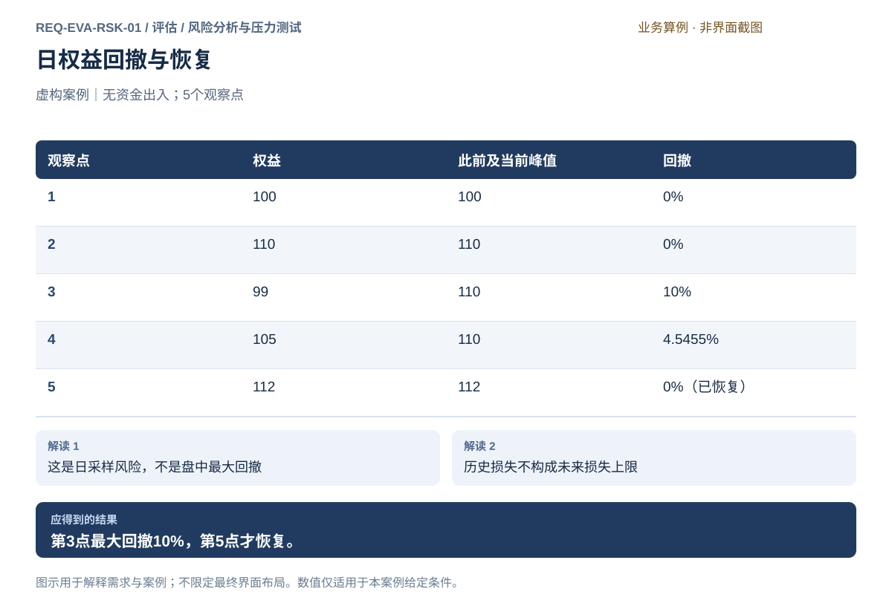
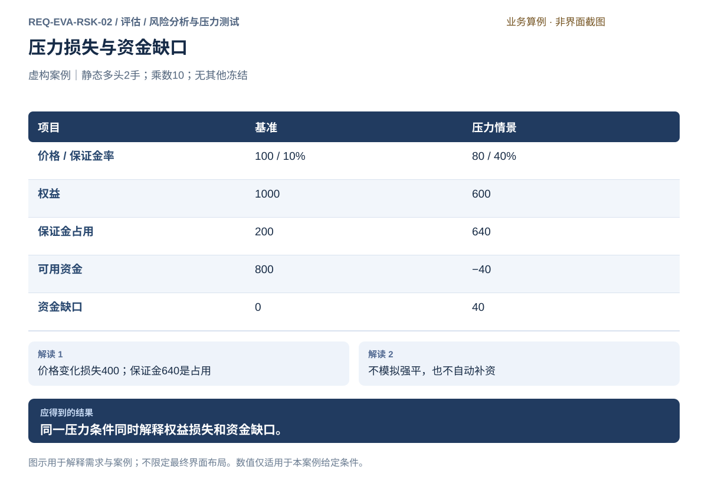
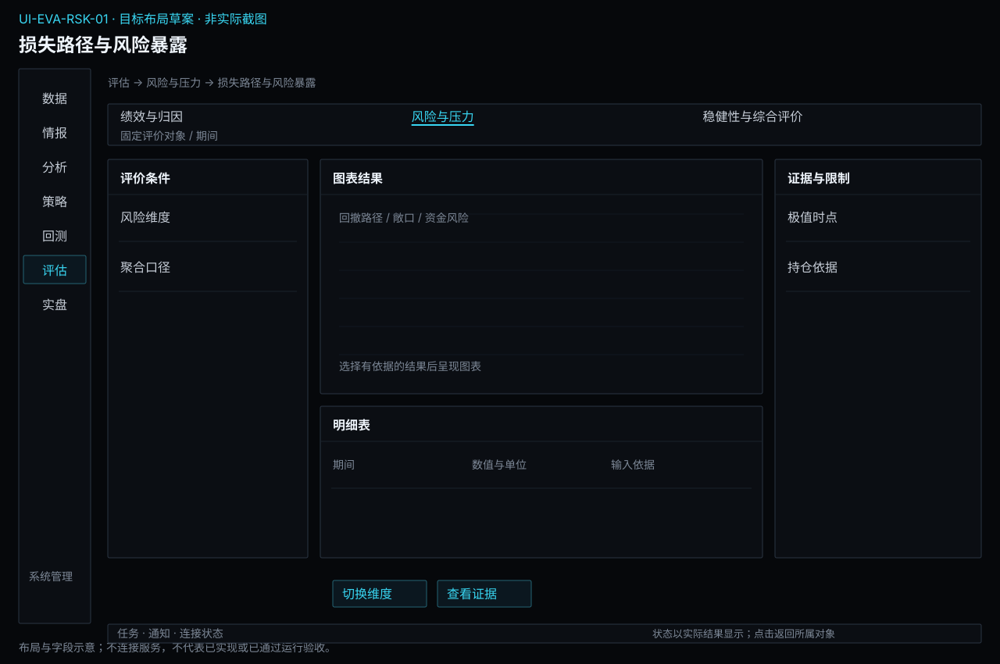
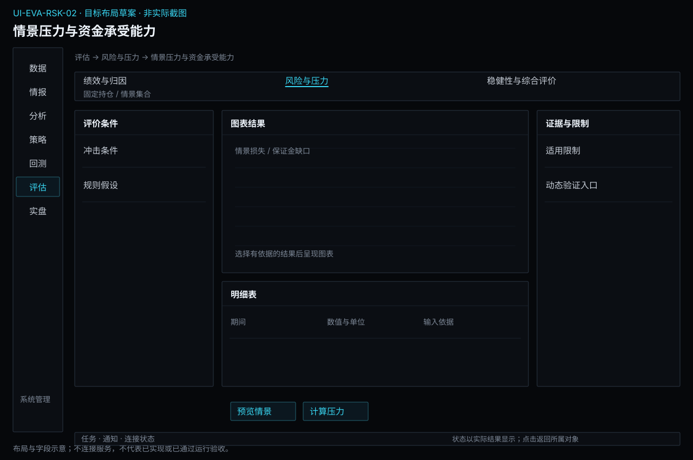

# 风险分析与压力测试

[返回上级](README.md) · [需求总纲](../../README.md) · [实际界面](../../common/screens.md) · [跨模块流程](../../workflows/README.md)

需求交付版 · 2026-10-18。细化规格已编制，用户逐项签认与产品验收分别记录；目标设计不代表已经实现，实际入口与差距见本页界面对应。

**归属：** 评估 / 风险分析与压力测试。本页集中保存业务需求、详细功能、案例、界面对应和验收；通用规则见[通用规范](../../common/README.md)。

## 需求导航

- [REQ-EVA-RSK-01 解释损失路径、敞口与资金风险](#req-eva-rsk-01)
- [REQ-EVA-RSK-02 评价市场、流动性与保证金压力](#req-eva-rsk-02)

## 目标与内部能力

本子模块分析已经发生的损失、固定持仓的风险暴露，以及明确不利情景下的承受能力。实盘负责执行账户实时限额与委托准入，本模块不承担控制权。统计风险、情景损失、保证金占用和实际可执行处置是四种不同信息，必须分别说明。

| 对象     | 字段与依据                                            | 生命周期/限制                                      |
| -------- | ----------------------------------------------------- | -------------------------------------------------- |
| 损失路径 | 权益、现金流调整、采样、峰谷、持续、恢复              | 区间和采样固定；未恢复不是恢复时长零               |
| 暴露切片 | 真实月份、多空、手数、乘数、价格、总/净敞口、策略归属 | 不自动跨品种净额或抵扣，缺证据不当零               |
| 资金约束 | 权益、保证金、冻结、可用资金及规则时点                | 账户事实从来源读取，分析不更改余额                 |
| 风险估计 | 方法、样本、置信口径、模型条件、覆盖与限制            | 尾部估计不代表损失上限；不支持方法明确缺口         |
| 压力定义 | 价格、相关性、保证金、延迟/容量、静态或动态、基准     | 修改生成新情景，不改变已有结果；冲击值不是发生概率 |
| 压力结果 | 损失、占用、缺口、可成交情况、未解除风险和运行身份    | 静态估计与动态路径分开，不伪造平仓事实             |

## 操作流程

固定评价切片 → 查看回撤和恢复 → 分解总净敞口与共同风险 → 核对保证金和资金 → 定义压力情景与方法 → 静态计算或交回测生成动态运行 → 核对损失、缺口和限制 → 将固定结果交稳健性与报告引用。

静态压力只重估选定持仓，不声称策略会保持这些持仓或能够即时退出。动态压力涉及策略反应、成交延迟、订单容量、资金准入或风险处置时，必须在回测中运行完整路径。动态重跑通过原回测准入与预算，评估页不能绕过风控提交。

## 数值口径与异常

日权益100、110、99、105、112的最大日采样回撤为10%，第4点尚未恢复；不能声称这也是盘中最大回撤。持仓净敞口0仍可有很大的双边总敞口、基差、资金和退出风险。风险贡献需要说明方法、聚合与相关性假设，不能把未分配项平均摊给策略后称精确归因。

压力案例：权益1000元、多头2手、价格100、乘数10，保证金率10%时占用200、可用800。价格80且保证金率40%时，价格损失400、权益600、占用640、可用−40，即缺口40；这不意味着又损失640，也不证明强平能成交。情景同时改变价格和费率只是案例假设，不是市场规则或上线默认值。

缺估值、规则或仓位时标明受影响风险项；不能以0补齐。尾部风险样本不足时可以继续展示确定的持仓和金额，但不能出具完整风险结论。静态和动态情景部分失败均保留，比较时不得只留下安全情景。

## 界面与权限

风险页联动损失曲线、敞口表、资金和指标方法详情；压力页显示基准、情景、计算方式、状态及固定结果。颜色必须有风险文字和单位，不用红绿代替可解释原因。只有“查看来源”“准备新回测”“交接风险政策审阅”等入口；修改政策、撤单、平仓仍在原业务中独立确认。读取被授权资料即可分析，不额外要求交易授权。

## 核对风险约束与执行结果

评价时固定策略约束、模拟或实盘账户政策及实际触发记录，展示参数、时间和状态差异。策略计划止损、账户允许风险、历史测得损失与压力估计不能混称为保证的损失上限。需要修改策略时回到策略形成新固定条件，需要修改真实限额或暂停时跳转实盘并独立确认；不把报告保存当成处置完成。共用含义见[共用交易约束](../../product.md#execution-risk-semantics)。

## REQ-EVA-RSK-01 解释损失路径、敞口与资金风险

**领域：** 评估 / 风险分析与压力测试　 **建议优先级：** P1核心必要　 **需求状态：** 交付规格已编制（定位与模块已确认；细节待用户签认）

### 目标与场景

在固定观察范围内度量已发生损失和当前风险集中，说明相关性、杠杆与保证金的影响；风险分析不执行账户控制。

**使用者与场景：** 个人期货量化研究与交易用户。

**触发条件：** 选择固定评价对象并提出评价问题。

### 前置条件

- 对象、来源环境、观察截止、估值与费用口径可识别。
- 所需证据已固定；缺失部分明确可见。

### 输入与含义

| 输入           | 含义与单位                                              | 约束                                                         |
| -------------- | ------------------------------------------------------- | ------------------------------------------------------------ |
| 权益与损失路径 | 采样、时间区间、现金流处理、回撤基准和恢复状态。        | 现金流中性化后的路径与资金金额分开；日采样不能证明盘中风险。 |
| 持仓与敞口     | 真实月份、多空、乘数、数量、估值、策略归属及净/总敞口。 | 对冲和保证金优惠须有依据，不按代码相似自动抵消。             |
| 资金与风险样本 | 权益、保证金、冻结、可用资金、历史样本和相关性方法。    | 保证金不是最大可能损失；样本不足保留限制。                   |

### 正常操作与反馈

1. 选择账户或组合及固定观察截止，确认来源覆盖。
2. 查看回撤深度、持续及恢复状态，定位权益与事件。
3. 分解品种、方向、策略的总敞口、净敞口和集中度。
4. 核对保证金、冻结与可用资金，检查共同风险来源。
5. 保存带样本和方法限制的风险结论，必要时交给实盘账户风险设置审阅。

### 业务规则

- 历史最大回撤不代表未来最大损失；风险估计必须带样本与假设。
- 相关性与风险贡献需方法和足够样本；相关性不能直接当作交易所保证金抵扣。
- 多空净敞口接近零不等于没有基差、流动性或保证金风险。
- 负权益或失效基准下不强行计算百分比或杠杆，金额事实仍保留。
- 实时风险阈值和受控处置由实盘负责，本模块不能直接改限额、撤单或平仓。

### 输出与状态影响

- 损失路径、风险暴露和资金约束说明。
- 风险来源、样本范围与无法判定项。

### 异常与继续方式

| 发生什么         | 应怎样表现                         | 使用者如何继续                                         |
| ---------------- | ---------------------------------- | ------------------------------------------------------ |
| 只能取得日权益。 | 报告日采样回撤及限制。             | 取得可靠盘中资料后另建评价，不能声称已测盘中最大回撤。 |
| 持仓或估值缺失。 | 相关风险显示不完整，不能按零敞口。 | 回到来源核对后创建新切片。                             |

### 案例：回撤深度和恢复状态分开

**虚构案例条件：** 虚构案例：无资金出入，日权益依次100、110、99、105、112。

1. 峰值110到99下降11，回撤10%。
2. 105仍未回到110；112才恢复并创新高。

**预期结果：**

- 最大日采样回撤10%。
- 恢复发生在第5个观察点，不能在第4点标已恢复。

### 可观察验收条件

| 编号                | 给定                     | 当             | 则                                      |
| ------------------- | ------------------------ | -------------- | --------------------------------------- |
| REQ-EVA-RSK-01-AC01 | 给定五点权益。           | 计算日回撤。   | 最大回撤10%，第4点仍处回撤，第5点恢复。 |
| REQ-EVA-RSK-01-AC02 | 只有日采样。             | 展示风险摘要。 | 标明不能据此断言真实盘中最大损失。      |
| REQ-EVA-RSK-01-AC03 | 净敞口零但双边持仓存在。 | 查看风险。     | 显示总敞口与资金占用，不宣称无风险。    |

### 决定与配置约束

- **DEC-EVA-RSK-01-01**：**规格决定**。提供名义敞口、集中度、杠杆、保证金占用、回撤及成员贡献；不同单位不直接相加，不用保证金占用替代最大可能亏损。

- **DEC-EVA-RSK-01-02**：**运行配置**。历史分位VaR/ES显式选择置信水平、样本窗口和频率，并显示尾样本数；不足时不可计算，不使用正态假设静默补足尾部。

### 详细功能

### FR-EVA-RSK-01-01 度量回撤、亏损持续和恢复

**目标与结果：** 解释损失经历及测量限制。

**触发：** 进入相应评价工作区或打开关联证据。

**输入与约束：** 现金流处理后的权益路径、采样频率、峰值规则与观察截止。

**目标操作与反馈：**

1. 计算回撤并定位峰谷。
2. 显示未恢复区间及持续计时口径。
3. 从损失点下钻到来源事实。

**异常与边界：**

- 未恢复不能填恢复时长0。
- 不把日度观察扩展为盘中结论。

**验收条件：**

- **FR-EVA-RSK-01-01-AC01**：100/110/99/105/112最大回撤10%。
- **FR-EVA-RSK-01-01-AC02**：观察止于105时显示仍未恢复。

**界面对应：** [UI-EVA-RSK-01 损失路径与风险暴露](#ui-eva-rsk-01)。

### FR-EVA-RSK-01-02 分解敞口、集中度与风险贡献

**目标与结果：** 辨别多个策略或品种背后的共同风险。

**触发：** 进入相应评价工作区或打开关联证据。

**输入与约束：** 持仓、乘数、价格、策略分配、总/净敞口与相关性依据。 关联策略预算、模拟或实盘政策及拒绝/触发记录，并注明口径差异。

**目标操作与反馈：**

1. 核对合约身份和数量。
2. 分维度展示方向、集中度及可用相关性。
3. 核对贡献合计与未分配部分。

**异常与边界：**

- 缺归属不猜测均摊；组合与策略分项不重复相加。
- 高相关不能直接解释为确定因果或保证金可抵扣。
- 风险结论不改变账户限额或自动触发交易；处置须在实盘独立确认。

**验收条件：**

- **FR-EVA-RSK-01-02-AC01**：等额多空保留双边总敞口而非仅显示净0。
- **FR-EVA-RSK-01-02-AC02**：未分配风险保留在组合层，不伪造策略占比。

**界面对应：** [UI-EVA-RSK-01 损失路径与风险暴露](#ui-eva-rsk-01)。

### FR-EVA-RSK-01-03 核对资金占用和尾部风险依据

**目标与结果：** 区分资金可用性、估计损失和损失上限。

**触发：** 进入相应评价工作区或打开关联证据。

**输入与约束：** 权益、保证金、冻结、可用资金及选定尾部风险方法的样本。

**目标操作与反馈：**

1. 展示占用与可用资金的来源时点。
2. 若启用尾部估计则展示方法、置信口径、样本和适用条件。
3. 标记缺失或失效指标，保留金额事实。

**异常与边界：**

- VaR等估计不当作最大损失承诺，方法未支持时明确不可用。
- 负权益或不适用分母不强行生成风险比例。

**验收条件：**

- **FR-EVA-RSK-01-03-AC01**：保证金2000元不能被解释为最多损失2000元。
- **FR-EVA-RSK-01-03-AC02**：样本不足时尾部指标不填0并解释原因。

**界面对应：** [UI-EVA-RSK-01 损失路径与风险暴露](#ui-eva-rsk-01)。

## REQ-EVA-RSK-02 评价市场、流动性与保证金压力

**领域：** 评估 / 风险分析与压力测试　 **建议优先级：** P1核心必要　 **需求状态：** 交付规格已编制（定位与模块已确认；细节待用户签认）

### 目标与场景

基于固定持仓或独立历史重跑，估计明确不利情景下的损失、资金缺口和退出限制；静态冲击与动态路径分别解释。

**使用者与场景：** 个人期货量化研究与交易用户。

**触发条件：** 选择固定评价对象并提出评价问题。

### 前置条件

- 对象、来源环境、观察截止、估值与费用口径可识别。
- 所需证据已固定；缺失部分明确可见。

### 输入与含义

| 输入               | 含义与单位                                               | 约束                                           |
| ------------------ | -------------------------------------------------------- | ---------------------------------------------- |
| 情景定义           | 价格变化、相关性、延迟、可成交容量、保证金率与适用日期。 | 冲击是假设而非预测，名称不能替代具体取值。     |
| 基准对象与计算模式 | 固定账户切片的静态冲击，或完整策略的路径重跑。           | 静态重估不模拟未来调仓，动态行为交回回测执行。 |
| 可复核结果         | 权益、占用、资金缺口、成交和残留风险。                   | 缺失情景不当作通过，不发生真实资金补充或交易。 |

### 正常操作与反馈

1. 选择固定基准和需要检验的不利条件。
2. 声明静态冲击或动态重跑、假设和方法，预览输入。
3. 静态计算使用固定持仓；动态情景生成回测草稿，经风险与预算检查后运行。
4. 比较损失、可用资金、成交限制和未解除风险。
5. 保存压力结果并交稳健性评价引用。

### 业务规则

- 静态重估不能声称还原实际强平价格或未来策略路径。
- 动态情景必须重跑订单和账户过程，不能只在原收益末尾减一个数。
- 估计保证金规则和账户实际要求分别标明；不静默应用跨品种优惠。
- 亏损、保证金占用、冻结分开；保证金不是损益。
- 数据、代码或风险条件不足的动态回测明确拒绝，不因为是压力测试而绕过。

### 输出与状态影响

- 逐情景损失、资金缺口及假设。
- 动态运行引用、失败状态和退出限制。

### 异常与继续方式

| 发生什么                           | 应怎样表现                   | 使用者如何继续                         |
| ---------------------------------- | ---------------------------- | -------------------------------------- |
| 情景没有可支持的成交或保证金依据。 | 标不支持或要求明确研究假设。 | 调整条件形成新情景，不伪造零风险结果。 |
| 动态重跑失败。                     | 保留失败和未验证范围。       | 显式新建运行，原结果不被覆盖。         |

### 案例：价格下跌与保证金提高共同形成缺口

**虚构案例条件：** 虚构案例：权益1000元，持有多头2手、价格100、乘数10；初始保证金率10%，无其他冻结。静态情景价格跌至80、保证金率升至40%，不模拟成交和手续费变化。

1. 初始名义额2000、保证金200、可用800。
2. 价格损失(80−100)×10×2＝−400，权益600。
3. 情景保证金80×10×2×40%＝640，可用−40。

**预期结果：**

- 资金缺口40元；不是新增亏损640元。
- 未模拟强平和动态调仓，不宣称可以按80元退出。

### 可观察验收条件

| 编号                | 给定                   | 当             | 则                                       |
| ------------------- | ---------------------- | -------------- | ---------------------------------------- |
| REQ-EVA-RSK-02-AC01 | 给定静态案例。         | 重估压力资金。 | 权益600、占用640、可用−40、缺口40元。    |
| REQ-EVA-RSK-02-AC02 | 动态情景改变成交容量。 | 查看结果。     | 来自独立模拟路径，未成交和残余风险可见。 |
| REQ-EVA-RSK-02-AC03 | 压力结果完成。         | 查看真实账户。 | 没有下单、修改限额或自动补资。           |

### 决定与配置约束

- **DEC-EVA-RSK-02-01**：**规格决定**。静态价格、流动性和保证金冲击、历史压力区间；需要动态成交/路径时交回测创建独立实验，所有冲击参数显式指定。

### 详细功能

### FR-EVA-RSK-02-01 固定情景并区分静态与动态方法

**目标与结果：** 让压力结果有可复核假设。

**触发：** 进入相应评价工作区或打开关联证据。

**输入与约束：** 对象切片、冲击变量、参考规则、方法、情景用途与范围。

**目标操作与反馈：**

1. 选择静态持仓或动态策略路径。
2. 预览价格、保证金、延迟和容量条件。
3. 检查依赖后计算，动态情景转回测草稿。

**异常与边界：**

- 编辑情景生成新定义和结果，不覆盖原记录。
- 需要回测时必须具备必要风险配置和预算。

**验收条件：**

- **FR-EVA-RSK-02-01-AC01**：静态案例明确无成交和调仓模拟。
- **FR-EVA-RSK-02-01-AC02**：动态情景缺风险能力时拒绝运行。

**界面对应：** [UI-EVA-RSK-02 情景压力与资金承受能力](#ui-eva-rsk-02)。

### FR-EVA-RSK-02-02 评估延迟与流动性情景的路径影响

**目标与结果：** 检查结果对成交假设的依赖。

**触发：** 按预定计划比较压力实验。

**输入与约束：** 相同策略和数据、明确改变的延迟/容量、完整订单与账本结果。

**目标操作与反馈：**

1. 显示各情景固定假设和运行完整性。
2. 比较成交率、持仓路径、回撤与净收益。
3. 记录证据支持范围及未测试情景。

**异常与边界：**

- 不能在原曲线末尾统一减损失冒充重跑。
- 无成交样本不输出虚构胜率，缺失情景不判通过。

**验收条件：**

- **FR-EVA-RSK-02-02-AC01**：延迟导致未成交时，持仓和后续收益随真实模拟路径改变。
- **FR-EVA-RSK-02-02-AC02**：压力运行失败保留状态并使结论注明证据不足。

**界面对应：** [UI-EVA-RSK-02 情景压力与资金承受能力](#ui-eva-rsk-02)；[UI-BKT-EXP-01 回测方案与验证计划](../backtest/experiments.md#ui-bkt-exp-01)。

### FR-EVA-RSK-02-03 解释压力损失、资金缺口与退出限制

**目标与结果：** 区分估值损失和实际可执行结果。

**触发：** 进入相应评价工作区或打开关联证据。

**输入与约束：** 情景权益、保证金、冻结、成交证据与剩余持仓。

**目标操作与反馈：**

1. 核对损失与资金占用。
2. 列示缺口、未成交和未解除风险。
3. 保存结论并交稳健性评价，控制动作另走交易。

**异常与边界：**

- 静态冲击无成交证据时不能显示已强平。
- 缺失项不能填0使情景看似安全。

**验收条件：**

- **FR-EVA-RSK-02-03-AC01**：案例损失400、保证金640、缺口40分别显示。
- **FR-EVA-RSK-02-03-AC02**：查看报告不会更改真实账户持仓或风险政策。

**界面对应：** [UI-EVA-RSK-02 情景压力与资金承受能力](#ui-eva-rsk-02)。

## 界面设计与实际对应

## UI-EVA-RSK-01 损失路径与风险暴露

**业务目标：** 核对回撤、敞口、集中和资金风险。

**对应情况：待设计。** 暂无已核对的完整工作台，不能当作已实现。

**实际入口：** 当前没有独立界面；以下为拟议需求。

当前没有对应的实际界面截图；下方目标设计不表示已经实现或操作成功。

### 页面形态与目标布局

**设计状态：** 目标规格已编制，含布局、字段、动作和关键状态；尚未获得逐项产品签认或实现验收。现状对应证据保持上文说明，图稿不是运行截图。

**界面形态：** 配置与分析结果工作区。

**目标到达路径：** 评估 → 风险与压力 → 损失路径与风险暴露。这是已确认导航下的目标入口，实际对应仍见上方证据。

| 区域 | 要显示的内容 |
| --- | --- |
| 顶部上下文 | 固定评价对象 / 期间 |
| 列表、分类或步骤区 | 风险维度 / 聚合口径 |
| 主要工作区 | 回撤路径 / 敞口 / 资金风险 |
| 选中项详情或检查区 | 极值时点 / 持仓依据 |
| 主要动作区 | 切换维度 / 查看证据 |

**区域联动与返回：** 选择列表或步骤只更新当前对象及详情，不隐式启动业务；图表与明细使用同一输入或结果上下文。离开并返回保留已确认的对象和查询条件，未保存草稿按本页保存语义处理。异步提交后用请求/任务身份定位实际状态，不能把操作按钮点击当作成功。

**窗口与空间：** 复用现有主窗口框架。宽度缩小时优先收拢辅助详情，表格在内容区横向滚动；主操作和关键上下文不能被页面裁切。重新展开详情仍指向原选中对象。

**状态设计范围：** 以本页状态/异常和验收为准，正常操作、首次无对象、筛选无匹配、请求中、失败及该业务的未知状态分别说明；不适用状态需说明原因，不套用虚构成功数据。字段类型、默认值和动作前提见下文；关键状态按本页交付约定及模块状态图检查。[返回界面设计总览](../../common/ui-designs.md)。

### 目标交互设计（待实现）

沿用Terminal现有视觉、表格和详情交互；字段及动作是目标规格，现有截图不改绘，新增能力须实现后验收。

**字段与信息：**

- 固定评价栏、采样与现金流口径。
- 回撤路径、峰谷/恢复、总净敞口、杠杆、集中度及风险贡献。
- 保证金、冻结、可用资金与尾部指标方法、样本和限制。
- 策略计划、账户政策、风险暴露和实际限制触发的关联证据。

**动作与反馈：**

- 选回撤点定位交易和持仓。
- 切换策略、品种和方向；核对分项与合计。
- 查看指标方法、资料缺口；进入压力测试或报告。
- 解释差异；修改策略或账户政策需跳转对应模块独立确认。

**状态与异常：**

- 未恢复：显示持续中。
- 缺持仓或估值：不显示零风险。
- 比例分母不适用：保留金额，说明比例未定义。

### 业务验收要求（待验收，不代表截图已证明实现）

- **UI-EVA-RSK-01-AC01**：五点案例最大日回撤10%，第5点恢复。
- **UI-EVA-RSK-01-AC02**：双边净零仍显示总敞口。
- **UI-EVA-RSK-01-AC03**：风险分析不修改账户限额或触发平仓。

### 字段与操作交付约定

以下补齐页面关键字段的类型、初始值与边界；已有功能条目的输入规则仍适用。进入已有对象时加载实际保存值，新建时未明确给默认的必填项为空，不能借用案例数值。只读缺失统一显示“—”并提供原因。

| 字段组 | 类型与单位 | 初始值、检查及变化影响 |
| --- | --- | --- |
| 风险范围 | 账户/组合切片、期间 | 固定输入，实际与模拟分列 |
| 指标与参数 | 敞口/集中度/尾部方法 | 置信水平在0与1之间，频率和样本窗口必填 |
| 损失证据 | 回撤路径、极值时点、持仓 | 只读，尾样本不足不强行给VaR/ES |

**操作顺序：** 使用“切换维度 / 查看证据”完成本页任务；先选择固定对象并补齐必填项，再检查范围和影响，最后提交有副作用的动作。查看、筛选和返回不隐式执行业务；保存、发布、启动、授权和撤单各自显示实际结果，不能合并为一个成功提示。

| 关键状态 | 信息与允许操作 | 禁止或返回行为 |
| --- | --- | --- |
| 首次为空或无匹配 | 显示当前风险范围范围，提供创建/补齐或清除筛选入口；只读详情说明来源 | 不填示例数据，不把无权限显示为无记录 |
| 输入错误或前提缺失 | 在“指标与参数”等具体字段旁说明问题，保留其他输入，焦点移至首个错误 | 依赖错误项的动作不可提交，返回不丢草稿 |
| 加载、运行或部分结果 | 保留对象身份和最后可靠时间，展示实际阶段/覆盖；可查看“损失证据”已有证据 | 未完成不能显示全量成功，不能用加载中的空表覆盖已知事实 |
| 失败或结果未知 | 已明确失败可修正输入后独立提交；可能已受理则查询原请求/对象；展示未决范围 | 未核实前不重复有副作用的操作，不把取消页面当取消业务 |
| 离开及返回 | 已保存对象可由原身份重开，未保存编辑提供保存/放弃/留在当前页；关闭抽屉只改变展示 | 即时偏好不套草稿确认；秘密取消后不留普通表单缓存 |

**交互验收案例：** 在本页选择一个有效对象，改变“风险范围”后核对旧预览是否失效；制造“指标与参数”缺项或不可用，确认原因与阻断；补齐后完成主要动作，核对“损失证据”与关联对象结果，再离开返回。只读字段通过隔离测试回复制造状态，不在实际界面篡改业务事实。适用的具体成功结果仍以本页原有案例及AC为准。

关键状态的视觉呈现见[状态设计约定](../../common/ui-designs.md#state-designs)及本模块状态图；状态与动作按本表及关联FR逐项验收，静态图不冒充已执行交互。

### 对应功能需求

- [FR-EVA-RSK-01-01 度量回撤、亏损持续和恢复](#fr-eva-rsk-01-01)
- [FR-EVA-RSK-01-02 分解敞口、集中度与风险贡献](#fr-eva-rsk-01-02)
- [FR-EVA-RSK-01-03 核对资金占用和尾部风险依据](#fr-eva-rsk-01-03)
- [FR-EVA-VAL-03-01 固定评价上下文与证据清单](validation.md#fr-eva-val-03-01)

## UI-EVA-RSK-02 情景压力与资金承受能力

**业务目标：** 区分静态损失和动态执行路径。

**对应情况：待设计。** 暂无已核对的完整工作台，不能当作已实现。

**实际入口：** 当前没有独立界面；以下为拟议需求。

当前没有对应的实际界面截图；下方目标设计不表示已经实现或操作成功。

### 页面形态与目标布局

**设计状态：** 目标规格已编制，含布局、字段、动作和关键状态；尚未获得逐项产品签认或实现验收。现状对应证据保持上文说明，图稿不是运行截图。

**界面形态：** 配置与分析结果工作区。

**目标到达路径：** 评估 → 风险与压力 → 情景压力与资金承受能力。这是已确认导航下的目标入口，实际对应仍见上方证据。

| 区域 | 要显示的内容 |
| --- | --- |
| 顶部上下文 | 固定持仓 / 情景集合 |
| 列表、分类或步骤区 | 冲击条件 / 规则假设 |
| 主要工作区 | 情景损失 / 保证金缺口 |
| 选中项详情或检查区 | 适用限制 / 动态验证入口 |
| 主要动作区 | 预览情景 / 计算压力 |

**区域联动与返回：** 选择列表或步骤只更新当前对象及详情，不隐式启动业务；图表与明细使用同一输入或结果上下文。离开并返回保留已确认的对象和查询条件，未保存草稿按本页保存语义处理。异步提交后用请求/任务身份定位实际状态，不能把操作按钮点击当作成功。

**窗口与空间：** 复用现有主窗口框架。宽度缩小时优先收拢辅助详情，表格在内容区横向滚动；主操作和关键上下文不能被页面裁切。重新展开详情仍指向原选中对象。

**状态设计范围：** 以本页状态/异常和验收为准，正常操作、首次无对象、筛选无匹配、请求中、失败及该业务的未知状态分别说明；不适用状态需说明原因，不套用虚构成功数据。字段类型、默认值和动作前提见下文；关键状态按本页交付约定及模块状态图检查。[返回界面设计总览](../../common/ui-designs.md)。

### 目标交互设计（待实现）

沿用Terminal现有视觉、表格和详情交互；字段及动作是目标规格，现有截图不改绘，新增能力须实现后验收。

**字段与信息：**

- 固定基准切片、情景来源、冲击值和静态/动态类型。
- 逐情景状态、权益损失、占用、缺口、成交与残留风险。
- 假设、失败原因及关联回测记录。

**动作与反馈：**

- 定义情景并预览能力。
- 计算静态冲击或转回测草稿执行动态情景。
- 对照损失及退出限制；引用到稳健性评价。

**状态与异常：**

- 情景未检查：不可运行。
- 动态条件缺风险能力：拒绝。
- 部分失败：保留所有情景，不把缺失标安全。

### 业务验收要求（待验收，不代表截图已证明实现）

- **UI-EVA-RSK-02-AC01**：案例权益600、占用640、缺口40元。
- **UI-EVA-RSK-02-AC02**：静态结果不声称强平已完成。
- **UI-EVA-RSK-02-AC03**：动态改变容量必须来自独立模拟路径。

### 字段与操作交付约定

以下补齐页面关键字段的类型、初始值与边界；已有功能条目的输入规则仍适用。进入已有对象时加载实际保存值，新建时未明确给默认的必填项为空，不能借用案例数值。只读缺失统一显示“—”并提供原因。

| 字段组 | 类型与单位 | 初始值、检查及变化影响 |
| --- | --- | --- |
| 压力方案 | 价格/流动性/保证金冲击 | 数值、单位和适用范围必填，无默认真实预测 |
| 计算方式 | 静态或动态重放 | 动态明确转回测生成新实验 |
| 资金缺口 | 损失、保证金、现金及限制 | 缺规则不可计算，压力结果不改变实际账户限额 |

**操作顺序：** 使用“预览情景 / 计算压力”完成本页任务；先选择固定对象并补齐必填项，再检查范围和影响，最后提交有副作用的动作。查看、筛选和返回不隐式执行业务；保存、发布、启动、授权和撤单各自显示实际结果，不能合并为一个成功提示。

| 关键状态 | 信息与允许操作 | 禁止或返回行为 |
| --- | --- | --- |
| 首次为空或无匹配 | 显示当前压力方案范围，提供创建/补齐或清除筛选入口；只读详情说明来源 | 不填示例数据，不把无权限显示为无记录 |
| 输入错误或前提缺失 | 在“计算方式”等具体字段旁说明问题，保留其他输入，焦点移至首个错误 | 依赖错误项的动作不可提交，返回不丢草稿 |
| 加载、运行或部分结果 | 保留对象身份和最后可靠时间，展示实际阶段/覆盖；可查看“资金缺口”已有证据 | 未完成不能显示全量成功，不能用加载中的空表覆盖已知事实 |
| 失败或结果未知 | 已明确失败可修正输入后独立提交；可能已受理则查询原请求/对象；展示未决范围 | 未核实前不重复有副作用的操作，不把取消页面当取消业务 |
| 离开及返回 | 已保存对象可由原身份重开，未保存编辑提供保存/放弃/留在当前页；关闭抽屉只改变展示 | 即时偏好不套草稿确认；秘密取消后不留普通表单缓存 |

**交互验收案例：** 在本页选择一个有效对象，改变“压力方案”后核对旧预览是否失效；制造“计算方式”缺项或不可用，确认原因与阻断；补齐后完成主要动作，核对“资金缺口”与关联对象结果，再离开返回。只读字段通过隔离测试回复制造状态，不在实际界面篡改业务事实。适用的具体成功结果仍以本页原有案例及AC为准。

关键状态的视觉呈现见[状态设计约定](../../common/ui-designs.md#state-designs)及本模块状态图；状态与动作按本表及关联FR逐项验收，静态图不冒充已执行交互。

### 对应功能需求

- [FR-EVA-RSK-02-01 固定情景并区分静态与动态方法](#fr-eva-rsk-02-01)
- [FR-EVA-RSK-02-02 评估延迟与流动性情景的路径影响](#fr-eva-rsk-02-02)
- [FR-EVA-RSK-02-03 解释压力损失、资金缺口与退出限制](#fr-eva-rsk-02-03)

