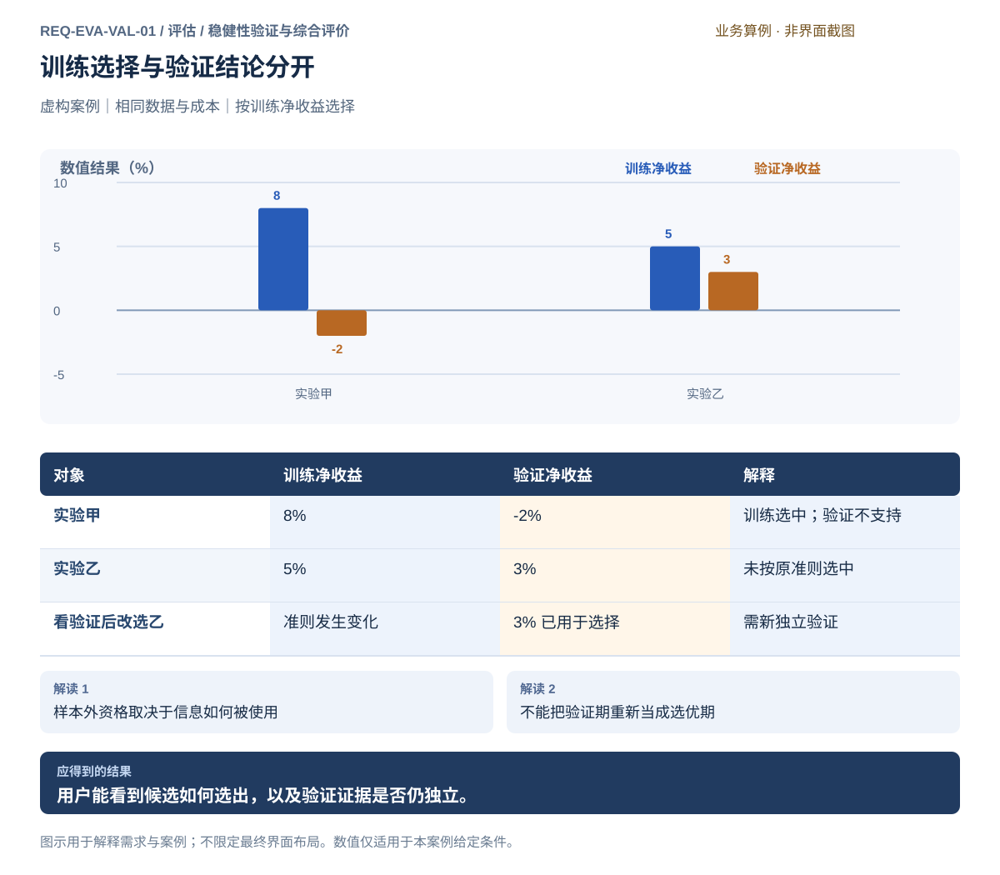
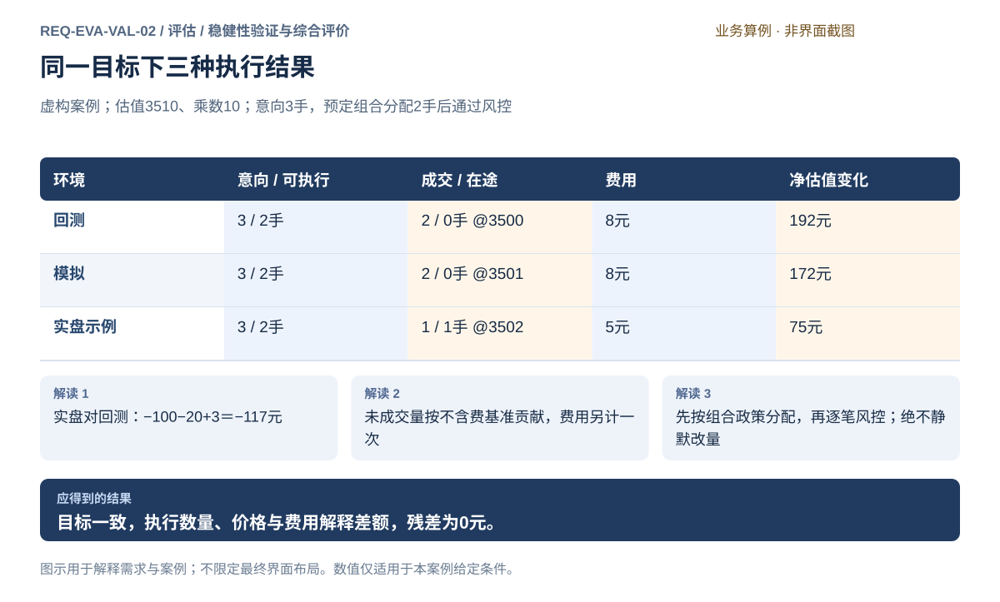
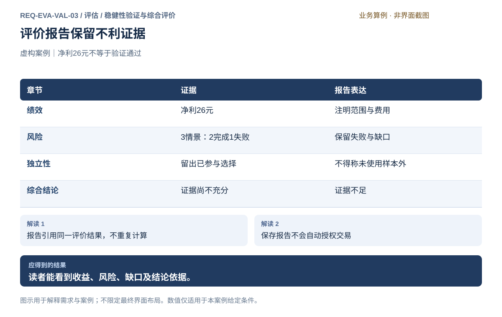
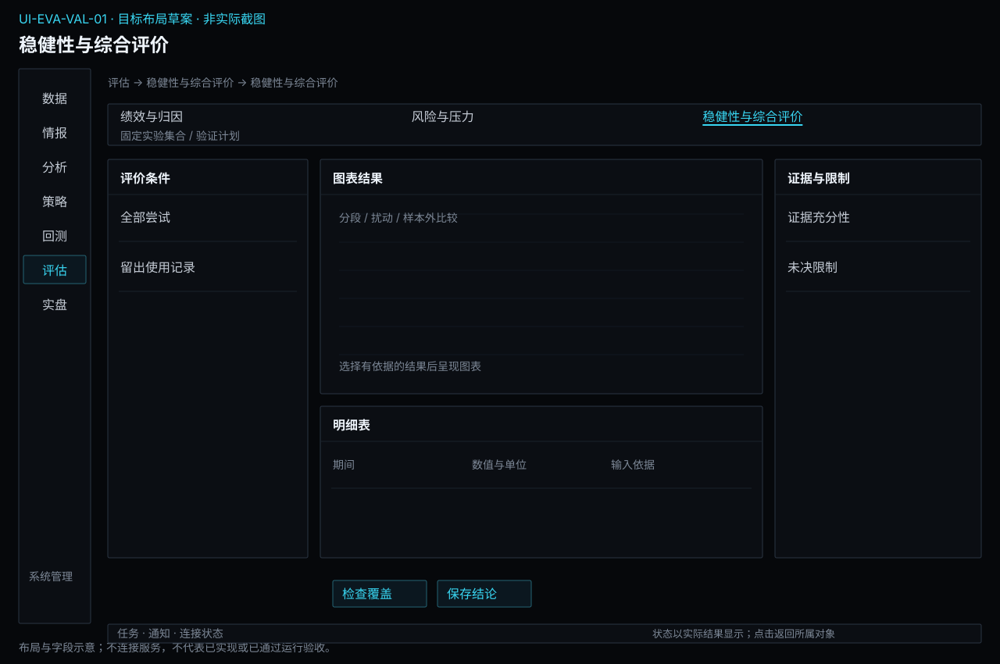
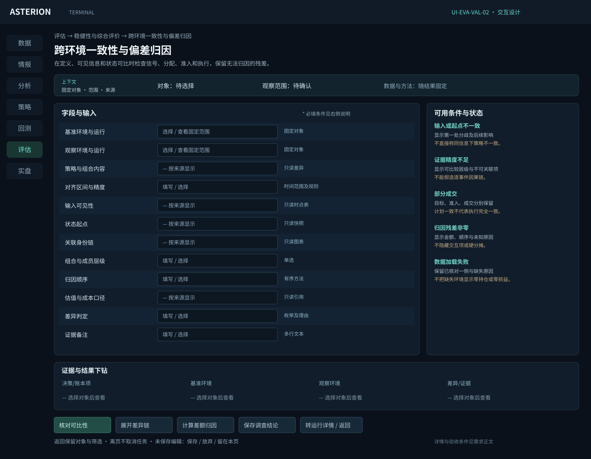
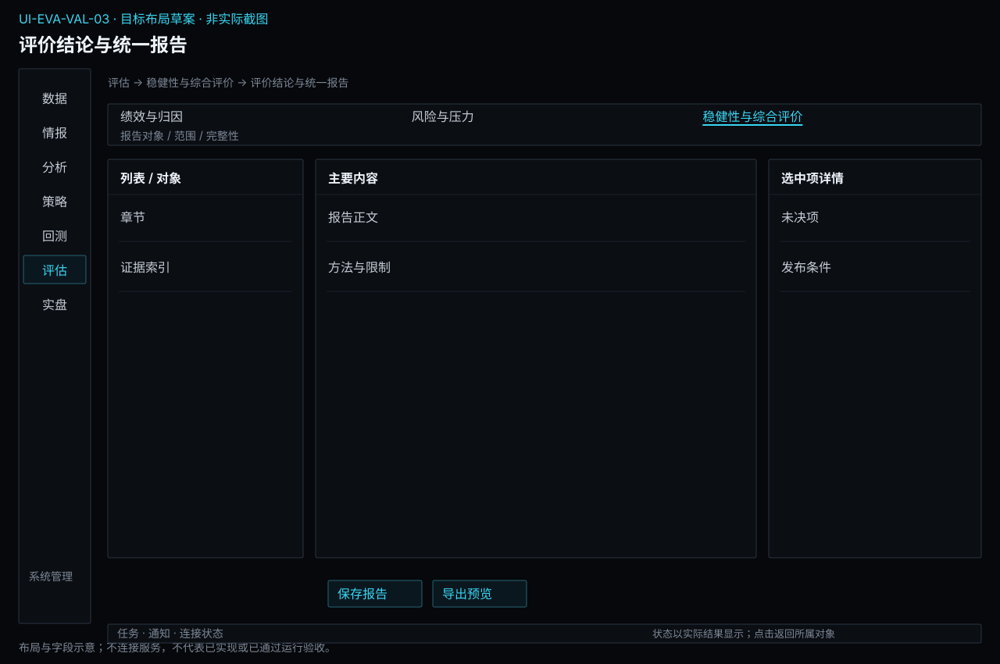

# 稳健性验证与综合评价

[返回上级](README.md) · [需求总纲](../../README.md) · [实际界面](../../common/screens.md) · [跨模块流程](../../workflows/README.md)

需求交付版 · 2026-10-18。细化规格已编制，用户逐项签认与产品验收分别记录；目标设计不代表已经实现，实际入口与差距见本页界面对应。

**归属：** 评估 / 稳健性验证与综合评价。本页集中保存业务需求、详细功能、案例、界面对应和验收；通用规则见[通用规范](../../common/README.md)。

## 需求导航

- [REQ-EVA-VAL-01 按完整证据验证稳健性并形成结论](#req-eva-val-01)
- [REQ-EVA-VAL-02 核对跨环境行为并解释研究与实盘偏差](#req-eva-val-02)
- [REQ-EVA-VAL-03 保存可追溯评价结论与统一报告](#req-eva-val-03)

## 目标与职责

解释完整策略在成交、费用与账户约束之后的收益风险，并评价证据是否支持研究结论。数据与变量关系属于分析模块；执行计划与尝试事实属于回测实验管理；模拟账本属于回测，真实账户事实属于交易。这里读取固定证据、计算有口径的统计并保存解释。

## 对象与字段

| 对象       | 必需字段                                                       | 边界                                     |
| ---------- | -------------------------------------------------------------- | ---------------------------------------- |
| 绩效报告   | 固定运行、区间、完整性、权益采样、费用、估值、指标定义与样本量 | 部分结果与完整结果不可混排，未定义不当零 |
| 归因表     | 合约/方向/时间、毛变动、费用、净贡献、未平仓与未解释差额       | 合计同范围核对，贡献维度不得重复累计     |
| 比较集合   | 实验身份、共同口径、条件差异与选择理由                         | 不可比可以并列但不能自动判优             |
| 稳健性评价 | 事前参数邻域、成本/延迟/容量情景、运行状态与路径变化           | 缺点和失败保留，情景变化重跑完整模拟     |
| 独立性记录 | 训练与留出、滚动折、标签跨界、信息使用及所有尝试               | 已被用于选择的区间不能重新变成未使用留出 |
| 结论       | 支持/不支持/证据不足、理由、限制、固定证据及候选内容           | 不强制选赢家，不授予交易权限             |

## 操作流程

1. 打开结果先核对固定输入、终态和实际覆盖；失败/取消仅允许带边界的诊断与阶段观察。
2. 从权益和回撤定位具体交易日、订单、成本、持仓和风险事件，核对贡献与账本。
3. 查看指标口径及样本量；年化依赖采样和交易日历，收益不以保证金占用冒充账户权益。
4. 加入比较前检查日期、数据、模型、费用、风险和区间；不同条件允许解释差异，不自动公平排名。
5. 按原验证计划检查训练、开发验证、最终留出与滚动结果；重叠区间按事前规则选取唯一时间路径，不能重复叠加同一天收益。
6. 检查参数邻域和成本/延迟/流动性情景，保留失败、不完整和不支持范围；条件改变的路径必须来自独立模拟。
7. 保存全部尝试、所见信息与选择理由，形成有边界的结论；需要改计划回到实验设计，需要固定候选进入策略管理。

## 指标与展示口径

| 内容                 | 必须说明                                     | 无效情形                                       |
| -------------------- | -------------------------------------------- | ---------------------------------------------- |
| 收益和年化           | 净费用、估值、区间、权益基准、采样及年化方法 | 权益非正或公式不适用时说明，不能输出误导百分比 |
| 回撤与风险           | 权益路径、峰值基准、持续期、采样频率         | 只有日数据不能宣称已测出真实盘中最大回撤       |
| 胜率、盈亏比和持有期 | 闭合交易方法、净费口径、样本量与时间精度     | 未平仓不得伪装为完成盈利交易；分母为零不填零   |
| 成本和资金占用       | 现金费用与价格影响分开、占用规则与使用率     | 保证金不是亏损，成本归因不重复扣账             |
| 归因                 | 同一资金与时段、未平仓估值、残差             | 不用虚构“其他收入”抹平差额                     |

## 稳健性与独立验证

虚构成本例：相同成交路径的毛利30元，费4元则净26，费6元则净24。只有已经核实该变化未改变资金准入和后续路径时，才可把2元差异完全解释为费用；其余情况检查重跑后的订单和账本。

虚构选择例：甲训练8%、验证−2%，乙训练5%、验证3%；按训练净收益事前选择甲。看到乙的验证3%后改选，必须承认该段参与选择，不能再称此次选择的独立证明。反复试验的全部候选保留；统计检验若启用，应解释适用假设、样本和多重尝试影响，不预设万能显著性阈值。

多个策略的独立净值不能简单相加作为可交易组合结果。共享资金、订单容量及风险会相互作用，需由策略模块定义组合后执行一次共享账户模拟。

## 界面与结果交接

绩效页保留权益/回撤与贡献表联动，点击异常点进入对应模拟证据。比较页先展示条件差异，再展示邻域/压力/滚动与留出；失败和缺失点明确留空并说明。支持按日期、合约、方向筛选，但筛选改变统计范围必须可见。结论保存时同时保留口径、证据身份、已用信息和限制，不能只导出“最佳收益”。

当前软件已有回测与因子结果入口及比较区；完整结果实拍、独立稳健性工作台及验证信息使用界面尚未完成运行验收。下方字段与交互是目标设计，原实际截图不改绘。

## 统一评价计划、跨环境调查与报告

评估保存评价问题、基准、方法、选择准则、要检验的假设和结论范围；回测保存落实这些要求的执行区间、实际参数、折次、批次和尝试事实。二者引用固定内容，不各存一份可随意覆盖的计划。修改方法或执行输入必须表明新范围；事后提出的检验不能伪装为事前验证。风险情景计算归风险分析，本页只引用结果判断证据强弱。

| 对象       | 关键字段                                                         | 规则                                                 |
| ---------- | ---------------------------------------------------------------- | ---------------------------------------------------- |
| 稳健性证据 | 样本外资格、参数邻域、风险情景引用、选择历史、缺失运行           | 保留全部尝试，零候选和证据不足均合法                 |
| 跨环境对照 | 策略内容、信息可得时点、调度、状态、观察截止、数量/价格/费用归因 | 同名不足以同定义；残差不伪装为零；未明订单不当空状态 |
| 综合结论   | 支持/不支持/不足、范围、理由、不利证据、固定引用                 | 不保证未来有效，不自动授权交易或改变运行             |
| 统一报告   | 评价身份、环境、截止、图表、方法、敏感标识范围、导出状态         | 三个子模块共用输出；报告不另算指标、不自动对外发送   |

跨环境调查先核对定义、信息和状态，之后比较信号、目标、风险、订单、成交与费用。收益不同不能直接推断逻辑不同；无法证明起点相同时保持不可判定。需要新重演时交回测，真实状态查询和暂停、恢复、撤单、平仓交交易模块。

报告预览统一展示绩效、风险、验证和偏差，既含有利结果，也含失败情景、已使用留出、未解释残差与方法限制。报告里的数值与页面引用同一结果；导出格式不能另算舍入口径。评价上下文或新证据改变后派生新评价和报告，已保存结论保持。失败导出不删除评价，也不提示文件已成功生成。

当前实际软件没有完整独立评估工作台。字段、动作、状态与案例图属于目标需求；实拍图只说明已存在入口，不能据此声称完整评价或控制流程已验证。

## REQ-EVA-VAL-01 按完整证据验证稳健性并形成结论

**领域：** 评估 / 稳健性验证与综合评价　 **建议优先级：** P1核心必要　 **需求状态：** 交付规格已编制（源自已确认定位；细节待用户签认）

### 目标与场景

用户能够比较策略与参数变体，并知道哪些差异来自模型、数据或费用条件。训练选择与样本外评价必须分开，防止反复查看验证结果后仍把它称作未使用的独立证据。 同时检查参数邻域、成本、延迟和流动性假设变化的影响，允许结论为证据不足；不强制挑选赢家。

**使用者与场景：** 个人研究用户，在选参数、检验稳定性或比较不同研究思路时。

**触发条件：** 已有实验结果，用户按照已固定验证计划开展比较与评价。

### 前置条件

- 各实验的固定条件、实际样本和评价结果可读取。
- 用于选优的标准及训练验证边界已声明。

### 输入与含义

| 输入           | 含义与单位                             | 约束                                                       |
| -------------- | -------------------------------------- | ---------------------------------------------------------- |
| 比较对象       | 需要对照的实验及其选取理由。           | 不兼容口径允许独立展示，但不能自动宣称公平优劣排序。       |
| 训练与验证安排 | 按时间划分的选择期、验证期或滚动窗口。 | 预热可以取用此前资料，但不得将未来标签泄露到训练。         |
| 选优准则       | 在允许的选择期资料内使用的评价规则。   | 准则和使用过的验证信息应保留，不能反复换标准隐藏试验次数。 |

### 正常操作与反馈

1. 用户确定比较问题及允许用于选择的样本。
2. 系统对照数据、费用、风险、日期及样本数量差异。
3. 用户按训练期预定准则选定候选，单独查看验证结果。
4. 对照预先声明的参数邻域、费用、延迟与流动性情景，展示缺失运行与孤立最优点。
5. 若根据验证结果调整参数，记录新一轮探索，并安排尚未使用的独立验证。
6. 用户保存比较结论及限制，不以单次最好收益替代稳定性判断。

### 业务规则

- 样本外是相对于实际选择过程而言，不只由日期标签决定。
- 不同日期或费用的净收益不能直接称同口径优劣。
- 滚动验证需说明每轮训练范围、验证范围及重叠处理，合计不能重复计算同一天。
- 比较不会修改原实验，也不自动将多个收益序列视为可执行组合。
- 评估负责评价问题、方法与选择准则；回测保存固定的执行区间、参数、折次和运行清单，二者通过引用关联，不能静默改写。
- 改变成交、成本或账户约束可能改变后续路径；压力情景须重新模拟，不在原收益末尾统一扣减。
- 多个策略独立回测的净值相加不是共享账户组合回测，须重新模拟资金与风险竞争。
- 压力结果由风险分析提供，评价只判断它如何影响结论，不另生成第二份情景损失。
- 观察历史表现不能证明未来有效；没有合格候选或资料不足时允许保存证据不足。
- 若使用统计显著性、重采样或置信区间，必须说明样本依赖、方法和多次选择影响；不把默认阈值当保证。

### 输出与状态影响

- 含条件差异、分段绩效及样本依据的比较结果。
- 明确选择过程与独立性限制的验证结论。

### 异常与继续方式

| 发生什么                           | 应怎样表现                                                 | 使用者如何继续                                             |
| ---------------------------------- | ---------------------------------------------------------- | ---------------------------------------------------------- |
| 两个实验采用不同费用或验证日期。   | 指出具体差异并独立展示，禁止自动标为同口径赢家。           | 用户创建条件一致的新实验，或仅作带限制的参考比较。         |
| 拟作为独立验证的区间已参与选参数。 | 标明该区间已被使用，不能把同一结果重命名为新的样本外验证。 | 用户保留探索记录，并选择未用于决策的新资料或等待后续观测。 |

### 案例：不能用验证结果悄悄重选参数

**虚构案例条件：** 虚构案例：甲乙使用相同数据和成本。事前规定按训练净收益选择；甲训练 8%、验证 -2%，乙训练 5%、验证 3%。验证段在选择前未使用。

1. 按训练准则选择甲。
2. 读取甲验证 -2% 后，记录验证未支持该候选。
3. 若因看到乙验证 3% 而改选乙，则标明已利用该验证段。

**预期结果：**

- 原训练选择为甲，验证结果为 -2%。
- 改选乙属于新的探索，乙的 3% 不再是此次选择的独立样本外证明。

### 可观察验收条件

| 编号                | 给定                       | 当                   | 则                                               |
| ------------------- | -------------------------- | -------------------- | ------------------------------------------------ |
| REQ-EVA-VAL-01-AC01 | 案例按训练净收益选择。     | 比较甲乙训练表现。   | 选择依据为甲的 8%，不能事后声称预先选择了乙。    |
| REQ-EVA-VAL-01-AC02 | 用户已经看到两者验证结果。 | 依据乙的 3% 改选乙。 | 记录验证信息参与选择，不能继续标称完全独立验证。 |
| REQ-EVA-VAL-01-AC03 | 比较对象费用不一致。       | 展示净收益。         | 费用差异显式可见，不自动产生同口径优劣结论。     |

### 决定与配置约束

- **DEC-EVA-VAL-01-01**：**规格决定**。样本外、滚动、参数邻域、费用/滑点扰动、分块重采样及全部尝试记录纳入；缺独立验证、关键成本或未决账本证据阻止候选放行。

- **DEC-EVA-VAL-01-02**：**规格决定**。展示总尝试数、选择历史及留出使用；统计检验要求明确样本时间依赖和方法适用条件。条件不满足仅描述，不把多次选出的最佳结果宣称独立验证。

### 详细功能

### FR-EVA-VAL-01-01 选择实验并核对比较口径

**目标与结果：** 让用户先知道比较是否公平，再判断结果差异。 条件对照与选择共同保存，避免再次打开只剩结果排名。

**触发：** 比较页选择实验或从结果加入比较。

**输入与约束：** 实验身份与比较问题；不自动按最好收益选择对象。

**目标操作与反馈：**

1. 选择多个实验并查看条件摘要。
2. 逐项对照数据、成本、风险、日期和样本。
3. 确认同口径部分，或选择带限制独立列示。

**异常与边界：**

- 不同费用或区间不能自动标赢家。
- 结果缺失的实验保留为不可比较项，不伪造指标。

**验收条件：**

- **FR-EVA-VAL-01-01-AC01**：费用差异具体到数值和单位可见。
- **FR-EVA-VAL-01-01-AC02**：移除比较选择不删除原实验或改动其结果。

**界面对应：** [UI-EVA-VAL-01 稳健性与综合评价](#ui-eva-val-01)；[UI-EVA-PER-01 绩效与收益归因](performance.md#ui-eva-per-01)。

### FR-EVA-VAL-01-02 记录训练选择及验证信息的使用

**目标与结果：** 保证样本外判断基于实际决策过程，而非仅凭区间名称。

**触发：** 训练结果出现后确认候选，随后查看验证结果。

**输入与约束：** 预定选优准则、训练结果和已查看的验证信息。

**目标操作与反馈：**

1. 按训练准则记录选择及理由。
2. 单独查看验证表现并形成结论。
3. 若根据验证改选，标明该信息已参与选择并安排新的独立检验。

**异常与边界：**

- 看过的验证结果不能改名为从未使用的独立证据。
- 没有合适新资料时允许结论为证据不足，不强行判通过。

**验收条件：**

- **FR-EVA-VAL-01-02-AC01**：案例训练8%与5%时选择甲，验证负2%仍如实保留。
- **FR-EVA-VAL-01-02-AC02**：因乙验证3%改选乙时记录验证参与选择。

**界面对应：** [UI-EVA-VAL-01 稳健性与综合评价](#ui-eva-val-01)。

### FR-EVA-VAL-01-03 保存比较结论并交接固定证据

**目标与结果：** 保留比较选择、差异与评价过程，使结论可供候选审阅。 下次打开可恢复当时选择和判断过程。

**触发：** 比较完成后点击保存结论或准备候选。

**输入与约束：** 所选实验、条件差异、验证独立性和判断理由。

**目标操作与反馈：**

1. 复核比较矩阵和不兼容说明。
2. 记录结论及不能由本次证明的内容。
3. 保存固定比较结论，并通过统一报告或策略候选交接引用，不在比较页另建报告计算。

**异常与边界：**

- 比较不合并净值成可交易组合，也不生成交易授权。
- 证据导出不改变原实验；范围不完整须在摘要中保留。

**验收条件：**

- **FR-EVA-VAL-01-03-AC01**：候选摘要能看到被选实验及未选原因。
- **FR-EVA-VAL-01-03-AC02**：导出比较结果包含费用差异和验证使用说明。

**界面对应：** [UI-EVA-VAL-01 稳健性与综合评价](#ui-eva-val-01)；[UI-STR-DLV-01 交易候选与交接检查](../strategy/delivery.md#ui-str-dlv-01)；[UI-SYS-REC-03 导出资料](../system/records.md#ui-sys-rec-03)；[UI-EVA-VAL-03 评价结论与统一报告](#ui-eva-val-03)。

### FR-EVA-VAL-01-04 比较参数邻域与成本扰动的稳健性

**目标与结果：** 候选不能只凭单个最好数值选出，使用者应同时看到相邻参数和费用增加后的结果。分析绑定相同数据与评价口径，缺点和不完整范围与中心结果一起展示。

**触发：** 批次形成完整候选结果后，选择预先声明的中心、邻域和扰动对照。

**输入与约束：** 中心参数、邻域取值、成本倍率与评价指标；分析依据事前计划，费用单位及资金区间一致，不把缺失结果写成零。

**目标操作与反馈：**

1. 选中中心并列出已声明的相邻参数结果。
2. 切换同参数的成本情景，查看费用和净结果差额。
3. 记录孤立尖峰、缺失邻域或稳定区间及其证据。

**异常与边界：**

- 部分失败或取消导致邻域缺点时明确说明，不能宣称该范围已验证。
- 只改变费用的案例须能复算差额，其他条件变化同时列出。

**验收条件：**

- **FR-EVA-VAL-01-04-AC01**：案例中心26元、邻域24及25元并列显示，不只突出中心。
- **FR-EVA-VAL-01-04-AC02**：中心费用4增到6元时净结果26降到24元，不能误归因于策略变更。

**界面对应：** [UI-EVA-VAL-01 稳健性与综合评价](#ui-eva-val-01)；[UI-BKT-EXP-02 实验批次与运行记录](../backtest/experiments.md#ui-bkt-exp-02)。

### FR-EVA-VAL-01-05 保留重复试验和选择记录再进入独立验证

**目标与结果：** 批量搜索和反复选择会消耗验证信息，使用者需要知道候选为何被选中及看过哪些结果。同条件重复、参数重选与新验证分别记录，避免伪装成更多独立证据。

**触发：** 用户保存批次选择、重跑同条件或请求进入独立验证。

**输入与约束：** 训练选择准则、已查看的验证范围、候选身份和选择理由；重复实验必须标明重算或随机重复用途，不能隐瞒尝试次数。

**目标操作与反馈：**

1. 核对选中候选及当前已使用信息。
2. 记录选择理由和与此前决定的差异，保留未选候选。
3. 将固定候选、选择理由与批次证据带回实验设计，安排独立验证；保存计划和实际运行分别确认。

**异常与边界：**

- 按已看过的验证结果重选后，该段不能重新标为未使用样本外。
- 重复同条件不得直接加倍统计有效样本，原失败与取消仍保留。

**验收条件：**

- **FR-EVA-VAL-01-05-AC01**：第二次改选能同时找到前一次选择与采用的信息，原决定不被覆盖。
- **FR-EVA-VAL-01-05-AC02**：独立验证草稿保留批次身份和限制，进入候选页不自动启动实盘。

**界面对应：** [UI-EVA-VAL-01 稳健性与综合评价](#ui-eva-val-01)；[UI-BKT-EXP-02 实验批次与运行记录](../backtest/experiments.md#ui-bkt-exp-02)；[UI-BKT-EXP-01 回测方案与验证计划](../backtest/experiments.md#ui-bkt-exp-01)。

## REQ-EVA-VAL-02 核对跨环境行为并解释研究与实盘偏差

**领域：** 评估 / 稳健性验证与综合评价　 **建议优先级：** P0安全必要　 **需求状态：** 交付规格已编制（源自已确认定位；细节待用户签认）

### 目标与场景

使用者能够把同一量化定义在回测、模拟与实盘中的行为逐层核对，确认差异来自可见信息、运行状态、逻辑还是执行结果。调查必须保留真实订单和持仓事实，不能用重新计算、自动补单或静默重启掩盖偏差。

**使用者与场景：** 个人量化研究者与交易授权人，在方案进入下一环境、运行偏离预期或重启后核对时。

**触发条件：** 选择回测、模拟和实盘的固定观察切片，调查同一决策点或可比范围。

### 前置条件

- 策略、因子、组合、数据与风险定义均能明确识别，比较范围和信息可见时点已经确定。
- 可读取已授权范围内的运行与交易证据；只读评估不要求新增交易授权，执行新的受控回测仍要求必要风险配置。

### 输入与含义

| 输入           | 含义与单位                                                                         | 约束                                                             |
| -------------- | ---------------------------------------------------------------------------------- | ---------------------------------------------------------------- |
| 定义与状态起点 | 逻辑及参数、因子依赖、组合分配、数据口径、风险规则、持仓现金、未明订单及已处理事件 | 身份和内容依据一致才可判为同起点；相同名称或日期不足以证明。     |
| 决策与执行记录 | 可用信息时点、调度事件、信号、目标、获准量、委托、成交、持仓及费用                 | 按环境、运行和观察时点关联，事实只计一次，不混合模拟与真实成交。 |
| 评价与交接范围 | 比较基准、估值口径、归因证据及所选策略或组合运行                                   | 分析只读取固定证据；处置跳转交易模块，暂停、撤单、平仓独立确认。 |

### 正常操作与反馈

1. 选择运行与比较基准，核对定义身份、可见数据和状态起点。
2. 比较同一决策点的信号意向、组合政策产生的可执行目标，再分别核对逐笔风控结果和实际执行。
3. 沿信号、目标、委托、成交和持仓关联查证差异，标明证据缺口。
4. 按数据、逻辑、调度、执行与费用分类归因，保留未解释部分和计算口径。
5. 保存解释、未解释差额和证据限制；需要处置时跳转交易运行控制，查看分析不执行交易。
6. 需要修订时交给策略或回测生成新草稿；评估不能修改运行定义或授权。

### 业务规则

- 一致性只针对相同定义、可见信息、调度语义和运行状态的决策；不同市场结果和后续状态不要求收益相同。
- 数据时点、缺口、调度延迟、拒单、部分成交、滑点和费用分别说明；不能把所有偏差归为策略逻辑错误。
- 组合意向、可执行目标、账户持仓及策略归属是不同层次；同一成交和费用只归集一次，组合合计与策略分项不能重复相加。共享账户成交和费用分配政策由 DEC-STR-PRT-01-02 统一。
- 金额归因先固定基准、估值时点和拆分顺序；已解释项与残差相加必须等于总差，重算不得再次累计原归因。
- 可执行目标由预先明确的组合预算和分配政策形成，随后接受逐笔风控；风控只校验完整意图，不静默裁剪数量。需要改量时须形成独立新意图并重新校验。
- 交易恢复、暂停和授权只在交易模块处理；本模块只读原事实并交接证据。

### 输出与状态影响

- 固定比较范围、逐层差异和证据缺口。
- 按数量、价格、成本解释的金额差额与残差。
- 供策略修订、回测或交易处置审阅的固定结论，不包含执行许可。

### 异常与继续方式

| 发生什么                                             | 应怎样表现                                                       | 使用者如何继续                                             |
| ---------------------------------------------------- | ---------------------------------------------------------------- | ---------------------------------------------------------- |
| 回测看到完整区间数据，而实盘决策时某个输入尚未可用。 | 标记信息起点不同，先归类数据时点问题，不宣称同信息下逻辑不一致。 | 固定当时可用数据和状态重新对照，缺失证据继续保留不可判定。 |
| 只取得组合合计费用，无法可靠分配到具体策略。         | 费用保留在组合层待分配，不同时计入多个策略或凭猜测均摊。         | 取得明确归属规则和依据，再保存可解释的分配结果。           |

### 案例：目标一致但部分成交和成本造成净值差异

**虚构案例条件：** 虚构案例：三环境定义、可见信息、调度和零持仓起点相同。策略甲意向2手、乙意向1手，原始合计3手；预先确认的组合政策为总预算2手且甲优先，因此生成甲2手、乙0手的可执行目标。此后2手委托完整通过逐笔风控，不存在3手委托被风控静默裁成2手。观察价3510、乘数10，初始权益100000元，无其他收支；均为未实现估值演示，不代表真实收益。

1. 回测2手成交于3500，费用8元，净估值变化(3510−3500)×10×2−8＝192元。
2. 模拟2手成交于3501，费用8元，净估值变化172元。
3. 实盘示例1手成交于3502，费用5元，另1手仍在途，净估值变化75元。
4. 以回测为基准，实盘差额75−192＝−117元：未成交数量按不含费基准价贡献−100元，已成交滑点贡献−20元，费用总额减少贡献+3元。

**预期结果：**

- 三环境原始意向均3手，预定组合政策均生成可执行目标2手，并完整通过逐笔风控；不能据净值差异断言信号不同。
- 实盘1手成交归策略甲，策略乙本次实际归属0手；组合实际持仓1手，不重复相加。
- −100−20+3＝−117元，残差0元；费用按独立总额项只计一次，1手在途仍需核对和独立处置。

### 可观察验收条件

| 编号                | 给定                                       | 当                   | 则                                                                                                      |
| ------------------- | ------------------------------------------ | -------------------- | ------------------------------------------------------------------------------------------------------- |
| REQ-EVA-VAL-02-AC01 | 定义、信息可见时点、调度语义和起始状态一致 | 比较同一决策点       | 三环境原始意向均3手，按预定总预算2手和甲优先政策生成可执行目标2手，再通过完整逐笔校验；风控不静默改量。 |
| REQ-EVA-VAL-02-AC02 | 某环境缺少当时可用数据或明确运行状态       | 尝试给出一致性结论   | 标为不可直接比较或证据不足，列出差异，不强行证明一致或不一致。                                          |
| REQ-EVA-VAL-02-AC03 | 案例成交和费用成立                         | 计算实盘对回测的归因 | 净变化为192与75元，差额−117元，归因为−100、−20、+3且残差0；重复查看不再次累计。                         |
| REQ-EVA-VAL-02-AC04 | 存在未知订单或正在运行的账户。             | 执行只读偏差评价。   | 保留未知状态，不自动重放、补单、暂停或平仓。                                                            |

### 决定与配置约束

- **DEC-EVA-VAL-02-01**：**规格决定**。按输入事件→信号→目标→风险→意图→订单→成交→费用关联；保留原始时间精度和无法关联项，不能伪造毫秒匹配。

- **DEC-EVA-VAL-02-02**：**运行配置**。偏差提示采用用户为具体对象配置的数量/价格/时效绝对阈值；无足够样本或规则证据时标不可判断。提示不自动修改策略或解除执行限制。

### 详细功能

### FR-EVA-VAL-02-01 固定定义身份、可见信息与运行状态起点

**目标与结果：** 使用者先确认比较对象是否具备相同决策条件，避免把同名方案或同一日期误当成可比较运行。

**触发：** 从量化运行或研究比较进入一致性调查，选择环境与决策点。

**输入与约束：** 策略因子组合、数据和风险内容依据，参数、可见时点、调度语义，以及持仓现金、在途订单和已处理事件；只读取明确选中的固定运行切片，不恢复交易运行。

**目标操作与反馈：**

1. 分别选择基准运行和待调查运行，显示环境与定义身份。
2. 展开信息可见时点、因子准备区间、组合归属及状态起点。
3. 逐项标为相同、不同或证据不足，形成比较范围。

**异常与边界：**

- 定义名称相同但内容或参数不同不能标为同定义。
- 未明订单或缺失运行状态不能当作空状态；未完成核对不允许隐式恢复执行。

**验收条件：**

- **FR-EVA-VAL-02-01-AC01**：状态和信息不同的运行显示具体阻断项，而非直接给出一致率。
- **FR-EVA-VAL-02-01-AC02**：案例零持仓起点及相同定义都可追溯，观察时点与决策时点分别明确。

**界面对应：** [UI-EVA-VAL-02 跨环境一致性与偏差归因](#ui-eva-val-02)；[UI-DAT-SRV-02 数据目录与修订对照](../data/management.md#ui-dat-srv-02)；[UI-LIV-EXE-03 断线与未知结果核对](../live/execution.md#ui-liv-exe-03)。

### FR-EVA-VAL-02-02 核对跨环境信号、组合分配及逐笔风控结果

**目标与结果：** 使用者在同一信息和状态下比较逻辑输出，区分信号一致性与后续执行差异，不以收益不同判定逻辑失败。

**触发：** 起点核对后选择受控对照或查看同决策点输出。

**输入与约束：** 固定定义和信息、调度事件、因子值、策略意向、预先确认的组合预算与分配政策，以及独立逐笔风险规则；任何重演都不发送真实交易。

**目标操作与反馈：**

1. 选择可比较决策点，逐层展示已有因子、信号和目标；需新受控重演时转回测草稿，不在评价页直接执行。
2. 先比较原始意向与组合政策生成的可执行目标，再核对完整意图的逐笔风控结果，保留分配与拒绝依据。
3. 发现不同后定位最早差异环节；信息不同则转数据或状态核实。

**异常与边界：**

- 未来才可用的信息不能参与当时信号比较。
- 回测与模拟须有有效风险配置，但不要求实盘授权；对照过程不能补做真实交易。
- 风控不能把3手请求静默改为2手；本例2手来自预定组合政策，之后才进入逐笔校验。

**验收条件：**

- **FR-EVA-VAL-02-02-AC01**：案例三环境原始意向3手、组合政策生成可执行目标2手并通过风控；执行净值不同不改变该结论。
- **FR-EVA-VAL-02-02-AC02**：调度或状态不相同显示不可直接比较，不伪造一致或根因结论。

**界面对应：** [UI-EVA-VAL-02 跨环境一致性与偏差归因](#ui-eva-val-02)；[UI-STR-LOG-01 策略规则、混合决策与逻辑试算](../strategy/logic.md#ui-str-log-01)；[UI-STR-PRT-01 组合构建、资金与调仓](../strategy/portfolio.md#ui-str-prt-01)；[UI-LIV-ACC-03 账户风险规则与生效管理](../live/accounts.md#ui-liv-acc-03)。

### FR-EVA-VAL-02-03 按数据逻辑执行和成本归因偏差

**目标与结果：** 使用者用证据解释偏差并保留未解释部分，每个金额只分配一次，避免重复重算夸大损失或收益。

**触发：** 比较结果出现差异后选择归因预览。

**输入与约束：** 基准和观察时点、数据缺口、调度时刻、目标、拒单、成交滑点及费用；先明确计算顺序和估值口径。

**目标操作与反馈：**

1. 先分类数据时点、逻辑与调度差异，再核对组合分配、逐笔风控和执行结果。
2. 按数量、价格和费用的独立贡献拆分可解释金额，并列依据。
3. 核对各项加残差等于总差，保存本次口径与未解决项。

**异常与边界：**

- 缺少费用归属时保留组合层待分配，不能猜测均摊。
- 重算替换该次派生预览而非再次累计旧归因；旧事实和已保存说明不被覆盖。

**验收条件：**

- **FR-EVA-VAL-02-03-AC01**：案例实盘对回测差−117元＝未成交量−100＋滑点−20＋费用差+3，残差0。
- **FR-EVA-VAL-02-03-AC02**：数据不足时保留残差或不可判定，不把未知项填成零并声称完全解释。

**界面对应：** [UI-EVA-VAL-02 跨环境一致性与偏差归因](#ui-eva-val-02)；[UI-DAT-SRV-02 数据目录与修订对照](../data/management.md#ui-dat-srv-02)；[UI-LIV-ACC-02 成交结算核对与差异处理](../live/accounts.md#ui-liv-acc-02)。

## REQ-EVA-VAL-03 保存可追溯评价结论与统一报告

**领域：** 评估 / 稳健性验证与综合评价　 **建议优先级：** P1核心必要　 **需求状态：** 交付规格已编制（定位与模块已确认；细节待用户签认）

### 目标与场景

让三类评价共用一个报告输出流程，保存数据、方法、图表、限制及决定，而不另外复制指标计算。

**使用者与场景：** 个人期货量化研究与交易用户。

**触发条件：** 选择固定评价对象并提出评价问题。

### 前置条件

- 对象、来源环境、观察截止、估值与费用口径可识别。
- 所需证据已固定；缺失部分明确可见。

### 输入与含义

| 输入       | 含义与单位                                 | 约束                                       |
| ---------- | ------------------------------------------ | ------------------------------------------ |
| 评价上下文 | 固定对象、环境、观察截止、源证据与方法。   | 每个数字都能回到固定来源和口径。           |
| 报告内容   | 绩效、风险、稳健性、偏差、结论和未解决项。 | 未完成、不支持和缺失不能被导出模板隐去。   |
| 输出范围   | 所选章节、明细、文件位置和敏感账户标识。   | 显式选择本地导出；不自动上传或发送给他人。 |

### 正常操作与反馈

1. 从任一评估工作区打开统一报告预览。
2. 选择章节与范围，核对图表、方法和证据清单。
3. 记录支持、不支持或证据不足，以及适用范围和理由。
4. 保存固定报告；需要导出时预览并选择本地位置。
5. 新数据或结论变化派生新评价，不覆盖旧报告。

### 业务规则

- 报告是三个子模块的共用输出，综合评价保存结论；不设第四个报告业务子模块。
- 报告引用同一指标与图表结果，不另算一套数字。
- 账户标识可按导出范围隐藏，缺失证据、失败实验和不利结果不得因版式被隐藏。
- 文件导出失败不显示成功；保留已保存评价以便重新导出。
- 报告和评价不自动授予策略交易资格，也不改风险限额。

### 输出与状态影响

- 固定结论、证据清单及可复核报告。
- 导出范围和成功或失败反馈。

### 异常与继续方式

| 发生什么                       | 应怎样表现                       | 使用者如何继续                       |
| ------------------------------ | -------------------------------- | ------------------------------------ |
| 报告引用的部分压力情景未完成。 | 保留未完成列表及结论限制。       | 补充实验后另存评价，原报告不被替换。 |
| 导出位置不可写。               | 提示具体错误，不显示文件已生成。 | 选择可写位置再次显式导出。           |

### 案例：证据不足也能形成完整报告

**虚构案例条件：** 虚构案例：绩效报告净利26元，计划3项压力测试，仅2项完成，1项失败；最终留出已参与选择。

1. 报告展示26元的范围与成本口径。
2. 风险章节列出2完成1失败；独立性章节标留出已用。
3. 综合结论为证据不足。

**预期结果：**

- 报告有完整限制而非只展示盈利。
- 新补充结果形成新报告，旧结论仍可复核。

### 可观察验收条件

| 编号                | 给定                         | 当               | 则                                                     |
| ------------------- | ---------------------------- | ---------------- | ------------------------------------------------------ |
| REQ-EVA-VAL-03-AC01 | 案例存在失败情景和已用留出。 | 导出报告。       | 同时包含2完成1失败、已用留出和证据不足，不只导出26元。 |
| REQ-EVA-VAL-03-AC02 | 底层新增实盘成交。           | 重开已保存报告。 | 原观察截止和数字不变，可显式创建新评价。               |
| REQ-EVA-VAL-03-AC03 | 导出失败。                   | 返回工作区。     | 已保存评价仍在，未声称导出成功。                       |

### 决定与配置约束

- **DEC-EVA-VAL-03-01**：**规格决定**。报告为离线HTML，明细CSV；包含固定条件、图表、事实/方法引用、评价结论和限制，账户标识默认脱敏。PDF可由用户打印阅读版，不作为独立业务格式承诺。

### 详细功能

### FR-EVA-VAL-03-01 固定评价上下文与证据清单

**目标与结果：** 让不同入口引用同一份评价。

**触发：** 进入相应评价工作区或打开关联证据。

**输入与约束：** 来源环境、运行/账户切片、观察截止、单位币种、估值/费用口径、方法、实际覆盖。

**目标操作与反馈：**

1. 选择对象并核对证据完整性。
2. 固定上下文，生成评价身份。
3. 各子模块读取同一上下文，新增资料派生新评价。

**异常与边界：**

- 不能把当前滚动账户冒充固定历史切片。
- 数据修订不静默改变旧评价，源数据删除遵守引用保护。

**验收条件：**

- **FR-EVA-VAL-03-01-AC01**：新成交到达后旧评价数字保持。
- **FR-EVA-VAL-03-01-AC02**：未知费用或缺失范围可见，不能默认为零。

**界面对应：** [UI-EVA-VAL-03 评价结论与统一报告](#ui-eva-val-03)；[UI-EVA-PER-01 绩效与收益归因](performance.md#ui-eva-per-01)；[UI-EVA-RSK-01 损失路径与风险暴露](risk.md#ui-eva-rsk-01)。

### FR-EVA-VAL-03-02 保存综合结论及候选交接

**目标与结果：** 将证据支持范围与决定明确关联。

**触发：** 进入相应评价工作区或打开关联证据。

**输入与约束：** 绩效、风险、稳健性、偏差、限制、选择依据和固定策略内容。

**目标操作与反馈：**

1. 核对有利与不利证据。
2. 记录支持/不支持/证据不足及理由。
3. 按明确用途交接策略候选或交易控制审阅。

**异常与边界：**

- 评估不自动授权实盘或改账户风险。
- 没有合格候选时可保存零候选，修改策略不得继承不匹配证据。

**验收条件：**

- **FR-EVA-VAL-03-02-AC01**：压力缺项和留出已用时不得自动盖验证通过。
- **FR-EVA-VAL-03-02-AC02**：报告与候选关联具体策略内容而非同名策略。

**界面对应：** [UI-EVA-VAL-01 稳健性与综合评价](#ui-eva-val-01)；[UI-EVA-VAL-03 评价结论与统一报告](#ui-eva-val-03)。

### FR-EVA-VAL-03-03 预览并导出统一评价报告

**目标与结果：** 保存可分享且能复核的评价资料。

**触发：** 进入相应评价工作区或打开关联证据。

**输入与约束：** 固定评价、章节、证据范围、账户标识显示选项及本地目标位置。

**目标操作与反馈：**

1. 预览表格图表、单位和结论限制。
2. 显式选择范围与位置导出。
3. 成功后给出文件位置，失败保留评价并说明。

**异常与边界：**

- 导出不重算指标，也不自动上传或发送。
- 删去章节时注明未包含范围，不能让完整性声明失真。

**验收条件：**

- **FR-EVA-VAL-03-03-AC01**：案例报告保留失败情景和留出已用，不只留下26元。
- **FR-EVA-VAL-03-03-AC02**：不可写位置不显示导出成功，原评价不丢失。

**界面对应：** [UI-EVA-VAL-03 评价结论与统一报告](#ui-eva-val-03)。

### FR-EVA-VAL-03-04 明确评价方法口径和报告可交付状态

**来源与确认：** 2026-10-18全面审查及用户授权补充；详细行为草案待评审，未实现、未执行产品验收。

**目标与结果：** 指标无定义、输入缺失与计算值为零分别展示，报告限制可以追溯。

**触发：** 选择评价方法或形成报告。

**输入与约束：** 固定输入、方法定义、参数、交易日/自然日口径、年化基数、基准、现金流处理和最小适用样本；方法集合采用评估模块交付范围，参数和适用条件须随评价固定。

**目标操作与反馈：**

1. 查看方法说明及输入适用性，不能只按指标名称匹配。
2. 运行后逐项显示有效值、无定义、缺资料或未计算及原因，附原始事实链接。
3. 报告核对必需章节、未决差异和覆盖范围，分别保存草稿、完整含限制或不具备结论条件；结论不授予交易权。

**异常与边界：**

- 零方差导致比率无定义时不显示0或无限收益；不同口径不直接排名。
- 部分输入缺失可保存事实报告，但不得伪装成完成全部验证。

**操作案例：** 无任何成交的实验可以报告零成交事实，但不能因此将胜率记为100%或将全部稳健性要求标为通过。

**验收条件：**

- **FR-EVA-VAL-03-04-AC01**：相同收益序列采用不同年化口径的结果能辨别且比较前提示口径差异。
- **FR-EVA-VAL-03-04-AC02**：必要结算资料缺失时报告保留资料不足，不输出无条件通过结论。

**界面对应：** [UI-EVA-VAL-03](#ui-eva-val-03)；[UI-EVA-PER-01](performance.md#ui-eva-per-01)。

## 界面设计与实际对应

## UI-EVA-VAL-01 稳健性与综合评价

**业务目标：** 审阅候选证据、样本外资格和结论限制。

**对应情况：部分对应。** 已有各类实验比较入口；独立评估、全部尝试与综合结论工作台仍待设计。

**实际入口：** 研究 → 回测；研究 → 因子

[查看实际界面及对应说明](../../prototype.html#UI-EVA-VAL-01)

- [回测记录：截图、字段和操作](../../common/screens.md#screen-research-backtest)
- [因子：截图、字段和操作](../../common/screens.md#screen-research-factor)

### 页面形态与目标布局

**设计状态：** 目标规格已编制，含布局、字段、动作和关键状态；尚未获得逐项产品签认或实现验收。现状对应证据保持上文说明，图稿不是运行截图。

**界面形态：** 配置与分析结果工作区。

**目标到达路径：** 评估 → 稳健性与综合评价 → 稳健性与综合评价。这是已确认导航下的目标入口，实际对应仍见上方证据。

| 区域 | 要显示的内容 |
| --- | --- |
| 顶部上下文 | 固定实验集合 / 验证计划 |
| 列表、分类或步骤区 | 全部尝试 / 留出使用记录 |
| 主要工作区 | 分段 / 扰动 / 样本外比较 |
| 选中项详情或检查区 | 证据充分性 / 未决限制 |
| 主要动作区 | 检查覆盖 / 保存结论 |

**区域联动与返回：** 选择列表或步骤只更新当前对象及详情，不隐式启动业务；图表与明细使用同一输入或结果上下文。离开并返回保留已确认的对象和查询条件，未保存草稿按本页保存语义处理。异步提交后用请求/任务身份定位实际状态，不能把操作按钮点击当作成功。

**窗口与空间：** 复用现有主窗口框架。宽度缩小时优先收拢辅助详情，表格在内容区横向滚动；主操作和关键上下文不能被页面裁切。重新展开详情仍指向原选中对象。

**状态设计范围：** 以本页状态/异常和验收为准，正常操作、首次无对象、筛选无匹配、请求中、失败及该业务的未知状态分别说明；不适用状态需说明原因，不套用虚构成功数据。字段类型、默认值和动作前提见下文；关键状态按本页交付约定及模块状态图检查。[返回界面设计总览](../../common/ui-designs.md)。

### 目标交互设计（待实现）

沿用Terminal现有视觉、表格和详情交互；字段及动作是目标规格，现有截图不改绘，新增能力须实现后验收。

**字段与信息：**

- 问题、比较对象、事前方法、选择准则及对应执行计划。
- 条件矩阵、参数邻域、风险情景引用、滚动/留出与全部尝试。
- 证据不足范围、选择理由、结论和候选交接。

**动作与反馈：**

- 先检查口径与信息使用。
- 展开未选、失败和取消的尝试。
- 引用风险结果，判断其对结论的影响。
- 保存结论；补充实验返回回测，策略修改返回策略模块。

**状态与异常：**

- 不可比：并列且注明，禁止自动排名。
- 留出已用：不再称未使用验证。
- 无合格候选：允许保存证据不足。

### 业务验收要求（待验收，不代表截图已证明实现）

- **UI-EVA-VAL-01-AC01**：甲训练8%验证−2%；因乙验证3%改选则记录留出参与选择。
- **UI-EVA-VAL-01-AC02**：中心26、邻域24/25、增费情景24同口径展示。
- **UI-EVA-VAL-01-AC03**：评价不合并独立净值冒充共享账户组合。

### 字段与操作交付约定

以下补齐页面关键字段的类型、初始值与边界；已有功能条目的输入规则仍适用。进入已有对象时加载实际保存值，新建时未明确给默认的必填项为空，不能借用案例数值。只读缺失统一显示“—”并提供原因。

| 字段组 | 类型与单位 | 初始值、检查及变化影响 |
| --- | --- | --- |
| 证据集合 | 所有尝试、留出、扰动结果 | 必须含失败/排除记录，不能仅选最佳样本 |
| 判断计划 | 指标、阈值、时间依赖方法 | 与事前计划对应，变化留痕 |
| 结论 | 支持/否定/不足、理由 | 证据不足不能发布通过；结论不代替实盘授权 |

**操作顺序：** 使用“检查覆盖 / 保存结论”完成本页任务；先选择固定对象并补齐必填项，再检查范围和影响，最后提交有副作用的动作。查看、筛选和返回不隐式执行业务；保存、发布、启动、授权和撤单各自显示实际结果，不能合并为一个成功提示。

| 关键状态 | 信息与允许操作 | 禁止或返回行为 |
| --- | --- | --- |
| 首次为空或无匹配 | 显示当前证据集合范围，提供创建/补齐或清除筛选入口；只读详情说明来源 | 不填示例数据，不把无权限显示为无记录 |
| 输入错误或前提缺失 | 在“判断计划”等具体字段旁说明问题，保留其他输入，焦点移至首个错误 | 依赖错误项的动作不可提交，返回不丢草稿 |
| 加载、运行或部分结果 | 保留对象身份和最后可靠时间，展示实际阶段/覆盖；可查看“结论”已有证据 | 未完成不能显示全量成功，不能用加载中的空表覆盖已知事实 |
| 失败或结果未知 | 已明确失败可修正输入后独立提交；可能已受理则查询原请求/对象；展示未决范围 | 未核实前不重复有副作用的操作，不把取消页面当取消业务 |
| 离开及返回 | 已保存对象可由原身份重开，未保存编辑提供保存/放弃/留在当前页；关闭抽屉只改变展示 | 即时偏好不套草稿确认；秘密取消后不留普通表单缓存 |

**交互验收案例：** 在本页选择一个有效对象，改变“证据集合”后核对旧预览是否失效；制造“判断计划”缺项或不可用，确认原因与阻断；补齐后完成主要动作，核对“结论”与关联对象结果，再离开返回。只读字段通过隔离测试回复制造状态，不在实际界面篡改业务事实。适用的具体成功结果仍以本页原有案例及AC为准。

关键状态的视觉呈现见[状态设计约定](../../common/ui-designs.md#state-designs)及本模块状态图；状态与动作按本表及关联FR逐项验收，静态图不冒充已执行交互。

### 对应功能需求

- [FR-BKT-EXP-02-04 按原条件重跑或派生新实验](../backtest/experiments.md#fr-bkt-exp-02-04)
- [FR-LIV-RUN-03-02 配置并检查独立模拟验证](../live/operations.md#fr-liv-run-03-02)
- [FR-EVA-VAL-01-01 选择实验并核对比较口径](#fr-eva-val-01-01)
- [FR-EVA-VAL-01-02 记录训练选择及验证信息的使用](#fr-eva-val-01-02)
- [FR-EVA-VAL-01-03 保存比较结论并交接固定证据](#fr-eva-val-01-03)
- [FR-EVA-VAL-01-04 比较参数邻域与成本扰动的稳健性](#fr-eva-val-01-04)
- [FR-EVA-VAL-01-05 保留重复试验和选择记录再进入独立验证](#fr-eva-val-01-05)
- [FR-EVA-VAL-03-02 保存综合结论及候选交接](#fr-eva-val-03-02)
- [FR-DAT-SRV-02-03 比较数据修订并识别受影响实验](../data/management.md#fr-dat-srv-02-03)

## UI-EVA-VAL-02 跨环境一致性与偏差归因

**业务目标：** 对照同一决策条件并解释执行偏差。

**对应情况：待设计。** 暂无已核对的完整工作台，不能当作已实现。

**实际入口：** 当前没有独立界面；以下为拟议需求。

当前没有对应的实际界面截图；下方目标设计不表示已经实现或操作成功。

### 页面形态与目标布局

**设计状态：** 目标规格已编制，含布局、字段、动作和关键状态；尚未获得逐项产品签认或实现验收。现状对应证据保持上文说明，图稿不是运行截图。

**界面形态：** 并排核对详情。

**目标到达路径：** 评估 → 稳健性与综合评价 → 跨环境一致性与偏差归因。这是已确认导航下的目标入口，实际对应仍见上方证据。

| 区域 | 要显示的内容 |
| --- | --- |
| 顶部上下文 | 基准与对照 / 决策及估值时点 |
| 列表、分类或步骤区 | 历史模拟 / 固定定义 |
| 主要工作区 | 实时模拟或实盘 / 实际事实 |
| 选中项详情或检查区 | 数量 / 价格 / 费用 / 残差 |
| 主要动作区 | 核对差异 / 转运行处置 |

**区域联动与返回：** 选择列表或步骤只更新当前对象及详情，不隐式启动业务；图表与明细使用同一输入或结果上下文。离开并返回保留已确认的对象和查询条件，未保存草稿按本页保存语义处理。异步提交后用请求/任务身份定位实际状态，不能把操作按钮点击当作成功。

**窗口与空间：** 复用现有主窗口框架。宽度缩小时优先收拢辅助详情，表格在内容区横向滚动；主操作和关键上下文不能被页面裁切。重新展开详情仍指向原选中对象。

**状态设计范围：** 以本页状态/异常和验收为准，正常操作、首次无对象、筛选无匹配、请求中、失败及该业务的未知状态分别说明；不适用状态需说明原因，不套用虚构成功数据。字段类型、默认值和动作前提见下文；关键状态按本页交付约定及模块状态图检查。[返回界面设计总览](../../common/ui-designs.md)。

### 目标交互设计（待实现）

沿用Terminal现有视觉、表格和详情交互；字段及动作是目标规格，现有截图不改绘，新增能力须实现后验收。

**字段与信息：**

- 基准与对照环境、策略内容、数据可得时点、调度、状态和估值截止。
- 信号→目标→风险→委托→成交→持仓的逐层证据。
- 数量、价格、费用差异及残差、不能判断的范围。

**动作与反馈：**

- 核对起点，缺证据保持不可判定。
- 逐层定位首次差异与来源。
- 保存归因；必要时跳转交易运行控制独立处置。

**状态与异常：**

- 信息不同：不判同逻辑不一致。
- 只有组合总费用：保持待分配，不猜测。
- 未知订单：引用原查询，不补发。

### 业务验收要求（待验收，不代表截图已证明实现）

- **UI-EVA-VAL-02-AC01**：净变化192、172、75分别保留；实盘对回测差−117＝−100−20+3。
- **UI-EVA-VAL-02-AC02**：组合持仓1手不能与甲1手相加为2手。
- **UI-EVA-VAL-02-AC03**：查看归因不自动暂停、重放或平仓。

### 字段与操作交付约定

以下补齐页面关键字段的类型、初始值与边界；已有功能条目的输入规则仍适用。进入已有对象时加载实际保存值，新建时未明确给默认的必填项为空，不能借用案例数值。只读缺失统一显示“—”并提供原因。

| 字段组 | 类型与单位 | 初始值、检查及变化影响 |
| --- | --- | --- |
| 环境对照 | 两个固定模式/实例/截点 | 时间/合约/策略内容可比，差异先说明 |
| 关联层级 | 输入至费用的身份链 | 按实际精度匹配，无法关联项保留 |
| 偏差与残差 | 数量/价格/时间/费用差异 | 阈值用户指定，不能强行归因；处置跳实盘 |

**操作顺序：** 使用“核对差异 / 转运行处置”完成本页任务；先选择固定对象并补齐必填项，再检查范围和影响，最后提交有副作用的动作。查看、筛选和返回不隐式执行业务；保存、发布、启动、授权和撤单各自显示实际结果，不能合并为一个成功提示。

| 关键状态 | 信息与允许操作 | 禁止或返回行为 |
| --- | --- | --- |
| 首次为空或无匹配 | 显示当前环境对照范围，提供创建/补齐或清除筛选入口；只读详情说明来源 | 不填示例数据，不把无权限显示为无记录 |
| 输入错误或前提缺失 | 在“关联层级”等具体字段旁说明问题，保留其他输入，焦点移至首个错误 | 依赖错误项的动作不可提交，返回不丢草稿 |
| 加载、运行或部分结果 | 保留对象身份和最后可靠时间，展示实际阶段/覆盖；可查看“偏差与残差”已有证据 | 未完成不能显示全量成功，不能用加载中的空表覆盖已知事实 |
| 失败或结果未知 | 已明确失败可修正输入后独立提交；可能已受理则查询原请求/对象；展示未决范围 | 未核实前不重复有副作用的操作，不把取消页面当取消业务 |
| 离开及返回 | 已保存对象可由原身份重开，未保存编辑提供保存/放弃/留在当前页；关闭抽屉只改变展示 | 即时偏好不套草稿确认；秘密取消后不留普通表单缓存 |

**交互验收案例：** 在本页选择一个有效对象，改变“环境对照”后核对旧预览是否失效；制造“关联层级”缺项或不可用，确认原因与阻断；补齐后完成主要动作，核对“偏差与残差”与关联对象结果，再离开返回。只读字段通过隔离测试回复制造状态，不在实际界面篡改业务事实。适用的具体成功结果仍以本页原有案例及AC为准。

关键状态的视觉呈现见[状态设计约定](../../common/ui-designs.md#state-designs)及本模块状态图；状态与动作按本表及关联FR逐项验收，静态图不冒充已执行交互。

### 对应功能需求

- [FR-EVA-VAL-02-01 固定定义身份、可见信息与运行状态起点](#fr-eva-val-02-01)
- [FR-EVA-VAL-02-02 核对跨环境信号、组合分配及逐笔风控结果](#fr-eva-val-02-02)
- [FR-EVA-VAL-02-03 按数据逻辑执行和成本归因偏差](#fr-eva-val-02-03)

## UI-EVA-VAL-03 评价结论与统一报告

**业务目标：** 汇总三类评价的固定证据并导出。

**对应情况：待设计。** 暂无已核对的完整工作台，不能当作已实现。

**实际入口：** 当前没有独立界面；以下为拟议需求。

当前没有对应的实际界面截图；下方目标设计不表示已经实现或操作成功。

### 页面形态与目标布局

**设计状态：** 目标规格已编制，含布局、字段、动作和关键状态；尚未获得逐项产品签认或实现验收。现状对应证据保持上文说明，图稿不是运行截图。

**界面形态：** 列表与详情工作区。

**目标到达路径：** 评估 → 稳健性与综合评价 → 评价结论与统一报告。这是已确认导航下的目标入口，实际对应仍见上方证据。

| 区域 | 要显示的内容 |
| --- | --- |
| 顶部上下文 | 报告对象 / 范围 / 完整性 |
| 列表、分类或步骤区 | 章节 / 证据索引 |
| 主要工作区 | 报告正文 / 方法与限制 |
| 选中项详情或检查区 | 未决项 / 发布条件 |
| 主要动作区 | 保存报告 / 导出预览 |

**区域联动与返回：** 选择列表或步骤只更新当前对象及详情，不隐式启动业务；图表与明细使用同一输入或结果上下文。离开并返回保留已确认的对象和查询条件，未保存草稿按本页保存语义处理。异步提交后用请求/任务身份定位实际状态，不能把操作按钮点击当作成功。

**窗口与空间：** 复用现有主窗口框架。宽度缩小时优先收拢辅助详情，表格在内容区横向滚动；主操作和关键上下文不能被页面裁切。重新展开详情仍指向原选中对象。

**状态设计范围：** 以本页状态/异常和验收为准，正常操作、首次无对象、筛选无匹配、请求中、失败及该业务的未知状态分别说明；不适用状态需说明原因，不套用虚构成功数据。字段类型、默认值和动作前提见下文；关键状态按本页交付约定及模块状态图检查。[返回界面设计总览](../../common/ui-designs.md)。

### 目标交互设计（待实现）

沿用Terminal现有视觉、表格和详情交互；字段及动作是目标规格，现有截图不改绘，新增能力须实现后验收。

**字段与信息：**

- 固定评价上下文、源记录、方法与覆盖清单。
- 章节选择：绩效、风险、稳健性、偏差、结论和局限。
- 账户标识显示选项、导出范围、位置及状态。

**动作与反馈：**

- 预览报告，点图表回到对应证据。
- 记录并保存结论。
- 显式选择范围和本地位置导出。

**状态与异常：**

- 部分结果：限制与失败列表不得隐藏。
- 已保存：只读，新增资料另存评价。
- 导出失败：保留评价并提供位置重选。

### 业务验收要求（待验收，不代表截图已证明实现）

- **UI-EVA-VAL-03-AC01**：净利26、2完成1失败、留出已用及证据不足同时出现。
- **UI-EVA-VAL-03-AC02**：新数据不改变已保存报告。
- **UI-EVA-VAL-03-AC03**：导出不自动发送给他人或授予交易权限。

### 字段与操作交付约定

以下补齐页面关键字段的类型、初始值与边界；已有功能条目的输入规则仍适用。进入已有对象时加载实际保存值，新建时未明确给默认的必填项为空，不能借用案例数值。只读缺失统一显示“—”并提供原因。

| 字段组 | 类型与单位 | 初始值、检查及变化影响 |
| --- | --- | --- |
| 报告范围 | 固定评价、章节、引用 | 必选对象，范围内证据可追溯 |
| 结论与限制 | 正文、未决项、发布状态 | 缺关键证据只保存草稿，发布保留内容身份 |
| 导出 | HTML/CSV、脱敏、路径 | 默认隐藏账户标识；预览范围，冲突先确认不覆盖 |

**操作顺序：** 使用“保存报告 / 导出预览”完成本页任务；先选择固定对象并补齐必填项，再检查范围和影响，最后提交有副作用的动作。查看、筛选和返回不隐式执行业务；保存、发布、启动、授权和撤单各自显示实际结果，不能合并为一个成功提示。

| 关键状态 | 信息与允许操作 | 禁止或返回行为 |
| --- | --- | --- |
| 首次为空或无匹配 | 显示当前报告范围范围，提供创建/补齐或清除筛选入口；只读详情说明来源 | 不填示例数据，不把无权限显示为无记录 |
| 输入错误或前提缺失 | 在“结论与限制”等具体字段旁说明问题，保留其他输入，焦点移至首个错误 | 依赖错误项的动作不可提交，返回不丢草稿 |
| 加载、运行或部分结果 | 保留对象身份和最后可靠时间，展示实际阶段/覆盖；可查看“导出”已有证据 | 未完成不能显示全量成功，不能用加载中的空表覆盖已知事实 |
| 失败或结果未知 | 已明确失败可修正输入后独立提交；可能已受理则查询原请求/对象；展示未决范围 | 未核实前不重复有副作用的操作，不把取消页面当取消业务 |
| 离开及返回 | 已保存对象可由原身份重开，未保存编辑提供保存/放弃/留在当前页；关闭抽屉只改变展示 | 即时偏好不套草稿确认；秘密取消后不留普通表单缓存 |

**交互验收案例：** 在本页选择一个有效对象，改变“报告范围”后核对旧预览是否失效；制造“结论与限制”缺项或不可用，确认原因与阻断；补齐后完成主要动作，核对“导出”与关联对象结果，再离开返回。只读字段通过隔离测试回复制造状态，不在实际界面篡改业务事实。适用的具体成功结果仍以本页原有案例及AC为准。

关键状态的视觉呈现见[状态设计约定](../../common/ui-designs.md#state-designs)及本模块状态图；状态与动作按本表及关联FR逐项验收，静态图不冒充已执行交互。

### 对应功能需求

- [FR-EVA-VAL-01-03 保存比较结论并交接固定证据](#fr-eva-val-01-03)
- [FR-EVA-VAL-03-01 固定评价上下文与证据清单](#fr-eva-val-03-01)
- [FR-EVA-VAL-03-02 保存综合结论及候选交接](#fr-eva-val-03-02)
- [FR-EVA-VAL-03-03 预览并导出统一评价报告](#fr-eva-val-03-03)
- [FR-EVA-VAL-03-04 明确评价方法口径和报告可交付状态](#fr-eva-val-03-04)
- [FR-EVA-PER-01-04 核对指标口径并记录解释限制](performance.md#fr-eva-per-01-04)

