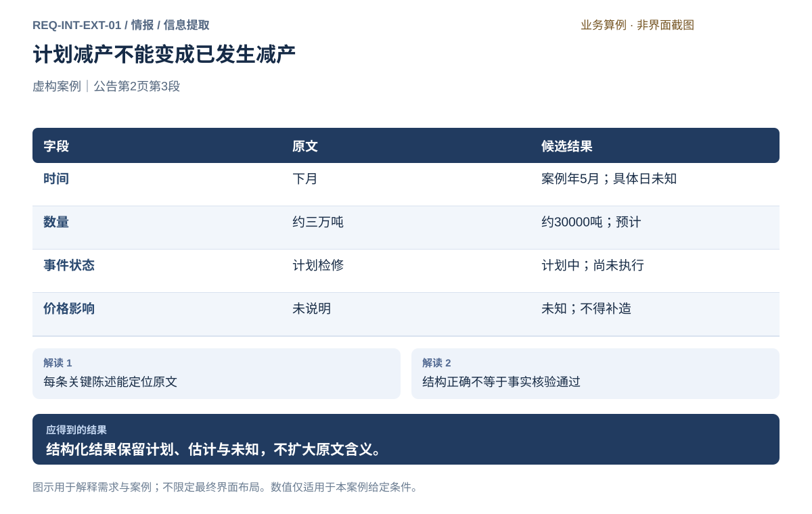
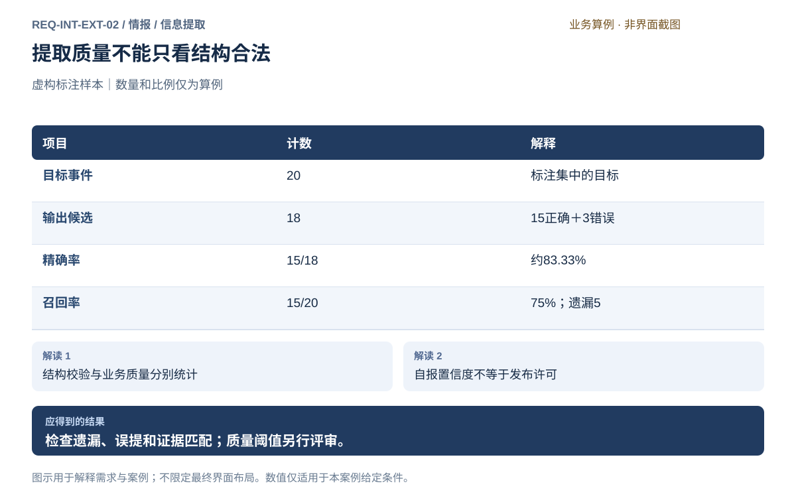
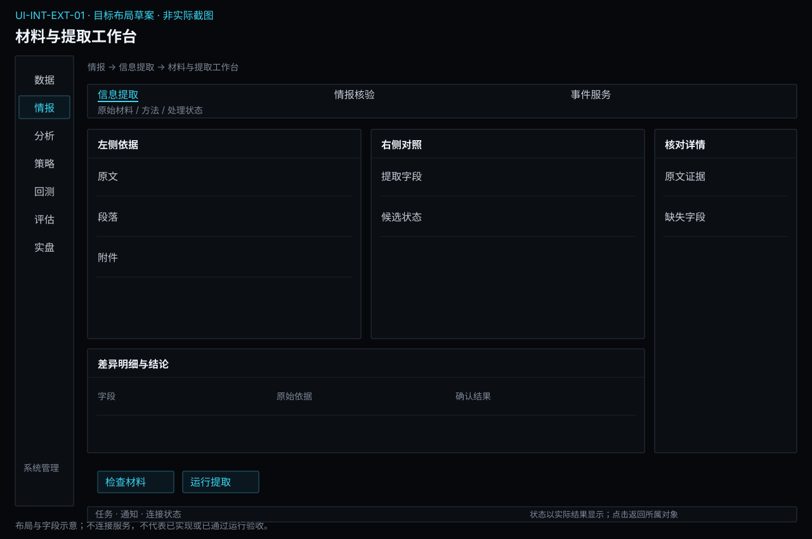
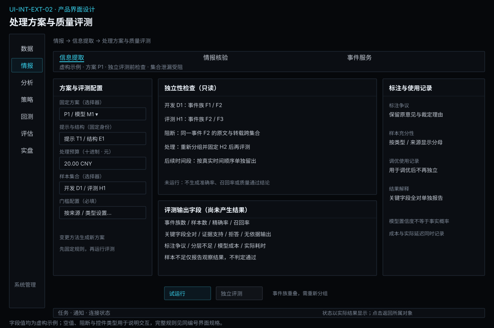

# 信息提取

[返回上级](README.md) · [需求总纲](../../README.md) · [实际界面](../../common/screens.md) · [跨模块流程](../../workflows/README.md)

需求交付版 · 2026-10-18。细化规格已编制，用户逐项签认与产品验收分别记录；目标设计不代表已经实现，实际入口与差距见本页界面对应。

**归属：** 情报 / 信息提取。本页集中保存业务需求、详细功能、案例、界面对应和验收；通用规则见[通用规范](../../common/README.md)。

## 需求导航

- [REQ-INT-EXT-01 从原始材料提取带证据的结构化候选](#req-int-ext-01)
- [REQ-INT-EXT-02 受控使用LLM并评估提取质量](#req-int-ext-02)

## 任务与对象

本子模块消费数据侧的原件和基础解析，负责“这些文字表达了什么”。OCR、文件读取和表格定位归数据；事件及数值的业务解释归情报。处理任务引用材料，不拥有第二份可独立改写的原件。

| 对象     | 关键字段                                                           | 操作与限制                                 |
| -------- | ------------------------------------------------------------------ | ------------------------------------------ |
| 材料引用 | 来源、内容标识、发布时间、获取时间、解析身份、可读页段、使用限制   | 打开原文、查看覆盖；缺失回数据补齐         |
| 处理方案 | 方法/提供方/模型身份、提示、字段规范、参数、发送范围、预算         | 固定方案后提交；修改形成独立处理记录       |
| 提取候选 | 主体、事件、数值单位、时间范围、语气、陈述类型、证据位置、缺失原因 | 逐字段核对，送核验；不直接发布             |
| 处理记录 | 真实开始/结束时间、实际方法、输入输出、失败范围、已知消耗          | 停止后续项、核对在途、显式重试；不静默覆盖 |
| 质量记录 | 标注集及角色、匹配规则、正确/错误/遗漏、字段和证据错误、成本耗时   | 比较方法，保留失败样本，不仅展示平均分     |

## 工作台操作与状态

材料列表筛选未处理、部分完成和失败；选择一条后中央显示原文，右侧逐字段显示候选、证据与问题。提交前显示固定方案、发送内容、预算和覆盖；点击取消不调用模型。离开页面不代表取消后台任务，回到任务可继续查看同一处理记录。

任务显示排队、执行、停止后续请求、部分完成、完成无匹配、完成及失败。停止在途请求的真实结果和费用可能仍待核对；不能把未知费用显示为0。重处理是显式新尝试，成功候选按身份交接，不重复发布。

质量检查使用独立于提示调优的标注样本；事件匹配规则固定后分别统计精确率、召回率、数值/单位/时间/证据正确性及成本耗时。样本不足或分母为0明确说明。阈值、材料格式、处理规模、时延和模型名单均待评审。

## REQ-INT-EXT-01 从原始材料提取带证据的结构化候选

**领域：** 情报 / 信息提取　 **建议优先级：** P1核心必要　 **需求状态：** 交付规格已编制（定位与模块已确认；细节待用户签认）

### 目标与场景

让用户从公告、新闻、研报正文和表格中取得可逐条核对的候选陈述，而非无出处的摘要。

**使用者与场景：** 兼顾期货量化研究与实盘的个人用户。

**触发条件：** 从材料列表选择已取得材料并查看完整性。

### 前置条件

- 原始材料由数据模块从获授权来源取得，保留固定内容及来源时间。
- 所选处理方法、数据使用范围和必要预算已明确；本需求不授权实际调用外部模型。

### 输入与含义

| 输入     | 含义与单位                                       | 约束                                                              |
| -------- | ------------------------------------------------ | ----------------------------------------------------------------- |
| 材料引用 | 数据目录中的固定内容、来源与基础解析结果         | 不能以网页现有内容替代已处理原件；PDF页码、表格行列等定位可复核。 |
| 提取规范 | 实体、事件、数值、单位、时间、陈述类型等字段定义 | 无法确定允许为空并说明原因；原始表述与标准字段并存。              |

### 正常操作与反馈

1. 从材料列表选择已取得材料并查看完整性。
2. 查看原文、基础解析与可读范围，选择提取规范。
3. 提交提取任务，逐条查看候选字段及证据定位。
4. 将候选送往标准化与核验，未发布结果不供正式策略消费。

### 业务规则

- 文件解码、正文抽取、OCR和表格读取属于数据基础解析；主体、数字含义和事件识别属于情报语义提取。
- 区分来源陈述、来源观点、用户判断及模型推断；来源陈述不等于已证实事实。
- 保留估计、否定、条件和计划语气；无明确方向时不得自行判断利多或利空。
- 解析不完整时标识已处理与未处理范围，不能把部分提取标为整篇完成。

### 输出与状态影响

- 让用户从公告、新闻、研报正文和表格中取得可逐条核对的候选陈述，而非无出处的摘要。
- 保留输入、证据、处理记录、限制与明确结果状态。

### 异常与继续方式

| 发生什么             | 应怎样表现                     | 使用者如何继续                                 |
| -------------------- | ------------------------------ | ---------------------------------------------- |
| 扫描表格不可读       | 标明材料可读性不足，不补造数字 | 回数据模块重新解析，取得新解析结果后显式处理。 |
| 句子未给出日期或数量 | 候选字段为空并保留原文         | 补充证据或保留未知，不用模型常识填满。         |

### 案例：计划减产不能变成已发生减产

**虚构案例条件：** 虚构公告：工厂甲预计下月检修两周，预计影响产量约三万吨；公告发布日期为案例年4月20日。

1. 取得原文第2页第3段。
2. 提取主体、时间范围、数量及计划状态。

**预期结果：**

- 时间保留为案例年5月，具体日期未知。
- 影响数量约30000吨，状态计划中；不产生已减产记录或交易指令。

### 可观察验收条件

| 编号                | 给定               | 当       | 则                               |
| ------------------- | ------------------ | -------- | -------------------------------- |
| REQ-INT-EXT-01-AC01 | 原文只写下月       | 提取日期 | 得到月份范围，不伪造具体开工日。 |
| REQ-INT-EXT-01-AC02 | 原文写预计约三万吨 | 查看候选 | 估计修饰与计划状态保留。         |
| REQ-INT-EXT-01-AC03 | 原文没有价格判断   | 查看结果 | 不把利多推断写成来源事实。       |

### 决定与配置约束

- **DEC-INT-EXT-01-01**：**规格决定**。支持中文/英文HTML、纯文本、文本型PDF及来源表格；首批供给/产能、库存、政策/交易规则事件。主体、品种、地区、类型、时间、数值单位、事实/观点及证据位置纳入结构；扫描件和音视频明确不支持。

### 详细功能

### FR-INT-EXT-01-01 选择材料并检查解析范围

**目标与结果：** 在提取前知道材料身份和可读范围。

**触发：** 选择材料并打开原文预览。

**输入与约束：** 材料内容标识、来源、基础解析记录、页数和缺失范围。

**目标操作与反馈：**

1. 选择材料并打开原文预览。
2. 核对来源、发布时间、获取时间与解析范围。
3. 只对明确范围提交语义提取。

**异常与边界：**

- 原件不可访问时提示具体原因，不以模型记忆替代。
- 重复选择材料不复制原件。

**验收条件：**

- **FR-INT-EXT-01-01-AC01**：坏页和完整页分别显示。
- **FR-INT-EXT-01-01-AC02**：语义提取失败不会把采集成功改为采集失败。

**界面对应：** [UI-INT-EXT-01 材料与提取工作台](#ui-int-ext-01)。

### FR-INT-EXT-01-02 提取实体、事件和数量时间

**目标与结果：** 形成可用于核验的有类型候选。

**触发：** 查看提取规范和范围。

**输入与约束：** 提取规范、原文片段、实体、数量、单位、时区与时间范围。

**目标操作与反馈：**

1. 查看提取规范和范围。
2. 执行提取并显示原始表述与候选字段。
3. 将缺失、否定和不确定性一并保留。

**异常与边界：**

- 相对日期只有可靠基准时才解析。
- 三万吨可标准化为30000吨，但不能成为确定实际减产。

**验收条件：**

- **FR-INT-EXT-01-02-AC01**：候选包含单位、估计标识和证据。
- **FR-INT-EXT-01-02-AC02**：缺失数量为空，不显示零。

**界面对应：** [UI-INT-EXT-01 材料与提取工作台](#ui-int-ext-01)。

### FR-INT-EXT-01-03 逐字段回看证据和陈述类型

**目标与结果：** 让用户能够检查抽取是否忠实于材料。

**触发：** 点击候选字段跳到证据。

**输入与约束：** 材料标识、页段/表格坐标、文本片段、陈述类别。

**目标操作与反馈：**

1. 点击候选字段跳到证据。
2. 查看来源陈述、观点或模型推断标签。
3. 标记证据不支持的问题并送核验。

**异常与边界：**

- 摘要不能替代关键数值原文。
- 模型推断不自动提升为来源事实。

**验收条件：**

- **FR-INT-EXT-01-03-AC01**：修改页面筛选不改变原始证据。
- **FR-INT-EXT-01-03-AC02**：无法定位证据的关键字段不能发布为已核验。

**界面对应：** [UI-INT-EXT-01 材料与提取工作台](#ui-int-ext-01)。

### FR-INT-EXT-01-04 交接完整、部分与无提取结果

**目标与结果：** 区分处理结果和业务含义。

**触发：** 核对任务结果与覆盖。

**输入与约束：** 材料范围、成功条目、失败页、无匹配结果及错误原因。

**目标操作与反馈：**

1. 核对任务结果与覆盖。
2. 将成功候选交接核验并保留失败范围。
3. 针对失败范围显式重新处理。

**异常与边界：**

- 无匹配仅说明当前规范未提取到，不证明没有事件。
- 失败不得伪装为零事件的成功结果。

**验收条件：**

- **FR-INT-EXT-01-04-AC01**：部分完成能同时显示候选和未处理页。
- **FR-INT-EXT-01-04-AC02**：重复交接同一候选不会生成多条独立事件。

**界面对应：** [UI-INT-EXT-01 材料与提取工作台](#ui-int-ext-01)。

### FR-INT-EXT-01-05 定义提取结构与缺失字段语义

**来源与确认：** 2026-10-18全面审查及用户授权补充；详细行为草案待评审，未实现、未执行产品验收。

**目标与结果：** 同一类材料产出可比较候选，未提及、无法辨认与明确否定不混同。

**触发：** 创建或修改材料提取方案。

**输入与约束：** 事件类型、实体、发生/生效时间、数值单位、证据位置、字段必需性与允许多值；原文引用保持。

**目标操作与反馈：**

1. 列出每个字段的类型、含义、单位、必填条件与未知表达，预览正例及缺失例。
2. 在固定材料样本上试提取，逐字段显示值、证据和未通过原因。
3. 固定结构与方法后用于新候选；修改结构只影响新处理结果，旧证据可查。

**异常与边界：**

- 材料未给出数量时保留未提及，不填0；否定陈述不能变成肯定事件。
- 结构检查仅判断格式与字段约束，不代表事实通过核验或允许发布。

**操作案例：** 公告只给“下月检修”，候选保留原文时间及解析范围；没有可靠发布日期时不补造具体年月日。

**验收条件：**

- **FR-INT-EXT-01-05-AC01**：包含“拟减产，规模未披露”的材料产生拟议状态及数量未提及，不产生已减产0吨。
- **FR-INT-EXT-01-05-AC02**：必需实体无法确认的结果保留为待核对候选，不能进入已发布集合。

**界面对应：** [UI-INT-EXT-01](#ui-int-ext-01)；[UI-INT-VER-01](verification.md#ui-int-ver-01)。

## REQ-INT-EXT-02 受控使用LLM并评估提取质量

**领域：** 情报 / 信息提取　 **建议优先级：** P1核心必要　 **需求状态：** 交付规格已编制（定位与模块已确认；细节待用户签认）

### 目标与场景

在明确材料范围、处理方法和预算下使用LLM，留下可以比较和追溯的处理记录。

**使用者与场景：** 兼顾期货量化研究与实盘的个人用户。

**触发条件：** 选择规则或LLM处理方法，检查提供方、发送内容和预算。

### 前置条件

- 原始材料由数据模块从获授权来源取得，保留固定内容及来源时间。
- 所选处理方法、数据使用范围和必要预算已明确；本需求不授权实际调用外部模型。

### 输入与含义

| 输入     | 含义与单位                                         | 约束                                                         |
| -------- | -------------------------------------------------- | ------------------------------------------------------------ |
| 处理方案 | 模型提供方、模型标识、提示模板与提取规范的固定内容 | 记录实际使用身份及参数；供应商未提供精确构建身份时明示限制。 |
| 处理预算 | 输入范围、费用上限、超时和任务停止约定             | 估算与实际消耗分开，价格未知时不能伪称免费。                 |
| 核验样本 | 人工标注材料、目标字段和独立评测集                 | 不把用于调提示的样本当作独立质量证明。                       |

### 正常操作与反馈

1. 选择规则或LLM处理方法，检查提供方、发送内容和预算。
2. 执行后记录输入摘要、模型身份、提示及输出、校验与消耗。
3. 对标注集检查提取质量并查看失败样例。
4. 需要调整方案时形成独立处理记录并比较，既有引用不被覆盖。

### 业务规则

- LLM是可选择的处理能力，不另设通用AI业务模块；确定性格式检查、数值换算不能只靠模型回答。
- 外部材料是不可信内容；其中要求忽略规则、上传秘密或执行操作的文字不得改变任务权限。
- 只发送任务必要且获允许的材料，不发送账户凭据；模型密钥本地输入、脱敏显示，不进入日志和普通配置。
- 受限材料不能发送到未获允许的外部模型；不可用时明确失败，不静默换提供方或模型。
- 可追溯不承诺模型重新运行逐字相同，保留实际结果和方法限制。
- 任务重试需明确剩余范围与费用；请求结果不明时不能无界重试或重复发布。

### 输出与状态影响

- 在明确材料范围、处理方法和预算下使用LLM，留下可以比较和追溯的处理记录。
- 保留输入、证据、处理记录、限制与明确结果状态。

### 异常与继续方式

| 发生什么                 | 应怎样表现                                       | 使用者如何继续                                   |
| ------------------------ | ------------------------------------------------ | ------------------------------------------------ |
| 模型超时或输出不满足结构 | 标为失败或部分完成并保留结果与消耗已知范围       | 用户选择剩余范围后再次确认，处理结果按身份去重。 |
| 材料包含操作指令         | 仅按材料内容处理，不调用交易、凭据或任意网络工具 | 继续提取可用证据，记录异常内容。                 |

### 案例：提取质量不能只看结构合法

**虚构案例条件：** 虚构标注集有20条目标事件；模型输出18条候选，其中15条匹配标注，3条错误，漏掉5条。

1. 计算匹配、错误与遗漏。
2. 与结构合法率分别展示。

**预期结果：**

- 精确率15/18约83.33%，召回率15/20为75%。
- 不得把18条结构合法输出称为100%业务准确。

### 可观察验收条件

| 编号                | 给定               | 当         | 则                                                 |
| ------------------- | ------------------ | ---------- | -------------------------------------------------- |
| REQ-INT-EXT-02-AC01 | 15条正确、3条错误  | 计算精确率 | 显示15/18及约83.33%。                              |
| REQ-INT-EXT-02-AC02 | 20条目标只找到15条 | 计算召回率 | 显示15/20及75%。                                   |
| REQ-INT-EXT-02-AC03 | 重复执行相同输入   | 查看结果   | 保留独立处理记录，不覆盖已引用结果或重复发布事件。 |

### 决定与配置约束

- **DEC-INT-EXT-02-01**：**运行配置**。模型方案须显式填写模型标识、部署位置、允许外发材料类别、调用/输入/费用上限和标注集。默认禁止外发；无质量核验不自动发布，LLM输出须人工复核。具体服务连接通过GATE-INT核验。

### 详细功能

### FR-INT-EXT-02-01 确认模型处理方案和材料发送范围

**目标与结果：** 让用户控制处理方法与外部调用。

**触发：** 选择处理方案并预览材料发送范围。

**输入与约束：** 模型身份、模板、字段规范、发送片段、材料使用限制、预算。

**目标操作与反馈：**

1. 选择处理方案并预览材料发送范围。
2. 核对提供方、数据使用条件与预计消耗。
3. 确认后提交固定方案的任务。

**异常与边界：**

- 无授权或预算不明时明确阻断原因。
- 不静默启用另一提供方。

**验收条件：**

- **FR-INT-EXT-02-01-AC01**：用户可在执行前查看实际拟发送内容。
- **FR-INT-EXT-02-01-AC02**：取消提交不发出模型请求。

**界面对应：** [UI-INT-EXT-02 处理方案与质量评测](#ui-int-ext-02)。

### FR-INT-EXT-02-02 保留处理证据并比较重处理结果

**目标与结果：** 解释候选如何产生以及处理差异。

**触发：** 查看一次处理的输入、方法和输出。

**输入与约束：** 原件/解析身份、模型/提示/规范内容标识、参数、时间、实际输出。

**目标操作与反馈：**

1. 查看一次处理的输入、方法和输出。
2. 改变方案后发起独立处理。
3. 比较新增、删除、字段变化和证据变化。

**异常与边界：**

- 不能覆盖已用于研究的输出。
- 模型服务内部变化未知时保留可重现性限制。

**验收条件：**

- **FR-INT-EXT-02-02-AC01**：旧研究引用仍定位原结果。
- **FR-INT-EXT-02-02-AC02**：新结果不会自动替换已发布情报。

**界面对应：** [UI-INT-EXT-02 处理方案与质量评测](#ui-int-ext-02)。

### FR-INT-EXT-02-03 控制消耗并处理部分完成和重试

**目标与结果：** 失败时保留材料和已知进度。

**触发：** 查看进度、费用和失败原因。

**输入与约束：** 预算、实际或未知消耗、任务范围、已完成项、待核对请求。

**目标操作与反馈：**

1. 查看进度、费用和失败原因。
2. 停止尚未开始的处理，说明在途请求仍可能计费。
3. 仅对明确范围重新提交，去重交接结果。

**异常与边界：**

- 请求超时不证明服务未收费。
- 达到预算停止新增请求，不虚构全部完成。

**验收条件：**

- **FR-INT-EXT-02-03-AC01**：已完成输出保留且可核对。
- **FR-INT-EXT-02-03-AC02**：相同材料候选重复交接不会增加事件数量。

**界面对应：** [UI-INT-EXT-02 处理方案与质量评测](#ui-int-ext-02)。

### FR-INT-EXT-02-04 用独立标注集评估提取方法

**目标与结果：** 以真实错误类型决定方法是否适用。

**触发：** 固定评测集及事件匹配规则。

**输入与约束：** 标注规则、样本身份、匹配规则、开发/评测区分、成本和耗时。

**目标操作与反馈：**

1. 固定评测集及事件匹配规则。
2. 运行质量检查并展示计数和比例。
3. 下钻数字、单位、时间、证据错误和漏提，记录适用边界。

**异常与边界：**

- 分母为零时显示不适用。
- 模型自报置信度不能替代实测质量。

**验收条件：**

- **FR-INT-EXT-02-04-AC01**：案例精确率83.33%、召回率75%。
- **FR-INT-EXT-02-04-AC02**：字段正确率、证据匹配、成本和延迟有各自口径。

**界面对应：** [UI-INT-EXT-02 处理方案与质量评测](#ui-int-ext-02)。

## 界面设计与实际对应

## UI-INT-EXT-01 材料与提取工作台

**业务目标：** 让用户从公告、新闻、研报正文和表格中取得可逐条核对的候选陈述，而非无出处的摘要。

**对应情况：待设计。** 当前17张界面基线没有情报工作台，本条只定义目标交互，不表示现有软件已实现。

**实际入口：** 当前无对应入口；目标入口：情报 → 材料与提取工作台（待设计）。

当前没有对应的实际界面截图；下方目标设计不表示已经实现或操作成功。

### 页面形态与目标布局

**设计状态：** 目标规格已编制，含布局、字段、动作和关键状态；尚未获得逐项产品签认或实现验收。现状对应证据保持上文说明，图稿不是运行截图。

**界面形态：** 并排核对详情。

**目标到达路径：** 情报 → 信息提取 → 材料与提取工作台。这是已确认导航下的目标入口，实际对应仍见上方证据。

| 区域 | 要显示的内容 |
| --- | --- |
| 顶部上下文 | 原始材料 / 方法 / 处理状态 |
| 列表、分类或步骤区 | 原文 / 段落 / 附件 |
| 主要工作区 | 提取字段 / 候选状态 |
| 选中项详情或检查区 | 原文证据 / 缺失字段 |
| 主要动作区 | 检查材料 / 运行提取 |

**区域联动与返回：** 选择列表或步骤只更新当前对象及详情，不隐式启动业务；图表与明细使用同一输入或结果上下文。离开并返回保留已确认的对象和查询条件，未保存草稿按本页保存语义处理。异步提交后用请求/任务身份定位实际状态，不能把操作按钮点击当作成功。

**窗口与空间：** 复用现有主窗口框架。宽度缩小时优先收拢辅助详情，表格在内容区横向滚动；主操作和关键上下文不能被页面裁切。重新展开详情仍指向原选中对象。

**状态设计范围：** 以本页状态/异常和验收为准，正常操作、首次无对象、筛选无匹配、请求中、失败及该业务的未知状态分别说明；不适用状态需说明原因，不套用虚构成功数据。字段类型、默认值和动作前提见下文；关键状态按本页交付约定及模块状态图检查。[返回界面设计总览](../../common/ui-designs.md)。

### 目标交互设计（待实现）

沿用Terminal紧凑表格、详情区、语言与状态规范。目标布局：左侧材料与处理状态列表；中央原文及定位；右侧字段与证据详情。保留来源和时间上下文，未实现页面不补画为实际截图。

**字段与信息：**

- 来源、材料标题、内容标识、发布时间/获取时间、可读范围。
- 实体、事件类型、原文数值/单位、时间范围、计划/发生、估计/确认、陈述类型。
- 提取规范、处理记录、证据页段、缺失原因。

**动作与反馈：**

- 选择材料与规范；执行前展示范围和预算。
- 点击字段定位原文；标记问题；送往核验。

**状态与异常：**

- 待解析、可提取、处理中、部分完成、完成无匹配和失败分别说明。
- 无原文证据或材料不完整时显示限制。

### 业务验收要求（待验收，不代表截图已证明实现）

- **UI-INT-EXT-01-AC01**：计划30000吨保持计划状态。
- **UI-INT-EXT-01-AC02**：原文和候选字段能够双向定位。
- **UI-INT-EXT-01-AC03**：没有材料时提供前往数据来源与采集的路径，不展示虚构新闻。

### 字段与操作交付约定

以下补齐页面关键字段的类型、初始值与边界；已有功能条目的输入规则仍适用。进入已有对象时加载实际保存值，新建时未明确给默认的必填项为空，不能借用案例数值。只读缺失统一显示“—”并提供原因。

| 字段组 | 类型与单位 | 初始值、检查及变化影响 |
| --- | --- | --- |
| 材料选择 | 固定原文身份多选 | 仅已授权且可解析类型，原文只读 |
| 结构与方案 | 事件结构、处理方案 | 必选，字段类型/必需性明确，改变结构重新预览 |
| 证据与候选 | 段落位置、事实/观点、缺失原因 | 每个事实可回原文；未知值不补造，提取后仍待核验 |

**操作顺序：** 使用“检查材料 / 运行提取”完成本页任务；先选择固定对象并补齐必填项，再检查范围和影响，最后提交有副作用的动作。查看、筛选和返回不隐式执行业务；保存、发布、启动、授权和撤单各自显示实际结果，不能合并为一个成功提示。

| 关键状态 | 信息与允许操作 | 禁止或返回行为 |
| --- | --- | --- |
| 首次为空或无匹配 | 显示当前材料选择范围，提供创建/补齐或清除筛选入口；只读详情说明来源 | 不填示例数据，不把无权限显示为无记录 |
| 输入错误或前提缺失 | 在“结构与方案”等具体字段旁说明问题，保留其他输入，焦点移至首个错误 | 依赖错误项的动作不可提交，返回不丢草稿 |
| 加载、运行或部分结果 | 保留对象身份和最后可靠时间，展示实际阶段/覆盖；可查看“证据与候选”已有证据 | 未完成不能显示全量成功，不能用加载中的空表覆盖已知事实 |
| 失败或结果未知 | 已明确失败可修正输入后独立提交；可能已受理则查询原请求/对象；展示未决范围 | 未核实前不重复有副作用的操作，不把取消页面当取消业务 |
| 离开及返回 | 已保存对象可由原身份重开，未保存编辑提供保存/放弃/留在当前页；关闭抽屉只改变展示 | 即时偏好不套草稿确认；秘密取消后不留普通表单缓存 |

**交互验收案例：** 在本页选择一个有效对象，改变“材料选择”后核对旧预览是否失效；制造“结构与方案”缺项或不可用，确认原因与阻断；补齐后完成主要动作，核对“证据与候选”与关联对象结果，再离开返回。只读字段通过隔离测试回复制造状态，不在实际界面篡改业务事实。适用的具体成功结果仍以本页原有案例及AC为准。

关键状态的视觉呈现见[状态设计约定](../../common/ui-designs.md#state-designs)及本模块状态图；状态与动作按本表及关联FR逐项验收，静态图不冒充已执行交互。

### 对应功能需求

- [FR-INT-EXT-01-01 选择材料并检查解析范围](#fr-int-ext-01-01)
- [FR-INT-EXT-01-02 提取实体、事件和数量时间](#fr-int-ext-01-02)
- [FR-INT-EXT-01-03 逐字段回看证据和陈述类型](#fr-int-ext-01-03)
- [FR-INT-EXT-01-04 交接完整、部分与无提取结果](#fr-int-ext-01-04)
- [FR-INT-EXT-01-05 定义提取结构与缺失字段语义](#fr-int-ext-01-05)

## UI-INT-EXT-02 处理方案与质量评测

**业务目标：** 在明确材料范围、处理方法和预算下使用LLM，留下可以比较和追溯的处理记录。

**对应情况：待设计。** 当前17张界面基线没有情报工作台，本条只定义目标交互，不表示现有软件已实现。

**实际入口：** 当前无对应入口；目标入口：情报 → 处理方案与质量评测（待设计）。

当前没有对应的实际界面截图；下方目标设计不表示已经实现或操作成功。

### 页面形态与目标布局

**设计状态：** 目标规格已编制，含布局、字段、动作和关键状态；尚未获得逐项产品签认或实现验收。现状对应证据保持上文说明，图稿不是运行截图。

**界面形态：** 配置与分析结果工作区。

**目标到达路径：** 情报 → 信息提取 → 处理方案与质量评测。这是已确认导航下的目标入口，实际对应仍见上方证据。

| 区域 | 要显示的内容 |
| --- | --- |
| 顶部上下文 | 固定方法 / 预算 / 样本 |
| 列表、分类或步骤区 | 方法参数 / 评测集合 |
| 主要工作区 | 质量分布 / 错误分类 |
| 选中项详情或检查区 | 标注对照 / 消耗记录 |
| 主要动作区 | 试运行 / 评价质量 |

**区域联动与返回：** 选择列表或步骤只更新当前对象及详情，不隐式启动业务；图表与明细使用同一输入或结果上下文。离开并返回保留已确认的对象和查询条件，未保存草稿按本页保存语义处理。异步提交后用请求/任务身份定位实际状态，不能把操作按钮点击当作成功。

**窗口与空间：** 复用现有主窗口框架。宽度缩小时优先收拢辅助详情，表格在内容区横向滚动；主操作和关键上下文不能被页面裁切。重新展开详情仍指向原选中对象。

**状态设计范围：** 以本页状态/异常和验收为准，正常操作、首次无对象、筛选无匹配、请求中、失败及该业务的未知状态分别说明；不适用状态需说明原因，不套用虚构成功数据。字段类型、默认值和动作前提见下文；关键状态按本页交付约定及模块状态图检查。[返回界面设计总览](../../common/ui-designs.md)。

### 目标交互设计（待实现）

沿用Terminal紧凑表格、详情区、语言与状态规范。目标布局：方案与任务列表；固定输入和运行记录；质量结果与错误样本。保留来源和时间上下文，未实现页面不补画为实际截图。

**字段与信息：**

- 提供方、模型身份、模板与规范、参数、材料外发范围。
- 预算、预计/已知实际消耗、耗时、在途请求。
- 评测样本、匹配规则、精确率/召回率、数值/单位/证据错误。

**动作与反馈：**

- 预览并提交；停止后续请求；核对失败范围后重试。
- 固定方案；比较两次处理；打开错误样本原文。

**状态与异常：**

- 未配置、不可用、执行中、部分完成、结果待核对。
- 材料禁止外发时提交禁用并解释；费用未知不显示0。

### 业务验收要求（待验收，不代表截图已证明实现）

- **UI-INT-EXT-02-AC01**：模拟的指令注入文本不能触发外部操作或下单。
- **UI-INT-EXT-02-AC02**：停止不承诺取消已发出的模型请求。
- **UI-INT-EXT-02-AC03**：案例质量分母与计算结果一致。

### 字段与操作交付约定

以下补齐页面关键字段的类型、初始值与边界；已有功能条目的输入规则仍适用。进入已有对象时加载实际保存值，新建时未明确给默认的必填项为空，不能借用案例数值。只读缺失统一显示“—”并提供原因。

| 字段组 | 类型与单位 | 初始值、检查及变化影响 |
| --- | --- | --- |
| 方法与模型 | 解析/LLM、模型标识/部署 | 必选，默认不外发，实际模型不可用阻止调用 |
| 预算和质量集 | 调用次数/输入量/费用、标注集 | 全部显式填写，预算正值，集合固定且显示样本分层 |
| 比较结果 | 字段正确/完整/证据支持/拒答 | 显示分母及错误样本；平均成绩不是发布许可 |

**操作顺序：** 使用“试运行 / 评价质量”完成本页任务；先选择固定对象并补齐必填项，再检查范围和影响，最后提交有副作用的动作。查看、筛选和返回不隐式执行业务；保存、发布、启动、授权和撤单各自显示实际结果，不能合并为一个成功提示。

| 关键状态 | 信息与允许操作 | 禁止或返回行为 |
| --- | --- | --- |
| 首次为空或无匹配 | 显示当前方法与模型范围，提供创建/补齐或清除筛选入口；只读详情说明来源 | 不填示例数据，不把无权限显示为无记录 |
| 输入错误或前提缺失 | 在“预算和质量集”等具体字段旁说明问题，保留其他输入，焦点移至首个错误 | 依赖错误项的动作不可提交，返回不丢草稿 |
| 加载、运行或部分结果 | 保留对象身份和最后可靠时间，展示实际阶段/覆盖；可查看“比较结果”已有证据 | 未完成不能显示全量成功，不能用加载中的空表覆盖已知事实 |
| 失败或结果未知 | 已明确失败可修正输入后独立提交；可能已受理则查询原请求/对象；展示未决范围 | 未核实前不重复有副作用的操作，不把取消页面当取消业务 |
| 离开及返回 | 已保存对象可由原身份重开，未保存编辑提供保存/放弃/留在当前页；关闭抽屉只改变展示 | 即时偏好不套草稿确认；秘密取消后不留普通表单缓存 |

**交互验收案例：** 在本页选择一个有效对象，改变“方法与模型”后核对旧预览是否失效；制造“预算和质量集”缺项或不可用，确认原因与阻断；补齐后完成主要动作，核对“比较结果”与关联对象结果，再离开返回。只读字段通过隔离测试回复制造状态，不在实际界面篡改业务事实。适用的具体成功结果仍以本页原有案例及AC为准。

关键状态的视觉呈现见[状态设计约定](../../common/ui-designs.md#state-designs)及本模块状态图；状态与动作按本表及关联FR逐项验收，静态图不冒充已执行交互。

### 对应功能需求

- [FR-INT-EXT-02-01 确认模型处理方案和材料发送范围](#fr-int-ext-02-01)
- [FR-INT-EXT-02-02 保留处理证据并比较重处理结果](#fr-int-ext-02-02)
- [FR-INT-EXT-02-03 控制消耗并处理部分完成和重试](#fr-int-ext-02-03)
- [FR-INT-EXT-02-04 用独立标注集评估提取方法](#fr-int-ext-02-04)
- [FR-INT-VER-02-05 按明确质量门槛决定人工或自动发布](verification.md#fr-int-ver-02-05)

