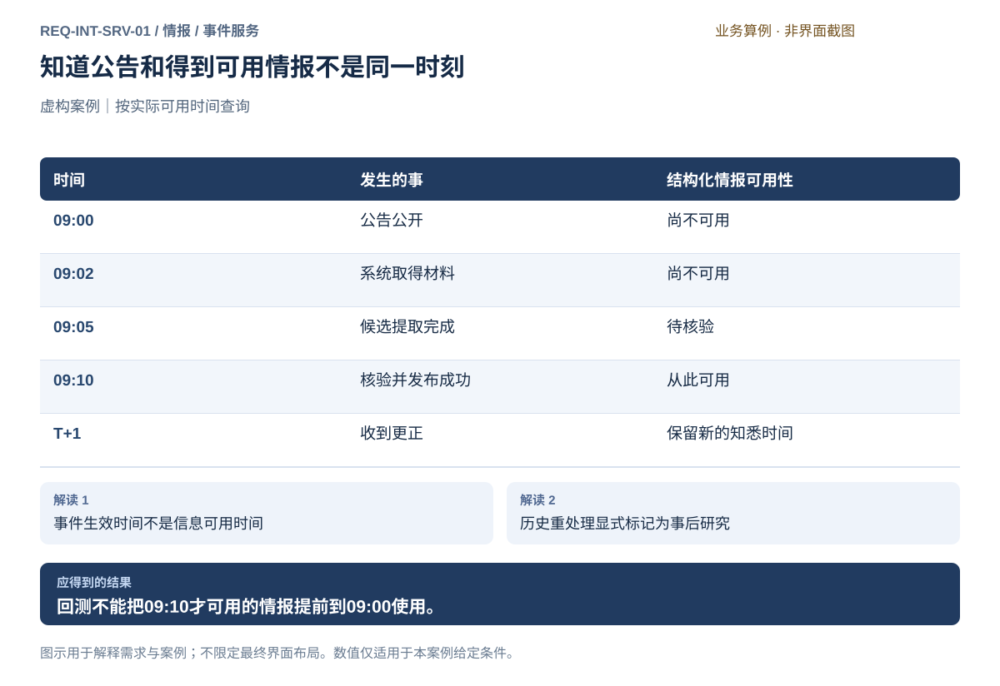
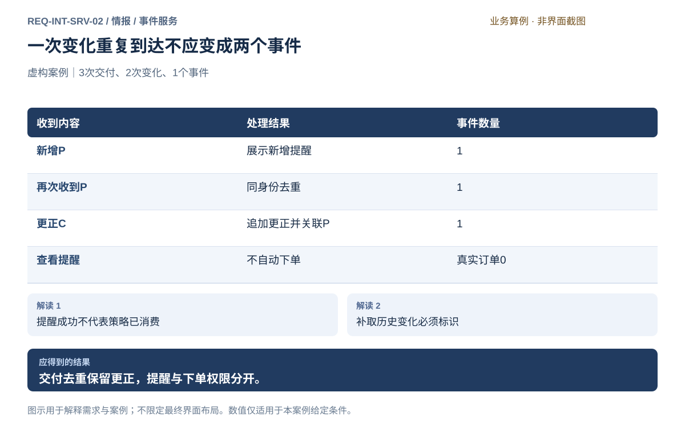
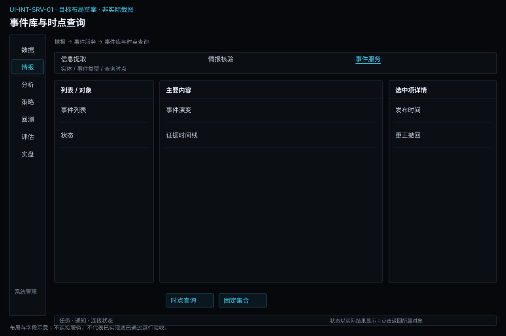
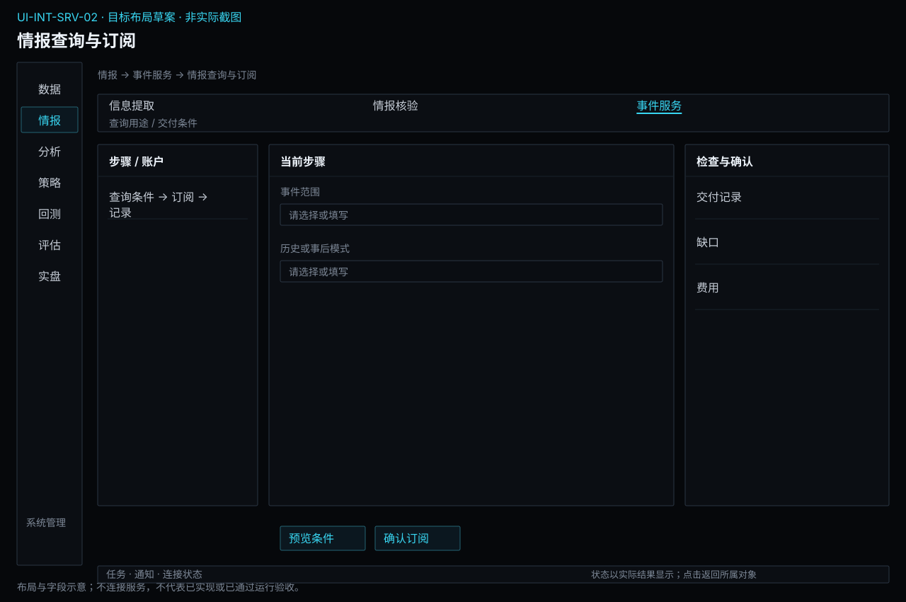

# 事件服务

[返回上级](README.md) · [需求总纲](../../README.md) · [实际界面](../../common/screens.md) · [跨模块流程](../../workflows/README.md)

需求交付版 · 2026-10-18。细化规格已编制，用户逐项签认与产品验收分别记录；目标设计不代表已经实现，实际入口与差距见本页界面对应。

**归属：** 情报 / 事件服务。本页集中保存业务需求、详细功能、案例、界面对应和验收；通用规则见[通用规范](../../common/README.md)。

## 需求导航

- [REQ-INT-SRV-01 组织事件演变并查询当时可得情报](#req-int-srv-01)
- [REQ-INT-SRV-02 通过查询、订阅和提醒交付情报](#req-int-srv-02)

## 事件与陈述分开

一个事件可有多条来源陈述和多次进展。材料身份、陈述身份、事件身份及发布变化身份分别用于原件定位、证据核验、事件组织和交付去重；不能用标题充当所有身份。事件关联调整须有依据，不删除原材料或已引用结果。

| 时间                   | 含义                                 | 使用限制                             |
| ---------------------- | ------------------------------------ | ------------------------------------ |
| 事件发生或计划生效时间 | 现实事件发生或预定发生的时刻/范围    | 不代表用户何时知道                   |
| 来源发布时间           | 来源向外公开材料的时刻及精度         | 未知时不能拿下载时间替代             |
| 系统获取时间           | 本系统取得该固定材料的时刻           | 晚取得材料不能进入更早的实际历史消费 |
| 提取及核验时间         | 实际处理候选和确认结果的时刻         | 不能回填到历史公告日                 |
| 情报可用时间           | 满足发布及持久保存条件后可消费的时刻 | 实际历史查询截止时点前必须已可用     |
| 更正知悉与可用时间     | 新材料/更正进入系统并可消费的时刻    | 不抹去旧时点的知识状态               |

## 查询与交付模式

当前事件视图回答“现在掌握的进展”；实际历史视图回答“截至当时系统可用的已发布情报”；事后研究允许今天加工历史材料，但始终标识真实处理时间和模型事后知识风险，不能称为历史可交易证据。未知时间的记录列出排除原因，不自动补日期。

查询结果固定为研究集合时，保存记录内容、时点模式、筛选条件、证据、处理方法及用途限制。数据管理与服务提供存储、访问和依赖保护；情报拥有事件关系与发布语义。分析用该集合定义变量和检验，策略明确缺失/延迟输入处理，实盘和风控保持独立权限。

## 订阅与提醒

用户按品种、主体、事件类型及变化条件预览并启用订阅；列表显示当前状态、最后确认位置和缺口。重复交付用变化身份去重，但不同更正不能被当成旧重复。连接恢复不表示历史缺口已补齐；补取范围明确且带历史补取标签。

自然语言查询先展示解释出的条件与时点，用户可纠正后执行；摘要关键事实附引用，无足够证据时明确说明。订阅暂停只停止后续提醒，不删除历史记录。提醒、数据交付、策略消费和交易结果分别显示，不设直接越过授权的下单按钮。

## REQ-INT-SRV-01 组织事件演变并查询当时可得情报

**领域：** 情报 / 事件服务　 **建议优先级：** P1核心必要　 **需求状态：** 交付规格已编制（定位与模块已确认；细节待用户签认）

### 目标与场景

让研究者既能查看当前事件，也能重建某一时点系统实际知道的信息。

**使用者与场景：** 兼顾期货量化研究与实盘的个人用户。

**触发条件：** 从已发布记录查看关联主体、品种和事件时间线。

### 前置条件

- 原始材料由数据模块从获授权来源取得，保留固定内容及来源时间。
- 所选处理方法、数据使用范围和必要预算已明确；本需求不授权实际调用外部模型。

### 输入与含义

| 输入       | 含义与单位                                   | 约束                                                       |
| ---------- | -------------------------------------------- | ---------------------------------------------------------- |
| 事件与陈述 | 稳定事件身份、多个来源陈述和后续变化         | 事件归并不删除陈述；同一事件可同时存在计划和未知实际结果。 |
| 查询上下文 | 截止时点、时区、用途、发布规则及固定情报集合 | 实际历史可得和事后历史重处理必须明确区分。                 |

### 正常操作与反馈

1. 从已发布记录查看关联主体、品种和事件时间线。
2. 选定截至时点与实际可得或事后研究模式。
3. 查询符合当时获取、处理、核验和发布条件的记录。
4. 固定结果及限制，交接分析并保留引用。

### 业务规则

- 事件发生时间、来源发布时间、系统获取时间、提取完成时间、情报可用时间分开记录。
- 实际历史消费只使用截至时点已满足用途条件的内容；未来发生但已公开的计划可以在信息可得时被研究。
- 后来取得的旧公告和今天重处理的历史材料不能冒充当时系统已产生的情报。
- 材料中未包含的事后知识不得作为来源事实；仅限制提示不能证明模型没有历史泄漏，事后研究须保留模型知识污染风险。
- 当前事件视图与时点视图分开；固定快照保留当时陈述、发布状态和方法。

### 输出与状态影响

- 让研究者既能查看当前事件，也能重建某一时点系统实际知道的信息。
- 保留输入、证据、处理记录、限制与明确结果状态。

### 异常与继续方式

| 发生什么           | 应怎样表现             | 使用者如何继续                               |
| ------------------ | ---------------------- | -------------------------------------------- |
| 来源发布时刻未知   | 标注历史可得性无法证明 | 排除严格时点研究，或明确限定为事后研究。     |
| 关联错误或事件拆分 | 形成有理由的关系修订   | 保留旧引用及变更记录，不静默重算已完成实验。 |

### 案例：知道公告和得到可用情报不是同一时刻

**虚构案例条件：** 虚构案例日T：公告09:00发布，09:02获取，09:05提取完成，09:10核验发布；T+1才收到更正。

1. 分别查询T09:04和T09:11。
2. 在T+1查询旧时点。

**预期结果：**

- T09:04只能看到已取得材料，没有已发布结构化情报。
- T09:11可使用原情报；T+1更正不改变旧时点当时所知。

### 可观察验收条件

| 编号                | 给定                  | 当         | 则                              |
| ------------------- | --------------------- | ---------- | ------------------------------- |
| REQ-INT-SRV-01-AC01 | 09:04查询实际可得情报 | 执行查询   | 不返回09:10才发布的结构化结果。 |
| REQ-INT-SRV-01-AC02 | 09:11查询             | 执行查询   | 返回原情报及可用时间09:10。     |
| REQ-INT-SRV-01-AC03 | T+1已收到更正         | 回看T09:11 | 不把后来更正混入旧时点。        |

### 决定与配置约束

- **DEC-INT-SRV-01-01**：**规格决定**。严格历史模式要求原发布时间、系统取得/处理和发布时点证据，消费截止不早于实际可得时间；现在重处理的旧文标记事后研究，不允许伪装成历史可交易信号。

### 详细功能

### FR-INT-SRV-01-01 建立事件及其演变关系

**目标与结果：** 将多次报道组织为可解释事件。

**触发：** 打开事件候选关系。

**输入与约束：** 主体、时间、类型、陈述和关联依据。

**目标操作与反馈：**

1. 打开事件候选关系。
2. 确认同事件、后续进展、更正或独立事件。
3. 沿时间线查看计划、发生、取消及未知状态。

**异常与边界：**

- 不能因一次取消公告删除原计划记录。
- 争议状态保留各方陈述。

**验收条件：**

- **FR-INT-SRV-01-01-AC01**：每次状态变化能回到来源。
- **FR-INT-SRV-01-01-AC02**：关联修订不破坏原研究引用。

**界面对应：** [UI-INT-SRV-01 事件库与时点查询](#ui-int-srv-01)。

### FR-INT-SRV-01-02 按用途与截止时点查询

**目标与结果：** 正确区分当前事实视图和历史已知信息。

**触发：** 选择模式及截止时点。

**输入与约束：** 事件过滤、截止时点、时间证据、实际可得/事后模式。

**目标操作与反馈：**

1. 选择模式及截止时点。
2. 查询并显示被排除记录及原因。
3. 下钻记录各时间与证据。

**异常与边界：**

- 时间缺失不能自动设为事件发生日。
- 事后模式不得标为当时可交易。

**验收条件：**

- **FR-INT-SRV-01-02-AC01**：09:04查询排除09:10才可用的情报。
- **FR-INT-SRV-01-02-AC02**：09:11可见原记录但不见T+1更正。

**界面对应：** [UI-INT-SRV-01 事件库与时点查询](#ui-int-srv-01)。

### FR-INT-SRV-01-03 固定情报集合并交接研究

**目标与结果：** 形成可复核的事件研究输入。

**触发：** 预览研究输入及质量限制。

**输入与约束：** 记录集合、筛选条件、时点模式、发布规则、证据与方法引用。

**目标操作与反馈：**

1. 预览研究输入及质量限制。
2. 通过数据统一能力保存固定集合。
3. 在分析模块选择该集合并定义研究变量。

**异常与边界：**

- 保存失败不返回可用快照。
- 情报不计算因子有效性或调整目标仓位。

**验收条件：**

- **FR-INT-SRV-01-03-AC01**：重查询固定身份返回相同内容。
- **FR-INT-SRV-01-03-AC02**：新的提取或修订不自动修改旧集合。

**界面对应：** [UI-INT-SRV-01 事件库与时点查询](#ui-int-srv-01)。

### FR-INT-SRV-01-04 约束历史重处理的结论

**目标与结果：** 揭示事后模型加工的可得性限制。

**触发：** 选择历史重处理用途。

**输入与约束：** 历史材料、实际处理日期、模型身份、材料内外证据及研究声明。

**目标操作与反馈：**

1. 选择历史重处理用途。
2. 查看处理时间与历史观察期差异。
3. 将结论标为事后研究并交接评估限制。

**异常与边界：**

- 禁止用模型记忆补充原材料不存在的历史事实。
- 不能仅凭提示词声称完全消除事后知识。

**验收条件：**

- **FR-INT-SRV-01-04-AC01**：输出保留真实处理时间。
- **FR-INT-SRV-01-04-AC02**：实际历史模式不会纳入后来加工的结果。

**界面对应：** [UI-INT-SRV-01 事件库与时点查询](#ui-int-srv-01)。

## REQ-INT-SRV-02 通过查询、订阅和提醒交付情报

**领域：** 情报 / 事件服务　 **建议优先级：** P1核心必要　 **需求状态：** 交付规格已编制（定位与模块已确认；细节待用户签认）

### 目标与场景

让用户按品种和事件持续获得情报变化，并明确交付范围及消费者权限。

**使用者与场景：** 兼顾期货量化研究与实盘的个人用户。

**触发条件：** 创建查询或订阅并预览匹配结果和条件。

### 前置条件

- 原始材料由数据模块从获授权来源取得，保留固定内容及来源时间。
- 所选处理方法、数据使用范围和必要预算已明确；本需求不授权实际调用外部模型。

### 输入与含义

| 输入       | 含义与单位                                     | 约束                                                       |
| ---------- | ---------------------------------------------- | ---------------------------------------------------------- |
| 订阅条件   | 主体、品种、事件类型、字段条件、变化类型与用途 | 不以关键词命中代替已核验事实；候选观察与正式消费分别标识。 |
| 消费上下文 | 查询身份、发布内容、时间语义与订阅游标         | 统一数据交付提供可追溯内容，不重复计算或复制情报业务状态。 |

### 正常操作与反馈

1. 创建查询或订阅并预览匹配结果和条件。
2. 确认启用，接收新增、修订和撤回变化。
3. 打开提醒查看事件、原文证据和可用时间。
4. 跳转分析或已配置策略输入，决策由策略定义，准入与实际执行由实盘负责。

### 业务规则

- 自然语言查询先展示解释出的条件、截止时点和范围，不自行扩展搜索权限或执行外部动作。
- 摘要中的关键事实带引用；缺证据时说明不足，不生成确定答案。
- 同次事件变化有稳定标识，重复交付可辨认；订阅恢复列出缺口和补取范围。
- 实时策略使用符合用途的已发布情报；缺失或延迟由策略定义的输入规则处理，不能被默认为零事件。
- 材料与情报保存在统一数据能力中，情报发布状态只能由情报流程决定；通知状态不等于消费或交易执行成功。

### 输出与状态影响

- 让用户按品种和事件持续获得情报变化，并明确交付范围及消费者权限。
- 保留输入、证据、处理记录、限制与明确结果状态。

### 异常与继续方式

| 发生什么               | 应怎样表现                           | 使用者如何继续                                       |
| ---------------------- | ------------------------------------ | ---------------------------------------------------- |
| 订阅中断               | 显示最后确认位置与缺口，保留已有提醒 | 按明确范围补取，并标识历史补取，不伪装为实时新事件。 |
| 自然语言问题无对应证据 | 显示无足够证据及实际查询条件         | 用户调整范围或补充来源，不编造市场结论。             |

### 案例：一次变化重复到达不应变成两个事件

**虚构案例条件：** 虚构同一事件的发布变化P到达两次，随后更正变化C到达一次。

1. 按变化身份接收三次消息。
2. 查看事件及提醒列表。

**预期结果：**

- 显示一次新增P与一次更正C，事件仍为一个。
- 情报提醒自身产生真实订单0笔。

### 可观察验收条件

| 编号                | 给定          | 当       | 则                                 |
| ------------------- | ------------- | -------- | ---------------------------------- |
| REQ-INT-SRV-02-AC01 | P重复到达两次 | 订阅接收 | 只形成一次同身份新增提醒。         |
| REQ-INT-SRV-02-AC02 | 后续C更正     | 刷新事件 | 保留P并关联更正C，不静默覆盖历史。 |
| REQ-INT-SRV-02-AC03 | 出现提醒      | 查看交易 | 未经过策略与授权路径，不产生订单。 |

### 决定与配置约束

- **DEC-INT-SRV-02-01**：**规格决定**。支持实体/品种/类型/时间/状态的字段过滤及相应事件订阅、应用内提醒、显式区间补取。自然语言只生成可审阅条件及带引用回答，不能自动执行策略或无限抓取。

### 详细功能

### FR-INT-SRV-02-01 构建查询并查看带证据的回答

**目标与结果：** 支持可解释检索和摘要。

**触发：** 输入条件或自然语言问题。

**输入与约束：** 用户问题、允许材料、结构化过滤条件、时点与用途。

**目标操作与反馈：**

1. 输入条件或自然语言问题。
2. 核对解析出的过滤条件和时间范围。
3. 查询并查看引用及证据不足提示。

**异常与边界：**

- 查询不得执行交易或修改发布状态。
- 空结果与请求失败分别显示。

**验收条件：**

- **FR-INT-SRV-02-01-AC01**：每个关键事实可定位已授权证据。
- **FR-INT-SRV-02-01-AC02**：用户可以修改误解的查询条件。

**界面对应：** [UI-INT-SRV-02 情报查询与订阅](#ui-int-srv-02)。

### FR-INT-SRV-02-02 创建订阅和条件提醒

**目标与结果：** 按明确事件变化提醒用户。

**触发：** 编辑订阅并预览匹配案例。

**输入与约束：** 品种实体、类型、条件、发布/修订/撤回范围。

**目标操作与反馈：**

1. 编辑订阅并预览匹配案例。
2. 启用后查看状态和最新位置。
3. 修改、暂停或停止订阅，保留已有记录。

**异常与边界：**

- 编辑条件不自动回填全部历史提醒。
- 候选观察明确未发布，不进入正式策略输入。
- 情报决定事件条件及更新，通知中心只呈现提醒；标记已读或静音不改变已发布情报或订阅业务条件。

**验收条件：**

- **FR-INT-SRV-02-02-AC01**：重复变化P只产生一次同身份提醒。
- **FR-INT-SRV-02-02-AC02**：暂停后不新增提醒，历史记录保持。

**界面对应：** [UI-INT-SRV-02 情报查询与订阅](#ui-int-srv-02)；[UI-COM-UX-02 通知中心](../../common/interaction.md#ui-com-ux-02)。

### FR-INT-SRV-02-03 识别交付缺口并核对补取

**目标与结果：** 保持消费进度可解释。

**触发：** 检查订阅或查询的交付状态。

**输入与约束：** 最后确认位置、变化身份、缺失范围、来源可用性。

**目标操作与反馈：**

1. 检查订阅或查询的交付状态。
2. 中断后查看缺口并明确补取范围。
3. 对补取结果去重并标为历史补取。

**异常与边界：**

- 恢复连接不等于补取完成。
- 补取事件不得冒充当前首次公开消息。

**验收条件：**

- **FR-INT-SRV-02-03-AC01**：更正C不会因P已交付而被错误去重。
- **FR-INT-SRV-02-03-AC02**：缺口未补齐时持续显示限制。

**界面对应：** [UI-INT-SRV-02 情报查询与订阅](#ui-int-srv-02)。

### FR-INT-SRV-02-04 向研究和策略交付发布内容

**目标与结果：** 提供可追溯输入且不越权执行。

**触发：** 预览内容及用途限制。

**输入与约束：** 已发布内容、可用时间、用途条件、消费者引用。

**目标操作与反馈：**

1. 预览内容及用途限制。
2. 通过统一数据访问交给分析或已配置策略。
3. 查看交付状态，交易结果另到实盘核对。

**异常与边界：**

- 数据接口不能改变情报核验或发布状态。
- 情报模块无账户交易权限；延迟输入不自动视为无事件。

**验收条件：**

- **FR-INT-SRV-02-04-AC01**：未发布内容被正式消费接口排除。
- **FR-INT-SRV-02-04-AC02**：提醒自身产生订单0笔。

**界面对应：** [UI-INT-SRV-02 情报查询与订阅](#ui-int-srv-02)。

## 界面设计与实际对应

## UI-INT-SRV-01 事件库与时点查询

**业务目标：** 让研究者既能查看当前事件，也能重建某一时点系统实际知道的信息。

**对应情况：待设计。** 当前17张界面基线没有情报工作台，本条只定义目标交互，不表示现有软件已实现。

**实际入口：** 当前无对应入口；目标入口：情报 → 事件库与时点查询（待设计）。

当前没有对应的实际界面截图；下方目标设计不表示已经实现或操作成功。

### 页面形态与目标布局

**设计状态：** 目标规格已编制，含布局、字段、动作和关键状态；尚未获得逐项产品签认或实现验收。现状对应证据保持上文说明，图稿不是运行截图。

**界面形态：** 列表与详情工作区。

**目标到达路径：** 情报 → 事件服务 → 事件库与时点查询。这是已确认导航下的目标入口，实际对应仍见上方证据。

| 区域 | 要显示的内容 |
| --- | --- |
| 顶部上下文 | 实体 / 事件类型 / 查询时点 |
| 列表、分类或步骤区 | 事件列表 / 状态 |
| 主要工作区 | 事件演变 / 证据时间线 |
| 选中项详情或检查区 | 发布时间 / 更正撤回 |
| 主要动作区 | 时点查询 / 固定集合 |

**区域联动与返回：** 选择列表或步骤只更新当前对象及详情，不隐式启动业务；图表与明细使用同一输入或结果上下文。离开并返回保留已确认的对象和查询条件，未保存草稿按本页保存语义处理。异步提交后用请求/任务身份定位实际状态，不能把操作按钮点击当作成功。

**窗口与空间：** 复用现有主窗口框架。宽度缩小时优先收拢辅助详情，表格在内容区横向滚动；主操作和关键上下文不能被页面裁切。重新展开详情仍指向原选中对象。

**状态设计范围：** 以本页状态/异常和验收为准，正常操作、首次无对象、筛选无匹配、请求中、失败及该业务的未知状态分别说明；不适用状态需说明原因，不套用虚构成功数据。字段类型、默认值和动作前提见下文；关键状态按本页交付约定及模块状态图检查。[返回界面设计总览](../../common/ui-designs.md)。

### 目标交互设计（待实现）

沿用Terminal紧凑表格、详情区、语言与状态规范。目标布局：事件列表和筛选；事件时间线；来源、时点与研究交接详情。保留来源和时间上下文，未实现页面不补画为实际截图。

**字段与信息：**

- 事件身份、主体品种、类型、计划/发生/取消等状态。
- 发生、来源发布、获取、处理、可用时间及时区。
- 当前/实际历史/事后研究模式、截止时点、排除原因。

**动作与反馈：**

- 筛选并打开事件；查看更正；按时点查询。
- 预览固定集合并交接分析；检查引用与限制。

**状态与异常：**

- 无匹配、时间证据不足、冲突、待核验、已撤回分别呈现。
- 查询失败不能显示成成功的空结果。

### 业务验收要求（待验收，不代表截图已证明实现）

- **UI-INT-SRV-01-AC01**：09:04和09:11结果按案例不同。
- **UI-INT-SRV-01-AC02**：切换当前视图不能静默改变固定研究输入。
- **UI-INT-SRV-01-AC03**：事后重处理标签在结果及导出中保留。

### 字段与操作交付约定

以下补齐页面关键字段的类型、初始值与边界；已有功能条目的输入规则仍适用。进入已有对象时加载实际保存值，新建时未明确给默认的必填项为空，不能借用案例数值。只读缺失统一显示“—”并提供原因。

| 字段组 | 类型与单位 | 初始值、检查及变化影响 |
| --- | --- | --- |
| 事件过滤 | 实体/品种/类型/时间/状态 | 默认全部已授权已发布范围，候选单独筛选 |
| 查询模式 | 严格时点/事后研究 | 必须明确，严格模式需截止和可得证据 |
| 时间线 | 版本、发布、更正/撤回时点 | 只读不覆盖；历史查询展示当时版本及后来更正提示 |

**操作顺序：** 使用“时点查询 / 固定集合”完成本页任务；先选择固定对象并补齐必填项，再检查范围和影响，最后提交有副作用的动作。查看、筛选和返回不隐式执行业务；保存、发布、启动、授权和撤单各自显示实际结果，不能合并为一个成功提示。

| 关键状态 | 信息与允许操作 | 禁止或返回行为 |
| --- | --- | --- |
| 首次为空或无匹配 | 显示当前事件过滤范围，提供创建/补齐或清除筛选入口；只读详情说明来源 | 不填示例数据，不把无权限显示为无记录 |
| 输入错误或前提缺失 | 在“查询模式”等具体字段旁说明问题，保留其他输入，焦点移至首个错误 | 依赖错误项的动作不可提交，返回不丢草稿 |
| 加载、运行或部分结果 | 保留对象身份和最后可靠时间，展示实际阶段/覆盖；可查看“时间线”已有证据 | 未完成不能显示全量成功，不能用加载中的空表覆盖已知事实 |
| 失败或结果未知 | 已明确失败可修正输入后独立提交；可能已受理则查询原请求/对象；展示未决范围 | 未核实前不重复有副作用的操作，不把取消页面当取消业务 |
| 离开及返回 | 已保存对象可由原身份重开，未保存编辑提供保存/放弃/留在当前页；关闭抽屉只改变展示 | 即时偏好不套草稿确认；秘密取消后不留普通表单缓存 |

**交互验收案例：** 在本页选择一个有效对象，改变“事件过滤”后核对旧预览是否失效；制造“查询模式”缺项或不可用，确认原因与阻断；补齐后完成主要动作，核对“时间线”与关联对象结果，再离开返回。只读字段通过隔离测试回复制造状态，不在实际界面篡改业务事实。适用的具体成功结果仍以本页原有案例及AC为准。

关键状态的视觉呈现见[状态设计约定](../../common/ui-designs.md#state-designs)及本模块状态图；状态与动作按本表及关联FR逐项验收，静态图不冒充已执行交互。

### 对应功能需求

- [FR-INT-SRV-01-01 建立事件及其演变关系](#fr-int-srv-01-01)
- [FR-INT-SRV-01-02 按用途与截止时点查询](#fr-int-srv-01-02)
- [FR-INT-SRV-01-03 固定情报集合并交接研究](#fr-int-srv-01-03)
- [FR-INT-SRV-01-04 约束历史重处理的结论](#fr-int-srv-01-04)

## UI-INT-SRV-02 情报查询与订阅

**业务目标：** 让用户按品种和事件持续获得情报变化，并明确交付范围及消费者权限。

**对应情况：待设计。** 当前17张界面基线没有情报工作台，本条只定义目标交互，不表示现有软件已实现。

**实际入口：** 当前无对应入口；目标入口：情报 → 情报查询与订阅（待设计）。

当前没有对应的实际界面截图；下方目标设计不表示已经实现或操作成功。

### 页面形态与目标布局

**设计状态：** 目标规格已编制，含布局、字段、动作和关键状态；尚未获得逐项产品签认或实现验收。现状对应证据保持上文说明，图稿不是运行截图。

**界面形态：** 分步表单或账户操作区。

**目标到达路径：** 情报 → 事件服务 → 情报查询与订阅。这是已确认导航下的目标入口，实际对应仍见上方证据。

| 区域 | 要显示的内容 |
| --- | --- |
| 顶部上下文 | 查询用途 / 交付条件 |
| 列表、分类或步骤区 | 查询条件 → 订阅 → 记录 |
| 主要工作区 | 事件范围 / 历史或事后模式 |
| 选中项详情或检查区 | 交付记录 / 缺口 / 费用 |
| 主要动作区 | 预览条件 / 确认订阅 |

**区域联动与返回：** 选择列表或步骤只更新当前对象及详情，不隐式启动业务；图表与明细使用同一输入或结果上下文。离开并返回保留已确认的对象和查询条件，未保存草稿按本页保存语义处理。异步提交后用请求/任务身份定位实际状态，不能把操作按钮点击当作成功。

**窗口与空间：** 复用现有主窗口框架。宽度缩小时优先收拢辅助详情，表格在内容区横向滚动；主操作和关键上下文不能被页面裁切。重新展开详情仍指向原选中对象。

**状态设计范围：** 以本页状态/异常和验收为准，正常操作、首次无对象、筛选无匹配、请求中、失败及该业务的未知状态分别说明；不适用状态需说明原因，不套用虚构成功数据。字段类型、默认值和动作前提见下文；关键状态按本页交付约定及模块状态图检查。[返回界面设计总览](../../common/ui-designs.md)。

### 目标交互设计（待实现）

沿用Terminal紧凑表格、详情区、语言与状态规范。目标布局：查询条件与订阅列表；结果和变化记录；带引用摘要与交付详情。保留来源和时间上下文，未实现页面不补画为实际截图。

**字段与信息：**

- 品种主体、事件类型、条件、时间范围与用途。
- 发布状态、可用时间、变化身份、最后位置、缺口。
- 摘要来源、补取标识、订阅状态与交付错误。

**动作与反馈：**

- 预览自然语言解释；执行查询；定位证据。
- 启用/暂停订阅；确认补取；跳转研究。

**状态与异常：**

- 未启用、运行、暂停、缺口、失败、无匹配分别说明。
- 没有证据时展示不足；未核验候选独立标识。

### 业务验收要求（待验收，不代表截图已证明实现）

- **UI-INT-SRV-02-AC01**：三次交付形成两次变化、一个事件。
- **UI-INT-SRV-02-AC02**：摘要中关键事实有引用。
- **UI-INT-SRV-02-AC03**：不出现从情报直接绕过授权的下单动作。

### 字段与操作交付约定

以下补齐页面关键字段的类型、初始值与边界；已有功能条目的输入规则仍适用。进入已有对象时加载实际保存值，新建时未明确给默认的必填项为空，不能借用案例数值。只读缺失统一显示“—”并提供原因。

| 字段组 | 类型与单位 | 初始值、检查及变化影响 |
| --- | --- | --- |
| 查询表达 | 结构化条件或自然语言草稿 | 自然语言先转可审阅条件，未确认不提交 |
| 订阅与提醒 | 范围、启用开关、补取区间 | 默认不启用；范围及费用明确后才订阅 |
| 交付记录 | 游标、缺口、消费状态 | 只读；无结果、失败和未完成分开 |

**操作顺序：** 使用“预览条件 / 确认订阅”完成本页任务；先选择固定对象并补齐必填项，再检查范围和影响，最后提交有副作用的动作。查看、筛选和返回不隐式执行业务；保存、发布、启动、授权和撤单各自显示实际结果，不能合并为一个成功提示。

| 关键状态 | 信息与允许操作 | 禁止或返回行为 |
| --- | --- | --- |
| 首次为空或无匹配 | 显示当前查询表达范围，提供创建/补齐或清除筛选入口；只读详情说明来源 | 不填示例数据，不把无权限显示为无记录 |
| 输入错误或前提缺失 | 在“订阅与提醒”等具体字段旁说明问题，保留其他输入，焦点移至首个错误 | 依赖错误项的动作不可提交，返回不丢草稿 |
| 加载、运行或部分结果 | 保留对象身份和最后可靠时间，展示实际阶段/覆盖；可查看“交付记录”已有证据 | 未完成不能显示全量成功，不能用加载中的空表覆盖已知事实 |
| 失败或结果未知 | 已明确失败可修正输入后独立提交；可能已受理则查询原请求/对象；展示未决范围 | 未核实前不重复有副作用的操作，不把取消页面当取消业务 |
| 离开及返回 | 已保存对象可由原身份重开，未保存编辑提供保存/放弃/留在当前页；关闭抽屉只改变展示 | 即时偏好不套草稿确认；秘密取消后不留普通表单缓存 |

**交互验收案例：** 在本页选择一个有效对象，改变“查询表达”后核对旧预览是否失效；制造“订阅与提醒”缺项或不可用，确认原因与阻断；补齐后完成主要动作，核对“交付记录”与关联对象结果，再离开返回。只读字段通过隔离测试回复制造状态，不在实际界面篡改业务事实。适用的具体成功结果仍以本页原有案例及AC为准。

关键状态的视觉呈现见[状态设计约定](../../common/ui-designs.md#state-designs)及本模块状态图；状态与动作按本表及关联FR逐项验收，静态图不冒充已执行交互。

### 对应功能需求

- [FR-INT-SRV-02-01 构建查询并查看带证据的回答](#fr-int-srv-02-01)
- [FR-INT-SRV-02-02 创建订阅和条件提醒](#fr-int-srv-02-02)
- [FR-INT-SRV-02-03 识别交付缺口并核对补取](#fr-int-srv-02-03)
- [FR-INT-SRV-02-04 向研究和策略交付发布内容](#fr-int-srv-02-04)

