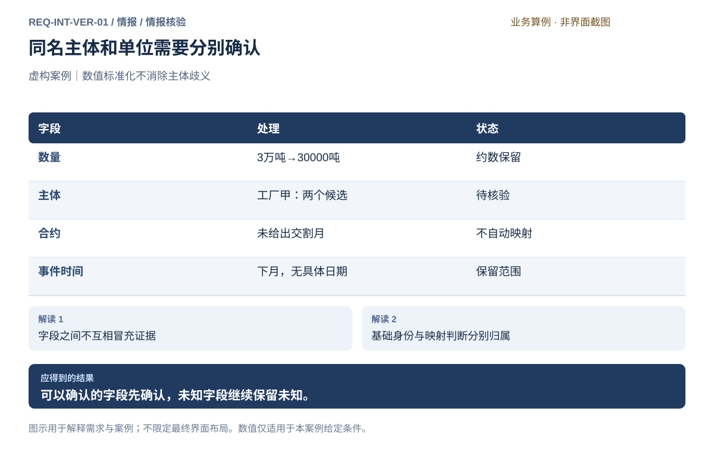
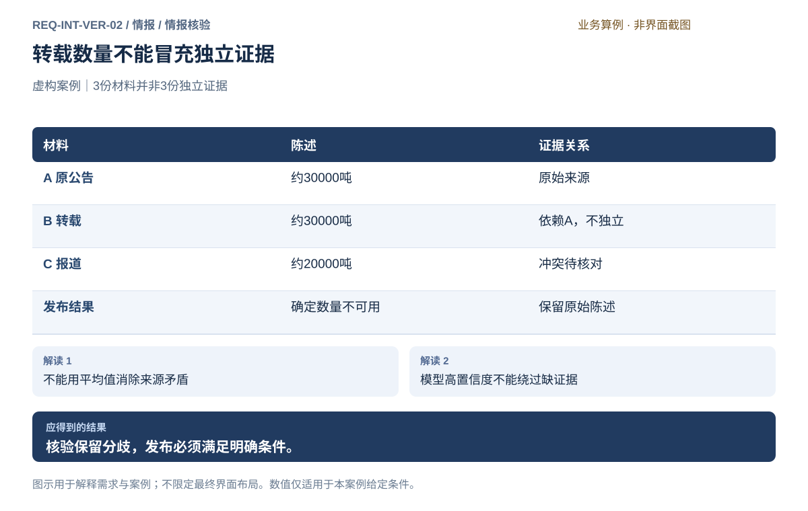
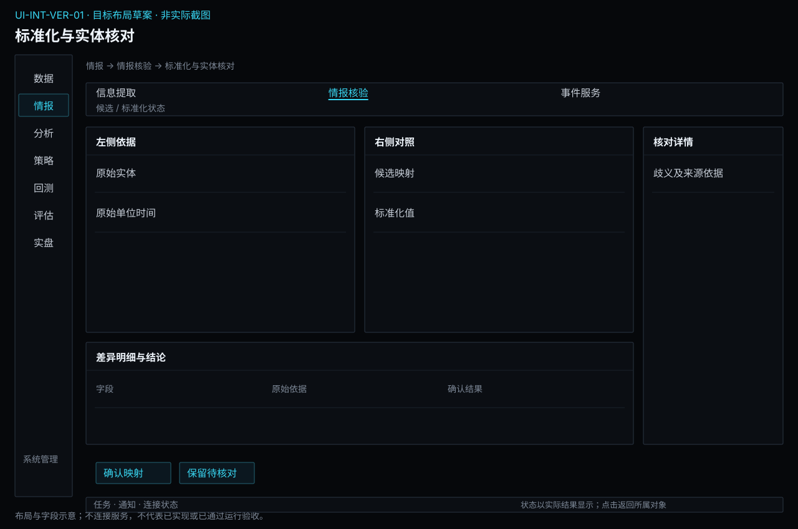
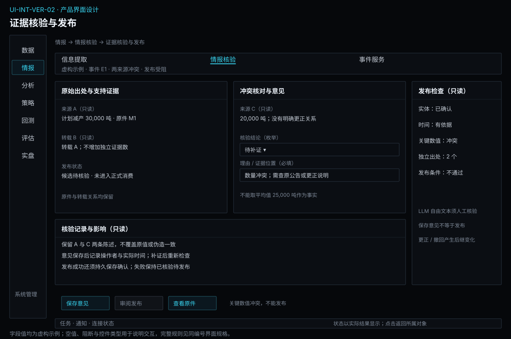

# 情报核验

[返回上级](README.md) · [需求总纲](../../README.md) · [实际界面](../../common/screens.md) · [跨模块流程](../../workflows/README.md)

需求交付版 · 2026-10-18。细化规格已编制，用户逐项签认与产品验收分别记录；目标设计不代表已经实现，实际入口与差距见本页界面对应。

**归属：** 情报 / 情报核验。本页集中保存业务需求、详细功能、案例、界面对应和验收；通用规则见[通用规范](../../common/README.md)。

## 需求导航

- [REQ-INT-VER-01 统一实体、单位和时间并处理语义歧义](#req-int-ver-01)
- [REQ-INT-VER-02 核验来源陈述并受控发布情报](#req-int-ver-02)

## 核验的含义

“有出处”只表示能找到陈述依据，不保证来源陈述已经成为现实。计划、预期、估计和实际发生分别表达；发布也不代表信息必然正确或可直接交易，而是满足明确的证据与用途条件。

| 对象     | 关键字段                                            | 责任与操作                                     |
| -------- | --------------------------------------------------- | ---------------------------------------------- |
| 实体映射 | 原名、统一身份、候选匹配、地区产品、证据、确认状态  | 情报决定此次映射；通用资料由数据维护           |
| 标准字段 | 原值、标准值、量纲、口径、约数/区间、时间精度       | 明确规则换算；保留歧义，不能强行填值           |
| 证据集合 | 原始出处、转载链、独立来源、支持/矛盾陈述           | 关联同事件，不按报道数量投票确定事实           |
| 复核记录 | 检查项、采用规则、用户修正、理由、时间、残余限制    | 单人完成复核，不引入团队审批                   |
| 发布记录 | 内容、证据、用途、事件关系、可用时间、更正/撤回引用 | 核验与存储成功后可消费；数据接口不自行决定发布 |

## 核验与发布流程

候选进入待核验队列，结构检查、实体/单位/时间核对和来源支持分别显示结果。符合已确认规则的条目可自动发布，其余进入人工复核；规则尚未配置时保持待核验。用户可确认有依据的字段、补充材料、驳回或继续保留未知，不能以人工点击替代不存在的关键证据。

已核验待发布、发布中、已发布和发布失败分开。存储失败时保留复核决定与输入，核对同次结果后继续，不能重复建立事件。若发布所需内容发生变化，应重新核验相应变化，而非沿用旧通过状态。

发布后有新证据时形成更正或撤回记录，列出受影响的订阅和固定研究引用。当前查询提示变化，历史查询仍保留当时可得内容；固定研究不自动改算。情报撤回只改变情报可用性与提醒，不自动操作真实订单或持仓。

## REQ-INT-VER-01 统一实体、单位和时间并处理语义歧义

**领域：** 情报 / 情报核验　 **建议优先级：** P1核心必要　 **需求状态：** 交付规格已编制（定位与模块已确认；细节待用户签认）

### 目标与场景

将候选映射为明确的业务对象，保留原始含义和无法确定的部分。

**使用者与场景：** 兼顾期货量化研究与实盘的个人用户。

**触发条件：** 打开候选与基础资料匹配建议。

### 前置条件

- 原始材料由数据模块从获授权来源取得，保留固定内容及来源时间。
- 所选处理方法、数据使用范围和必要预算已明确；本需求不授权实际调用外部模型。

### 输入与含义

| 输入     | 含义与单位                             | 约束                                                 |
| -------- | -------------------------------------- | ---------------------------------------------------- |
| 实体资料 | 企业、产品、地区及合约等统一身份和别名 | 通用标识由数据管理；情报维护此次映射证据与确认状态。 |
| 标准字段 | 数值、量纲、时区、事件时间及状态       | 计划、实际、同比、环比、累计值不能相互替换。         |

### 正常操作与反馈

1. 打开候选与基础资料匹配建议。
2. 核对主体、产品、地区和事件类别，歧义时选择或保留未知。
3. 按确定规则换算单位与时间，保留原值和规则。
4. 将映射结果与证据交接发布核验。

### 业务规则

- 名称相似不是同一实体的充分依据；品种关联不等于自动选择某交割月。
- 通用资料缺失回到数据模块补充依据，情报不另建一套合约字典。
- “三万吨”换算为30000吨；吨和万吨可换算，吨和手缺少合约上下文不能直接换算。
- 未知时区、模糊时间保留未知或范围，不能以本机日期补齐。

### 输出与状态影响

- 将候选映射为明确的业务对象，保留原始含义和无法确定的部分。
- 保留输入、证据、处理记录、限制与明确结果状态。

### 异常与继续方式

| 发生什么             | 应怎样表现                   | 使用者如何继续                 |
| -------------------- | ---------------------------- | ------------------------------ |
| 同名主体对应两家工厂 | 保留待确认映射，不自动合并   | 用户检查地区和来源证据后确认。 |
| 出现冲突单位或口径   | 标记不一致，阻止用作确定数量 | 核对原文或等待修订。           |

### 案例：同名主体和单位需要分别确认

**虚构案例条件：** 虚构材料提到“工厂甲约3万吨”；基础资料中有两个同名主体，原文没有地区。

1. 换算数量并检查主体匹配。
2. 保留两种可能主体。

**预期结果：**

- 数量为约30000吨。
- 主体未确定，不能把记录绑定到任一家工厂或某张合约。

### 可观察验收条件

| 编号                | 给定           | 当         | 则                           |
| ------------------- | -------------- | ---------- | ---------------------------- |
| REQ-INT-VER-01-AC01 | 3万吨          | 统一单位   | 得到30000吨并保留约数。      |
| REQ-INT-VER-01-AC02 | 同名主体有两个 | 自动关联   | 保持待核验，不任意选第一项。 |
| REQ-INT-VER-01-AC03 | 缺少合约乘数   | 请求吨转手 | 明确不可转换。               |

### 决定与配置约束

- **DEC-INT-VER-01-01**：**规格决定**。企业、产品、地区使用带来源资料；精确唯一匹配可接受，多个候选或单位/时区歧义必须人工核验。首批事件类别按情报交付范围，人工决定保留原值及理由。

### 详细功能

### FR-INT-VER-01-01 核对实体匹配与品种关联

**目标与结果：** 避免同名实体和交割月份误配。

**触发：** 查看匹配建议及依据。

**输入与约束：** 候选名称、地区、产品、基础身份、匹配依据。

**目标操作与反馈：**

1. 查看匹配建议及依据。
2. 确认明确身份或保留歧义。
3. 需要补资料时跳转数据管理并保留当前候选。

**异常与边界：**

- 不得因高模型评分自动选择冲突主体。
- 期货品种关联不是可下单合约选择。

**验收条件：**

- **FR-INT-VER-01-01-AC01**：多个匹配项可见且不默认确认。
- **FR-INT-VER-01-01-AC02**：映射修订保留原证据和受影响记录。

**界面对应：** [UI-INT-VER-01 标准化与实体核对](#ui-int-ver-01)。

### FR-INT-VER-01-02 核对数量单位及统计口径

**目标与结果：** 形成可解释的标准数值。

**触发：** 查看原值与标准值。

**输入与约束：** 原数值、单位、约数、区间、同比环比/累计/当期口径。

**目标操作与反馈：**

1. 查看原值与标准值。
2. 按明确换算规则检查量纲。
3. 冲突时标记待核验而非强行转换。

**异常与边界：**

- 百分比变化与绝对量不能混用。
- 未提供数值不能以0补齐。

**验收条件：**

- **FR-INT-VER-01-02-AC01**：3万吨得到30000吨。
- **FR-INT-VER-01-02-AC02**：吨转手缺少必要合约条件时拒绝。

**界面对应：** [UI-INT-VER-01 标准化与实体核对](#ui-int-ver-01)。

### FR-INT-VER-01-03 表达事件时间与信息时间

**目标与结果：** 保留不同时间的业务含义。

**触发：** 核对原时间文字和解析基准。

**输入与约束：** 发生/计划时间、发布/获取/处理/发布情报时间、时区、精度。

**目标操作与反馈：**

1. 核对原时间文字和解析基准。
2. 确定时间或范围并保留不确定性。
3. 交接可得性检查所需时间证据。

**异常与边界：**

- 事件未来生效不代表今天不可知。
- 材料发布时间不能冒充系统获取或情报可用时间。

**验收条件：**

- **FR-INT-VER-01-03-AC01**：下月解析为月份范围。
- **FR-INT-VER-01-03-AC02**：时区未知不伪造成确定UTC时刻。

**界面对应：** [UI-INT-VER-01 标准化与实体核对](#ui-int-ver-01)。

### FR-INT-VER-01-04 保留语气、类别和标准化变更

**目标与结果：** 让语义修正可追踪。

**触发：** 对照原文检查标准字段。

**输入与约束：** 事实陈述/观点/推断、计划/实际、否定、修饰、变更依据。

**目标操作与反馈：**

1. 对照原文检查标准字段。
2. 保存有理由的修正或驳回。
3. 比较修正前后并标明仍未解决的问题。

**异常与边界：**

- 用户修正不是原始公告修订。
- 不能删去“预计”后发布为实际发生。

**验收条件：**

- **FR-INT-VER-01-04-AC01**：候选与原文始终可追溯。
- **FR-INT-VER-01-04-AC02**：改变类别时留下操作者、时间与理由。

**界面对应：** [UI-INT-VER-01 标准化与实体核对](#ui-int-ver-01)。

## REQ-INT-VER-02 核验来源陈述并受控发布情报

**领域：** 情报 / 情报核验　 **建议优先级：** P1核心必要　 **需求状态：** 交付规格已编制（定位与模块已确认；细节待用户签认）

### 目标与场景

使发布后的情报满足明确证据要求，同时保留争议和修订过程。

**使用者与场景：** 兼顾期货量化研究与实盘的个人用户。

**触发条件：** 选择候选查看规则检查、证据与可能重复报道。

### 前置条件

- 原始材料由数据模块从获授权来源取得，保留固定内容及来源时间。
- 所选处理方法、数据使用范围和必要预算已明确；本需求不授权实际调用外部模型。

### 输入与含义

| 输入       | 含义与单位                                       | 约束                                               |
| ---------- | ------------------------------------------------ | -------------------------------------------------- |
| 发布条件   | 字段完整性、证据支持、映射明确性、材料范围及规则 | 结构合法和模型置信度不能单独决定发布。             |
| 多来源陈述 | 相同事件的不同报道、来源链和独立性               | 转载不是独立交叉验证，来源权威不等于所有字段无误。 |

### 正常操作与反馈

1. 选择候选查看规则检查、证据与可能重复报道。
2. 核对是否同一事件、是否独立来源及是否存在矛盾。
3. 符合已确认自动发布条件时按规则发布，否则进入人工复核。
4. 用户确认、驳回或保留待核验；后续更正形成新记录并关联已发布内容。

### 业务规则

- 采集成功、结构检查通过、语义核验通过和发布成功是不同状态。
- 发布规则未配置时保持待核验，不能默认允许全部自动发布。
- 原始来源陈述可以保留供研究查看；正式消费须满足发布与用途条件，未知关键字段按用途阻断。
- 纠错不篡改原文或被引用结果；撤回标识影响后续使用，历史查询仍保留当时状态。

### 输出与状态影响

- 使发布后的情报满足明确证据要求，同时保留争议和修订过程。
- 保留输入、证据、处理记录、限制与明确结果状态。

### 异常与继续方式

| 发生什么                   | 应怎样表现                         | 使用者如何继续                     |
| -------------------------- | ---------------------------------- | ---------------------------------- |
| 两个来源给出30000和20000吨 | 保留两条陈述和冲突，不求平均当事实 | 查原始公告或来源更正后决定。       |
| 关键证据缺失或规则不通过   | 保持待核验并列出阻断项             | 补证、人工确认有依据的字段或驳回。 |

### 案例：转载数量不能冒充独立证据

**虚构案例条件：** 虚构来源A公告约3万吨，B转载A为3万吨，C另报2万吨。

1. 关联A/B来源链，比较C。
2. 核对是否存在更正依据。

**预期结果：**

- A/B不是两份独立支持。
- 数量冲突未解时不能发布确定减产量；原陈述继续可查。

### 可观察验收条件

| 编号                | 给定                 | 当           | 则                                     |
| ------------------- | -------------------- | ------------ | -------------------------------------- |
| REQ-INT-VER-02-AC01 | B转载A               | 计算证据支持 | 保留来源链，不算独立验证。             |
| REQ-INT-VER-02-AC02 | C报2万吨且无修订证据 | 核验         | 显示冲突，不把2.5万吨当事实。          |
| REQ-INT-VER-02-AC03 | 新公告更正数值       | 发布修订     | 新内容关联旧记录，旧研究不被静默改写。 |

### 决定与配置约束

- **DEC-INT-VER-02-01**：**规格决定**。默认人工发布；只有确定性来源映射且全部必需字段、证据、实体和时间检查通过的规则可配置自动发布。LLM自由文本必须人工核验；撤回产生新事件通知，已固定历史引用保留并标受影响。

### 详细功能

### FR-INT-VER-02-01 检查证据支持和发布条件

**目标与结果：** 把发布门槛转为可解释检查项。

**触发：** 查看结构与证据检查清单。

**输入与约束：** 字段、证据定位、来源限制、发布规则及用途。

**目标操作与反馈：**

1. 查看结构与证据检查清单。
2. 定位缺失、未支持和映射不明的字段。
3. 按明确规则进入自动发布或待复核。

**异常与边界：**

- 模型自报分数不能覆盖阻断项。
- 规则缺失不默认放行。

**验收条件：**

- **FR-INT-VER-02-01-AC01**：每个阻断项有字段和证据位置。
- **FR-INT-VER-02-01-AC02**：无规则时不发布正式可消费记录。

**界面对应：** [UI-INT-VER-02 证据核验与发布](#ui-int-ver-02)。

### FR-INT-VER-02-02 识别重复报道和矛盾陈述

**目标与结果：** 形成事件证据集合而不丢失来源差异。

**触发：** 查看疑似同事件记录。

**输入与约束：** 材料身份、转载来源链、事件候选关系、冲突字段。

**目标操作与反馈：**

1. 查看疑似同事件记录。
2. 核对主体、时间和出处后关联或保持独立。
3. 保留冲突及支持/反对证据。

**异常与边界：**

- 相似标题不能单独确定同一事件。
- 重复材料不等于独立证据。

**验收条件：**

- **FR-INT-VER-02-02-AC01**：A/B转载关系可见。
- **FR-INT-VER-02-02-AC02**：30000与20000冲突保留，不发布25000为事实。

**界面对应：** [UI-INT-VER-02 证据核验与发布](#ui-int-ver-02)。

### FR-INT-VER-02-03 人工复核并发布或驳回

**目标与结果：** 提供个人可完成的核验闭环。

**触发：** 打开待复核队列及证据。

**输入与约束：** 候选、检查结果、修正理由、使用范围。

**目标操作与反馈：**

1. 打开待复核队列及证据。
2. 确认支持的内容，标记未知或驳回不成立陈述。
3. 满足条件后发布并显示实际成功结果。

**异常与边界：**

- 无需引入团队审批流程。
- 保存复核意见不等于发布成功；存储失败仍未发布。

**验收条件：**

- **FR-INT-VER-02-03-AC01**：操作者、理由、时间与采用规则可查。
- **FR-INT-VER-02-03-AC02**：重复同次发布不会创建两个情报记录。

**界面对应：** [UI-INT-VER-02 证据核验与发布](#ui-int-ver-02)。

### FR-INT-VER-02-04 更正或撤回已发布情报

**目标与结果：** 让后续消费者知道变化并保持历史依据。

**触发：** 查看新证据和受影响引用。

**输入与约束：** 旧记录、新证据、修订原因、生效与处理时间、依赖引用。

**目标操作与反馈：**

1. 查看新证据和受影响引用。
2. 发布关联更正或撤回说明。
3. 向订阅者提供变化事件，保留旧结果可追溯。

**异常与边界：**

- 不静默覆盖固定研究快照。
- 撤回情报不自动撤单或平仓。

**验收条件：**

- **FR-INT-VER-02-04-AC01**：历史时点查询保留当时已知内容。
- **FR-INT-VER-02-04-AC02**：更正后的当前视图能跳到原记录。

**界面对应：** [UI-INT-VER-02 证据核验与发布](#ui-int-ver-02)。

### FR-INT-VER-02-05 按明确质量门槛决定人工或自动发布

**来源与确认：** 2026-10-18全面审查及用户授权补充；详细行为草案待评审，未实现、未执行产品验收。

**目标与结果：** 发布方式与证据条件可审查，自动处理不等于自动采信。

**触发：** 配置发布政策或候选申请发布。

**输入与约束：** 事件类型、固定核验方法、独立标注评测、必需证据、冲突处理和人工复核条件；具体阈值待评审。

**目标操作与反馈：**

1. 默认新方案需要人工核验；配置自动发布时逐项列出必需字段、证据、已验证质量门槛和例外条件。
2. 执行发布检查，显示每项结果；全部条件有依据且满足才进入允许的发布路径。
3. 模型、结构或核验方法改变后重新检查适用证据；撤回和更正保留历史可见状态。

**异常与边界：**

- 门槛未确认或评测样本不覆盖该类型时不得启用该类型自动发布。
- 低置信、证据冲突、时间不明进入复核，不因任务按时完成而放行。

**操作案例：** 自动方案已覆盖生产公告但未覆盖传闻，传闻候选即使模型给高置信度也进入人工复核。

**验收条件：**

- **FR-INT-VER-02-05-AC01**：方法变化使原质量证据不适用时，自动发布被阻断且候选保留。
- **FR-INT-VER-02-05-AC02**：候选格式合法但来源冲突时只进入待复核，不进入策略可用发布流。

**界面对应：** [UI-INT-VER-02](#ui-int-ver-02)；[UI-INT-EXT-02](extraction.md#ui-int-ext-02)。

## 界面设计与实际对应

## UI-INT-VER-01 标准化与实体核对

**业务目标：** 将候选映射为明确的业务对象，保留原始含义和无法确定的部分。

**对应情况：待设计。** 当前17张界面基线没有情报工作台，本条只定义目标交互，不表示现有软件已实现。

**实际入口：** 当前无对应入口；目标入口：情报 → 标准化与实体核对（待设计）。

当前没有对应的实际界面截图；下方目标设计不表示已经实现或操作成功。

### 页面形态与目标布局

**设计状态：** 目标规格已编制，含布局、字段、动作和关键状态；尚未获得逐项产品签认或实现验收。现状对应证据保持上文说明，图稿不是运行截图。

**界面形态：** 并排核对详情。

**目标到达路径：** 情报 → 情报核验 → 标准化与实体核对。这是已确认导航下的目标入口，实际对应仍见上方证据。

| 区域 | 要显示的内容 |
| --- | --- |
| 顶部上下文 | 候选 / 标准化状态 |
| 列表、分类或步骤区 | 原始实体 / 原始单位时间 |
| 主要工作区 | 候选映射 / 标准化值 |
| 选中项详情或检查区 | 歧义及来源依据 |
| 主要动作区 | 确认映射 / 保留待核对 |

**区域联动与返回：** 选择列表或步骤只更新当前对象及详情，不隐式启动业务；图表与明细使用同一输入或结果上下文。离开并返回保留已确认的对象和查询条件，未保存草稿按本页保存语义处理。异步提交后用请求/任务身份定位实际状态，不能把操作按钮点击当作成功。

**窗口与空间：** 复用现有主窗口框架。宽度缩小时优先收拢辅助详情，表格在内容区横向滚动；主操作和关键上下文不能被页面裁切。重新展开详情仍指向原选中对象。

**状态设计范围：** 以本页状态/异常和验收为准，正常操作、首次无对象、筛选无匹配、请求中、失败及该业务的未知状态分别说明；不适用状态需说明原因，不套用虚构成功数据。字段类型、默认值和动作前提见下文；关键状态按本页交付约定及模块状态图检查。[返回界面设计总览](../../common/ui-designs.md)。

### 目标交互设计（待实现）

沿用Terminal紧凑表格、详情区、语言与状态规范。目标布局：待核验队列；原文与字段对照；实体资料与修正记录。保留来源和时间上下文，未实现页面不补画为实际截图。

**字段与信息：**

- 原始/标准实体、产品地区、匹配依据、候选项。
- 原数值/标准值、单位、口径、估计范围、否定与计划状态。
- 事件/发布/获取等时间、时区、精度与证据。

**动作与反馈：**

- 确认映射或标记歧义；跳转基础资料。
- 按规则换算；保存修正理由；提交核验。

**状态与异常：**

- 待确认、部分已确认、冲突、资料缺失。
- 禁止转换显示缺少条件，不填0。

### 业务验收要求（待验收，不代表截图已证明实现）

- **UI-INT-VER-01-AC01**：同名主体两个候选时可保留未知。
- **UI-INT-VER-01-AC02**：30000吨仍显示约数和原3万吨。
- **UI-INT-VER-01-AC03**：修改情报不能修改原件或通用身份资料。

### 字段与操作交付约定

以下补齐页面关键字段的类型、初始值与边界；已有功能条目的输入规则仍适用。进入已有对象时加载实际保存值，新建时未明确给默认的必填项为空，不能借用案例数值。只读缺失统一显示“—”并提供原因。

| 字段组 | 类型与单位 | 初始值、检查及变化影响 |
| --- | --- | --- |
| 原值与候选映射 | 主体/单位/时间并排字段 | 原值只读，映射无唯一候选时不预选 |
| 标准实体 | 引用资料身份和有效期 | 人工选择须写依据，无法确认保留歧义 |
| 转换规则 | 单位倍率/时区/精度 | 必须可核对，未知精度不自动补齐 |

**操作顺序：** 使用“确认映射 / 保留待核对”完成本页任务；先选择固定对象并补齐必填项，再检查范围和影响，最后提交有副作用的动作。查看、筛选和返回不隐式执行业务；保存、发布、启动、授权和撤单各自显示实际结果，不能合并为一个成功提示。

| 关键状态 | 信息与允许操作 | 禁止或返回行为 |
| --- | --- | --- |
| 首次为空或无匹配 | 显示当前原值与候选映射范围，提供创建/补齐或清除筛选入口；只读详情说明来源 | 不填示例数据，不把无权限显示为无记录 |
| 输入错误或前提缺失 | 在“标准实体”等具体字段旁说明问题，保留其他输入，焦点移至首个错误 | 依赖错误项的动作不可提交，返回不丢草稿 |
| 加载、运行或部分结果 | 保留对象身份和最后可靠时间，展示实际阶段/覆盖；可查看“转换规则”已有证据 | 未完成不能显示全量成功，不能用加载中的空表覆盖已知事实 |
| 失败或结果未知 | 已明确失败可修正输入后独立提交；可能已受理则查询原请求/对象；展示未决范围 | 未核实前不重复有副作用的操作，不把取消页面当取消业务 |
| 离开及返回 | 已保存对象可由原身份重开，未保存编辑提供保存/放弃/留在当前页；关闭抽屉只改变展示 | 即时偏好不套草稿确认；秘密取消后不留普通表单缓存 |

**交互验收案例：** 在本页选择一个有效对象，改变“原值与候选映射”后核对旧预览是否失效；制造“标准实体”缺项或不可用，确认原因与阻断；补齐后完成主要动作，核对“转换规则”与关联对象结果，再离开返回。只读字段通过隔离测试回复制造状态，不在实际界面篡改业务事实。适用的具体成功结果仍以本页原有案例及AC为准。

关键状态的视觉呈现见[状态设计约定](../../common/ui-designs.md#state-designs)及本模块状态图；状态与动作按本表及关联FR逐项验收，静态图不冒充已执行交互。

### 对应功能需求

- [FR-INT-EXT-01-05 定义提取结构与缺失字段语义](extraction.md#fr-int-ext-01-05)
- [FR-INT-VER-01-01 核对实体匹配与品种关联](#fr-int-ver-01-01)
- [FR-INT-VER-01-02 核对数量单位及统计口径](#fr-int-ver-01-02)
- [FR-INT-VER-01-03 表达事件时间与信息时间](#fr-int-ver-01-03)
- [FR-INT-VER-01-04 保留语气、类别和标准化变更](#fr-int-ver-01-04)

## UI-INT-VER-02 证据核验与发布

**业务目标：** 使发布后的情报满足明确证据要求，同时保留争议和修订过程。

**对应情况：待设计。** 当前17张界面基线没有情报工作台，本条只定义目标交互，不表示现有软件已实现。

**实际入口：** 当前无对应入口；目标入口：情报 → 证据核验与发布（待设计）。

当前没有对应的实际界面截图；下方目标设计不表示已经实现或操作成功。

### 页面形态与目标布局

**设计状态：** 目标规格已编制，含布局、字段、动作和关键状态；尚未获得逐项产品签认或实现验收。现状对应证据保持上文说明，图稿不是运行截图。

**界面形态：** 并排核对详情。

**目标到达路径：** 情报 → 情报核验 → 证据核验与发布。这是已确认导航下的目标入口，实际对应仍见上方证据。

| 区域 | 要显示的内容 |
| --- | --- |
| 顶部上下文 | 候选 / 核验与发布状态 |
| 列表、分类或步骤区 | 来源陈述 / 证据链 |
| 主要工作区 | 一致项 / 冲突项 / 必需字段 |
| 选中项详情或检查区 | 发布条件 / 人工复核 |
| 主要动作区 | 保存核验 / 审阅发布 |

**区域联动与返回：** 选择列表或步骤只更新当前对象及详情，不隐式启动业务；图表与明细使用同一输入或结果上下文。离开并返回保留已确认的对象和查询条件，未保存草稿按本页保存语义处理。异步提交后用请求/任务身份定位实际状态，不能把操作按钮点击当作成功。

**窗口与空间：** 复用现有主窗口框架。宽度缩小时优先收拢辅助详情，表格在内容区横向滚动；主操作和关键上下文不能被页面裁切。重新展开详情仍指向原选中对象。

**状态设计范围：** 以本页状态/异常和验收为准，正常操作、首次无对象、筛选无匹配、请求中、失败及该业务的未知状态分别说明；不适用状态需说明原因，不套用虚构成功数据。字段类型、默认值和动作前提见下文；关键状态按本页交付约定及模块状态图检查。[返回界面设计总览](../../common/ui-designs.md)。

### 目标交互设计（待实现）

沿用Terminal紧凑表格、详情区、语言与状态规范。目标布局：候选队列和阻断项；来源证据与冲突对照；复核记录和发布结果。保留来源和时间上下文，未实现页面不补画为实际截图。

**字段与信息：**

- 材料来源链、陈述、冲突字段、原文位置、核验状态。
- 采用规则、复核理由、可用范围、情报发布时间。

**动作与反馈：**

- 关联或拆分重复报道；确认或驳回；发布。
- 更正或撤回前查看引用影响；跳转订阅变化记录。

**状态与异常：**

- 待核验、冲突、已核验待发布、发布中、已发布、发布失败、已撤回。
- 材料访问失败与核验不通过分别说明。

### 业务验收要求（待验收，不代表截图已证明实现）

- **UI-INT-VER-02-AC01**：3万吨与2万吨冲突不能被平均消除。
- **UI-INT-VER-02-AC02**：发布失败不显示已可消费。
- **UI-INT-VER-02-AC03**：重复发布不生成重复事件。

### 字段与操作交付约定

以下补齐页面关键字段的类型、初始值与边界；已有功能条目的输入规则仍适用。进入已有对象时加载实际保存值，新建时未明确给默认的必填项为空，不能借用案例数值。只读缺失统一显示“—”并提供原因。

| 字段组 | 类型与单位 | 初始值、检查及变化影响 |
| --- | --- | --- |
| 核验对象 | 候选身份与证据集合 | 固定当前候选，证据可逐项展开 |
| 冲突与必需项 | 只读检查结果、人工结论 | 缺必需字段或冲突未解禁止发布 |
| 发布决定 | 人工确认/更正/撤回、理由 | 理由必填；发布与修改原文分开，撤回新增事件 |

**操作顺序：** 使用“保存核验 / 审阅发布”完成本页任务；先选择固定对象并补齐必填项，再检查范围和影响，最后提交有副作用的动作。查看、筛选和返回不隐式执行业务；保存、发布、启动、授权和撤单各自显示实际结果，不能合并为一个成功提示。

| 关键状态 | 信息与允许操作 | 禁止或返回行为 |
| --- | --- | --- |
| 首次为空或无匹配 | 显示当前核验对象范围，提供创建/补齐或清除筛选入口；只读详情说明来源 | 不填示例数据，不把无权限显示为无记录 |
| 输入错误或前提缺失 | 在“冲突与必需项”等具体字段旁说明问题，保留其他输入，焦点移至首个错误 | 依赖错误项的动作不可提交，返回不丢草稿 |
| 加载、运行或部分结果 | 保留对象身份和最后可靠时间，展示实际阶段/覆盖；可查看“发布决定”已有证据 | 未完成不能显示全量成功，不能用加载中的空表覆盖已知事实 |
| 失败或结果未知 | 已明确失败可修正输入后独立提交；可能已受理则查询原请求/对象；展示未决范围 | 未核实前不重复有副作用的操作，不把取消页面当取消业务 |
| 离开及返回 | 已保存对象可由原身份重开，未保存编辑提供保存/放弃/留在当前页；关闭抽屉只改变展示 | 即时偏好不套草稿确认；秘密取消后不留普通表单缓存 |

**交互验收案例：** 在本页选择一个有效对象，改变“核验对象”后核对旧预览是否失效；制造“冲突与必需项”缺项或不可用，确认原因与阻断；补齐后完成主要动作，核对“发布决定”与关联对象结果，再离开返回。只读字段通过隔离测试回复制造状态，不在实际界面篡改业务事实。适用的具体成功结果仍以本页原有案例及AC为准。

关键状态的视觉呈现见[状态设计约定](../../common/ui-designs.md#state-designs)及本模块状态图；状态与动作按本表及关联FR逐项验收，静态图不冒充已执行交互。

### 对应功能需求

- [FR-INT-VER-02-01 检查证据支持和发布条件](#fr-int-ver-02-01)
- [FR-INT-VER-02-02 识别重复报道和矛盾陈述](#fr-int-ver-02-02)
- [FR-INT-VER-02-03 人工复核并发布或驳回](#fr-int-ver-02-03)
- [FR-INT-VER-02-04 更正或撤回已发布情报](#fr-int-ver-02-04)
- [FR-INT-VER-02-05 按明确质量门槛决定人工或自动发布](#fr-int-ver-02-05)

