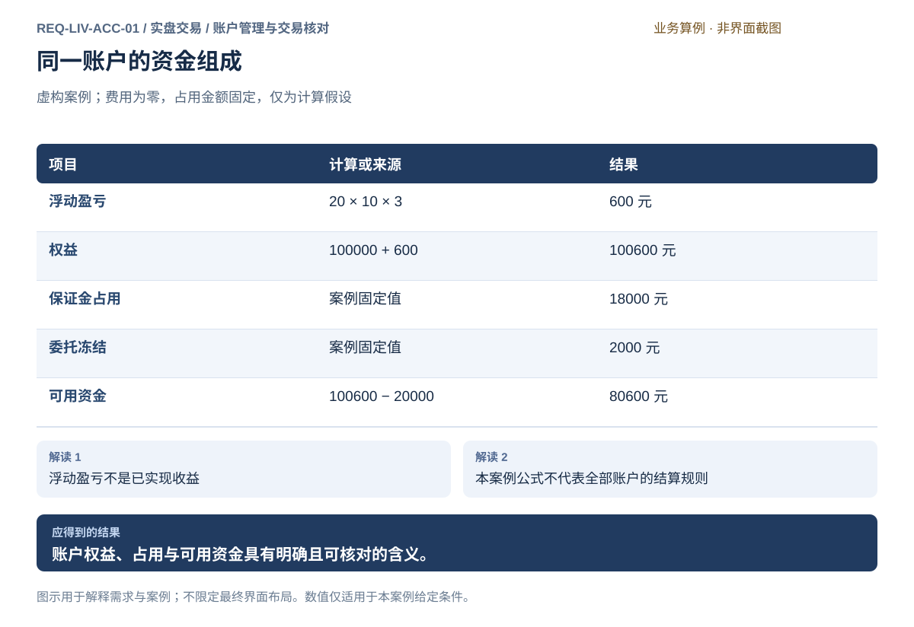
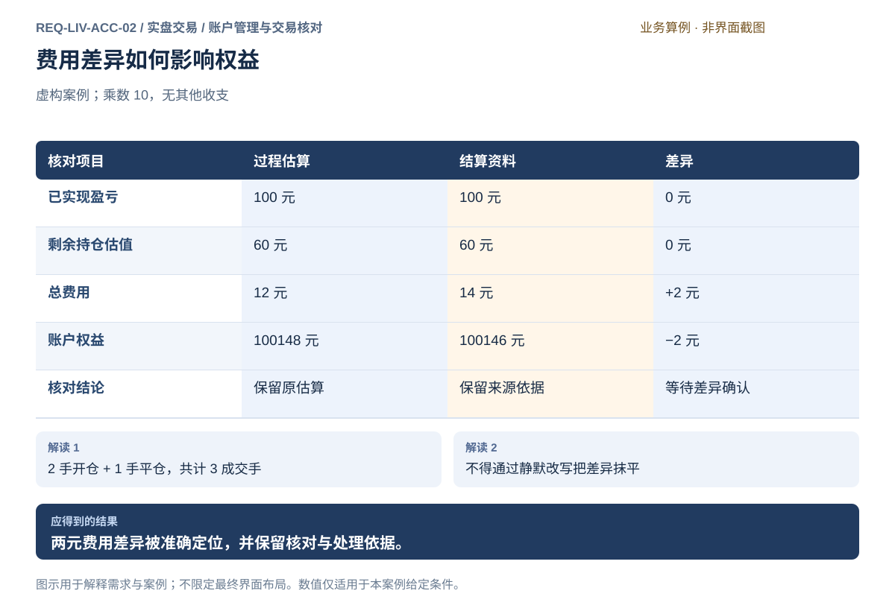
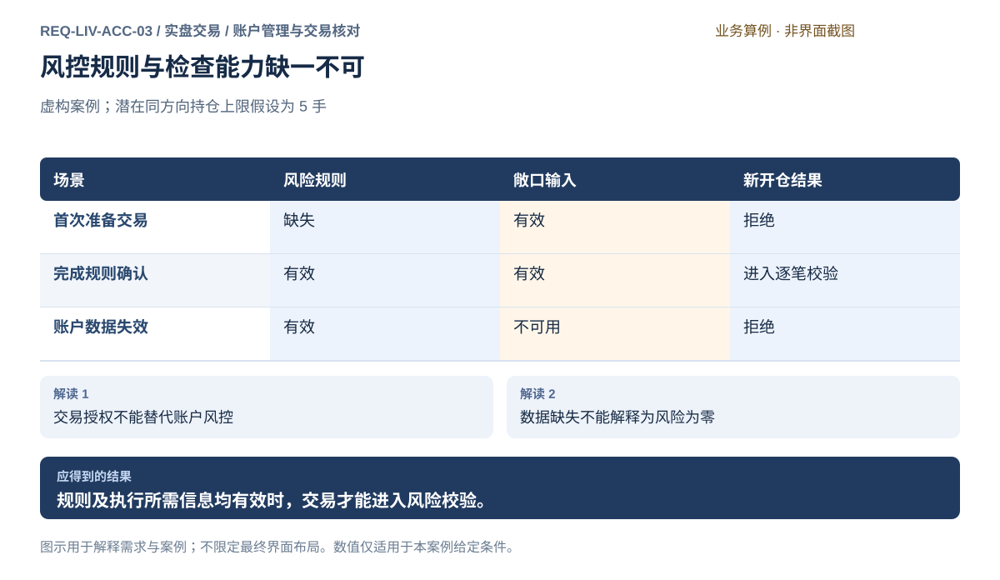
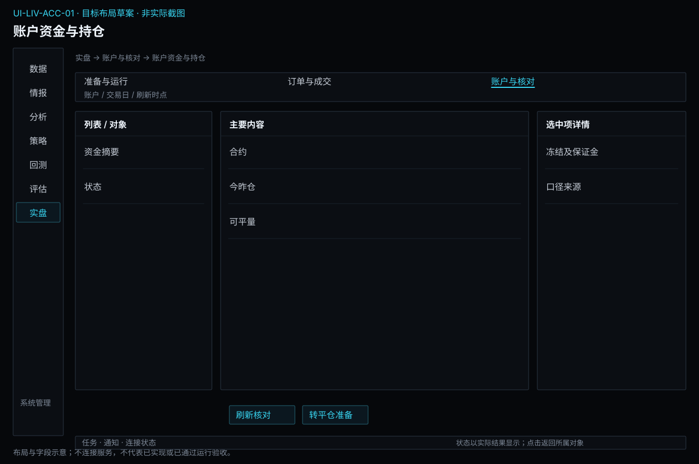
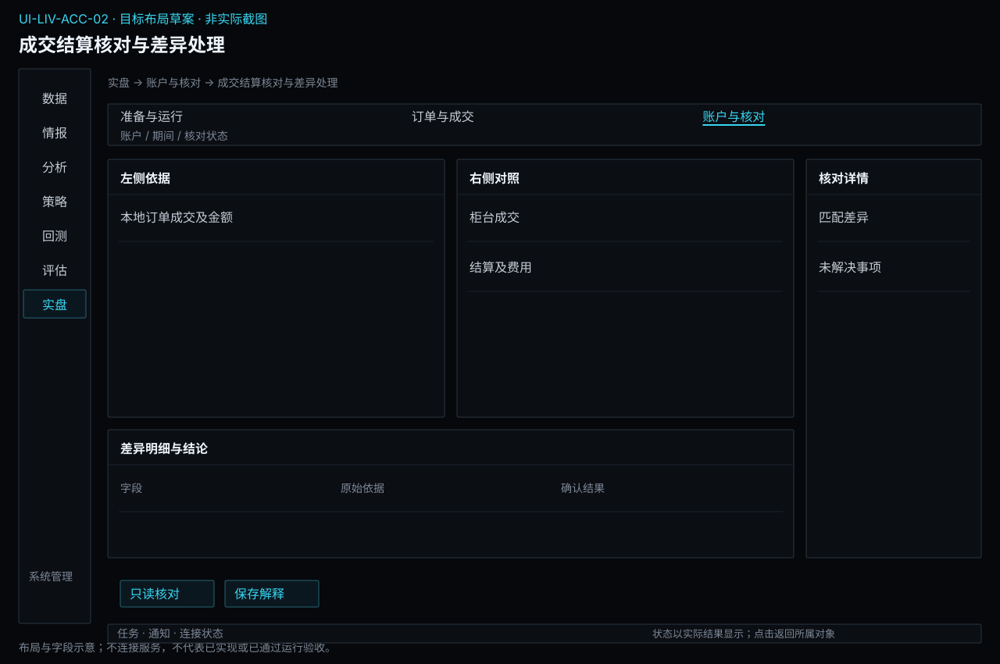
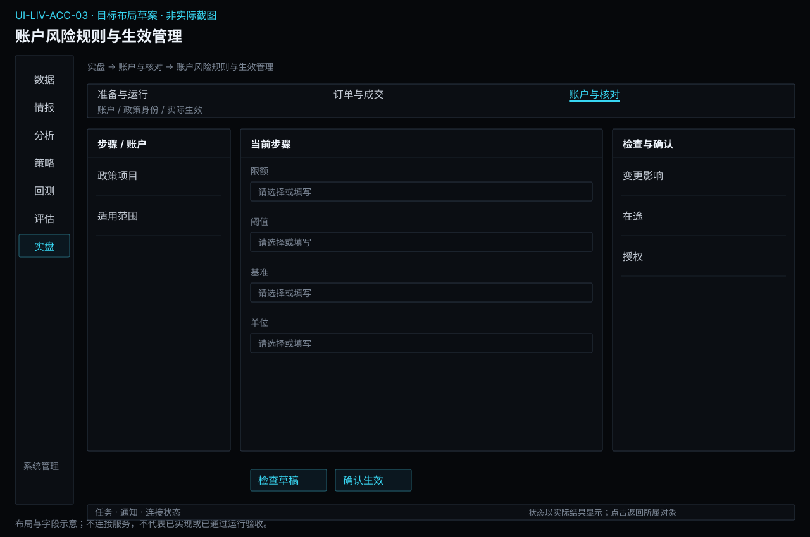

# 账户管理与交易核对

[返回上级](README.md) · [需求总纲](../../README.md) · [实际界面](../../common/screens.md) · [跨模块流程](../../workflows/README.md)

需求交付版 · 2026-10-18。细化规格已编制，用户逐项签认与产品验收分别记录；目标设计不代表已经实现，实际入口与差距见本页界面对应。

**归属：** 实盘交易（Live Trading） / 账户管理与交易核对。本页集中保存业务需求、详细功能、案例、界面对应和验收；通用规则见[通用规范](../../common/README.md)。

## 需求导航

- [REQ-LIV-ACC-01 按明确业务口径查看资金与持仓](#req-liv-acc-01)
- [REQ-LIV-ACC-02 核对成交、费用与结算差异](#req-liv-acc-02)
- [REQ-LIV-ACC-03 明确账户风险规则并在缺失时拒绝交易](#req-liv-acc-03)

## 目标与职责

解释实际账户资金、持仓、成交、费用和结算，保留可复核的权威来源及差异。账户连接与授权归实盘准备；订单状态与未知发送结果归订单执行；投资绩效及风险估计归评估。账户事实不能由报告或重新模拟覆盖。

## 对象与字段

| 对象       | 必需内容                                                       | 口径与限制                                         |
| ---------- | -------------------------------------------------------------- | -------------------------------------------------- |
| 资金切片   | 账户/环境、币种、余额、权益、保证金、冻结、可用资金、查询时点  | 每项依据可查，缺失不填零，不假装所有字段同刻更新   |
| 持仓       | 真实合约、多空、今昨、总量/冻结/可平、成本与结算基准、估值时点 | 买卖与开平分开；可平量不简单等于总持仓             |
| 成交与费用 | 可靠身份、账户、量价、开平、费用估算/确认状态、来源            | 一次成交只计一次，估算不冒充最终费用               |
| 结算资料   | 机构、账户、业务日、来源、版本/修订依据、确认范围              | 夜盘业务日不直接按自然日推断，结算权威性按来源说明 |
| 核对项     | 匹配依据、两侧金额、差额、状态、缺口、处理说明                 | 匹配不足不能猜测，完全一致/有差异/资料不足分开     |
| 更正与说明 | 原记录、来源修订、依据、派生汇总与处理结果                     | 保留原事实；本地说明不能改变柜台账本               |

## 资金持仓观察流程

选择账户与环境 → 查询切片与各项更新时间 → 查看资金组成和持仓批次 → 从变化定位成交、费用及估值 → 区分数据陈旧、查询失败和有效零 → 明确仍待核对的范围。

保证金和冻结影响可用资金，不等于损失。持仓估值需要说明最新价、结算价或所选权威口径；将日结转盈亏再次当成全部浮盈会重复计账，界面必须能追溯基准。来自不同时间的资金与持仓不能伪装为原子快照。

## 结算和差异处理

1. 确定同一账户、环境、业务期间与口径，取得真实成交及结算资料。
2. 按可靠身份匹配，重复反馈识别一次，未匹配保留。
3. 比较数量、价格、费用、资金和估值，区分时间差、估算差、来源修订与未解释差异。
4. 补充来源或记录说明，必要时据权威修订更新派生展示；保留原值、依据和处理轨迹，不静默删改账本。
5. 保存完全一致、有差异或资料不足及未解决事项，将固定切片交评估，不靠收益归因抹平账户差额。

虚构案例：初始权益100000，买开2手3500，平1手3510，剩余1手3506估值，乘数10，无其他收支。平仓利润100、未平仓估值60，估算费用12则权益100148；来源确认费用14则同口径权益100146，差额−2来自费用。两个依据都保留，不能直接覆盖原估算并让差异消失。

## 界面与例外

资金和持仓页常驻账户/环境与更新时间；数值可展开定义，持仓进入平仓草稿时重新经过订单确认和风险检查，查看持仓不发送交易。结算核对页提供期间选择、匹配表、差异详情和处理记录。资料不足时展示具体缺项，不能标“对账通过”。

实盘与仿真不合并资金或成交汇总；更换展示账户不改原记录归属。查询失败保留最后明确值与过期标识，不能清零余额或持仓。凭据不进入页面导出；需要导出的账户标识范围单独明确。完整报表与绩效报告由评估统一输出，本页保留业务核对记录和事实。

## 账户风险政策的维护入口

在实盘账户详情维护规则草稿、确认生效及查看变更影响。规则包含账户/环境、指标、单位、基准、在途口径、阈值、触发行为与恢复条件；具体政策、参数和生效记录由账户拥有。模型或策略自身的预算不得覆盖账户限制，换账户不能继承生效资格。

保存草稿、检查可执行性和确认生效是不同动作。风险配置缺失、插件不可用或必要输入失效时阻断受影响的新委托；查询与独立合规撤单按各自权限判断。变更不自动撤销旧订单或平仓，逐笔依据在订单详情查看，风险暂停与恢复转运行详情。共用规则见[共用交易约束](../../product.md#execution-risk-semantics)。

## 与配置、调度和通知的交接

账户限额及授权在实盘账户详情维护，系统设置只提供引用与跳转，不另存可生效副本。有效配置、草稿、检查和确认生效分别展示；关键变更保留业务审计，普通日志清理不改变账户政策或账本。具体公共分工见[运行支撑边界](../../product.md#operational-support-boundaries)。

## REQ-LIV-ACC-01 按明确业务口径查看资金与持仓

**领域：** 实盘交易 / 账户管理与交易核对　 **建议优先级：** P0安全必要　 **需求状态：** 交付规格已编制（源自已确认定位；细节待用户签认）

### 目标与场景

使用者能够理解账户拥有多少权益、哪些资金已占用、哪些持仓承担风险，以及信息是否足够新。不同口径的数值必须解释清楚，不能让名义金额、权益、可用资金和盈亏互相冒充。

**使用者与场景：** 个人交易者，在交易前评估账户能力、交易后核对影响及持仓期间观察风险时。

**触发条件：** 查询账户、发生订单或成交变化，或请求更新资金与持仓信息。

### 前置条件

- 使用者拥有目标账户的查询权限。
- 资金与持仓来源能够说明字段含义、业务时间及适用账户。

### 输入与含义

| 输入     | 含义与单位                                 | 约束                                                       |
| -------- | ------------------------------------------ | ---------------------------------------------------------- |
| 账户资金 | 权益、可用资金、保证金及冻结金额等来源字段 | 币种、单位、是否包含浮动盈亏和费用必须明确。               |
| 持仓信息 | 合约、方向、数量、可平数量及持仓成本口径   | 不得把持仓数量等同于可平数量；分项口径应遵从目标账户规则。 |

### 正常操作与反馈

1. 使用者确认目标账户和观察时间。
2. 系统呈现来源提供的资金及持仓，并解释关键字段口径。
3. 对计算派生值，系统说明输入与计算依据。
4. 订单冻结、成交或行情变化后，系统更新可确认的信息。
5. 若部分信息未更新或来自不同时间，系统说明差异，便于使用者决定是否继续交易。

### 业务规则

- 权益、现金、可用资金和名义敞口必须有各自定义，不能只显示一个模糊余额。
- 账户服务直接提供的结果与本地估算应能区分；估算不能替代权威结算。
- 多个时点的数据不得拼成声称同一时点的完整快照。
- 盈亏计算必须说明采用的价格、合约乘数、费用和成本口径。
- 账户更新失败时可以保留历史参考，但必须标明时间与失效状态。

### 输出与状态影响

- 可追溯到账户与时间的资金、持仓及可平数量。
- 字段口径、估算依据及需要再次核对的差异说明。

### 异常与继续方式

| 发生什么                                     | 应怎样表现                                                   | 使用者如何继续                                     |
| -------------------------------------------- | ------------------------------------------------------------ | -------------------------------------------------- |
| 持仓已刷新但资金查询失败。                   | 分别显示两者时间和可用性，不声称账户整体已更新。             | 使用者重新查询资金，待获得有效结果后再作资金判断。 |
| 来源只给出总持仓，没有足够信息确认可平数量。 | 不把总持仓直接用作可平数量，也不据此提交无法校验的平仓委托。 | 补充账户查询或取得明确的可平信息。                 |

### 案例：权益与可用资金不是同一个数

**虚构案例条件：** 虚构案例：初始权益 100000 元，多头 3 手，成本 3500、估值价 3520、乘数 10；假设无费用及其他收支，保证金固定 18000 元，委托冻结 2000 元，可用资金按权益减两项占用计算，仅适用于本案例。

1. 计算浮动盈亏：(3520−3500)×10×3＝600 元。
2. 本案例权益为 100000＋600＝100600 元。
3. 可用资金为 100600−18000−2000＝80600 元。

**预期结果：**

- 权益显示为 100600 元，可用资金显示为 80600 元，两者不能混用。
- 浮动盈亏 600 元明确为指定估值口径下的未实现结果。

### 可观察验收条件

| 编号                | 给定                       | 当               | 则                                                         |
| ------------------- | -------------------------- | ---------------- | ---------------------------------------------------------- |
| REQ-LIV-ACC-01-AC01 | 案例中的持仓与估值条件成立 | 计算账户观察结果 | 浮动盈亏为 600 元，权益为 100600 元，可用资金为 80600 元。 |
| REQ-LIV-ACC-01-AC02 | 资金与持仓来自不同更新时间 | 呈现账户信息     | 各自时间可辨认，不标称为同一时点的完整快照。               |
| REQ-LIV-ACC-01-AC03 | 来源没有确认可平数量       | 使用者准备平仓   | 不能以总持仓替代可平数量完成校验。                         |

### 决定与配置约束

- **DEC-LIV-ACC-01-01**：**交付准入**。人民币，资金/盈亏/保证金/冻结与今昨仓/可平量保留柜台口径和时间；柜台推送加显式查询，迟到不能覆盖新事实。具体字段来源及更新能力通过GATE-TRADE登记。

### 详细功能

### FR-LIV-ACC-01-01 查看资金组成与数值口径

**目标与结果：** 使用者区分权益、保证金、冻结和可用资金，避免把账户总权益当作可立即使用的资金。

**触发：** 进入资金持仓并选择目标账户。

**输入与约束：** 来源资金字段、币种、业务时间及计算定义；派生值必须说明公式，缺项不能按零补齐。

**目标操作与反馈：**

1. 核对账户、环境和资金更新时间。
2. 查看权益、占用和可用资金组成，展开各字段解释。
3. 选中派生值查看输入来源，必要时进入结算核对。

**异常与边界：**

- 不同币种不能无汇率口径直接相加。
- 部分字段缺失时显示缺失及其影响，不计算看似完整的可用金额。

**验收条件：**

- **FR-LIV-ACC-01-01-AC01**：案例权益100600、保证金18000、冻结2000时可用为80600元。
- **FR-LIV-ACC-01-01-AC02**：来源直接值和估算值能辨认，金额单位与时间同时显示。

**界面对应：** [UI-LIV-ACC-01 账户资金与持仓](#ui-liv-acc-01)；[UI-LIV-ACC-02 成交结算核对与差异处理](#ui-liv-acc-02)。

### FR-LIV-ACC-01-02 查看持仓方向数量与可平范围

**目标与结果：** 使用者看清实际持有和当前可平数量，为后续平仓准备准确上下文。

**触发：** 资金持仓页选择持仓行。

**输入与约束：** 合约身份、方向、总量、可平量、冻结量及适用的今昨仓分项；仅展示有真实依据的分项。

**目标操作与反馈：**

1. 按账户和合约筛选持仓，查看方向和数量。
2. 展开该持仓的可平限制及来源时间。
3. 选择准备平仓，带入账户合约和明确方向，数量仍须核对。

**异常与边界：**

- 总持仓与可平量不等；缺失可平量时不能默认全部可平。
- 多个方向或今昨仓不可凭合约代码直接合并成可交易净量。

**验收条件：**

- **FR-LIV-ACC-01-02-AC01**：准备平仓的数量不得超过可确认的可平范围。
- **FR-LIV-ACC-01-02-AC02**：持仓行进入下单只创建草稿，不自动发送反向订单。

**界面对应：** [UI-LIV-ACC-01 账户资金与持仓](#ui-liv-acc-01)；[UI-LIV-EXE-01 手动下单工作台](execution.md#ui-liv-exe-01)。

### FR-LIV-ACC-01-03 解释持仓估值与盈亏来源

**目标与结果：** 使用者能复核持仓盈亏来自什么价格和口径，并分清浮动结果和已经实现的结果。

**触发：** 持仓行选择估值明细或盈亏说明。

**输入与约束：** 数量、成本口径、估值价、乘数、费用范围与估值时刻；不支持的口径不得通过猜测生成。

**目标操作与反馈：**

1. 展开估值摘要，查看采用价格和时间。
2. 查看计算项及费用是否计入，区分浮动与已实现。
3. 价格或来源变化后核对新的估值时刻和结果。

**异常与边界：**

- 估值价过期时结果作为过期参考，不声称当前风险。
- 结算成本与开仓成本不同需说明，不能跨口径直接比较为差异。

**验收条件：**

- **FR-LIV-ACC-01-03-AC01**：案例多头3手、成本3500、估值3520、乘数10得到浮动盈亏600元。
- **FR-LIV-ACC-01-03-AC02**：说明中明确该600元未计费用且不是已经兑现的收益。

**界面对应：** [UI-LIV-ACC-01 账户资金与持仓](#ui-liv-acc-01)。

### FR-LIV-ACC-01-04 刷新账户并辨认不同时间的信息

**目标与结果：** 使用者知道资金和持仓各自是否最新，避免部分刷新失败时误信整个账户已更新。

**触发：** 点击刷新或账户数据产生更新事件。

**输入与约束：** 选定账户、资金时间、持仓时间和查询结果；刷新过程中保持原账户上下文。

**目标操作与反馈：**

1. 发起刷新后分别显示资金与持仓更新进度。
2. 有新结果的区域更新，失败区域保留旧值及时间。
3. 检查差异提示后决定重查或仅查看历史参考。

**异常与边界：**

- 请求尚未结束时重复刷新不制造相互覆盖的旧结果。
- 账户切换后晚到结果不能覆盖新账户；过期资金不能继续支持新的通过结论。

**验收条件：**

- **FR-LIV-ACC-01-04-AC01**：持仓刷新成功而资金失败时，两者状态和时间分别可见。
- **FR-LIV-ACC-01-04-AC02**：页面不会把混合时点数据标成同一完整快照，查询不会因风险暂停无理由被禁。

**界面对应：** [UI-LIV-ACC-01 账户资金与持仓](#ui-liv-acc-01)；[UI-LIV-ACC-03 账户风险规则与生效管理](#ui-liv-acc-03)。

## REQ-LIV-ACC-02 核对成交、费用与结算差异

**领域：** 实盘交易 / 账户管理与交易核对　 **建议优先级：** P0安全必要　 **需求状态：** 交付规格已编制（源自已确认定位；细节待用户签认）

### 目标与场景

使用者能够将交易过程记录与账户服务提供的成交、费用和结算结果逐项核对。发现差异时应保留事实、解释差额并留下处理依据，避免静默改写账目掩盖问题。

**使用者与场景：** 个人交易者，在交易后检查、案例日结束或取得结算结果时。

**触发条件：** 获取新的成交或结算资料，或者使用者主动发起核对。

### 前置条件

- 目标账户、核对期间和采用的结算口径已经明确。
- 有合法取得的账户成交及结算资料，且能够识别其来源。

### 输入与含义

| 输入         | 含义与单位                               | 约束                                                     |
| ------------ | ---------------------------------------- | -------------------------------------------------------- |
| 交易过程记录 | 订单关联成交、数量、价格、费用及记录时间 | 应保持原始事实可追溯，重复记录不能重复入账。             |
| 账户结算资料 | 账户服务确认的成交、费用、权益及结算日   | 与相同账户、期间和口径比较，不能跨口径直接相减得出异常。 |

### 正常操作与反馈

1. 使用者确定账户、业务期间和比较口径。
2. 系统按可确认身份匹配成交并列出未匹配项目。
3. 比较数量、价格、费用及相关账户结果，区分一致项与差异项。
4. 使用者检查差异来源，必要时补充权威资料。
5. 需要形成更正或说明时保留原记录、依据和处理结论，再呈现核对后的结果。

### 业务规则

- 核对结论应区分完全一致、存在差异与资料不足。
- 费用、平仓盈亏和持仓估值须采用明确假设，不能混用不同结算口径。
- 差异不能通过静默修改、删除原始记录或虚构成交消除。
- 确认更正应保留更正前后内容及依据，避免制造无法解释的账目跳变。
- 结算资料的权威性与最终性应依据实际账户服务明确，而非由系统猜测。
- 可追溯更正只针对有依据的派生展示或核对说明；本地用户不能把修改金额当作修改柜台账本，权威资料修订需保留来源。

### 输出与状态影响

- 逐项匹配结果、差异金额和未匹配记录。
- 保留原始记录的差异处理说明及待核对事项。

### 异常与继续方式

| 发生什么                       | 应怎样表现                                     | 使用者如何继续                                 |
| ------------------------------ | ---------------------------------------------- | ---------------------------------------------- |
| 同一笔成交在过程记录出现两次。 | 识别重复，核对时只计一次，并保留重复来源说明。 | 确认成交身份后修正派生汇总，不能删除真实成交。 |
| 结算费用与估算费用不一致。     | 展示差额与两边依据，不自动覆盖原估算记录。     | 使用者取得适用费率或账单依据，确认差异处理。   |

### 案例：手续费相差两元的核对

**虚构案例条件：** 虚构案例：初始权益 100000 元；买开 2 手于 3500，卖平 1 手于 3510，剩余 1 手按 3506 估值；乘数 10。假设无其他收支，过程估算每成交手费用 4 元，结算资料总费用为 14 元，本案例采用已实现加未实现盈亏比较。

1. 平仓盈亏为 (3510−3500)×10＝100 元，剩余持仓估值盈亏为 60 元。
2. 共成交 3 手，过程估算费用为 12 元，推算权益为 100148 元。
3. 结算费用 14 元，对应权益 100146 元，与过程估算相差 −2 元。

**预期结果：**

- 差异明确归于费用多 2 元，不能误报为少了一笔成交。
- 原估算与结算依据同时保留，等待确认后记录处理说明。

### 可观察验收条件

| 编号                | 给定                         | 当           | 则                                                         |
| ------------------- | ---------------------------- | ------------ | ---------------------------------------------------------- |
| REQ-LIV-ACC-02-AC01 | 案例的数量、价格及费用成立   | 完成核对     | 过程权益为 100148 元、结算权益为 100146 元，差额为 −2 元。 |
| REQ-LIV-ACC-02-AC02 | 费用存在未解释差异           | 生成核对结果 | 结论为存在差异，原记录没有被静默覆盖。                     |
| REQ-LIV-ACC-02-AC03 | 缺少核对期间的一部分结算资料 | 尝试完成核对 | 标记资料不足，并列明缺失期间或项目。                       |

### 决定与配置约束

- **DEC-LIV-ACC-02-01**：**交付准入**。核对柜台订单、成交、结算及费率；日内、结算和跨日口径分列。费用更正形成独立调整，人工确认不能改写外部事实；缺结算资料明确未核对。

### 详细功能

### FR-LIV-ACC-02-01 选择账户和期间取得核对资料

**目标与结果：** 使用者在开始对账前明确资料覆盖范围，避免跨账户或不完整期间产生虚假的一致结论。

**触发：** 从成交、账户或异常核对进入结算对账。

**输入与约束：** 账户、业务日期范围、账户服务提供的结算资料及口径；不能用随意编辑的市场数据充当权威成交。

**目标操作与反馈：**

1. 选择账户和业务期间，核对日期及结算口径。
2. 取得授权账户的成交与结算资料，显示来源和覆盖范围。
3. 资料齐备后开始匹配，不齐备则列出缺失项目。

**异常与边界：**

- 缺少一日资料不能把已有部分标为整段已一致。
- 资料账户或环境与目标不符时拒绝纳入，保留当前选择便于纠正。

**验收条件：**

- **FR-LIV-ACC-02-01-AC01**：核对前显示账户、范围、来源与齐备状态。
- **FR-LIV-ACC-02-01-AC02**：资料不足时能定位缺失期间，结果不显示完全一致。

**界面对应：** [UI-LIV-ACC-02 成交结算核对与差异处理](#ui-liv-acc-02)；[UI-LIV-EXE-02 委托、成交与撤单](execution.md#ui-liv-exe-02)。

### FR-LIV-ACC-02-02 逐笔匹配成交和汇总金额

**目标与结果：** 使用者看见哪些成交被可靠匹配、哪些尚有疑问，并能复核汇总数值的来源。

**触发：** 资料就绪后选择开始核对。

**输入与约束：** 过程记录、结算成交身份、数量价格和费用；匹配以充分身份依据为准，不能只按金额相同配对。

**目标操作与反馈：**

1. 逐笔匹配同账户同期间的成交，显示匹配依据。
2. 汇总成交量、费用及可比较的权益结果。
3. 查看未匹配或数量不一致的记录，展开原始资料。

**异常与边界：**

- 重复资料不会产生重复成交或重复费用。
- 相同价量的多笔不同成交不能合并；口径不一致时先说明不可直接比较。

**验收条件：**

- **FR-LIV-ACC-02-02-AC01**：独立成交合计与汇总量一致，重复读取资料不翻倍。
- **FR-LIV-ACC-02-02-AC02**：每笔匹配结果能追到两侧依据，未匹配项目不会被隐藏。

**界面对应：** [UI-LIV-ACC-02 成交结算核对与差异处理](#ui-liv-acc-02)；[UI-LIV-EXE-02 委托、成交与撤单](execution.md#ui-liv-exe-02)。

### FR-LIV-ACC-02-03 分析差异并记录解释或更正

**目标与结果：** 使用者定位费用和权益等差异，保留原记录与处理依据，避免为了让数字一致而抹除事实。

**触发：** 选择一条差异并打开处理说明。

**输入与约束：** 差异两侧数值、口径、原始资料和说明；更正内容必须指明依据及影响，不能直接删除原交易。

**目标操作与反馈：**

1. 比较差异字段与相关成交，区分金额差异和资料不足。
2. 填写核实依据或补充来源资料，预览处理后结果。
3. 明确确认解释或更正记录，原值和新结论同时可查。

**异常与边界：**

- 没有依据时可保留待核实，不允许自动编造原因。
- 取消处理保留原始差异，不产生部分更正或静默覆盖。

**验收条件：**

- **FR-LIV-ACC-02-03-AC01**：案例费用12与14元显示差额2元，对应权益差额负2元。
- **FR-LIV-ACC-02-03-AC02**：确认后能查看原估算、结算依据和处理说明，不把历史原值改成14元。

**界面对应：** [UI-LIV-ACC-02 成交结算核对与差异处理](#ui-liv-acc-02)；[UI-SYS-REC-03 导出资料](../system/records.md#ui-sys-rec-03)。

### FR-LIV-ACC-02-04 形成可审查的核对结果

**目标与结果：** 使用者形成包含范围、结论和未解决项的核对资料，后续仍可解释为什么判为一致或存在差异。

**触发：** 完成匹配和差异检查后选择生成核对记录或导出。

**输入与约束：** 核对范围、匹配项目、差异结论和来源依据；生成记录不是外部服务的结算确认。

**目标操作与反馈：**

1. 预览核对总结，查看一致、差异及资料不足项目数量。
2. 确认保存本次核对记录，未解决事项保留其状态。
3. 需要分享时进入导出，选取资料范围并检查敏感信息。

**异常与边界：**

- 有未解决差异时可保存阶段记录，但不能标为完全一致。
- 再次核对不能覆盖原记录，新的结论保留自己的时间和依据。

**验收条件：**

- **FR-LIV-ACC-02-04-AC01**：导出含账户适当标识、期间、口径和未解决项，不含凭据。
- **FR-LIV-ACC-02-04-AC02**：已保存记录仍能定位相关成交及差异依据，失败不造成原记录丢失。

**界面对应：** [UI-LIV-ACC-02 成交结算核对与差异处理](#ui-liv-acc-02)；[UI-SYS-REC-03 导出资料](../system/records.md#ui-sys-rec-03)。

### FR-LIV-ACC-02-05 核对交易日切换与跨日账户状态

**来源与确认：** 2026-10-18全面审查及用户授权补充；详细行为草案待评审，未实现、未执行产品验收。

**目标与结果：** 今昨仓、结算、费用和风险基准切换以可核对事实为准，不能以本机零点重置账户。

**触发：** 来源报告新交易日或用户进入日终/次日核对。

**输入与约束：** 账户交易日、交易时段、成交与在途、结算记录、持仓批次、适用费率/保证金和风险基准政策。

**目标操作与反馈：**

1. 保留前一日最后确认切片和未决项，核对新日账户、订单与成交事实；未知订单延续核对责任。
2. 按来源规则核对今昨仓、结算权益及费率变化，差异以记录解释，不静默改写旧账。
3. 计算当前占用和可用条件，检查风险基准按已确认政策是否允许更新；交运行管理决定继续条件。

**异常与边界：**

- 不在日历零点自动撤单、清仓或重置回撤基准；订单是否跨日存续按实际柜台事实核对。
- 旧日结算不齐、当前风险输入不可靠时阻止依赖该事实的新增；只读检查继续。

**操作案例：** 昨日2手持仓和1手待核对订单，次日仍先核对三者可能影响；不能只读取2手持仓就释放未知1手额度。

**验收条件：**

- **FR-LIV-ACC-02-05-AC01**：跨日未明订单仍保留潜在占用，不因日期改变消失。
- **FR-LIV-ACC-02-05-AC02**：今仓转昨仓后平仓检查使用当前批次及适用规则，旧日费用和结算原记录不被覆盖。

**界面对应：** [UI-LIV-ACC-02](#ui-liv-acc-02)；[UI-LIV-ACC-03](#ui-liv-acc-03)。

## REQ-LIV-ACC-03 明确账户风险规则并在缺失时拒绝交易

**领域：** 实盘交易 / 账户管理与交易核对　 **建议优先级：** P0安全必要　 **需求状态：** 交付规格已编制（源自已确认定位；细节待用户签认）

### 目标与场景

每个可交易账户都必须具有明确、可执行的风险规则，使用者能够知道规则限制什么以及何时生效。规则缺失或无法执行时应阻止新增交易，不能以没有检测出风险为由默认放行。

**使用者与场景：** 个人账户管理者，在配置账户、调整风险约束或准备启用交易时。

**触发条件：** 首次启用账户交易、风险规则发生变更，或规则执行能力失效。

### 前置条件

- 账户身份及使用者管理权限明确。
- 必要风险输入及其业务口径能够获得；不可获得时可以明确说明。

### 输入与含义

| 输入         | 含义与单位                                     | 约束                                           |
| ------------ | ---------------------------------------------- | ---------------------------------------------- |
| 账户风险规则 | 适用账户、受控交易行为及数量、资金或敞口等约束 | 每条限制有单位、计算口径、生效条件和拒绝行为。 |
| 规则生效确认 | 使用者确认的规则内容及生效时间                 | 变更须明确生效，不能悄悄影响正在进行的交易。   |

### 正常操作与反馈

1. 使用者为目标账户定义必要风险限制及适用范围。
2. 系统检查规则是否完整、自洽且具备执行所需输入。
3. 使用者核对规则内容并确认生效。
4. 准备交易时，系统检查规则存在、有效且能够执行。
5. 规则变化或不可用时，系统说明受影响账户与允许继续的操作。

### 业务规则

- 没有有效风险配置的账户不能进行交易；自动执行和手动执行均受约束。
- 规则存在不等于能够执行，所需数据缺失或检查能力不可用必须明确拒绝受影响交易。
- 规则必须绑定明确账户；其他账户的配置不能自动代用。
- 变更后每笔新委托使用可确认的生效规则，不混合新旧规则。
- 阻止新增风险不自动等于撤销旧委托或平掉已有持仓，后者需要独立明确规则与授权。

### 输出与状态影响

- 账户风险规则的明确内容、生效状态及适用范围。
- 可执行检查或拒绝交易的原因，以及必要的配置处理指引。

### 异常与继续方式

| 发生什么                     | 应怎样表现                                   | 使用者如何继续                           |
| ---------------------------- | -------------------------------------------- | ---------------------------------------- |
| 账户已授权但没有风险规则。   | 拒绝交易并指出风险配置缺失。                 | 使用者完成规则配置并确认生效。           |
| 规则需要的账户敞口无法取得。 | 拒绝依赖该输入的新交易，不将缺失敞口当作零。 | 恢复有效账户信息后重新提交新的交易意图。 |

### 案例：有账户权限仍必须具备有效风控

**虚构案例条件：** 虚构案例：账户 A 已授权；案例规则为合约 A 的同方向潜在持仓上限 5 手，具体口径包含已持仓和未成交开仓委托，仅用于说明规则。

1. 未配置规则时准备开仓，系统拒绝。
2. 确认上述规则且取得有效账户数据后，可以进入逐笔校验。
3. 随后账户敞口数据失效，再次准备开仓。

**预期结果：**

- 第一步因规则缺失拒绝；第二步只获得进入逐笔检查的资格。
- 第三步因风控输入不可用拒绝，不把账户风险视作零。

### 可观察验收条件

| 编号                | 给定                       | 当               | 则                                           |
| ------------------- | -------------------------- | ---------------- | -------------------------------------------- |
| REQ-LIV-ACC-03-AC01 | 交易授权成立但风险规则缺失 | 请求开仓         | 交易不发出，拒绝原因明确指出缺失的风险配置。 |
| REQ-LIV-ACC-03-AC02 | 规则生效且所需输入完整     | 准备交易         | 按该账户规则进入逐笔校验，并能说明适用规则。 |
| REQ-LIV-ACC-03-AC03 | 敞口输入不可用             | 检查新的开仓请求 | 拒绝请求，不以零敞口或上次成功结果放行。     |

### 决定与配置约束

- **DEC-LIV-ACC-03-01**：**运行配置**。必填政策为单笔数量、潜在持仓/敞口、资金/保证金、价格偏离、损失/回撤、时效和恢复；降低风险仍走适用准入。规则变更预览在途影响，不能追溯抹除原检查。

### 详细功能

### FR-LIV-ACC-03-01 为目标账户定义风险约束草稿

**目标与结果：** 使用者明确每个账户允许承担的风险及计算范围，规则不是只有名称而没有可执行含义。

**触发：** 实盘账户风险设置选择账户并新建或编辑规则草稿。

**输入与约束：** 账户、指标、单位、作用范围、阈值和计算口径；示例5手不是系统默认值，缺项须由使用者明确。

**目标操作与反馈：**

1. 选择目标账户，确认规则作用于哪些交易行为。
2. 填写数量或资金等阈值，查看单位及所含在途风险。
3. 保存草稿并查看待补项，尚未确认的草稿不自动生效。

**异常与边界：**

- 其他账户规则只能作为明确复制后的新草稿，不能直接继承生效。
- 规则字段不完整时仍可保留草稿，但不能让账户获得交易资格。

**验收条件：**

- **FR-LIV-ACC-03-01-AC01**：同一阈值同时显示单位、范围和在途订单是否计入。
- **FR-LIV-ACC-03-01-AC02**：账户无有效规则时明确阻止新交易，未确认草稿不能替代有效规则。

**界面对应：** [UI-LIV-ACC-03 账户风险规则与生效管理](#ui-liv-acc-03)；[UI-LIV-RUN-01 账户连接与交易授权](operations.md#ui-liv-run-01)。

### FR-LIV-ACC-03-02 检查规则完整性和执行所需信息

**目标与结果：** 让使用者知道规则是否真正可执行，避免仅保存一个阈值就误以为风控可用。

**触发：** 规则草稿选择检查或账户准备启用交易时。

**输入与约束：** 规则内容、所需账户指标及输入有效时间；每个缺失项必须能定位到受影响规则。

**目标操作与反馈：**

1. 检查单位、范围及阈值之间是否自洽。
2. 列出每条规则所需输入，核对账户数据是否可用。
3. 呈现通过项与阻断项，使用者补充后重新检查。

**异常与边界：**

- 未知敞口不能按零值参与检查，也不能以历史通过代替本次结果。
- 规则执行能力不可用时必须拒绝受影响交易，不能默认允许减仓绕过。

**验收条件：**

- **FR-LIV-ACC-03-02-AC01**：缺少敞口时指出具体规则与缺失输入，不报告风险为零。
- **FR-LIV-ACC-03-02-AC02**：规则文件存在但不能执行时显示不可用，而不是显示已保护。

**界面对应：** [UI-LIV-ACC-03 账户风险规则与生效管理](#ui-liv-acc-03)；[UI-LIV-ACC-01 账户资金与持仓](#ui-liv-acc-01)。

### FR-LIV-ACC-03-03 确认规则生效和变更影响

**目标与结果：** 使用者在生效前知道哪些规则发生变化、哪些账户受影响，避免草稿编辑悄悄改变交易行为。

**触发：** 通过完整性检查后选择确认生效。

**输入与约束：** 草稿与当前规则、目标账户、生效条件和在途订单摘要；变更影响必须明确，不采用隐藏生效时点。

**目标操作与反馈：**

1. 比较变更前后指标及阈值，展示目标账户。
2. 检查在途订单和运行策略影响，并明确新交易使用的规则。
3. 确认生效后显示生效依据，保留变更说明；取消则仍使用旧有效规则。

**异常与边界：**

- 生效确认处理中不能把草稿和旧规则混合用于一笔请求。
- 降低额度不自动撤单或平仓；需要处置旧风险时独立发起授权动作。

**验收条件：**

- **FR-LIV-ACC-03-03-AC01**：未确认草稿不会改变当前生效限制。
- **FR-LIV-ACC-03-03-AC02**：生效后新请求能说明采用哪一份明确规则，旧订单仍可查询。

**界面对应：** [UI-LIV-ACC-03 账户风险规则与生效管理](#ui-liv-acc-03)；[UI-LIV-EXE-02 委托、成交与撤单](execution.md#ui-liv-exe-02)；[UI-LIV-RUN-04 实盘准备、授权与策略运行](operations.md#ui-liv-run-04)。

### FR-LIV-ACC-03-04 显示账户风险资格与不可用原因

**目标与结果：** 使用者在交易前看到规则、输入和执行能力的具体状态，直接知道应恢复什么前提。

**触发：** 实盘运行限制详情或委托工作台查看风险资格。

**输入与约束：** 账户有效规则、输入时效、执行结果及授权状态；资格有效只允许进入逐笔校验，不保证委托会通过。

**目标操作与反馈：**

1. 查看规则是否生效、必要输入是否齐备。
2. 展开不可用原因及受影响交易范围。
3. 进入对应账户查询或规则编辑，恢复后重新评估资格。

**异常与边界：**

- 风险不可用时拒绝新交易，但仍按独立权限提供安全查询和撤单。
- 恢复资格不自动重发此前拒绝或未知的交易命令。

**验收条件：**

- **FR-LIV-ACC-03-04-AC01**：规则缺失、输入失效和执行能力不可用有不同可理解原因。
- **FR-LIV-ACC-03-04-AC02**：恢复后必须由新明确意图发起交易，旧请求不会自动出现订单。

**界面对应：** [UI-LIV-ACC-03 账户风险规则与生效管理](#ui-liv-acc-03)；[UI-LIV-EXE-01 手动下单工作台](execution.md#ui-liv-exe-01)；[UI-LIV-EXE-02 委托、成交与撤单](execution.md#ui-liv-exe-02)。

## 界面设计与实际对应

## UI-LIV-ACC-01 账户资金与持仓

**业务目标：** 理解账户权益、占用、可用资金及真实持仓，辨认数值口径与更新时间，并为独立平仓草稿或对账提供明确上下文。

**对应情况：源码已核对，运行待验证。** 资金摘要与持仓在所选交易账户内；尚无账户可验证真实资金、今昨仓和刷新状态。

**实际入口：** 主导航 → 交易（⌘6）

[查看实际界面及对应说明](../../prototype.html#UI-LIV-ACC-01)

- [CTP 交易：截图、字段和操作](../../common/screens.md#screen-trading)

### 页面形态与目标布局

**设计状态：** 目标规格已编制，含布局、字段、动作和关键状态；尚未获得逐项产品签认或实现验收。现状对应证据保持上文说明，图稿不是运行截图。

**界面形态：** 列表与详情工作区。

**目标到达路径：** 实盘 → 账户与核对 → 账户资金与持仓。这是已确认导航下的目标入口，实际对应仍见上方证据。

| 区域 | 要显示的内容 |
| --- | --- |
| 顶部上下文 | 账户 / 交易日 / 刷新时点 |
| 列表、分类或步骤区 | 资金摘要 / 状态 |
| 主要工作区 | 合约 / 今昨仓 / 可平量 |
| 选中项详情或检查区 | 冻结及保证金 / 口径来源 |
| 主要动作区 | 刷新核对 / 转平仓准备 |

**区域联动与返回：** 选择列表或步骤只更新当前对象及详情，不隐式启动业务；图表与明细使用同一输入或结果上下文。离开并返回保留已确认的对象和查询条件，未保存草稿按本页保存语义处理。异步提交后用请求/任务身份定位实际状态，不能把操作按钮点击当作成功。

**窗口与空间：** 复用现有主窗口框架。宽度缩小时优先收拢辅助详情，表格在内容区横向滚动；主操作和关键上下文不能被页面裁切。重新展开详情仍指向原选中对象。

**状态设计范围：** 以本页状态/异常和验收为准，正常操作、首次无对象、筛选无匹配、请求中、失败及该业务的未知状态分别说明；不适用状态需说明原因，不套用虚构成功数据。字段类型、默认值和动作前提见下文；关键状态按本页交付约定及模块状态图检查。[返回界面设计总览](../../common/ui-designs.md)。

### 目标交互设计（待实现）

以下为目标交互规格，沿用当前Terminal样式、语言、表格和详情规范。原实际截图不改绘；完整字段和动作需实现后验收。

**字段与信息：**

- 账户/环境、资金各组成、币种与更新时间。
- 真实月份、多空、今昨、持仓/冻结/可平、成本及估值基准。

**动作与反馈：**

- 刷新并展开口径，定位成交和费用来源。
- 准备平仓时进入独立委托草稿，查看本身不下单。

**状态与异常：**

- 不同时间切片标明；缺失和过期不清零。
- 实盘/仿真资金持仓不合并。

### 业务验收要求（待验收，不代表截图已证明实现）

- **UI-LIV-ACC-01-AC01**：案例浮盈600元、权益100600元、保证金18000元、冻结2000元得到可用80600元。
- **UI-LIV-ACC-01-AC02**：资金失败而持仓成功时分别显示时间和结果，不把两者当同一快照。
- **UI-LIV-ACC-01-AC03**：总仓和可平量分别说明，风险缺失时平仓也不能被默认免检。
- **UI-LIV-ACC-01-AC04**：账户与实际环境持续可见；切换环境不继承授权、重定向订单或自动启动。

### 字段与操作交付约定

以下补齐页面关键字段的类型、初始值与边界；已有功能条目的输入规则仍适用。进入已有对象时加载实际保存值，新建时未明确给默认的必填项为空，不能借用案例数值。只读缺失统一显示“—”并提供原因。

| 字段组 | 类型与单位 | 初始值、检查及变化影响 |
| --- | --- | --- |
| 账户快照 | 余额/权益/可用/保证金/冻结 | 金额带币种和来源时间，不用页面刷新伪造新值 |
| 持仓 | 合约、方向、今昨仓、可平 | 整数数量；未知冻结或外部活动明确未核对 |
| 下钻 | 资金流水、订单、规则来源 | 只读查看；手动调整进入独立有依据的流程 |

**操作顺序：** 使用“刷新核对 / 转平仓准备”完成本页任务；先选择固定对象并补齐必填项，再检查范围和影响，最后提交有副作用的动作。查看、筛选和返回不隐式执行业务；保存、发布、启动、授权和撤单各自显示实际结果，不能合并为一个成功提示。所有发送及运行控制仍在执行边界重新核对账户、模式、授权、有效风险和执行归属；列表上的可用按钮不是授权证明。

| 关键状态 | 信息与允许操作 | 禁止或返回行为 |
| --- | --- | --- |
| 首次为空或无匹配 | 显示当前账户快照范围，提供创建/补齐或清除筛选入口；只读详情说明来源 | 不填示例数据，不把无权限显示为无记录 |
| 输入错误或前提缺失 | 在“持仓”等具体字段旁说明问题，保留其他输入，焦点移至首个错误 | 依赖错误项的动作不可提交，返回不丢草稿 |
| 加载、运行或部分结果 | 保留对象身份和最后可靠时间，展示实际阶段/覆盖；可查看“下钻”已有证据 | 未完成不能显示全量成功，不能用加载中的空表覆盖已知事实 |
| 失败或结果未知 | 已明确失败可修正输入后独立提交；可能已受理则查询原请求/对象；展示未决范围 | 未核实前不重复有副作用的操作，不把取消页面当取消业务 |
| 离开及返回 | 已保存对象可由原身份重开，未保存编辑提供保存/放弃/留在当前页；关闭抽屉只改变展示 | 即时偏好不套草稿确认；秘密取消后不留普通表单缓存 |

**交互验收案例：** 在本页选择一个有效对象，改变“账户快照”后核对旧预览是否失效；制造“持仓”缺项或不可用，确认原因与阻断；补齐后完成主要动作，核对“下钻”与关联对象结果，再离开返回。只读字段通过隔离测试回复制造状态，不在实际界面篡改业务事实。适用的具体成功结果仍以本页原有案例及AC为准。

关键状态的视觉呈现见[状态设计约定](../../common/ui-designs.md#state-designs)及本模块状态图；状态与动作按本表及关联FR逐项验收，静态图不冒充已执行交互。

### 对应功能需求

- [FR-LIV-RUN-04-04 处理停止后的残余订单和持仓](operations.md#fr-liv-run-04-04)
- [FR-LIV-RUN-05-01 关联信号目标、订单成交与策略归属](operations.md#fr-liv-run-05-01)
- [FR-LIV-RUN-05-02 限定受影响量化运行并确认暂停新增](operations.md#fr-liv-run-05-02)
- [FR-LIV-RUN-06-01 观察风险指标和阈值距离](operations.md#fr-liv-run-06-01)
- [FR-LIV-RUN-06-03 暂停新增风险并保留安全处置入口](operations.md#fr-liv-run-06-03)
- [FR-LIV-EXE-01-01 填写完整手动委托意图](execution.md#fr-liv-exe-01-01)
- [FR-LIV-EXE-02-02 查看部分成交与订单事件过程](execution.md#fr-liv-exe-02-02)
- [FR-LIV-EXE-02-04 查询成交明细并关联账户影响](execution.md#fr-liv-exe-02-04)
- [FR-LIV-EXE-04-02 计算资金和在途敞口占用](execution.md#fr-liv-exe-04-02)
- [FR-LIV-ACC-01-01 查看资金组成与数值口径](#fr-liv-acc-01-01)
- [FR-LIV-ACC-01-02 查看持仓方向数量与可平范围](#fr-liv-acc-01-02)
- [FR-LIV-ACC-01-03 解释持仓估值与盈亏来源](#fr-liv-acc-01-03)
- [FR-LIV-ACC-01-04 刷新账户并辨认不同时间的信息](#fr-liv-acc-01-04)
- [FR-LIV-ACC-03-02 检查规则完整性和执行所需信息](#fr-liv-acc-03-02)
- [FR-STR-PRT-01-03 处理共享账户策略目标与持仓归属](../strategy/portfolio.md#fr-str-prt-01-03)

## UI-LIV-ACC-02 成交结算核对与差异处理

**业务目标：** 取得明确账户期间的结算资料，匹配实际成交并解释金额差异，形成保留原始依据的核对记录。

**对应情况：待设计。** 实盘成交结算差异处理没有独立页面；研究结果中的账户核对不能替代实盘对账。

**实际入口：** 暂无可直接到达的独立界面。

当前没有对应的实际界面截图；下方目标设计不表示已经实现或操作成功。

### 页面形态与目标布局

**设计状态：** 目标规格已编制，含布局、字段、动作和关键状态；尚未获得逐项产品签认或实现验收。现状对应证据保持上文说明，图稿不是运行截图。

**界面形态：** 并排核对详情。

**目标到达路径：** 实盘 → 账户与核对 → 成交结算核对与差异处理。这是已确认导航下的目标入口，实际对应仍见上方证据。

| 区域 | 要显示的内容 |
| --- | --- |
| 顶部上下文 | 账户 / 期间 / 核对状态 |
| 列表、分类或步骤区 | 本地订单成交及金额 |
| 主要工作区 | 柜台成交 / 结算及费用 |
| 选中项详情或检查区 | 匹配差异 / 未解决事项 |
| 主要动作区 | 只读核对 / 保存解释 |

**区域联动与返回：** 选择列表或步骤只更新当前对象及详情，不隐式启动业务；图表与明细使用同一输入或结果上下文。离开并返回保留已确认的对象和查询条件，未保存草稿按本页保存语义处理。异步提交后用请求/任务身份定位实际状态，不能把操作按钮点击当作成功。

**窗口与空间：** 复用现有主窗口框架。宽度缩小时优先收拢辅助详情，表格在内容区横向滚动；主操作和关键上下文不能被页面裁切。重新展开详情仍指向原选中对象。

**状态设计范围：** 以本页状态/异常和验收为准，正常操作、首次无对象、筛选无匹配、请求中、失败及该业务的未知状态分别说明；不适用状态需说明原因，不套用虚构成功数据。字段类型、默认值和动作前提见下文；关键状态按本页交付约定及模块状态图检查。[返回界面设计总览](../../common/ui-designs.md)。

### 目标交互设计（待实现）

以下为目标交互规格，沿用当前Terminal样式、语言、表格和详情规范。原实际截图不改绘；完整字段和动作需实现后验收。

**字段与信息：**

- 账户/环境、业务期间、来源结算资料、匹配项、费用估算/确认及差额。

**动作与反馈：**

- 同口径匹配、查看未匹配与差异。
- 依据权威资料保存说明或派生更正，保留原事实。

**状态与异常：**

- 完全一致、有差异、资料不足分别显示。
- 导出说明不删除未决事项，不能本地修改柜台余额。

### 业务验收要求（待验收，不代表截图已证明实现）

- **UI-LIV-ACC-02-AC01**：费用12与14元显示差额+2元，权益100148与100146元显示差额−2元。
- **UI-LIV-ACC-02-AC02**：资料不足不能得出完全一致；相同成交重复载入不使金额翻倍。
- **UI-LIV-ACC-02-AC03**：处理差异后仍能查看原估算、结算资料及处理依据，取消不修改记录。

### 字段与操作交付约定

以下补齐页面关键字段的类型、初始值与边界；已有功能条目的输入规则仍适用。进入已有对象时加载实际保存值，新建时未明确给默认的必填项为空，不能借用案例数值。只读缺失统一显示“—”并提供原因。

| 字段组 | 类型与单位 | 初始值、检查及变化影响 |
| --- | --- | --- |
| 核对期间 | 账户、交易日、结算资料 | 无资料明确缺失，日内和结算口径分开 |
| 匹配与差异 | 成交/费用/持仓/现金逐项 | 来源事实不可覆盖，修正有独立记录 |
| 结论 | 未核对/有差异/已核对、依据 | 不能人工点击配平账本；跨日必需项未满足不恢复新增 |

**操作顺序：** 使用“只读核对 / 保存解释”完成本页任务；先选择固定对象并补齐必填项，再检查范围和影响，最后提交有副作用的动作。查看、筛选和返回不隐式执行业务；保存、发布、启动、授权和撤单各自显示实际结果，不能合并为一个成功提示。所有发送及运行控制仍在执行边界重新核对账户、模式、授权、有效风险和执行归属；列表上的可用按钮不是授权证明。

| 关键状态 | 信息与允许操作 | 禁止或返回行为 |
| --- | --- | --- |
| 首次为空或无匹配 | 显示当前核对期间范围，提供创建/补齐或清除筛选入口；只读详情说明来源 | 不填示例数据，不把无权限显示为无记录 |
| 输入错误或前提缺失 | 在“匹配与差异”等具体字段旁说明问题，保留其他输入，焦点移至首个错误 | 依赖错误项的动作不可提交，返回不丢草稿 |
| 加载、运行或部分结果 | 保留对象身份和最后可靠时间，展示实际阶段/覆盖；可查看“结论”已有证据 | 未完成不能显示全量成功，不能用加载中的空表覆盖已知事实 |
| 失败或结果未知 | 已明确失败可修正输入后独立提交；可能已受理则查询原请求/对象；展示未决范围 | 未核实前不重复有副作用的操作，不把取消页面当取消业务 |
| 离开及返回 | 已保存对象可由原身份重开，未保存编辑提供保存/放弃/留在当前页；关闭抽屉只改变展示 | 即时偏好不套草稿确认；秘密取消后不留普通表单缓存 |

**交互验收案例：** 在本页选择一个有效对象，改变“核对期间”后核对旧预览是否失效；制造“匹配与差异”缺项或不可用，确认原因与阻断；补齐后完成主要动作，核对“结论”与关联对象结果，再离开返回。只读字段通过隔离测试回复制造状态，不在实际界面篡改业务事实。适用的具体成功结果仍以本页原有案例及AC为准。

关键状态的视觉呈现见[状态设计约定](../../common/ui-designs.md#state-designs)及本模块状态图；状态与动作按本表及关联FR逐项验收，静态图不冒充已执行交互。

### 对应功能需求

- [FR-LIV-EXE-02-04 查询成交明细并关联账户影响](execution.md#fr-liv-exe-02-04)
- [FR-LIV-EXE-03-03 保留未解决事项并进行人工核实](execution.md#fr-liv-exe-03-03)
- [FR-LIV-EXE-03-04 把核对结果交接给订单和结算](execution.md#fr-liv-exe-03-04)
- [FR-LIV-ACC-01-01 查看资金组成与数值口径](#fr-liv-acc-01-01)
- [FR-LIV-ACC-02-01 选择账户和期间取得核对资料](#fr-liv-acc-02-01)
- [FR-LIV-ACC-02-02 逐笔匹配成交和汇总金额](#fr-liv-acc-02-02)
- [FR-LIV-ACC-02-03 分析差异并记录解释或更正](#fr-liv-acc-02-03)
- [FR-LIV-ACC-02-04 形成可审查的核对结果](#fr-liv-acc-02-04)
- [FR-LIV-ACC-02-05 核对交易日切换与跨日账户状态](#fr-liv-acc-02-05)
- [FR-EVA-VAL-02-03 按数据逻辑执行和成本归因偏差](../evaluation/validation.md#fr-eva-val-02-03)
- [FR-STR-PRT-01-06 核对组合贡献与目标执行偏差](../strategy/portfolio.md#fr-str-prt-01-06)

## UI-LIV-ACC-03 账户风险规则与生效管理

**业务目标：** 在实盘账户内定义并确认风险限额，核对配置、输入和检查能力，将委托检查及限制状态关联到实际交易。

**对应情况：部分对应。** 账户创建/配置及账户内风控页签有对应入口；完整规则生效审阅、运行限制与恢复交互待设计，不新增独立风控中心。

**实际入口：** 主导航 → 交易（⌘6）

[查看实际界面及对应说明](../../prototype.html#UI-LIV-ACC-03)

- [CTP 交易：截图、字段和操作](../../common/screens.md#screen-trading)

### 页面形态与目标布局

**设计状态：** 目标规格已编制，含布局、字段、动作和关键状态；尚未获得逐项产品签认或实现验收。现状对应证据保持上文说明，图稿不是运行截图。

**界面形态：** 分步表单或账户操作区。

**目标到达路径：** 实盘 → 账户与核对 → 账户风险规则与生效管理。这是已确认导航下的目标入口，实际对应仍见上方证据。

| 区域 | 要显示的内容 |
| --- | --- |
| 顶部上下文 | 账户 / 政策身份 / 实际生效 |
| 列表、分类或步骤区 | 政策项目 / 适用范围 |
| 主要工作区 | 限额 / 阈值 / 基准 / 单位 |
| 选中项详情或检查区 | 变更影响 / 在途 / 授权 |
| 主要动作区 | 检查草稿 / 确认生效 |

**区域联动与返回：** 选择列表或步骤只更新当前对象及详情，不隐式启动业务；图表与明细使用同一输入或结果上下文。离开并返回保留已确认的对象和查询条件，未保存草稿按本页保存语义处理。异步提交后用请求/任务身份定位实际状态，不能把操作按钮点击当作成功。

**窗口与空间：** 复用现有主窗口框架。宽度缩小时优先收拢辅助详情，表格在内容区横向滚动；主操作和关键上下文不能被页面裁切。重新展开详情仍指向原选中对象。

**状态设计范围：** 以本页状态/异常和验收为准，正常操作、首次无对象、筛选无匹配、请求中、失败及该业务的未知状态分别说明；不适用状态需说明原因，不套用虚构成功数据。字段类型、默认值和动作前提见下文；关键状态按本页交付约定及模块状态图检查。[返回界面设计总览](../../common/ui-designs.md)。

### 目标交互设计（待实现）

目标设计位于实盘账户详情。规则编辑与生效审阅在本页，逐笔检查在订单详情，告警和恢复在运行详情；原截图不改绘。

**字段与信息：**

- 目标账户与环境、规则身份及实际内容、指标、单位、范围、阈值、在途口径。
- 规则草稿/生效状态、必要输入及时间、风险插件可用性、变更影响。

**动作与反馈：**

- 编辑草稿并检查完整性；查看受影响订单和策略；明确确认生效。
- 查看规则不可用原因；跳转订单准入依据或运行限制详情。

**状态与异常：**

- 草稿不生效；规则缺失、输入失效和检查能力不可用分别说明。
- 具备配置资格不代表逐笔委托已经通过；恢复配置不自动重发请求。

### 业务验收要求（待验收，不代表截图已证明实现）

- **UI-LIV-ACC-03-AC01**：风险参数单位、适用账户和在途口径明确，草稿未经确认不生效。
- **UI-LIV-ACC-03-AC02**：配置缺失或风险插件不可用时拒绝受影响委托，包括不能默认放行新的减仓委托。
- **UI-LIV-ACC-03-AC03**：规则变更显示影响与生效条件，不自动撤单、平仓或重放请求。

### 字段与操作交付约定

以下补齐页面关键字段的类型、初始值与边界；已有功能条目的输入规则仍适用。进入已有对象时加载实际保存值，新建时未明确给默认的必填项为空，不能借用案例数值。只读缺失统一显示“—”并提供原因。

| 字段组 | 类型与单位 | 初始值、检查及变化影响 |
| --- | --- | --- |
| 政策范围 | 账户、规则定义/生效内容 | 只作用所选账户与模式，规则变更独立身份 |
| 阈值 | 数量/资金/敞口/偏离/损失/时效 | 无可交易默认值，单位和基准必填；非法值逐字段拒绝 |
| 生效与恢复 | 影响预览、在途、恢复条件 | 先核对已有占用，保存≠生效；缺插件拒绝执行 |

**操作顺序：** 使用“检查草稿 / 确认生效”完成本页任务；先选择固定对象并补齐必填项，再检查范围和影响，最后提交有副作用的动作。查看、筛选和返回不隐式执行业务；保存、发布、启动、授权和撤单各自显示实际结果，不能合并为一个成功提示。所有发送及运行控制仍在执行边界重新核对账户、模式、授权、有效风险和执行归属；列表上的可用按钮不是授权证明。

| 关键状态 | 信息与允许操作 | 禁止或返回行为 |
| --- | --- | --- |
| 首次为空或无匹配 | 显示当前政策范围范围，提供创建/补齐或清除筛选入口；只读详情说明来源 | 不填示例数据，不把无权限显示为无记录 |
| 输入错误或前提缺失 | 在“阈值”等具体字段旁说明问题，保留其他输入，焦点移至首个错误 | 依赖错误项的动作不可提交，返回不丢草稿 |
| 加载、运行或部分结果 | 保留对象身份和最后可靠时间，展示实际阶段/覆盖；可查看“生效与恢复”已有证据 | 未完成不能显示全量成功，不能用加载中的空表覆盖已知事实 |
| 失败或结果未知 | 已明确失败可修正输入后独立提交；可能已受理则查询原请求/对象；展示未决范围 | 未核实前不重复有副作用的操作，不把取消页面当取消业务 |
| 离开及返回 | 已保存对象可由原身份重开，未保存编辑提供保存/放弃/留在当前页；关闭抽屉只改变展示 | 即时偏好不套草稿确认；秘密取消后不留普通表单缓存 |

**交互验收案例：** 在本页选择一个有效对象，改变“政策范围”后核对旧预览是否失效；制造“阈值”缺项或不可用，确认原因与阻断；补齐后完成主要动作，核对“生效与恢复”与关联对象结果，再离开返回。只读字段通过隔离测试回复制造状态，不在实际界面篡改业务事实。适用的具体成功结果仍以本页原有案例及AC为准。

关键状态的视觉呈现见[状态设计约定](../../common/ui-designs.md#state-designs)及本模块状态图；状态与动作按本表及关联FR逐项验收，静态图不冒充已执行交互。

### 对应功能需求

- [FR-SYS-SET-02-01 按对象定位配置并跳转责任模块](../system/setup.md#fr-sys-set-02-01)
- [FR-LIV-RUN-01-03 审查交易授权范围与有效性](operations.md#fr-liv-run-01-03)
- [FR-LIV-RUN-03-03 限定账户与范围授予实盘权限](operations.md#fr-liv-run-03-03)
- [FR-LIV-RUN-04-02 监控策略数据依据与执行结果](operations.md#fr-liv-run-04-02)
- [FR-LIV-EXE-01-03 核对委托摘要并明确确认](execution.md#fr-liv-exe-01-03)
- [FR-LIV-ACC-01-04 刷新账户并辨认不同时间的信息](#fr-liv-acc-01-04)
- [FR-LIV-ACC-02-05 核对交易日切换与跨日账户状态](#fr-liv-acc-02-05)
- [FR-LIV-ACC-03-01 为目标账户定义风险约束草稿](#fr-liv-acc-03-01)
- [FR-LIV-ACC-03-02 检查规则完整性和执行所需信息](#fr-liv-acc-03-02)
- [FR-LIV-ACC-03-03 确认规则生效和变更影响](#fr-liv-acc-03-03)
- [FR-LIV-ACC-03-04 显示账户风险资格与不可用原因](#fr-liv-acc-03-04)
- [FR-EVA-VAL-02-02 核对跨环境信号、组合分配及逐笔风控结果](../evaluation/validation.md#fr-eva-val-02-02)
- [FR-STR-PRT-01-03 处理共享账户策略目标与持仓归属](../strategy/portfolio.md#fr-str-prt-01-03)
- [FR-STR-PRT-01-05 核对聚合风险与保证金压力](../strategy/portfolio.md#fr-str-prt-01-05)
- [FR-STR-DLV-01-03 分别完成风险与实盘授权准备](../strategy/delivery.md#fr-str-dlv-01-03)

