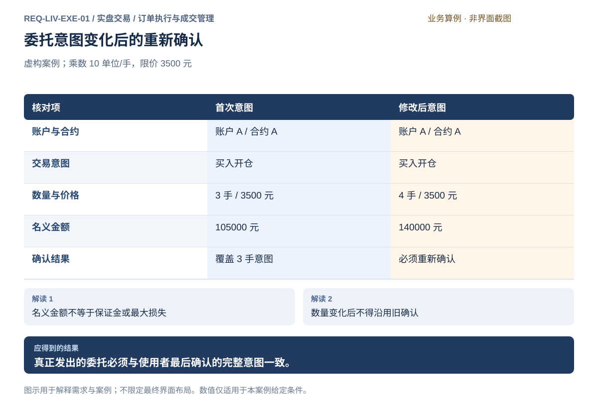
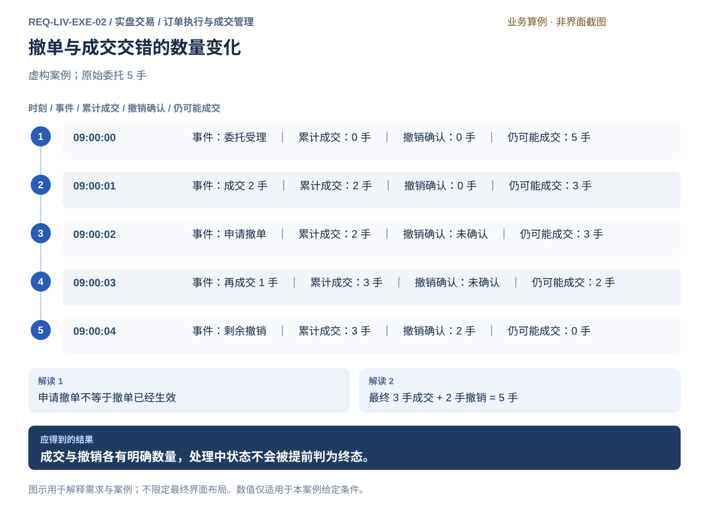
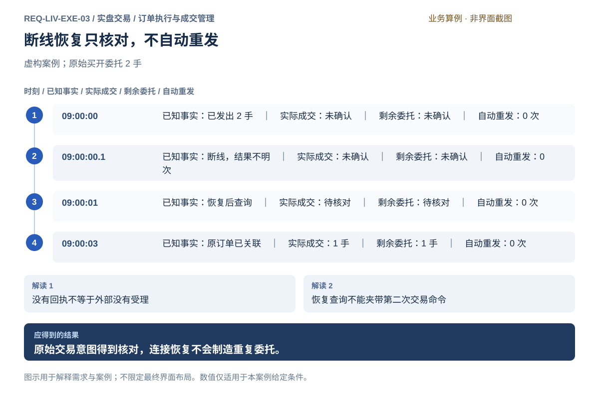
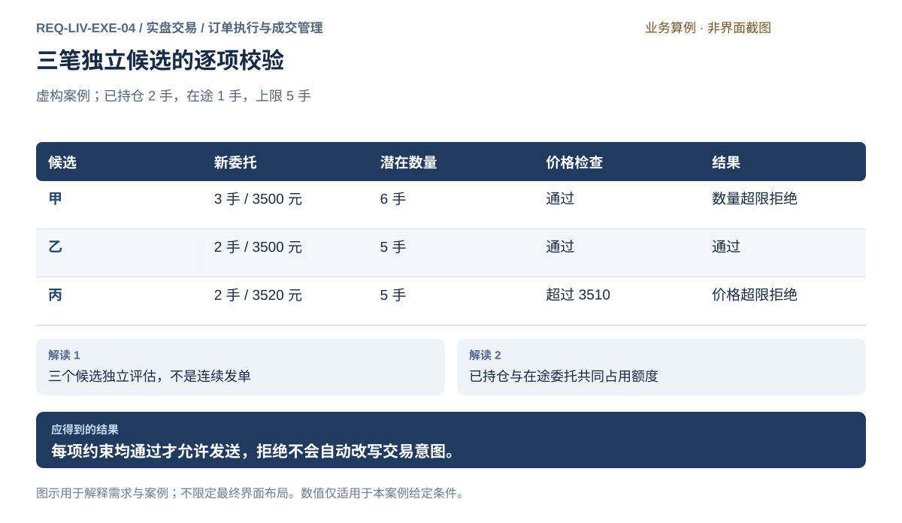
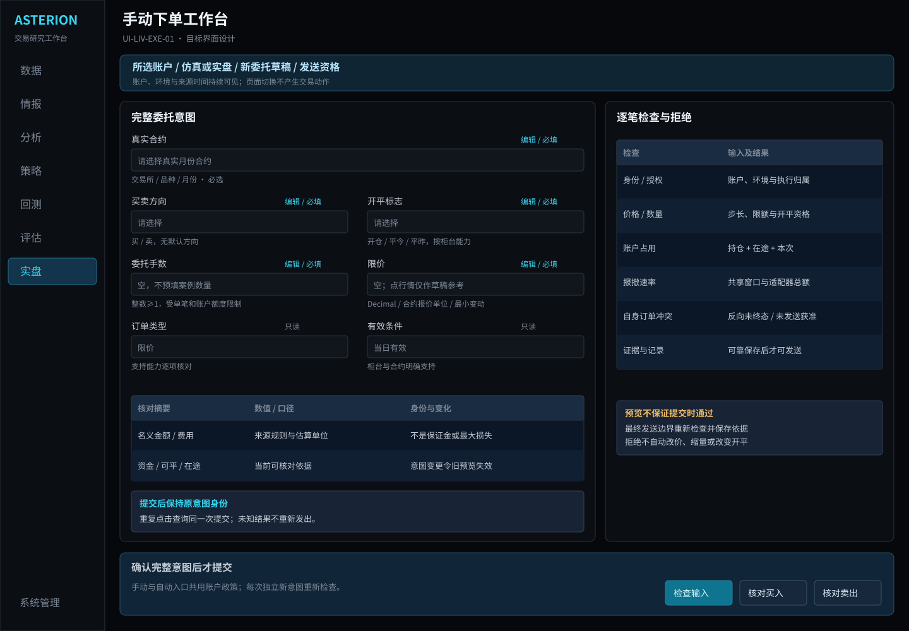
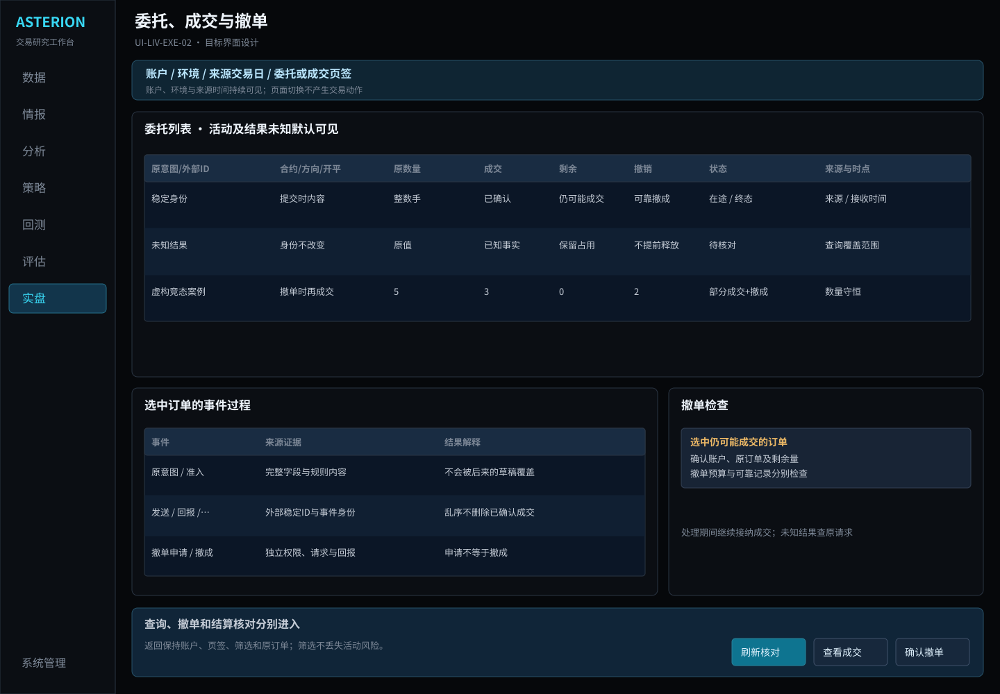
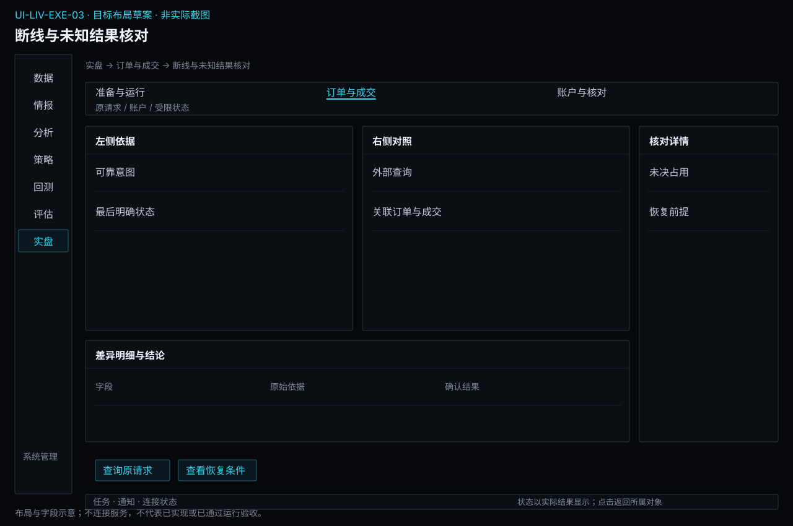
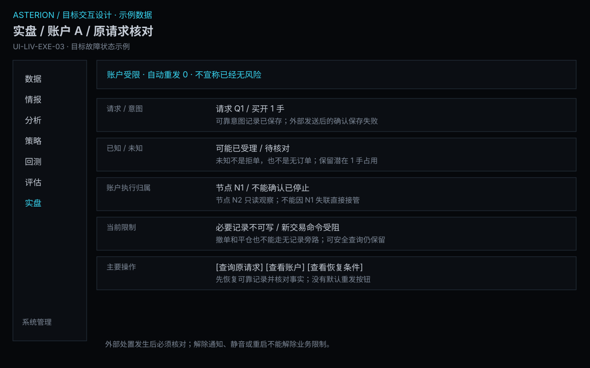

# 订单执行与成交管理

[返回上级](README.md) · [需求总纲](../../README.md) · [实际界面](../../common/screens.md) · [跨模块流程](../../workflows/README.md)

需求交付版 · 2026-10-18。细化规格已编制，用户逐项签认与产品验收分别记录；目标设计不代表已经实现，实际入口与差距见本页界面对应。

**归属：** 实盘交易（Live Trading） / 订单执行与成交管理。本页集中保存业务需求、详细功能、案例、界面对应和验收；通用规则见[通用规范](../../common/README.md)。

## 需求导航

- [REQ-LIV-EXE-01 表达完整委托意图并在提交前确认](#req-liv-exe-01)
- [REQ-LIV-EXE-02 跟踪订单、部分成交与撤单结果](#req-liv-exe-02)
- [REQ-LIV-EXE-03 在断线和结果不明时核对真实交易结果](#req-liv-exe-03)
- [REQ-LIV-EXE-04 统一校验每笔委托的价格数量与风险占用](#req-liv-exe-04)

## 目标与责任

将手动或已授权策略产生的明确交易意图，经账户授权、风险检查和统一执行路径转换为可追溯订单。接纳、发送、柜台受理、成交、撤销与未知结果分别表达；不把行情显示或用户点击当作成交证据。

## 对象与字段

| 对象           | 必需内容                                                              | 不变量                                                   |
| -------------- | --------------------------------------------------------------------- | -------------------------------------------------------- |
| 交易意图       | 账户、环境、真实合约、买卖/开平、手数、订单类型、价格、有效条件、来源 | 价格数量不静默取整；内容变化重新核对，不能沿用旧手动确认 |
| 授权与风险判断 | 账户及策略范围、当前风险条件、准入结果和原因                          | 不支持类型或必要条件缺失明确拒绝，不经第二条路径绕过     |
| 委托           | 意图关联、发送/柜台标识、状态、累计成交、有效剩余量、拒绝及事件时间   | 同次提交不重复订单，结果未知不自动重发                   |
| 成交           | 可靠成交身份、订单、合约、方向开平、量价、时间和费用来源              | 重复反馈只影响账本一次，合计不能超过可确认成交量         |
| 撤单           | 原订单、待撤剩余量、申请和实际结果                                    | 申请不等于生效，已成交部分不能被撤销                     |
| 待核对事项     | 原请求、最后明确事实、查询范围、证据缺口和下一步                      | 未知不等于失败，保留占用，不凭同价同量猜测订单关联       |

## 手动与策略的统一路径

手动：填写完整意图 → 显示摘要和估算依据 → 确认 → 核对当前授权/风险 → 发送并追踪。

策略：已明确授权的固定策略生成目标 → 按组合政策形成意图 → 核对当前授权/风险 → 同一路径发送并追踪。自动意图在既有授权范围内执行，不要求每笔手动弹窗，但权限和风控不能省略。策略目标不等于获准量，风控拒绝不静默裁剪数量。

## 正常、断线与部分成交

1. 准备时显示实盘/仿真与账户身份，核对合约、开平和可平量。切换账户必须重新核对草稿，原订单归属不变。
2. 提交后分开呈现本地接纳、发送、柜台反馈及真实成交。重复点击查询同一意图；故意再次交易需独立意图。
3. 部分成交更新累计量和剩余量，成交只入账一次；撤单只针对未成交部分。
4. 断线保留最后明确事实和未知请求，重连先查询订单、成交及覆盖范围，绝不自动补发。
5. 查不到不足以证明未发送或已失败；证据不完整保留待核对和风险占用，交用户明确处理。
6. 将已确认成交与未决事项交账户核对，不以新增对冲或平仓订单掩盖原未知结果。

## 界面及验收示例

下单区显示账户与环境、合约、方向、开平、数量、价格与有效期；估算名义额、保证金和费用标明假设。订单表按实际状态和时间筛选，详情串联原意图、风险结果、事件与成交；未知结果独立显示，不仅用红色表示失败。

虚构乘数10、价格3500：3手名义额105000元，改为4手变140000元；它们都不是最大损失或保证金。3手确认不能覆盖4手订单。价格最小变动1元时3500.5明确拒绝，不能取整发单。实际价格和规则始终来自真实来源，案例不得作为生产默认值。

暂停新交易或撤回新增权限不等于禁止所有查询；撤单和平仓分别按其权限和风险语义执行。缺风险能力不得放行新增风险；对已有风险的操作按共用交易约束及实际账户权限明确处理，不在本页发明绕过路径。

## 逐笔准入和在途占用

手动与策略意图在统一账户执行边界检查价格数量、开平、资金、政策、持仓和在途量；预览不会预先授予发送权限。通过与占用必须共同判断，两个请求不能同时花掉同一份额度；结果不明不释放风险，撤单以确认结果为准。

拒绝详情展示规则、实际值、输入时间及计算组成，修改意图后重新确认；不静默缩量、改价或排队等待额度恢复后自动重发。新减仓委托仍需必要检查；安全查询和独立合规撤单保留各自入口。共用定义见[共用交易约束](../../product.md#execution-risk-semantics)。

## REQ-LIV-EXE-01 表达完整委托意图并在提交前确认

**领域：** 实盘交易 / 订单执行与成交管理　 **建议优先级：** P0安全必要　 **需求状态：** 交付规格已编制（源自已确认定位；细节待用户签认）

### 目标与场景

使用者能够完整表达一笔手动委托，并在发出前理解目标账户、合约、方向、数量及价格约束。任何关键意图缺失或变化都不能由系统静默猜测，防止误账户、误方向或误数量交易。

**使用者与场景：** 已获交易授权的个人使用者，在准备新委托或平仓委托时。

**触发条件：** 使用者明确开始准备一笔手动委托。

### 前置条件

- 目标账户交易授权成立且风险配置可用。
- 合约交易属性与账户支持的委托方式已明确。

### 输入与含义

| 输入           | 含义与单位                           | 约束                                                     |
| -------------- | ------------------------------------ | -------------------------------------------------------- |
| 委托身份与方向 | 账户、合约、买卖方向及开平仓意图     | 含义必须完整，开平方式按账户和场所真实规则解释。         |
| 数量与价格条件 | 手数、支持的订单类型、价格和有效条件 | 数量单位及价格最小变动单位可辨认；不支持的类型明确拒绝。 |

### 正常操作与反馈

1. 使用者确定账户、合约及买卖和开平意图。
2. 输入数量、价格和适用的有效条件。
3. 系统检查输入完整性并给出委托摘要及必要的风险估算口径。
4. 使用者确认完整意图后，系统执行授权与逐笔风控检查。
5. 通过检查的委托发往目标账户，返回发送结果与后续可追踪标识。

### 业务规则

- 买卖方向和开平仓意图是不同维度，不得仅以买入推定开仓。
- 价格及数量不得静默修正；修正必须形成使用者可以重新确认的意图。
- 已确认内容发生实质变化后，原确认不再覆盖变更后的委托。
- 估算占用或费用必须标明假设及不确定性，不能伪装成最终结算。
- 提交被接受只表示进入后续处理，不等于已成交。
- 同一次提交动作的重复点击或按键只对应同一交易意图，不得重复生成订单；故意再次交易必须表达并确认独立意图。
- 手动委托和策略意图共用账户授权、必要风控和执行路径；策略授权允许其范围内产生意图，不要求每个自动意图重复弹窗，但不能绕过准入。

### 输出与状态影响

- 可核对的完整委托摘要和明确的提交结果。
- 成功进入处理的委托可继续跟踪；被拒绝的委托说明原因。

### 异常与继续方式

| 发生什么                     | 应怎样表现                               | 使用者如何继续                       |
| ---------------------------- | ---------------------------------------- | ------------------------------------ |
| 价格不满足合约最小变动单位。 | 拒绝当前输入并说明约束，不自动取整发单。 | 使用者修改价格并重新确认。           |
| 确认后目标账户或数量被改变。 | 使原确认失效，阻止沿用旧确认提交。       | 重新核对完整摘要并确认新的委托意图。 |

### 案例：三手买开委托的完整确认

**虚构案例条件：** 虚构案例：示例合约 A，价格单位为元/单位，合约乘数 10 单位/手，最小变动为 1 元，均为案例假设；账户 A 已授权。

1. 使用者准备限价买入开仓 3 手，限价 3500 元，有效条件为案例账户支持的当日有效。
2. 摘要显示账户 A、合约 A、买开、3 手、3500 元；名义金额按 3500×10×3 计算。
3. 使用者将数量改为 4 手，系统要求重新确认，名义金额重新计算。

**预期结果：**

- 原意图名义金额为 105000 元，并明确不是保证金或最大损失。
- 修改后名义金额为 140000 元；旧的 3 手确认不能用于 4 手委托。

### 可观察验收条件

| 编号                | 给定                                     | 当                                     | 则                                                           |
| ------------------- | ---------------------------------------- | -------------------------------------- | ------------------------------------------------------------ |
| REQ-LIV-EXE-01-AC01 | 开平意图缺失                             | 尝试提交手动委托                       | 委托不发出，并明确需要补全开平意图。                         |
| REQ-LIV-EXE-01-AC02 | 案例合约最小变动为 1 元                  | 输入 3500.5 元并提交                   | 当前价格被拒绝且不会自动修正发单。                           |
| REQ-LIV-EXE-01-AC03 | 3 手委托已经确认                         | 数量修改为 4 手                        | 旧确认失效，摘要和名义金额更新后须重新确认。                 |
| REQ-LIV-EXE-01-AC04 | 同一完整委托已确认，首次提交结果尚未返回 | 使用者连续重复点击或按键触发同一次提交 | 只生成一个对应委托；故意再次交易必须另行表达并确认独立意图。 |

### 决定与配置约束

- **DEC-LIV-EXE-01-01**：**规格决定**。真实发送首批为支持的限价、开/平今/平昨、当日有效和撤单；手动新增逐次确认账户、真实合约、方向、价量和预计占用。自动策略逐次走统一准入，不弹逐笔人工确认框。

### 详细功能

### FR-LIV-EXE-01-01 填写完整手动委托意图

**目标与结果：** 让账户、合约、买卖及开平意图在同一份草稿中完整表达，减少跨页带入信息造成的歧义。

**触发：** 从合约详情、持仓行或手动下单入口创建草稿。

**输入与约束：** 账户、合约、买卖方向、开平意图、订单类型、数量及有效条件；入口可以带入候选上下文，方向和数量没有确认依据时必须留空。

**目标操作与反馈：**

1. 核对草稿来源及目标账户，选择明确合约。
2. 依次填写买卖、开平、类型与数量，系统展示每个字段的业务含义。
3. 保留草稿并进入输入校验，未填项原位提示。

**异常与边界：**

- 从持仓行进入也不能绕过可平数量检查，不能默认总持仓全部可平。
- 切换账户或合约后原确认失效，失配字段须重新检查。

**验收条件：**

- **FR-LIV-EXE-01-01-AC01**：缺少开平或账户时不能进入发送，错误标记对应缺失字段。
- **FR-LIV-EXE-01-01-AC02**：从行情行进入只得到草稿，未确认的方向数量不会自动填成交易。

**界面对应：** [UI-LIV-EXE-01 手动下单工作台](#ui-liv-exe-01)；[UI-LIV-RUN-03 合约图表、盘口与成交](operations.md#ui-liv-run-03)；[UI-LIV-ACC-01 账户资金与持仓](accounts.md#ui-liv-acc-01)。

### FR-LIV-EXE-01-02 检查价格数量与有效条件

**目标与结果：** 使用者在正式确认前知道哪些输入无效，系统说明规则而不擅自改价或改量。

**触发：** 委托草稿输入完成后点击检查，或离开存在约束的字段。

**输入与约束：** 价格、手数、最小变动单位、允许类型及有效条件；规则来源与有效时间需明确，不能用相似合约补齐。

**目标操作与反馈：**

1. 核对合约交易单位和有效规则。
2. 逐项检查价格步长、数量及订单条件，显示错误值与允许规则。
3. 使用者主动修改后重新检查，完整保留其他未受影响输入。

**异常与边界：**

- 最小变动1元时3500.5元不合法，不能自动四舍五入后提交。
- 规则不可用时保留草稿并阻止受影响校验，不能凭旧通过结果继续。

**验收条件：**

- **FR-LIV-EXE-01-02-AC01**：不合规输入得到字段级解释，修正前没有订单发出。
- **FR-LIV-EXE-01-02-AC02**：每次修改影响意图的字段后，摘要与校验结果重新计算。

**界面对应：** [UI-LIV-EXE-01 手动下单工作台](#ui-liv-exe-01)；[UI-DAT-SRV-01 合约、日历与基础资料](../data/management.md#ui-dat-srv-01)。

### FR-LIV-EXE-01-03 核对委托摘要并明确确认

**目标与结果：** 使用者看到最终将发出的完整意图及估算口径，再明确决定是否提交；确认不会被解释为成交。

**触发：** 合法草稿选择核对委托摘要。

**输入与约束：** 账户、合约、方向、开平、数量、价格、有效条件及估算假设；所有数值须与草稿一致。

**目标操作与反馈：**

1. 阅读完整摘要，实盘属性和目标账户保持突出。
2. 展开名义金额和估算占用依据，区分估算与最终结算。
3. 选择返回修改或明确确认提交；发送前重新执行授权和风控。

**异常与边界：**

- 摘要打开后关键内容变更，原确认不再有效。
- 取消确认只返回草稿，不发单、不清空全部输入。

**验收条件：**

- **FR-LIV-EXE-01-03-AC01**：案例3500元、乘数10、3手的名义金额显示105000元。
- **FR-LIV-EXE-01-03-AC02**：由3手改4手后显示140000元且要求重新确认，不能沿用旧确认。

**界面对应：** [UI-LIV-EXE-01 手动下单工作台](#ui-liv-exe-01)；[UI-LIV-ACC-03 账户风险规则与生效管理](accounts.md#ui-liv-acc-03)。

### FR-LIV-EXE-01-04 防止重复触发并显示提交结果

**目标与结果：** 同一次提交动作只产生一份交易意图，使用者能够辨认处理中、明确拒绝和结果不明。

**触发：** 使用者确认委托后的提交动作。

**输入与约束：** 已确认的完整意图与本次提交身份；再次交易必须形成独立意图，不通过快速重复点击表达。

**目标操作与反馈：**

1. 确认后显示提交处理中，锁定本次已确认内容。
2. 相同动作的重复点击或按键关联同次提交，不另发订单。
3. 根据返回结果跳转对应订单，或保留拒绝原因与可修改草稿。

**异常与边界：**

- 超时或断线不能作为再次自动提交的理由，进入异常核对。
- 若使用者确实再交易，须新建并确认独立意图，原记录仍保留。

**验收条件：**

- **FR-LIV-EXE-01-04-AC01**：首次结果未返回时重复点击不会生成第二张订单。
- **FR-LIV-EXE-01-04-AC02**：拒绝、处理中与结果不明分别显示；输入框回车不直接发送。

**界面对应：** [UI-LIV-EXE-01 手动下单工作台](#ui-liv-exe-01)；[UI-LIV-EXE-02 委托、成交与撤单](#ui-liv-exe-02)；[UI-LIV-EXE-03 断线与未知结果核对](#ui-liv-exe-03)。

## REQ-LIV-EXE-02 跟踪订单、部分成交与撤单结果

**领域：** 实盘交易 / 订单执行与成交管理　 **建议优先级：** P0安全必要　 **需求状态：** 交付规格已编制（源自已确认定位；细节待用户签认）

### 目标与场景

使用者应知道委托处于什么阶段、已经成交多少、仍有多少可能成交，以及撤单是否真正生效。交易请求、外部确认和最终成交必须区分，避免在结果未定时重复操作。

**使用者与场景：** 个人交易者，在委托提交后持续观察或撤销剩余委托时。

**触发条件：** 新委托进入处理、收到订单或成交更新，或使用者请求撤单。

### 前置条件

- 委托已有可追踪的账户与订单身份。
- 订单和成交结果来自有权提供结果的账户服务。

### 输入与含义

| 输入           | 含义与单位                             | 约束                                           |
| -------------- | -------------------------------------- | ---------------------------------------------- |
| 订单状态与成交 | 订单身份、原始数量、累计成交及外部确认 | 同一成交不能重复计入；状态应能追溯到来源时间。 |
| 撤单请求       | 撤销目标订单仍未成交部分的意图         | 必须关联明确订单；撤单申请本身不证明已经撤销。 |

### 正常操作与反馈

1. 系统展示原始委托与当前可确认的状态。
2. 收到成交后更新累计成交和未成交部分，并保留成交明细。
3. 使用者检查剩余数量后提出撤单申请。
4. 系统明确显示撤单请求处理中，继续接收期间可能发生的成交。
5. 收到明确结果后，呈现最终成交数量、撤销数量及剩余未定数量。

### 业务规则

- 已发送、已受理、部分成交和全部成交不能混为一谈。
- 撤单只作用于未成交部分，不能抹除已经发生的成交。
- 撤单与成交可能交错，最终数量以可核对的权威结果为准。
- 重复送达的同一成交不会增加累计成交；成交身份不能仅依赖展示序号。
- 结果不明时保留不确定状态，不能自行宣称已撤单或失败。

### 输出与状态影响

- 包含累计成交、剩余委托及撤单结果的订单记录。
- 能与订单对应的成交明细，以及需要进一步核对的未定状态。

### 异常与继续方式

| 发生什么                                   | 应怎样表现                                               | 使用者如何继续                               |
| ------------------------------------------ | -------------------------------------------------------- | -------------------------------------------- |
| 撤单申请之后、撤单生效之前又发生一笔成交。 | 保留这笔成交，按最终结果撤销真正剩余部分。               | 使用者依据最终成交和撤销数量核对持仓。       |
| 撤单结果返回前连接中断。                   | 标记撤单结果待核对，不假定成功，也不自动重发原交易委托。 | 恢复查询后核对订单及成交，再决定下一步操作。 |

### 案例：部分成交过程中撤单

**虚构案例条件：** 虚构案例：示例合约 A 的 5 手委托已被受理；案例日 T 的时刻仅用于展示先后顺序，不代表真实成交。

1. 09:00:00 委托 5 手受理；09:00:01 成交 2 手。
2. 09:00:02 使用者申请撤单，当时未成交 3 手。
3. 09:00:03 又成交 1 手；09:00:04 确认剩余 2 手撤销。

**预期结果：**

- 最终累计成交为 3 手，撤销为 2 手，仍可能成交为 0 手。
- 撤单申请不会将先后发生的 3 手成交删除或恢复为未成交。

### 可观察验收条件

| 编号                | 给定                   | 当                    | 则                                                     |
| ------------------- | ---------------------- | --------------------- | ------------------------------------------------------ |
| REQ-LIV-EXE-02-AC01 | 5 手订单已成交 2 手    | 使用者申请撤单        | 系统显示撤单处理中，并保留累计成交 2 手。              |
| REQ-LIV-EXE-02-AC02 | 撤单处理中又成交 1 手  | 其后确认剩余 2 手撤销 | 最终成交 3 手、撤销 2 手、未定 0 手，合计为原始 5 手。 |
| REQ-LIV-EXE-02-AC03 | 同一笔成交结果重复到达 | 更新订单累计成交      | 同一成交只计入一次，数量和持仓不会重复增加。           |

### 决定与配置约束

- **DEC-LIV-EXE-02-01**：**交付准入**。按柜台映射外部订单与成交身份、部分/全部成交、撤成/撤拒及终态；终态依可靠外部证据。成交更正保留原事实及修正，特殊撤单限制由GATE-TRADE核验。

### 详细功能

### FR-LIV-EXE-02-01 筛选委托并辨认当前状态

**目标与结果：** 使用者按账户和业务范围找到目标委托，明白它仍可能成交还是已经结束。

**触发：** 从提交结果或交易工作区进入委托列表。

**输入与约束：** 账户、业务日期、合约、来源及状态过滤；筛选不删除订单，也不以界面序号作为唯一身份。

**目标操作与反馈：**

1. 确认列表账户和日期范围，加载对应订单。
2. 选择待处理、部分成交或全部等状态范围并查看数量摘要。
3. 选中订单，展开原始意图和最后确认状态。

**异常与边界：**

- 筛选结果为空与账户查询失败必须区分，失败不能显示为没有订单。
- 数据过期时保留最后状态和时间，不宣称订单没有变化。

**验收条件：**

- **FR-LIV-EXE-02-01-AC01**：每行显示原始量、累计成交、未定或剩余数量及状态时间。
- **FR-LIV-EXE-02-01-AC02**：从提交结果进入时定位同一订单，改变排序不会丢失身份。

**界面对应：** [UI-LIV-EXE-02 委托、成交与撤单](#ui-liv-exe-02)。

### FR-LIV-EXE-02-02 查看部分成交与订单事件过程

**目标与结果：** 把分次成交和订单变化按事实串联，帮助使用者核对累计结果，避免只看最后状态误解执行过程。

**触发：** 选择订单并打开成交与事件明细。

**输入与约束：** 订单身份、事件时间、成交身份、价格和数量；外部时间与接收时间需要时分别显示。

**目标操作与反馈：**

1. 查看原始委托及事件顺序，辨认来源确认。
2. 逐笔查看成交数量和价格，汇总累计成交。
3. 查看尚未成交部分及是否仍有效，再选择继续观察或撤单。

**异常与边界：**

- 事件乱序到达不能删除已确认成交；缺失事件说明缺口。
- 同一成交重复到达只计一次，展示顺序变化不改变累计数量。

**验收条件：**

- **FR-LIV-EXE-02-02-AC01**：5手订单先成交2手再成交1手时累计为3手。
- **FR-LIV-EXE-02-02-AC02**：事件明细的唯一成交合计与订单累计成交一致，重复消息不增加数量。

**界面对应：** [UI-LIV-EXE-02 委托、成交与撤单](#ui-liv-exe-02)；[UI-LIV-ACC-01 账户资金与持仓](accounts.md#ui-liv-acc-01)。

### FR-LIV-EXE-02-03 确认并撤销订单未成交部分

**目标与结果：** 使用者准确知道撤单对象及可能仍成交的窗口，独立授权撤单而不误以为成交也会撤销。

**触发：** 订单列表选中仍有效的订单并选择撤单。

**输入与约束：** 明确账户与订单、当前未成交部分及撤单权限；风险暂停不自动取消已有撤单权限。

**目标操作与反馈：**

1. 显示目标订单和可确认的剩余量，说明撤单仅针对未成交部分。
2. 使用者确认撤单意图后显示申请处理中，继续接收成交更新。
3. 取得结果后显示实际成交量和确认撤销量；必要时进入结果核对。

**异常与边界：**

- 申请后又成交时按事实增加成交，不能把申请时剩余量全部记为撤销。
- 撤单权限或目标身份不明时拒绝该动作并说明原因；不能只因暂停新增交易禁用独立合规撤单。

**验收条件：**

- **FR-LIV-EXE-02-03-AC01**：5手订单累计成交3手后剩余2手撤销，最终数量为3加2。
- **FR-LIV-EXE-02-03-AC02**：仅撤单请求已发出时不显示已撤销，也不自动发出反向平仓。

**界面对应：** [UI-LIV-EXE-02 委托、成交与撤单](#ui-liv-exe-02)；[UI-LIV-EXE-03 断线与未知结果核对](#ui-liv-exe-03)。

### FR-LIV-EXE-02-04 查询成交明细并关联账户影响

**目标与结果：** 使用者能够从成交定位原订单及对应持仓变化，区分真实成交、模拟结果和重复回报。

**触发：** 委托明细切换成交视图，或从持仓查看相关成交。

**输入与约束：** 成交标识、账户、合约、方向、价格、数量和费用资料；无费用资料时明确未提供。

**目标操作与反馈：**

1. 按账户和期间查询成交，确认环境及来源。
2. 打开一笔成交，查看原订单和数量价格。
3. 查看其账户影响或进入对账，保留原查询范围。

**异常与边界：**

- 相同价量不是同一成交的充分依据，不能据此错误去重。
- 未取得费用或结算口径时不伪造净盈亏，模拟成交不能进入真实成交列表。

**验收条件：**

- **FR-LIV-EXE-02-04-AC01**：同一有效成交标识重复返回不会重复计入。
- **FR-LIV-EXE-02-04-AC02**：从成交能返回同一原始订单，账户和环境在两处一致。

**界面对应：** [UI-LIV-EXE-02 委托、成交与撤单](#ui-liv-exe-02)；[UI-LIV-ACC-01 账户资金与持仓](accounts.md#ui-liv-acc-01)；[UI-LIV-ACC-02 成交结算核对与差异处理](accounts.md#ui-liv-acc-02)。

## REQ-LIV-EXE-03 在断线和结果不明时核对真实交易结果

**领域：** 实盘交易 / 订单执行与成交管理　 **建议优先级：** P0安全必要　 **需求状态：** 交付规格已编制（源自已确认定位；细节待用户签认）

### 目标与场景

断线时，使用者能区分未发送、已受理和结果不明的请求，并在恢复后核对实际结果。缺少回执不得触发自动重发，避免重复执行同一交易意图。

**使用者与场景：** 个人交易者及自动策略使用者，在交易连接异常、回执缺失或恢复连接时。

**触发条件：** 委托或撤单请求发出后未取得明确结果，或者交易连接中断。

### 前置条件

- 每笔请求已有可关联的账户、交易意图和发送记录。
- 账户服务可在恢复后提供核对资料；资料不足时明确保留疑问。

### 输入与含义

| 输入         | 含义与单位                                     | 约束                                                         |
| ------------ | ---------------------------------------------- | ------------------------------------------------------------ |
| 待核对请求   | 账户、合约、数量、方向、请求标识和最后已知状态 | 不能因没有收到确认就断言请求没有到达。                       |
| 恢复查询结果 | 账户订单、成交及其关联依据                     | 核对是查询动作，不能夹带重新发单；匹配依据不足不得强行认定。 |

### 正常操作与反馈

1. 发现断线或回执缺失后，保留请求与最后明确事实。
2. 标明结果不明的请求及可能存在的交易影响。
3. 恢复后查询订单与成交，与待核对请求逐项关联。
4. 有充分依据时确认实际成交与剩余委托。
5. 无法确定时保留待核对状态，由使用者补充依据。
6. 后续新交易须形成独立意图并重新经过授权和风控。

### 业务规则

- 断线、超时和未收到回执都不能自动证明外部未执行。
- 断线后不得自动重发任何交易命令，也不能以重发探测结果。
- 结果未明的请求不能默认释放风险占用或假设相关持仓为零。
- 恢复查询只能依据充分身份关联，不能仅凭价格数量相同就认定同一订单。
- 后续人工动作须保留与原请求的关系及依据，不能擦除原始过程。

### 输出与状态影响

- 待核对请求及其已知事实、未知结果和潜在影响。
- 基于账户证据确认的实际订单与成交，或明确的未解决事项。

### 异常与继续方式

| 发生什么                                         | 应怎样表现                                         | 使用者如何继续                                   |
| ------------------------------------------------ | -------------------------------------------------- | ------------------------------------------------ |
| 委托已经到达账户服务，但确认回传前连接断开。     | 结果暂时标为不明，恢复后查询确认，不自动再发一笔。 | 核对已存在订单及成交，再决定是否撤单或新增交易。 |
| 恢复后查询不到订单，且来源不能证明查询范围完整。 | 继续标记待核对，不能把未查到等同于未受理。         | 取得完整范围的账户资料或由使用者向服务方核实。   |

### 案例：两手委托断线后查到一手成交

**虚构案例条件：** 虚构案例：账户 A 对示例合约 A 发出买开 2 手委托，发送后连接断开；外部实际受理且成交 1 手，剩余 1 手仍有效。时刻仅用于解释顺序。

1. 09:00:00 发出 2 手委托，09:00:00.1 断线且没有确认。
2. 09:00:01 恢复连接，仅进行订单与成交查询。
3. 09:00:03 凭关联依据确认原订单：成交 1 手、剩余 1 手。

**预期结果：**

- 恢复过程中自动重发的交易命令为 0。
- 原 2 手意图被核对为 1 手成交加 1 手在途，没有多生成第二张 2 手订单。

### 可观察验收条件

| 编号                | 给定                                    | 当           | 则                                                   |
| ------------------- | --------------------------------------- | ------------ | ---------------------------------------------------- |
| REQ-LIV-EXE-03-AC01 | 委托发出后连接中断且无明确回执          | 处理断线     | 标为结果待核对，不断言未受理，也不自动重发。         |
| REQ-LIV-EXE-03-AC02 | 连接已恢复但原请求结果仍不明            | 启动恢复核对 | 执行查询并保留相关风险占用，不通过再次交易探测状态。 |
| REQ-LIV-EXE-03-AC03 | 查询确认原 2 手订单成交 1 手且剩余 1 手 | 完成关联核对 | 更新为成交 1 手、在途 1 手，自动重发次数为 0。       |

### 决定与配置约束

- **DEC-LIV-EXE-03-01**：**交付准入**。柜台必须提供可核对关联标识及查询范围；结果不明保留占用，长期无法核实则暂停相关新增，由用户取得外部可靠证明并记录。没有证据不可强制标未发送。

### 详细功能

### FR-LIV-EXE-03-01 保留断线时的最后明确交易事实

**目标与结果：** 使用者知道哪些交易可能已经发生，结果不明不会被误报为失败，从而避免贸然重复下单。

**触发：** 交易请求无明确结果或交易连接中断。

**输入与约束：** 账户、请求身份、发送记录、最后已知状态及时间；没有回执不是未受理证据。

**目标操作与反馈：**

1. 记录连接变化并列出受影响的请求。
2. 分别标明未发送、已确认受理和结果待核对。
3. 显示潜在订单及风险占用，提供恢复查询入口。

**异常与边界：**

- 不得自动重发交易命令，也不能清空原请求当作从未发生。
- 连接问题不意味着所有账户都失效，应标明实际受影响范围。

**验收条件：**

- **FR-LIV-EXE-03-01-AC01**：2手委托发送后断线被标为结果待核对，而不是自动失败。
- **FR-LIV-EXE-03-01-AC02**：自动重发次数保持0，原意图和发送记录可查。

**界面对应：** [UI-LIV-EXE-03 断线与未知结果核对](#ui-liv-exe-03)；[UI-LIV-EXE-02 委托、成交与撤单](#ui-liv-exe-02)。

### FR-LIV-EXE-03-02 恢复连接后只查询并关联结果

**目标与结果：** 使用者通过账户事实确认原始交易结果，恢复连接不能偷偷带来第二次交易。

**触发：** 异常核对页确认连接可查询后选择查询原请求。

**输入与约束：** 原请求身份、账户订单和成交资料、查询覆盖范围；匹配不能只凭价格数量相同。

**目标操作与反馈：**

1. 展示本次查询账户和覆盖范围，发起只读核对。
2. 将可靠身份匹配的订单与成交关联到原请求。
3. 显示累计成交、剩余订单和仍未确认项，不改变原交易意图。

**异常与边界：**

- 查询不到但覆盖不完整时不能判为未受理。
- 核对过程中不得附带重发、自动撤单或反向交易。

**验收条件：**

- **FR-LIV-EXE-03-02-AC01**：原2手订单查到1手成交和1手在途后，自动重发仍为0。
- **FR-LIV-EXE-03-02-AC02**：关联依据可展开核对，其他相同价量订单不会被误当作原订单。

**界面对应：** [UI-LIV-EXE-03 断线与未知结果核对](#ui-liv-exe-03)；[UI-LIV-EXE-02 委托、成交与撤单](#ui-liv-exe-02)。

### FR-LIV-EXE-03-03 保留未解决事项并进行人工核实

**目标与结果：** 自动查询不足时使用者可以有序收集依据，系统保持不确定性，不以猜测恢复交易资格。

**触发：** 查询仍无法确定结果时进入人工核实说明。

**输入与约束：** 待核对请求、缺失范围、外部核实依据和说明；敏感凭据不得写入说明或附件内容。

**目标操作与反馈：**

1. 查看为何不能确认及仍可能存在的影响。
2. 取得服务方资料或完整范围结果，填写核实依据。
3. 依据充分时确认结论，否则保存待核实事项并继续保留风险占用。

**异常与边界：**

- 用户手写一句未成交不能替代必要依据而释放未知风险。
- 人工核实不授权自动重发；需要新交易必须形成独立确认意图。

**验收条件：**

- **FR-LIV-EXE-03-03-AC01**：范围不完整时状态持续为待核对，原请求和占用不被删除。
- **FR-LIV-EXE-03-03-AC02**：核实结论能追到依据及操作者确认，取消不会留下部分更正。

**界面对应：** [UI-LIV-EXE-03 断线与未知结果核对](#ui-liv-exe-03)；[UI-LIV-ACC-02 成交结算核对与差异处理](accounts.md#ui-liv-acc-02)；[UI-SYS-REC-03 导出资料](../system/records.md#ui-sys-rec-03)。

### FR-LIV-EXE-03-04 把核对结果交接给订单和结算

**目标与结果：** 使用者在确定异常结果后继续处理真实订单和对账，整个过程保留原先的不确定阶段。

**触发：** 异常核对得到明确结果后选择查看订单或进入结算。

**输入与约束：** 已关联订单、成交、账户和业务期间；连接恢复时间不代替成交业务时间。

**目标操作与反馈：**

1. 查看最终确认事实及依据，核对数量守恒。
2. 转到订单管理独立决定保留或撤销剩余委托。
3. 将实际成交带入同账户同期间对账，查看费用和结算差异。

**异常与边界：**

- 异常条目已解决不等于订单全部结束，仍有效部分必须继续可见。
- 生成对账记录不能静默改写原请求时间线，也不自动标为金额一致。

**验收条件：**

- **FR-LIV-EXE-03-04-AC01**：1手成交加1手在途仍为原2手，订单页保留真实状态。
- **FR-LIV-EXE-03-04-AC02**：对账继承正确账户期间和实际成交，未查明费用仍标待核对。

**界面对应：** [UI-LIV-EXE-03 断线与未知结果核对](#ui-liv-exe-03)；[UI-LIV-EXE-02 委托、成交与撤单](#ui-liv-exe-02)；[UI-LIV-ACC-02 成交结算核对与差异处理](accounts.md#ui-liv-acc-02)。

### FR-LIV-EXE-03-05 在关键记录写入失败及进程中断后保持交易事实

**来源与确认：** 2026-10-18全面审查及用户授权补充；详细行为草案待评审，未实现、未执行产品验收。

**目标与结果：** 只有可靠保留必要意图和检查依据后才能发送；无法确认发送结果时保留未知占用。

**触发：** 必要记录不可写、发送边界进程退出或启动恢复。

**输入与约束：** 账户、请求身份、完整意图、授权与风险依据、必要占用、发送状态及外部确认；诊断日志不承担权威记录职责。

**目标操作与反馈：**

1. 发送前确认必要接纳记录可靠保存；失败则拒绝本次发送，显示账户受限原因。
2. 发送后无法可靠保存结果时限制新的交易命令，记录最后可确认状态；界面显示执行结果待核对，不宣称发送失败等于没有订单。
3. 恢复后只查询原账户与请求并核对成交/占用；存储恢复且事实核对完成后由用户确认后续运行，不补发原命令。

**异常与边界：**

- 必要记录不可写时新增、撤单及平仓指令均不得通过无记录旁路发送；可安全的只读查询保留，紧急外部处置须随后核对。
- 外部回报重复不重复记账；资料无法完整保存时不能确认账本已更新。

**操作案例：** 买开1手已被柜台受理但本地结果写入失败；重启后查询原请求确认该1手，不能再发1手来“补偿失败”。

**验收条件：**

- **FR-LIV-EXE-03-05-AC01**：在发送前注入必要写入失败，外部发送次数为0且界面明确拒绝原因。
- **FR-LIV-EXE-03-05-AC02**：外部已收单而本地保存结果失败，恢复时保持未知占用并查询关联，自动重发次数为0。
- **FR-LIV-EXE-03-05-AC03**：发送前后退出的恢复检查分别说明已知/未知依据，不因本地无订单记录而释放可能占用。

**界面对应：** [UI-LIV-EXE-03](#ui-liv-exe-03)；[UI-LIV-RUN-05](operations.md#ui-liv-run-05)。

## REQ-LIV-EXE-04 统一校验每笔委托的价格数量与风险占用

**领域：** 实盘交易 / 订单执行与成交管理　 **建议优先级：** P0安全必要　 **需求状态：** 交付规格已编制（源自已确认定位；细节待用户签认）

### 目标与场景

每笔委托都应在发出前接受一致的合法性和账户风险检查，避免手动与自动交易分别绕过约束。检查需要考虑已经存在的持仓和在途委托，防止多笔请求同时占用同一份资金或风险额度。

**使用者与场景：** 发起手动或自动交易的使用者，在每次交易意图准备送出时。

**触发条件：** 一笔完整的新委托请求到达交易执行前的检查阶段。

### 前置条件

- 目标账户授权与风险规则有效。
- 合约价格数量约束、有效账户资金及相关在途订单可供校验。

### 输入与含义

| 输入     | 含义与单位                             | 约束                                                   |
| -------- | -------------------------------------- | ------------------------------------------------------ |
| 完整委托 | 账户、合约、方向、数量、价格及开平意图 | 手动与自动请求提供相同的业务必要信息。                 |
| 风险占用 | 持仓、在途委托、可用资金和适用限制     | 数量单位与计算范围一致；不得遗漏已受理但未成交的风险。 |

### 正常操作与反馈

1. 检查委托身份、必要字段及账户交易权限。
2. 按照明确合约和账户规则检查价格、数量与开平条件。
3. 综合当前持仓与在途订单，计算新委托可能增加的占用。
4. 逐项比较价格限制、资金和敞口规则。
5. 通过时确保本笔占用不会被并发请求重复使用；未通过时说明实际值与限制。

### 业务规则

- 所有交易入口使用统一的风险语义，不能为自动策略提供绕过入口。
- 在途开仓委托应按适用规则纳入潜在风险，不能只看已成交持仓。
- 多个同时提交的请求不能分别基于同一份未扣减额度全部获准。
- 委托价格、数量或账户变更后必须重新检查。
- 拒绝应指出具体约束及可核对的输入；检查失败不会自动改量、改价或换账户。

### 输出与状态影响

- 逐笔允许或拒绝结果，以及适用规则和计算依据。
- 通过请求对应的风险占用；最终释放须依据可确认的订单结果。

### 异常与继续方式

| 发生什么                             | 应怎样表现                                     | 使用者如何继续                                 |
| ------------------------------------ | ---------------------------------------------- | ---------------------------------------------- |
| 提交时账户资金信息已经失效。         | 拒绝依赖该资金判断的交易，不沿用旧的通过结论。 | 取得有效资金信息后重新准备和检查委托。         |
| 两个请求同时申请剩余的同一风险额度。 | 按明确顺序处理可用额度，不允许合计超过限制。   | 使用者查看通过与拒绝结果后决定是否调整新意图。 |

### 案例：在途开仓同样占用持仓额度

**虚构案例条件：** 虚构案例：同方向持仓 2 手，在途买开 1 手，上限 5 手；案例委托最高允许价 3510 元。假设资金及其他条件充足，以下三个候选分别独立评估，不连续累计。另设独立并发边界：持仓 2 手、在途 2 手、上限仍为 5 手，仅剩 1 手额度。

1. 候选甲以 3500 元新增 3 手，潜在数量为 2＋1＋3＝6 手。
2. 候选乙以 3500 元新增 2 手，潜在数量为 5 手。
3. 候选丙以 3520 元新增 2 手，数量为 5 手，但超过案例价格限制。
4. 在独立并发边界下，两个均以 3500 元新增 1 手的请求同时到达，不能分别占用同一份剩余额度。

**预期结果：**

- 甲因数量 6 大于 5 拒绝；乙在全部假设成立时通过。
- 丙因价格 3520 大于 3510 拒绝，不自动改价为 3510。
- 并发边界下两个请求不能均获准，最终获准新增数量合计不超过 1 手。

### 可观察验收条件

| 编号                | 给定                                                         | 当                                | 则                                                                                |
| ------------------- | ------------------------------------------------------------ | --------------------------------- | --------------------------------------------------------------------------------- |
| REQ-LIV-EXE-04-AC01 | 持仓 2 手、在途 1 手、上限 5 手                              | 新增 3 手开仓                     | 计算潜在数量为 6 手并拒绝，原因包含在途占用。                                     |
| REQ-LIV-EXE-04-AC02 | 同样账户条件且其他检查通过                                   | 独立评估新增 2 手                 | 潜在数量为 5 手并允许进入发送阶段。                                               |
| REQ-LIV-EXE-04-AC03 | 最高允许价为 3510 元                                         | 以 3520 元提交 2 手               | 因价格拒绝，不会自动改价或只因数量合规而放行。                                    |
| REQ-LIV-EXE-04-AC04 | 持仓 2 手、在途 2 手、上限 5 手，仅剩 1 手额度，其他条件有效 | 两个各新增 1 手的开仓请求同时到达 | 两个请求不能均获准，最终获准新增数量合计不超过 1 手，未获准请求明确说明额度限制。 |

### 决定与配置约束

- **DEC-LIV-EXE-04-01**：**运行配置**。价格保护、手数/敞口和资金限额逐账户配置；订单准入及占用按账户唯一顺序，未知和撤单中不释放；当前无跨合约对冲额度减免，避免未核实净额放宽。

### 详细功能

### FR-LIV-EXE-04-01 执行统一价格数量与开平校验

**目标与结果：** 所有交易入口使用相同业务约束，使用者能复核哪一项规则阻止了请求。

**触发：** 手动确认提交或策略提出新的交易意图。

**输入与约束：** 账户、合约、价格、数量、开平和有效规则；不支持类型、缺失规则或失效数据都不能默默绕过。

**目标操作与反馈：**

1. 检查身份与必要字段，核对合约和账户条件。
2. 逐项比较最小变动、数量限制和开平范围。
3. 展示通过或明确拒绝，并保留原意图供审查。

**异常与边界：**

- 自动策略不能因为已经获准运行而跳过逐笔校验。
- 拒绝不能自动修改价格数量或将平仓改成开仓。

**验收条件：**

- **FR-LIV-EXE-04-01-AC01**：同一账户同一意图经手动或策略入口受到一致约束。
- **FR-LIV-EXE-04-01-AC02**：案例最高允许3510元时3520元被拒绝，系统不会改为3510元发出。

**界面对应：** [UI-LIV-EXE-01 手动下单工作台](#ui-liv-exe-01)；[UI-LIV-RUN-04 实盘准备、授权与策略运行](operations.md#ui-liv-run-04)。

### FR-LIV-EXE-04-02 计算资金和在途敞口占用

**目标与结果：** 使用者理解新委托加入后会消耗多少资源，检查同时考虑已成交和仍可能成交的订单。

**触发：** 逐笔风险检查进入资金及敞口评估阶段。

**输入与约束：** 有效资金、已有持仓、在途开仓量与适用计算口径；冻结或估算占用不得被重复扣除或遗漏。

**目标操作与反馈：**

1. 展开当前占用构成，区分已持仓与在途。
2. 加入新意图，显示预计占用及适用阈值。
3. 比较后允许发送或拒绝，保留计算依据。

**异常与边界：**

- 账户资金过期时不沿用旧通过结果，不把缺失当零。
- 撤单申请未确认前不能默认释放相关在途占用。

**验收条件：**

- **FR-LIV-EXE-04-02-AC01**：案例持仓2手、在途1手、新开3手得到6手并超过5手限制。
- **FR-LIV-EXE-04-02-AC02**：独立候选新开2手得到5手，只有其他检查也通过时才允许发送。

**界面对应：** [UI-LIV-EXE-01 手动下单工作台](#ui-liv-exe-01)；[UI-LIV-ACC-01 账户资金与持仓](accounts.md#ui-liv-acc-01)。

### FR-LIV-EXE-04-03 防止并发请求重复使用额度

**目标与结果：** 多笔请求同时到达时，账户总获准风险不能超过剩余额度，使用者能看到各自最终结果。

**触发：** 多个手动或策略请求竞争同一账户剩余风险容量。

**输入与约束：** 每笔独立意图、有效额度和已有占用；请求排序原则需明确，不能让每笔都假设其他请求不存在。

**目标操作与反馈：**

1. 接收独立请求并呈现各自处理中状态。
2. 按统一额度判断获准请求，同时记录该请求所占用的容量。
3. 其余请求显示通过或额度不足原因，不自动缩量续发。

**异常与边界：**

- 额度已被前一请求占用后，后一请求不能继续依据旧余量通过。
- 获准后外部结果不明不能立即释放容量，需依据订单确认。

**验收条件：**

- **FR-LIV-EXE-04-03-AC01**：只剩1手额度且两个1手开仓同时到达时，获准新增合计不超过1手。
- **FR-LIV-EXE-04-03-AC02**：未获准请求说明额度竞争结果，不能自动等待后续释放再发单。

**界面对应：** [UI-LIV-EXE-01 手动下单工作台](#ui-liv-exe-01)；[UI-LIV-EXE-02 委托、成交与撤单](#ui-liv-exe-02)；[UI-LIV-RUN-04 实盘准备、授权与策略运行](operations.md#ui-liv-run-04)。

### FR-LIV-EXE-04-04 依据风险拒绝修改独立交易意图

**目标与结果：** 使用者知道拒绝的原因及实际值，可以主动修正新意图，而不是由系统偷偷放宽规则。

**触发：** 在手动委托或策略事件中打开风险拒绝详情。

**输入与约束：** 被拒绝意图、限制、计算值及数据时刻；修改数量或价格必须由使用者明确决定，不能自动改变风险规则。

**目标操作与反馈：**

1. 查看拒绝项和持仓、在途等计算构成。
2. 选择返回修改，保留原拒绝记录并生成待核对草稿。
3. 修改后重新确认和校验，通过才形成新的发送动作。

**异常与边界：**

- 规则失效时仅改数量不能绕过缺失前提。
- 从拒绝详情返回并不自动重试，批量确认也不能重发未知结果请求。

**验收条件：**

- **FR-LIV-EXE-04-04-AC01**：3手导致6大于5时，改为2手后显示新的5手计算并重新确认。
- **FR-LIV-EXE-04-04-AC02**：原拒绝仍可查，新意图有独立结果且不会自动降低阈值。

**界面对应：** [UI-LIV-EXE-01 手动下单工作台](#ui-liv-exe-01)；[UI-LIV-EXE-02 委托、成交与撤单](#ui-liv-exe-02)。

## 界面设计与实际对应

## UI-LIV-EXE-01 手动下单工作台

**业务目标：** 完整表达、检查和确认一笔手动交易意图，清楚显示风险拒绝或提交结果，避免重复触发产生重复订单。

**对应情况：源码已核对，运行待验证。** 授权后在账户内选择手动下单，使用合约、开平仓、委托手数、限价与买卖按钮；使用所选账户内表单，不设置独立下单主导航。

**实际入口：** 主导航 → 交易（⌘6）

[查看实际界面及对应说明](../../prototype.html#UI-LIV-EXE-01)

- [CTP 交易：截图、字段和操作](../../common/screens.md#screen-trading)

### 页面形态与目标布局

**设计状态：** 目标规格已编制，含布局、字段、动作和关键状态；尚未获得逐项产品签认或实现验收。现状对应证据保持上文说明，图稿不是运行截图。

**界面形态：** 分步表单或账户操作区。

**目标到达路径：** 实盘 → 订单与成交 → 手动下单工作台。这是已确认导航下的目标入口，实际对应仍见上方证据。

| 区域 | 要显示的内容 |
| --- | --- |
| 顶部上下文 | 账户 / 环境 / 授权 / 可用状态 |
| 列表、分类或步骤区 | 账户列表 / 当前选中 |
| 主要工作区 | 合约 / 开平 / 手数 / 限价 |
| 选中项详情或检查区 | 资金 / 可平量 / 准入结果 |
| 主要动作区 | 核对买入 / 核对卖出 |

**区域联动与返回：** 选择列表或步骤只更新当前对象及详情，不隐式启动业务；图表与明细使用同一输入或结果上下文。离开并返回保留已确认的对象和查询条件，未保存草稿按本页保存语义处理。异步提交后用请求/任务身份定位实际状态，不能把操作按钮点击当作成功。

**窗口与空间：** 复用现有主窗口框架。宽度缩小时优先收拢辅助详情，表格在内容区横向滚动；主操作和关键上下文不能被页面裁切。重新展开详情仍指向原选中对象。

**状态设计范围：** 以本页状态/异常和验收为准，正常操作、首次无对象、筛选无匹配、请求中、失败及该业务的未知状态分别说明；不适用状态需说明原因，不套用虚构成功数据。字段类型、默认值和动作前提见下文；关键状态按本页交付约定及模块状态图检查。[返回界面设计总览](../../common/ui-designs.md)。

### 目标交互设计（待实现）

以下为目标交互规格，沿用当前Terminal样式、语言、表格和详情规范。原实际截图不改绘；完整字段和动作需实现后验收。

**字段与信息：**

- 账户/环境、合约、买卖/开平、手数、类型、价格、有效条件和摘要。
- 逐笔风险检查：规则身份、价格数量、持仓/在途占用、剩余额度、通过/拒绝依据及数据时间。

**动作与反馈：**

- 检查输入，重新确认改变后的完整意图。
- 显式提交后追踪原意图，不以重复点击创建新订单。
- 在订单预览核对各项约束；提交时重新按实际账户状态检查并保留拒绝证据。

**状态与异常：**

- 无授权、风险不可用、非法价格或不支持类型明确拒绝。
- 提交结果未知保留待核对，不自动重发。
- 预览通过不保证提交时仍通过；拒绝不自动改价缩量，未知结果占用不擅自释放。

### 业务验收要求（待验收，不代表截图已证明实现）

- **UI-LIV-EXE-01-AC01**：3500×10×3显示名义金额105000元，并明确不是保证金或最大损失。
- **UI-LIV-EXE-01-AC02**：持仓2、在途1、新增3超过5手时明确拒绝；改2手须独立确认。
- **UI-LIV-EXE-01-AC03**：重复点击一次已确认提交只产生一个意图；未知结果不自动重发。
- **UI-LIV-EXE-01-AC04**：账户与实际环境持续可见；切换环境不继承授权、重定向订单或自动启动。
- **UI-LIV-EXE-01-AC05**：持仓2、在途2、限额5时两个并发1手开仓不能同时获准，获准总新增不超1手。

### 字段与操作交付约定

以下补齐页面关键字段的类型、初始值与边界；已有功能条目的输入规则仍适用。进入已有对象时加载实际保存值，新建时未明确给默认的必填项为空，不能借用案例数值。只读缺失统一显示“—”并提供原因。

| 字段组 | 类型与单位 | 初始值、检查及变化影响 |
| --- | --- | --- |
| 委托对象 | 账户/环境、真实合约、方向/开平 | 全部必选，不允许连续合约 |
| 价格与数量 | Decimal限价、整数手数 | 价格符合步长，手数≥1并在限额内；不支持条件拒绝 |
| 确认与提交 | 完整意图、准入/占用预览 | 预览不是许可；确认后执行边界重新检查，未知先查原身份 |

**操作顺序：** 使用“核对买入 / 核对卖出”完成本页任务；先选择固定对象并补齐必填项，再检查范围和影响，最后提交有副作用的动作。查看、筛选和返回不隐式执行业务；保存、发布、启动、授权和撤单各自显示实际结果，不能合并为一个成功提示。所有发送及运行控制仍在执行边界重新核对账户、模式、授权、有效风险和执行归属；列表上的可用按钮不是授权证明。

| 关键状态 | 信息与允许操作 | 禁止或返回行为 |
| --- | --- | --- |
| 首次为空或无匹配 | 显示当前委托对象范围，提供创建/补齐或清除筛选入口；只读详情说明来源 | 不填示例数据，不把无权限显示为无记录 |
| 输入错误或前提缺失 | 在“价格与数量”等具体字段旁说明问题，保留其他输入，焦点移至首个错误 | 依赖错误项的动作不可提交，返回不丢草稿 |
| 加载、运行或部分结果 | 保留对象身份和最后可靠时间，展示实际阶段/覆盖；可查看“确认与提交”已有证据 | 未完成不能显示全量成功，不能用加载中的空表覆盖已知事实 |
| 失败或结果未知 | 已明确失败可修正输入后独立提交；可能已受理则查询原请求/对象；展示未决范围 | 未核实前不重复有副作用的操作，不把取消页面当取消业务 |
| 离开及返回 | 已保存对象可由原身份重开，未保存编辑提供保存/放弃/留在当前页；关闭抽屉只改变展示 | 即时偏好不套草稿确认；秘密取消后不留普通表单缓存 |

**交互验收案例：** 在本页选择一个有效对象，改变“委托对象”后核对旧预览是否失效；制造“价格与数量”缺项或不可用，确认原因与阻断；补齐后完成主要动作，核对“确认与提交”与关联对象结果，再离开返回。只读字段通过隔离测试回复制造状态，不在实际界面篡改业务事实。适用的具体成功结果仍以本页原有案例及AC为准。

关键状态的视觉呈现见[状态设计约定](../../common/ui-designs.md#state-designs)及本模块状态图；状态与动作按本表及关联FR逐项验收，静态图不冒充已执行交互。

### 对应功能需求

- [FR-LIV-RUN-01-01 选择账户并辨认交易环境](operations.md#fr-liv-run-01-01)
- [FR-LIV-RUN-01-03 审查交易授权范围与有效性](operations.md#fr-liv-run-01-03)
- [FR-LIV-RUN-02-03 查看合约身份和交易属性](operations.md#fr-liv-run-02-03)
- [FR-LIV-RUN-02-08 同时查看盘口与最近成交](operations.md#fr-liv-run-02-08)
- [FR-LIV-RUN-06-04 核对恢复条件并明确恢复授权](operations.md#fr-liv-run-06-04)
- [FR-LIV-EXE-01-01 填写完整手动委托意图](#fr-liv-exe-01-01)
- [FR-LIV-EXE-01-02 检查价格数量与有效条件](#fr-liv-exe-01-02)
- [FR-LIV-EXE-01-03 核对委托摘要并明确确认](#fr-liv-exe-01-03)
- [FR-LIV-EXE-01-04 防止重复触发并显示提交结果](#fr-liv-exe-01-04)
- [FR-LIV-EXE-04-01 执行统一价格数量与开平校验](#fr-liv-exe-04-01)
- [FR-LIV-EXE-04-02 计算资金和在途敞口占用](#fr-liv-exe-04-02)
- [FR-LIV-EXE-04-03 防止并发请求重复使用额度](#fr-liv-exe-04-03)
- [FR-LIV-EXE-04-04 依据风险拒绝修改独立交易意图](#fr-liv-exe-04-04)
- [FR-LIV-ACC-01-02 查看持仓方向数量与可平范围](accounts.md#fr-liv-acc-01-02)
- [FR-LIV-ACC-03-04 显示账户风险资格与不可用原因](accounts.md#fr-liv-acc-03-04)

## UI-LIV-EXE-02 委托、成交与撤单

**业务目标：** 跟踪原始委托到最终成交或撤销的全过程，独立确认撤单，并保持结果不明的请求可核对。

**对应情况：源码已核对，运行待验证。** 委托和成交是交易账户内页签，撤单在委托行；没有单独全局订单页面。

**实际入口：** 主导航 → 交易（⌘6）

[查看实际界面及对应说明](../../prototype.html#UI-LIV-EXE-02)

- [CTP 交易：截图、字段和操作](../../common/screens.md#screen-trading)

### 页面形态与目标布局

**设计状态：** 目标规格已编制，含布局、字段、动作和关键状态；尚未获得逐项产品签认或实现验收。现状对应证据保持上文说明，图稿不是运行截图。

**界面形态：** 列表与详情工作区。

**目标到达路径：** 实盘 → 订单与成交 → 委托、成交与撤单。这是已确认导航下的目标入口，实际对应仍见上方证据。

| 区域 | 要显示的内容 |
| --- | --- |
| 顶部上下文 | 账户 / 状态 / 期间 |
| 列表、分类或步骤区 | 委托与成交页签 |
| 主要工作区 | 订单 / 累计成交 / 剩余 / 费用 |
| 选中项详情或检查区 | 原意图 / 外部确认 / 撤单结果 |
| 主要动作区 | 查询 / 明确撤剩余 |

**区域联动与返回：** 选择列表或步骤只更新当前对象及详情，不隐式启动业务；图表与明细使用同一输入或结果上下文。离开并返回保留已确认的对象和查询条件，未保存草稿按本页保存语义处理。异步提交后用请求/任务身份定位实际状态，不能把操作按钮点击当作成功。

**窗口与空间：** 复用现有主窗口框架。宽度缩小时优先收拢辅助详情，表格在内容区横向滚动；主操作和关键上下文不能被页面裁切。重新展开详情仍指向原选中对象。

**状态设计范围：** 以本页状态/异常和验收为准，正常操作、首次无对象、筛选无匹配、请求中、失败及该业务的未知状态分别说明；不适用状态需说明原因，不套用虚构成功数据。字段类型、默认值和动作前提见下文；关键状态按本页交付约定及模块状态图检查。[返回界面设计总览](../../common/ui-designs.md)。

### 目标交互设计（待实现）

以下为目标交互规格，沿用当前Terminal样式、语言、表格和详情规范。原实际截图不改绘；完整字段和动作需实现后验收。

**字段与信息：**

- 账户/环境、订单标识、意图来源、状态、累计成交、剩余量、事件和成交明细。

**动作与反馈：**

- 筛选并展开订单事件，按可靠身份关联成交。
- 确认撤销剩余量并等待实际结果。

**状态与异常：**

- 部分成交、撤单申请、撤余完成、拒绝和未知分别呈现。
- 停止策略后已有订单成交仍反映账户变化。

### 业务验收要求（待验收，不代表截图已证明实现）

- **UI-LIV-EXE-02-AC01**：5手订单成交2手、撤单申请后再成交1手，最后撤销2手时合计5手。
- **UI-LIV-EXE-02-AC02**：撤单处理中持续呈现成交，状态不提前写成已撤销。
- **UI-LIV-EXE-02-AC03**：风险暂停时安全查询及独立获准撤单仍可执行；重复成交不重复增加数量。

### 字段与操作交付约定

以下补齐页面关键字段的类型、初始值与边界；已有功能条目的输入规则仍适用。进入已有对象时加载实际保存值，新建时未明确给默认的必填项为空，不能借用案例数值。只读缺失统一显示“—”并提供原因。

| 字段组 | 类型与单位 | 初始值、检查及变化影响 |
| --- | --- | --- |
| 订单与成交 | 身份、状态、累计/剩余数量 | 只读，撤单中与撤成分开 |
| 过滤与定位 | 账户、合约、期间、状态 | 当前账户为上下文，切换账户清旧选择 |
| 撤单动作 | 目标订单、确认与结果 | 仅对可撤范围启用，撤拒和并发成交保留实际结果 |

**操作顺序：** 使用“查询 / 明确撤剩余”完成本页任务；先选择固定对象并补齐必填项，再检查范围和影响，最后提交有副作用的动作。查看、筛选和返回不隐式执行业务；保存、发布、启动、授权和撤单各自显示实际结果，不能合并为一个成功提示。所有发送及运行控制仍在执行边界重新核对账户、模式、授权、有效风险和执行归属；列表上的可用按钮不是授权证明。

| 关键状态 | 信息与允许操作 | 禁止或返回行为 |
| --- | --- | --- |
| 首次为空或无匹配 | 显示当前订单与成交范围，提供创建/补齐或清除筛选入口；只读详情说明来源 | 不填示例数据，不把无权限显示为无记录 |
| 输入错误或前提缺失 | 在“过滤与定位”等具体字段旁说明问题，保留其他输入，焦点移至首个错误 | 依赖错误项的动作不可提交，返回不丢草稿 |
| 加载、运行或部分结果 | 保留对象身份和最后可靠时间，展示实际阶段/覆盖；可查看“撤单动作”已有证据 | 未完成不能显示全量成功，不能用加载中的空表覆盖已知事实 |
| 失败或结果未知 | 已明确失败可修正输入后独立提交；可能已受理则查询原请求/对象；展示未决范围 | 未核实前不重复有副作用的操作，不把取消页面当取消业务 |
| 离开及返回 | 已保存对象可由原身份重开，未保存编辑提供保存/放弃/留在当前页；关闭抽屉只改变展示 | 即时偏好不套草稿确认；秘密取消后不留普通表单缓存 |

**交互验收案例：** 在本页选择一个有效对象，改变“订单与成交”后核对旧预览是否失效；制造“过滤与定位”缺项或不可用，确认原因与阻断；补齐后完成主要动作，核对“撤单动作”与关联对象结果，再离开返回。只读字段通过隔离测试回复制造状态，不在实际界面篡改业务事实。适用的具体成功结果仍以本页原有案例及AC为准。

关键状态的视觉呈现见[状态设计约定](../../common/ui-designs.md#state-designs)及本模块状态图；状态与动作按本表及关联FR逐项验收，静态图不冒充已执行交互。

### 对应功能需求

- [FR-LIV-RUN-01-04 撤回授权并核对连接变化](operations.md#fr-liv-run-01-04)
- [FR-LIV-RUN-03-05 建立隔离的本地实时模拟账户](operations.md#fr-liv-run-03-05)
- [FR-LIV-RUN-04-02 监控策略数据依据与执行结果](operations.md#fr-liv-run-04-02)
- [FR-LIV-RUN-04-03 停止新意图并确认真正停止](operations.md#fr-liv-run-04-03)
- [FR-LIV-RUN-04-04 处理停止后的残余订单和持仓](operations.md#fr-liv-run-04-04)
- [FR-LIV-RUN-05-01 关联信号目标、订单成交与策略归属](operations.md#fr-liv-run-05-01)
- [FR-LIV-RUN-05-02 限定受影响量化运行并确认暂停新增](operations.md#fr-liv-run-05-02)
- [FR-LIV-RUN-06-03 暂停新增风险并保留安全处置入口](operations.md#fr-liv-run-06-03)
- [FR-LIV-EXE-01-04 防止重复触发并显示提交结果](#fr-liv-exe-01-04)
- [FR-LIV-EXE-02-01 筛选委托并辨认当前状态](#fr-liv-exe-02-01)
- [FR-LIV-EXE-02-02 查看部分成交与订单事件过程](#fr-liv-exe-02-02)
- [FR-LIV-EXE-02-03 确认并撤销订单未成交部分](#fr-liv-exe-02-03)
- [FR-LIV-EXE-02-04 查询成交明细并关联账户影响](#fr-liv-exe-02-04)
- [FR-LIV-EXE-03-01 保留断线时的最后明确交易事实](#fr-liv-exe-03-01)
- [FR-LIV-EXE-03-02 恢复连接后只查询并关联结果](#fr-liv-exe-03-02)
- [FR-LIV-EXE-03-04 把核对结果交接给订单和结算](#fr-liv-exe-03-04)
- [FR-LIV-EXE-04-03 防止并发请求重复使用额度](#fr-liv-exe-04-03)
- [FR-LIV-EXE-04-04 依据风险拒绝修改独立交易意图](#fr-liv-exe-04-04)
- [FR-LIV-ACC-02-01 选择账户和期间取得核对资料](accounts.md#fr-liv-acc-02-01)
- [FR-LIV-ACC-02-02 逐笔匹配成交和汇总金额](accounts.md#fr-liv-acc-02-02)
- [FR-LIV-ACC-03-03 确认规则生效和变更影响](accounts.md#fr-liv-acc-03-03)
- [FR-LIV-ACC-03-04 显示账户风险资格与不可用原因](accounts.md#fr-liv-acc-03-04)
- [FR-STR-PRT-01-04 生成调仓差额并追踪部分成交](../strategy/portfolio.md#fr-str-prt-01-04)

## UI-LIV-EXE-03 断线与未知结果核对

**业务目标：** 保留不确定交易事实，恢复后只读查询并核对原订单；无法确认时保留风险和待核实事项，绝不自动重发交易。

**对应情况：部分对应。** 未知委托提示在账户内；统一断线核对工作台待设计。断线不自动重发仍是必须遵守的业务规则。

**实际入口：** 主导航 → 交易（⌘6）

[查看实际界面及对应说明](../../prototype.html#UI-LIV-EXE-03)

- [CTP 交易：截图、字段和操作](../../common/screens.md#screen-trading)

### 页面形态与目标布局

**设计状态：** 目标规格已编制，含布局、字段、动作和关键状态；尚未获得逐项产品签认或实现验收。现状对应证据保持上文说明，图稿不是运行截图。

**界面形态：** 并排核对详情。

**目标到达路径：** 实盘 → 订单与成交 → 断线与未知结果核对。这是已确认导航下的目标入口，实际对应仍见上方证据。

| 区域 | 要显示的内容 |
| --- | --- |
| 顶部上下文 | 原请求 / 账户 / 受限状态 |
| 列表、分类或步骤区 | 可靠意图 / 最后明确状态 |
| 主要工作区 | 外部查询 / 关联订单与成交 |
| 选中项详情或检查区 | 未决占用 / 恢复前提 |
| 主要动作区 | 查询原请求 / 查看恢复条件 |

**区域联动与返回：** 选择列表或步骤只更新当前对象及详情，不隐式启动业务；图表与明细使用同一输入或结果上下文。离开并返回保留已确认的对象和查询条件，未保存草稿按本页保存语义处理。异步提交后用请求/任务身份定位实际状态，不能把操作按钮点击当作成功。

**窗口与空间：** 复用现有主窗口框架。宽度缩小时优先收拢辅助详情，表格在内容区横向滚动；主操作和关键上下文不能被页面裁切。重新展开详情仍指向原选中对象。

**状态设计范围：** 以本页状态/异常和验收为准，正常操作、首次无对象、筛选无匹配、请求中、失败及该业务的未知状态分别说明；不适用状态需说明原因，不套用虚构成功数据。字段类型、默认值和动作前提见下文；关键状态按本页交付约定及模块状态图检查。[返回界面设计总览](../../common/ui-designs.md)。

### 目标交互设计（待实现）

以下为目标交互规格，沿用当前Terminal样式、语言、表格和详情规范。原实际截图不改绘；完整字段和动作需实现后验收。

**字段与信息：**

- 原账户/环境、请求身份、最后明确状态、查询覆盖、未知占用和未解决事项。

**动作与反馈：**

- 恢复连接后查询原订单与成交。
- 核对可靠关联，保留证据不足并交接人工核实。

**状态与异常：**

- 查不到不等于失败；不自动补发或新建替代意图。

### 目标操作规格（设计草案，非已实现界面）

**目标入口与返回：** 实盘 → 订单与成交 → 断线与未知结果核对。订单详情、连接提示或账户限制可直接进入同一核对视图，保留原请求身份；返回不重发订单。

| 字段/区域 | 输入、默认与约束 |
| --- | --- |
| 请求证据 | 账户、完整意图、原请求身份、记录/发送/外部确认状态和时间。 |
| 核对覆盖 | 查询账户、期间、返回覆盖、可靠关联依据与未明占用。 |

**动作与结果：**

- 只读核对不发交易；证据足够才更新已知事实。
- 新撤单或平仓仍按当前记录、授权与风险条件检查；必要记录不可写时明确不可用。

**状态与反馈：** 未发送已确认、已发已确认、可能发送待核对分开；本地失败不能显示柜台不存在。

**操作案例：** 外部受理而本地写失败，显示待核对1手；查到结果后关联，重发按钮不作为默认恢复路径。

未保存编辑离开时提供保存、放弃、留在当前页；只读查询离开不触发业务动作。异步请求接纳后显示独立任务/请求身份；结果未知时提供查询而非默认重试。键盘焦点、缺失数值和语言遵守通用规范。一级入口与七个业务模块一致，二级入口对应子模块；本页作为子模块内视图，不再增加同名一级入口。

### 业务验收要求（待验收，不代表截图已证明实现）

- **UI-LIV-EXE-03-AC01**：2手委托发出后断线显示结果不明；自动重发始终为0。
- **UI-LIV-EXE-03-AC02**：查询只确认原订单1手成交、1手在途，关联依据和范围可复核。
- **UI-LIV-EXE-03-AC03**：范围不全且未找到订单时继续待核对，不清零占用，不自动新发或平仓。

### 字段与操作交付约定

以下补齐页面关键字段的类型、初始值与边界；已有功能条目的输入规则仍适用。进入已有对象时加载实际保存值，新建时未明确给默认的必填项为空，不能借用案例数值。只读缺失统一显示“—”并提供原因。

| 字段组 | 类型与单位 | 初始值、检查及变化影响 |
| --- | --- | --- |
| 未知意图 | 原请求、最后可靠记录 | 只读且不能重发按钮代替核对 |
| 外部证据 | 查询区间、订单/成交关联 | 无法覆盖目标请求时继续未知 |
| 限制与恢复 | 未决占用、可用查询/撤单 | 证据充分才释放占用；外部人工证明要留来源 |

**操作顺序：** 使用“查询原请求 / 查看恢复条件”完成本页任务；先选择固定对象并补齐必填项，再检查范围和影响，最后提交有副作用的动作。查看、筛选和返回不隐式执行业务；保存、发布、启动、授权和撤单各自显示实际结果，不能合并为一个成功提示。所有发送及运行控制仍在执行边界重新核对账户、模式、授权、有效风险和执行归属；列表上的可用按钮不是授权证明。

| 关键状态 | 信息与允许操作 | 禁止或返回行为 |
| --- | --- | --- |
| 首次为空或无匹配 | 显示当前未知意图范围，提供创建/补齐或清除筛选入口；只读详情说明来源 | 不填示例数据，不把无权限显示为无记录 |
| 输入错误或前提缺失 | 在“外部证据”等具体字段旁说明问题，保留其他输入，焦点移至首个错误 | 依赖错误项的动作不可提交，返回不丢草稿 |
| 加载、运行或部分结果 | 保留对象身份和最后可靠时间，展示实际阶段/覆盖；可查看“限制与恢复”已有证据 | 未完成不能显示全量成功，不能用加载中的空表覆盖已知事实 |
| 失败或结果未知 | 已明确失败可修正输入后独立提交；可能已受理则查询原请求/对象；展示未决范围 | 未核实前不重复有副作用的操作，不把取消页面当取消业务 |
| 离开及返回 | 已保存对象可由原身份重开，未保存编辑提供保存/放弃/留在当前页；关闭抽屉只改变展示 | 即时偏好不套草稿确认；秘密取消后不留普通表单缓存 |

**交互验收案例：** 在本页选择一个有效对象，改变“未知意图”后核对旧预览是否失效；制造“外部证据”缺项或不可用，确认原因与阻断；补齐后完成主要动作，核对“限制与恢复”与关联对象结果，再离开返回。只读字段通过隔离测试回复制造状态，不在实际界面篡改业务事实。适用的具体成功结果仍以本页原有案例及AC为准。

关键状态的视觉呈现见[状态设计约定](../../common/ui-designs.md#state-designs)及本模块状态图；状态与动作按本表及关联FR逐项验收，静态图不冒充已执行交互。

### 对应功能需求

- [FR-LIV-RUN-01-04 撤回授权并核对连接变化](operations.md#fr-liv-run-01-04)
- [FR-LIV-RUN-02-10 识别延迟断流与数据恢复](operations.md#fr-liv-run-02-10)
- [FR-LIV-RUN-04-03 停止新意图并确认真正停止](operations.md#fr-liv-run-04-03)
- [FR-LIV-RUN-05-01 关联信号目标、订单成交与策略归属](operations.md#fr-liv-run-05-01)
- [FR-LIV-EXE-01-04 防止重复触发并显示提交结果](#fr-liv-exe-01-04)
- [FR-LIV-EXE-02-03 确认并撤销订单未成交部分](#fr-liv-exe-02-03)
- [FR-LIV-EXE-03-01 保留断线时的最后明确交易事实](#fr-liv-exe-03-01)
- [FR-LIV-EXE-03-02 恢复连接后只查询并关联结果](#fr-liv-exe-03-02)
- [FR-LIV-EXE-03-03 保留未解决事项并进行人工核实](#fr-liv-exe-03-03)
- [FR-LIV-EXE-03-04 把核对结果交接给订单和结算](#fr-liv-exe-03-04)
- [FR-LIV-EXE-03-05 在关键记录写入失败及进程中断后保持交易事实](#fr-liv-exe-03-05)
- [FR-EVA-VAL-02-01 固定定义身份、可见信息与运行状态起点](../evaluation/validation.md#fr-eva-val-02-01)

