# 实盘准备与运行管理

[返回上级](README.md) · [需求总纲](../../README.md) · [实际界面](../../common/screens.md) · [跨模块流程](../../workflows/README.md)

需求交付版 · 2026-10-18。细化规格已编制，用户逐项签认与产品验收分别记录；目标设计不代表已经实现，实际入口与差距见本页界面对应。

**归属：** 实盘交易（Live Trading） / 实盘准备与运行管理。本页集中保存业务需求、详细功能、案例、界面对应和验收；通用规则见[通用规范](../../common/README.md)。

## 需求导航

- [REQ-LIV-RUN-01 识别目标账户并明确授权交易](#req-liv-run-01)
- [REQ-LIV-RUN-02 观察自选合约并辨认行情来源与时效](#req-liv-run-02)
- [REQ-LIV-RUN-03 核对策略与评价依据并独立授权实盘范围](#req-liv-run-03)
- [REQ-LIV-RUN-04 监控策略运行并明确停止后的订单与持仓](#req-liv-run-04)
- [REQ-LIV-RUN-05 核对运行事实并独立确认处置与恢复](#req-liv-run-05)
- [REQ-LIV-RUN-06 识别风险阈值并暂停新增风险](#req-liv-run-06)

## 目标与职责

建立清楚的账户、环境、策略和授权上下文，管理真实实例的启动、观察、暂停、停止与恢复。交易前行情观察和自选也是准备的一部分；数据源接入由数据负责，独立绩效和跨环境归因由评估负责。

## 对象与字段

| 对象         | 关键字段                                                               | 约束                                                 |
| ------------ | ---------------------------------------------------------------------- | ---------------------------------------------------- |
| 账户连接     | 机构、稳定账户身份、连接目标、实盘/仿真、查询状态与时点                | 名称相同不等于同账户；行情连接不产生交易权限         |
| 行情上下文   | 真实合约、来源、时间、交易日、盘口、最新有效记录和连接状态             | 延迟、断流、缺失与无成交分开，不制造行情             |
| 实盘准备记录 | 固定策略包、参数、数据依赖、评估引用、合约范围、资金分配与停止约定     | 修改逻辑/模型返回策略；评估只能引用确切内容的证据    |
| 交易授权     | 账户、环境、策略内容、允许用途和范围、额度与有效性依据                 | 不跨账户/环境继承；授权不自动启动                    |
| 运行实例     | 实例身份、账户、策略包、当前状态、已处理事件、数据时效、在途与残余持仓 | 一个启动意图不重复生成实例，失联不能推断已停止       |
| 控制请求     | 目标实例、动作、范围、请求身份、接纳和实际结果                         | 暂停、停止、撤单、平仓、恢复分别明确，结果未知先核对 |

## 准备与启动流程

1. 选择稳定账户身份，核对连接目标及实盘/仿真标签；行情凭据不能自动复用于交易登录。
2. 查看合约、行情时间、交易日与可用性。行情观察本身不要求交易授权。
3. 自动策略选择固定内容、参数方案、组合资金分配与评估证据；手动交易进入完整意图确认，不要求创建自动策略实例。
4. 核对当前资金、持仓、可平量、在途和未知请求、必要风险及依赖。未知信息不能当零或空状态。
5. 单独授予明确用途的实盘权限，保持实际账户风险和逐笔检查；验证不足可返回回测或明确标识的模拟，真实委托数仍为零。
6. 明确启动后取得实例身份与实际状态。启动请求已接纳不等于正常运行，重复点击不产生另一实例。
7. 按信号、目标、风险结果、订单和成交观察运行；归因计算链接评估，原始执行事实留在Live。

## 状态与控制语义

| 情形/动作            | 必须反馈                                                 | 对已有风险的影响                                   |
| -------------------- | -------------------------------------------------------- | -------------------------------------------------- |
| 行情可用、交易未授权 | 可看行情，真实执行拒绝并指出缺项                         | 不产生订单                                         |
| 授权有效、尚未启动   | 可准备运行，不能显示已运行                               | 不自动生成策略意图                                 |
| 启动中/结果未知      | 正在启动或待核对，保留请求身份                           | 不重复启动或生成替代实例                           |
| 数据不可用           | 显示最后有效时点，阻止依赖该数据的新意图                 | 已有订单、持仓仍可变化                             |
| 暂停/停止新增已确认  | 新生成和尚未发送意图不再发出                             | 已发订单仍可能成交；不自动撤单或平仓               |
| 停止结果未知         | 待核对，不能宣称无风险                                   | 查询实际实例和订单，不重启替代实例                 |
| 恢复                 | 核对固定内容、当前状态、已处理事件、未知订单、风险与授权 | 不自动重放暂停期旧意图或重发断线前指令             |
| 关闭窗口             | 按安装版服务生命周期说明真实状态                         | 关闭显示不意味着实例停止；开发入口退出另遵系统规则 |

恢复的确认强度与数据中断后的继续条件待评审；不能据此默认为自动恢复。已安装Terminal关闭窗口保留服务运行，显式退出单一开发入口停止本地服务，远端节点不随之停止。工作区布局恢复不启动交易。

## 案例与界面设计

授权案例：方案每次最多1手，模拟10个信号中7个模拟委托、2个风险拒绝、1个数据拒绝，真实委托0；独立实盘授权覆盖1手后，改为2手需重新审查固定内容及授权，不能直接启动。

停止案例：持仓2手、已发在途买开1手，确认停止新增后在途成交，账户变为3手。实例仍为停止，持仓变化来自已有订单，不是策略重启。用户若要撤单或平仓，分别通过订单执行流程表达新意图。

准备页应把账户/环境、连接、授权、必要风险、策略内容和运行状态并列显示；行情页保留自选、图表、盘口与时效。运行页以实例为单位显示实际状态、数据依据和执行链；控制动作给出对象及后果，不能用一个“停止全部”隐式包含撤单和平仓。现有UI截图与以下拟议交互分别标明。

## 运行限制、预警与恢复

运行详情展示账户指标、基准、预警/暂停阈值、触发时间、受限行为、在途订单与持仓。风险限制与单个策略停止是不同状态；手动入口不能绕过账户限制。缺失风险输入显示无法确认，不按零风险或正常状态处理。

达到条件后按已确认政策阻止新增风险；已读告警不解除限制，停止新增不自动撤单或平仓。恢复须核对当前有效状态、政策要求和必要确认，只允许后续独立意图重新检查；断线重连、指标回落或恢复授权都不重放旧请求。所需查询、撤单和平仓入口按各自权限及检查条件分别提供。共用定义见[共用交易约束](../../product.md#execution-risk-semantics)。

## 与配置、调度和通知的交接

实盘拥有账户风险事件的触发、更新和解除，并独立执行限制。通知失败、已读或静音不改变阻断；恢复仍核对政策条件。交易事实与授权审计不能仅写入可清理的诊断日志；断线或计划恢复绝不自动重发交易命令。具体公共分工见[运行支撑边界](../../product.md#operational-support-boundaries)。

## REQ-LIV-RUN-01 识别目标账户并明确授权交易

**领域：** 实盘交易 / 实盘准备与运行管理　 **建议优先级：** P0安全必要　 **需求状态：** 交付规格已编制（源自已确认定位；细节待用户签认）

### 目标与场景

使用者应清楚每一次交易作用于哪个账户，以及该账户当前是否允许交易。行情连接成功不能被理解为已取得交易权限，避免误用账户或凭据造成非预期委托。

**使用者与场景：** 个人使用者，在连接账户、切换账户或准备发起交易时。

**触发条件：** 新增账户、重新登录、切换目标账户，或首次尝试需要交易权限的操作。

### 前置条件

- 使用者已取得相应服务与账户的合法使用授权。
- 账户身份可由账户服务确认；行情与交易的授权用途能够区分。

### 输入与含义

| 输入     | 含义与单位                         | 约束                                                                       |
| -------- | ---------------------------------- | -------------------------------------------------------------------------- |
| 账户身份 | 服务机构、账户标识及模拟或实盘属性 | 必须足以区分不同账户，不能只用可重复的显示名称判断。                       |
| 交易授权 | 本次允许的账户及交易用途           | 须由使用者明确给予；行情授权、行情密码和行情授权码不能自动复用于交易登录。 |

### 正常操作与反馈

1. 使用者选择目标账户，确认账户身份和模拟或实盘属性。
2. 系统分别说明行情连接、账户查询和交易授权是否成立。
3. 使用者通过适当的凭据完成交易身份验证，并明确授权交易用途。
4. 系统确认账户授权与必要风险配置，说明是否可进入委托校验。
5. 切换账户或授权失效后，系统重新依据目标账户判断权限。

### 业务规则

- 账户展示名称不是交易身份；后续委托始终关联明确账户标识。
- 拥有行情访问权不产生交易权，也不自动完成交易登录。
- 交易授权不能跨账户继承；模拟授权不等于实盘授权。
- 授权成功只满足交易前提，仍须执行每笔委托的统一风险检查。
- 凭据不得出现在普通配置、业务日志或案例导出中；保存方式另行明确。
- 账户环境来自可核对的连接与账户身份，不仅依赖用户可随意改的名称；界面同时显示实盘/仿真文字和账户身份。
- 仿真账户接入不产生实盘资格；切换环境不能迁移授权、在途订单或运行实例，恢复工作区也不自动登录交易或启动策略。

### 输出与状态影响

- 可辨认的目标账户、环境属性及权限状态。
- 交易授权成立或拒绝的明确结果；未授权账户不能提交交易。

### 异常与继续方式

| 发生什么                            | 应怎样表现                                             | 使用者如何继续                      |
| ----------------------------------- | ------------------------------------------------------ | ----------------------------------- |
| 行情已连接，但交易身份尚未验证。    | 行情可按授权查看，交易请求明确拒绝并说明缺少交易授权。 | 使用者单独完成目标账户交易授权。    |
| 从已授权账户 A 切换至未授权账户 B。 | 不继承 A 的交易权限，说明 B 尚未授权。                 | 核对 B 的身份后独立授权，或返回 A。 |

### 案例：行情可用并不表示可以交易

**虚构案例条件：** 虚构案例：账户 A 为实盘账户，账户 B 为另一账户；行情访问已获授权。假设 A 的风险配置有效，其他条件尚需逐笔校验。

1. 仅完成行情登录时尝试向 A 发起委托。
2. 独立完成 A 的交易验证与明确授权后再次准备委托。
3. 切换至未授权的 B 并尝试交易。

**预期结果：**

- 第一步拒绝，原因是 A 缺少交易授权。
- 第二步允许进入逐笔委托校验，不代表已成交。
- 第三步拒绝，A 的权限没有转移至 B。

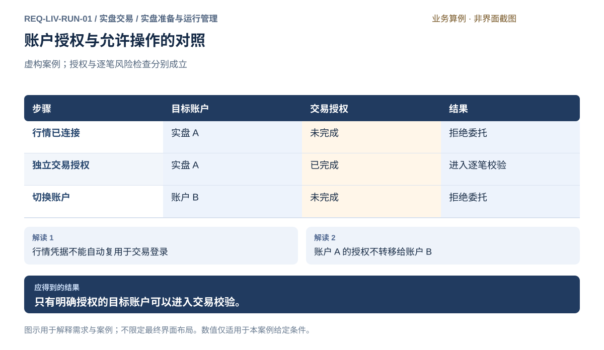

### 可观察验收条件

| 编号                | 给定                         | 当                  | 则                                             |
| ------------------- | ---------------------------- | ------------------- | ---------------------------------------------- |
| REQ-LIV-RUN-01-AC01 | 行情已连接且交易未授权       | 使用者尝试提交委托  | 委托不会发出，结果明确指出缺少交易授权。       |
| REQ-LIV-RUN-01-AC02 | A 已授权而 B 未授权          | 切换至 B 并发起交易 | B 的委托被拒绝，A 的授权不被复用。             |
| REQ-LIV-RUN-01-AC03 | 实盘账户已授权且风险配置有效 | 准备一笔新委托      | 结果明确显示实盘账户身份，并继续执行逐笔校验。 |

### 决定与配置约束

- **DEC-LIV-RUN-01-01**：**交付准入**。CTP兼容期货仿真与真实柜台逐一核验；授权持续至撤销或适用条件改变，实际发送每次重新核对当前连接/政策。交易登录秘密不持久保存，需本地输入；具体账户接入通过GATE-TRADE。

### 详细功能

### FR-LIV-RUN-01-01 选择账户并辨认交易环境

**目标与结果：** 使账户切换保持明确，避免在名称相同的账户之间误操作；完成后所有查询和交易准备都能指向唯一目标账户。

**触发：** 从账户入口选择已有账户或登记新的账户身份。

**输入与约束：** 服务机构、账户标识、模拟或实盘属性与自定义名称；环境属性来自账户信息，不能由名称猜测，也不默认选中实盘账户。

**目标操作与反馈：**

1. 选择机构与环境，填写或选择账户身份。
2. 核对机构、账户标识和环境组成的摘要；同名账户仍分别列出。
3. 确认选用后更新上下文，已有委托草稿提示账户已变更并要求重新核对。

**异常与边界：**

- 身份无法确认时保留输入，不能标为已连接。
- 账户切换不能继承另一账户的交易授权，也不能自动发送旧草稿。

**验收条件：**

- **FR-LIV-RUN-01-01-AC01**：两个显示名称相同的账户仍能凭机构、标识和环境区分。
- **FR-LIV-RUN-01-01-AC02**：从 A 切至 B 后，旧草稿不能凭 A 的确认在 B 发出。

**界面对应：** [UI-LIV-RUN-01 账户连接与交易授权](#ui-liv-run-01)；[UI-LIV-EXE-01 手动下单工作台](execution.md#ui-liv-exe-01)。

### FR-LIV-RUN-01-02 分别建立行情与交易授权

**目标与结果：** 行情观察与交易权限有独立、可见的结果，行情连接成功不再被误读为账户可交易。

**触发：** 账户页分别进入行情连接或交易授权。

**输入与约束：** 授权用途、服务身份及必要凭据；凭据仅在真实产品授权流程本地输入，原型不收集，行情凭据不得自动填入交易用途。

**目标操作与反馈：**

1. 选择行情用途并查看本次服务范围。
2. 完成后看到行情状态与交易状态分别显示。
3. 需要交易时单独确认目标账户和授权用途，再进行独立验证。

**异常与边界：**

- 行情验证失败只改变对应连接结果，不伪造交易失败或成功。
- 不得将行情密码、授权码或连接成功结果复用于交易登录。

**验收条件：**

- **FR-LIV-RUN-01-02-AC01**：仅行情已连接的账户能观察获授权信息，但提交交易被拒绝。
- **FR-LIV-RUN-01-02-AC02**：交易授权摘要明确显示目标账户，敏感值不出现在结果或日志。

**界面对应：** [UI-LIV-RUN-01 账户连接与交易授权](#ui-liv-run-01)。

### FR-LIV-RUN-01-03 审查交易授权范围与有效性

**目标与结果：** 让使用者理解本次授权覆盖哪些账户和行为，授权成功只作为进入逐笔校验的前提。

**触发：** 账户页查看授权详情，或从委托工作台检查交易资格。

**输入与约束：** 账户、允许行为、生效时间及有效条件；具体时长未确认时标为待确定，不偷偷授予永久权限。

**目标操作与反馈：**

1. 展开目标账户授权详情，核对身份及允许行为。
2. 确认授予范围后看到已授权及有效条件。
3. 返回委托准备，逐项显示账户授权与风险资格，继续逐笔检查。

**异常与边界：**

- 授权过期或被撤回时阻止新交易，保留历史查询上下文。
- 模拟授权不能满足实盘授权条件，其他账户权限不能自动代入。

**验收条件：**

- **FR-LIV-RUN-01-03-AC01**：授权详情能区分已授权、未授权、失效与待核对。
- **FR-LIV-RUN-01-03-AC02**：已授权但风险规则缺失时仍不能提交新交易。

**界面对应：** [UI-LIV-RUN-01 账户连接与交易授权](#ui-liv-run-01)；[UI-LIV-EXE-01 手动下单工作台](execution.md#ui-liv-exe-01)；[UI-LIV-ACC-03 账户风险规则与生效管理](accounts.md#ui-liv-acc-03)。

### FR-LIV-RUN-01-04 撤回授权并核对连接变化

**目标与结果：** 使用者能够主动收回交易权限，并知道撤权不意味着原订单已经撤销或持仓已经清空。

**触发：** 账户页选择撤回交易授权，或连接变化后检查权限。

**输入与约束：** 目标账户及待撤回的授权；保留对已发生交易的查询范围，查询和撤单的独立权限需分别判断。

**目标操作与反馈：**

1. 查看目标账户的运行策略、在途订单和持仓摘要。
2. 确认撤回该账户交易授权，说明新交易会被阻止。
3. 查看撤权结果和剩余事项，按独立权限进入订单查询或撤单。

**异常与边界：**

- 未获得撤权确认时显示处理中或待核对，不能提前宣称已撤回。
- 网络恢复不自动恢复被主动撤回的权限，也不重发交易。

**验收条件：**

- **FR-LIV-RUN-01-04-AC01**：撤权后新交易被拒绝，而仍获授权的查询不会无理由被禁用。
- **FR-LIV-RUN-01-04-AC02**：订单和持仓不会因撤权动作被隐去或自动处置。

**界面对应：** [UI-LIV-RUN-01 账户连接与交易授权](#ui-liv-run-01)；[UI-LIV-EXE-02 委托、成交与撤单](execution.md#ui-liv-exe-02)；[UI-LIV-EXE-03 断线与未知结果核对](execution.md#ui-liv-exe-03)。

### FR-LIV-RUN-01-05 完成开市前账户与运行准备检查

**来源与确认：** 2026-10-18全面审查及用户授权补充；详细行为草案待评审，未实现、未执行产品验收。

**目标与结果：** 使用者知道今天哪些条件已满足，昨日正常不能代替今日检查。

**触发：** 首次交易登录、交易日变化或用户检查开市准备。

**输入与约束：** 账户/行情交易日、结算确认要求、授权、资金持仓、在途、风险政策、费率、行情时效、运行归属与固定策略。

**目标操作与反馈：**

1. 读取各来源的当前事实及时间，展示一致、缺项和待核对，不将查询成功当作全部准备完成。
2. 按柜台要求取得并由用户确认结算资料；列出昨日未决、外部活动及策略输入缺口。
3. 满足条件后显示可进入独立启动/下单检查；保留检查依据，后续状态变化使相应检查失效。

**异常与边界：**

- 结算确认是确认已阅指定资料，不表示所有账务差异已解决，也不产生策略授权。
- 必要来源未同步或规则未知时拒绝相关新增，不能沿用昨天的通过标志。

**操作案例：** 夜盘日历日期改变但交易日未变时不重复结算；柜台交易日切换后重新核对实际交易日资料。

**验收条件：**

- **FR-LIV-RUN-01-05-AC01**：账户日与所需行情日不一致时显示来源及交易日，相关启动不可用。
- **FR-LIV-RUN-01-05-AC02**：完成开市清单不会自动发单或启动昨日策略。

**界面对应：** [UI-LIV-RUN-01](#ui-liv-run-01)；[UI-LIV-RUN-04](#ui-liv-run-04)。

## REQ-LIV-RUN-02 观察自选合约并辨认行情来源与时效

**领域：** 实盘交易 / 实盘准备与运行管理　 **建议优先级：** P1核心必要　 **需求状态：** 交付规格已编制（源自已确认定位；细节待用户签认）

### 目标与场景

使用者能够持续观察关心的期货合约，并判断所见报价是否足以支持当前决策。缺失、延迟或中断的数据必须可以辨认，避免把旧值或不存在的值当作实时市场信息。

**使用者与场景：** 个人研究者或交易者，在观察市场、维护关注集合及准备交易时。

**触发条件：** 添加或移除关注合约、打开行情观察任务，或行情连接和数据时效发生变化。

### 前置条件

- 存在已授权的真实行情来源。
- 合约身份能明确区分交易场所、品种与到期合约。

### 输入与含义

| 输入       | 含义与单位                             | 约束                                                 |
| ---------- | -------------------------------------- | ---------------------------------------------------- |
| 关注合约   | 需要持续观察的明确合约集合             | 相似代码或名称必须可区分；添加关注不自动触发交易。   |
| 行情及时间 | 来源提供的报价、市场时间和本地接收时间 | 字段缺失不得填造；时效阈值和时间解释必须有明确依据。 |

### 正常操作与反馈

1. 使用者通过明确身份选择合约并加入关注集合。
2. 系统呈现来源可提供的报价与合约信息，并说明来源。
3. 系统随数据更新呈现变化，同时给出可辨认的时间与时效状态。
4. 发生断流、延迟或缺失时，系统使其与有效行情清晰区别。
5. 使用者可查看具体合约信息或移除关注，关注关系本身不产生委托。

### 业务规则

- 真实行情来源、缺失字段与示例数据必须区分，不能用虚构值补齐行情。
- 最新成交价、买卖报价等有不同含义，不能相互替代而不说明。
- 休市与断流不能仅凭没有新成交判为同一状态，应结合来源能力与市场时段规则。
- 过期数据若保留作参考，必须保留其时间与失效标识。
- 只有存在可比较的来源序列或时间依据时，才能判定乱序；旧消息不得冒充新行情。

### 输出与状态影响

- 使用者维护的关注集合与可辨认的合约身份。
- 带来源、时间及缺失或过期状态的行情信息。

### 异常与继续方式

| 发生什么                               | 应怎样表现                                   | 使用者如何继续                                         |
| -------------------------------------- | -------------------------------------------- | ------------------------------------------------------ |
| 某合约有最新成交但来源未提供买卖报价。 | 明确表示买卖报价缺失，不使用最新成交价填充。 | 使用者依据现有信息判断，或选择具备所需数据权限的来源。 |
| 行情连接中断，最后报价仍保留。         | 显示连接中断及最后有效时间，不继续声称实时。 | 恢复连接后，以新收到的有效行情重新判断时效。           |

### 案例：同一报价从有效到过期再恢复

**虚构案例条件：** 虚构案例：示例合约 A，案例日 T；假设当前处于有效交易时段，来源时间可信，演示过期阈值为 2 秒，仅用于说明规则。

1. T 09:00:01 观察到来源时间为 09:00:00、价格为 3500 的报价，数据年龄为 1 秒。
2. 09:00:03 尚无更新，同一报价年龄为 3 秒。
3. 09:00:04 收到并观察来源时间 09:00:03.8、价格 3501 的报价。

**预期结果：**

- 第一步为有效行情；第二步明确标为过期参考值。
- 第三步数据年龄 0.2 秒，恢复有效状态，显示 3501。

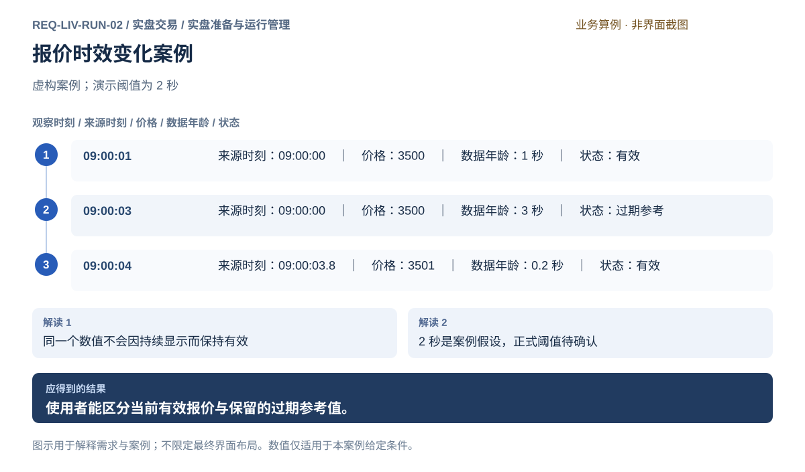

### 可观察验收条件

| 编号                | 给定                                 | 当             | 则                                           |
| ------------------- | ------------------------------------ | -------------- | -------------------------------------------- |
| REQ-LIV-RUN-02-AC01 | 来源没有买卖报价字段                 | 显示该合约行情 | 缺失字段可辨认且不会被最新成交价或零值冒充。 |
| REQ-LIV-RUN-02-AC02 | 案例阈值为 2 秒且最新报价已过去 3 秒 | 使用者观察报价 | 该报价明确标为过期并保留其原始时间。         |
| REQ-LIV-RUN-02-AC03 | 过期状态下收到可信的新报价           | 重新计算时效   | 按照新报价时间恢复状态，不沿用旧时间。       |

### 决定与配置约束

- **DEC-LIV-RUN-02-01**：**运行配置**。行情来源和合约权限显式选择，不自动跨源混用；交易时段依据获授权日历，阈值按类别配置，未知时效不得供依赖新鲜输入的执行使用。

### 详细功能

### FR-LIV-RUN-02-01 浏览分类报价并排序筛选

**目标与结果：** 使用者按市场和品种范围快速定位感兴趣的期货合约，同时知道列表覆盖的来源与更新时间。

**触发：** 打开行情总览，选择分类或输入合约检索条件。

**输入与约束：** 交易场所、品种、合约关键词及排序字段；分类来自授权目录，初始仅恢复上次已选范围或提示选择，不猜主力合约。

**目标操作与反馈：**

1. 选择场所及品种，读取相应合约报价集合。
2. 按代码、价格或有依据的涨跌字段排序，表头明确排序方向。
3. 选中一行查看身份摘要，再进入合约详情或添加自选。

**异常与边界：**

- 目录未加载与筛选无匹配结果分别提示，不能显示同一种空白。
- 没有昨结算或对比基准时不计算涨跌百分比，缺失值不参与数值排序。

**验收条件：**

- **FR-LIV-RUN-02-01-AC01**：筛选条件、报价来源和更新时刻始终可辨认。
- **FR-LIV-RUN-02-01-AC02**：空值不会以零价格或零涨跌显示，排序不改变合约身份。

**界面对应：** [UI-LIV-RUN-02 行情总览与自选](#ui-liv-run-02)；[UI-LIV-RUN-03 合约图表、盘口与成交](#ui-liv-run-03)。

### FR-LIV-RUN-02-02 维护自选集合与关注顺序

**目标与结果：** 使用者建立符合个人观察任务的合约集合，并能调整顺序而不改变交易或持仓状态。

**触发：** 行情行添加自选，或自选列表执行移除、排序与搜索。

**输入与约束：** 明确合约身份、目标自选集合和顺序；集合名称不得掩盖场所和到期合约的差异。

**目标操作与反馈：**

1. 选中具体合约并加入自选，反馈已加入及所属集合。
2. 在自选列表调整顺序或筛选，保留当前关注合约。
3. 移除关注时仅删除关注关系，允许返回分类报价重新添加。

**异常与边界：**

- 重复添加同一合约不产生重复行；同代码不同场所不误合并。
- 移除自选不触发撤单、平仓或删除研究数据。

**验收条件：**

- **FR-LIV-RUN-02-02-AC01**：同一集合中的同一合约只出现一次。
- **FR-LIV-RUN-02-02-AC02**：重新进入时保持已保存的关注顺序，移除后既有订单和持仓不变。

**界面对应：** [UI-LIV-RUN-02 行情总览与自选](#ui-liv-run-02)；[UI-LIV-RUN-03 合约图表、盘口与成交](#ui-liv-run-03)。

### FR-LIV-RUN-02-03 查看合约身份和交易属性

**目标与结果：** 使用者在观察和交易前确认自己选择的是哪一个期货合约，理解乘数、价格单位和有效交易属性。

**触发：** 双击报价行、选中合约后选择详情，或从交易草稿查看规则。

**输入与约束：** 场所、合约代码、到期信息及来源提供的名称和属性；不存在的字段标为未提供，不能从相似合约复制。

**目标操作与反馈：**

1. 查看固定身份摘要及属性来源。
2. 展开乘数、最小变动、交易时段等可用信息并核对有效时间。
3. 需要进一步查证时进入合约规则页，返回后仍保留当前合约。

**异常与边界：**

- 规则缺失时保持可观察行情，但依赖缺失规则的交易校验必须拒绝。
- 切换合约后清楚更新身份，原图表和盘口未就绪时不冒充新合约数据。

**验收条件：**

- **FR-LIV-RUN-02-03-AC01**：图表、盘口及委托准备均显示同一完整合约身份。
- **FR-LIV-RUN-02-03-AC02**：名称缺失时仍能通过代码和场所辨认，不补造名称或交易规则。

**界面对应：** [UI-LIV-RUN-03 合约图表、盘口与成交](#ui-liv-run-03)；[UI-DAT-SRV-01 合约、日历与基础资料](../data/management.md#ui-dat-srv-01)；[UI-LIV-EXE-01 手动下单工作台](execution.md#ui-liv-exe-01)。

### FR-LIV-RUN-02-04 观察分时走势与交易时段

**目标与结果：** 使用者了解一个交易日内价格演变及数据空缺，并能区分正常休市与缺失行情。

**触发：** 合约详情选择分时，并明确要观察的交易日。

**输入与约束：** 合约、业务交易日、价格字段与时区；夜盘归属使用来源和市场规则，未确认时提示口径不足。

**目标操作与反馈：**

1. 选择分时视图及交易日，看到价格曲线和横轴时间口径。
2. 移动观察点读取该时刻价格与数据时间。
3. 展开空缺区间说明，辨认休市、未提供与中断。

**异常与边界：**

- 无成交不自动生成虚构成交点；断流区间不画成连续有效行情。
- 日历日期与业务交易日可能不同，跨夜不能只凭本地零点切分。

**验收条件：**

- **FR-LIV-RUN-02-04-AC01**：分时显示合约、交易日、时区和价格单位。
- **FR-LIV-RUN-02-04-AC02**：有已知数据空缺时曲线明确中断或标识，不把缺失补成真实报价。

**界面对应：** [UI-LIV-RUN-03 合约图表、盘口与成交](#ui-liv-run-03)。

### FR-LIV-RUN-02-05 查看完整K线与未结束区间

**目标与结果：** 使用者能够观察合约不同区间的开高低收变化，并识别尚未完成的当前K线。

**触发：** 合约详情切至K线，选择可用日期范围。

**输入与约束：** 合约、区间粒度、开高低收和时间范围；输入须来自真实来源或明确的派生规则，缺项不能随意补值。

**目标操作与反馈：**

1. 选择K线视图，加载范围内的价格区间。
2. 选中一根K线查看开高低收、量及起止时间。
3. 观察最新区间的未结束标记，结束后按数据依据形成完整区间。

**异常与边界：**

- 缺失区间必须标识，不能把上一收盘价复制成完整K线。
- 只有有依据的更正数据才能更正历史区间，并保留时间与来源说明。

**验收条件：**

- **FR-LIV-RUN-02-05-AC01**：每根完整K线满足最高不低于开收、最低不高于开收。
- **FR-LIV-RUN-02-05-AC02**：未结束K线与已结束K线可辨认，来源缺失时不会虚构成交量。

**界面对应：** [UI-LIV-RUN-03 合约图表、盘口与成交](#ui-liv-run-03)。

### FR-LIV-RUN-02-06 切换图表周期并保持合约上下文

**目标与结果：** 使用者切换观察尺度时明确看到新周期的数据，避免把旧周期的图误认为新结果。

**触发：** 图表区域选择受支持的分时、分钟或日线周期。

**输入与约束：** 周期、合约、观察区间；可选项以数据来源和有效聚合能力为依据，不展示实际无法提供的周期。

**目标操作与反馈：**

1. 打开周期选择，查看当前值与可用范围。
2. 选择新周期后显示加载状态及目标周期，保留合约和可解释的时间范围。
3. 新数据就绪后整体替换图表，更新横轴和观察点。

**异常与边界：**

- 新周期失败时保留旧图并明确旧周期，不伪装成切换成功。
- 连续快速切换以最后选择为目标，较早返回结果不能覆盖最新选择。

**验收条件：**

- **FR-LIV-RUN-02-06-AC01**：切换前后合约身份保持一致，周期标识与实际区间一致。
- **FR-LIV-RUN-02-06-AC02**：先请求分钟后请求日线时，分钟结果晚到不会替换日线目标。

**界面对应：** [UI-LIV-RUN-03 合约图表、盘口与成交](#ui-liv-run-03)。

### FR-LIV-RUN-02-07 使用十字线缩放和平移检查价格细节

**目标与结果：** 使用者能在长序列中定位某一时刻并比较价格，而不把观察动作误触发为交易。

**触发：** 指向图表、使用键盘移动观察点、缩放或拖动时间范围。

**输入与约束：** 已加载图表、焦点时刻与可见区间；缩放只改变观察范围，不改变价格数据和周期定义。

**目标操作与反馈：**

1. 把焦点移到图表，显示十字线对应时间与价格摘要。
2. 缩放或平移后保持焦点或明确重新定位，并提示更早数据加载状态。
3. 选择回到最新，恢复最新可见区间并保留周期。

**异常与边界：**

- 无数据点处说明缺失而非显示插值为真实成交。
- Esc结束观察焦点或关闭详情；回车和图表双击均不能直接下单。

**验收条件：**

- **FR-LIV-RUN-02-07-AC01**：十字线所见数值与该区间明细一致，缩放不修改原始数据。
- **FR-LIV-RUN-02-07-AC02**：平移查看历史期间，新行情到达不会无提示把用户拉回最新位置。

**界面对应：** [UI-LIV-RUN-03 合约图表、盘口与成交](#ui-liv-run-03)。

### FR-LIV-RUN-02-08 同时查看盘口与最近成交

**目标与结果：** 使用者比较可见买卖报价和已经发生的成交，明确两者不同含义与数据覆盖。

**触发：** 进入合约详情的盘口和最近成交区域。

**输入与约束：** 来源提供的买卖层级、价格、挂量与成交明细；缺少深度时只显示可用层级，不制造五档或逐笔数据。

**目标操作与反馈：**

1. 核对盘口的合约和数据时刻，查看买卖两侧价量。
2. 阅读最近成交的时间、价格和数量，并查看成交标识。
3. 选择某报价准备委托时只带入价格候选，进入独立委托确认。

**异常与边界：**

- 盘口缺失不能用最新成交价填充，成交数量缺失不能记为零。
- 盘口到达与成交到达的时间可不同，必须分别标识；点击价位不直接发单。

**验收条件：**

- **FR-LIV-RUN-02-08-AC01**：报价挂量和成交量有明确标签，不能被当成同一字段。
- **FR-LIV-RUN-02-08-AC02**：选择报价后仅生成待确认草稿，没有真实订单产生。

**界面对应：** [UI-LIV-RUN-03 合约图表、盘口与成交](#ui-liv-run-03)；[UI-LIV-EXE-01 手动下单工作台](execution.md#ui-liv-exe-01)。

### FR-LIV-RUN-02-09 管理行情订阅与连接范围

**目标与结果：** 使用者知道哪些关注对象正在接收行情，明确订阅失败是否影响某个合约或整个来源。

**触发：** 添加关注、打开合约详情，或在行情页查看订阅状态。

**输入与约束：** 合约身份、授权来源、所需数据类型；订阅范围以实际观察需求及来源权限为依据。

**目标操作与反馈：**

1. 请求观察某合约后展示订阅处理中及来源。
2. 收到订阅结果后分别说明可用数据和受限数据。
3. 离开详情或移除关注后更新所需订阅范围，不影响仍被其他观察任务使用的数据。

**异常与边界：**

- 来源达到订阅限制时指出受影响合约，不能宣称所有自选都实时。
- 重复关注同一合约不造成重复订阅或重复报价行。

**验收条件：**

- **FR-LIV-RUN-02-09-AC01**：单个合约订阅失败能够被定位，其他已成功合约仍可观察。
- **FR-LIV-RUN-02-09-AC02**：取消一个观察入口不终止其他仍需同一合约的数据任务。

**界面对应：** [UI-LIV-RUN-02 行情总览与自选](#ui-liv-run-02)；[UI-LIV-RUN-03 合约图表、盘口与成交](#ui-liv-run-03)；[UI-LIV-RUN-01 账户连接与交易授权](#ui-liv-run-01)。

### FR-LIV-RUN-02-10 识别延迟断流与数据恢复

**目标与结果：** 使用者在报价旁直接判断数据是否仍有效，避免保留的旧值造成实时错觉。

**触发：** 报价超出已确认时效规则、连接变化或新有效数据到达。

**输入与约束：** 来源时间、接收时间、市场时段及业务场景的时效阈值；示例2秒仅用于演示，不是正式默认值。

**目标操作与反馈：**

1. 查看行情状态及最近有效时间，必要时展开来源与接收时间。
2. 超时或断流后旧值保留为参考，并清楚改变状态。
3. 新有效数据到达后依据时间重新判断；来源无法比较时说明不能确认。

**异常与边界：**

- 休市、无成交、连接断开分别说明，不能仅凭没有更新推断原因。
- 可信时间或序列证明旧消息时，不允许旧消息覆盖新值。

**验收条件：**

- **FR-LIV-RUN-02-10-AC01**：案例年龄3秒超过假设2秒阈值时明确显示过期。
- **FR-LIV-RUN-02-10-AC02**：新报价年龄0.2秒恢复有效；过期参考值不会被继续标成实时。

**界面对应：** [UI-LIV-RUN-02 行情总览与自选](#ui-liv-run-02)；[UI-LIV-RUN-03 合约图表、盘口与成交](#ui-liv-run-03)；[UI-LIV-EXE-03 断线与未知结果核对](execution.md#ui-liv-exe-03)。

## REQ-LIV-RUN-03 核对策略与评价依据并独立授权实盘范围

**领域：** 实盘交易 / 实盘准备与运行管理　 **建议优先级：** P0安全必要　 **需求状态：** 交付规格已编制（源自已确认定位；细节待用户签认）

### 目标与场景

使用者先理解策略在给定条件下如何行动，再决定是否允许其作用于真实账户。模拟结果只能支持决策，不能自动产生实盘权限或收益保证。

**使用者与场景：** 个人策略研究者与同一账户的交易授权人，在准备将研究方案用于实盘时。

**触发条件：** 使用者提出启用一个自动策略方案，或修改会影响交易行为的方案内容。

### 前置条件

- 策略目标、参数、交易范围及停止方式已有可审查说明。
- 模拟阶段所需数据已有合法来源，模拟风险规则与执行假设完整有效，不要求真实账户交易授权。
- 实盘启用前，目标账户交易授权与账户风控配置必须有效可用。

### 输入与含义

| 输入               | 含义与单位                             | 约束                                                         |
| ------------------ | -------------------------------------- | ------------------------------------------------------------ |
| 策略方案           | 交易逻辑、参数、合约范围及预期行为     | 必须能确定本次授权覆盖的具体内容，不能仅以可重复名称识别。   |
| 验证依据与实盘授权 | 模拟条件、结果、限制和目标账户授权范围 | 模拟与真实成交严格区分；实盘账户、额度和启用条件需明确确认。 |

### 正常操作与反馈

1. 选择策略模块交付的固定内容和评估结论，核对参数、数据依赖、限制及适用范围。
2. 验证不足时创建独立回测或明确标识的模拟验证草稿，结果交评估形成依据；实盘准备只引用证据。
3. 核对目标实盘账户、合约范围、资金分配、必要风险和停止约定。
4. 独立授予明确账户及固定策略内容的交易权限；授权不自动启动。
5. 启动前再次核对实际条件，关键行为变化后重新审查验证与授权。

### 业务规则

- 模拟信号、委托与真实成交须区分，不能合并为实盘业绩。
- 验证标准须预先明确，不能仅凭正收益准许实盘。
- 模拟转实盘须独立授权，不因模拟结束自动发生。
- 实盘须经统一授权和逐笔风控，验证不能带来豁免。
- 关键参数或范围变化后，原授权不自动覆盖新行为。
- 模拟阶段不得向真实账户发送交易指令，即使该真实账户已经另行取得交易授权。
- 历史回测和评价由对应模块负责，不在Live另建一套绩效计算；本地模拟、仿真柜台与真实市场均须明确标签。
- 资金分配来自已确认组合政策和账户风险约束，不能把策略预算当作已经转入账户的资金，也不保证足额成交。

### 输出与状态影响

- 包含条件、结果与局限的策略验证依据。
- 限定账户、策略内容及交易范围的实盘授权，或明确不能启用的原因。

### 异常与继续方式

| 发生什么                                 | 应怎样表现                                         | 使用者如何继续                       |
| ---------------------------------------- | -------------------------------------------------- | ------------------------------------ |
| 模拟报告未说明成交或费用假设。           | 标为依据不完整，不能据此宣称方案具备实盘启用条件。 | 补充条件并重新审查相应结果。         |
| 取得授权后将单次开仓量从 1 手改为 2 手。 | 识别为影响交易的变更，原授权不自动覆盖。           | 重新验证必要场景并确认新的授权范围。 |

### 案例：一手方案的授权不覆盖两手方案

**虚构案例条件：** 虚构案例：方案甲每次最多开仓示例合约 A 1 手；10 个模拟信号中，7 个形成模拟委托、2 个因风控拒绝、1 个因数据不足拒绝。仅演示授权关系，10 个信号不构成正式验证门槛，无真实交易。

1. 审查 10 个信号及拒绝原因；本例假设使用者已确认方案审查要求满足。
2. 独立授权方案甲在实盘账户 A 运行，每次最多开仓 1 手。
3. 把策略参数改为每次开仓 2 手后尝试启动。

**预期结果：**

- 模拟阶段实际发出的真实委托为 0。
- 1 手方案可在其他前提满足时启用；改为 2 手后必须重新评估和授权，不能直接启用。

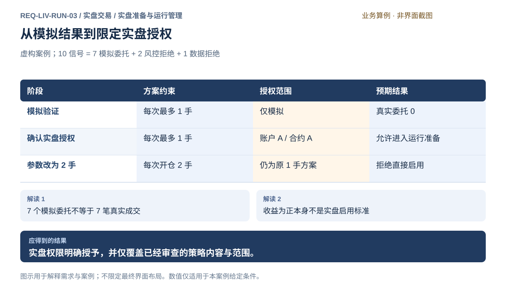

### 可观察验收条件

| 编号                | 给定                                                         | 当                    | 则                                                                           |
| ------------------- | ------------------------------------------------------------ | --------------------- | ---------------------------------------------------------------------------- |
| REQ-LIV-RUN-03-AC01 | 只有模拟验证结果而没有实盘授权                               | 尝试启动实盘策略      | 拒绝启动，模拟过程没有发出真实委托。                                         |
| REQ-LIV-RUN-03-AC02 | 方案甲已明确授权且其他前提成立                               | 以授权的 1 手约束启动 | 允许进入运行准备，并保持统一逐笔风控。                                       |
| REQ-LIV-RUN-03-AC03 | 授权仅覆盖每次最多 1 手                                      | 改为 2 手后启动       | 旧授权不被沿用，明确指出交易行为已变更。                                     |
| REQ-LIV-RUN-03-AC04 | 模拟所需数据、风险规则及执行假设有效，但没有真实账户交易授权 | 启动策略模拟验证      | 模拟可以进行，向真实账户发送的交易指令为 0；缺少实盘授权不会阻止合规的模拟。 |

### 决定与配置约束

- **DEC-LIV-RUN-03-01**：**规格决定**。支持本交付规则、模型、混合及组合包；至少一完整交易日与次日开市的模拟行为证据、独立策略评价和人工授权。包/政策/执行位置实质改变重新核对与授权，不用模拟收益作为自动许可。

### 详细功能

### FR-LIV-RUN-03-01 从研究候选交接可验证策略方案

**目标与结果：** 把研究结果转为明确的待验证方案，保留假设和限制，避免只凭一个策略名称直接启动实盘。

**触发：** 从研究候选交接页进入策略授权与运行。

**输入与约束：** 固定策略包、实际参数方案、合约范围、数据需求、评估结论及停止语义；交接不包含实盘授权。

**目标操作与反馈：**

1. 查看固定策略内容和关联评估证据。
2. 核对交易范围、资金分配、参数与停止约定；需要修改逻辑或参数时返回策略模块派生。
3. 保存准备记录；证据不足时进入独立验证草稿，仍未获得实盘权限。

**异常与边界：**

- 候选资料缺失时指出缺项，不能沿用同名历史方案补齐。
- 研究成绩或候选排名不能代替交易授权与风控。

**验收条件：**

- **FR-LIV-RUN-03-01-AC01**：交接后能返回原研究依据，并看到本次方案的具体参数范围。
- **FR-LIV-RUN-03-01-AC02**：仅完成交接没有真实交易指令，也不会自动启动策略。

**界面对应：** [UI-STR-DLV-01 交易候选与交接检查](../strategy/delivery.md#ui-str-dlv-01)；[UI-LIV-RUN-04 实盘准备、授权与策略运行](#ui-liv-run-04)。

### FR-LIV-RUN-03-02 配置并检查独立模拟验证

**目标与结果：** 使用者在没有真实账户交易授权的条件下检查策略行为，模拟结果与实际交易完全分离。

**触发：** 策略方案选择模拟验证。

**输入与约束：** 真实来源数据、模拟风险规则、费用与成交假设；缺风险配置拒绝模拟或回测，不要求实盘账户授权。

**目标操作与反馈：**

1. 明确需要历史回测、本地模拟还是仿真柜台验证；分别转对应执行入口，核对数据、费用、成交和必要风险。
2. 独立运行后查看信号、模拟委托和拒绝原因，环境标识不变。
3. 引用评估模块保存的结果与限制，返回实盘准备核对启用条件。

**异常与边界：**

- 不能因为真实账户已授权就向它发送模拟指令。
- 费用或成交假设缺失时不能把结果视为完整验证依据，也不补造真实成交。

**验收条件：**

- **FR-LIV-RUN-03-02-AC01**：未授权实盘账户仍能在模拟前提有效时运行模拟，真实指令为0。
- **FR-LIV-RUN-03-02-AC02**：案例10信号拆成7模拟委托、2风控拒绝、1数据拒绝且含义明确。

**界面对应：** [UI-LIV-RUN-04 实盘准备、授权与策略运行](#ui-liv-run-04)；[UI-SYS-RUN-02 任务中心](../system/tasks-nodes.md#ui-sys-run-02)；[UI-BKT-EXP-01 回测方案与验证计划](../backtest/experiments.md#ui-bkt-exp-01)；[UI-EVA-VAL-01 稳健性与综合评价](../evaluation/validation.md#ui-eva-val-01)。

### FR-LIV-RUN-03-03 限定账户与范围授予实盘权限

**目标与结果：** 使用者单独批准一个具体策略作用于真实账户，明确额度和停止条件，不因模拟结束自动转实盘。

**触发：** 模拟审查后选择申请实盘授权。

**输入与约束：** 目标账户、策略内容、合约范围、数量约束及停止条件；须有有效账户交易授权和可执行风险规则。

**目标操作与反馈：**

1. 审查模拟依据和未证明事项，确认符合约定的启用门槛。
2. 核对实盘账户、策略范围和数量限制。
3. 明确授权后显示有效范围，仍需单独启动并持续逐笔校验。

**异常与边界：**

- 未取得账户交易权或风险不可用时不能授予可启动资格。
- 实盘授权不能跨账户或扩展到未列明合约，批准本身不发第一笔单。

**验收条件：**

- **FR-LIV-RUN-03-03-AC01**：仅模拟已通过而未实盘授权时，启动实盘被拒绝。
- **FR-LIV-RUN-03-03-AC02**：授权摘要能看到具体账户及每次最多1手的案例限制。

**界面对应：** [UI-LIV-RUN-04 实盘准备、授权与策略运行](#ui-liv-run-04)；[UI-LIV-RUN-01 账户连接与交易授权](#ui-liv-run-01)；[UI-LIV-ACC-03 账户风险规则与生效管理](accounts.md#ui-liv-acc-03)。

### FR-LIV-RUN-03-04 识别方案变更并重新审查授权

**目标与结果：** 防止策略在授权后因参数或范围变化悄悄承担更大风险，使用者可以看到哪些变化需要重新审查。

**触发：** 修改已验证或已授权方案的关键内容。

**输入与约束：** 原方案、新参数和有效授权范围；名称相同不代表交易行为相同。

**目标操作与反馈：**

1. 展示变更前后参数、合约范围与数量限制。
2. 标明受到影响的验证和实盘授权，保留原依据。
3. 重新验证必要场景并确认新授权后，才允许启动变更后的方案。

**异常与边界：**

- 运行中的方案修改不能无提示直接改变正在执行的交易行为。
- 取消变更保留原方案，不能留下部分参数已更新的混合状态。

**验收条件：**

- **FR-LIV-RUN-03-04-AC01**：每次最多1手改为2手时原授权不自动覆盖新方案。
- **FR-LIV-RUN-03-04-AC02**：修改草稿不改变正在运行方案，生效内容和授权范围可核对。

**界面对应：** [UI-LIV-RUN-04 实盘准备、授权与策略运行](#ui-liv-run-04)；[UI-STR-DLV-01 交易候选与交接检查](../strategy/delivery.md#ui-str-dlv-01)。

### FR-LIV-RUN-03-05 建立隔离的本地实时模拟账户

**来源与确认：** 2026-10-18全面审查及用户授权补充；详细行为草案待评审，未实现、未执行产品验收。

**目标与结果：** 用真实实时输入观察完整策略执行链，资金与成交是明确标注的模拟事实。

**触发：** 准备页选择本地模拟并新建模拟运行。

**输入与约束：** 固定策略、真实数据订阅、模拟初始资金/持仓及来源说明、时钟、撮合/成本/结算方法、风险配置与停止条件。

**目标操作与反馈：**

1. 核对“本地模拟”标识、真实数据来源、模拟账户身份及初始状态；订单去向明确为内部模拟。
2. 检查固定包和模式能力，采用实时事件时间与声明的迟到/断流策略；明确启动后生成独立实例。
3. 展示模拟信号、拒绝、订单、成交、资金与费用，并把结果交评估；每个输出保留模拟标识。

**异常与边界：**

- 缺真实行情不生成模拟行情；缺风险或撮合规则拒绝启动。
- 初始持仓必须显式设置或引用核对过的账户快照副本；不自动跟随真实账户变化。
- 柜台仿真使用外部仿真账户和柜台成交，本地模拟不发送任何柜台委托。

**操作案例：** 模拟账户初始10万元、空仓，按真实行情模拟成交1手；真实账户持仓和资金完全不变。

**验收条件：**

- **FR-LIV-RUN-03-05-AC01**：本地模拟收到信号后仅增加模拟订单，真实和柜台仿真委托均为0。
- **FR-LIV-RUN-03-05-AC02**：行情断流后依赖行情的新决策受阻，已有模拟事实保持，不按最后价格持续虚构成交。

**界面对应：** [UI-LIV-RUN-04](#ui-liv-run-04)；[UI-LIV-EXE-02](execution.md#ui-liv-exe-02)。

### FR-LIV-RUN-03-06 保存模拟运行并明确继续或重新开始

**来源与确认：** 2026-10-18全面审查及用户授权补充；详细行为草案待评审，未实现、未执行产品验收。

**目标与结果：** 停止后可复核完整模拟事实，继续与重置不混为同一运行。

**触发：** 模拟停止、中断后重新打开。

**输入与约束：** 原实例、固定策略及规则、事件处理位置、模拟账本、在途、输入缺口和能力状态。

**目标操作与反馈：**

1. 查询原记录并显示最后确认状态，进程退出不显示仍正常运行。
2. 检查事件连续性、策略状态和账本一致性；证据齐全时允许用户明确继续同一实例，否则只允许查看或建立独立新实例。
3. 继续只处理明确的新事件；重新开始要求确认新账户起点，原实例完整保留。

**异常与边界：**

- 未恢复策略必要状态或无法解释中断期间订单时拒绝继续，不补造中间成交。
- 历史缺口重演属于独立历史实验，不能改写原实时模拟经历。

**操作案例：** 中断前买单在途但期间行情缺失；用户查看未决订单后选择新模拟，旧运行仍显示中断及缺口。

**验收条件：**

- **FR-LIV-RUN-03-06-AC01**：重新开始得到新实例及账本，旧损益不被清零。
- **FR-LIV-RUN-03-06-AC02**：存在无法解释的模拟在途与事件缺口时继续被拒绝，不能以重启掩盖。

**界面对应：** [UI-LIV-RUN-04](#ui-liv-run-04)；[UI-LIV-RUN-05](#ui-liv-run-05)。

## REQ-LIV-RUN-04 监控策略运行并明确停止后的订单与持仓

**领域：** 实盘交易 / 实盘准备与运行管理　 **建议优先级：** P0安全必要　 **需求状态：** 交付规格已编制（源自已确认定位；细节待用户签认）

### 目标与场景

使用者能够判断策略是否运行、依据什么信息行动，以及停止是否完成。停止产生新交易意图须与撤单、处理持仓区分，避免误以为停止就没有市场风险。

**使用者与场景：** 个人策略使用者，在启动、观察、暂停或停止已授权策略时。

**触发条件：** 发起启动或停止请求，策略发生重要运行事件，或运行信息失去更新。

### 前置条件

- 策略内容、目标账户、运行授权和风险规则均明确。
- 所需数据与账户连接可用，停止行为已有明确约定。

### 输入与含义

| 输入           | 含义与单位                                 | 约束                                                 |
| -------------- | ------------------------------------------ | ---------------------------------------------------- |
| 启动范围       | 策略、账户、合约范围与允许行为             | 同一启动意图不能因重复点击产生重复运行。             |
| 运行与停止信息 | 有效数据时间、运行状态、委托结果及停止确认 | 请求已收到不等于状态已达到；未知状态必须保持可辨认。 |

### 正常操作与反馈

1. 使用者核对策略与账户范围并发起启动。
2. 系统确认前置条件后明确报告是否已经运行。
3. 运行期间说明数据时效、策略动作、委托结果与拒绝原因。
4. 使用者请求停止，系统说明正在停止并阻止继续产生新的交易意图。
5. 确认停止完成后才报告已停止，并列明仍存在的订单与持仓。
6. 撤单或平仓作为独立意图经过授权与风控。

### 业务规则

- 运行状态需要有依据，不能把启动请求成功当成策略持续正常工作。
- 重复启动请求不应造成同一授权意图被重复执行。
- 本条草案的停止语义是停止产生新交易意图，不自动撤单或平仓。
- 确认停止后，尚未发送的策略意图不再发出；停止前已发出的委托仍可能成交，必须继续反映其结果与持仓影响。
- 无法确认停止完成时明确显示待核对，不能报为已停止或推定没有风险。

### 输出与状态影响

- 可辨认的策略状态、数据依据及重要运行事件。
- 停止完成或待核对结果，以及独立列明的在途订单和持仓。

### 异常与继续方式

| 发生什么                           | 应怎样表现                                               | 使用者如何继续                           |
| ---------------------------------- | -------------------------------------------------------- | ---------------------------------------- |
| 策略失去有效行情但运行连接仍存在。 | 明确显示数据不可用并按适用规则阻止依赖该数据的新交易。   | 恢复有效数据后按事先明确的继续条件处理。 |
| 停止请求发出后无法取得确认。       | 保持停止结果待核对，不宣称已停止，也不自动启动替代实例。 | 核对实际运行状态后再决定下一步。         |

### 案例：停止策略后在途订单仍然成交

**虚构案例条件：** 虚构案例：策略持有示例合约 A 多头 2 手，另有此前发出、尚未成交的买开 1 手订单；停止仅停止产生新交易意图，不包含撤单和平仓。

1. 09:30:00 策略运行，持仓 2 手，在途 1 手。
2. 09:31:00 确认策略已停止，新交易意图不再产生；持仓和在途订单仍保留。
3. 09:31:02 此前在途的 1 手成交，持仓变为 3 手。

**预期结果：**

- 策略在 09:31:00 后没有产生新的委托意图。
- 最终仍为已停止，但持仓为 3 手、在途 0 手；不能显示为无风险或已平仓。

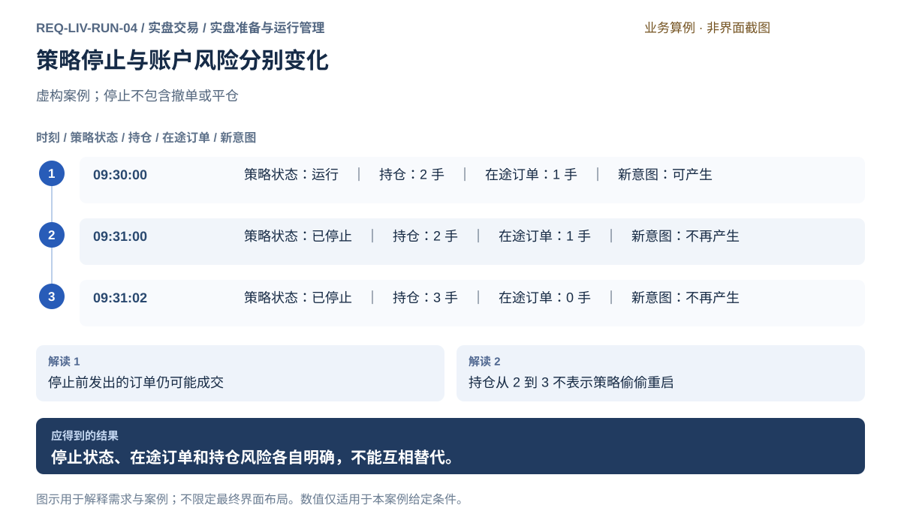

### 可观察验收条件

| 编号                | 给定                           | 当               | 则                                                                                   |
| ------------------- | ------------------------------ | ---------------- | ------------------------------------------------------------------------------------ |
| REQ-LIV-RUN-04-AC01 | 启动请求尚未获得运行确认       | 显示策略状态     | 显示启动处理中或待核对，不显示已正常运行。                                           |
| REQ-LIV-RUN-04-AC02 | 案例策略已确认停止             | 继续观察后续行为 | 不再产生新委托意图，停止前生成但尚未发送的意图也不会发出；已有订单及持仓信息仍保留。 |
| REQ-LIV-RUN-04-AC03 | 停止时持仓 2 手、在途买开 1 手 | 此前订单成交     | 更新为持仓 3 手、在途 0 手，策略仍为已停止。                                         |

### 决定与配置约束

- **DEC-LIV-RUN-04-01**：**规格决定**。支持本地和可信Linux远程运行；数据连续性中断先停止依赖该输入的新意图，恢复后核对当前目标，不补发旧事件。关闭安装版窗口服务继续，显式停止新意图、撤单及平仓分别操作。

### 详细功能

### FR-LIV-RUN-04-01 明确启动策略并防止重复运行

**目标与结果：** 使用者确认策略、账户和模式后启动，系统把请求处理中与实际已运行区分。

**触发：** 策略授权页选择启动模拟或启动实盘。

**输入与约束：** 方案内容、运行模式、授权范围、数据和风险资格；模式没有明确选择时不能隐式启动实盘。

**目标操作与反馈：**

1. 核对本次方案、账户和运行模式摘要。
2. 实盘启动前检查授权及风险，确认后显示启动处理中。
3. 取得运行确认后显示运行实例及时间，重复触发关联同次启动。

**异常与边界：**

- 未确认启动结果时不能自动再创建一份策略运行。
- 模拟数据和风险成立时不要求实盘授权；实盘缺任一前提必须拒绝。

**验收条件：**

- **FR-LIV-RUN-04-01-AC01**：连续重复点击同一次启动不会出现两个同意图运行。
- **FR-LIV-RUN-04-01-AC02**：处理中不显示已正常运行，拒绝时保留原因且无真实委托。

**界面对应：** [UI-LIV-RUN-04 实盘准备、授权与策略运行](#ui-liv-run-04)；[UI-SYS-RUN-02 任务中心](../system/tasks-nodes.md#ui-sys-run-02)。

### FR-LIV-RUN-04-02 监控策略数据依据与执行结果

**目标与结果：** 使用者能判断策略正在做什么、依据的数据是否有效，以及未成交是因为没有信号还是因规则拒绝。

**触发：** 选中一个策略运行并查看监控。

**输入与约束：** 运行确认、数据时间、信号、委托关联和拒绝原因；不以连接存在直接推定策略正常。

**目标操作与反馈：**

1. 查看模式、账户、运行状态及最后有效数据时间。
2. 浏览最近信号和实际处理结果，区分模拟、拒绝和已发出。
3. 选中事件定位订单或风险详情，再返回原运行上下文。

**异常与边界：**

- 数据中断时说明受影响策略行为，不能继续标示健康实时。
- 日志或状态更新失去依据时明确待核对，不伪造心跳时间。

**验收条件：**

- **FR-LIV-RUN-04-02-AC01**：一个风控拒绝事件能追到规则和原信号，但没有真实成交记录。
- **FR-LIV-RUN-04-02-AC02**：已发送订单能跳到对应委托，模式和账户在两处一致。

**界面对应：** [UI-LIV-RUN-04 实盘准备、授权与策略运行](#ui-liv-run-04)；[UI-LIV-EXE-02 委托、成交与撤单](execution.md#ui-liv-exe-02)；[UI-LIV-ACC-03 账户风险规则与生效管理](accounts.md#ui-liv-acc-03)。

### FR-LIV-RUN-04-03 停止新意图并确认真正停止

**目标与结果：** 使用者明确停止一个运行，看到请求和完成结果；停止后尚未发送的策略意图也不能继续发出。

**触发：** 运行监控选择停止策略。

**输入与约束：** 目标运行、账户、待处理意图和在途订单摘要；停止不默认包含撤单或平仓。

**目标操作与反馈：**

1. 核对目标策略和停止后果，确认停止新意图及尚未发送意图。
2. 显示停止处理中，等待真实停止确认。
3. 停止完成后显示时间及剩余订单持仓，允许独立查询与处置。

**异常与边界：**

- 停止确认未到或连接中断时标为待核对，不能显示已停止。
- 关闭已安装软件窗口不等于点击停止，后台运行继续，重开后恢复观察。

**验收条件：**

- **FR-LIV-RUN-04-03-AC01**：停止完成后不再生成或发出尚未发送的策略意图。
- **FR-LIV-RUN-04-03-AC02**：此前已发订单仍可成交，停止不会自动发平仓或重发命令。

**界面对应：** [UI-LIV-RUN-04 实盘准备、授权与策略运行](#ui-liv-run-04)；[UI-LIV-EXE-03 断线与未知结果核对](execution.md#ui-liv-exe-03)；[UI-LIV-EXE-02 委托、成交与撤单](execution.md#ui-liv-exe-02)。

### FR-LIV-RUN-04-04 处理停止后的残余订单和持仓

**目标与结果：** 使用者在策略停止后仍能管理账户风险，明确需要另行撤单或平仓，而不是被停止状态误导。

**触发：** 停止结果中选择查看剩余订单或持仓。

**输入与约束：** 策略关联订单、实际成交、剩余委托及账户持仓；关联不足时不把整个账户持仓猜作单一策略持仓。

**目标操作与反馈：**

1. 查看停止时在途订单和持仓快照及时间。
2. 有后续成交时更新实际风险，并说明来自停止前订单。
3. 选择独立授权撤单或准备平仓，分别核对权限和逐笔风险。

**异常与边界：**

- 策略停止后不能隐藏新到的历史订单成交。
- 风险不可用时不能将平仓意图默认免检，但仍按独立安全权限提供查询和撤单。

**验收条件：**

- **FR-LIV-RUN-04-04-AC01**：案例停止时持仓2手、在途1手，后续成交后持仓3手且在途0。
- **FR-LIV-RUN-04-04-AC02**：策略仍显示已停止，不能把持仓增加误报为重新启动。

**界面对应：** [UI-LIV-RUN-04 实盘准备、授权与策略运行](#ui-liv-run-04)；[UI-LIV-EXE-02 委托、成交与撤单](execution.md#ui-liv-exe-02)；[UI-LIV-ACC-01 账户资金与持仓](accounts.md#ui-liv-acc-01)。

### FR-LIV-RUN-04-05 明确同一真实账户的执行归属

**来源与确认：** 2026-10-18全面审查及用户授权补充；详细行为草案待评审，未实现、未执行产品验收。

**目标与结果：** 所有受本产品控制的执行意图使用同一个账户事实与风险占用，节点不可各自持有独立执行权。

**触发：** 启动、连接另一节点或计划改变执行位置。

**输入与约束：** 稳定机构/环境/账户身份、当前执行节点、活动实例、手动请求、在途和未确认命令；不同策略共享账户执行边界。

**目标操作与反馈：**

1. 显示账户当前执行归属及核实时间；多个观察窗口可只读观察同一归属。
2. 新执行位置请求检查现有归属；存在有效或无法排除的其他执行方时拒绝新位置启动。
3. 变更归属前明确停止原位置新增、核对在途与持仓并确认原位置不能继续发送；再独立核验新位置与授权，不自动接管。

**异常与边界：**

- 旧节点失联不等于已停止，不允许单凭超时或关闭窗口夺取归属。
- 本软件不能控制券商其他客户端；发现外部活动纳入账户核对，影响安全判断时限制新增。

**操作案例：** Mac观察运行在Linux的账户A；Mac请求改成本地运行，原节点离线，系统保留待核对而非自动接管。

**验收条件：**

- **FR-LIV-RUN-04-05-AC01**：本地已执行账户A时远程独立启动A被拒绝；观察不被当成另一个执行方。
- **FR-LIV-RUN-04-05-AC02**：原节点无法确认停止时新节点保持不可执行；不出现两套各自可用额度。

**界面对应：** [UI-LIV-RUN-04](#ui-liv-run-04)；[UI-SYS-RUN-03](../system/tasks-nodes.md#ui-sys-run-03)。

## REQ-LIV-RUN-05 核对运行事实并独立确认处置与恢复

**领域：** 实盘交易 / 实盘准备与运行管理　 **建议优先级：** P0安全必要　 **需求状态：** 交付规格已编制（源自已确认定位；细节待用户签认）

### 目标与场景

保留真实订单、持仓与运行状态，在调查需要处置时明确控制范围，安全暂停新增、核对未知订单及审查恢复；评价计算与偏差归因由评估模块负责。

**使用者与场景：** 个人量化研究者与交易授权人，在方案进入下一环境、运行偏离预期或重启后核对时。

**触发条件：** 比较不同环境的同一决策点、发现信号或目标偏差、执行结果不符预期，或恢复一个已有量化运行。

### 前置条件

- 能读取明确账户与运行的当前事实和已有调查证据，未知状态如实保留。
- 查询与实际控制分别核对权限；风险能力异常不妨碍允许的只读查询，真实控制按各自必要前提执行。

### 输入与含义

| 输入           | 含义与单位                                                                         | 约束                                                             |
| -------------- | ---------------------------------------------------------------------------------- | ---------------------------------------------------------------- |
| 定义与状态起点 | 逻辑及参数、因子依赖、组合分配、数据口径、风险规则、持仓现金、未明订单及已处理事件 | 身份和内容依据一致才可判为同起点；相同名称或日期不足以证明。     |
| 决策与执行记录 | 可用信息时点、调度事件、信号、目标、获准量、委托、成交、持仓及费用                 | 按环境、运行和观察时点关联，事实只计一次，不混合模拟与真实成交。 |
| 调查与处置范围 | 比较基准、估值口径、归因证据及所选策略或组合运行                                   | 暂停新增、撤单、平仓分别明确授权，不自动扩大到其他运行或账户。   |

### 正常操作与反馈

1. 从交易运行或评估结论进入，核对当前实例、已处理事件、订单与持仓事实。
2. 明确受影响范围，独立确认暂停新增；撤单和平仓按各自流程处理。
3. 查询未知结果并保留风险占用，禁止补单或重放。
4. 需要修订时创建独立草稿，重新验证及核对授权后再决定是否恢复。

### 业务规则

- 组合意向、可执行目标、账户持仓及策略归属是不同层次；同一成交和费用只归集一次，组合合计与策略分项不能重复相加。共享账户成交和费用分配政策由 DEC-STR-PRT-01-02 统一。
- 重启须核对运行状态、已处理事件和未明订单；未知结果不作零占用，绝不自动重发或补做交易。
- 暂停新增保留查询及独立可安全执行的撤单，不等于停止观察、自动撤单或平仓；修订不悄悄改变正在运行内容。
- 可执行目标由预先明确的组合预算和分配政策形成，随后接受逐笔风控；风控只校验完整意图，不静默裁剪数量。需要改量时须形成独立新意图并重新校验。
- 跨环境比较与金额归因引用评估结果，本模块不维护另一份指标和解释。

### 输出与状态影响

- 可核对的运行、订单、持仓与处置事实。
- 独立确认的暂停范围、修订草稿与恢复条件。

### 异常与继续方式

| 发生什么                             | 应怎样表现                                                   | 使用者如何继续                                   |
| ------------------------------------ | ------------------------------------------------------------ | ------------------------------------------------ |
| 重启后发现一个已发送但未确认的委托。 | 保留未知占用并转入原订单查询，不自动补单或重算出新意图发出。 | 取得可靠订单成交及状态依据后再决定是否继续运行。 |

### 案例：暂停新增不消除已有风险

**虚构案例条件：** 虚构案例：账户A的运行R有1手持仓和1手在途委托；用户仅暂停R的新增意图。

1. 核对当前实例、已处理事件与订单状态。
2. 独立确认暂停新增，继续查询既有委托和持仓。

**预期结果：**

- 运行R不再新增意图；既有1手持仓、1手在途保留。
- 查询不触发补单；撤单、平仓与恢复都需独立流程。

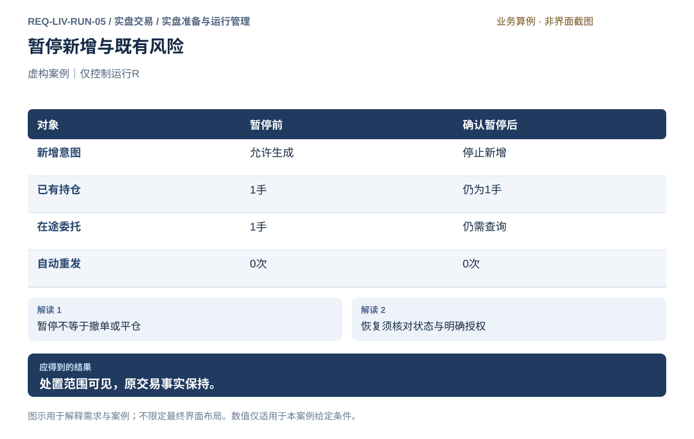

### 可观察验收条件

| 编号                | 给定                                       | 当                         | 则                                                                          |
| ------------------- | ------------------------------------------ | -------------------------- | --------------------------------------------------------------------------- |
| REQ-LIV-RUN-05-AC01 | 运行重启且有结果未明委托                   | 恢复调查或用户确认暂停新增 | 原请求及风险占用保留，自动重发为0；查询和独立安全撤单保持可用，未自动平仓。 |
| REQ-LIV-RUN-05-AC02 | 修订影响因子、策略、组合目标或实际执行行为 | 准备恢复实盘               | 重新验证受影响范围并核对明确授权，旧授权不能自动覆盖新行为。                |
| REQ-LIV-RUN-05-AC03 | 仅暂停选中运行。                           | 查询当前订单和持仓。       | 1手在途和1手持仓仍保留，未自动撤单或平仓。                                  |

### 决定与配置约束

- **DEC-LIV-RUN-05-01**：**规格决定**。执行归属冲突、未知委托、状态/时点不一致和关键写入失败进入限制与核对；查询保留，恢复须排除原因、核实在途及政策，再显式批准，不自动接管。

### 详细功能

### FR-LIV-RUN-05-01 关联信号目标、订单成交与策略归属

**目标与结果：** 使用者从某次量化目标查到真正作用于账户的成交及持仓，组合合计与策略分项不能重复计算风险和收益。

**触发：** 在调查表选择一次信号、组合目标或已关联订单。

**输入与约束：** 运行、策略、组合、目标与订单成交身份，明确分配规则及实际持仓；同价同量不能代替可靠关联。

**目标操作与反馈：**

1. 沿信号、目标、获准量、委托、成交逐层展开事实。
2. 查看每笔成交归属及组合汇总，未分配项保持可辨认。
3. 重启后先核对已处理事件和未明订单，再判断当前运行状态。

**异常与边界：**

- 同一成交和费用不同时完整计入策略与组合后再次相加。
- 结果不明或关联不足时保留占用，绝不自动重发、补单或重复消费已处理信号。

**验收条件：**

- **FR-LIV-RUN-05-01-AC01**：案例1手真实成交只归甲一次，乙实际0手，组合合计1手。
- **FR-LIV-RUN-05-01-AC02**：重启核对中自动重发保持0，未知订单不会被重算成新委托。

**界面对应：** [UI-LIV-RUN-05 运行核对、处置与恢复审查](#ui-liv-run-05)；[UI-LIV-EXE-02 委托、成交与撤单](execution.md#ui-liv-exe-02)；[UI-LIV-ACC-01 账户资金与持仓](accounts.md#ui-liv-acc-01)；[UI-LIV-EXE-03 断线与未知结果核对](execution.md#ui-liv-exe-03)。

### FR-LIV-RUN-05-02 限定受影响量化运行并确认暂停新增

**目标与结果：** 使用者在调查过程中控制新的量化交易意图，同时知道已有订单和持仓仍有风险；不把调查操作变成批量撤单或平仓。

**触发：** 调查页选择受影响策略或组合运行并请求暂停新增。

**输入与约束：** 明确账户、运行、组合和策略范围，以及新增意图与尚未发送意图的处理；不默认扩展到整个账户。

**目标操作与反馈：**

1. 展示所选范围、仍在途订单和已有持仓。
2. 独立确认暂停该范围的新生成及尚未发送意图，等待明确结果。
3. 继续查询；如需撤单或平仓，分别进入已有订单和持仓流程另行确认。

**异常与边界：**

- 暂停确认未知时标待核对，不能宣称已停；不自动重发任何交易。
- 风险暂停不无理由禁安全查询与独立撤单；平仓仍须完整授权与统一风险检查。

**验收条件：**

- **FR-LIV-RUN-05-02-AC01**：确认仅暂停所选运行，其他未选组合不会被静默改变。
- **FR-LIV-RUN-05-02-AC02**：案例1手在途不会自动撤销，1手持仓不会自动平仓，查询仍可用。

**界面对应：** [UI-LIV-RUN-05 运行核对、处置与恢复审查](#ui-liv-run-05)；[UI-LIV-RUN-04 实盘准备、授权与策略运行](#ui-liv-run-04)；[UI-LIV-EXE-02 委托、成交与撤单](execution.md#ui-liv-exe-02)；[UI-LIV-ACC-01 账户资金与持仓](accounts.md#ui-liv-acc-01)。

### FR-LIV-RUN-05-03 保留调查依据并重新验证修订范围

**目标与结果：** 使用者依据调查创建明确修订，重新验证其影响并审查实盘权限，避免调整假设后悄悄改变运行内容。

**触发：** 完成调查预览后选择逻辑、因子或组合修订及验证交接。

**输入与约束：** 原定义身份、调查证据、拟修改内容、受影响场景及现有授权；执行费用假设变更与真实交易行为变更要区分。

**目标操作与反馈：**

1. 保留原运行与归因结论，选择明确修订目标。
2. 在定义或组合页形成独立草稿，列出受影响验证范围。
3. 重新验证后核对授权；涉及实际交易行为的变更须独立确认，恢复另行决定。

**异常与边界：**

- 修订草稿不修改正在运行的定义，也不覆盖历史归因。
- 仅说明文案变化不能假称交易行为改变；反之关键参数变化不能沿用旧实盘授权。

**验收条件：**

- **FR-LIV-RUN-05-03-AC01**：从调查可定位修订前后内容与验证依据，原记录仍可查询。
- **FR-LIV-RUN-05-03-AC02**：恢复前明确验证和授权结论，不自动重放暂停期间的旧意图。

**界面对应：** [UI-LIV-RUN-05 运行核对、处置与恢复审查](#ui-liv-run-05)；[UI-STR-LOG-01 策略规则、混合决策与逻辑试算](../strategy/logic.md#ui-str-log-01)；[UI-STR-PRT-01 组合构建、资金与调仓](../strategy/portfolio.md#ui-str-prt-01)；[UI-LIV-RUN-04 实盘准备、授权与策略运行](#ui-liv-run-04)。

### FR-LIV-RUN-05-04 按明确条件继续次日运行

**来源与确认：** 2026-10-18全面审查及用户授权补充；详细行为草案待评审，未实现、未执行产品验收。

**目标与结果：** 正常跨日与进程重启分开处理，继续运行只处理新的有效决策。

**触发：** 日切核对完成、授权或规则变化后申请继续。

**输入与约束：** 原实例、固定策略、账户日切结果、当前授权/风险、策略状态及已处理事件。

**目标操作与反馈：**

1. 运行准备记录声明是否允许同一实例正常跨日持续；未明确时进入暂停待确认。
2. 日切期间按账户事实可用性限制新增，完成当前规则和策略状态检查；符合已授权持续条件才处理后续新事件，否则等待独立确认。
3. 进程重启、执行位置改变、授权失效或必要状态丢失时转恢复审查；不沿用正常跨日通过结论。

**异常与边界：**

- 暂停期旧信号不排队补发；恢复应重新依据当前有效输入作新决策。
- 本日风险基准只能按事前政策更新，不能为了通过检查重设。

**操作案例：** 允许连续运行的策略日切遇到未明成交而暂停；核对完成后确认继续，只处理当前新事件，不补发暂停期间3个买入信号。

**验收条件：**

- **FR-LIV-RUN-05-04-AC01**：正常跨日若新费率缺失则持续运行条件不满足；补齐核对后才可按约定继续。
- **FR-LIV-RUN-05-04-AC02**：重启后即使日期和策略相同也不会自行恢复发送，需完成恢复与授权检查。

**界面对应：** [UI-LIV-RUN-05](#ui-liv-run-05)；[UI-LIV-RUN-04](#ui-liv-run-04)。

## REQ-LIV-RUN-06 识别风险阈值并暂停新增风险

**领域：** 实盘交易 / 实盘准备与运行管理　 **建议优先级：** P0安全必要　 **需求状态：** 交付规格已编制（源自已确认定位；细节待用户签认）

### 目标与场景

使用者能够得知风险接近或达到限制，并理解哪些行为受约束。达到停止条件时应暂停新增风险，避免只告警却继续扩大敞口。

**使用者与场景：** 个人账户管理者及正在运行自动策略的使用者，在持续交易和持仓期间。

**触发条件：** 有效账户数据使风险指标达到预警或暂停阈值，或者使用者主动暂停新增风险。

### 前置条件

- 风险指标、计算基准、阈值及受控行为已明确并生效。
- 指标所需信息可用，风险状态可关联到明确账户及时间。

### 输入与含义

| 输入           | 含义与单位                         | 约束                                               |
| -------------- | ---------------------------------- | -------------------------------------------------- |
| 风险指标与阈值 | 例如按明确基准计算的亏损或风险占用 | 区分预警与强制暂停；百分比有明确分母与时间范围。   |
| 恢复决定       | 重新允许新增风险的条件与使用者授权 | 风险数值回落不自动等于恢复；恢复条件必须事先明确。 |

### 正常操作与反馈

1. 系统依生效规则持续评估可确认的风险指标。
2. 达到预警条件时，说明当前值、阈值与影响范围。
3. 达到暂停条件时，阻止受控的新风险请求并说明原因。
4. 使用者检查已有持仓、在途订单和告警依据，决定后续操作。
5. 只有满足明确恢复条件并完成所需确认后，才重新开放受控行为。

### 业务规则

- 预警与暂停具有不同后果，必须使使用者可以区分。
- 暂停新增风险不能被解释为既有订单全部撤销或持仓已经清零。
- 降低风险操作是否允许取决于明确规则及可验证的交易意图，不能仅凭操作名称放行。
- 重要风险输入失效时应说明无法确认风险，不得假装指标已恢复正常。
- 暂停状态必须跨各交易入口一致生效，手动与自动请求不能相互绕过。

### 输出与状态影响

- 可解释的风险指标、预警或暂停状态及触发原因。
- 受影响交易的明确拒绝结果，以及恢复所需条件。

### 异常与继续方式

| 发生什么                     | 应怎样表现                                                           | 使用者如何继续                             |
| ---------------------------- | -------------------------------------------------------------------- | ------------------------------------------ |
| 已暂停账户的风险值暂时回落。 | 按既定恢复规则保持或解除暂停，不因单次回落偷偷恢复交易。             | 使用者核对风险状态并完成必要恢复确认。     |
| 暂停期间已有订单继续成交。   | 更新持仓与风险，明确成交来自此前在途订单，不声称暂停消除了原有风险。 | 使用者核对并按独立授权处理剩余订单或持仓。 |

### 案例：预警、暂停和回落后的状态

**虚构案例条件：** 虚构案例：以期初权益 100000 元为固定基准，忽略资金进出；损失达到 2% 预警、3% 暂停新增风险，恢复需人工确认。上述阈值仅为案例假设，不是推荐参数。

1. 权益下降到 98000 元，损失 2000 元，即 2%，触发预警。
2. 权益下降到 97000 元，损失 3000 元，即 3%，暂停新增风险。
3. 权益回升至 97500 元，损失 2500 元，即 2.5%，尚未完成人工恢复确认。

**预期结果：**

- 达到 3% 后，新增加风险的请求被拒绝。
- 回升至 2.5% 时仍保持暂停，既有持仓和在途订单单独呈现。

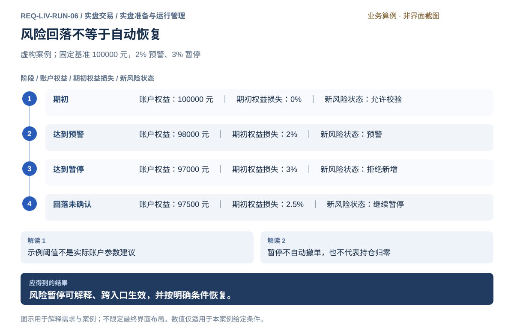

### 可观察验收条件

| 编号                | 给定                                | 当                            | 则                                           |
| ------------------- | ----------------------------------- | ----------------------------- | -------------------------------------------- |
| REQ-LIV-RUN-06-AC01 | 案例期初权益 100000 元且预警线为 2% | 权益为 98000 元               | 显示损失 2000 元和 2% 预警，触发依据可辨认。 |
| REQ-LIV-RUN-06-AC02 | 暂停线为 3%                         | 权益为 97000 元并尝试新增风险 | 新请求被拒绝，风险暂停不等同于自动平仓。     |
| REQ-LIV-RUN-06-AC03 | 已触发暂停且恢复需人工确认          | 权益回升至 97500 元但尚未确认 | 保持暂停，不自动恢复手动或策略新增风险。     |

### 决定与配置约束

- **DEC-LIV-RUN-06-01**：**运行配置**。损失/回撤、潜在持仓或敞口、保证金/可用资金、价格偏离、输入有效期及恢复条件由账户政策必填；无可交易默认阈值。既有订单不因暂停自动撤销，撤单按独立动作。

### 详细功能

### FR-LIV-RUN-06-01 观察风险指标和阈值距离

**目标与结果：** 使用者知道当前风险如何计算、距离哪一道限制还有多少，避免没有分母的百分比产生误导。

**触发：** 进入实盘运行限制详情或从账户指标展开详情。

**输入与约束：** 有效权益或敞口、基准、期间、预警及暂停阈值；现金进出与跨夜口径需明确，未确认不能套用案例。

**目标操作与反馈：**

1. 查看指标当前值、基准和更新时间。
2. 展开计算组成，核对资金变化是否计入。
3. 查看距离预警与暂停线的差值及适用动作。

**异常与边界：**

- 输入过期时指标变为无法确认，而不是自动回到正常。
- 不同基准的亏损和回撤不能混用同一百分比标签。

**验收条件：**

- **FR-LIV-RUN-06-01-AC01**：期初100000、权益98000的案例明确为期初损失2%，不是无说明回撤。
- **FR-LIV-RUN-06-01-AC02**：金额、百分比分母和指标时间可同时核对。

**界面对应：** [UI-LIV-RUN-05 运行核对、处置与恢复审查](#ui-liv-run-05)；[UI-LIV-ACC-01 账户资金与持仓](accounts.md#ui-liv-acc-01)。

### FR-LIV-RUN-06-02 识别告警并检查触发依据

**目标与结果：** 使用者区分提示风险和强制限制，读完告警并不等于关闭风险检查。

**触发：** 有效指标达到预警条件或使用者查看告警记录。

**输入与约束：** 指标、触发值、阈值、账户和触发时间；同一事件的已读状态只影响阅读，不改变交易资格。

**目标操作与反馈：**

1. 展示新告警及具体账户、当前值和阈值。
2. 打开详情查看触发数据和当前风险状态。
3. 标记已读或进入账户处理，后续风险变化仍独立判断。

**异常与边界：**

- 重复更新不把同一未变化事件伪装成多次独立风险。
- 告警数据失效后要说明当前风险未确认，不能仅保留旧正常结论。
- 实盘先独立执行必要阻断；通知未送达、已读或静音不改变风险限制，解除由实盘按恢复条件确认。

**验收条件：**

- **FR-LIV-RUN-06-02-AC01**：达到2%预警时说明2000元损失和100000元基准。
- **FR-LIV-RUN-06-02-AC02**：标记已读不会解除3%触发的暂停，也不会恢复策略发单。
- **FR-LIV-RUN-06-02-AC03**：桌面通知不可用时，达到3%的新增风险仍被拒绝，应用内记录及账户状态可查。

**界面对应：** [UI-LIV-RUN-05 运行核对、处置与恢复审查](#ui-liv-run-05)；[UI-LIV-RUN-04 实盘准备、授权与策略运行](#ui-liv-run-04)；[UI-COM-UX-02 通知中心](../../common/interaction.md#ui-com-ux-02)。

### FR-LIV-RUN-06-03 暂停新增风险并保留安全处置入口

**目标与结果：** 达到暂停条件后阻止新增风险，同时让使用者继续查清账户并按明确权限撤销在途订单。

**触发：** 风险规则触发暂停或使用者主动暂停新增风险。

**输入与约束：** 目标账户、暂停范围、触发原因及已有订单；查询、撤单与新增委托分别判断权限和安全前提。

**目标操作与反馈：**

1. 显示暂停原因及手动和策略受影响范围。
2. 拦截新的增加风险请求，保留其明确拒绝原因。
3. 列出仍有风险的订单与持仓，提供查询和独立确认撤单入口。

**异常与边界：**

- 暂停不自动平仓，也不把尚未撤销的订单隐藏。
- 不能以暂停状态一概禁止安全查询和独立合规撤单；风险能力缺失也不能默许新的减仓委托绕过检查。

**验收条件：**

- **FR-LIV-RUN-06-03-AC01**：案例权益97000达到3%后新风险请求被拒绝。
- **FR-LIV-RUN-06-03-AC02**：已授权可安全执行的查询和撤单仍可进入，撤单有单独确认和结果。

**界面对应：** [UI-LIV-RUN-05 运行核对、处置与恢复审查](#ui-liv-run-05)；[UI-LIV-EXE-02 委托、成交与撤单](execution.md#ui-liv-exe-02)；[UI-LIV-ACC-01 账户资金与持仓](accounts.md#ui-liv-acc-01)。

### FR-LIV-RUN-06-04 核对恢复条件并明确恢复授权

**目标与结果：** 使用者在风险回落后重新审查条件，避免行情短暂波动使暂停自动消失。

**触发：** 实盘账户风险设置选择检查恢复条件并请求恢复新增风险。

**输入与约束：** 有效账户状态、恢复规则、原暂停原因及所需授权；正式规则未确定前不能假定自动恢复。

**目标操作与反馈：**

1. 查看暂停原因和当前指标，核对所有恢复条件。
2. 条件满足时显示恢复范围及尚在处理的订单。
3. 明确确认恢复后才允许新意图继续校验，保留恢复依据。

**异常与边界：**

- 指标回落但人工确认未完成时保持暂停。
- 恢复授权不会重放此前拒绝、排队或结果不明的请求。

**验收条件：**

- **FR-LIV-RUN-06-04-AC01**：案例权益由97000回到97500且未确认时仍暂停。
- **FR-LIV-RUN-06-04-AC02**：确认恢复后只影响后续独立意图，历史拒绝记录和在途订单不被改写。

**界面对应：** [UI-LIV-RUN-05 运行核对、处置与恢复审查](#ui-liv-run-05)；[UI-LIV-RUN-04 实盘准备、授权与策略运行](#ui-liv-run-04)；[UI-LIV-EXE-01 手动下单工作台](execution.md#ui-liv-exe-01)。

## 界面设计与实际对应

## UI-LIV-RUN-01 账户连接与交易授权

**业务目标：** 明确连接哪个账户、处于模拟还是实盘环境，并分别管理行情访问、查询和交易授权，保留可安全执行的查询及撤单入口。

**对应情况：源码已核对，运行待验证。** 账户登记在设置；连接、环境核对和发送授权在交易工作区所选账户内。

**实际入口：** 主导航 → 交易（⌘6）；设置 → CTP 账户

[查看实际界面及对应说明](../../prototype.html#UI-LIV-RUN-01)

- [CTP 交易：截图、字段和操作](../../common/screens.md#screen-trading)
- [CTP 账户：截图、字段和操作](../../common/screens.md#screen-settings-ctp)

### 页面形态与目标布局

**设计状态：** 目标规格已编制，含布局、字段、动作和关键状态；尚未获得逐项产品签认或实现验收。现状对应证据保持上文说明，图稿不是运行截图。

**界面形态：** 分步表单或账户操作区。

**目标到达路径：** 实盘 → 准备与运行 → 账户连接与交易授权。这是已确认导航下的目标入口，实际对应仍见上方证据。

| 区域 | 要显示的内容 |
| --- | --- |
| 顶部上下文 | 账户身份 / 环境 / 当前步骤 |
| 列表、分类或步骤区 | 账户列表 / 各自状态 |
| 主要工作区 | 核对环境 → 连接 → 授权 |
| 选中项详情或检查区 | 开市检查 / 结算及风险缺项 |
| 主要动作区 | 核对账户 / 独立授权 |

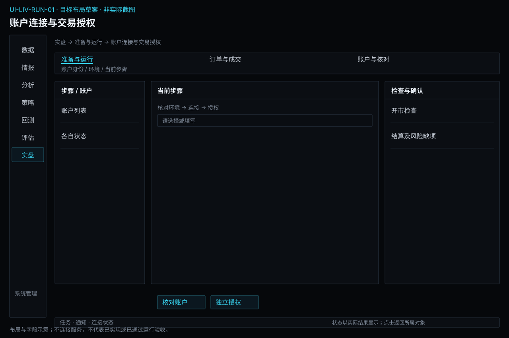

**区域联动与返回：** 选择列表或步骤只更新当前对象及详情，不隐式启动业务；图表与明细使用同一输入或结果上下文。离开并返回保留已确认的对象和查询条件，未保存草稿按本页保存语义处理。异步提交后用请求/任务身份定位实际状态，不能把操作按钮点击当作成功。

**窗口与空间：** 复用现有主窗口框架。宽度缩小时优先收拢辅助详情，表格在内容区横向滚动；主操作和关键上下文不能被页面裁切。重新展开详情仍指向原选中对象。

**状态设计范围：** 以本页状态/异常和验收为准，正常操作、首次无对象、筛选无匹配、请求中、失败及该业务的未知状态分别说明；不适用状态需说明原因，不套用虚构成功数据。字段类型、默认值和动作前提见下文；关键状态按本页交付约定及模块状态图检查。[返回界面设计总览](../../common/ui-designs.md)。

### 目标交互设计（待实现）

以下为目标交互规格，沿用当前Terminal样式、语言、表格和详情规范。原实际截图不改绘；完整字段和动作需实现后验收。

**字段与信息：**

- 机构、稳定账户身份、实盘/仿真、连接目标。
- 行情、查询、交易身份、授权范围与必要风险分别显示。

**动作与反馈：**

- 连接目标账户并核对环境。
- 独立授予或撤回明确范围授权，查看实际结果。

**状态与异常：**

- 行情可用不等于交易可用。
- 未授权、授权失效、风险不可用和连接异常分开显示。

### 业务验收要求（待验收，不代表截图已证明实现）

- **UI-LIV-RUN-01-AC01**：行情成功而交易未授权时，两项状态分别显示，交易明确被拒绝。
- **UI-LIV-RUN-01-AC02**：从账户A切到B后A的授权不会沿用，原交易草稿须重新确认。
- **UI-LIV-RUN-01-AC03**：撤权显示在途和持仓影响，查询及独立合规撤单不因统一遮罩被无理由禁用。
- **UI-LIV-RUN-01-AC04**：账户与实际环境持续可见；切换环境不继承授权、重定向订单或自动启动。

### 字段与操作交付约定

以下补齐页面关键字段的类型、初始值与边界；已有功能条目的输入规则仍适用。进入已有对象时加载实际保存值，新建时未明确给默认的必填项为空，不能借用案例数值。只读缺失统一显示“—”并提供原因。

| 字段组 | 类型与单位 | 初始值、检查及变化影响 |
| --- | --- | --- |
| 账户与环境 | 账户身份、仿真/实盘、节点 | 新建不预选真实账户；醒目显示环境 |
| 连接与准备 | 认证/查询/结算/规则状态 | 分项显示，连接正常不等于可交易 |
| 授权范围 | 用途、政策、明确授权动作 | 风险配置缺失拒绝；撤销不等于撤单或平仓 |

**操作顺序：** 使用“核对账户 / 独立授权”完成本页任务；先选择固定对象并补齐必填项，再检查范围和影响，最后提交有副作用的动作。查看、筛选和返回不隐式执行业务；保存、发布、启动、授权和撤单各自显示实际结果，不能合并为一个成功提示。所有发送及运行控制仍在执行边界重新核对账户、模式、授权、有效风险和执行归属；列表上的可用按钮不是授权证明。

| 关键状态 | 信息与允许操作 | 禁止或返回行为 |
| --- | --- | --- |
| 首次为空或无匹配 | 显示当前账户与环境范围，提供创建/补齐或清除筛选入口；只读详情说明来源 | 不填示例数据，不把无权限显示为无记录 |
| 输入错误或前提缺失 | 在“连接与准备”等具体字段旁说明问题，保留其他输入，焦点移至首个错误 | 依赖错误项的动作不可提交，返回不丢草稿 |
| 加载、运行或部分结果 | 保留对象身份和最后可靠时间，展示实际阶段/覆盖；可查看“授权范围”已有证据 | 未完成不能显示全量成功，不能用加载中的空表覆盖已知事实 |
| 失败或结果未知 | 已明确失败可修正输入后独立提交；可能已受理则查询原请求/对象；展示未决范围 | 未核实前不重复有副作用的操作，不把取消页面当取消业务 |
| 离开及返回 | 已保存对象可由原身份重开，未保存编辑提供保存/放弃/留在当前页；关闭抽屉只改变展示 | 即时偏好不套草稿确认；秘密取消后不留普通表单缓存 |

**交互验收案例：** 在本页选择一个有效对象，改变“账户与环境”后核对旧预览是否失效；制造“连接与准备”缺项或不可用，确认原因与阻断；补齐后完成主要动作，核对“授权范围”与关联对象结果，再离开返回。只读字段通过隔离测试回复制造状态，不在实际界面篡改业务事实。适用的具体成功结果仍以本页原有案例及AC为准。

关键状态的视觉呈现见[状态设计约定](../../common/ui-designs.md#state-designs)及本模块状态图；状态与动作按本表及关联FR逐项验收，静态图不冒充已执行交互。

### 对应功能需求

- [FR-COM-SEC-01-01 按用途填写凭据并核对权限](../../common/security.md#fr-com-sec-01-01)
- [FR-COM-SEC-01-03 移除保存项并区分本地与外部授权](../../common/security.md#fr-com-sec-01-03)
- [FR-SYS-SET-01-03 按研究与交易分别完成准备清单](../system/setup.md#fr-sys-set-01-03)
- [FR-SYS-RUN-02-04 明确停止指定位置的工作并核对影响](../system/tasks-nodes.md#fr-sys-run-02-04)
- [FR-SYS-REC-01-05 恢复后核对资料并重新准备业务](../system/records.md#fr-sys-rec-01-05)
- [FR-SYS-REC-02-02 按对象与时间检索关键操作记录](../system/records.md#fr-sys-rec-02-02)
- [FR-SYS-REC-02-03 把操作意图和确认结果排成可核对时间线](../system/records.md#fr-sys-rec-02-03)
- [FR-LIV-RUN-01-01 选择账户并辨认交易环境](#fr-liv-run-01-01)
- [FR-LIV-RUN-01-02 分别建立行情与交易授权](#fr-liv-run-01-02)
- [FR-LIV-RUN-01-03 审查交易授权范围与有效性](#fr-liv-run-01-03)
- [FR-LIV-RUN-01-04 撤回授权并核对连接变化](#fr-liv-run-01-04)
- [FR-LIV-RUN-01-05 完成开市前账户与运行准备检查](#fr-liv-run-01-05)
- [FR-LIV-RUN-02-09 管理行情订阅与连接范围](#fr-liv-run-02-09)
- [FR-LIV-RUN-03-03 限定账户与范围授予实盘权限](#fr-liv-run-03-03)
- [FR-LIV-ACC-03-01 为目标账户定义风险约束草稿](accounts.md#fr-liv-acc-03-01)
- [FR-STR-PRT-01-05 核对聚合风险与保证金压力](../strategy/portfolio.md#fr-str-prt-01-05)
- [FR-STR-DLV-01-03 分别完成风险与实盘授权准备](../strategy/delivery.md#fr-str-dlv-01-03)

## UI-LIV-RUN-02 行情总览与自选

**业务目标：** 按分类观察期货报价并维护个人关注集合；直接辨认来源、缺失和时效，进入目标合约后继续分析或准备交易。

**对应情况：部分对应。** 当前行情观察分为自选和市场，截图保留实际主导航；实时有效数据状态尚未验证。

**实际入口：** 主导航 → 自选（⌘1）；主导航 → 市场（⌘3）

[查看实际界面及对应说明](../../prototype.html#UI-LIV-RUN-02)

- [自选：截图、字段和操作](../../common/screens.md#screen-watchlist)
- [市场：截图、字段和操作](../../common/screens.md#screen-market)

### 页面形态与目标布局

**设计状态：** 目标规格已编制，含布局、字段、动作和关键状态；尚未获得逐项产品签认或实现验收。现状对应证据保持上文说明，图稿不是运行截图。

**界面形态：** 行情工作区。

**目标到达路径：** 实盘 → 准备与运行 → 行情总览与自选。这是已确认导航下的目标入口，实际对应仍见上方证据。

| 区域 | 要显示的内容 |
| --- | --- |
| 顶部上下文 | 分类 / 来源 / 更新时间 |
| 列表、分类或步骤区 | 分类行情 / 自选列表 |
| 主要工作区 | 主图 / 辅图 / 周期切换 |
| 选中项详情或检查区 | 报价状态 / 真实合约入口 |
| 主要动作区 | 维护自选 / 查看合约 |

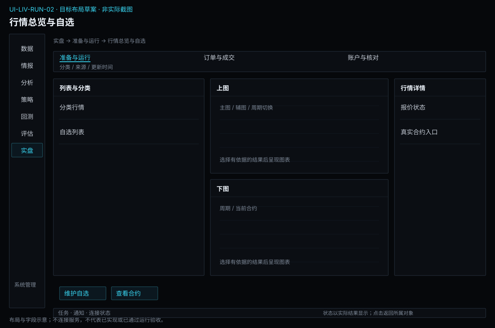

**区域联动与返回：** 选择列表或步骤只更新当前对象及详情，不隐式启动业务；图表与明细使用同一输入或结果上下文。离开并返回保留已确认的对象和查询条件，未保存草稿按本页保存语义处理。异步提交后用请求/任务身份定位实际状态，不能把操作按钮点击当作成功。

**窗口与空间：** 复用现有主窗口框架。宽度缩小时优先收拢辅助详情，表格在内容区横向滚动；主操作和关键上下文不能被页面裁切。重新展开详情仍指向原选中对象。

**状态设计范围：** 以本页状态/异常和验收为准，正常操作、首次无对象、筛选无匹配、请求中、失败及该业务的未知状态分别说明；不适用状态需说明原因，不套用虚构成功数据。字段类型、默认值和动作前提见下文；关键状态按本页交付约定及模块状态图检查。[返回界面设计总览](../../common/ui-designs.md)。

### 目标交互设计（待实现）

以下为目标交互规格，沿用当前Terminal样式、语言、表格和详情规范。原实际截图不改绘；完整字段和动作需实现后验收。

**字段与信息：**

- 真实合约、行情来源、价格量、更新时间、自选分组。

**动作与反馈：**

- 排序筛选、维护自选、打开合约详情。

**状态与异常：**

- 无数据、有效零、延迟或断流明确区分；不要求交易授权才能看行情。

### 业务验收要求（待验收，不代表截图已证明实现）

- **UI-LIV-RUN-02-AC01**：分类无匹配、自选为空和来源失败具有不同提示，已有关注不会被清空。
- **UI-LIV-RUN-02-AC02**：报价缺失不填零，3秒年龄超过案例2秒阈值时明确显示过期。
- **UI-LIV-RUN-02-AC03**：添加同一合约两次只有一行，移除关注不会触发撤单和平仓。

### 字段与操作交付约定

以下补齐页面关键字段的类型、初始值与边界；已有功能条目的输入规则仍适用。进入已有对象时加载实际保存值，新建时未明确给默认的必填项为空，不能借用案例数值。只读缺失统一显示“—”并提供原因。

| 字段组 | 类型与单位 | 初始值、检查及变化影响 |
| --- | --- | --- |
| 行情范围 | 市场/品种/自选、来源 | 仅有权限合约，缺资料显示代码 |
| 报价与时效 | 价格、涨跌、量、原始/接收时间 | 未知显示—，旧值保留时间并标陈旧 |
| 观察操作 | 加入自选、打开真实合约 | 观察不要求账户授权，不触发下载/下单 |

**操作顺序：** 使用“维护自选 / 查看合约”完成本页任务；先选择固定对象并补齐必填项，再检查范围和影响，最后提交有副作用的动作。查看、筛选和返回不隐式执行业务；保存、发布、启动、授权和撤单各自显示实际结果，不能合并为一个成功提示。所有发送及运行控制仍在执行边界重新核对账户、模式、授权、有效风险和执行归属；列表上的可用按钮不是授权证明。

| 关键状态 | 信息与允许操作 | 禁止或返回行为 |
| --- | --- | --- |
| 首次为空或无匹配 | 显示当前行情范围范围，提供创建/补齐或清除筛选入口；只读详情说明来源 | 不填示例数据，不把无权限显示为无记录 |
| 输入错误或前提缺失 | 在“报价与时效”等具体字段旁说明问题，保留其他输入，焦点移至首个错误 | 依赖错误项的动作不可提交，返回不丢草稿 |
| 加载、运行或部分结果 | 保留对象身份和最后可靠时间，展示实际阶段/覆盖；可查看“观察操作”已有证据 | 未完成不能显示全量成功，不能用加载中的空表覆盖已知事实 |
| 失败或结果未知 | 已明确失败可修正输入后独立提交；可能已受理则查询原请求/对象；展示未决范围 | 未核实前不重复有副作用的操作，不把取消页面当取消业务 |
| 离开及返回 | 已保存对象可由原身份重开，未保存编辑提供保存/放弃/留在当前页；关闭抽屉只改变展示 | 即时偏好不套草稿确认；秘密取消后不留普通表单缓存 |

**交互验收案例：** 在本页选择一个有效对象，改变“行情范围”后核对旧预览是否失效；制造“报价与时效”缺项或不可用，确认原因与阻断；补齐后完成主要动作，核对“观察操作”与关联对象结果，再离开返回。只读字段通过隔离测试回复制造状态，不在实际界面篡改业务事实。适用的具体成功结果仍以本页原有案例及AC为准。

关键状态的视觉呈现见[状态设计约定](../../common/ui-designs.md#state-designs)及本模块状态图；状态与动作按本表及关联FR逐项验收，静态图不冒充已执行交互。

### 对应功能需求

- [FR-COM-REL-01-01 并行研究期间保持关键交互响应](../../common/reliability.md#fr-com-rel-01-01)
- [FR-COM-REL-01-02 呈现行情时效而不掩盖上游延迟](../../common/reliability.md#fr-com-rel-01-02)
- [FR-COM-REL-01-04 中断后保留已保存资料并核对原工作](../../common/reliability.md#fr-com-rel-01-04)
- [FR-SYS-SET-01-04 完成准备后进入明确的工作入口](../system/setup.md#fr-sys-set-01-04)
- [FR-LIV-RUN-02-01 浏览分类报价并排序筛选](#fr-liv-run-02-01)
- [FR-LIV-RUN-02-02 维护自选集合与关注顺序](#fr-liv-run-02-02)
- [FR-LIV-RUN-02-09 管理行情订阅与连接范围](#fr-liv-run-02-09)
- [FR-LIV-RUN-02-10 识别延迟断流与数据恢复](#fr-liv-run-02-10)

## UI-LIV-RUN-03 合约图表、盘口与成交

**业务目标：** 围绕一个明确合约观察分时与K线、盘口及成交，并将观察结果转成独立待确认委托草稿。

**对应情况：部分对应。** 图表、盘口和成交在合约工作区；本轮无行情，未验证选中合约后的明细。

**实际入口：** 主导航 → 合约（⌘2）

[查看实际界面及对应说明](../../prototype.html#UI-LIV-RUN-03)

- [合约：截图、字段和操作](../../common/screens.md#screen-contract)

### 页面形态与目标布局

**设计状态：** 目标规格已编制，含布局、字段、动作和关键状态；尚未获得逐项产品签认或实现验收。现状对应证据保持上文说明，图稿不是运行截图。

**界面形态：** 行情工作区。

**目标到达路径：** 实盘 → 准备与运行 → 合约图表、盘口与成交。这是已确认导航下的目标入口，实际对应仍见上方证据。

| 区域 | 要显示的内容 |
| --- | --- |
| 顶部上下文 | 合约身份 / 来源 / 时效 |
| 列表、分类或步骤区 | 自选 / 同品种相关合约 |
| 主要工作区 | 价格图表 / 周期 / 指标 |
| 选中项详情或检查区 | 报价 / 五档 / 成交明细 |
| 主要动作区 | 切换合约 / 转交易准备 |

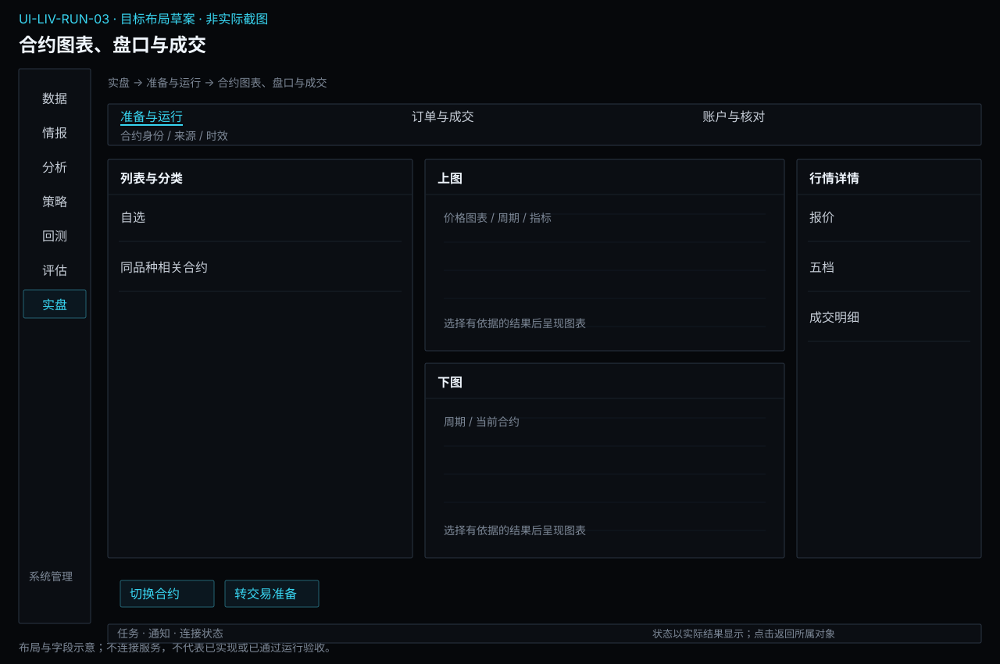

**区域联动与返回：** 选择列表或步骤只更新当前对象及详情，不隐式启动业务；图表与明细使用同一输入或结果上下文。离开并返回保留已确认的对象和查询条件，未保存草稿按本页保存语义处理。异步提交后用请求/任务身份定位实际状态，不能把操作按钮点击当作成功。

**窗口与空间：** 复用现有主窗口框架。宽度缩小时优先收拢辅助详情，表格在内容区横向滚动；主操作和关键上下文不能被页面裁切。重新展开详情仍指向原选中对象。

**状态设计范围：** 以本页状态/异常和验收为准，正常操作、首次无对象、筛选无匹配、请求中、失败及该业务的未知状态分别说明；不适用状态需说明原因，不套用虚构成功数据。字段类型、默认值和动作前提见下文；关键状态按本页交付约定及模块状态图检查。[返回界面设计总览](../../common/ui-designs.md)。

### 目标交互设计（待实现）

以下为目标交互规格，沿用当前Terminal样式、语言、表格和详情规范。原实际截图不改绘；完整字段和动作需实现后验收。

**字段与信息：**

- 合约、周期、交易时段、盘口、成交和数据精度。

**动作与反馈：**

- 切换周期、十字线、缩放平移并保持合约上下文。

**状态与异常：**

- 未结束K线和缺口标明；缺盘口不制造买卖档。

### 业务验收要求（待验收，不代表截图已证明实现）

- **UI-LIV-RUN-03-AC01**：切换周期后合约与周期标识一致，旧响应不会覆盖最后选择。
- **UI-LIV-RUN-03-AC02**：十字线、K线明细与开高低收数据一致，缺失区间有可见标记。
- **UI-LIV-RUN-03-AC03**：盘口价点击只创建草稿；数据不提供深度时没有虚构档位。

### 字段与操作交付约定

以下补齐页面关键字段的类型、初始值与边界；已有功能条目的输入规则仍适用。进入已有对象时加载实际保存值，新建时未明确给默认的必填项为空，不能借用案例数值。只读缺失统一显示“—”并提供原因。

| 字段组 | 类型与单位 | 初始值、检查及变化影响 |
| --- | --- | --- |
| 合约与图表 | 真实合约、周期、指标 | 来源不支持的周期禁用且解释 |
| 盘口与成交 | 来源实际档位、价格数量时间 | 缺档不补造，无历史不画虚构走势 |
| 快捷跳转 | 资料/行情来源/手动委托 | 跳下单仅带合约，必须重新选择账户并检查权限 |

**操作顺序：** 使用“切换合约 / 转交易准备”完成本页任务；先选择固定对象并补齐必填项，再检查范围和影响，最后提交有副作用的动作。查看、筛选和返回不隐式执行业务；保存、发布、启动、授权和撤单各自显示实际结果，不能合并为一个成功提示。所有发送及运行控制仍在执行边界重新核对账户、模式、授权、有效风险和执行归属；列表上的可用按钮不是授权证明。

| 关键状态 | 信息与允许操作 | 禁止或返回行为 |
| --- | --- | --- |
| 首次为空或无匹配 | 显示当前合约与图表范围，提供创建/补齐或清除筛选入口；只读详情说明来源 | 不填示例数据，不把无权限显示为无记录 |
| 输入错误或前提缺失 | 在“盘口与成交”等具体字段旁说明问题，保留其他输入，焦点移至首个错误 | 依赖错误项的动作不可提交，返回不丢草稿 |
| 加载、运行或部分结果 | 保留对象身份和最后可靠时间，展示实际阶段/覆盖；可查看“快捷跳转”已有证据 | 未完成不能显示全量成功，不能用加载中的空表覆盖已知事实 |
| 失败或结果未知 | 已明确失败可修正输入后独立提交；可能已受理则查询原请求/对象；展示未决范围 | 未核实前不重复有副作用的操作，不把取消页面当取消业务 |
| 离开及返回 | 已保存对象可由原身份重开，未保存编辑提供保存/放弃/留在当前页；关闭抽屉只改变展示 | 即时偏好不套草稿确认；秘密取消后不留普通表单缓存 |

**交互验收案例：** 在本页选择一个有效对象，改变“合约与图表”后核对旧预览是否失效；制造“盘口与成交”缺项或不可用，确认原因与阻断；补齐后完成主要动作，核对“快捷跳转”与关联对象结果，再离开返回。只读字段通过隔离测试回复制造状态，不在实际界面篡改业务事实。适用的具体成功结果仍以本页原有案例及AC为准。

关键状态的视觉呈现见[状态设计约定](../../common/ui-designs.md#state-designs)及本模块状态图；状态与动作按本表及关联FR逐项验收，静态图不冒充已执行交互。

### 对应功能需求

- [FR-LIV-RUN-02-01 浏览分类报价并排序筛选](#fr-liv-run-02-01)
- [FR-LIV-RUN-02-02 维护自选集合与关注顺序](#fr-liv-run-02-02)
- [FR-LIV-RUN-02-03 查看合约身份和交易属性](#fr-liv-run-02-03)
- [FR-LIV-RUN-02-04 观察分时走势与交易时段](#fr-liv-run-02-04)
- [FR-LIV-RUN-02-05 查看完整K线与未结束区间](#fr-liv-run-02-05)
- [FR-LIV-RUN-02-06 切换图表周期并保持合约上下文](#fr-liv-run-02-06)
- [FR-LIV-RUN-02-07 使用十字线缩放和平移检查价格细节](#fr-liv-run-02-07)
- [FR-LIV-RUN-02-08 同时查看盘口与最近成交](#fr-liv-run-02-08)
- [FR-LIV-RUN-02-09 管理行情订阅与连接范围](#fr-liv-run-02-09)
- [FR-LIV-RUN-02-10 识别延迟断流与数据恢复](#fr-liv-run-02-10)
- [FR-LIV-EXE-01-01 填写完整手动委托意图](execution.md#fr-liv-exe-01-01)

## UI-LIV-RUN-04 实盘准备、授权与策略运行

**业务目标：** 核对固定策略和评估依据，明确账户及环境，独立授权并控制真实运行；模拟入口保持独立标识。

**对应情况：部分对应。** 策略运行在交易账户内页签；完整研究候选交接与跨环境模拟工作台待设计。

**实际入口：** 主导航 → 交易（⌘6）

[查看实际界面及对应说明](../../prototype.html#UI-LIV-RUN-04)

- [CTP 交易：截图、字段和操作](../../common/screens.md#screen-trading)

### 页面形态与目标布局

**设计状态：** 目标规格已编制，含布局、字段、动作和关键状态；尚未获得逐项产品签认或实现验收。现状对应证据保持上文说明，图稿不是运行截图。

**界面形态：** 编辑与试算工作区。

**目标到达路径：** 实盘 → 准备与运行 → 实盘准备、授权与策略运行。这是已确认导航下的目标入口，实际对应仍见上方证据。

| 区域 | 要显示的内容 |
| --- | --- |
| 顶部上下文 | 账户 / 模式 / 策略包 / 实际状态 |
| 列表、分类或步骤区 | 准备项 / 实例列表 |
| 主要工作区 | 固定条件 / 模拟起点 / 运行链 |
| 选中项详情或检查区 | 授权 / 执行归属 / 风险 |
| 主要动作区 | 检查准备 / 独立启动 |

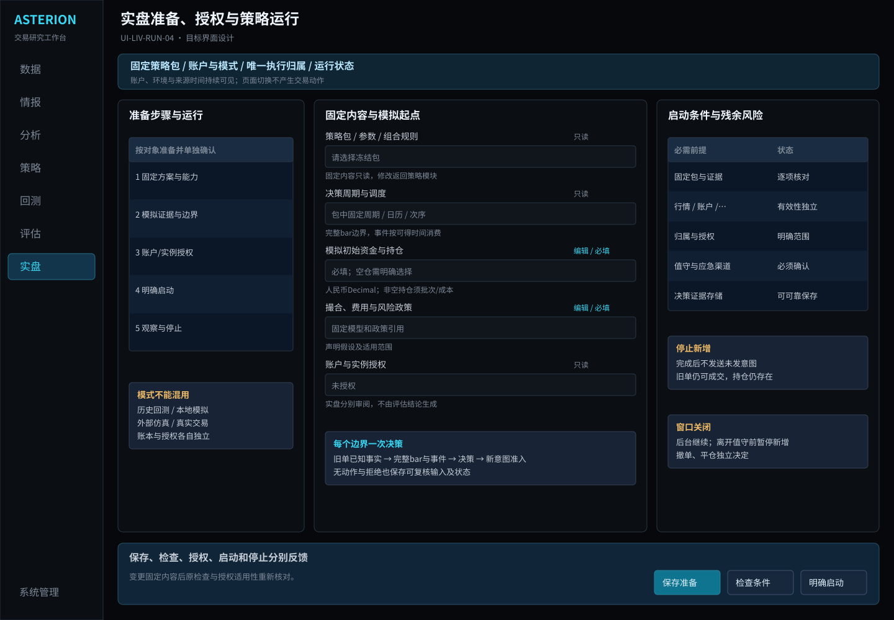

**区域联动与返回：** 选择列表或步骤只更新当前对象及详情，不隐式启动业务；图表与明细使用同一输入或结果上下文。离开并返回保留已确认的对象和查询条件，未保存草稿按本页保存语义处理。异步提交后用请求/任务身份定位实际状态，不能把操作按钮点击当作成功。

**窗口与空间：** 复用现有主窗口框架。宽度缩小时优先收拢辅助详情，表格在内容区横向滚动；主操作和关键上下文不能被页面裁切。重新展开详情仍指向原选中对象。

**状态设计范围：** 以本页状态/异常和验收为准，正常操作、首次无对象、筛选无匹配、请求中、失败及该业务的未知状态分别说明；不适用状态需说明原因，不套用虚构成功数据。字段类型、默认值和动作前提见下文；关键状态按本页交付约定及模块状态图检查。[返回界面设计总览](../../common/ui-designs.md)。

### 目标交互设计（待实现）

以下为目标交互规格，沿用当前Terminal样式、语言、表格和详情规范。原实际截图不改绘；完整字段和动作需实现后验收。

**字段与信息：**

- 账户与环境、固定策略包、实际参数、评价证据、合约范围、资金分配、风险及停止约定。
- 实例身份、当前状态、数据时效、在途与持仓。

**动作与反馈：**

- 审阅准备清单，证据不足转独立验证。
- 独立授权后显式启动；查询实际状态。
- 请求暂停或停止新增并核对结果，残余订单和持仓独立处理。

**状态与异常：**

- 未检查/缺依赖/未授权：不能启动。
- 启动中、运行、停止中、已停止与待核对分开。
- 仿真或本地模拟持续标识，不称实盘。

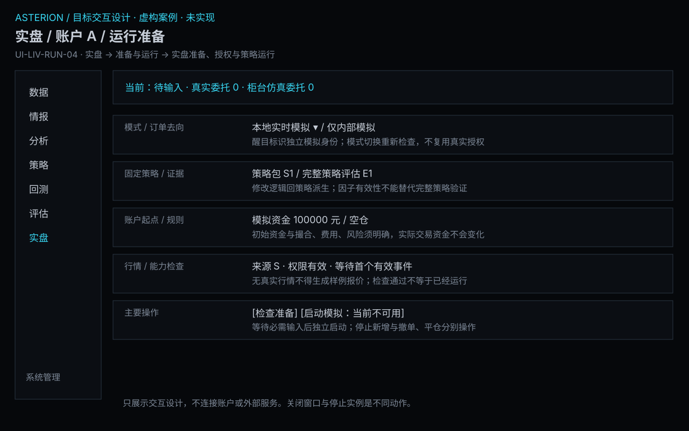

### 目标操作规格（设计草案，非已实现界面）

**目标入口与返回：** 实盘 → 准备与运行 → 实盘准备、授权与策略运行。保持所选账户与实例上下文，显示模式与能力检查；切换账户或运行模式重新检查适用条件，不因导航授予交易权限。

| 字段/区域 | 输入、默认与约束 |
| --- | --- |
| 模式与账户 | 历史回测转回测；本地模拟/柜台仿真/实盘必须明确选择，显示独立账户身份；不默认实盘。 |
| 固定方案 | 策略包、参数、完整评估证据、数据和必要能力只读引用；编辑返回策略。 |
| 模拟条件 | 初始资金为明确非负金额，初始持仓、撮合/成本及事件时钟必选；不使用真实账户隐式默认。 |
| 执行与继续 | 节点、账户唯一执行归属、当前授权、风险、连续跨日条件、实际状态和核对时点。 |

**动作与结果：**

- 检查准备不启动；授权与启动分别确认。
- 开始后显示实例和实际状态；停止新增不包含撤单和平仓。
- 跨日/中断恢复进入核对；新建模拟保留旧账本，不在原实例清零。

**状态与反馈：** 草稿、阻塞、可准备、启动中、运行、暂停、停止处理中、已停止、待核对各自显示；运行不意味着账户无未决。

**操作案例：** 节点失联导致执行归属未知，另一节点启动不可用，但原账户核对入口仍保留。

未保存编辑离开时提供保存、放弃、留在当前页；只读查询离开不触发业务动作。异步请求接纳后显示独立任务/请求身份；结果未知时提供查询而非默认重试。键盘焦点、缺失数值和语言遵守通用规范。一级入口与七个业务模块一致，二级入口对应子模块；本页作为子模块内视图，不再增加同名一级入口。

### 业务验收要求（待验收，不代表截图已证明实现）

- **UI-LIV-RUN-04-AC01**：模拟所需风险和数据有效但无实盘授权时可模拟，真实交易指令为0。
- **UI-LIV-RUN-04-AC02**：1手方案改2手后不能沿用原授权；重复同次启动不生成双实例。
- **UI-LIV-RUN-04-AC03**：停止确认后尚未发送意图不再发出，先前在途成交可令持仓2变3，但状态仍为已停止。
- **UI-LIV-RUN-04-AC04**：账户与实际环境持续可见；切换环境不继承授权、重定向订单或自动启动。

### 字段与操作交付约定

以下补齐页面关键字段的类型、初始值与边界；已有功能条目的输入规则仍适用。进入已有对象时加载实际保存值，新建时未明确给默认的必填项为空，不能借用案例数值。只读缺失统一显示“—”并提供原因。

| 字段组 | 类型与单位 | 初始值、检查及变化影响 |
| --- | --- | --- |
| 模式与实例 | 本地模拟/仿真/实盘、固定包 | 模式必选，切换重新准备，不复用授权 |
| 起点与规则 | 模拟资金/状态或真实账户、风险 | 模拟资金显式输入；真实资金只读来源事实 |
| 运行控制 | 检查、独立启动、暂停新意图 | 检查通过≠运行，停止不自动撤单/平仓 |

**操作顺序：** 使用“检查准备 / 独立启动”完成本页任务；先选择固定对象并补齐必填项，再检查范围和影响，最后提交有副作用的动作。查看、筛选和返回不隐式执行业务；保存、发布、启动、授权和撤单各自显示实际结果，不能合并为一个成功提示。所有发送及运行控制仍在执行边界重新核对账户、模式、授权、有效风险和执行归属；列表上的可用按钮不是授权证明。

| 关键状态 | 信息与允许操作 | 禁止或返回行为 |
| --- | --- | --- |
| 首次为空或无匹配 | 显示当前模式与实例范围，提供创建/补齐或清除筛选入口；只读详情说明来源 | 不填示例数据，不把无权限显示为无记录 |
| 输入错误或前提缺失 | 在“起点与规则”等具体字段旁说明问题，保留其他输入，焦点移至首个错误 | 依赖错误项的动作不可提交，返回不丢草稿 |
| 加载、运行或部分结果 | 保留对象身份和最后可靠时间，展示实际阶段/覆盖；可查看“运行控制”已有证据 | 未完成不能显示全量成功，不能用加载中的空表覆盖已知事实 |
| 失败或结果未知 | 已明确失败可修正输入后独立提交；可能已受理则查询原请求/对象；展示未决范围 | 未核实前不重复有副作用的操作，不把取消页面当取消业务 |
| 离开及返回 | 已保存对象可由原身份重开，未保存编辑提供保存/放弃/留在当前页；关闭抽屉只改变展示 | 即时偏好不套草稿确认；秘密取消后不留普通表单缓存 |

**交互验收案例：** 在本页选择一个有效对象，改变“模式与实例”后核对旧预览是否失效；制造“起点与规则”缺项或不可用，确认原因与阻断；补齐后完成主要动作，核对“运行控制”与关联对象结果，再离开返回。只读字段通过隔离测试回复制造状态，不在实际界面篡改业务事实。适用的具体成功结果仍以本页原有案例及AC为准。

关键状态的视觉呈现见[状态设计约定](../../common/ui-designs.md#state-designs)及本模块状态图；状态与动作按本表及关联FR逐项验收，静态图不冒充已执行交互。

### 对应功能需求

- [FR-LIV-RUN-01-05 完成开市前账户与运行准备检查](#fr-liv-run-01-05)
- [FR-LIV-RUN-03-01 从研究候选交接可验证策略方案](#fr-liv-run-03-01)
- [FR-LIV-RUN-03-02 配置并检查独立模拟验证](#fr-liv-run-03-02)
- [FR-LIV-RUN-03-03 限定账户与范围授予实盘权限](#fr-liv-run-03-03)
- [FR-LIV-RUN-03-04 识别方案变更并重新审查授权](#fr-liv-run-03-04)
- [FR-LIV-RUN-03-05 建立隔离的本地实时模拟账户](#fr-liv-run-03-05)
- [FR-LIV-RUN-03-06 保存模拟运行并明确继续或重新开始](#fr-liv-run-03-06)
- [FR-LIV-RUN-04-01 明确启动策略并防止重复运行](#fr-liv-run-04-01)
- [FR-LIV-RUN-04-02 监控策略数据依据与执行结果](#fr-liv-run-04-02)
- [FR-LIV-RUN-04-03 停止新意图并确认真正停止](#fr-liv-run-04-03)
- [FR-LIV-RUN-04-04 处理停止后的残余订单和持仓](#fr-liv-run-04-04)
- [FR-LIV-RUN-04-05 明确同一真实账户的执行归属](#fr-liv-run-04-05)
- [FR-LIV-RUN-05-02 限定受影响量化运行并确认暂停新增](#fr-liv-run-05-02)
- [FR-LIV-RUN-05-03 保留调查依据并重新验证修订范围](#fr-liv-run-05-03)
- [FR-LIV-RUN-05-04 按明确条件继续次日运行](#fr-liv-run-05-04)
- [FR-LIV-RUN-06-02 识别告警并检查触发依据](#fr-liv-run-06-02)
- [FR-LIV-RUN-06-04 核对恢复条件并明确恢复授权](#fr-liv-run-06-04)
- [FR-LIV-EXE-04-01 执行统一价格数量与开平校验](execution.md#fr-liv-exe-04-01)
- [FR-LIV-EXE-04-03 防止并发请求重复使用额度](execution.md#fr-liv-exe-04-03)
- [FR-LIV-ACC-03-03 确认规则生效和变更影响](accounts.md#fr-liv-acc-03-03)
- [FR-STR-PRT-01-04 生成调仓差额并追踪部分成交](../strategy/portfolio.md#fr-str-prt-01-04)
- [FR-STR-DLV-01-02 核对目标环境与研究假设差异](../strategy/delivery.md#fr-str-dlv-01-02)
- [FR-STR-DLV-01-03 分别完成风险与实盘授权准备](../strategy/delivery.md#fr-str-dlv-01-03)
- [FR-STR-DLV-01-04 交接候选并保留启动前复核](../strategy/delivery.md#fr-str-dlv-01-04)
- [FR-STR-DLV-02-06 在交付前逐项核对消费环境能力](../strategy/delivery.md#fr-str-dlv-02-06)

## UI-LIV-RUN-05 运行核对、处置与恢复审查

**业务目标：** 核对当前运行事实，独立处理暂停、撤单、平仓和恢复；跨环境归因跳转评估。

**对应情况：待设计。** 完整运行核对与恢复工作台待设计；偏差分析入口由评估统一。

**实际入口：** 暂无可直接到达的独立界面。

当前没有对应的实际界面截图；下方目标设计不表示已经实现或操作成功。

### 页面形态与目标布局

**设计状态：** 目标规格已编制，含布局、字段、动作和关键状态；尚未获得逐项产品签认或实现验收。现状对应证据保持上文说明，图稿不是运行截图。

**界面形态：** 并排核对详情。

**目标到达路径：** 实盘 → 准备与运行 → 运行核对、处置与恢复审查。这是已确认导航下的目标入口，实际对应仍见上方证据。

| 区域 | 要显示的内容 |
| --- | --- |
| 顶部上下文 | 实例 / 限制 / 最后核对时点 |
| 列表、分类或步骤区 | 原运行 / 意图 / 在途 |
| 主要工作区 | 当前账户事实 / 待核对差异 |
| 选中项详情或检查区 | 恢复条件 / 处置后果 |
| 主要动作区 | 核对事实 / 明确处置 |

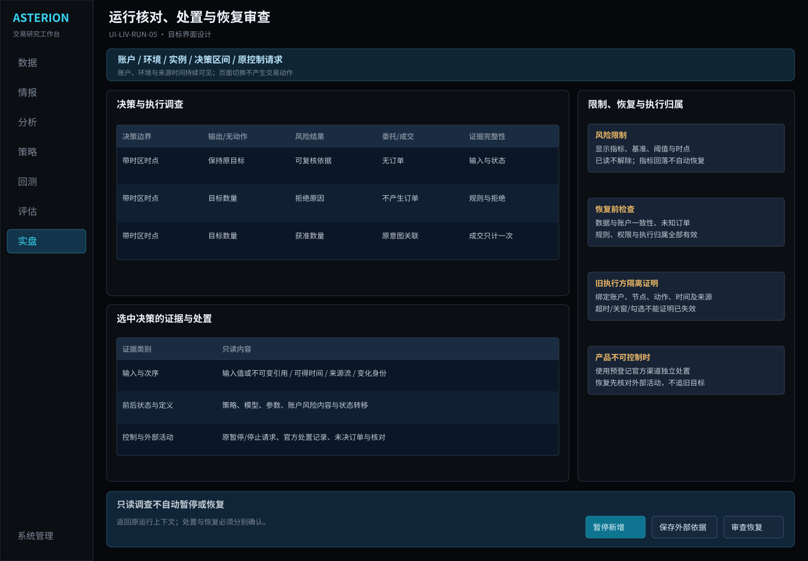

**区域联动与返回：** 选择列表或步骤只更新当前对象及详情，不隐式启动业务；图表与明细使用同一输入或结果上下文。离开并返回保留已确认的对象和查询条件，未保存草稿按本页保存语义处理。异步提交后用请求/任务身份定位实际状态，不能把操作按钮点击当作成功。

**窗口与空间：** 复用现有主窗口框架。宽度缩小时优先收拢辅助详情，表格在内容区横向滚动；主操作和关键上下文不能被页面裁切。重新展开详情仍指向原选中对象。

**状态设计范围：** 以本页状态/异常和验收为准，正常操作、首次无对象、筛选无匹配、请求中、失败及该业务的未知状态分别说明；不适用状态需说明原因，不套用虚构成功数据。字段类型、默认值和动作前提见下文；关键状态按本页交付约定及模块状态图检查。[返回界面设计总览](../../common/ui-designs.md)。

### 目标交互设计（待实现）

以下为目标交互规格，沿用当前Terminal样式、语言、表格和详情规范。原实际截图不改绘；完整字段和动作需实现后验收。

**字段与信息：**

- 目标账户、环境、运行、已处理事件、未知订单、调查证据和控制范围。
- 账户预警/限制状态、当前指标、分母基准、触发阈值、适用范围、剩余订单及恢复条件。
- 业务告警活动/解除状态、触发证据、恢复条件；通知渠道/阅读状态仅作关联。

**动作与反馈：**

- 查询并关联原事实，必要时打开评估。
- 独立确认暂停与恢复；改策略或假设分别返回策略/回测草稿。
- 查看告警证据；暂停新增；跳转独立撤单或持仓处置；检查并确认恢复条件。

**状态与异常：**

- 未知结果保留占用，不自动重发或替代实例。
- 待验证或待授权时不能隐式恢复。
- 读过告警不解除限制；风险回落未满足恢复条件仍暂停；停止策略与账户风险限制分开。
- 通知不可用、已读或静音不影响实际风险阻断和恢复条件。

### 业务验收要求（待验收，不代表截图已证明实现）

- **UI-LIV-RUN-05-AC01**：只读调查不自动暂停或恢复。
- **UI-LIV-RUN-05-AC02**：暂停保留1手持仓和1手在途，查询仍可用。
- **UI-LIV-RUN-05-AC03**：结果未知不自动重发，撤单和平仓另走独立流程。
- **UI-LIV-RUN-05-AC04**：权益达到97000触发案例3%暂停；回到97500未人工确认仍暂停。
- **UI-LIV-RUN-05-AC05**：暂停不禁用有独立权限且可安全执行的查询和撤单；风险缺失不能默认放行减仓委托。

### 字段与操作交付约定

以下补齐页面关键字段的类型、初始值与边界；已有功能条目的输入规则仍适用。进入已有对象时加载实际保存值，新建时未明确给默认的必填项为空，不能借用案例数值。只读缺失统一显示“—”并提供原因。

| 字段组 | 类型与单位 | 初始值、检查及变化影响 |
| --- | --- | --- |
| 核对范围 | 实例、账户、原意图/在途 | 固定原请求和执行归属，不另造意图 |
| 事实与限制 | 外部查询、当前政策、差异 | 只读证据，未知不当作零仓位 |
| 恢复决定 | 处置选择、条件清单、理由 | 原因排除及未决核清后显式批准；不能自动补发 |

**操作顺序：** 使用“核对事实 / 明确处置”完成本页任务；先选择固定对象并补齐必填项，再检查范围和影响，最后提交有副作用的动作。查看、筛选和返回不隐式执行业务；保存、发布、启动、授权和撤单各自显示实际结果，不能合并为一个成功提示。所有发送及运行控制仍在执行边界重新核对账户、模式、授权、有效风险和执行归属；列表上的可用按钮不是授权证明。

| 关键状态 | 信息与允许操作 | 禁止或返回行为 |
| --- | --- | --- |
| 首次为空或无匹配 | 显示当前核对范围范围，提供创建/补齐或清除筛选入口；只读详情说明来源 | 不填示例数据，不把无权限显示为无记录 |
| 输入错误或前提缺失 | 在“事实与限制”等具体字段旁说明问题，保留其他输入，焦点移至首个错误 | 依赖错误项的动作不可提交，返回不丢草稿 |
| 加载、运行或部分结果 | 保留对象身份和最后可靠时间，展示实际阶段/覆盖；可查看“恢复决定”已有证据 | 未完成不能显示全量成功，不能用加载中的空表覆盖已知事实 |
| 失败或结果未知 | 已明确失败可修正输入后独立提交；可能已受理则查询原请求/对象；展示未决范围 | 未核实前不重复有副作用的操作，不把取消页面当取消业务 |
| 离开及返回 | 已保存对象可由原身份重开，未保存编辑提供保存/放弃/留在当前页；关闭抽屉只改变展示 | 即时偏好不套草稿确认；秘密取消后不留普通表单缓存 |

**交互验收案例：** 在本页选择一个有效对象，改变“核对范围”后核对旧预览是否失效；制造“事实与限制”缺项或不可用，确认原因与阻断；补齐后完成主要动作，核对“恢复决定”与关联对象结果，再离开返回。只读字段通过隔离测试回复制造状态，不在实际界面篡改业务事实。适用的具体成功结果仍以本页原有案例及AC为准。

关键状态的视觉呈现见[状态设计约定](../../common/ui-designs.md#state-designs)及本模块状态图；状态与动作按本表及关联FR逐项验收，静态图不冒充已执行交互。

### 对应功能需求

- [FR-COM-UX-02-02 区分阅读状态与业务告警状态](../../common/interaction.md#fr-com-ux-02-02)
- [FR-LIV-RUN-03-06 保存模拟运行并明确继续或重新开始](#fr-liv-run-03-06)
- [FR-LIV-RUN-05-01 关联信号目标、订单成交与策略归属](#fr-liv-run-05-01)
- [FR-LIV-RUN-05-02 限定受影响量化运行并确认暂停新增](#fr-liv-run-05-02)
- [FR-LIV-RUN-05-03 保留调查依据并重新验证修订范围](#fr-liv-run-05-03)
- [FR-LIV-RUN-05-04 按明确条件继续次日运行](#fr-liv-run-05-04)
- [FR-LIV-RUN-06-01 观察风险指标和阈值距离](#fr-liv-run-06-01)
- [FR-LIV-RUN-06-02 识别告警并检查触发依据](#fr-liv-run-06-02)
- [FR-LIV-RUN-06-03 暂停新增风险并保留安全处置入口](#fr-liv-run-06-03)
- [FR-LIV-RUN-06-04 核对恢复条件并明确恢复授权](#fr-liv-run-06-04)
- [FR-LIV-EXE-03-05 在关键记录写入失败及进程中断后保持交易事实](execution.md#fr-liv-exe-03-05)
- [FR-STR-PRT-01-06 核对组合贡献与目标执行偏差](../strategy/portfolio.md#fr-str-prt-01-06)

