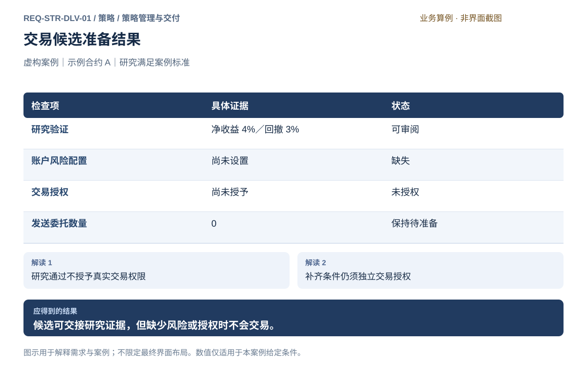
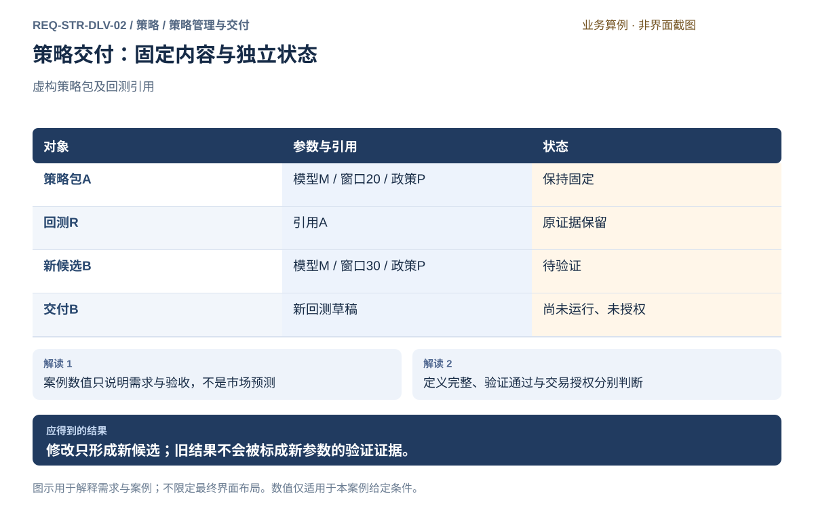
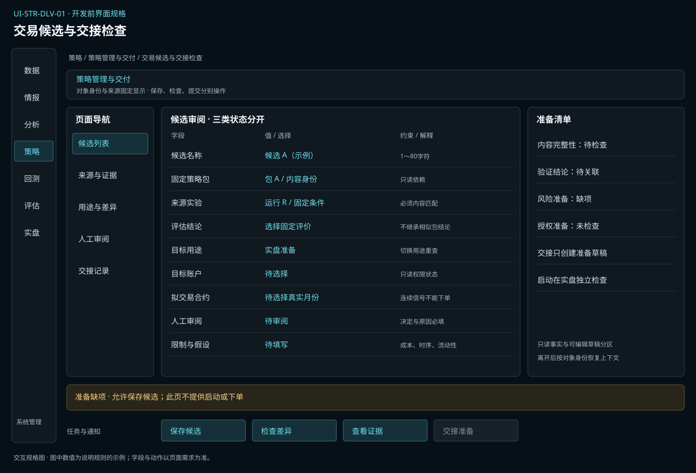
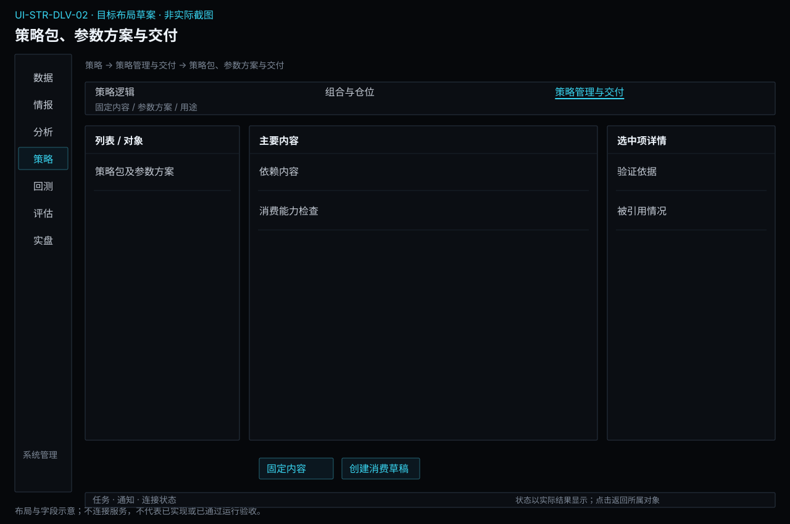

# 策略管理与交付

[返回上级](README.md) · [需求总纲](../../README.md) · [实际界面](../../common/screens.md) · [跨模块流程](../../workflows/README.md)

需求交付版 · 2026-10-18。细化规格已编制，用户逐项签认与产品验收分别记录；目标设计不代表已经实现，实际入口与差距见本页界面对应。

**归属：** 策略 / 策略管理与交付。本页集中保存业务需求、详细功能、案例、界面对应和验收；通用规则见[通用规范](../../common/README.md)。

## 需求导航

- [REQ-STR-DLV-01 形成研究结论并交接可审查的交易候选](#req-str-dlv-01)
- [REQ-STR-DLV-02 固定策略包、参数方案和依赖并交付下游](#req-str-dlv-02)

## 子模块详细设计

策略管理与交付保存“后续究竟使用什么”。它不是交易运行控制台，也不重复保存完整回测账本。通过固定依赖和证据引用组织草稿、候选、参数方案、用途及交接状态。

| 对象       | 必要内容                                      | 不能隐含的行为                             |
| ---------- | --------------------------------------------- | ------------------------------------------ |
| 策略草稿   | 逻辑/模型选择、参数、组合政策、未定项         | 保存不表示可运行或已验证                   |
| 固定策略包 | 内容身份、全部依赖、输入能力、事件/状态与用途 | 不引用可变名称，不原地替换依赖             |
| 参数方案   | 字段类型、单位、约束、具体值和说明            | 变更不能继承旧条件的试算或回测通过状态     |
| 证据关联   | 来源分析、训练、逻辑试算、回测结果和限制      | 只关联实际使用该包的结果；相似结果仅作参考 |
| 交付记录   | 目标回测/交易准备草稿、创建状态、包引用       | 不自动执行、授权、替换实例或重发指令       |
| 使用与弃用 | 当前用途、依赖和引用、弃用理由                | 弃用不删除原实验，不停止已有运行           |

### 三类状态分别判断

内容完整性由策略负责；历史验证结论由评估负责，模拟事实由回测负责；账户权限、账户风险准入和运行资格由实盘负责。固定但未回测的包可以交付回测草稿；没有账户授权不妨碍创建研究候选。真正运行回测时，仍须具备数据、成本、保证金与必要风险条件。

实盘用途的准备检查可以显示缺少权限、风险或数据的事实，并提供对应入口；本模块不自行发放或缓存可复用授权。进入交易准备也不代表允许启动，交易侧要按当前账户、包内容、参数、额度及停止条件重新核对。

### 差异、引用与证据

比较方案时展示逻辑、模型、特征处理、参数、组合政策与范围的具体差异。名称变化而内容不变不制造新的验证结论；内容变化即使同名也必须区分。已固定结果绑定其实际内容和输入，历史内容不需要开发版本计数或旧格式兼容入口。

回测参数搜索的每次实际参数配置必须保留；选中配置通过本模块固定为候选，并引用对应真实实验条件。若重训模型、改变处理或变更参数，不能继续将原配置的通过结论贴给新候选。新候选可以参考旧证据，但适用性必须明确。

删除前列出引用和在用实例，仍被引用或运行中的依赖不能删除。退出编辑、标记弃用与删除是不同动作；资料异常只报告，不静默重建、转换或清理用户内容。

### 界面、正常流程与异常

列表显示名称、具体身份、构建方式、参数方案、内容完整性、验证状态、用途和引用数；详情展开依赖清单、差异与证据。操作为保存草稿、检查、固定、派生、交付和查看引用；不提供与交付混淆的“立即交易”按钮。

依赖缺失定位到具体内容；目标环境不支持列能力差异；回测证据不匹配显示原引用；交付响应不明时先查询同次交付结果，不能重复创建目标草稿。交付到回测和交易准备都要有可返回的来源引用，便于知道当前操作基于哪份策略。

回测搜索所得配置只有在逻辑、模型、参数、处理和组合政策与实际实验完全一致时，才可作为其验证证据关联到固定候选。来源包名称相同并不充分；固定候选也不能修改已记录实验的实际条件。

## REQ-STR-DLV-01 形成研究结论并交接可审查的交易候选

**领域：** 策略 / 策略管理与交付　 **建议优先级：** P0安全必要　 **需求状态：** 交付规格已编制（定位与模块已确认；细节待用户签认）

### 目标与场景

用户可以把研究结果整理为明确的交易候选，检查哪些假设在实际交易中成立以及哪些证据仍不足。研究通过只产生候选，不授予交易权限，也不自动把历史模拟仓位变成真实委托。

**使用者与场景：** 兼顾研究与实盘的个人用户，在考虑将某策略用于仿真或真实交易时。

**触发条件：** 用户从一项已审阅研究结论发起交易候选准备。

### 前置条件

- 候选来源实验、策略内容、参数和评价范围可追溯。
- 用户知道历史结果不能保证未来表现；拟交易合约和账户条件需要单独确认。

### 输入与含义

| 输入           | 含义与单位                                         | 约束                                           |
| -------------- | -------------------------------------------------- | ---------------------------------------------- |
| 候选定义       | 拟使用的策略、参数、适用市场与运行周期。           | 与研究结论一致；变更关键条件须明确列为新差异。 |
| 研究证据与限制 | 验证结果、数据成本假设、容量和失效条件。           | 不隐藏失败样本、未验证市场或不支持的成交情形。 |
| 交易准备条件   | 账户授权、实时数据、执行支持、风险限额和停止方式。 | 每项独立核对；研究状态不能代替真实交易授权。   |

### 正常操作与反馈

1. 用户归纳研究支持和不支持的结论，选出候选范围。
2. 系统生成可审阅摘要，保留数据、参数、成本、验证及限制证据。
3. 用户逐项核对拟交易环境与研究假设之间的差异。
4. 对缺失授权、风险、数据或执行能力列出阻止原因。
5. 用户在独立交易流程中完成准备及授权；候选记录仅提供经确认的研究依据。

### 业务规则

- 研究候选、仿真验证和真实交易是不同用途，任何阶段结果不能自动代替后续条件。
- 研究中的资金、保证金和费用假设不得自动覆盖账户实际规则。
- 参数或策略变化必须保留与原证据的关系，不能继续冒称原候选已验证。
- 交接不发送委托、不恢复授权，也不因实时断线而重发历史交易指令。

### 输出与状态影响

- 可追溯的候选说明与研究证据摘要。
- 交易准备差异、阻止项及需要继续取得的证据。

### 异常与继续方式

| 发生什么                                               | 应怎样表现                                           | 使用者如何继续                                               |
| ------------------------------------------------------ | ---------------------------------------------------- | ------------------------------------------------------------ |
| 候选需要的交易周期、合约或执行规则无法在拟用环境满足。 | 显示不具备交接条件及具体差异，不以近似方式自动上线。 | 用户改变候选并重新研究，或补齐目标环境后重新核对。           |
| 账户缺少风险配置或尚未授予交易权限。                   | 保存研究候选但明确列出阻止项，不发送委托。           | 用户在独立交易流程中完成风险设置和授权，再重新检查准备条件。 |

### 案例：研究满足条件但仍不得发送委托

**虚构案例条件：** 虚构案例：事前研究标准为验证段净收益大于 0、最大回撤不超过 5%。示例合约 A 的候选净收益 4%、最大回撤 3%，满足标准。账户风险限额尚未设置，交易授权尚未授予。

1. 用户保存候选及其验证证据。
2. 系统核对研究、风险和授权三类条件。

**预期结果：**

- 研究证据为可审阅，风险配置为缺失，交易授权为未授予。
- 候选保持待准备，发送委托数量为 0。

### 可观察验收条件

| 编号                | 给定                                 | 当                 | 则                                                               |
| ------------------- | ------------------------------------ | ------------------ | ---------------------------------------------------------------- |
| REQ-STR-DLV-01-AC01 | 研究结果满足案例标准但风险配置缺失。 | 用户创建交易候选。 | 候选可保存，风险缺项可见，不能发送任何委托。                     |
| REQ-STR-DLV-01-AC02 | 风险已配置但尚未交易授权。           | 查看候选准备结果。 | 仍显示授权待完成，研究结论不能充当授权。                         |
| REQ-STR-DLV-01-AC03 | 用户修改候选的关键参数。             | 保存新候选。       | 差异和原研究来源保留，不能沿用原参数的验证结论冒充新参数已验证。 |

### 决定与配置约束

- **DEC-STR-DLV-01-01**：**运行配置**。候选必须具备逻辑样例、独立留出、成本/压力、模拟及人工审查证据；每项研究的成功指标和最低覆盖由用户事前填写，未填不能放行，不用通用收益阈值。

- **DEC-STR-DLV-01-02**：**规格决定**。规则、模型及混合策略，日线/分钟决策及明确事件/定时触发，面向已核验CTP兼容期货账户；不承诺高频低延迟或所有柜台能力。

### 详细功能

### FR-STR-DLV-01-01 建立有来源的交易候选说明

**目标与结果：** 把具体策略、参数、适用范围与研究证据汇集起来，供后续用途审阅。

**触发：** 研究结论或比较页点击建立候选。

**输入与约束：** 来源实验、策略身份、参数、适用合约周期及结论范围。 待定项可保存但须明确标记，草稿不称可执行策略。

**目标操作与反馈：**

1. 核对原研究证据。
2. 填写候选目标用途及适用限制。
3. 保存独立候选，显示与来源一致和发生变更的条件。

**异常与边界：**

- 关键参数改动不能继续声称原验证已覆盖新条件。
- 候选可以保存为待准备，不创建真实委托或账户授权。

**验收条件：**

- **FR-STR-DLV-01-01-AC01**：同名策略的不同定义在候选中可分辨。
- **FR-STR-DLV-01-01-AC02**：候选保存后原研究资料和结果保持不变。

**界面对应：** [UI-STR-DLV-01 交易候选与交接检查](#ui-str-dlv-01)。

### FR-STR-DLV-01-02 核对目标环境与研究假设差异

**目标与结果：** 用户知道研究中的费用、周期和执行假设在目标环境是否成立。

**触发：** 候选页选择目标用途并点击检查差异。

**输入与约束：** 模拟或实盘用途、拟运行环境、数据、周期、成本及风险能力。

**目标操作与反馈：**

1. 选择用途，查看所需条件清单。
2. 对照研究假设和目标环境支持，逐项查看证据。
3. 记录阻止项、需重新研究的差异及下一步。

**异常与边界：**

- 模拟不要求实盘授权；但仍要求适用风险配置和风险能力可用。
- 不支持的周期或合约不能被自动近似替换后称可运行。

**验收条件：**

- **FR-STR-DLV-01-02-AC01**：模拟用途不出现必须授予实盘交易权限的阻止项。
- **FR-STR-DLV-01-02-AC02**：风险能力不可用在模拟与实盘中均阻止运行。

**界面对应：** [UI-STR-DLV-01 交易候选与交接检查](#ui-str-dlv-01)；[UI-LIV-RUN-04 实盘准备、授权与策略运行](../live/operations.md#ui-liv-run-04)。

### FR-STR-DLV-01-03 分别完成风险与实盘授权准备

**目标与结果：** 研究证据不能替代账户许可，且准备失败不能妨碍安全查询或撤单。

**触发：** 实盘候选的条件清单点击配置风险或前往授权。

**输入与约束：** 明确目标账户、必要风险条件及当前授权状态；不能从行情授权推断交易许可。

**目标操作与反馈：**

1. 查看缺失风险或权限项。
2. 进入实盘账户风险设置与授权入口分别完成独立核对，再返回刷新候选准备状态。
3. 确认仅完成准备，真正启动仍在策略运行页进行。

**异常与边界：**

- 未授权不发送委托，也不通过自动恢复旧授权绕过。
- 暂停新增交易不应无理由禁用可安全执行的查询或撤单。

**验收条件：**

- **FR-STR-DLV-01-03-AC01**：研究满足条件但缺风险或未授权时，委托数仍为零。
- **FR-STR-DLV-01-03-AC02**：返回候选时显示实际授权状态，不因曾访问授权页假定完成。

**界面对应：** [UI-STR-DLV-01 交易候选与交接检查](#ui-str-dlv-01)；[UI-LIV-RUN-01 账户连接与交易授权](../live/operations.md#ui-liv-run-01)；[UI-LIV-RUN-04 实盘准备、授权与策略运行](../live/operations.md#ui-liv-run-04)；[UI-LIV-ACC-03 账户风险规则与生效管理](../live/accounts.md#ui-liv-acc-03)。

### FR-STR-DLV-01-04 交接候选并保留启动前复核

**目标与结果：** 将准备好的候选带到运行配置，保持研究、模拟和实盘的清晰边界。

**触发：** 条件满足后点击前往运行配置。

**输入与约束：** 候选身份、用途、策略与参数、范围、风险及证据摘要。

**目标操作与反馈：**

1. 审阅携带内容与未覆盖限制。
2. 前往策略运行页，看到对应用途的待确认配置。
3. 在目标页重新核对即时状态后决定是否启动；交接本身不启动。

**异常与边界：**

- 期间权限失效或风险不可用时目标页阻止启动。
- 断线后不重发历史委托；更改候选内容应形成新的明确条件。

**验收条件：**

- **FR-STR-DLV-01-04-AC01**：点击交接仅打开运行草稿，真实委托数不变。
- **FR-STR-DLV-01-04-AC02**：模拟交接不要求实盘授权，实盘交接仍须独立授权和启动。

**界面对应：** [UI-STR-DLV-01 交易候选与交接检查](#ui-str-dlv-01)；[UI-LIV-RUN-04 实盘准备、授权与策略运行](../live/operations.md#ui-liv-run-04)。

## REQ-STR-DLV-02 固定策略包、参数方案和依赖并交付下游

**领域：** 策略 / 策略管理与交付　 **建议优先级：** P1核心必要　 **需求状态：** 交付规格已编制（定位与模块已确认；细节待用户签认）

### 目标与场景

保证回测与交易准备读取的是明确内容，而不是随时变化的策略名称；管理完整性、验证证据和用途，不把交付误当运行许可。

**使用者与场景：** 个人期货量化研究与实盘使用者，构建规则、模型或混合策略时。

**触发条件：** 将已选逻辑、模型、参数和组合政策组装为草稿。

### 前置条件

- 已有可追溯的分析特征或策略输入定义；真实训练与研究数据来自数据提供方。
- 清楚区分逻辑试算、模型训练、历史回测与账户运行，定义或训练不会发送委托。

### 输入与含义

| 输入       | 含义与单位                                               | 约束                                           |
| ---------- | -------------------------------------------------------- | ---------------------------------------------- |
| 策略包内容 | 逻辑、模型、处理产物、特征定义、参数、组合政策和状态约定 | 每项绑定具体内容身份，不能只引用名称或latest   |
| 用途与限制 | 品种、频率、输入能力、可得性、环境约束和未验证范围       | 回测、模拟、实盘分别显示准备状态               |
| 证据关联   | 逻辑试算、训练、分析与回测结果、修改原因                 | 结果绑定其实际策略包，参数变更不继承旧通过结论 |

### 正常操作与反馈

1. 将已选逻辑、模型、参数和组合政策组装为草稿。
2. 检查依赖、单位、参数范围、状态与目标环境能力。
3. 确认固定内容，获得可复核的策略包身份。
4. 选择交付回测或交易准备，显示目标草稿及仍需配置的条件。
5. 收到验证结果后关联到原策略包；需要修改时派生新候选。

### 业务规则

- 草稿可编辑，已固定包不可原地更换内容；历史由真实产物与引用记录，不引入开发格式版本计数。
- 完整性通过、回测通过、交易已授权是独立事实，不能合并为一个已就绪勾选。
- 冻结未回测策略允许交付回测草稿，不要求已有回测结果形成循环。
- 依赖缺失时明确阻断需要该依赖的交付，不静默下载、重训、改用最新或删掉依赖。
- 交付本身不启动回测、替换运行实例、发送委托或更改账户授权。

### 输出与状态影响

- 固定策略包、参数方案、依赖清单及用途限制。
- 回测/交易准备草稿引用与原包对应的证据。

### 异常与继续方式

| 发生什么               | 应怎样表现                           | 使用者如何继续                           |
| ---------------------- | ------------------------------------ | ---------------------------------------- |
| 模型产物或必要插件缺失 | 草稿保留，指出缺项，不称可运行包     | 补齐同一依赖后重查，或修改方案形成新候选 |
| 参数变化后仍引用旧回测 | 显示证据与内容不匹配，旧结果只作参考 | 交付新包并重新验证受影响范围             |
| 目标环境能力不支持     | 保存包但阻断该用途交付，列差异       | 选择支持的环境或修改方案重新审查         |

### 案例：参数变化不覆盖旧回测对象

**虚构案例条件：** 虚构策略包A绑定模型M、窗口20和仓位政策P；回测R引用A。用户把窗口改成30。

1. 保留A及R的引用。
2. 生成新候选B并重新做必要完整性检查。
3. 将B交付新的回测草稿。

**预期结果：**

- R仍对应A和窗口20；B窗口30为待验证。
- B交付成功不表示回测已运行，更不表示实盘已授权。

### 可观察验收条件

| 编号                | 给定                    | 当                 | 则                                        |
| ------------------- | ----------------------- | ------------------ | ----------------------------------------- |
| REQ-STR-DLV-02-AC01 | R引用窗口20的固定包A    | 修改窗口为30并保存 | 创建B，R仍引用A                           |
| REQ-STR-DLV-02-AC02 | B依赖模型M但产物缺失    | 尝试交付回测       | 定位M缺失，不使用同名其他模型             |
| REQ-STR-DLV-02-AC03 | B内容完整但未有回测证据 | 交付回测           | 创建待检查草稿，验证状态仍未验证，委托数0 |

### 决定与配置约束

- **DEC-STR-DLV-02-01**：**规格决定**。参数方案采用名称、标签、父方案及逐字段差异，固定策略包与方案分开；比较条件不同不得直接排名，改名不改变内容身份。

- **DEC-STR-DLV-02-02**：**规格决定**。强制核对输入结构/时点、事件与状态、模型/插件身份、订单类型、费用/风险、资源及运行模式；任一必需能力缺失阻止交付，逐项显示原因。

### 详细功能

### FR-STR-DLV-02-01 组装策略包并检查完整依赖

**目标与结果：** 让策略交付包含实际运行所需内容。

**触发：** 选择依赖并查看内容身份。

**输入与约束：** 规则/模型、分析定义、参数、处理产物、组合政策、状态与环境能力。

**目标操作与反馈：**

1. 选择依赖并查看内容身份。
2. 运行单位、参数和能力检查。
3. 保存草稿与逐项缺失原因。

**异常与边界：**

- 依赖闭包不完整不能称可运行包。
- 不存凭据或实盘授权到策略包。

**验收条件：**

- **FR-STR-DLV-02-01-AC01**：模型缺失时定位模型内容而不是泛报不可用。
- **FR-STR-DLV-02-01-AC02**：一个同名但内容不同的模型不能自动补位。

**界面对应：** [UI-STR-DLV-02 策略包、参数方案与交付](#ui-str-dlv-02)。

### FR-STR-DLV-02-02 管理参数方案与固定内容

**目标与结果：** 区分可编辑草稿和已固定候选。

**触发：** 创建或选择参数方案。

**输入与约束：** 参数名、类型、单位、范围、约束、适用逻辑及方案说明。

**目标操作与反馈：**

1. 创建或选择参数方案。
2. 比较具体参数与依赖差异。
3. 确认后固定策略内容，修改时派生候选。

**异常与边界：**

- 参数值不能改写逻辑声明的单位或范围。
- 固定包不原地覆盖，不保留开发历史格式兼容入口。

**验收条件：**

- **FR-STR-DLV-02-02-AC01**：窗口20改30形成新候选B，旧A保持20。
- **FR-STR-DLV-02-02-AC02**：未改名但内容变化也必须被辨认为新内容。

**界面对应：** [UI-STR-DLV-02 策略包、参数方案与交付](#ui-str-dlv-02)。

### FR-STR-DLV-02-03 关联验证证据并分别展示准备状态

**目标与结果：** 防止完整性或交付状态被误解为验证和授权。

**触发：** 选择证据并核对实际引用。

**输入与约束：** 策略包身份、试算/训练/回测证据、用途、条件差异。

**目标操作与反馈：**

1. 选择证据并核对实际引用。
2. 显示完整性、验证、用途准备三个独立结果。
3. 记录限制与后续工作。

**异常与边界：**

- 新包不继承旧包的验证通过状态。
- 交易权限只读取当前账户/运行检查结果，不由此页生成。

**验收条件：**

- **FR-STR-DLV-02-03-AC01**：R引用A时不能作为B已通过的证据。
- **FR-STR-DLV-02-03-AC02**：B完整但未回测时显示内容完整、未验证、交易未授权。

**界面对应：** [UI-STR-DLV-02 策略包、参数方案与交付](#ui-str-dlv-02)。

### FR-STR-DLV-02-04 交付回测或交易准备草稿

**目标与结果：** 使策略与消费环境通过固定引用交接。

**触发：** 选择交付回测或交易准备。

**输入与约束：** 固定包、目的环境、适用品种周期与必要能力。

**目标操作与反馈：**

1. 选择交付回测或交易准备。
2. 检查所选用途的依赖与支持范围。
3. 创建目标草稿并显示返回链接。

**异常与边界：**

- 回测交付不要求实盘授权；运行仍需风险配置和模拟条件。
- 交易交付不自动启动、替换运行或重发指令。

**验收条件：**

- **FR-STR-DLV-02-04-AC01**：未回测但完整的包能创建回测草稿。
- **FR-STR-DLV-02-04-AC02**：同一包交给两个草稿时内容仍相同，运行条件各自保存。

**界面对应：** [UI-STR-DLV-02 策略包、参数方案与交付](#ui-str-dlv-02)。

### FR-STR-DLV-02-05 管理弃用候选与引用保护

**目标与结果：** 使不再推荐的策略不会消失或影响已有证据。

**触发：** 查看候选被哪些结果和实例引用。

**输入与约束：** 候选使用状态、依赖关系、回测和运行引用、弃用原因。

**目标操作与反馈：**

1. 查看候选被哪些结果和实例引用。
2. 标记不再用于新建并说明原因。
3. 需要删除时检查引用和用户明确操作。

**异常与边界：**

- 弃用不停止正在运行的实例，不删除既有模型或回测。
- 仍被引用或运行中的内容不能直接删除；文件异常只报告，不静默转换或清理。

**验收条件：**

- **FR-STR-DLV-02-05-AC01**：弃用A后R仍可查看A，新的交付明确提示不可用于新建。
- **FR-STR-DLV-02-05-AC02**：引用存在时删除被拒绝且显示阻止对象。

**界面对应：** [UI-STR-DLV-02 策略包、参数方案与交付](#ui-str-dlv-02)。

### FR-STR-DLV-02-06 在交付前逐项核对消费环境能力

**来源与确认：** 2026-10-18全面审查及用户授权补充；详细行为草案待评审，未实现、未执行产品验收。

**目标与结果：** 可保存策略包与可在指定位置执行是不同状态。

**触发：** 交付回测、模拟或实盘准备。

**输入与约束：** 策略内容、数据语义、所需策略/风险能力、运行模式、目标节点能力及评估引用。

**目标操作与反馈：**

1. 生成输入、决策、状态初始化、仓位与退出、方法能力清单。
2. 选择消费模式和节点，逐项比较可用性；显示不支持、缺权限、资料不足和待核实。
3. 仅满足所需条件后创建消费草稿并携带固定内容；验证和真实授权由各自责任方继续判断。

**异常与边界：**

- 本地具备某插件不表示远程也具备；不自动改选节点或替换算法。
- 交付检查之后能力变化，实际启动重新检查并拒绝失效前提。

**操作案例：** 同一个固定包在本地通过能力检查，在远程缺因子处理能力；远程草稿列出缺项，不自动降级成另一个策略。

**验收条件：**

- **FR-STR-DLV-02-06-AC01**：远程缺必要风险能力时可保留策略包，但不能启动回测或实盘。
- **FR-STR-DLV-02-06-AC02**：变更模式不复用旧账户授权，原固定包保持不变。

**界面对应：** [UI-STR-DLV-02](#ui-str-dlv-02)；[UI-LIV-RUN-04](../live/operations.md#ui-liv-run-04)。

## 界面设计与实际对应

## UI-STR-DLV-01 交易候选与交接检查

**业务目标：** 把研究证据和拟交易条件逐项核对，形成可审查的模拟或实盘候选；交接不直接启动或发送委托。

**对应情况：待设计。** 研究候选与交易交接检查没有独立界面；不得把研究结果链接描述成自动实盘授权。

**实际入口：** 暂无可直接到达的独立界面。

当前没有对应的实际界面截图；下方目标设计不表示已经实现或操作成功。

### 页面形态与目标布局

**设计状态：** 目标规格已编制，含布局、字段、动作和关键状态；尚未获得逐项产品签认或实现验收。现状对应证据保持上文说明，图稿不是运行截图。

**界面形态：** 列表与详情工作区。

**目标到达路径：** 策略 → 策略管理与交付 → 交易候选与交接检查。这是已确认导航下的目标入口，实际对应仍见上方证据。

| 区域 | 要显示的内容 |
| --- | --- |
| 顶部上下文 | 候选 / 目标用途 |
| 列表、分类或步骤区 | 候选列表 / 评估引用 |
| 主要工作区 | 完整性 / 验证 / 用途准备 |
| 选中项详情或检查区 | 缺项 / 限制 / 后续入口 |
| 主要动作区 | 审阅候选 / 交接准备 |

**区域联动与返回：** 选择列表或步骤只更新当前对象及详情，不隐式启动业务；图表与明细使用同一输入或结果上下文。离开并返回保留已确认的对象和查询条件，未保存草稿按本页保存语义处理。异步提交后用请求/任务身份定位实际状态，不能把操作按钮点击当作成功。

**窗口与空间：** 复用现有主窗口框架。宽度缩小时优先收拢辅助详情，表格在内容区横向滚动；主操作和关键上下文不能被页面裁切。重新展开详情仍指向原选中对象。

**状态设计范围：** 以本页状态/异常和验收为准，正常操作、首次无对象、筛选无匹配、请求中、失败及该业务的未知状态分别说明；不适用状态需说明原因，不套用虚构成功数据。字段类型、默认值和动作前提见下文；关键状态按本页交付约定及模块状态图检查。[返回界面设计总览](../../common/ui-designs.md)。

### 目标交互设计（待实现）

本页记录交付审查与准备差异，实际账户授权和策略启动必须在交易流程独立完成。

**字段与信息：**

- 固定候选与分析/回测证据
- 目标用途、环境差异、限制和未满足条件
- 独立风险与授权准备状态

**动作与反馈：**

- 保存候选说明
- 查看差异与证据
- 前往独立交易准备流程
- 交接固定引用

**状态与异常：**

- 证据不足：可保存但不能标已验证
- 未授权或缺风险：可记录缺项，不能运行
- 交接完成：只代表草稿与引用已建立

### 业务验收要求（待验收，不代表截图已证明实现）

- **UI-STR-DLV-01-AC01**：研究净收益4%回撤3%满足案例标准，缺风险及未授权时委托数仍0。
- **UI-STR-DLV-01-AC02**：模拟用途不要求实盘授权，但必要风险条件仍须满足。
- **UI-STR-DLV-01-AC03**：前往运行配置只是打开草稿，权限变化会阻止后续启动，不重发历史指令。

### 字段与操作交付约定

以下补齐页面关键字段的类型、初始值与边界；已有功能条目的输入规则仍适用。进入已有对象时加载实际保存值，新建时未明确给默认的必填项为空，不能借用案例数值。只读缺失统一显示“—”并提供原因。

| 字段组 | 类型与单位 | 初始值、检查及变化影响 |
| --- | --- | --- |
| 候选与依据 | 固定包、评价/模拟引用 | 必需验证项全部有证据，否则只保留候选 |
| 交接用途 | 回测/本地模拟/仿真/实盘 | 显式选择，模式切换重新核对 |
| 缺项与决定 | 清单、人工结论及限制 | 只读检查加明确决定；通过准备不授予账户权限 |

**操作顺序：** 使用“审阅候选 / 交接准备”完成本页任务；先选择固定对象并补齐必填项，再检查范围和影响，最后提交有副作用的动作。查看、筛选和返回不隐式执行业务；保存、发布、启动、授权和撤单各自显示实际结果，不能合并为一个成功提示。

| 关键状态 | 信息与允许操作 | 禁止或返回行为 |
| --- | --- | --- |
| 首次为空或无匹配 | 显示当前候选与依据范围，提供创建/补齐或清除筛选入口；只读详情说明来源 | 不填示例数据，不把无权限显示为无记录 |
| 输入错误或前提缺失 | 在“交接用途”等具体字段旁说明问题，保留其他输入，焦点移至首个错误 | 依赖错误项的动作不可提交，返回不丢草稿 |
| 加载、运行或部分结果 | 保留对象身份和最后可靠时间，展示实际阶段/覆盖；可查看“缺项与决定”已有证据 | 未完成不能显示全量成功，不能用加载中的空表覆盖已知事实 |
| 失败或结果未知 | 已明确失败可修正输入后独立提交；可能已受理则查询原请求/对象；展示未决范围 | 未核实前不重复有副作用的操作，不把取消页面当取消业务 |
| 离开及返回 | 已保存对象可由原身份重开，未保存编辑提供保存/放弃/留在当前页；关闭抽屉只改变展示 | 即时偏好不套草稿确认；秘密取消后不留普通表单缓存 |

**交互验收案例：** 在本页选择一个有效对象，改变“候选与依据”后核对旧预览是否失效；制造“交接用途”缺项或不可用，确认原因与阻断；补齐后完成主要动作，核对“缺项与决定”与关联对象结果，再离开返回。只读字段通过隔离测试回复制造状态，不在实际界面篡改业务事实。适用的具体成功结果仍以本页原有案例及AC为准。

关键状态的视觉呈现见[状态设计约定](../../common/ui-designs.md#state-designs)及本模块状态图；状态与动作按本表及关联FR逐项验收，静态图不冒充已执行交互。

### 对应功能需求

- [FR-LIV-RUN-03-01 从研究候选交接可验证策略方案](../live/operations.md#fr-liv-run-03-01)
- [FR-LIV-RUN-03-04 识别方案变更并重新审查授权](../live/operations.md#fr-liv-run-03-04)
- [FR-EVA-VAL-01-03 保存比较结论并交接固定证据](../evaluation/validation.md#fr-eva-val-01-03)
- [FR-STR-DLV-01-01 建立有来源的交易候选说明](#fr-str-dlv-01-01)
- [FR-STR-DLV-01-02 核对目标环境与研究假设差异](#fr-str-dlv-01-02)
- [FR-STR-DLV-01-03 分别完成风险与实盘授权准备](#fr-str-dlv-01-03)
- [FR-STR-DLV-01-04 交接候选并保留启动前复核](#fr-str-dlv-01-04)

## UI-STR-DLV-02 策略包、参数方案与交付

**业务目标：** 管理固定策略内容、证据和用途，以引用交付回测或交易准备。

**对应情况：待设计。** 没有已核对的完整工作台，不能把拟议流程当作已经实现。

**实际入口：** 当前没有独立界面；以下交互为拟议需求。

当前没有对应的实际界面截图；下方目标设计不表示已经实现或操作成功。

### 页面形态与目标布局

**设计状态：** 目标规格已编制，含布局、字段、动作和关键状态；尚未获得逐项产品签认或实现验收。现状对应证据保持上文说明，图稿不是运行截图。

**界面形态：** 列表与详情工作区。

**目标到达路径：** 策略 → 策略管理与交付 → 策略包、参数方案与交付。这是已确认导航下的目标入口，实际对应仍见上方证据。

| 区域 | 要显示的内容 |
| --- | --- |
| 顶部上下文 | 固定内容 / 参数方案 / 用途 |
| 列表、分类或步骤区 | 策略包及参数方案 |
| 主要工作区 | 依赖内容 / 消费能力检查 |
| 选中项详情或检查区 | 验证依据 / 被引用情况 |
| 主要动作区 | 固定内容 / 创建消费草稿 |

**区域联动与返回：** 选择列表或步骤只更新当前对象及详情，不隐式启动业务；图表与明细使用同一输入或结果上下文。离开并返回保留已确认的对象和查询条件，未保存草稿按本页保存语义处理。异步提交后用请求/任务身份定位实际状态，不能把操作按钮点击当作成功。

**窗口与空间：** 复用现有主窗口框架。宽度缩小时优先收拢辅助详情，表格在内容区横向滚动；主操作和关键上下文不能被页面裁切。重新展开详情仍指向原选中对象。

**状态设计范围：** 以本页状态/异常和验收为准，正常操作、首次无对象、筛选无匹配、请求中、失败及该业务的未知状态分别说明；不适用状态需说明原因，不套用虚构成功数据。字段类型、默认值和动作前提见下文；关键状态按本页交付约定及模块状态图检查。[返回界面设计总览](../../common/ui-designs.md)。

### 目标交互设计（待实现）

沿用现有Terminal视觉与表格交互，实际菜单和截图保持原样；以下字段与动作须经实现后验收。

**字段与信息：**

- 逻辑、模型、特征、处理与组合政策的内容身份
- 参数方案、依赖检查、适用范围与变更差异
- 完整性、验证和目标用途准备状态；引用与弃用原因

**动作与反馈：**

- 保存草稿并检查依赖
- 比较方案并固定内容
- 关联对应证据
- 交付回测或交易准备草稿
- 查看引用并标记弃用

**状态与异常：**

- 草稿：允许缺项但不能称可运行
- 依赖缺失：阻断相应用途交付
- 已固定但未验证：允许交付回测
- 已弃用：禁止未经明确新决定用于新建，旧证据仍可查

### 业务验收要求（待验收，不代表截图已证明实现）

- **UI-STR-DLV-02-AC01**：A窗口20改成B窗口30，回测R继续引用A。
- **UI-STR-DLV-02-AC02**：交付B只建立草稿，不启动运行或授予权限。

### 字段与操作交付约定

以下补齐页面关键字段的类型、初始值与边界；已有功能条目的输入规则仍适用。进入已有对象时加载实际保存值，新建时未明确给默认的必填项为空，不能借用案例数值。只读缺失统一显示“—”并提供原因。

| 字段组 | 类型与单位 | 初始值、检查及变化影响 |
| --- | --- | --- |
| 固定包 | 逻辑/参数/模型/状态/依赖 | 完整内容身份只读，修改派生新包 |
| 参数方案 | 名称、标签、实际差异 | 相同名称不等同相同参数，差异逐字段显示 |
| 消费能力 | 目的环境和检查结果 | 逐项核对算法、输入、事件、订单、风险；缺能力禁止交付 |

**操作顺序：** 使用“固定内容 / 创建消费草稿”完成本页任务；先选择固定对象并补齐必填项，再检查范围和影响，最后提交有副作用的动作。查看、筛选和返回不隐式执行业务；保存、发布、启动、授权和撤单各自显示实际结果，不能合并为一个成功提示。

| 关键状态 | 信息与允许操作 | 禁止或返回行为 |
| --- | --- | --- |
| 首次为空或无匹配 | 显示当前固定包范围，提供创建/补齐或清除筛选入口；只读详情说明来源 | 不填示例数据，不把无权限显示为无记录 |
| 输入错误或前提缺失 | 在“参数方案”等具体字段旁说明问题，保留其他输入，焦点移至首个错误 | 依赖错误项的动作不可提交，返回不丢草稿 |
| 加载、运行或部分结果 | 保留对象身份和最后可靠时间，展示实际阶段/覆盖；可查看“消费能力”已有证据 | 未完成不能显示全量成功，不能用加载中的空表覆盖已知事实 |
| 失败或结果未知 | 已明确失败可修正输入后独立提交；可能已受理则查询原请求/对象；展示未决范围 | 未核实前不重复有副作用的操作，不把取消页面当取消业务 |
| 离开及返回 | 已保存对象可由原身份重开，未保存编辑提供保存/放弃/留在当前页；关闭抽屉只改变展示 | 即时偏好不套草稿确认；秘密取消后不留普通表单缓存 |

**交互验收案例：** 在本页选择一个有效对象，改变“固定包”后核对旧预览是否失效；制造“参数方案”缺项或不可用，确认原因与阻断；补齐后完成主要动作，核对“消费能力”与关联对象结果，再离开返回。只读字段通过隔离测试回复制造状态，不在实际界面篡改业务事实。适用的具体成功结果仍以本页原有案例及AC为准。

关键状态的视觉呈现见[状态设计约定](../../common/ui-designs.md#state-designs)及本模块状态图；状态与动作按本表及关联FR逐项验收，静态图不冒充已执行交互。

### 对应功能需求

- [FR-ANA-EVL-02-06 将研究候选交给策略而不直接作为交易方案](../analysis/evaluation.md#fr-ana-evl-02-06)
- [FR-STR-DLV-02-01 组装策略包并检查完整依赖](#fr-str-dlv-02-01)
- [FR-STR-DLV-02-02 管理参数方案与固定内容](#fr-str-dlv-02-02)
- [FR-STR-DLV-02-03 关联验证证据并分别展示准备状态](#fr-str-dlv-02-03)
- [FR-STR-DLV-02-04 交付回测或交易准备草稿](#fr-str-dlv-02-04)
- [FR-STR-DLV-02-05 管理弃用候选与引用保护](#fr-str-dlv-02-05)
- [FR-STR-DLV-02-06 在交付前逐项核对消费环境能力](#fr-str-dlv-02-06)
- [FR-STR-LOG-01-04 固定内容身份并交接可追溯实验引用](logic.md#fr-str-log-01-04)
- [FR-STR-LOG-03-04 交付统一决策定义给组合与策略包](logic.md#fr-str-log-03-04)

