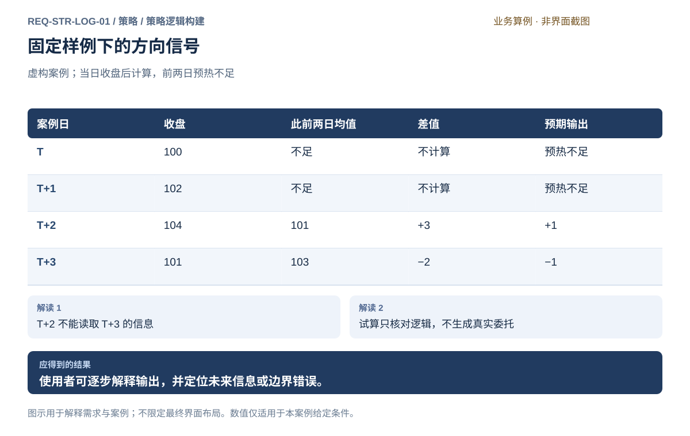
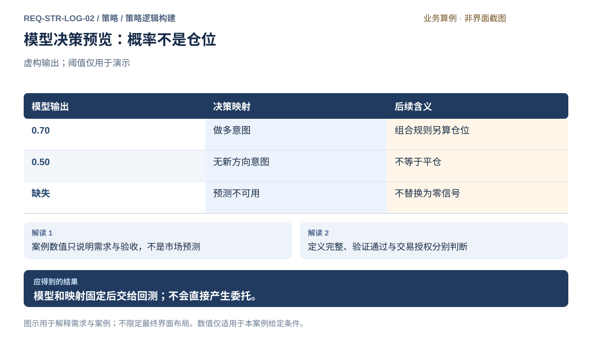
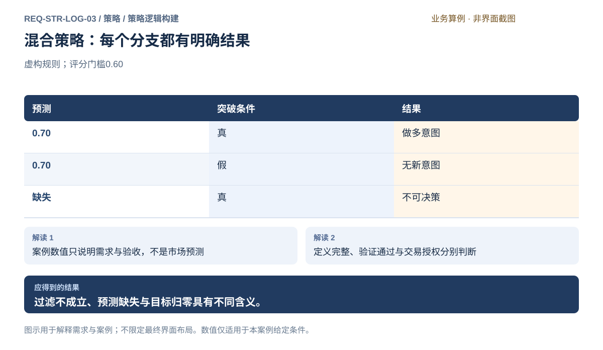
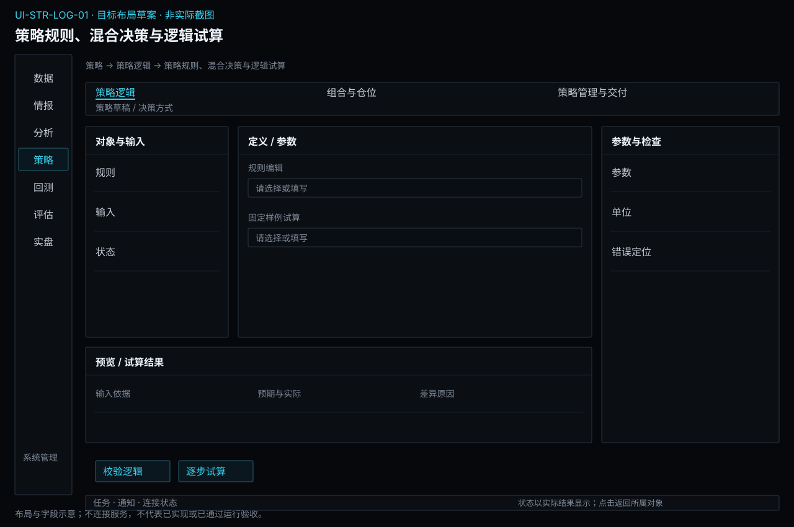
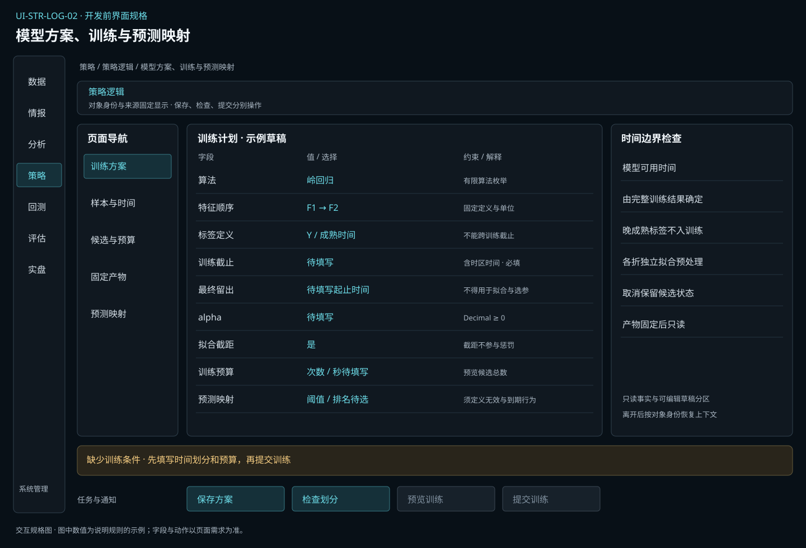

# 策略逻辑构建

[返回上级](README.md) · [需求总纲](../../README.md) · [实际界面](../../common/screens.md) · [跨模块流程](../../workflows/README.md)

需求交付版 · 2026-10-18。细化规格已编制，用户逐项签认与产品验收分别记录；目标设计不代表已经实现，实际入口与差距见本页界面对应。

**归属：** 策略 / 策略逻辑构建。本页集中保存业务需求、详细功能、案例、界面对应和验收；通用规则见[通用规范](../../common/README.md)。

## 需求导航

- [REQ-STR-LOG-01 构建规则策略并用固定样例核对决策](#req-str-log-01)
- [REQ-STR-LOG-02 训练模型并定义预测到策略决策的映射](#req-str-log-02)
- [REQ-STR-LOG-03 组合规则与模型并明确策略状态](#req-str-log-03)

## 子模块详细设计

规则、模型与混合策略在这里定义如何决策。变量生产和分析筛选由分析模块负责，本页通过固定引用消费；策略需要的预测模型、训练过程和决策映射由本页拥有。

| 构建方式 | 输入和配置                                          | 必须解释的结果                                 |
| -------- | --------------------------------------------------- | ---------------------------------------------- |
| 规则     | 特征、阈值、比较、事件、条件优先级、状态和退出      | 哪些条件成立、使用何时已知数据、为什么产生意图 |
| 模型     | 特征/标签、目标函数、算法、处理、时间划分、搜索预算 | 哪份训练产物、输入顺序单位、预测含义与有效期   |
| 混合     | 模型预测、规则过滤、状态条件及冲突处理              | 每个分支与最终意图之间的关系                   |

### 共同的决策契约

| 字段组 | 内容                                            | 必须满足的约束                         |
| ------ | ----------------------------------------------- | -------------------------------------- |
| 输入   | 固定定义、品种/合约、单位、周期、事件与可得时间 | 不能读到决策后才可知的值；缺失与零分开 |
| 事件   | 何时触发、同一事件身份、频率、日历和截止时点    | 重复收到同一事件不应重复累加同一意图   |
| 状态   | 初始状态、可信实际持仓引用、冷却和退出条件      | 目标不是实际；状态不明时明确不可决策   |
| 输出   | 方向、评分或明确目标语义、有效时间和理由        | 无新意图、目标零、计算无效分别表达     |
| 参数   | 名称、类型、单位、范围、联动约束                | 试算结果只覆盖其实际参数，修改后须重查 |

单策略可以直接给出目标，但须声明目标单位并进入组合约束；不能由逻辑绕过组合和账户风险直接发送订单。规则退出意图不等于退出成交，退出后的实际持仓必须来自执行事实。

### 模型训练与时间边界

训练方案先固定特征与标签、训练/开发验证/最终留出、目标函数、搜索空间和资源预算，再执行拟合。需要学习的缩放、插补、特征选择与模型参数均在相应训练折中拟合；分析可提供定义和探索证据，但全期拟合的处理结果不能直接用于独立训练验证。

显示每个参数候选的实际状态和评分范围；失败、取消与未开始不能被隐藏或填零。比较模型必须核对目标、样本和评价口径。算法含随机性时记录随机源和允许误差依据，不能用随意加大容差掩盖差异。

历史回测有两种明确用途：固定模型只在其训练完成并可用之后的区间评估；滚动训练按历史时点仅读取当时允许的资料并产出各次模型。用户必须选定用途，禁止把最终全期模型回填整个历史。训练耗时或模型可用时刻影响预测何时允许使用，不能假定尚未完成的模型已在线。

模型训练中的预测损失与完整策略的净盈亏、回撤分别评价。训练评分较好不表示扣除成交成本后策略有效，完整验证交给回测模块。模型更新形成新候选；自动训练计划若提供，需要明确触发、预算、失败与审阅条件，默认不热替换已有实例。

### 决策组合与试算

混合策略用明确的条件顺序和状态转换表表达。给定上涨概率0.70且突破条件为真可形成做多意图；突破为假是无新意图；预测缺失是不可决策。这三种情况不等同于目标仓位归零。若策略希望过滤失败时退出，须单独写出退出规则。

固定样例必须先保存预期，逐步显示输入、条件、状态变化和最终输出，支持定位时间穿越和边界错误。文档及测试样例不是市场来源，不能用于报告真实策略收益。以真实数据检验市场有效性必须使用提供方快照并进入独立回测。

### 目标界面与异常反馈

规则工作区以定义和状态编辑为主体，下方联动样例预期与实际；模型工作区展示训练计划、候选进度、固定产物和预测映射。工作台可以互相跳转，但固定逻辑只能引用明确模型，不能引用可变的“最佳模型”别名。

字段无效时保留草稿并标明字段和单位；预热不足显示缺口；条件冲突定位两条条件；模型输入不符列出差异；模型不可用按声明政策停止新增决策。任何异常都不得隐式换模型、忽略规则或把无效值改成零继续运行。

## REQ-STR-LOG-01 构建规则策略并用固定样例核对决策

**领域：** 策略 / 策略逻辑构建　 **建议优先级：** P1核心必要　 **需求状态：** 交付规格已编制（定位与模块已确认；细节待用户签认）

### 目标与场景

个人研究者定义条件、事件和状态，引用分析特征形成明确决策，再用固定样例核对行为。策略逻辑及试算证据可追溯，不能只凭名称或一次成功运行判断正确。

**使用者与场景：** 同时研究规则策略和多因子组合的个人使用者，在定义、修改或复核计算逻辑时。

**触发条件：** 使用者新建逻辑定义、提供修改内容，或从实验结果回到原逻辑排查。

### 前置条件

- 明确逻辑用途为规则决策或信号到决策的转换；可复用特征定义由分析模块提供。
- 固定虚构样例仅用于逻辑测试或教学，不作为生产数据来源、市场研究证据或策略收益证据。

### 输入与含义

| 输入           | 含义与单位                                         | 约束                                                                           |
| -------------- | -------------------------------------------------- | ------------------------------------------------------------------------------ |
| 逻辑内容与来源 | 用户可审阅的计算说明、规则或所提供材料             | 编辑形式和具体语言待评审，不预设嵌入开发环境；与分析变量定义通过固定引用交接。 |
| 输入输出与参数 | 字段单位、时间可知性、预热长度、结果类型和参数边界 | 声明方向、评分、无新意图或目标零的具体语义；未来目标不得作为当时输入。         |
| 固定样例与预期 | 明确样例输入、预期输出及允许误差的依据             | 预期先于试算保存；缺失、零值、预热不足不能混同。                               |

### 正常操作与反馈

1. 使用者说明逻辑用途、输入输出和参数，提供可审阅内容。
2. 系统检查必要定义并把问题定位到字段、计算步骤或所提供材料的位置。
3. 使用者选择固定样例，事先填写预期输出和关键边界。
4. 试算后逐项比较实际与预期，查看使用了哪些已知输入。
5. 修改内容后重新试算，形成可辨认的新内容身份，旧实验引用保持原样。
6. 通过核对的逻辑交给组合与策略包管理，再创建回测草稿；运行仍须满足数据、成本和风险条件。

### 业务规则

- 逻辑身份绑定实际内容与输入输出约束；同名不等于相同内容，不使用名称覆盖旧证据。
- 参数值与逻辑内容分别记录，修改任一项使原试算结论不再覆盖新条件。
- 试算仅产生计算结果与定位信息，不发送委托，不表示策略已获实盘授权。
- 虚构样例仅作逻辑测试或教学；真实研究必须使用合法提供方数据，不能以样例输出支持市场结论。
- 只能使用决策时点已经可知的输入；预热不足和无法定义的输出须明确标识。
- 输出不满足声明约束时试算失败，不以零信号或默认仓位掩盖错误。
- 进入任何回测仍要求必要风险配置及风险能力可用；逻辑试算通过不能豁免。

### 输出与状态影响

- 有明确用途、内容身份和输入输出约束的逻辑定义。
- 绑定具体内容、参数和固定样例的试算结果与差异定位。
- 用于新实验的待确认逻辑引用，不自动产生回测或交易。

### 异常与继续方式

| 发生什么                           | 应怎样表现                                 | 使用者如何继续                                   |
| ---------------------------------- | ------------------------------------------ | ------------------------------------------------ |
| 样例缺少预热所需历史值。           | 标为预热不足，不输出假定的零或方向。       | 补足明确样例历史，或核对所声明预热长度。         |
| 实际输出不是声明允许的类型或范围。 | 显示实际值、约束及对应步骤，保留失败证据。 | 修改逻辑或修正不合理的声明后，以新条件重新试算。 |

### 案例：差值方向规则的逐日试算

**虚构案例条件：** 虚构案例：示例合约 A 四日收盘依次为 T=100、T+1=102、T+2=104、T+3=101 元/单位。规则在当日收盘可知后计算当日收盘减前两日均值；差值至少 2 输出 +1，至多 −2 输出 −1，其余输出 0。前两日预热不足。输出是研究信号，不是成交。 此例输出0表示无新方向意图，不表示平仓，目标持仓另由组合政策解释。

1. T 与 T+1 没有足够的前两日输入，明确标为预热不足。
2. T+2 的此前均值为 101，差值 3，输出 +1；T+3 的此前均值为 103，差值 −2，输出 −1。
3. 单独改变 T+3 的样例值重新核对 T+2，T+2 输出必须仍为 +1。

**预期结果：**

- 四日结果依次为预热不足、预热不足、+1、−1。
- 试算没有产生订单；后日输入变化不能影响此前信号。

### 可观察验收条件

| 编号                | 给定                             | 当                  | 则                                                        |
| ------------------- | -------------------------------- | ------------------- | --------------------------------------------------------- |
| REQ-STR-LOG-01-AC01 | 案例定义、参数与预期已固定       | 执行四日样例试算    | 前两日为预热不足，后两日为 +1 和 −1，并能复算均值与差值。 |
| REQ-STR-LOG-01-AC02 | 仅修改案例 T+3 输入              | 重新核对 T+2 的输出 | T+2 仍为 +1，使用的输入不含 T+3。                         |
| REQ-STR-LOG-01-AC03 | 输出应为 −1、0、+1 却返回其他值  | 检查试算结果        | 明确失败并定位到输出步骤，不自动改成零。                  |
| REQ-STR-LOG-01-AC04 | 逻辑内容被修改且原内容已用于实验 | 登记修改内容        | 生成可辨认的新内容身份，原实验仍指向原内容及原试算证据。  |

### 决定与配置约束

- **DEC-STR-LOG-01-01**：**规格决定**。结构化条件及表达式编辑，支持K线收盘、核验事件、定时调仓、有限状态、入场/退出/目标调整；错误定位到规则和字段，提供固定样例逐事件试算。

- **DEC-STR-LOG-01-02**：**规格决定**。逻辑样例至少覆盖条件成立、不成立、输入缺失、边界相等和重复事件；数量及Decimal账本精确比对，浮点预测使用固定方法容差；样例通过后仍需独立回测和评估。

### 详细功能

### FR-STR-LOG-01-01 提供逻辑并声明输入输出约束

**目标与结果：** 使用者把规则决策定义成可审阅的具体内容，通过固定引用复用分析特征。输入、时间口径、参数与输出明确，避免相同名称掩盖不同计算。

**触发：** 从研究问题进入策略逻辑工作区，选择新建或查看原定义。

**输入与约束：** 逻辑用途、内容材料、所需字段、单位、预热和参数约束；编辑或提供形式待评审，不默认某种语言或完整开发环境。

**目标操作与反馈：**

1. 选择规则决策用途，引用分析特征并提供逻辑内容。
2. 填写输入可知时间、参数范围及输出类型。
3. 检查定义并查看可定位的缺项，保存普通草稿。

**异常与边界：**

- 同名材料不能自动覆盖已被实验引用的内容。
- 定义不完整时允许保留草稿，但不能登记为已满足输入输出条件。

**验收条件：**

- **FR-STR-LOG-01-01-AC01**：缺少输出类型时指出相应字段，不用默认零信号代替定义。
- **FR-STR-LOG-01-01-AC02**：从旧实验进入能看到实际引用内容，修改草稿不改变旧实验。

**界面对应：** [UI-STR-LOG-01 策略规则、混合决策与逻辑试算](#ui-str-log-01)。

### FR-STR-LOG-01-02 固定样例与预期并逐步试算

**目标与结果：** 使用者可在正式研究前核对逻辑是否按预期计算，特别检查预热、零值和时间边界。试算结果与事先预期并排显示，不能把实际输出事后改写成原预期。

**触发：** 量化逻辑页选择固定样例，填写预期后点击试算。

**输入与约束：** 明确的样例身份、输入序列和预期输出；样例可虚构但只能用于试算，不混入真实研究数据。试算不提交交易或替代风险检查。

**目标操作与反馈：**

1. 选择固定输入并保存逐时点预期。
2. 运行逻辑试算，查看实际值、差异与使用的输入。
3. 逐步核对预热和有效输出，保留同条件结果。

**异常与边界：**

- 预热不足显示原因，不用零值充当方向信号。
- 样例或参数变化使原试算不再覆盖新条件，需要重新计算。

**验收条件：**

- **FR-STR-LOG-01-02-AC01**：案例四日输出为预热不足、预热不足、+1、−1，均值与差值可核对。
- **FR-STR-LOG-01-02-AC02**：仅改 T+3 输入不影响 T+2 输出，且试算产生真实委托为零。

**界面对应：** [UI-STR-LOG-01 策略规则、混合决策与逻辑试算](#ui-str-log-01)。

### FR-STR-LOG-01-03 定位逻辑错误与不符合约束的输出

**目标与结果：** 试算失败时应能定位哪项输入、计算步骤或输出违反定义，使使用者修正真正的问题。错误结果必须保留上下文，不能被吞掉后显示为无信号或一次成功。

**触发：** 定义检查或固定样例试算出现失败、输出差异或输入时间违规。

**输入与约束：** 错误位置、实际值、预期值与声明约束；按提供形式定位字段或计算步骤，具体源码级调试能力待评审，不作虚假承诺。

**目标操作与反馈：**

1. 选择失败样例查看对应位置和原因。
2. 展开可知输入及实际输出，区分计算异常与预期不符。
3. 修改草稿后重新试算，核对差异是否消除。

**异常与边界：**

- 某个样例失败不删除其他样例结果，但不能把整体标为全部通过。
- 不符合输出约束时明确失败，不通过自动改型或填默认值掩盖。

**验收条件：**

- **FR-STR-LOG-01-03-AC01**：方向输出返回2时显示允许范围为−1、0、+1及失败步骤。
- **FR-STR-LOG-01-03-AC02**：修正后新试算保留旧失败证据，旧输入和结果不被覆写。

**界面对应：** [UI-STR-LOG-01 策略规则、混合决策与逻辑试算](#ui-str-log-01)；[UI-SYS-REC-02 事件与诊断](../system/records.md#ui-sys-rec-02)。

### FR-STR-LOG-01-04 固定内容身份并交接可追溯实验引用

**目标与结果：** 使用者确认一份逻辑后，后续样例、单次实验和批次都引用同一实际内容。更改规则或参数形成明确新条件，重跑时能解释差异，不能用名称相同冒充复现。

**触发：** 量化逻辑页完成核对后登记内容，或从登记内容进入研究草稿。

**输入与约束：** 实际内容、输入输出约束、参数与试算证据；内容身份由其含义确定，不设置开发历史版本计数。参数选择与内容本身分别记录。

**目标操作与反馈：**

1. 审阅内容及试算覆盖，登记可辨认身份。
2. 在策略管理中组装固定策略包，再选择交付回测或批量实验草稿。
3. 在目标草稿确认数据、风险及评价条件后再运行。

**异常与边界：**

- 内容变化后不复用旧试算的通过结论，旧实验引用保持。
- 逻辑通过不代表回测具备风险条件，也不产生实盘授权。

**验收条件：**

- **FR-STR-LOG-01-04-AC01**：旧实验仍可找到原内容，新内容可辨认且不覆盖旧资料。
- **FR-STR-LOG-01-04-AC02**：缺少风险配置时目标回测明确拒绝，不能凭逻辑试算通过启动。

**界面对应：** [UI-STR-LOG-01 策略规则、混合决策与逻辑试算](#ui-str-log-01)；[UI-STR-DLV-02 策略包、参数方案与交付](delivery.md#ui-str-dlv-02)；[UI-BKT-EXP-01 回测方案与验证计划](../backtest/experiments.md#ui-bkt-exp-01)。

### FR-STR-LOG-01-05 按支持能力编写规则并定位输入错误

**来源与确认：** 2026-10-18全面审查及用户授权补充；详细行为草案待评审，未实现、未执行产品验收。

**目标与结果：** 使用者能知道如何表达规则以及为何不能运行，编写入口不能只是一句“支持自定义”。

**触发：** 新建或编辑规则策略。

**输入与约束：** 经评审支持的表达方式及算子清单；每个算子声明输入类型、输出、窗口、缺失处理、单位和可得时点。具体语言/编辑器仍为待决定项。

**目标操作与反馈：**

1. 选能力范围内的表达方式，建立命名输入、条件、触发与输出目标；显示可用算子及限制。
2. 检查参数类型、窗口取值、单位、必需数据和状态初始化，定位到规则节点或表达位置。
3. 固定小样例逐事件试算，显示实际读取值、条件结果及目标；仅检查通过内容可进入固定包。

**异常与边界：**

- 未知算子、越界参数及读未来数据明确失败；不自动替换成相似方法。
- 语法检查通过不等于历史验证通过，不接入真实账户发单。

**操作案例：** “收盘大于过去N根均值”检查N为正整数并说明窗口是否包含本根；窗口不足返回已定义的不可决策状态。

**验收条件：**

- **FR-STR-LOG-01-05-AC01**：规则引用不存在的字段时定位字段并阻止固定，用户其他输入保留。
- **FR-STR-LOG-01-05-AC02**：同一固定规则和样例可核对每个决策依据，试算不产生真实交易。

**界面对应：** [UI-STR-LOG-01](#ui-str-log-01)。

## REQ-STR-LOG-02 训练模型并定义预测到策略决策的映射

**领域：** 策略 / 策略逻辑构建　 **建议优先级：** P1核心必要　 **需求状态：** 交付规格已编制（定位与模块已确认；细节待用户签认）

### 目标与场景

把分析提供的变量和目标变成有训练依据的模型，明确何时预测以及预测值怎样影响决策；预测表现不能替代完整策略回测。

**使用者与场景：** 个人期货量化研究与实盘使用者，构建规则、模型或混合策略时。

**触发条件：** 从分析候选新建模型方案并绑定输入定义。

### 前置条件

- 已有可追溯的分析特征或策略输入定义；真实训练与研究数据来自数据提供方。
- 清楚区分逻辑试算、模型训练、历史回测与账户运行，定义或训练不会发送委托。

### 输入与含义

| 输入     | 含义与单位                                             | 约束                                                 |
| -------- | ------------------------------------------------------ | ---------------------------------------------------- |
| 模型方案 | 特征/标签定义、样本计划、算法插件、参数空间及目标函数  | 只有当前支持的算法可选；不宣称支持任意模型           |
| 训练条件 | 数据快照、训练及开发验证区间、预处理、随机性与资源预算 | 最终留出不用于拟合或选参；每个训练折独立拟合         |
| 预测约定 | 特征顺序与单位、预测时间、输出含义、映射阈值及有效期   | 输入与训练契约一致；阈值、无效预测和到期处理显式声明 |

### 正常操作与反馈

1. 从分析候选新建模型方案并绑定输入定义。
2. 声明目标函数、时间划分、候选参数和训练预算。
3. 检查标签边界与拟合范围后明确启动训练。
4. 查看逐候选训练结果、失败及选择依据，固定模型与处理产物。
5. 预览预测值、输入可得时间及决策映射，保存待回测策略。

### 业务规则

- 可复用分析中的处理定义，但拟合产物必须属于当前训练窗口；不能用全期资料预拟合结果。
- 模型内容、训练数据、参数、处理链及输入约束一同固定；同名模型不代表同一产物。
- 最终测试范围参与选择后须标已使用，不能靠重命名恢复独立性。
- 模型更新创建新候选，不能自动替换运行中策略的依赖。
- 模型失效或预测不可用不得隐式切换旧模型、规则模型或零信号。

### 输出与状态影响

- 固定模型、拟合处理、输入输出契约和训练选择记录。
- 预测到策略决策的明确映射及待回测方案。

### 异常与继续方式

| 发生什么                     | 应怎样表现                             | 使用者如何继续                       |
| ---------------------------- | -------------------------------------- | ------------------------------------ |
| 输入字段缺失、顺序或单位不符 | 定位契约差异，拒绝本次预测             | 补足匹配输入或新建并训练适用方案     |
| 训练部分失败或超出预算       | 保存各候选事实和消耗，不宣布全空间完成 | 明确缩小范围或发起补充训练           |
| 已固定模型超过声明适用期限   | 标不可用于新增决策，保留状态与证据     | 审阅新模型候选并通过独立运行变更流程 |

### 案例：预测值、映射结果与仓位分别记录

**虚构案例条件：** 固定示例模型输出上涨概率0.70、0.50、缺失。映射为p≥0.60产生做多意图，p≤0.40产生做空意图，其间不产生新方向意图。示例阈值不是推荐交易参数。

1. 依次输入三个预测结果核对映射。
2. 第三个结果必须报告预测不可用。
3. 把有效意图交给组合规则计算目标仓位。

**预期结果：**

- 0.70为做多意图；0.50为无新方向意图，不等于平仓。
- 缺失不是0或做空；0.70也不等于70%资金仓位。

### 可观察验收条件

| 编号                | 给定                       | 当             | 则                                     |
| ------------------- | -------------------------- | -------------- | -------------------------------------- |
| REQ-STR-LOG-02-AC01 | 三个预测为0.70、0.50、缺失 | 按案例映射试算 | 分别输出做多、无新方向意图、预测不可用 |
| REQ-STR-LOG-02-AC02 | 最终留出结果已被用于选模型 | 保存候选       | 记录范围已使用，不标为独立测试         |
| REQ-STR-LOG-02-AC03 | 训练完成后修改输入单位     | 请求预测       | 拒绝不匹配输入，不静默转换未声明口径   |

### 决定与配置约束

- **DEC-STR-LOG-02-01**：**规格决定**。首批模型为线性回归及岭回归；特征顺序、标签、预处理、训练窗口、参数和预测映射均固定，算法以可信插件提供，不引入任意在线代码执行。

- **DEC-STR-LOG-02-02**：**运行配置**。每次训练显式选择样本、计算位置、时间/次数预算；更新由新任务产生新包，不热替换运行实例。有效截止或失效条件是模型方案必填项，过期不自动续用。

### 详细功能

### FR-STR-LOG-02-01 建立模型方案和时间划分

**目标与结果：** 把目标、特征与训练规则固定为可检查计划。

**触发：** 从分析候选创建模型方案。

**输入与约束：** 分析特征/标签引用、样本快照、算法、主目标、训练/开发验证/最终留出。

**目标操作与反馈：**

1. 从分析候选创建模型方案。
2. 检查输入单位、标签边界和各样本角色。
3. 保存训练计划与未定项。

**异常与边界：**

- 特征筛选和拟合必须属于相应训练折。
- 不预选不支持的模型或默认为无限训练。

**验收条件：**

- **FR-STR-LOG-02-01-AC01**：最终留出不进入训练样本与选参评分。
- **FR-STR-LOG-02-01-AC02**：跨界标签按实际结束时间剔除，可查看具体行。

**界面对应：** [UI-STR-LOG-02 模型方案、训练与预测映射](#ui-str-log-02)。

### FR-STR-LOG-02-02 预览训练空间与资源并运行

**目标与结果：** 让每个训练候选的成本和结果都有记录。

**触发：** 预览有效参数组合与预计资源。

**输入与约束：** 参数候选、拟合管线、资源预算、停止条件与随机性设置。

**目标操作与反馈：**

1. 预览有效参数组合与预计资源。
2. 明确确认范围后启动训练。
3. 查看进度、逐候选结果、失败与取消。

**异常与边界：**

- 超预算阻断提交，不自动缩小参数空间。
- 失联先查询原运行，不自动重复训练；随机模型记录随机性来源而非承诺任意环境位级一致。

**验收条件：**

- **FR-STR-LOG-02-02-AC01**：2种深度与3种学习率显示6个候选。
- **FR-STR-LOG-02-02-AC02**：4完成1失败1取消时总数仍6，不把失败填0评分。

**界面对应：** [UI-STR-LOG-02 模型方案、训练与预测映射](#ui-str-log-02)。

### FR-STR-LOG-02-03 按训练计划选择并固定模型产物

**目标与结果：** 保存选择依据而不覆盖不理想试验。

**触发：** 比较同口径候选及不完整范围。

**输入与约束：** 候选评分、训练范围、拟合参数、输入契约、模型内容与选择理由。

**目标操作与反馈：**

1. 比较同口径候选及不完整范围。
2. 按预定标准选择或记录无合格模型。
3. 固定模型、处理链与全部证据引用。

**异常与边界：**

- 没有合格候选允许为空。
- 看到留出后改选必须记录该范围参与选择。

**验收条件：**

- **FR-STR-LOG-02-03-AC01**：固定模型能回到原样本、参数和拟合统计量。
- **FR-STR-LOG-02-03-AC02**：模型名称相同但内容不同不能替换旧策略依赖。

**界面对应：** [UI-STR-LOG-02 模型方案、训练与预测映射](#ui-str-log-02)。

### FR-STR-LOG-02-04 定义预测契约和决策映射

**目标与结果：** 使预测值具有明确策略含义。

**触发：** 预览模型输入和输出。

**输入与约束：** 输出类型、特征顺序单位、预测时点、阈值、有效期及无效值处理。

**目标操作与反馈：**

1. 预览模型输入和输出。
2. 设置预测到方向或评分的映射。
3. 用已固定测试样例检查边界。

**异常与边界：**

- 概率不直接等于资金权重。
- 无效预测不按0参与方向判断；过期模型不得自动换旧模型。

**验收条件：**

- **FR-STR-LOG-02-04-AC01**：0.70/0.50/缺失分别得到做多/无新方向/预测不可用。
- **FR-STR-LOG-02-04-AC02**：输入顺序或单位错误时明确拒绝预测。

**界面对应：** [UI-STR-LOG-02 模型方案、训练与预测映射](#ui-str-log-02)。

### FR-STR-LOG-02-05 产生模型更新候选并交接验证

**目标与结果：** 更新模型而不暗改已运行策略。

**触发：** 显式发起新训练或审阅已声明计划的训练候选。

**输入与约束：** 更新原因、训练时点、数据快照、前后模型与适用范围。

**目标操作与反馈：**

1. 显式发起新训练或审阅已声明计划的训练候选。
2. 比较新旧模型及信息使用范围。
3. 选择新产物构成新策略候选，再交付回测。

**异常与边界：**

- 本需求不默认启用自动训练；启用计划需明确频率、预算与失败行为。
- 训练完成不热替换运行实例，切换按交易运行变更流程执行。

**验收条件：**

- **FR-STR-LOG-02-05-AC01**：新模型M2出现后旧包仍引用M1。
- **FR-STR-LOG-02-05-AC02**：M2未完成验证时不能沿用M1结论显示已验证。

**界面对应：** [UI-STR-LOG-02 模型方案、训练与预测映射](#ui-str-log-02)。

## REQ-STR-LOG-03 组合规则与模型并明确策略状态

**领域：** 策略 / 策略逻辑构建　 **建议优先级：** P1核心必要　 **需求状态：** 交付规格已编制（定位与模块已确认；细节待用户签认）

### 目标与场景

为规则、模型及混合策略提供一致的决策语义和可复核状态，避免条件冲突、缺失预测或重复事件造成意外交易意图。

**使用者与场景：** 个人期货量化研究与实盘使用者，构建规则、模型或混合策略时。

**触发条件：** 选择规则、模型或混合模式，声明输入和输出类型。

### 前置条件

- 已有可追溯的分析特征或策略输入定义；真实训练与研究数据来自数据提供方。
- 清楚区分逻辑试算、模型训练、历史回测与账户运行，定义或训练不会发送委托。

### 输入与含义

| 输入       | 含义与单位                                     | 约束                                               |
| ---------- | ---------------------------------------------- | -------------------------------------------------- |
| 决策组合   | 规则条件、模型输出、方向映射及优先级           | 保留业务含义，不把无新意图、目标零和无效输入混同   |
| 事件与状态 | 触发时刻、已知持仓、冷却期、上一决策及退出规则 | 声明状态来源与生效时点；不能把目标持仓当已成交持仓 |
| 异常行为   | 缺输入、无效预测、条件冲突与状态不明           | 明确禁止新增意图或要求核实，不暗中改成平仓或反向   |

### 正常操作与反馈

1. 选择规则、模型或混合模式，声明输入和输出类型。
2. 列出触发事件、过滤条件、优先级和状态转换。
3. 预先保存固定样例及各分支预期。
4. 逐步试算，查看每个条件与状态如何形成最终意图。
5. 固定逻辑并交给组合和策略包管理。

### 业务规则

- 规则和模型共用决策输出契约，不建立两套互不兼容的策略运行路径。
- 存在持仓时，无新意图保持由既有持仓政策解释；明确目标零才表示希望归零。
- 冲突时采用事前声明的确定规则，没有规则则拒绝产生新增意图。
- 逻辑试算和历史回测共享同一份定义，不能把回测专用公式当另一策略实现。
- 停止、撤单、平仓是交易侧独立动作；策略草稿修改不能触发它们。

### 输出与状态影响

- 可复核的决策组合、状态约定和试算轨迹。
- 规则/模型/混合均可消费的统一策略定义。

### 异常与继续方式

| 发生什么                                 | 应怎样表现                                     | 使用者如何继续                  |
| ---------------------------------------- | ---------------------------------------------- | ------------------------------- |
| 规则要求做空但模型要求做多且优先级未定义 | 显示冲突与相关输入，阻止新增意图               | 补充组合规则后重新试算          |
| 模型无效且规则仍满足                     | 按无效输入政策保持不可决策，不自动降级为纯规则 | 核实模型或显式新建纯规则候选    |
| 状态起点与事实不符                       | 标明无法复现的状态差异                         | 核对账户/模拟事实后重新设定起点 |

### 案例：规则过滤与模型预测共同形成意图

**虚构案例条件：** 虚构规则：模型上涨概率至少0.60且突破条件为真才产生做多意图；预测无效时禁止新增意图。

1. 输入p=0.70、突破为真。
2. 输入p=0.70、突破为假。
3. 输入预测缺失、突破为真。

**预期结果：**

- 依次为做多意图、无新意图、不可决策。
- 已有仓位不因第二行被默默归零，第三行不回退成纯突破策略。

### 可观察验收条件

| 编号                | 给定                     | 当           | 则                                       |
| ------------------- | ------------------------ | ------------ | ---------------------------------------- |
| REQ-STR-LOG-03-AC01 | 0.70且突破为真           | 试算混合策略 | 产生做多意图并显示两个条件依据           |
| REQ-STR-LOG-03-AC02 | 0.70但突破为假且已有持仓 | 试算         | 无新意图，不生成未声明的平仓意图         |
| REQ-STR-LOG-03-AC03 | 预测缺失但突破为真       | 试算         | 按无效输入政策阻止新增，不自动切换纯规则 |

### 决定与配置约束

- **DEC-STR-LOG-03-01**：**规格决定**。规则按显式顺序过滤输入、检查模型预测并产生唯一目标；有限状态初始化和退出必填，冲突无优先级时拒绝固定，缺预测不视作零。

### 详细功能

### FR-STR-LOG-03-01 定义规则、模型与混合决策结构

**目标与结果：** 让不同决策方式共用清楚的输入输出语义。

**触发：** 选择构建方式并列出依赖。

**输入与约束：** 规则、模型引用、过滤、优先级、输出方向/评分/目标语义。

**目标操作与反馈：**

1. 选择构建方式并列出依赖。
2. 定义各条件及组合顺序。
3. 检查未定义冲突和输出范围。

**异常与边界：**

- 多模型组合不自动变成账户组合。
- 无冲突政策时拒绝新增意图，不猜测优先级。

**验收条件：**

- **FR-STR-LOG-03-01-AC01**：规则与模型方向冲突时显示冲突来源。
- **FR-STR-LOG-03-01-AC02**：模型缺失不会自动成为规则单独触发。

**界面对应：** [UI-STR-LOG-01 策略规则、混合决策与逻辑试算](#ui-str-log-01)。

### FR-STR-LOG-03-02 声明决策事件、状态和退出规则

**目标与结果：** 使重复事件与持仓状态有确定解释。

**触发：** 设置触发事件和数据截止时点。

**输入与约束：** 交易日历、决策频率、冷却条件、实际持仓引用、退出触发和状态起点。

**目标操作与反馈：**

1. 设置触发事件和数据截止时点。
2. 声明入场、持有、退出与冷却规则。
3. 按状态序列逐步试算。

**异常与边界：**

- 状态未知必须核实，不拿目标持仓替代实际。
- 目标零、无新意图、计算无效分别表达。

**验收条件：**

- **FR-STR-LOG-03-02-AC01**：已有仓位而过滤条件不满足时按声明政策处理，不无故归零。
- **FR-STR-LOG-03-02-AC02**：同一事件重复观察不能重复累计同一调仓意图。

**界面对应：** [UI-STR-LOG-01 策略规则、混合决策与逻辑试算](#ui-str-log-01)。

### FR-STR-LOG-03-03 核对混合策略的分支与异常

**目标与结果：** 在交付前暴露输入缺失、条件冲突与未来信息。

**触发：** 先保存各分支预期。

**输入与约束：** 固定样例、状态起点、预期输出、必要边界与容差依据。

**目标操作与反馈：**

1. 先保存各分支预期。
2. 运行逐步试算并查看条件链。
3. 定位差异后修改草稿并重新检查。

**异常与边界：**

- 样例只测试逻辑，不是市场证据。
- 无法解释的差异不以宽松容差掩盖。

**验收条件：**

- **FR-STR-LOG-03-03-AC01**：0.70配真/假突破和缺失配真突破产生三种不同结果。
- **FR-STR-LOG-03-03-AC02**：改变后续输入不改变此前意图。

**界面对应：** [UI-STR-LOG-01 策略规则、混合决策与逻辑试算](#ui-str-log-01)。

### FR-STR-LOG-03-04 交付统一决策定义给组合与策略包

**目标与结果：** 让回测和交易准备使用相同含义的逻辑。

**触发：** 检查完整依赖和输出单位。

**输入与约束：** 具体定义、模型、参数、状态、时间语义和组合输出约定。

**目标操作与反馈：**

1. 检查完整依赖和输出单位。
2. 固定逻辑内容与试算证据。
3. 在策略包中选择该定义及组合政策。

**异常与边界：**

- 运行消费者不得用另一份同名回测专用定义代替。
- 策略包交付不等于自动启动计算或交易。

**验收条件：**

- **FR-STR-LOG-03-04-AC01**：回测与交易准备能定位同一内容身份。
- **FR-STR-LOG-03-04-AC02**：逻辑改变后旧试算不覆盖新内容。

**界面对应：** [UI-STR-DLV-02 策略包、参数方案与交付](delivery.md#ui-str-dlv-02)。

## 界面设计与实际对应

## UI-STR-LOG-01 策略规则、混合决策与逻辑试算

**业务目标：** 引用分析特征，定义规则和模型组合、事件及状态，用固定样例核对后交给策略包管理。

**对应情况：待设计。** 当前没有规则逻辑编辑、固定样例试算与逐步调试页面。

**实际入口：** 暂无可直接到达的独立界面。

当前没有对应的实际界面截图；下方目标设计不表示已经实现或操作成功。

### 页面形态与目标布局

**设计状态：** 目标规格已编制，含布局、字段、动作和关键状态；尚未获得逐项产品签认或实现验收。现状对应证据保持上文说明，图稿不是运行截图。

**界面形态：** 编辑与试算工作区。

**目标到达路径：** 策略 → 策略逻辑 → 策略规则、混合决策与逻辑试算。这是已确认导航下的目标入口，实际对应仍见上方证据。

| 区域 | 要显示的内容 |
| --- | --- |
| 顶部上下文 | 策略草稿 / 决策方式 |
| 列表、分类或步骤区 | 规则 / 输入 / 状态 |
| 主要工作区 | 规则编辑 / 固定样例试算 |
| 选中项详情或检查区 | 参数 / 单位 / 错误定位 |
| 主要动作区 | 校验逻辑 / 逐步试算 |

**区域联动与返回：** 选择列表或步骤只更新当前对象及详情，不隐式启动业务；图表与明细使用同一输入或结果上下文。离开并返回保留已确认的对象和查询条件，未保存草稿按本页保存语义处理。异步提交后用请求/任务身份定位实际状态，不能把操作按钮点击当作成功。

**窗口与空间：** 复用现有主窗口框架。宽度缩小时优先收拢辅助详情，表格在内容区横向滚动；主操作和关键上下文不能被页面裁切。重新展开详情仍指向原选中对象。

**状态设计范围：** 以本页状态/异常和验收为准，正常操作、首次无对象、筛选无匹配、请求中、失败及该业务的未知状态分别说明；不适用状态需说明原因，不套用虚构成功数据。字段类型、默认值和动作前提见下文；关键状态按本页交付约定及模块状态图检查。[返回界面设计总览](../../common/ui-designs.md)。

### 目标交互设计（待实现）

规则与混合方式共用逻辑工作区；模型训练由模型页负责。当前没有已核对的独立编辑与调试页面。

**字段与信息：**

- 逻辑方式、特征/模型输入、单位和时点
- 触发事件、条件优先级、输出语义与状态
- 固定样例、预期、实际输出和条件链

**动作与反馈：**

- 编辑草稿并校验
- 保存预期并逐步试算
- 查看差异和未来信息检查
- 固定逻辑用于策略包

**状态与异常：**

- 预热不足与计算无效分开
- 条件冲突未定义时阻止新增意图
- 草稿改变后原试算只属于原内容

### 业务验收要求（待验收，不代表截图已证明实现）

- **UI-STR-LOG-01-AC01**：四日样例前两日为预热不足，后两日实际与预期均为+1、−1，输入依据可展开。
- **UI-STR-LOG-01-AC02**：改变后日输入不影响此前输出；内容或参数改变后旧试算不覆盖新条件。
- **UI-STR-LOG-01-AC03**：样例只作逻辑测试，不充当市场研究证据；进入回测仍须满足风险条件。

### 字段与操作交付约定

以下补齐页面关键字段的类型、初始值与边界；已有功能条目的输入规则仍适用。进入已有对象时加载实际保存值，新建时未明确给默认的必填项为空，不能借用案例数值。只读缺失统一显示“—”并提供原因。

| 字段组 | 类型与单位 | 初始值、检查及变化影响 |
| --- | --- | --- |
| 逻辑定义 | 规则/表达式及事件顺序 | 必填输入与输出，错误定位规则/字段 |
| 状态与参数 | 初始状态、范围/单位 | 初始化、停止及缺失输入政策必填 |
| 试算样例 | 固定输入、逐事件预期 | 包含成立/不成立/缺失/边界/重复事件，试算不产生真实订单 |

**操作顺序：** 使用“校验逻辑 / 逐步试算”完成本页任务；先选择固定对象并补齐必填项，再检查范围和影响，最后提交有副作用的动作。查看、筛选和返回不隐式执行业务；保存、发布、启动、授权和撤单各自显示实际结果，不能合并为一个成功提示。

| 关键状态 | 信息与允许操作 | 禁止或返回行为 |
| --- | --- | --- |
| 首次为空或无匹配 | 显示当前逻辑定义范围，提供创建/补齐或清除筛选入口；只读详情说明来源 | 不填示例数据，不把无权限显示为无记录 |
| 输入错误或前提缺失 | 在“状态与参数”等具体字段旁说明问题，保留其他输入，焦点移至首个错误 | 依赖错误项的动作不可提交，返回不丢草稿 |
| 加载、运行或部分结果 | 保留对象身份和最后可靠时间，展示实际阶段/覆盖；可查看“试算样例”已有证据 | 未完成不能显示全量成功，不能用加载中的空表覆盖已知事实 |
| 失败或结果未知 | 已明确失败可修正输入后独立提交；可能已受理则查询原请求/对象；展示未决范围 | 未核实前不重复有副作用的操作，不把取消页面当取消业务 |
| 离开及返回 | 已保存对象可由原身份重开，未保存编辑提供保存/放弃/留在当前页；关闭抽屉只改变展示 | 即时偏好不套草稿确认；秘密取消后不留普通表单缓存 |

**交互验收案例：** 在本页选择一个有效对象，改变“逻辑定义”后核对旧预览是否失效；制造“状态与参数”缺项或不可用，确认原因与阻断；补齐后完成主要动作，核对“试算样例”与关联对象结果，再离开返回。只读字段通过隔离测试回复制造状态，不在实际界面篡改业务事实。适用的具体成功结果仍以本页原有案例及AC为准。

关键状态的视觉呈现见[状态设计约定](../../common/ui-designs.md#state-designs)及本模块状态图；状态与动作按本表及关联FR逐项验收，静态图不冒充已执行交互。

### 对应功能需求

- [FR-LIV-RUN-05-03 保留调查依据并重新验证修订范围](../live/operations.md#fr-liv-run-05-03)
- [FR-EVA-VAL-02-02 核对跨环境信号、组合分配及逐笔风控结果](../evaluation/validation.md#fr-eva-val-02-02)
- [FR-STR-LOG-01-01 提供逻辑并声明输入输出约束](#fr-str-log-01-01)
- [FR-STR-LOG-01-02 固定样例与预期并逐步试算](#fr-str-log-01-02)
- [FR-STR-LOG-01-03 定位逻辑错误与不符合约束的输出](#fr-str-log-01-03)
- [FR-STR-LOG-01-04 固定内容身份并交接可追溯实验引用](#fr-str-log-01-04)
- [FR-STR-LOG-01-05 按支持能力编写规则并定位输入错误](#fr-str-log-01-05)
- [FR-STR-LOG-03-01 定义规则、模型与混合决策结构](#fr-str-log-03-01)
- [FR-STR-LOG-03-02 声明决策事件、状态和退出规则](#fr-str-log-03-02)
- [FR-STR-LOG-03-03 核对混合策略的分支与异常](#fr-str-log-03-03)

## UI-STR-LOG-02 模型方案、训练与预测映射

**业务目标：** 固定特征、时间划分和训练条件，形成模型及预测到决策的映射。

**对应情况：待设计。** 没有已核对的完整工作台，不能把拟议流程当作已经实现。

**实际入口：** 当前没有独立界面；以下交互为拟议需求。

当前没有对应的实际界面截图；下方目标设计不表示已经实现或操作成功。

### 页面形态与目标布局

**设计状态：** 目标规格已编制，含布局、字段、动作和关键状态；尚未获得逐项产品签认或实现验收。现状对应证据保持上文说明，图稿不是运行截图。

**界面形态：** 编辑与试算工作区。

**目标到达路径：** 策略 → 策略逻辑 → 模型方案、训练与预测映射。这是已确认导航下的目标入口，实际对应仍见上方证据。

| 区域 | 要显示的内容 |
| --- | --- |
| 顶部上下文 | 模型方案 / 训练范围 |
| 列表、分类或步骤区 | 特征 / 标签 / 方法 |
| 主要工作区 | 训练配置 / 预测到目标映射 |
| 选中项详情或检查区 | 训练截止 / 拟合证据 |
| 主要动作区 | 检查训练 / 创建训练任务 |

**区域联动与返回：** 选择列表或步骤只更新当前对象及详情，不隐式启动业务；图表与明细使用同一输入或结果上下文。离开并返回保留已确认的对象和查询条件，未保存草稿按本页保存语义处理。异步提交后用请求/任务身份定位实际状态，不能把操作按钮点击当作成功。

**窗口与空间：** 复用现有主窗口框架。宽度缩小时优先收拢辅助详情，表格在内容区横向滚动；主操作和关键上下文不能被页面裁切。重新展开详情仍指向原选中对象。

**状态设计范围：** 以本页状态/异常和验收为准，正常操作、首次无对象、筛选无匹配、请求中、失败及该业务的未知状态分别说明；不适用状态需说明原因，不套用虚构成功数据。字段类型、默认值和动作前提见下文；关键状态按本页交付约定及模块状态图检查。[返回界面设计总览](../../common/ui-designs.md)。

### 目标交互设计（待实现）

沿用现有Terminal视觉与表格交互，实际菜单和截图保持原样；以下字段与动作须经实现后验收。

**字段与信息：**

- 特征与标签引用、单位、时间划分、算法和参数空间
- 训练预算、拟合处理、逐候选状态和选择依据
- 固定模型、预测契约、映射阈值、有效期与更新计划

**动作与反馈：**

- 保存方案并检查边界
- 预览预算后启动训练
- 查看失败或取消并核实终态
- 固定模型并试算预测映射

**状态与异常：**

- 输入不符：定位字段或时间
- 训练失败或部分完成：展示实际范围
- 模型已固定：修改形成新候选
- 模型过期或预测缺失：不产生默认方向

### 业务验收要求（待验收，不代表截图已证明实现）

- **UI-STR-LOG-02-AC01**：0.70、0.50与缺失按定义产生三种不同结果。
- **UI-STR-LOG-02-AC02**：M2训练完成不自动替换已有M1运行依赖。

### 字段与操作交付约定

以下补齐页面关键字段的类型、初始值与边界；已有功能条目的输入规则仍适用。进入已有对象时加载实际保存值，新建时未明确给默认的必填项为空，不能借用案例数值。只读缺失统一显示“—”并提供原因。

| 字段组 | 类型与单位 | 初始值、检查及变化影响 |
| --- | --- | --- |
| 训练方案 | 算法、特征/标签、固定样本 | 至少一个特征，顺序固定，不读取验证目标训练 |
| 超参数与预算 | 带类型参数、训练截止/资源 | 不擅自填最优参数；正预算且显示总次数 |
| 预测映射 | 阈值或排名到目标规则 | 显式单位/方向/缺值行为；没有映射不能固定策略 |

**操作顺序：** 使用“检查训练 / 创建训练任务”完成本页任务；先选择固定对象并补齐必填项，再检查范围和影响，最后提交有副作用的动作。查看、筛选和返回不隐式执行业务；保存、发布、启动、授权和撤单各自显示实际结果，不能合并为一个成功提示。

| 关键状态 | 信息与允许操作 | 禁止或返回行为 |
| --- | --- | --- |
| 首次为空或无匹配 | 显示当前训练方案范围，提供创建/补齐或清除筛选入口；只读详情说明来源 | 不填示例数据，不把无权限显示为无记录 |
| 输入错误或前提缺失 | 在“超参数与预算”等具体字段旁说明问题，保留其他输入，焦点移至首个错误 | 依赖错误项的动作不可提交，返回不丢草稿 |
| 加载、运行或部分结果 | 保留对象身份和最后可靠时间，展示实际阶段/覆盖；可查看“预测映射”已有证据 | 未完成不能显示全量成功，不能用加载中的空表覆盖已知事实 |
| 失败或结果未知 | 已明确失败可修正输入后独立提交；可能已受理则查询原请求/对象；展示未决范围 | 未核实前不重复有副作用的操作，不把取消页面当取消业务 |
| 离开及返回 | 已保存对象可由原身份重开，未保存编辑提供保存/放弃/留在当前页；关闭抽屉只改变展示 | 即时偏好不套草稿确认；秘密取消后不留普通表单缓存 |

**交互验收案例：** 在本页选择一个有效对象，改变“训练方案”后核对旧预览是否失效；制造“超参数与预算”缺项或不可用，确认原因与阻断；补齐后完成主要动作，核对“预测映射”与关联对象结果，再离开返回。只读字段通过隔离测试回复制造状态，不在实际界面篡改业务事实。适用的具体成功结果仍以本页原有案例及AC为准。

关键状态的视觉呈现见[状态设计约定](../../common/ui-designs.md#state-designs)及本模块状态图；状态与动作按本表及关联FR逐项验收，静态图不冒充已执行交互。

### 对应功能需求

- [FR-STR-LOG-02-01 建立模型方案和时间划分](#fr-str-log-02-01)
- [FR-STR-LOG-02-02 预览训练空间与资源并运行](#fr-str-log-02-02)
- [FR-STR-LOG-02-03 按训练计划选择并固定模型产物](#fr-str-log-02-03)
- [FR-STR-LOG-02-04 定义预测契约和决策映射](#fr-str-log-02-04)
- [FR-STR-LOG-02-05 产生模型更新候选并交接验证](#fr-str-log-02-05)

