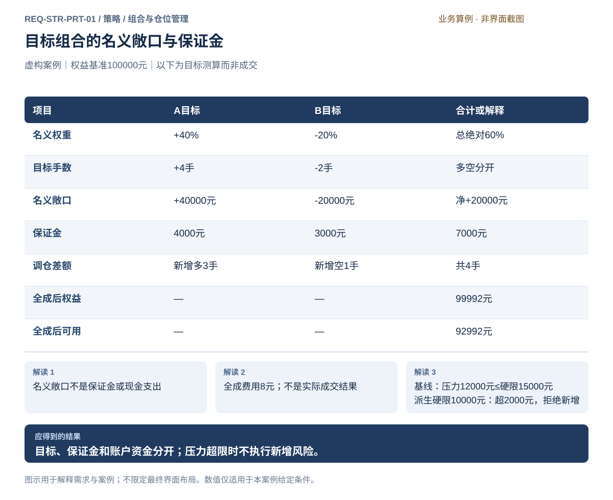

# 组合与仓位管理

[返回上级](README.md) · [需求总纲](../../README.md) · [界面规格](../../common/ui-designs.md) · [跨模块流程](../../workflows/README.md)

开发前需求规格 · 2026-10-20。定义目标功能、使用流程、界面行为与验收条件；数值案例仅用于核对规则，不作为用户配置默认值。

**归属：** 策略 / 组合与仓位管理。本页集中保存业务需求、详细功能、案例、界面设计和验收；通用规则见[通用规范](../../common/README.md)。

## 需求导航

- [REQ-STR-PRT-01 将量化信号转为可核对的组合目标与资金仓位](#req-str-prt-01)

## 子模块详细设计

组合与仓位管理把规则方向、模型评分或多因子信号变成目标持仓。它拥有预算、分配和调仓政策；真实资金、订单、成交、持仓和在途事实来自交易模块，不能在策略中复制一份可独立修改的账本。

| 能力       | 输入                                     | 输出与约束                                |
| ---------- | ---------------------------------------- | ----------------------------------------- |
| 信号组合   | 方向/评分、有效期、优先级、合成规则      | 策略意图；信号权重不直接等于资金比例      |
| 预算分配   | 账户权益、策略预算、风险预算、品种范围   | 各策略和品种目标；不越过账户硬限          |
| 仓位计算   | 仓位方法、合约乘数、价格、波动或风险距离 | 名义敞口、整数手数、取整误差和余量        |
| 多策略协调 | 子策略目标、共享账户、既有归属与冲突政策 | 聚合目标与明确归属，不能重复计费或计仓    |
| 调仓与换月 | 触发条件、有效目标、实际持仓及可信在途   | 调整意图与期限；未知在途先核实            |
| 约束检查   | 杠杆、流动性、保证金、账户风险条件       | 满足/不满足及原因，不静默改变目标后称通过 |

### 名义敞口、保证金与风险预算

名义敞口、保证金占用、权益和计划风险必须分别显示。给定虚构算例权益100000元、目标名义比例20%、价格100元/单位、乘数10单位/手，则目标名义敞口20000元、20手。它不表示保证金占权益20%，保证金按实际规则另算。

另一个虚构算例：预算1000元、计划止损距离5元/单位、乘数10，则忽略成本的单手计划风险50元、手数上限20。界面必须说明这不是最大损失保证；跳空、无法成交和成本可能使损失超过计划。正式手数还需费用、资金和硬风险检查。

方法、公式、取整与余量处理由用户明确选择。分母为零或价格条件不适用时拒绝该计算，不默认取绝对值；期货可能出现非正价格，是否适用由方法的领域约束声明。金额和权威价格使用精确十进制口径，展示舍入不改变账务依据。

### 有限波动率缩放方法

本规格的“波动率缩放”只指下列逐成员方法，不包括优化器、协方差配权或风险平价，也不保证组合恰好达到目标波动率。

1. 用户为每个成员选择固定信号价格序列、1分钟或日线周期，给出收益窗口 `N`（整数，至少2）、每年期数 `A`（正整数，与交易日历和周期一致）。取决策边界已经完整且可得的最近 `N+1` 个连续有效正收盘价，简单收益为 `r[j]=P[j]/P[j-1]−1`。不能用未完成bar、跨缺口拼接样本、回填的未来修订或未来换月映射；负价/零价不适用本方法。
2. 用 `N` 个收益的样本标准差（分母 `N−1`）计算 `σ=std(r)×√A`。`σ`、目标年化风险 `σ*` 和低波动拒绝阈值 `ε` 均以年化比例保存、以百分比展示。要求 `σ*>0`、`ε>0`；样本不足、非有限值或 `σ≤ε` 时拒绝生成该成员目标，并将整份预览标为不完整，不能暗中代入ε或把成员权重改成零。
3. 资金基准为明确时点的权益 `E>0`；成员预算权重 `b[i]∈[0,1]`，所有成员之和不超过1；方向 `d[i]∈{−1,0,+1}`。先算原始倍数 `k0=σ*/σ`，再按用户显式配置的 `0≤k_min≤k_max`、`k_max>0` 截取 `k=min(k_max,max(k_min,k0))`。界面同时显示原始值、截取值和触界原因；这一步仅是所选方法的明示规则，账户硬限超额仍拒绝，不再次偷偷缩量。
4. 成员名义目标 `T[i]=E×b[i]×d[i]×k[i]`。按目标真实合约的有效正价格 `p`、正乘数 `m` 计算 `q[i]=trunc(T[i]/(p×m))`，`trunc` 向零取整。固定权重法为 `T=E×w`，相当于不做波动率缩放；等权法先确定方向并取每成员绝对预算 `1/M`。固定手数法直接使用有符号整数目标，各方法均再检查名义敞口、预算、保证金和账户限制。
5. 分别显示未分配预算、取整名义余量 `T−q×p×m`、保证金估计及可用资金，不将名义余量记为账户现金收入，也不自动转配其他成员。实际持仓与可信在途只用于后续调仓差额，不参与收益标准差计算。

**算术验收例（非默认配置）：** `E=100000`、`b=0.2`、`d=+1`、`σ*=20%`、有效收益年化`σ=25%`、`ε=1%`、倍数界限`[0,2]`，则`k=0.8`，目标名义16000；价格100、乘数10，目标16手。若有效σ为5%，原始倍数4截到2，目标40手，仍须独立过限额检查；若σ为0.5%则拒绝，不能用2倍或零仓继续。负方向目标−16.7手必须取−16手。收益全相等、缺一bar及年化频数与周期不符都应给出具体错误。

### 调仓与实际状态

调仓只在完整bar边界判断定时或目标偏差触发，再计算目标与事实差异；事件和定时条件按[统一边界规则](logic.md#decision-contract)排队消费。简单同向算例：目标10手、实际6手、可信未成2手，新增差额为2手。存在反向在途、平今平昨、净额或对冲持仓时按明确账户语义处理，不能把此简单公式泛化为所有委托情况。

在途状态不明时不继续沿用旧差额，不把未知当0自动补单。部分成交改变实际仓位，目标仍单独显示；退出、停止或策略弃用不自动清理持仓。换月同时说明旧新月份、信号连续序列与真实交易价，并沿用声明的无法成交政策。

### 界面与交接

上方显示预算政策、权益基准和时间；主体分列目标权重、名义敞口、手数、保证金与余量；下方只读展示实际持仓、在途和差额。每个数字可以展开输入和公式。操作为预览、保存政策、检查约束、交付调整意图；真实委托仍通过交易模块和统一风控。

持仓政策固定到策略包，具体账户事实由每次回测或运行提供。政策预算不能替代账户硬风控；风险拒绝后保留原目标及原因，需要用户或已明确的策略规则作出新的目标决定，再重新检查。

## 风险约束的定义和交付

策略层明确预算范围、指标分母、组合或品种上限、止损/暂停触发条件及产生何种目标变化；没有要求的算法或阈值不默认补齐。止损触发只产生策略定义的意图，不保证成交或最大损失。策略预览使用明确状态与假设，实际执行仍由账户准入判断。

配置与规则随固定策略包交付回测或实盘准备；账户限额在实盘账户详情独立维护，不在本页重复编辑。若策略允许新增3手，而账户已有2手、在途1手、上限5手，策略意图不自动改成2手，账户应拒绝6手潜在占用；用户修改策略或意图后重新检查。共用含义见[共用交易约束](../../product.md#execution-risk-semantics)。

## REQ-STR-PRT-01 将量化信号转为可核对的组合目标与资金仓位

**领域：** 策略 / 组合与仓位管理　 **建议优先级：** P1核心必要　 **文档性质：** 开发前需求规格

### 目标与场景

用户能够把规则策略或多因子信号转化为有明确资金和风险预算的期货组合。目标权重、名义敞口、整数手数、保证金及实际账户结果分开核对，组合执行仍经过统一授权和风险检查。

**使用者与场景：** 个人量化研究与交易用户，构建组合、模拟调仓或准备实盘组合时。

**触发条件：** 冻结信号或规则策略提出组合目标，或用户启动计划内再平衡。

### 前置条件

- 信号、账户用途、价格时点、合约乘数和保证金依据已明确。
- 组合风险配置及风险能力可用；实盘另须有效账户与策略授权，模拟不要求实盘许可。

### 输入与含义

| 输入           | 含义与单位                                             | 约束                                                                 |
| -------------- | ------------------------------------------------------ | -------------------------------------------------------------------- |
| 组合权重与基准 | 目标名义敞口相对明确资金基准的比例，含多空方向。       | 说明总绝对敞口和净敞口，不能把权重直接当保证金比例。                 |
| 账户与预算     | 权益、现金、可用资金、持仓保证金、在途冻结和风险上限。 | 各自定义与时点明确，不把名义敞口当现金支出，不重复扣除已计费用。     |
| 目标手数规则   | 价格、乘数、整手取整、最小交易量和剩余预算处理。       | 转换规则须事前确定，显示目标与离散结果差异，不为用满资金而随意加仓。 |
| 策略归属与调仓 | 各策略目标、共享账户汇总政策、当前持仓和在途委托。     | 相反目标与人工持仓先明确归属及合并规则，无政策时拒绝冲突执行。       |

### 正常操作与反馈

1. 用户选择冻结信号与用途，明确组合构建方法和资金基准。
2. 设定多空权重、总净敞口、资金与风险预算，检查相关集中风险及保证金压力。
3. 按价格、乘数和明确取整规则计算目标手数，展示残余敞口与预算。
4. 核对共享账户各策略归属、已有持仓及在途委托，生成实际调仓差额。
5. 风险和权限齐备后进入统一执行，持续区分目标、已成交、在途和未完成数量。
6. 按账户权威结果核对费用、保证金及策略或合约贡献，记录偏差和部分成交影响。

### 业务规则

- 名义敞口是数量×乘数×价格；保证金按适用规则计算，不能与现金、权益混称。
- 离散手数及多空目标依据已确认规则转换，显示无法实现的剩余目标；构建方法按本页固定手数、名义权重及有限波动率缩放公式。
- 共享账户只保留一个实际持仓与资金事实；策略归属属于可追溯分配，不重复计算资金或成交。
- 组合调整必须计入已有与在途风险，未成交或撤单未确认前不能释放其占用。
- 预算分配按事前政策产生可执行目标，原目标与分配结果分别展示；聚合风险和保证金压力逐项核验，风控拒绝不静默裁剪订单。
- 模拟与实盘分离；实盘缺授权拒绝新增交易，暂停新增不得无理由阻断可安全查询撤单。
- 归因应对到账户实际结果；多策略相反目标的合并、费用分配及人工交易归属不得靠猜测。

### 输出与状态影响

- 含权重、整数手数、预算残差和资金口径的组合目标。
- 带策略归属的调仓差额、聚合风险及压力检查。
- 实际执行与目标偏差、部分成交状态和可核对贡献。

### 异常与继续方式

| 发生什么                                                               | 应怎样表现                                                         | 使用者如何继续                                                         |
| ---------------------------------------------------------------------- | ------------------------------------------------------------------ | ---------------------------------------------------------------------- |
| 共享账户中两个策略对同一合约提出冲突目标，但尚无确认的合并与归属政策。 | 列出各目标并阻止冲突新增执行，保留实际持仓与安全查询撤单。         | 用户确认政策和归属后重新计算聚合目标与风险。                           |
| 调仓只部分成交，或保证金压力超过所配置的硬门槛。                       | 显示已成交、在途和缺口，不冒称目标已达成；触发门槛时阻止新增风险。 | 查询或明确撤单后核对状态，按既定规则重新规划；不自动重发结果未知指令。 |

### 案例：名义权重转手数并核对资金占用

**虚构案例条件：** 虚构案例：账户权益和已结算现金各100000元，无未结盈亏、在途冻结或资金出入；现有A多1手、B空1手。A价格1000元、乘数10、保证金率10%；B价格1000元、乘数10、保证金率15%。目标名义权重A为+40%、B为-20%，按整手取整；案例手续费每新增成交手2元。价格保持不变，测算不是已成交事实。成功基线的压力率为20%、硬上限15000元；另派生硬上限10000元的超限情景。全成、部分成交及超限检查是独立情形，超限情景不产生新增成交。

1. 每手名义金额均10000元，目标A多4手、B空2手；总绝对敞口60000元、净敞口20000元。
2. 当前保证金2500元，可用资金97500元；拟新增A多3手、B空1手，共4手。
3. 假设全部按原价成交，仅手续费8元，则现金及权益各99992元、保证金7000元、可用资金92992元。
4. 若A新增只成交2手，实际为A多3手、B空1手，尚不能称目标达成；两合约保证金率都压力设为20%，目标保证金为12000元，低于成功基线上限15000元；派生硬上限10000元的情景时超限2000元并拒绝新增。

**预期结果：**

- 目标手数为A+4、B-2，调仓差额为A+3、B-1，名义敞口不从现金直接扣60000元。
- 全成测算净费用8元，权益99992元、保证金7000元、可用92992元；成功基线的12000元压力占用低于15000元硬限；派生10000元硬限情景拒绝新增，不能与全成结果混为同一次执行。

### 可观察验收条件

| 编号                | 给定                                   | 当                             | 则                                                                     |
| ------------------- | -------------------------------------- | ------------------------------ | ---------------------------------------------------------------------- |
| REQ-STR-PRT-01-AC01 | 案例资金、价格、乘数及目标权重明确。   | 计算目标。                     | A为+4手、B为-2手，总绝对名义敞口60000元、净敞口20000元，保证金7000元。 |
| REQ-STR-PRT-01-AC02 | 原持仓A+1、B-1且无在途。               | 计算调仓并假设全成且价格不变。 | 差额A+3、B-1，费用8元，权益99992元、可用92992元，测算不冒充成交。      |
| REQ-STR-PRT-01-AC03 | A新增只成交2手，B新增尚未成交。        | 查看目标完成度。               | 实际A+3、B-1与目标A+4、B-2分别列示，在途不重复下单。                   |
| REQ-STR-PRT-01-AC04 | 目标保证金率压力设20%，硬上限10000元。 | 核对压力门槛。                 | 需要12000元、超限2000元，拒绝新增风险，但安全查询撤单仍可用。          |

### 决定与配置约束

- **DEC-STR-PRT-01-01**：**规格决定**。支持固定手数、权益比例、等权/固定权重及[有限波动率缩放](#volatility-scaling)；目标手数向零取整、未使用名义预算保留未分配；按定时或目标偏差触发调仓，预算与压力约束显式配置。

- **DEC-STR-PRT-01-02**：**规格决定**。每个真实账户仅一套具有执行权的策略/组合实例，组合可有多个内部成员；人工新增前暂停自动新增并核对在途。外部成交待分配核对，不支持多个独立实例默默净额共享账户。

### 详细功能

### FR-STR-PRT-01-01 定义组合权重、基准与预算

**目标与结果：** 先明确权重对应何种资金和风险量，再构建多空组合，避免不同百分比被误用。

**触发：** 组合页选规则或合成信号后设置构建方法与资金基准。

**输入与约束：** 明确权益基准、目标名义权重、总绝对与净敞口预算、资金和风险约束；方法限定为固定手数、权益比例、等权、固定权重及本页波动率缩放。

**目标操作与反馈：**

1. 确认基准时点及信号到权重的规则。
2. 查看各成员权重、多空方向和总净敞口。
3. 按事前政策分配预算，分列原目标、可执行目标和未分配原因，审阅后形成目标草稿。

**异常与边界：**

- 权重不是保证金比例，也不要求多空权重机械相加为100%。
- 基准变化不静默改写冻结研究结果，运行用途变更须重新核对。

**验收条件：**

- **FR-STR-PRT-01-01-AC01**：案例A+40%、B-20%对应总绝对60%、净20%。
- **FR-STR-PRT-01-01-AC02**：界面同时说明权益基准100000元，不把60000元名义敞口称现金扣款。

**界面对应：** [UI-STR-PRT-01 组合构建、资金与调仓](#ui-str-prt-01)。

### FR-STR-PRT-01-02 将目标名义敞口转换为整数手数

**目标与结果：** 依据价格、乘数和明确离散规则得到可解释数量，并保留不能精确实现的目标差额。

**触发：** 组合页点击计算目标手数。

**输入与约束：** 目标名义金额、可靠价格时点、乘数、最小数量、取整规则及保证金依据；不默认提高杠杆补足残差。

**目标操作与反馈：**

1. 核对每手名义金额和适用规则。
2. 按确认的取整规则计算多空目标手数。
3. 展示离散后的实际名义权重、残余目标、保证金与可用资金测算。

**异常与边界：**

- 价格或乘数未知时阻止确定手数，不用近似合约代替。
- 金额不能整除时显示残差；不得自动加1手使预算超限。

**验收条件：**

- **FR-STR-PRT-01-02-AC01**：案例每手10000元，目标A+4手、B-2手，保证金分别4000和3000元。
- **FR-STR-PRT-01-02-AC02**：若目标A为45000元且规则向零取整，则4手、剩余5000元目标，不自动变5手。

**界面对应：** [UI-STR-PRT-01 组合构建、资金与调仓](#ui-str-prt-01)；[UI-DAT-SRV-01 合约、日历与基础资料](../data/management.md#ui-dat-srv-01)。

### FR-STR-PRT-01-03 处理共享账户策略目标与持仓归属

**目标与结果：** 保留每个策略意图及一个账户实际事实，避免相互覆盖、重复计资金或无人负责的仓位。

**触发：** 组合页选择共享账户并核对已有策略与人工持仓。

**输入与约束：** 各策略身份、目标、实际成交归属、人工持仓以及显式目标合并和费用分配政策。

**目标操作与反馈：**

1. 查看各策略与人工持仓的已知归属。
2. 发现同合约冲突时展示各目标，按已确认政策生成账户聚合目标。
3. 按声明的多空分项或净量口径核对已归属与明确未归属之和等于账户实际事实，保留差额依据。

**异常与边界：**

- 无合并政策时拒绝冲突新增执行，不能自行决定哪个策略优先。
- 内部归属不伪造成真实成交；不支持的归属资料不得猜测补齐。

**验收条件：**

- **FR-STR-PRT-01-03-AC01**：若确认的政策为有符号目标净额，甲A+4与乙A-1的账户目标为A+3，双方原意图仍可见。
- **FR-STR-PRT-01-03-AC02**：实际归属按声明的多空分项或净量口径守恒：已归属＋明确未归属＝账户实际事实；账户空头3手不能归属空头4手再虚构多头1手抵消。策略目标净额与实际成交归属分别核对。

**界面对应：** [UI-STR-PRT-01 组合构建、资金与调仓](#ui-str-prt-01)；[UI-LIV-ACC-01 账户资金与持仓](../live/accounts.md#ui-liv-acc-01)；[UI-LIV-ACC-03 账户风险规则与生效管理](../live/accounts.md#ui-liv-acc-03)。

### FR-STR-PRT-01-04 生成调仓差额并追踪部分成交

**目标与结果：** 清晰区分想持有、已经持有和仍在途的数量，避免部分成交时重复增加风险。

**触发：** 组合目标核对后点击调仓预览，执行后查看完成度。

**输入与约束：** 预算分配后的可执行目标、实际持仓、可信在途、开平规则及撤单状态；统一执行负责实际订单，逐笔风控不静默裁剪数量。

**目标操作与反馈：**

1. 按目标与当前事实计算尚需调整量。
2. 审阅逐合约开平、已有在途及费用，符合前提后交给统一执行。
3. 持续显示目标、已成交、在途和未完成，必要时安全查询或明确撤单。

**异常与边界：**

- 结果未知的订单不能当未发送重新补齐；撤单未确认不释放占用。
- 不支持的开平或持仓归属阻止相关调仓，不自动平掉其他策略仓位。

**验收条件：**

- **FR-STR-PRT-01-04-AC01**：无在途时案例A需新增多3手、B需新增空1手。
- **FR-STR-PRT-01-04-AC02**：若A只成交2手，实际A+3与目标+4分列，在途1手不能再重复提交。

**界面对应：** [UI-STR-PRT-01 组合构建、资金与调仓](#ui-str-prt-01)；[UI-LIV-RUN-04 实盘准备、授权与策略运行](../live/operations.md#ui-liv-run-04)；[UI-LIV-EXE-02 委托、成交与撤单](../live/execution.md#ui-liv-exe-02)。

### FR-STR-PRT-01-05 核对聚合风险与保证金压力

**目标与结果：** 在组合层面同时看集中度、总净敞口及保证金变化，防止分项合格却整体超限。

**触发：** 目标与调仓预览后点击风险及压力核对。

**输入与约束：** 账户权益、持仓、在途冻结、聚合风险预算和明确压力场景；场景是否为硬门槛须确认。

**目标操作与反馈：**

1. 汇总全部策略的实际及在途风险，避免逐个重复使用同一额度。
2. 按声明价格或保证金变化计算压力占用和可用资金。
3. 列超限项与阻止原因，只有必要条件满足才可交接执行。

**异常与边界：**

- 缺风险配置或能力不可用时拒绝执行；实盘还须独立授权。
- 暂停新增仍保留能安全执行的查询和撤单，不以新增禁令封死风险处置。
- 组合预览不授予执行许可；提交时由实盘账户根据当前状态再次准入，或由回测依据固定模拟状态检查。

**验收条件：**

- **FR-STR-PRT-01-05-AC01**：案例目标名义60000元，全部保证金率压力20%时占用12000元。
- **FR-STR-PRT-01-05-AC02**：若硬上限10000元，则超限2000元并拒绝新增，不静默降低目标后执行。
- **FR-STR-PRT-01-05-AC03**：策略允许新增3手但账户持仓2、在途1、上限5时，策略意图保持，账户拒绝6手潜在占用，不静默缩量。

**界面对应：** [UI-STR-PRT-01 组合构建、资金与调仓](#ui-str-prt-01)；[UI-LIV-ACC-03 账户风险规则与生效管理](../live/accounts.md#ui-liv-acc-03)；[UI-LIV-RUN-01 账户连接与交易授权](../live/operations.md#ui-liv-run-01)。

### FR-STR-PRT-01-06 核对组合贡献与目标执行偏差

**目标与结果：** 维护组合归属政策与目标，并引用评估的贡献和偏差结果；不在策略模块另算一套绩效。

**触发：** 组合结果或执行记录中选择贡献和偏差分析。

**输入与约束：** 账户权益、现金口径、资金出入、实际成交费用、估值、归属政策及目标记录。

**目标操作与反馈：**

1. 将固定目标、预算与归属政策交评估，关联实盘或回测的账户事实；由评估核对净变动并拆分贡献。
2. 分别说明未平仓估值、费用、部分成交及未分配差额。
3. 引用评估保存的目标与实际偏差解释及证据；修改归属政策产生新评价上下文，不回写旧结论。

**异常与边界：**

- 同一收益只能在同一维度合计一次，不将名义敞口变化当利润。
- 归属缺失保留未解释项，不能为让数字相等虚构收益或删除真实成交。

**验收条件：**

- **FR-STR-PRT-01-06-AC01**：案例价格不变且全成，A费用6元、B费用2元，净贡献合计-8元，权益99992元。
- **FR-STR-PRT-01-06-AC02**：现金、权益、保证金和可用资金分别列示，7000元保证金不会再次算作损失。

**界面对应：** [UI-EVA-PER-01](../evaluation/performance.md#ui-eva-per-01)； [UI-STR-PRT-01 组合构建、资金与调仓](#ui-str-prt-01)；[UI-LIV-RUN-05 运行核对、处置与恢复审查](../live/operations.md#ui-liv-run-05)；[UI-LIV-ACC-02 成交结算核对与差异处理](../live/accounts.md#ui-liv-acc-02)。

### FR-STR-PRT-01-07 定义仓位政策及其参数适用范围

**目标与结果：** 把单笔手数、多策略分配与账户限制分开。

**触发：** 选择支持的仓位方法并解释单位。

**输入与约束：** 信号语义、权益基准、固定手数/名义权重/有限波动率缩放方法、合约乘数、取整与风险预算限额。波动率方法必须填写N、A、目标风险、ε、成员预算与倍数上下界，并显示样本截止。 策略集中度、止损或暂停触发条件、触发后的目标行为及适用范围须明确；并非强制采用某种算法。

**目标操作与反馈：**

1. 选择支持的仓位方法并解释单位。
2. 预览信号到目标敞口和整数手数的计算。
3. 确认取整误差、预算余量与约束。
4. 将预算、上限及触发行为随固定策略交付，账户限制在实盘独立核对。

**异常与边界：**

- 模型评分和因子权重不得直接充当资金比例。
- 价格或风险距离使所选公式无定义时阻断，不取绝对值或补默认值绕过；负价适用性由方法显式声明。
- 止损触发不保证成交或损失上限；策略规则不得覆盖账户政策。

**验收条件：**

- **FR-STR-PRT-01-07-AC01**：权益100000、名义比例20%、价100、乘数10时目标为20手，非保证金占比20%。
- **FR-STR-PRT-01-07-AC02**：风险预算1000、每单位止损距离5、乘数10时单手计划风险50，忽略费用的示例上限20手，同时说明跳空可超出计划损失。

**界面对应：** [UI-STR-PRT-01 组合构建、资金与调仓](#ui-str-prt-01)。

### FR-STR-PRT-01-08 声明调仓触发与目标失效条件

**目标与结果：** 让调仓是明确计划而非持仓差异一出现就自动下单。

**触发：** 设置触发和保持条件。

**输入与约束：** 完整bar边界、排队的时间/事件触发、偏离阈值、最小调仓、换月目标、信号有效期与在途可信性；阈值以目标与已核对持仓加可信在途之差的绝对手数表示。

**目标操作与反馈：**

1. 设置触发和保持条件。
2. 在固定事实下预览目标、实际、在途与剩余差额。
3. 将调整意图交给统一执行检查。

**异常与边界：**

- 未知在途阻止依赖其数量的新增调仓，不自动补单。
- 来源更新、持仓变化或目标过期需重算并按运行政策重新检查。

**验收条件：**

- **FR-STR-PRT-01-08-AC01**：目标10、实际6、可信同向未成2时新增差额为2而不是4。
- **FR-STR-PRT-01-08-AC02**：把在途改为未知后不能沿用先前差额继续提交。

**界面对应：** [UI-STR-PRT-01 组合构建、资金与调仓](#ui-str-prt-01)。

## 界面设计

## UI-STR-PRT-01 组合构建、资金与调仓

**业务目标：** 将规则或多因子信号变为可解释的组合手数，核对共享账户风险与调仓，再经统一执行开展模拟或授权实盘。

### 页面形态与目标布局

**设计约束：** 页面布局、字段、动作及状态应与下述规范一致；具体字段与操作表是页面验收依据。

**界面形态：** 编辑与试算工作区。

**导航入口：** 策略 → 组合与仓位 → 组合构建、资金与调仓。

| 区域 | 要显示的内容 |
| --- | --- |
| 顶部上下文 | 组合 / 资金基准 / 草稿 |
| 列表、分类或步骤区 | 策略成员 / 预算分配 |
| 主要工作区 | 权重 / 整数目标 / 调仓预览 |
| 选中项详情或检查区 | 保证金 / 限额 / 归属冲突 |
| 主要动作区 | 计算目标 / 固定仓位政策 |

**区域联动与返回：** 选择列表或步骤只更新当前对象及详情，不隐式启动业务；图表与明细使用同一输入或结果上下文。离开并返回保留已确认的对象和查询条件，未保存草稿按本页保存语义处理。异步提交后用请求/任务身份定位实际状态，不能把操作按钮点击当作成功。

**窗口与空间：** 采用统一主窗口布局。宽度缩小时优先收拢辅助详情，表格在内容区横向滚动；主操作和关键上下文不能被页面裁切。重新展开详情仍指向原选中对象。

**状态与反馈依据：** 字段、动作、异常、离开及返回行为按本页下表验收，视觉反馈遵循[通用界面设计](../../common/ui-designs.md)。

### 操作与交互

目标与实际分列，策略负责政策和目标；真实订单、持仓、成交及授权事实由交易模块提供。

**字段与信息：**

- 信号含义、组合预算、权益基准和约束
- 目标权重、名义敞口、整数手数、取整余量
- 只读实际持仓、可信在途、调仓触发和差额
- 策略预算、集中度、止损或暂停条件及目标变化；账户限额为独立执行约束。

**动作与反馈：**

- 选择仓位方法
- 预览目标与压力约束
- 保存组合政策
- 将调整意图交给执行检查
- 预览并固定策略约束；账户设置跳转实盘，不在策略页直接修改。

**状态与异常：**

- 仅测算：不等于成交
- 输入或在途未知：阻止依赖该事实的新增调整
- 硬风险未满足：保留目标及原因，不静默改量

### 验收标准

- **UI-STR-PRT-01-AC01**：尚未执行的组合明确标为测算，不能把测算当实际成交或生成实际贡献。
- **UI-STR-PRT-01-AC02**：目标A+4、B-2，调仓A+3、B-1；名义敞口、保证金与现金权益分列。
- **UI-STR-PRT-01-AC03**：全成假设费用8元、权益99992元、保证金7000元、可用92992元，保证金不作为损失。
- **UI-STR-PRT-01-AC04**：压力保证金12000元超10000元门槛，风险条件未满足时仍禁止新增执行；安全查询撤单不被一并禁用。
- **UI-STR-PRT-01-AC05**：共享政策未定或订单结果未知时不能补发，部分成交保持目标与实际分列。

### 字段与操作规格

政策编辑区与账户事实区分开。预览使用显式状态快照，真实持仓、资金、在途及风控上限均只读；政策固定后通过派生编辑。

| 字段 | 类型/单位 | 必填 | 新建默认 | 合法值与关联检查 | 编辑权限 |
| --- | --- | --- | --- | --- | --- |
| 政策名称 | 文本 | 是 | 空 | 1～80字符 | 草稿可编辑 |
| 策略成员 | 固定逻辑/模型身份列表 | 是 | 空 | 至少一个，成员身份唯一；明确相反目标的合并与归属 | 草稿可编辑 |
| 仓位方法 | 枚举 | 是 | 空 | 固定手数、权益比例、等权、固定权重、有限波动率缩放 | 草稿可编辑 |
| 资金基准引用 | 快照身份 | 金额/比例方法时 | 空 | 权益>0且时点明确，不能混用可用资金或保证金 | 草稿可编辑选择；数值只读 |
| 固定目标手数 | 有符号整数/手 | 固定手数时 | 空 | 0表示明确空仓目标；满足合约手数步长 | 草稿可编辑 |
| 名义权重 | Decimal/比例 | 权益比例/固定权重时 | 空 | 符号表示方向；总绝对值受预算约束 | 草稿可编辑 |
| 成员预算b | Decimal/比例 | 波动率缩放时 | 空 | 每项[0,1]，合计≤1；等权方法显示计算值1/M | 草稿可编辑或计算只读 |
| 成员方向d | 枚举 | 等权/波动率时 | 空 | −1、0、+1；评分到方向的映射须固定 | 草稿可编辑 |
| 收益窗口N | 整数/bar收益数 | 波动率时 | 空 | ≥2，需要N+1个连续有效正收盘价 | 草稿可编辑 |
| 年化期数A | 正整数/期每年 | 波动率时 | 空 | 与选定1分钟/日线及日历一致；不隐式填252 | 草稿可编辑 |
| 目标年化风险σ* | Decimal/百分比 | 波动率时 | 空 | >0，按百分比输入，内部保留比例 | 草稿可编辑 |
| 低波动阈值ε | Decimal/年化百分比 | 波动率时 | 空 | >0；估计σ≤ε拒绝目标 | 草稿可编辑 |
| 缩放下界k_min | Decimal/倍 | 波动率时 | 空 | ≥0且≤k_max | 草稿可编辑 |
| 缩放上界k_max | Decimal/倍 | 波动率时 | 空 | >0；展示截取前后值 | 草稿可编辑 |
| 总绝对敞口上限 | Decimal/权益倍数 | 是 | 空 | >0；检查各成员绝对名义之和/权益 | 草稿可编辑 |
| 净敞口下界 | Decimal/权益倍数 | 是 | 空 | 可为负，须≤净敞口上界；不以净额掩盖总绝对风险 | 草稿可编辑 |
| 净敞口上界 | Decimal/权益倍数 | 是 | 空 | 须≥净敞口下界，检查有符号名义之和/权益 | 草稿可编辑 |
| 单成员敞口上限 | Decimal/权益倍数 | 是 | 空 | >0且≤组合绝对上限 | 草稿可编辑 |
| 保证金压力上限 | Decimal/元 | 是 | 空 | >0；压力率按来源或显式假设输入，不能用常规率代替 | 草稿可编辑 |
| 调仓触发 | 枚举多选 | 是 | 空 | 定时、目标偏差；只在完整bar边界消费 | 草稿可编辑 |
| 定时时刻/日历 | 时间列表/固定日历 | 定时触发时 | 空 | 明确时区，休市顺延至下一完整bar | 草稿可编辑 |
| 目标偏差阈值 | 正整数/手 | 偏差触发时 | 空 | 目标减实际减可信在途的绝对值≥阈值才触发 | 草稿可编辑 |
| 目标有效期 | 正整数/bar | 是 | 空 | ≥1；到期禁止据旧目标补单，退出规则另定 | 草稿可编辑 |
| 价格/乘数 | Decimal/元每单位、单位每手 | 计算时 | — | 来源、生效时间和目标合约可查；名义方法须正值 | 只读 |
| 实际/在途/剩余差额 | 有符号整数/手及可信状态 | 自动 | — | 可信在途未知时差额显示不可计算，不填0 | 只读 |
| 目标/余量/保证金 | 手、元及计算依据 | 自动 | — | 向零取整；名义余量不记为现金收入 | 只读 |

| 按钮 | 可用前提 | 结果与后续 |
| --- | --- | --- |
| 保存政策 | 名称有效 | 可保存缺项草稿，不改变账户 |
| 计算目标 | 方法字段及输入快照齐全 | 生成目标、公式、取整余量；任何字段变化使预览失效 |
| 预览调仓 | 目标有效，实际与在途可信 | 显示开平拆分、未达量及来源；不发送委托 |
| 检查压力 | 目标、费用、保证金与上限明确 | 显示逐项满足/超限，超限保留原目标且禁止交付可执行意图 |
| 固定/交付政策 | 内容完整、约束检查通过 | 携带成员、预算、时序与状态引用到策略包；执行资格由回测/实盘再检查 |
| 查看偏差与归因 | 有关联回测或运行事实 | 携带策略包、成员、账户及期间到评估，只读查看归属 |

**状态与导航：** 无成员显示“从逻辑选择”；缺价格、乘数或收益样本时逐成员说明缺口并保留其他预览，整份结果标不完整。收益σ过低显示拒绝，不自动用固定手数替代。账户查询失败保留最后可靠时间，实际/在途标未知；禁止据旧差额补单。超限保留目标和超额值，允许返回调整草稿。预览请求可取消等待，已完成的只读预览不改变事实；交付响应未知查询原交付。离开未保存政策提供保存/放弃/留在本页；返回保持政策、成员和状态快照。从交易返回时账户快照已变化须重新计算，不能沿用旧通过标记。

**交互验收：** E=100000、b=0.2、σ*=20%、σ=25%、倍数[0,2]及价格100乘数10时显示16手；改σ为0.5%而ε=1%时禁止目标交付。把可信在途改为查询未知后，差额从数值变为不可计算，原目标仍显示。

### 对应功能需求

- [FR-ANA-EVL-02-02 交接冻结信号并保留研究来源](../analysis/evaluation.md#fr-ana-evl-02-02)
- [FR-LIV-RUN-05-03 保留调查依据并重新验证修订范围](../live/operations.md#fr-liv-run-05-03)
- [FR-EVA-VAL-02-02 核对跨环境信号、组合分配及逐笔风控结果](../evaluation/validation.md#fr-eva-val-02-02)
- [FR-STR-PRT-01-01 定义组合权重、基准与预算](#fr-str-prt-01-01)
- [FR-STR-PRT-01-02 将目标名义敞口转换为整数手数](#fr-str-prt-01-02)
- [FR-STR-PRT-01-03 处理共享账户策略目标与持仓归属](#fr-str-prt-01-03)
- [FR-STR-PRT-01-04 生成调仓差额并追踪部分成交](#fr-str-prt-01-04)
- [FR-STR-PRT-01-05 核对聚合风险与保证金压力](#fr-str-prt-01-05)
- [FR-STR-PRT-01-06 核对组合贡献与目标执行偏差](#fr-str-prt-01-06)
- [FR-STR-PRT-01-07 定义仓位政策及其参数适用范围](#fr-str-prt-01-07)
- [FR-STR-PRT-01-08 声明调仓触发与目标失效条件](#fr-str-prt-01-08)

