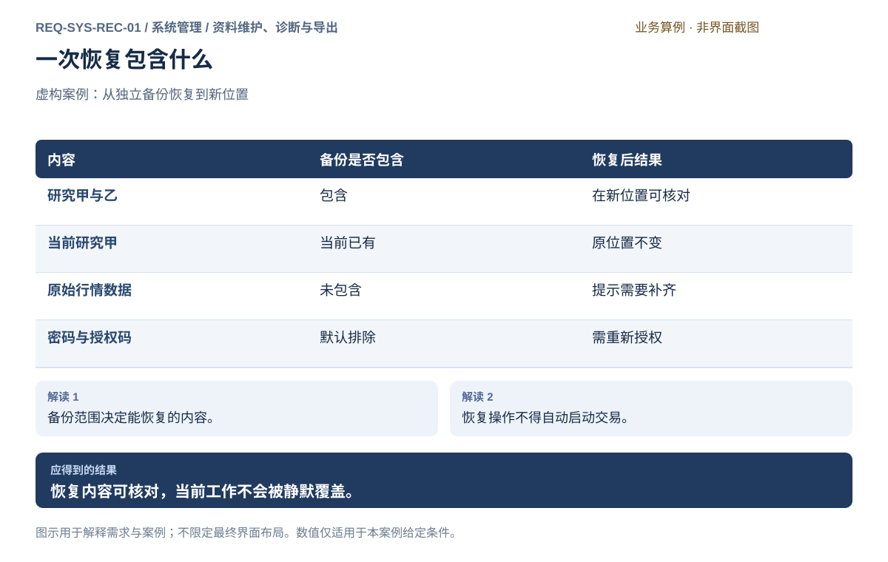
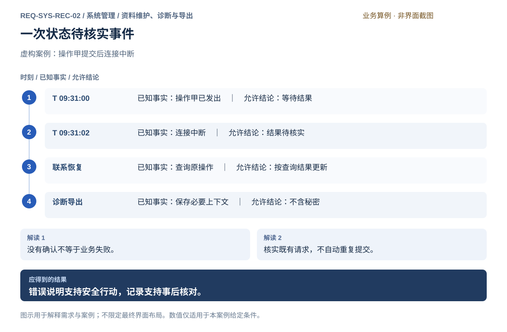
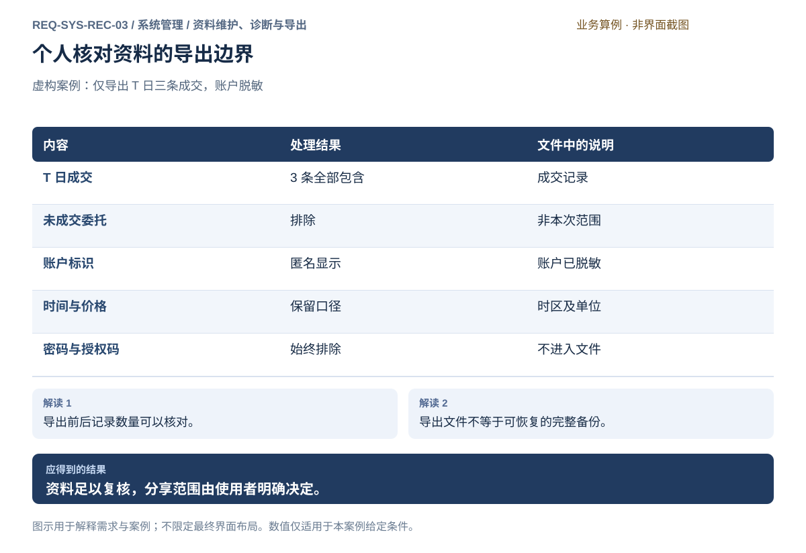
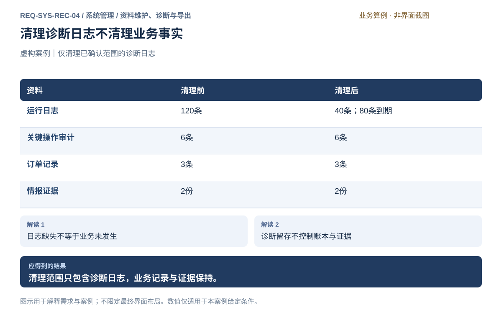
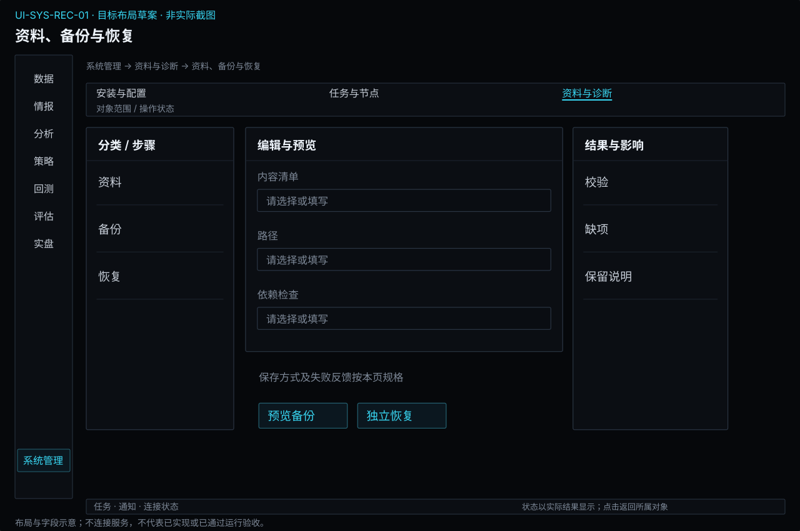
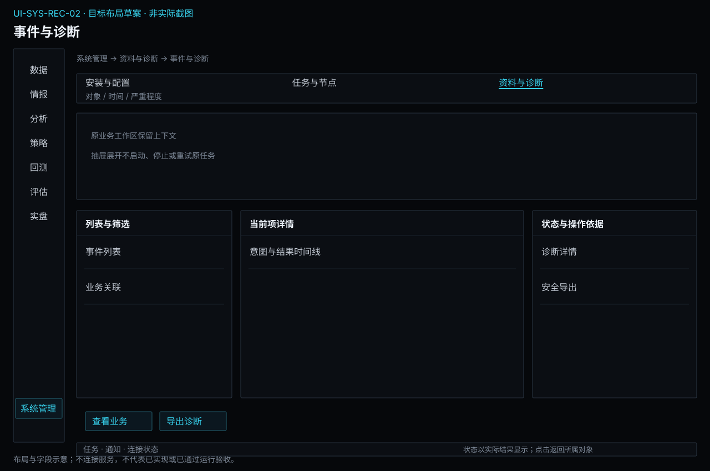
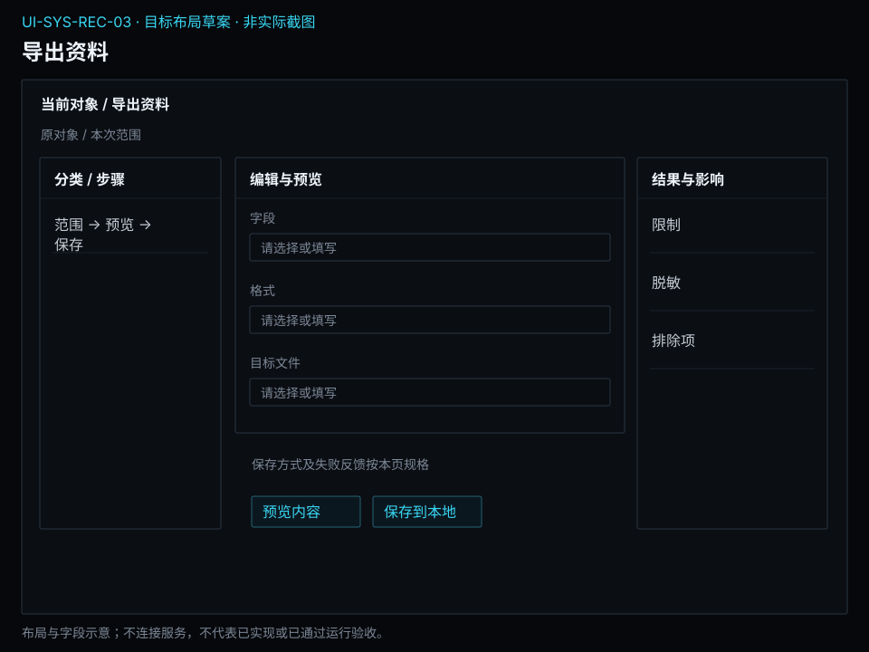

# 资料维护、诊断与导出

[返回上级](README.md) · [需求总纲](../../README.md) · [界面阅读指南](../../common/screens.md) · [跨模块流程](../../workflows/README.md)

开发前需求与设计规格 · 2026-10-20。定义目标功能、操作流程、界面和验收判据；规格决定、运行配置与外部条件分别记录。

**归属：** 系统管理 / 资料维护、诊断与导出。本页集中保存业务需求、详细功能、案例、界面对应和验收；通用规则见[通用规范](../../common/README.md)。

## 需求导航

- [REQ-SYS-REC-01 保存、备份、恢复和明确删除个人资料](#req-sys-rec-01)
- [REQ-SYS-REC-02 理解错误、追溯关键操作并安全导出诊断](#req-sys-rec-02)
- [REQ-SYS-REC-03 按范围导出研究与交易资料并控制泄露](#req-sys-rec-03)
- [REQ-SYS-REC-04 检索运行日志并按明确规则管理诊断留存](#req-sys-rec-04)

## 记录分类与唯一归属

| 类别           | 用途与责任                                                     | 留存及修改边界                                         |
| -------------- | -------------------------------------------------------------- | ------------------------------------------------------ |
| 运行诊断日志   | 系统记录服务、节点、插件和错误上下文，支持检索诊断             | 按明确日志期限/容量管理，过期范围可见；不包含秘密      |
| 关键操作审计   | 配置、授权、任务和交易操作由对应业务形成意图及确认记录         | 统一查询引用原记录，不能按普通日志清理策略删除         |
| 业务事实与证据 | 数据材料、情报证据、研究产物、订单成交和账户政策由所属模块维护 | 按业务引用与保护规则处理，不能被日志清理或诊断导出改写 |
| 本地诊断包     | 用户选择最小必要范围并预览脱敏后导出                           | 不自动发送给外部；导出失败不删除原记录                 |

日志检索支持来源节点/服务/插件、时间区间、时区、级别和业务身份。跨节点时间精度不足时标明限制，不把显示顺序解释成确定因果。查询无匹配、尚未取得、读取失败和超过留存时间分别说明。

确认留存策略前展示期限或容量、实际影响与排除项；执行后显示清理结果和覆盖变化。日志采集故障会降低诊断能力，但不能用日志有无推断订单是否成交。权威记录持久化失败按所属业务规则阻断依赖它的操作；交易的发送与恢复约束见[FR-LIV-EXE-03-05](../live/execution.md#fr-liv-exe-03-05)，不得以诊断日志代替必要记录。

日志在产生时排除秘密，导出再次核对敏感范围。账户身份按用途脱敏；完整原文、模型输入和策略内容不默认复制进诊断日志，必要上下文通过权限允许的证据引用获取。

## REQ-SYS-REC-01 保存、备份、恢复和明确删除个人资料

**领域：** 系统管理 / 资料维护、诊断与导出　 **建议优先级：** P0安全必要　 **需求状态：** 开发前设计规格（具体决定与运行配置见本条DEC）

### 目标与场景

研究配置、结果与交易记录是个人长期积累的资料，应能明确知道保存位置并获得可验证的备份。恢复或删除必须让使用者理解影响，防止误覆盖和静默丢失。

**使用者与场景：** 日常保存工作、迁移电脑或清理资料的个人使用者。

**触发条件：** 完成工作、主动备份、恢复资料或删除指定内容。

### 前置条件

- 待处理资料有明确范围和所属工作。
- 使用者有权访问目标位置，且已结束需要保持一致性的资料写入。

### 输入与含义

| 输入     | 含义与单位                               | 约束                                               |
| -------- | ---------------------------------------- | -------------------------------------------------- |
| 资料范围 | 配置、任务记录、结果、交易记录或关联数据 | 逐类说明包含及排除项；不得把快捷入口当成资料本身。 |
| 目标位置 | 备份或恢复资料的存放位置                 | 显示预计占用；已存在同名资料时不能静默覆盖。       |

### 正常操作与反馈

1. 使用者查看资料类别、大小和关联关系。
2. 选择备份范围及目标位置。
3. 系统生成备份并报告包含项、排除项与校验结果。
4. 恢复时先检查备份可读性及其内容。
5. 使用者确认恢复到独立位置，再核对资料。
6. 删除时先查看范围、引用及活动使用；有引用或活动使用时阻断，只有无阻断项才可明确确认。

### 业务规则

- 备份成功须基于可验证的产物，不能仅以开始复制为准。
- 活动写入中的资料需取得一致内容，或明确要求先停止相关工作。
- 备份不得包含密码、授权码和秘密密钥。
- 恢复不自动提交交易、启动任务或覆盖现有资料。
- 不支持或损坏的资料明确拒绝，原文件保留。
- 删除需说明是否包含底层数据及影响的研究记录；被引用或活动使用的对象禁止删除，不能静默级联删除或确认强删。

### 输出与状态影响

- 含范围说明和校验结果的备份。
- 恢复核对清单或已确认删除的范围记录。

### 异常与继续方式

| 发生什么                   | 应怎样表现                       | 使用者如何继续                     |
| -------------------------- | -------------------------------- | ---------------------------------- |
| 备份空间不足               | 报告备份未完成，不标为可用备份。 | 更换位置或释放空间后重新备份。     |
| 恢复文件缺失或内容校验失败 | 拒绝恢复并保留原文件及现有资料。 | 选择其他完整备份；不静默修补内容。 |

### 案例：恢复资料并保护当前工作

**虚构案例条件：** 虚构案例：当前有研究甲；备份含研究甲和乙，但不含密码与原始行情数据。

1. 检查备份包含清单。
2. 恢复到独立位置并核对两项研究。

**预期结果：**

- 现有研究甲不变；恢复资料含甲和乙；缺少原始数据与凭据的影响被列出。

### 可观察验收条件

| 编号                | 给定                   | 当           | 则                                           |
| ------------------- | ---------------------- | ------------ | -------------------------------------------- |
| REQ-SYS-REC-01-AC01 | 目标位置已有研究甲     | 恢复同名研究 | 不覆盖原资料，先明确恢复位置和影响。         |
| REQ-SYS-REC-01-AC02 | 备份校验失败           | 请求恢复     | 明确拒绝，现有资料和备份原文件均未改写。     |
| REQ-SYS-REC-01-AC03 | 所删数据被研究结果引用 | 请求删除     | 显示引用对象并阻断删除；不能通过确认绕过引用保护。 |

### 决定与配置约束

- **DEC-SYS-REC-01-01**：**规格决定**。默认手动完整备份，自动备份默认关闭；删除备份须明确授权，引用保护不因确认取消。交易账本及被引用证据不自动删除。**用户运行配置**：启用自动备份时必须填写频率、路径和保留数；这些输入不改变秘密排除和引用保护规则。

### 详细功能

### FR-SYS-REC-01-01 查看个人资料范围和引用关系

**目标与结果：** 使用者应能知道磁盘中的资料属于什么研究、哪些内容被引用以及哪些属于不可恢复的独立记录。清理或备份前先看范围，避免把快捷入口误当成唯一资料。

**触发：** 资料管理页选择当前工作位置，或研究详情进入资料信息。

**输入与约束：** 资料类别、大小、保存位置、所属工作与引用数量只读展示；未知大小显示待统计，不填为零。

**目标操作与反馈：**

1. 按研究、结果、交易记录和关联数据查看资料。
2. 选择一项查看来源、更新时间和被引用的工作。
3. 进入备份、导出或明确删除时携带精确选择范围。

**异常与边界：**

- 目录不可读时保留最后已知清单并标旧时间，不断言资料不存在。
- 引用无法完整确认时提示范围未知，不能据此执行无影响清理。

**验收条件：**

- **FR-SYS-REC-01-01-AC01**：选择底层数据时能列出受影响研究，资料范围与删除预览一致。
- **FR-SYS-REC-01-01-AC02**：没有资料时显示空状态及准备入口，不生成虚构记录。

**界面对应：** [UI-SYS-REC-01 资料、备份与恢复](#ui-sys-rec-01)；[UI-SYS-RUN-01 个人工作总览](tasks-nodes.md#ui-sys-run-01)。

### FR-SYS-REC-01-02 预览备份范围并验证备份结果

**目标与结果：** 备份应说明包含什么、排除了什么以及是否可读，不能以开始复制作为成功。使用者可以根据需要包含研究记录与关联资料，并知道秘密凭据不得随普通备份带走。

**触发：** 资料页选择范围后点击创建备份。

**输入与约束：** 选择资料类别和目标位置；显示预计大小、可用空间、活动写入与排除项，不得包含秘密凭据。

**目标操作与反馈：**

1. 预览备份包含项、引用缺项及容量。
2. 处理活动写入的一致性要求后明确开始。
3. 完成后核对实际包含清单及完整性校验结果。

**异常与边界：**

- 空间不足或中断时标记备份未完成，不把残缺产物列为可恢复备份。
- 无法取得一致内容时说明需要停止哪些写入，不假装已建立一致备份。

**验收条件：**

- **FR-SYS-REC-01-02-AC01**：备份成功清单包含数量、范围和验证结果，且没有密码或授权码。
- **FR-SYS-REC-01-02-AC02**：部分失败时保留原资料，界面不能出现备份成功提示。

**界面对应：** [UI-SYS-REC-01 资料、备份与恢复](#ui-sys-rec-01)；[UI-SYS-RUN-02 任务中心](tasks-nodes.md#ui-sys-run-02)。

### FR-SYS-REC-01-03 恢复到独立位置并核对缺项

**目标与结果：** 恢复旨在取回工作资料，同时保护当前工作。使用者在写入前可核对备份内容与目标冲突，恢复后明确知道哪些数据或访问条件还需要补齐。

**触发：** 资料页选择恢复备份并选择本地备份文件。

**输入与约束：** 备份来源与目标位置明确；默认目标不得覆盖当前资料，凭据和未包含数据没有自动补齐行为。

**目标操作与反馈：**

1. 检查备份可读性、完整性与包含清单。
2. 选择独立恢复位置，核对现有内容冲突后确认。
3. 完成后查看资料核对结果及缺少的数据或授权。

**异常与边界：**

- 文件损坏或不支持时拒绝恢复，保留原备份和当前资料。
- 目标已有同名内容时要求另选位置，不自动覆盖或重命名掩盖冲突。

**验收条件：**

- **FR-SYS-REC-01-03-AC01**：当前研究甲不变，新位置出现备份中的甲和乙。
- **FR-SYS-REC-01-03-AC02**：恢复不会自动启动研究、策略、交易登录或任何交易命令。

**界面对应：** [UI-SYS-REC-01 资料、备份与恢复](#ui-sys-rec-01)；[UI-SYS-SET-01 首次准备](setup.md#ui-sys-set-01)。

### FR-SYS-REC-01-04 预览删除后果并明确确认

**目标与结果：** 删除必须作用于清楚选择的资料及范围，特别说明是否包含底层数据和被引用的工作。使用者可在最后一步取消，不能把排错、空间清理或关闭窗口变成隐含删除。

**触发：** 资料页选择具体资料后点击删除。

**输入与约束：** 明确资料身份、实际路径、数量及影响范围；批量选择需显示完整对象数量，不默认勾选关联底层数据。

**目标操作与反馈：**

1. 查看删除预览与受影响研究或记录。
2. 检查引用和在用状态；存在引用或活动使用时阻断，展示依赖对象和所属业务入口。
3. 仅对无引用且不在用的对象明确确认；执行时再次核对依赖，逐项报告结果。

**异常与边界：**

- 选择取消时所有资料保持原状，返回原选择位置。
- 权限不足或部分删除失败时逐项说明实际结果，不声称全部完成。

**验收条件：**

- **FR-SYS-REC-01-04-AC01**：有引用或在用对象拒绝删除；无引用且不在用对象确认前不删除，预览后出现新引用时执行仍拒绝。
- **FR-SYS-REC-01-04-AC02**：仅删除一个结果不会静默连带删除同源数据和其他研究。

**界面对应：** [UI-SYS-REC-01 资料、备份与恢复](#ui-sys-rec-01)；[UI-COM-SEC-01 凭据与访问用途](../../common/security.md#ui-com-sec-01)。

### FR-SYS-REC-01-05 恢复后核对资料并重新准备业务

**目标与结果：** 备份文件可读不等于业务可继续，恢复不会重启策略或复用旧授权。

**触发：** 恢复到独立位置完成。

**输入与约束：** 备份清单、内容校验、依赖身份、研究结果、交易记录与未决项；安全凭据不随普通备份迁移。

**目标操作与反馈：**

1. 逐项核对包含、缺失和无法使用的资料，列出未恢复依赖及受影响用途。
2. 研究只读查看已恢复事实，重算需重新核对能力；交易记录仅作历史依据，查询真实账户重建当前事实。
3. 重新配置本机允许的凭据、节点信任与独立授权，再由用户选择新工作；保留恢复报告。

**异常与边界：**

- 不从备份时间点覆盖当前真实账本或重放订单，恢复的策略状态不证明可续跑。
- 完整性检查失败不把该对象标为成功，原目录及备份保留。

**操作案例：** 昨日备份记录1手持仓，当前账户实际2手；恢复报告保留昨日记录，真实处置以查询到的2手为准。

**验收条件：**

- **FR-SYS-REC-01-05-AC01**：恢复含运行记录的备份后真实委托与自动启动数均为0。
- **FR-SYS-REC-01-05-AC02**：缺少固定数据依赖的实验可辨认缺项，不能以当前数据冒充原快照重算。

**界面对应：** [UI-SYS-REC-01](#ui-sys-rec-01)；[UI-LIV-RUN-01](../live/operations.md#ui-liv-run-01)。

## REQ-SYS-REC-02 理解错误、追溯关键操作并安全导出诊断

**领域：** 系统管理 / 资料维护、诊断与导出　 **建议优先级：** P0安全必要　 **需求状态：** 开发前设计规格（具体决定与运行配置见本条DEC）

### 目标与场景

发生问题时，使用者需要知道哪项工作受影响、哪些事实已确认，以及接下来可以做什么。关键操作记录应支持核对行为和结果；诊断资料应帮助定位问题而不暴露秘密。

**使用者与场景：** 处理研究失败、连接异常或交易状态疑问的个人使用者。

**触发条件：** 操作失败、状态无法确认或使用者请求查看记录和导出诊断。

### 前置条件

- 相关任务、账户或运行位置可被明确识别。
- 系统能区分本地操作意图和已确认的外部结果。

### 输入与含义

| 输入     | 含义与单位                     | 约束                                             |
| -------- | ------------------------------ | ------------------------------------------------ |
| 查询范围 | 时间区间、任务、账户或运行位置 | 时间须带口径；记录关联不能只依靠可能重复的名称。 |
| 诊断范围 | 为某次问题导出的必要信息       | 导出前说明内容类别和脱敏范围，不自动发送给他人。 |

### 正常操作与反馈

1. 系统说明失败对象、原因类别和影响。
2. 明确展示已确认事实与尚待核实状态。
3. 给出与问题相符的下一步，不诱导重复交易。
4. 使用者查看相应时间线与关键操作结果。
5. 选择诊断范围并预览保密说明。
6. 本地导出并查看成功或失败结果。

### 业务规则

- 错误应能区分输入问题、权限不足、外部不可用和资料损坏。
- 记录关键配置修改、授权变化、任务启动取消及交易操作的时间与对象。
- 请求已发出和业务成功分别记录，不以超时推断失败或成功。
- 诊断提供稳定的问题标识和上下文，面向使用者的解释须可理解。
- 密码、授权码和秘密密钥不得进入记录及导出。
- 断线或超时后的交易指令不自动重发，先核实既有状态。

### 输出与状态影响

- 含影响和下一步的错误说明。
- 可关联的关键操作时间线及本地诊断文件。

### 异常与继续方式

| 发生什么           | 应怎样表现                           | 使用者如何继续                         |
| ------------------ | ------------------------------------ | -------------------------------------- |
| 交易请求后连接中断 | 说明结果待核实，保留请求时间与对象。 | 恢复联系后查询原结果，不自动重复提交。 |
| 诊断位置不可写     | 报告导出失败，原操作记录仍保留。     | 选择其他位置重新导出。                 |

### 案例：请求超时不等于交易失败

**虚构案例条件：** 虚构案例：使用者在 T 日 09:31:00 发出操作甲，09:31:02 连接中断，尚无确认结果。

1. 查看错误说明与操作记录。
2. 导出该时段诊断。
3. 恢复连接后核实操作甲。

**预期结果：**

- 记录显示结果待核实；不自动重发；导出保留时间和问题类别但没有秘密。

### 可观察验收条件

| 编号                | 给定                       | 当       | 则                                             |
| ------------------- | -------------------------- | -------- | ---------------------------------------------- |
| REQ-SYS-REC-02-AC01 | 操作结果尚未收到且连接中断 | 显示错误 | 标为待核实，不直接显示业务失败或成功。         |
| REQ-SYS-REC-02-AC02 | 关键配置被修改             | 查看记录 | 可识别修改时间、对象与实际结果。               |
| REQ-SYS-REC-02-AC03 | 诊断涉及认证失败           | 导出文件 | 包含必要问题信息，不含密码、授权码或秘密密钥。 |

### 决定与配置约束

- **DEC-SYS-REC-02-01**：**规格决定**。业务关键记录独立于诊断留存；诊断默认30日或1GiB先到为准，仅清可清诊断；脱敏预览包含字段与范围，秘密永不进入导出。

### 详细功能

### FR-SYS-REC-02-01 用可理解的错误解释影响和下一步

**目标与结果：** 错误应帮助使用者判断哪个工作受影响，而不是只有代码或通用失败。页面保留已知输入并指出可执行的下一步，内部诊断标识作为辅助定位而不替代业务说明。

**触发：** 配置校验、任务操作、查询或导出发生失败。

**输入与约束：** 关联对象、问题类别、已确认结果及必要诊断标识；不把秘密、完整认证请求或无关账户资料拼入文案。

**目标操作与反馈：**

1. 在相关位置看到失败对象和原因类别。
2. 展开详情查看已知事实、受影响范围和问题标识。
3. 按具体建议修正输入、补齐权限或核实外部状态。

**异常与边界：**

- 交易结果未知时不能显示简单的失败重试按钮诱导重发。
- 程序不应隐藏原用户输入；秘密字段按保护规则清除并说明需重输。

**验收条件：**

- **FR-SYS-REC-02-01-AC01**：只读保存位置错误能指向位置字段并保留其他普通输入。
- **FR-SYS-REC-02-01-AC02**：连接中断后的交易请求显示待核实，而不是未成交或允许自动重试。

**界面对应：** [UI-SYS-REC-02 事件与诊断](#ui-sys-rec-02)；[UI-SYS-RUN-02 任务中心](tasks-nodes.md#ui-sys-run-02)；[UI-SYS-REC-01 资料、备份与恢复](#ui-sys-rec-01)。

### FR-SYS-REC-02-02 按对象与时间检索关键操作记录

**目标与结果：** 个人使用者需要复盘修改、授权、任务和交易操作的前后过程。记录可按对象及时间精确缩小范围，时间口径与身份清楚，筛选不是删除。

**触发：** 事件诊断页选择时间范围、对象或事件类别。

**输入与约束：** 时间范围带显示时区；任务、连接和账户均用可关联身份选择，默认候选为最近一日且在页面明确标示。

**目标操作与反馈：**

1. 选择范围并查看匹配数量及筛选条件。
2. 打开事件详情核对对象、操作意图与实际结果。
3. 清除或调整条件，继续关联到相应任务和账户。

**异常与边界：**

- 无匹配显示当前条件而非系统没有任何记录。
- 缺少访问权限的对象不能通过事件搜索泄露其秘密内容。
- 统一检索展示业务模块提供的关键操作记录及引用，不复制可独立修改的账本；普通日志清理不删除这些记录。

**验收条件：**

- **FR-SYS-REC-02-02-AC01**：相同名称的两个任务可以按身份分别检索。
- **FR-SYS-REC-02-02-AC02**：过滤后的结果注明时间口径，清除筛选后原记录仍存在。

**界面对应：** [UI-SYS-REC-02 事件与诊断](#ui-sys-rec-02)；[UI-SYS-RUN-02 任务中心](tasks-nodes.md#ui-sys-run-02)；[UI-LIV-RUN-01 账户连接与交易授权](../live/operations.md#ui-liv-run-01)。

### FR-SYS-REC-02-03 把操作意图和确认结果排成可核对时间线

**目标与结果：** 同一次操作可能经历请求收到、发出、失联和后续确认。使用者要看清事实先后与哪些部分仍未知，避免把一个技术响应误认为业务已完成。

**触发：** 事件页打开任务取消、授权变化或交易待核对事件详情。

**输入与约束：** 事件时间、接收时间、关联对象与确认依据；缺少某时点时显示未提供，不推断顺序。

**目标操作与反馈：**

1. 选择一个请求查看关联事件而非只看最后文案。
2. 分辨请求阶段、外部事实和待核对部分。
3. 跳转原任务或账户核实，返回后查看新增确认事件。

**异常与边界：**

- 乱序或迟到反馈保留来源时点，不重写原操作历史。
- 没有足够证据时继续待核实，不以查询未命中直接判断外部未执行。

**验收条件：**

- **FR-SYS-REC-02-03-AC01**：取消请求已收到但未停止时，时间线中不会出现提前的已停止事实。
- **FR-SYS-REC-02-03-AC02**：同一成交重复反馈不会呈现为两笔真实成交或重复改变账户结果。

**界面对应：** [UI-SYS-REC-02 事件与诊断](#ui-sys-rec-02)；[UI-SYS-RUN-02 任务中心](tasks-nodes.md#ui-sys-run-02)；[UI-LIV-RUN-01 账户连接与交易授权](../live/operations.md#ui-liv-run-01)。

### FR-SYS-REC-02-04 导出问题所需的最小诊断资料

**目标与结果：** 使用者可把特定问题的必要信息保存到本地供排查，而无需交出整个工作空间。范围、时间和保密处理在导出前可见，生成文件不自动对外发送。

**触发：** 事件页选择一个问题或时间范围后点击导出诊断。

**输入与约束：** 问题对象、时间区间和包含类别；默认只涵盖当前选择的问题，秘密始终排除，账户标识可按明确选择脱敏。

**目标操作与反馈：**

1. 预览相关事件数量、运行信息与排除项。
2. 进入导出页确认本地位置和保密选项。
3. 生成后返回事件页显示文件位置及实际导出范围。

**异常与边界：**

- 存储不可写时保留事件与导出选择，允许换位置。
- 无法安全处理的字段导致该项导出拒绝，不以原始内容替代。

**验收条件：**

- **FR-SYS-REC-02-04-AC01**：认证故障诊断能说明用途与错误类别，文件没有密码或授权码。
- **FR-SYS-REC-02-04-AC02**：导出完成后没有网络上传、消息发送或分享权限变化。

**界面对应：** [UI-SYS-REC-02 事件与诊断](#ui-sys-rec-02)；[UI-SYS-REC-03 导出资料](#ui-sys-rec-03)。

## REQ-SYS-REC-03 按范围导出研究与交易资料并控制泄露

**领域：** 系统管理 / 资料维护、诊断与导出　 **建议优先级：** P1核心必要　 **需求状态：** 开发前设计规格（具体决定与运行配置见本条DEC）

### 目标与场景

使用者应能导出研究结论和交易记录用于复核、归档及交流。导出保留范围与口径，并允许隐藏账户和策略细节。

**使用者与场景：** 整理研究报告、核对交易或分享资料的个人使用者。

**触发条件：** 主动导出指定研究或某段交易资料。

### 前置条件

- 导出对象及其完整性状态已明确。
- 使用者有权导出所选资料；数据来源限制允许相应用途。

### 输入与含义

| 输入           | 含义与单位                   | 约束                                                         |
| -------------- | ---------------------------- | ------------------------------------------------------------ |
| 资料与时间范围 | 研究结果或交易记录及其区间   | 显示筛选条件、时区和记录数量；不得默认为全部账户。           |
| 保密选项       | 账户标识、策略参数等是否隐藏 | 秘密凭据始终排除；隐藏项须说明，不得让脱敏结果产生错误含义。 |

### 正常操作与反馈

1. 选择明确的研究或交易资料范围。
2. 查看完整性、单位和导出用途限制。
3. 选择适合阅读或复核的输出形式与保密选项。
4. 预览包含项、排除项和预计记录数量。
5. 确认本地保存位置并导出。
6. 系统报告实际数量与文件位置供核对。

### 业务规则

- 研究导出保留样本区间、数据依据和关键假设；阶段产物带不完整标识。
- 交易导出保留时间口径、金额单位、方向和记录性质，不能把委托当成交。
- 导出与备份用途不同：阅读文件不承诺可以恢复原工作。
- 不得导出密码、授权码及秘密密钥，账户标识可按用户选择脱敏。
- 来源不允许的原始数据分发应拒绝并说明，不能通过报告绕过限制。
- 导出只创建本地文件，不自动上传或发送给他人。

### 输出与状态影响

- 带范围与口径说明的导出文件。
- 实际导出数量、隐藏项和限制说明。

### 异常与继续方式

| 发生什么           | 应怎样表现                             | 使用者如何继续                         |
| ------------------ | -------------------------------------- | -------------------------------------- |
| 原始数据不允许导出 | 拒绝该部分并说明限制，不悄悄替换数据。 | 使用者调整到允许导出的内容后重新确认。 |
| 保存过程中空间不足 | 报告未完成，不把残缺文件标作成功产物。 | 选择足够空间的位置重新导出。           |

### 案例：导出三条成交用于个人核对

**虚构案例条件：** 虚构案例：账户甲在案例日 T 有三条成交；使用者仅导出该日成交并隐藏账户标识。

1. 选择 T 日与成交记录。
2. 启用账户标识脱敏并查看预览。
3. 本地保存导出文件。

**预期结果：**

- 文件包含三条成交及时间、数量和价格口径；账户显示匿名标识；不含其他日期和凭据。

### 可观察验收条件

| 编号                | 给定                             | 当             | 则                                             |
| ------------------- | -------------------------------- | -------------- | ---------------------------------------------- |
| REQ-SYS-REC-03-AC01 | 指定日有三条成交和两条未成交委托 | 只导出当日成交 | 文件恰有三条成交，不把两条委托混作成交。       |
| REQ-SYS-REC-03-AC02 | 已选择账户脱敏                   | 生成导出文件   | 无法从账户字段读出原标识，且秘密凭据均被排除。 |
| REQ-SYS-REC-03-AC03 | 研究结果只覆盖部分计划范围       | 导出报告       | 保留不完整标识与实际覆盖范围。                 |

### 决定与配置约束

- **DEC-SYS-REC-03-01**：**规格决定**。明细CSV、离线HTML报告及脱敏诊断包，采用预置字段顺序；本交付不要求用户自定义模板编辑器。目标冲突先确认，不静默覆盖。

### 详细功能

### FR-SYS-REC-03-01 选择资料范围与输出口径并预览

**目标与结果：** 导出资料要能被独立阅读和复核，使用者先明确导出哪项研究或哪个账户的何时记录。默认范围来自当前明确选择，不自动扩展为全部账户和全部历史。

**触发：** 研究、资料或事件页选择导出，进入导出资料页。

**输入与约束：** 对象、日期范围、记录类型和输出形式；格式候选为可阅读报告与结构化表格，具体文件格式仍为评审草案。

**目标操作与反馈：**

1. 查看带入的对象与范围，补齐必要日期或记录类别。
2. 选择输出形式并预览字段、数量、单位和时区。
3. 确认范围后进入保存步骤，保留筛选摘要供复核。

**异常与边界：**

- 空范围明确显示零条，不生成伪造示例作为真实内容。
- 只有阶段结果时带实际覆盖范围与不完整标识，不能导出成完整报告。

**验收条件：**

- **FR-SYS-REC-03-01-AC01**：T 日三条成交及两条委托选择仅成交时，预览恰好三条。
- **FR-SYS-REC-03-01-AC02**：日期改变后预览数量与范围说明同时更新，原确认不覆盖新范围。

**界面对应：** [UI-SYS-REC-03 导出资料](#ui-sys-rec-03)；[UI-SYS-REC-01 资料、备份与恢复](#ui-sys-rec-01)。

### FR-SYS-REC-03-02 选择账户脱敏与策略内容保密范围

**目标与结果：** 分享研究和交易资料时，使用者能够控制账户身份及策略细节的可见程度。脱敏不应造成记录无法对应或数值失真，且任何保密选项都不能重新允许导出秘密。

**触发：** 导出页打开保密选项，查看分享用途下的预览。

**输入与约束：** 账户标识脱敏默认开启并明确展示；策略参数按用户选择保留或排除，密码、授权码和密钥始终排除。

**目标操作与反馈：**

1. 查看待输出身份字段与参数类别。
2. 选择脱敏或排除项，预览匿名标识和说明。
3. 确认后生成文件，查看保留内容与隐藏内容摘要。

**异常与边界：**

- 隐藏参数后报告须声明复核信息不完整，不能仍声称足以完整复现。
- 多个账户匿名标识必须可区分，不能全部变为同一个账户。

**验收条件：**

- **FR-SYS-REC-03-02-AC01**：选择隐藏账户后文件不出现原账户标识，但各记录关联仍可辨认。
- **FR-SYS-REC-03-02-AC02**：关闭账户脱敏也不会使密码、授权码或秘密密钥进入文件。

**界面对应：** [UI-SYS-REC-03 导出资料](#ui-sys-rec-03)；[UI-COM-SEC-01 凭据与访问用途](../../common/security.md#ui-com-sec-01)。

### FR-SYS-REC-03-03 遵守来源导出限制并保留数据解释

**目标与结果：** 用户拥有查看数据的权限不一定拥有分发权限。导出应把原始数据、研究计算结果和账户自有记录区分开，遇到来源限制时明确让用户调整范围，不能偷偷换内容。

**触发：** 导出预览包含原始行情、数据切片或来源受限内容时。

**输入与约束：** 来源许可说明、数据类别和导出用途；未知许可不默认为允许，规则来自已确认来源条件而不是估算。

**目标操作与反馈：**

1. 预览每类内容的来源及允许导出范围。
2. 发现受限项时显示具体项目与限制原因。
3. 用户调整到允许范围后重新预览并确认。

**异常与边界：**

- 不允许的原始数据不能通过嵌入报告绕过限制。
- 许可未知时拒绝相应内容并保留其他选择，不自动付费或请求外部授权。

**验收条件：**

- **FR-SYS-REC-03-03-AC01**：受限原始数据没有出现在最终文件中，且排除项有明确说明。
- **FR-SYS-REC-03-03-AC02**：调整范围不会修改原研究数据或假装所导文件仍包含全部证据。

**界面对应：** [UI-SYS-REC-03 导出资料](#ui-sys-rec-03)；[UI-DAT-ACQ-01 数据来源与连接](../data/acquisition.md#ui-dat-acq-01)。

### FR-SYS-REC-03-04 保存导出并确认完整文件与实际数量

**目标与结果：** 导出结果须能与预览逐项核对，使用者知道文件在哪里、包含多少记录以及是否完成。读者文件和完整备份用途不同，不能因文件存在就承诺可以恢复原工作。

**触发：** 导出页完成范围与保密预览后选择本地位置并保存。

**输入与约束：** 目标文件位置、格式和已确认范围；已有同名文件必须明确处理，不静默覆盖，输出过程不自动发送给他人。

**目标操作与反馈：**

1. 核对位置和最终范围后开始生成。
2. 查看生成中状态，避免重复点击创建不明重复文件。
3. 完成后检查实际数量、文件位置和打开结果。

**异常与边界：**

- 空间不足或中断标为未完成，不把残缺文件列作可用产物。
- 同名文件冲突要求另选名称或明确覆盖确认，取消保持原文件。

**验收条件：**

- **FR-SYS-REC-03-04-AC01**：三条成交导出完成后报告三条及实际位置，与预览一致。
- **FR-SYS-REC-03-04-AC02**：导出失败不改变原资料，重新选择位置后可再次明确生成。

**界面对应：** [UI-SYS-REC-03 导出资料](#ui-sys-rec-03)；[UI-SYS-REC-02 事件与诊断](#ui-sys-rec-02)。

## REQ-SYS-REC-04 检索运行日志并按明确规则管理诊断留存

**领域：** 系统管理 / 资料维护、诊断与导出　 **建议优先级：** P1核心必要　 **需求状态：** 开发前设计规格（具体决定与运行配置见本条DEC）

### 目标与场景

集中诊断运行问题，同时保护各业务模块的权威记录和证据。

**使用者与场景：** 兼顾期货研究、实盘和运行维护的个人用户。

**触发条件：** 从错误、任务或业务对象进入日志诊断并保留关联范围。

### 前置条件

- 对象、所属业务模块和允许操作的范围明确。
- 涉及运行、费用或资料变更的条件已由用户明确配置；案例仅供评审。

### 输入与含义

| 输入     | 含义与单位                                              | 约束                                                             |
| -------- | ------------------------------------------------------- | ---------------------------------------------------------------- |
| 运行日志 | 节点/服务/插件、级别、时间、错误标识及任务/业务关联     | 日志用于诊断，不作为订单成交、材料证据或配置生效的唯一事实来源。 |
| 查询范围 | 来源、时间区间、时区、关键字、对象与读取状态            | 跨节点按来源时间及已知关联解释，不强行推断因果。                 |
| 保留规则 | 仅诊断日志的期限/容量、实际占用、可清理范围与保护排除项 | 日志到期不得删除交易账本、业务审计、情报证据或固定实验。         |

### 正常操作与反馈

1. 从错误、任务或业务对象进入日志诊断并保留关联范围。
2. 按节点、来源、时间和级别检索，定位异常上下文。
3. 需要业务事实时跳转原模块，区分日志描述与确认结果。
4. 配置诊断留存，预览范围和排除项后确认；查看清理记录与诊断覆盖限制。

### 业务规则

- 系统提供运行日志采集、检索、关联和留存机制；业务记录由各模块拥有，统一查看不复制一份可独立更改的账本或审计状态。
- 日志写入前排除密码、授权码、密钥等秘密；导出再次检查范围和脱敏，不能只依赖导出时处理。
- 操作审计记录对象、动作、时间和确认结果；普通诊断日志清理不能删掉业务审计。
- 已明确配置的日志保留规则可按规则执行，执行范围、结果和可查询时间可见；未配置不默认无限保留或随意删除。
- 无匹配、未取得、已过期和读取失败分别说明；没有日志不能推断业务从未发生。
- 日志输出受限或采集失败要说明诊断缺口；业务是否可继续由其持久化和执行规则决定，不能把诊断缺口当作交易结果。

### 输出与状态影响

- 集中诊断运行问题，同时保护各业务模块的权威记录和证据。
- 可追溯的操作结果、责任归属、时间与异常说明。

### 异常与继续方式

| 发生什么       | 应怎样表现                 | 使用者如何继续                               |
| -------------- | -------------------------- | -------------------------------------------- |
| 远程日志不可读 | 显示该来源未取得及覆盖缺口 | 恢复连接后查询原范围，不以本地日志冒充完整。 |
| 诊断日志已过期 | 显示过期范围和保留策略     | 转业务记录核对事实，不伪造丢失日志。         |

### 案例：清理诊断日志不清理业务事实

**虚构案例条件：** 虚构案例：120条运行日志中80条符合已确认保留规则，另有6条关键操作审计、3条订单记录和2份情报证据。

1. 预览仅诊断日志清理范围。
2. 执行后核对剩余日志和业务资料。

**预期结果：**

- 诊断日志剩40条，已过期区间明确。
- 6条审计、3条订单和2份情报证据仍保留，清理不改变业务状态。

### 可观察验收条件

| 编号                | 给定                          | 当             | 则                                         |
| ------------------- | ----------------------------- | -------------- | ------------------------------------------ |
| REQ-SYS-REC-04-AC01 | 120条诊断日志，其中80条可清理 | 按确认规则清理 | 剩40条并显示清理范围。                     |
| REQ-SYS-REC-04-AC02 | 同时存在审计订单和情报证据    | 清理运行日志   | 6/3/2项业务资料不受影响。                  |
| REQ-SYS-REC-04-AC03 | 查询已过期日志区间            | 检索           | 显示过期限制，而不是声称没有发生任何业务。 |

### 决定与配置约束

- **DEC-SYS-REC-04-01**：**规格决定**。支持信息、警告、错误日志按节点/服务/对象/请求/时间检索；远程离线显示覆盖与最后同步，采集失败告警，账本写入失败按业务阻断。诊断留存不决定审计保留。

### 详细功能

### FR-SYS-REC-04-01 按来源时间和对象检索诊断日志

**目标与结果：** 从具体故障定位相关运行上下文。

**触发：** 从错误或业务对象进入诊断。

**输入与约束：** 节点、服务、插件、日志级别、时间区间、时区、关联任务与业务身份。

**目标操作与反馈：**

1. 从错误或业务对象进入诊断。
2. 筛选来源、时间和级别，保留筛选条件。
3. 查看上下文、错误标识及业务引用。

**异常与边界：**

- 跨节点时钟差异未知时不伪称精确因果顺序。
- 记录中的账户或任务按身份关联，不只按名称匹配。

**验收条件：**

- **FR-SYS-REC-04-01-AC01**：来源不可读与无匹配结果分别显示。
- **FR-SYS-REC-04-01-AC02**：跳转原业务对象可核对实际结果。

**界面对应：** [UI-SYS-REC-02 事件与诊断](#ui-sys-rec-02)。

### FR-SYS-REC-04-02 区分诊断日志、操作审计和业务事实

**目标与结果：** 使统一检索不形成第二个事实来源。

**触发：** 查看记录类别和责任方。

**输入与约束：** 记录类别、产生模块、来源标识、关联对象、意图与确认结果。

**目标操作与反馈：**

1. 查看记录类别和责任方。
2. 由日志或审计跳转业务事实。
3. 结果未知时保持未知并给出核对入口。

**异常与边界：**

- 日志中的“发送请求”不能代替成交回报。
- 审计和业务事实不能按普通日志保留策略删除。

**验收条件：**

- **FR-SYS-REC-04-02-AC01**：订单事实仍从实盘查询，日志清理不改变成交。
- **FR-SYS-REC-04-02-AC02**：操作请求与确认结果保持不同记录含义。

**界面对应：** [UI-SYS-REC-02 事件与诊断](#ui-sys-rec-02)。

### FR-SYS-REC-04-03 配置诊断留存并核对清理范围

**目标与结果：** 控制日志占用而不损坏业务资料。

**触发：** 预览规则及实际清理范围。

**输入与约束：** 仅诊断日志的期限/容量、当前覆盖、可清理量、明确排除项。

**目标操作与反馈：**

1. 预览规则及实际清理范围。
2. 确认后按规则执行并显示结果。
3. 查看新的覆盖范围和已过期标识。

**异常与边界：**

- 不能把日志清理扩展到账本、数据集、任务产物或业务审计。
- 清理失败不宣称空间已释放。

**验收条件：**

- **FR-SYS-REC-04-03-AC01**：案例120减80剩40条。
- **FR-SYS-REC-04-03-AC02**：审计6、订单3、情报证据2保持原数量。

**界面对应：** [UI-SYS-REC-02 事件与诊断](#ui-sys-rec-02)；[UI-SYS-REC-01 资料、备份与恢复](#ui-sys-rec-01)。

### FR-SYS-REC-04-04 保护日志秘密并说明诊断缺口

**目标与结果：** 输出可使用且不误导的诊断结果。

**触发：** 查看诊断采集与覆盖状态。

**输入与约束：** 敏感字段规则、日志源状态、覆盖范围、导出限制。

**目标操作与反馈：**

1. 查看诊断采集与覆盖状态。
2. 确认输出已排除秘密，按既有导出流程选择必要范围。
3. 导出或采集失败时保留原因和业务核对路径。

**异常与边界：**

- 不得先记录明文秘密再仅在导出时遮盖。
- 日志完整性不能替代业务执行验收。

**验收条件：**

- **FR-SYS-REC-04-04-AC01**：认证错误记录不包含密码或令牌。
- **FR-SYS-REC-04-04-AC02**：已过期、读取失败、未取得和无匹配各有不同提示。

**界面对应：** [UI-SYS-REC-02 事件与诊断](#ui-sys-rec-02)。

## 目标界面设计

## UI-SYS-REC-01 资料、备份与恢复

**业务目标：** 确定资料范围与引用，创建可核对备份，恢复到独立位置，并在明确确认后删除指定内容。

### 页面形态与目标布局

**规格范围：** 本条定义目标布局、字段、动作和业务状态，设计图与以下操作规则共同作为开发依据。

**界面形态：** 模块内配置工作区。

**目标到达路径：** 系统管理 → 资料与诊断 → 资料、备份与恢复。从业务详情进入时携带固定对象身份和返回位置。

| 区域 | 要显示的内容 |
| --- | --- |
| 顶部上下文 | 对象范围 / 操作状态 |
| 列表、分类或步骤区 | 资料 / 备份 / 恢复 |
| 主要工作区 | 内容清单 / 路径 / 依赖检查 |
| 选中项详情或检查区 | 校验 / 缺项 / 保留说明 |
| 主要动作区 | 预览备份 / 独立恢复 |

**区域联动与返回：** 输入、只读展示与动作按下方分表定义；选中对象、查询条件及返回位置保持一致，导航不隐式执行业务。保存、取消及离开适用本页的具体规则。

**窗口与空间：** 使用主窗口内的模块配置工作区；分类、编辑和结果区域独立滚动，保留模块导航与主要动作。秘密不进入备份表单；访问准备返回所属来源或账户。

**状态设计范围：** 只采用下方状态表及关联FR适用于本页的状态；缺失值、来源时效、阻断原因与可执行下一步必须明确。字段与动作按本页交付约定核对。

### 目标操作规格

1. 选择资料及操作，核对范围、引用、活动使用、空间和排除项。
2. 备份先预览一致内容；恢复先校验并选独立目录；删除先通过引用和活动检查。
3. 明确确认后按原操作身份核对最终结果，失败或中断保留原资料。

**操作案例：** 恢复含研究甲和乙的备份时原研究甲保持不变；引用中的数据即使确认也不能删除。

### 业务验收要求

- **UI-SYS-REC-01-AC01**：恢复研究甲乙到新位置后，当前研究甲未被覆盖。
- **UI-SYS-REC-01-AC02**：损坏备份被明确拒绝，原备份和当前资料均保留。
- **UI-SYS-REC-01-AC03**：删除预览能列被引用研究，取消后所有内容不变；备份成功不含秘密。

### 字段与操作交付约定

备份、恢复和删除分别选择范围、预览影响并确认。备份/恢复状态不代表交易账户状态，删除确认不能绕过引用保护。

#### 用户输入

| 字段 | 类型、默认值与必填条件 | 合法范围及变更影响 |
| --- | --- | --- |
| 操作与资料范围 | 备份 / 恢复 / 删除单选，默认备份；资料对象多选，执行前至少一项 | 对象取明确身份；不默认扩展底层数据、全部账户或关联产物 |
| 备份内容类别 | 可允许的配置/研究/记录/数据多选，默认所选对象必需的可备份内容 | 含/不含数据量与缺失依赖显式展示；密码、授权码、密钥不提供勾选项 |
| 备份保存位置 | 本地绝对路径，首次为空，备份执行前必填 | 可写且空间满足；不覆盖工作资料或已有备份，冲突时另选名称/位置 |
| 恢复文件 / 独立目标目录 | 文件和绝对目录，首次为空，恢复前必填 | 目标须独立且不存在同名资料；不原地覆盖工作目录，不自动合并或转换 |
| 自动备份开关、时间与保留份数 | 开关默认关闭；启用后保存位置、每天时刻、IANA时区、正整数保留份数必填 | 保留份数初始为空，用户明确填写后适用；显示可回收范围，受保护引用与业务事实不得因保留规则删除 |

#### 只读展示

| 信息 | 来源与含义 | 缺失或陈旧时 |
| --- | --- | --- |
| 清单、大小与依赖 | 对象身份、范围、文件清单、内容校验、预计空间及排除项 | 不能确定空间或依赖时标明，未通过预检不可启动依赖其成立的操作 |
| 活动使用与引用关系 | 任务、固定成果、账本或其他对象的引用及最后检查时间 | 不能证明可删除即阻断，不提供强制删除按钮 |
| 备份一致性与恢复报告 | 备份边界、可恢复内容、缺失依赖、逐项恢复结果 | 活跃资料无法形成可靠一致副本时需停止相关写入或明确拒绝备份，不称成功 |

#### 按钮与动作

| 动作 | 启用条件 | 结果及失败反馈 |
| --- | --- | --- |
| 预览备份 / 开始备份 | 范围、路径、空间及一致性条件满足 | 显示清单和排除项后确认执行；以完整清单和校验结果确定成功，不完整文件不能标有效备份 |
| 校验备份 / 恢复到独立位置 | 文件可读且结构、内容校验和目标条件通过 | 先校验再确认恢复，记录逐项结果；失败保留原文件和原工作资料 |
| 删除所选资料 | 无引用、无活动使用、无未决范围且影响已展示 | 二次确认具体对象后执行前再次检查；引用仍在时拒绝，不能确认强删 |
| 保存备份设置 | 自动备份配置合法 | 仅保存明确规则及其启停状态；不启动恢复或删除用户选择以外的内容 |
| 取消准备 / 请求取消操作 | 准备阶段随时；执行阶段仅在支持取消时 | 准备取消无业务影响；执行取消显示处理中与最终保留范围，不谎称已经回滚 |

#### 适用状态与离开

| 状态 | 页面行为 |
| --- | --- |
| 无资料 / 无备份 | 分别显示没有可选对象与没有备份，不填充案例内容 |
| 引用阻断 / 空间不足 / 目标冲突 | 定位对象或路径，说明处理入口；不以确认框绕过 |
| 备份/恢复中 / 部分失败 | 显示对象、阶段及已确认结果；仅完整结果可作为成功备份或已恢复对象 |
| 文件损坏 / 内容不支持 | 拒绝恢复并保留文件，说明问题，不自动迁移或清空 |

普通备份设置与范围草稿离开时提供保存草稿、放弃、留在当前页；保存草稿不执行操作。已接纳操作离开后从原任务身份查询。恢复后只恢复资料，凭据、节点信任、交易授权和外部持仓须由所属流程重新确认，不能重放订单。返回保留资料身份、操作类别及最近结果。

### 对应功能需求

- [FR-COM-REL-01-04 中断后保留已保存资料并核对原工作](../../common/reliability.md#fr-com-rel-01-04)
- [FR-COM-UX-01-05 通过键盘完成导航并保持可见焦点](../../common/interaction.md#fr-com-ux-01-05)
- [FR-COM-UX-01-06 离开未保存草稿前作明确选择](../../common/interaction.md#fr-com-ux-01-06)
- [FR-COM-UX-01-07 危险动作明确对象后再确认](../../common/interaction.md#fr-com-ux-01-07)
- [FR-COM-SEC-01-04 在记录与分享资料中排除秘密](../../common/security.md#fr-com-sec-01-04)
- [FR-SYS-SET-01-02 选择工作资料位置并保护已有内容](setup.md#fr-sys-set-01-02)
- [FR-SYS-REC-01-01 查看个人资料范围和引用关系](#fr-sys-rec-01-01)
- [FR-SYS-REC-01-02 预览备份范围并验证备份结果](#fr-sys-rec-01-02)
- [FR-SYS-REC-01-03 恢复到独立位置并核对缺项](#fr-sys-rec-01-03)
- [FR-SYS-REC-01-04 预览删除后果并明确确认](#fr-sys-rec-01-04)
- [FR-SYS-REC-01-05 恢复后核对资料并重新准备业务](#fr-sys-rec-01-05)
- [FR-SYS-REC-02-01 用可理解的错误解释影响和下一步](#fr-sys-rec-02-01)
- [FR-SYS-REC-03-01 选择资料范围与输出口径并预览](#fr-sys-rec-03-01)
- [FR-SYS-REC-04-03 配置诊断留存并核对清理范围](#fr-sys-rec-04-03)
- [FR-DAT-SRV-02-06 管理存储占用与依赖删除](../data/management.md#fr-dat-srv-02-06)

## UI-SYS-REC-02 事件与诊断

**业务目标：** 按对象和时间理解关键操作的已知事实、未知结果及下一步，并选择必要诊断范围。

### 页面形态与目标布局

**规格范围：** 本条定义目标布局、字段、动作和业务状态，设计图与以下操作规则共同作为开发依据。

**界面形态：** 底部抽屉视图。

**目标到达路径：** 系统管理 → 资料与诊断 → 事件与诊断。系统管理入口打开同一全局抽屉，底部状态区提供快捷入口。从业务详情进入时携带固定对象身份和返回位置。

| 区域 | 要显示的内容 |
| --- | --- |
| 顶部上下文 | 对象 / 时间 / 严重程度 |
| 列表、分类或步骤区 | 事件列表 / 业务关联 |
| 主要工作区 | 意图与结果时间线 |
| 选中项详情或检查区 | 诊断详情 / 安全导出 |
| 主要动作区 | 查看业务 / 导出诊断 |

**区域联动与返回：** 输入、只读展示与动作按下方分表定义；选中对象、查询条件及返回位置保持一致，导航不隐式执行业务。保存、取消及离开适用本页的具体规则。

**窗口与空间：** 从底部展开并保留原工作区；列表及详情独立滚动，关闭抽屉不取消业务，返回所属业务时收起抽屉。

**状态设计范围：** 只采用下方状态表及关联FR适用于本页的状态；缺失值、来源时效、阻断原因与可执行下一步必须明确。字段与动作按本页交付约定核对。

### 目标操作规格

1. 从问题对象进入或设置来源、时间和身份过滤，区分业务事件与运行诊断。
2. 查看事件、原请求及反馈链，缺口、过期和来源不可达分别解释。
3. 需要维护留存时预览仅诊断范围再确认；需要分享时进入脱敏诊断导出。

**操作案例：** 外部结果未确认时只能查询原请求；清理诊断不删除订单记录、关键审计和固定证据。

### 业务验收要求

- **UI-SYS-REC-02-AC01**：请求后失联时事件显示待核实，不能显示业务失败并提供自动重发。
- **UI-SYS-REC-02-AC02**：筛选为空时保留条件，清除筛选后原事件仍可查询。
- **UI-SYS-REC-02-AC03**：诊断预览只包含明确范围，认证故障秘密不在列表、详情或文件中。
- **UI-SYS-REC-02-AC04**：120条运行日志清理80条后剩40条，审计6条、订单3条、情报证据2份保持。
- **UI-SYS-REC-02-AC05**：清理日志不删除业务记录，日志中不含秘密。

### 字段与操作交付约定

本页查询业务事件和诊断日志，设置仅诊断日志的留存规则。事件、结果、账本与审计内容都是只读事实。

#### 用户输入

| 字段 | 类型、默认值与必填条件 | 合法范围及变更影响 |
| --- | --- | --- |
| 来源 / 类型 / 级别 | 枚举多选，默认全部可读来源；可选 | 区分业务事件、关键审计和运行诊断；筛选不改变严重程度或处理状态 |
| 对象 / 请求 / 任务 | 已知身份选择或标识文本，默认调用上下文；可选 | 精确定位原对象，不以名称相同合并事件 |
| 时间范围 / 显示时区 | 带时区起止，默认最近一日；查询必填 | 起点早于终点；选择时区不改变原始时间、交易日或因果顺序 |
| 关键字 | 文本，默认空，0—200字符；可选 | 仅查询可见脱敏内容，禁止返回秘密 |
| 诊断保留期限 / 容量 | 正整数天 / 正整数MiB，默认30天 / 1024MiB；保存留存规则必填 | 任一阈值先到时按规则回收可清诊断；不能设为0绕过保护或把业务证据纳入清理 |

#### 只读展示

| 信息 | 来源与含义 | 缺失或陈旧时 |
| --- | --- | --- |
| 事件行与详情 | 事件身份、来源、对象、动作、发生/接收时间、业务结果及可靠关联顺序 | 来源时区或顺序未知明确标记，不能按墙钟显示顺序推断跨节点因果 |
| 关联链 | 原请求、受理、反馈、任务/账户记录及责任模块入口 | 迟到或乱序保持原事件，未核对结果显示待核实，不重写历史 |
| 覆盖与占用 | 各来源可查询区间、截断/过期范围、占用和保护排除项 | 已过期不能显示为从未发生，失联不能显示无记录 |

#### 按钮与动作

| 动作 | 启用条件 | 结果及失败反馈 |
| --- | --- | --- |
| 查询 / 清除筛选 | 时间和筛选合法 | 展示覆盖、截断及查询时点；失败保留筛选与已知结果 |
| 查看关联业务 | 事件有可定位对象 | 携带对象、请求/任务身份和时间范围进入责任页，只导航不重试业务 |
| 保存留存规则 / 预览清理 | 期限容量合法，清理范围只含诊断 | 先显示规则影响、可清内容及排除项，再明确确认；不删除账本、关键审计、固定实验或情报证据 |
| 导出诊断 | 选择问题对象及时间范围 | 进入导出页预览类别和脱敏，默认当前问题，不扩大全部账户 |

#### 适用状态与离开

| 状态 | 页面行为 |
| --- | --- |
| 无记录 / 无匹配 | 显示查询范围和覆盖前提；没有记录与日志已过期分开 |
| 查询中 / 部分来源失败 | 已有结果保留并逐来源标时间和缺口，不合并为完整查询成功 |
| 事件待核实 / 反馈迟到 | 展示原请求与新反馈的来源时间；仅在责任模块确认后更新业务结果 |
| 留存保存或清理失败 | 保留原生效规则、失败草稿及结果，禁止把未清理内容显示为已释放空间 |

只读查询离开不确认保存；编辑留存规则后离开提供保存、放弃、留在当前页。返回恢复范围和事件身份。清理只处理已确认规则下的诊断，引用或保护状态变化时重新核对并阻断受保护对象。

### 对应功能需求

- [FR-COM-REL-01-02 呈现行情时效而不掩盖上游延迟](../../common/reliability.md#fr-com-rel-01-02)
- [FR-COM-REL-01-03 及时反馈取消请求并保留停止等待](../../common/reliability.md#fr-com-rel-01-03)
- [FR-COM-REL-01-04 中断后保留已保存资料并核对原工作](../../common/reliability.md#fr-com-rel-01-04)
- [FR-COM-UX-01-02 区分显示时区与业务交易日](../../common/interaction.md#fr-com-ux-01-02)
- [FR-COM-SEC-01-04 在记录与分享资料中排除秘密](../../common/security.md#fr-com-sec-01-04)
- [FR-SYS-SET-02-04 保护配置秘密并关联变更记录](setup.md#fr-sys-set-02-04)
- [FR-SYS-REC-02-01 用可理解的错误解释影响和下一步](#fr-sys-rec-02-01)
- [FR-SYS-REC-02-02 按对象与时间检索关键操作记录](#fr-sys-rec-02-02)
- [FR-SYS-REC-02-03 把操作意图和确认结果排成可核对时间线](#fr-sys-rec-02-03)
- [FR-SYS-REC-02-04 导出问题所需的最小诊断资料](#fr-sys-rec-02-04)
- [FR-SYS-REC-03-04 保存导出并确认完整文件与实际数量](#fr-sys-rec-03-04)
- [FR-SYS-REC-04-01 按来源时间和对象检索诊断日志](#fr-sys-rec-04-01)
- [FR-SYS-REC-04-02 区分诊断日志、操作审计和业务事实](#fr-sys-rec-04-02)
- [FR-SYS-REC-04-03 配置诊断留存并核对清理范围](#fr-sys-rec-04-03)
- [FR-SYS-REC-04-04 保护日志秘密并说明诊断缺口](#fr-sys-rec-04-04)
- [FR-STR-LOG-01-03 定位逻辑错误与不符合约束的输出](../strategy/logic.md#fr-str-log-01-03)

## UI-SYS-REC-03 导出资料

**业务目标：** 将明确范围的研究、交易或诊断资料制成可核对的本地文件，同时控制口径、来源限制与敏感信息。

### 页面形态与目标布局

**规格范围：** 本条定义目标布局、字段、动作和业务状态，设计图与以下操作规则共同作为开发依据。

**界面形态：** 上下文对话框。

**目标到达路径：** 系统管理 → 资料与诊断 → 导出资料。该入口先选择有权限的资料对象，再打开导出对话框；各业务详情可直接携带对象打开同一对话框。从业务详情进入时携带固定对象身份和返回位置。

| 区域 | 要显示的内容 |
| --- | --- |
| 顶部上下文 | 原对象 / 本次范围 |
| 列表、分类或步骤区 | 范围 → 预览 → 保存 |
| 主要工作区 | 字段 / 格式 / 目标文件 |
| 选中项详情或检查区 | 限制 / 脱敏 / 排除项 |
| 主要动作区 | 预览内容 / 保存到本地 |

**区域联动与返回：** 输入、只读展示与动作按下方分表定义；选中对象、查询条件及返回位置保持一致，导航不隐式执行业务。保存、取消及离开适用本页的具体规则。

**窗口与空间：** 使用上下文导出对话框，正文区域必要时滚动；原对象、范围、预览、生成和取消入口保持可达，不重复主窗口侧栏。

**状态设计范围：** 只采用下方状态表及关联FR适用于本页的状态；缺失值、来源时效、阻断原因与可执行下一步必须明确。字段与动作按本页交付约定核对。

### 目标操作规格

1. 由对象详情或系统入口选择明确资料，设置输出形式与脱敏规则。
2. 预览记录、口径、许可、隐藏项和完整性限制，再选择本地输出位置。
3. 确认生成并核对完整文件；返回原对象或用任务身份查询进行中的生成。

**操作案例：** 部分覆盖的研究可以导出带限制报告，缺失范围不能因导出变成完整；导出文件不自动外发。

### 业务验收要求

- **UI-SYS-REC-03-AC01**：T 日仅成交范围为三条时，最终文件三条，不混入两条未成交委托。
- **UI-SYS-REC-03-AC02**：账户隐藏后无法读取原标识，各匿名账户仍可区分，秘密始终排除。
- **UI-SYS-REC-03-AC03**：空间不足时标记未完成，原资料和原同名文件不被静默替换。

### 字段与操作交付约定

本页按调用对象导出资料。用户先确定内容和脱敏规则，再预览并生成；导出不改变原资料或扩张来源许可。

#### 用户输入

| 字段 | 类型、默认值与必填条件 | 合法范围及变更影响 |
| --- | --- | --- |
| 资料范围 | 原对象内的记录/产物多选，默认调用页明确选择；至少一项 | 不默认全部账户或全部历史；范围改变使旧预览失效 |
| 时间范围 / 列选择 | 起止时间与允许列多选，默认调用筛选及必需解释列 | 时间类资料起点早于终点，必需身份/单位/时区/完整性说明不可去掉；非时间资料不显示时间必填项 |
| 输出形式 | CSV / HTML报告 / 诊断包，按资料能力提供，首次需确认 | 表格适用CSV，研究报告适用HTML，诊断入口提供诊断包；不支持的组合显示原因 |
| 账户标识脱敏 / 策略细节 | 脱敏默认开启；策略细节默认保留可导出部分，用户可明确排除 | 秘密没有导出开关；隐藏内容导致的复核限制必须保留在报告内 |
| 文件名 / 保存目录 | 文件名和本地绝对目录，首次为空，生成前必填 | 目录可写且空间满足，文件名不含路径分隔符；同名时另存或明确确认覆盖导出文件，不能覆盖源资料 |

#### 只读展示

| 信息 | 来源与含义 | 缺失或陈旧时 |
| --- | --- | --- |
| 原对象、固定输入与记录性质 | 研究/实验/账户身份，委托或成交性质，范围口径 | 原对象不可读取时拒绝生成该部分，不用缓存猜测内容 |
| 导出预览 | 记录数、字段、单位、时区、脱敏样例、隐藏项、许可和不完整标识 | 内容选择变更后原预览标失效，需重新确认 |
| 生成结果 | 文件路径、实际大小、包含/排除范围和完成状态 | 失败或中断文件明确标不完整，不提供成功报告提示 |

#### 按钮与动作

| 动作 | 启用条件 | 结果及失败反馈 |
| --- | --- | --- |
| 预览内容与脱敏 | 对象及范围可读，所选形式适用 | 显示即将导出字段和示例；许可未知或禁止项阻断对应内容，允许用户明确排除后再预览 |
| 保存导出方案 | 非秘密范围和格式配置合法 | 保存普通方案，不生成文件、不请求外部授权 |
| 生成文件 | 有效预览、许可、路径和空间通过，用户确认范围 | 创建生成任务，展示进度与身份；成功才显示最终文件，失败保留原资料和设置 |
| 请求取消 | 生成中且支持取消 | 显示取消处理中，最终说明保留文件及不完整范围；关闭页面不等于取消 |
| 打开文件位置 / 返回来源 | 已有成功文件或可定位原对象 | 只打开本地位置或返回来源，携带对象及原筛选，不上传或发送给他人 |

#### 适用状态与离开

| 状态 | 页面行为 |
| --- | --- |
| 无可导出内容 / 许可缺失 | 明确内容或许可原因及返回入口，不生成空成功报告 |
| 预览过期 / 输入错误 | 指向变化字段，保留其他选择，重新预览前禁用生成 |
| 生成中 / 取消中 | 绑定原任务，避免双击生成第二份；可查询已确认进度 |
| 不完整研究 / 生成失败 | 前者允许带覆盖限制导出；后者不能伪装成功，允许修正路径后独立生成 |

未保存普通导出方案离开提供保存方案、放弃、留在当前页；保存不执行导出。生成接纳后可离开并在任务中心查询原任务；返回来源保留对象、筛选和结果引用。导出预览与最终文件的口径、脱敏和完整性说明必须一致。

### 对应功能需求

- [FR-COM-UX-01-03 明确数值单位、精度和缺失状态](../../common/interaction.md#fr-com-ux-01-03)
- [FR-COM-UX-01-06 离开未保存草稿前作明确选择](../../common/interaction.md#fr-com-ux-01-06)
- [FR-COM-SEC-01-04 在记录与分享资料中排除秘密](../../common/security.md#fr-com-sec-01-04)
- [FR-BKT-EXP-02-03 保存完整结果及可复核证据](../backtest/experiments.md#fr-bkt-exp-02-03)
- [FR-SYS-REC-02-04 导出问题所需的最小诊断资料](#fr-sys-rec-02-04)
- [FR-SYS-REC-03-01 选择资料范围与输出口径并预览](#fr-sys-rec-03-01)
- [FR-SYS-REC-03-02 选择账户脱敏与策略内容保密范围](#fr-sys-rec-03-02)
- [FR-SYS-REC-03-03 遵守来源导出限制并保留数据解释](#fr-sys-rec-03-03)
- [FR-SYS-REC-03-04 保存导出并确认完整文件与实际数量](#fr-sys-rec-03-04)
- [FR-LIV-EXE-03-03 保留未解决事项并进行人工核实](../live/execution.md#fr-liv-exe-03-03)
- [FR-LIV-ACC-02-03 分析差异并记录解释或更正](../live/accounts.md#fr-liv-acc-02-03)
- [FR-LIV-ACC-02-04 形成可审查的核对结果](../live/accounts.md#fr-liv-acc-02-04)
- [FR-EVA-VAL-01-03 保存比较结论并交接固定证据](../evaluation/validation.md#fr-eva-val-01-03)
- [FR-EVA-PER-01-04 核对指标口径并记录解释限制](../evaluation/performance.md#fr-eva-per-01-04)

