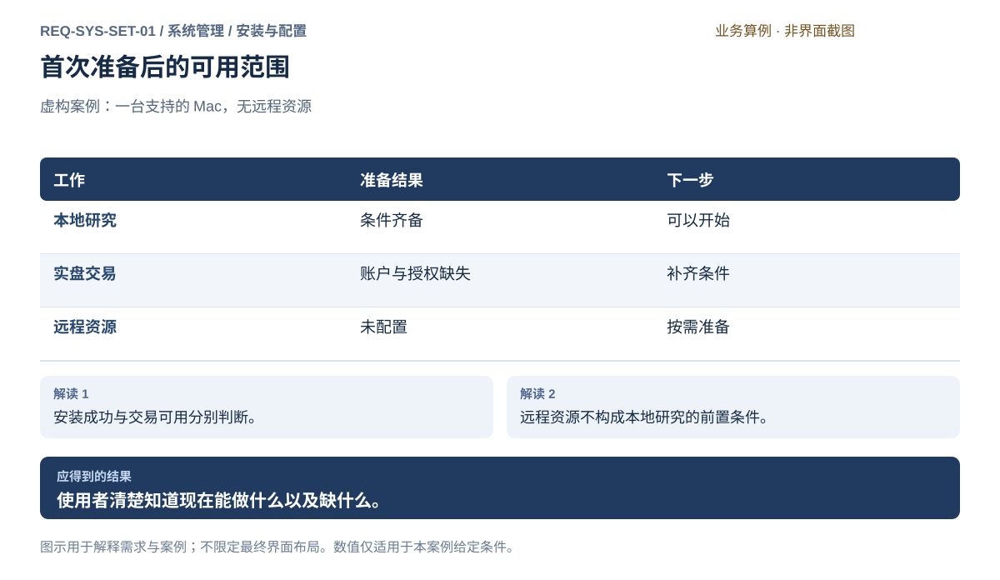
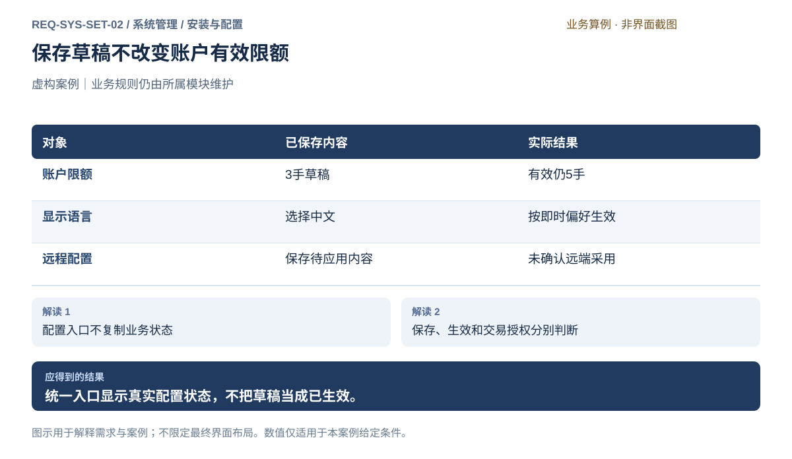
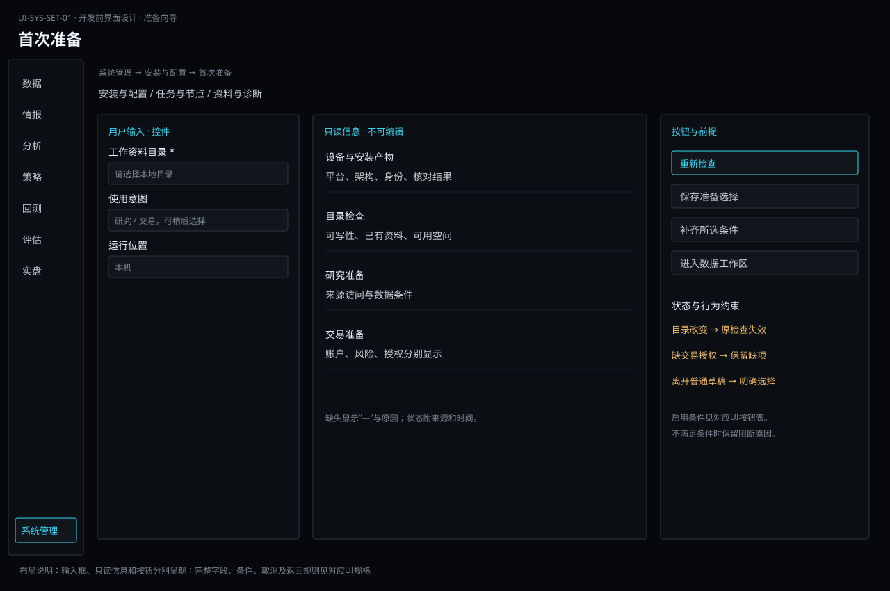
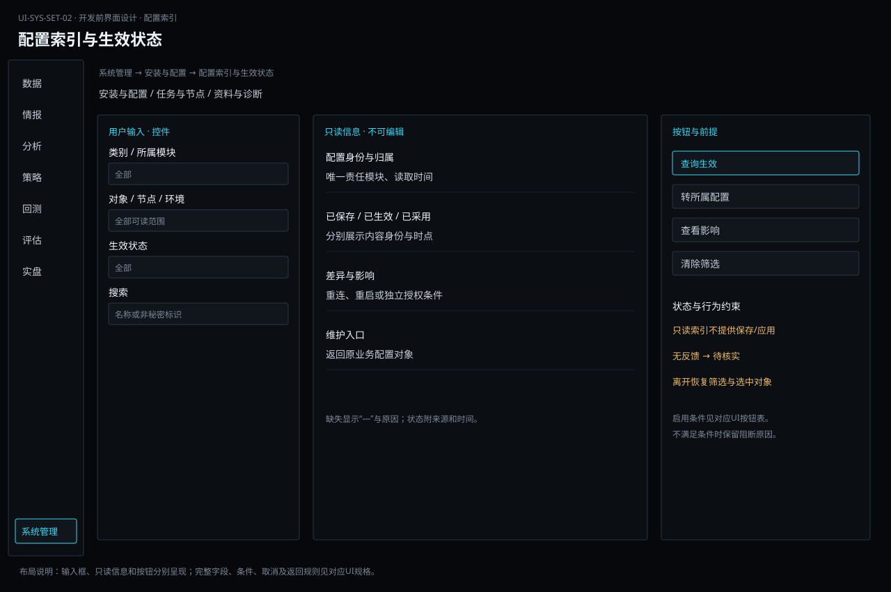

# 安装与配置

[返回上级](README.md) · [需求总纲](../../README.md) · [界面阅读指南](../../common/screens.md) · [跨模块流程](../../workflows/README.md)

开发前需求与设计规格 · 2026-10-20。定义目标功能、操作流程、界面和验收判据；规格决定、运行配置与外部条件分别记录。

**归属：** 系统管理 / 安装与配置。本页集中保存业务需求、详细功能、案例、界面对应和验收；通用规则见[通用规范](../../common/README.md)。

## 需求导航

- [REQ-SYS-SET-01 完成安装、首次准备并理解可用范围](#req-sys-set-01)
- [REQ-SYS-SET-02 按配置归属维护设置并确认实际生效](#req-sys-set-02)

## 配置对象与生效责任

| 配置类别                  | 编辑与确认位置                                               | 系统入口作用                                 |
| ------------------------- | ------------------------------------------------------------ | -------------------------------------------- |
| 语言、显示密度、涨跌配色  | 偏好设置，即时保存                                       | 展示实际偏好，不增加统一保存步骤             |
| 节点、连接、插件          | 系统管理对应对象                                             | 说明检查、采用状态和重连/重启影响            |
| 数据源及采集范围          | 数据                                                         | 跳转并查询真实状态，不复制独立可编辑定义     |
| 模型提供方/凭据与情报方案 | 系统管理提供连接和凭据机制，情报决定模型方案、发送内容和预算 | 凭据本地处理；业务使用限制由情报核验         |
| 策略参数与组合约束        | 策略                                                         | 引用固定内容，变更形成新的明确条件           |
| 回测条件与模拟账户政策    | 回测                                                         | 固定实验条件，运行仍检查风险能力             |
| 真实账户限额与授权        | 实盘                                                         | 编辑及生效由账户负责，保存设置不等于授权交易 |

系统只统一发现和查询，不为方便展示复制另一套可独立生效的业务配置。对象需记录所属模块、实际内容身份、有效状态和读取时间。保存、检查、生效、运行采用分别解释；未取得远程确认时保持待核实，不自动回滚、重启或放宽规则。

影响范围在操作前可见：已运行任务、固定研究快照和账户授权不能被新草稿静默改写。凭据保存遵守既有允许类别与本机安全存储规则，普通配置及导出中只含允许的引用。

## REQ-SYS-SET-01 完成安装、首次准备并理解可用范围

**领域：** 系统管理 / 安装与配置　 **建议优先级：** P1核心必要　 **需求状态：** 开发前设计规格（具体决定与运行配置见本条DEC）

### 目标与场景

个人使用者应能判断自己的电脑是否受支持，并完成首次使用所需的准备。准备结果须说明哪些工作已具备条件、哪些仍缺少资料或授权，避免把安装成功误认为已经可以研究或交易。

**使用者与场景：** 首次安装、换电脑或重新配置工作环境的个人期货使用者。

**触发条件：** 使用者首次打开软件，或主动检查使用条件。

### 前置条件

- 设备属于 macOS Apple Silicon 或 Linux x86_64 桌面范围。
- 使用者有权选择本地资料保存位置，并能取得所需数据或账户的合法使用权限。

### 输入与含义

| 输入         | 含义与单位                       | 约束                                       |
| ------------ | -------------------------------- | ------------------------------------------ |
| 工作资料位置 | 研究资料和业务记录的本地保存位置 | 须具备读写条件；不得自动覆盖已有资料。     |
| 使用意图     | 本地研究、本地交易或使用远程资源 | 允许稍后补充；选择意图不等于获得交易授权。 |

### 正常操作与反馈

1. 使用者确认设备范围并选择资料位置。
2. 系统检查保存条件和已选择用途需要的准备项。
3. 使用者按说明补齐数据访问或账户条件，也可暂时跳过。
4. 系统列出可用任务、缺失条件及其影响。
5. 使用者进入已具备条件的工作，之后可重新检查。

### 业务规则

- 本地独立工作不以配置远程 Linux 资源为前提。
- 研究与实盘分别判断准备状态，不得用单一成功标志掩盖交易缺项。
- 缺少行情来源时明确不可取得行情，不使用示例行情填补。
- 不支持的设备须说明范围；不得宣称可以正常工作。
- 首次准备不自动提交订单，也不默认开启交易权限。

### 输出与状态影响

- 可用范围与缺失条件清单。
- 使用者明确选择的资料位置和使用意图。

### 异常与继续方式

| 发生什么         | 应怎样表现                                         | 使用者如何继续               |
| ---------------- | -------------------------------------------------- | ---------------------------- |
| 资料位置不能写入 | 阻止创建资料并说明原因。                           | 选择可写位置后重新检查。     |
| 数据授权尚未提供 | 标明相关数据任务不可用，保留其他已满足条件的工作。 | 补齐授权后重新检查对应项目。 |

### 案例：只用一台 Mac 开始研究

**虚构案例条件：** 虚构案例：支持的 Mac 已有资料目录和数据权限，尚未配置交易账户，也没有远程资源。

1. 选择本地研究并完成条件检查。
2. 查看研究、交易和远程资源的独立结果。

**预期结果：**

- 本地研究可开始；交易缺少账户及授权；远程资源显示未配置且不阻止本地研究。

### 可观察验收条件

| 编号                | 给定                         | 当             | 则                                       |
| ------------------- | ---------------------------- | -------------- | ---------------------------------------- |
| REQ-SYS-SET-01-AC01 | 本地研究条件齐备而无远程资源 | 完成首次准备   | 可以开始本地研究，不要求先准备远程资源。 |
| REQ-SYS-SET-01-AC02 | 没有交易账户及授权           | 查看交易可用性 | 明确列出缺项，不能提交实盘交易。         |
| REQ-SYS-SET-01-AC03 | 选择只读资料位置             | 确认准备       | 指出不能写入且原目录内容不变。           |

### 决定与配置约束

- **DEC-SYS-SET-01-01**：**规格决定**。首次使用采用准备清单与必要步骤向导，不做独立课程系统；明确本地/远程用途、目录、来源与账户准备，完成后进入数据模块。

### 详细功能

### FR-SYS-SET-01-01 核对设备支持范围与首次可用条件

**目标与结果：** 使用者在投入配置前确认设备受支持，并看懂安装成功与工作可用的区别。准备检查分别说明本机条件、研究条件和交易条件，不把缺少远程资源当作本地阻断。

**触发：** 首次打开进入准备页，或从工作总览选择重新检查。

**输入与约束：** 读取设备平台和可用存储；用户选择使用意图。支持 macOS Apple Silicon、Linux x86_64；不预选实盘授权。

**目标操作与反馈：**

1. 查看设备与平台检查结果及其依据。
2. 选择研究与交易用途，查看各自需要补齐的条件。
3. 点击重新检查，仅更新检查结果并显示检查时间。

**异常与边界：**

- 不支持的平台显示具体范围，不能呈现全部准备完成。
- 某项检查失败保留其他结果；重试不自动登录或发出交易。

**验收条件：**

- **FR-SYS-SET-01-01-AC01**：无远程资源而本地条件齐备时，本地研究仍可进入。
- **FR-SYS-SET-01-01-AC02**：交易授权缺失时显示对应缺项，准备检查不能使交易变为已授权。

**界面对应：** [UI-SYS-SET-01 首次准备](#ui-sys-set-01)；[UI-SYS-RUN-01 个人工作总览](tasks-nodes.md#ui-sys-run-01)。

### FR-SYS-SET-01-02 选择工作资料位置并保护已有内容

**目标与结果：** 使用者明确知道研究资料与操作记录保存在哪里，确认写入能力和空间。已有目录不是可任意初始化的空白空间，选择位置不能悄悄覆盖原有内容。

**触发：** 首次准备中的资料位置选择，或工作总览打开当前资料信息。

**输入与约束：** 输入或选择本地资料位置；候选初始值为空并提示选择。显示是否存在内容、可写性和可用空间，不收集凭据。

**目标操作与反馈：**

1. 选择目录后预览可写性与现有资料概况。
2. 存在资料时明确选择打开可识别资料或另选位置。
3. 确认后显示最终工作位置和保存结果。

**异常与边界：**

- 只读位置明确指出无法写入，原有内容保持不变。
- 资料不受支持或损坏时拒绝打开，不自动清空或转换。

**验收条件：**

- **FR-SYS-SET-01-02-AC01**：选择有内容目录时，确认前不会写入或替换已有研究。
- **FR-SYS-SET-01-02-AC02**：无法写入时保留已输入路径并可重新选择，不能显示准备成功。

**界面对应：** [UI-SYS-SET-01 首次准备](#ui-sys-set-01)；[UI-SYS-REC-01 资料、备份与恢复](records.md#ui-sys-rec-01)。

### FR-SYS-SET-01-03 按研究与交易分别完成准备清单

**目标与结果：** 同一人需要并行准备研究与实盘，清单应分别表达数据、账户、风险和授权条件。未准备的一类能力不能掩盖另一类的可用结果，也不能通过总进度暗示可以交易。

**触发：** 首次准备选择研究与交易并重，或总览点击待补齐条件。

**输入与约束：** 清单读取合法数据来源、工作位置、账户身份、交易授权和风险可用性；缺项没有默认通过值。

**目标操作与反馈：**

1. 展开研究清单并进入来源配置补充真实数据条件。
2. 返回准备页重新核对研究条件，再查看交易缺项。
3. 进入账户授权页补齐条件后返回，只更新有可靠结果的项目。

**异常与边界：**

- 来源连接正常但无访问权限仍显示数据不可用。
- 账户已登录但风险缺失时禁止交易入口转为可提交。

**验收条件：**

- **FR-SYS-SET-01-03-AC01**：研究可用、交易缺风险时，两项状态分别可见。
- **FR-SYS-SET-01-03-AC02**：点击缺项携带对应上下文进入配置，返回后未确认项仍保留未完成说明。

**界面对应：** [UI-SYS-SET-01 首次准备](#ui-sys-set-01)；[UI-DAT-ACQ-01 数据来源与连接](../data/acquisition.md#ui-dat-acq-01)；[UI-LIV-RUN-01 账户连接与交易授权](../live/operations.md#ui-liv-run-01)。

### FR-SYS-SET-01-04 完成准备后进入明确的工作入口

**目标与结果：** 使用者完成必要准备后能够直接进入研究项目或市场观察，并知道随后哪些操作仍需要独立授权。首次准备可以稍后继续，跳过选项不能伪装成已满足条件。

**触发：** 首次准备页选择进入工作总览、开始研究或查看行情。

**输入与约束：** 使用意图和各项准备状态；研究与交易并重为本草案定位，不替使用者默认创建账户或策略。

**目标操作与反馈：**

1. 查看准备结果摘要及可用入口。
2. 选择稍后补齐非当前必需项，保存已经明确的普通偏好。
3. 进入目标工作，保留来源、资料位置与缺项提示的上下文。

**异常与边界：**

- 没有可用数据时允许查看空工作空间，但取数或实时行情明确不可用。
- 离开未保存设置时选择保存、放弃或继续编辑，不能直接丢失。

**验收条件：**

- **FR-SYS-SET-01-04-AC01**：跳过交易准备后可进入研究入口，交易仍未获授权。
- **FR-SYS-SET-01-04-AC02**：再次打开准备页能看到已保存位置和真实检查结果，不重新要求填写已保存普通资料。

**界面对应：** [UI-SYS-SET-01 首次准备](#ui-sys-set-01)；[UI-SYS-RUN-01 个人工作总览](tasks-nodes.md#ui-sys-run-01)；[UI-ANA-EDA-01 研究问题与样本计划](../analysis/exploration.md#ui-ana-eda-01)；[UI-LIV-RUN-02 行情总览与自选](../live/operations.md#ui-liv-run-02)。

### FR-SYS-SET-01-05 核对安装产物和支持环境

**目标与结果：** 安装前后都能确认运行的是预期产品及受支持平台。

**触发：** 安装、替换安装产物或首次打开。

**输入与约束：** 发行说明中的平台/架构/系统最低要求、可信来源与产物身份、资料位置和现有安装状态；具体发行渠道待评审。

**目标操作与反馈：**

1. 核对macOS Apple Silicon或Linux x86_64桌面及系统条件，说明包来源和验证结果。
2. 安装或显式替换前列出服务、资料及活动工作影响；存在活动交易时先进入账户处置，不能由安装动作隐式重启。
3. 安装后显示实际产物身份和准备检查入口，本地使用不要求Linux服务包。

**异常与边界：**

- 不支持的系统或无法通过产物完整性检查时停止安装，不关闭系统保护来继续。
- 不支持既有持久资料时明确拒绝打开并保留文件，不自动迁移或删除。

**操作案例：** 用户只有Mac并选择本地运行，准备页显示远程未配置且不阻塞本地能力。

**验收条件：**

- **FR-SYS-SET-01-05-AC01**：Mac本地研究安装完成无需下载或部署远程Linux服务才能进入准备。
- **FR-SYS-SET-01-05-AC02**：损坏产物拒绝使用，已有资料不变，安装成功不显示已获交易权限。

**界面对应：** [UI-SYS-SET-01](#ui-sys-set-01)。

### FR-SYS-SET-01-06 维护插件并明确卸载影响

**目标与结果：** 插件能力变化和卸载不会在用户不知情时改变运行或丢失资料。

**触发：** 启用、停用、替换插件或卸载软件。

**输入与约束：** 插件身份及兼容能力、依赖它的任务/策略/存储、活动服务与资料目录；插件是可信进程内代码，不宣称沙箱隔离。

**目标操作与反馈：**

1. 列出插件来源、可用能力及依赖；不匹配当前接口的插件明确不可用。
2. 停用/替换前显示影响，活动运行使用的必要能力必须先完成业务停止确认；缺风险能力不得继续新执行。
3. 卸载前区分客户端、后台服务、用户资料与安全存储，说明服务是否继续；仅按明确范围处理并报告结果，删除资料另行确认。

**异常与边界：**

- 未知停止状态不能视为维护已安全完成，不自动杀死远程运行。
- 卸载默认保留用户资料；不把删除客户端解释为账户已平仓。

**操作案例：** 准备停用策略依赖插件时看到一个远程运行，先回到运行页核对停止；远程失联时维护仍显示未满足前提。

**验收条件：**

- **FR-SYS-SET-01-06-AC01**：在用风险插件不能通过设置页停用而让原实例绕过风险继续发送。
- **FR-SYS-SET-01-06-AC02**：只移除客户端的结果明确剩余服务与资料位置，不静默删除账本。

**界面对应：** [UI-SYS-SET-02](#ui-sys-set-02)；[UI-SYS-RUN-03](tasks-nodes.md#ui-sys-run-03)。

## REQ-SYS-SET-02 按配置归属维护设置并确认实际生效

**领域：** 系统管理 / 安装与配置　 **建议优先级：** P1核心必要　 **需求状态：** 开发前设计规格（具体决定与运行配置见本条DEC）

### 目标与场景

让用户通过统一入口找到配置，明确配置由谁维护、影响什么对象及是否真正生效。

**使用者与场景：** 兼顾期货研究、实盘和运行维护的个人用户。

**触发条件：** 从配置入口选择明确对象，查看责任模块和当前有效状态。

### 前置条件

- 对象、所属业务模块和允许操作的范围明确。
- 涉及运行、费用或资料变更的条件已由用户明确配置；案例仅供评审。

### 输入与含义

| 输入           | 含义与单位                                                 | 约束                                                               |
| -------------- | ---------------------------------------------------------- | ------------------------------------------------------------------ |
| 配置对象       | 系统/节点/服务/插件或业务对象身份、所属模块                | 系统配置由系统管理维护；来源、策略、实验、账户政策回所属业务编辑。 |
| 配置内容与状态 | 当前有效值、待提交内容、保存结果、采用的配置身份与生效条件 | 界面不另存一份可独立生效的业务配置；既有固定实验保留所用内容。     |
| 凭据引用       | 本地凭据管理入口及脱敏身份                                 | 不在配置正文或导出中保存秘密，保存类别遵守既有凭据规则。           |

### 正常操作与反馈

1. 从配置入口选择明确对象，查看责任模块和当前有效状态。
2. 进入相应模块编辑，预览字段、影响范围及生效方式。
3. 按该类配置的规则保存或确认，查看实际结果与待生效条件。
4. 返回统一入口刷新真实状态，必要时查看记录或继续处理。

### 业务规则

- 统一入口提供索引、对象状态和跳转，不维护第二份账户或策略配置。
- 语言、密度等显示偏好即时保存；策略草稿、回测方案、账户限额遵守各自固定和生效流程，不强加通用保存按钮。
- 保存成功、业务规则检查通过和实际生效分开；需要重新连接或重启时先解释对象与影响，不能自动重启交易服务。
- 新配置不静默改变已提交任务、固定策略包或现有授权范围；采用条件由业务模块声明。
- 远程对象不可达时可保存明确标识的草稿，但不能显示远程已采用；无真实反馈不得宣称生效。

### 输出与状态影响

- 让用户通过统一入口找到配置，明确配置由谁维护、影响什么对象及是否真正生效。
- 可追溯的操作结果、责任归属、时间与异常说明。

### 异常与继续方式

| 发生什么               | 应怎样表现                                     | 使用者如何继续                                   |
| ---------------------- | ---------------------------------------------- | ------------------------------------------------ |
| 配置保存或应用失败     | 保留可确认的有效值和编辑内容，显示具体失败阶段 | 恢复对应条件后显式再提交，不以刷新页面冒充成功。 |
| 修改期间有效配置已变化 | 提示当前内容与基准差异，不覆盖另一已生效决定   | 重新核对差异与影响后确认。                       |

### 案例：保存草稿不改变账户有效限额

**虚构案例条件：** 虚构案例：账户同方向潜在上限当前为5手，编辑为3手并保存草稿，尚未确认生效。

1. 统一设置跳转账户配置。
2. 保存草稿后返回查询实际状态。

**预期结果：**

- 当前有效仍为5手，草稿为3手。
- 未确认生效不自动改变账户限制，也不撤销已有订单。

### 可观察验收条件

| 编号                | 给定               | 当               | 则                                         |
| ------------------- | ------------------ | ---------------- | ------------------------------------------ |
| REQ-SYS-SET-02-AC01 | 有效值5手，草稿3手 | 只保存草稿       | 有效仍为5手，状态与草稿分别显示。          |
| REQ-SYS-SET-02-AC02 | 修改显示语言       | 完成即时保存 | 立即显示实际语言，不要求额外生效审批。     |
| REQ-SYS-SET-02-AC03 | 远程对象不可达     | 查看配置状态     | 不显示远程已采用，保留待核实或未应用说明。 |

### 决定与配置约束

- **DEC-SYS-SET-02-01**：**规格决定**。偏好即时保存；来源认证重连后生效；账户风险按业务受控应用；节点信任与服务变更列明重连/重启对象，执行前展示影响。配置索引只跳转唯一责任模块。

### 详细功能

### FR-SYS-SET-02-01 按对象定位配置并跳转责任模块

**目标与结果：** 避免配置分散或重复维护。

**触发：** 选择配置对象并核对归属。

**输入与约束：** 配置类别、责任模块、目标节点或业务对象。

**目标操作与反馈：**

1. 选择配置对象并核对归属。
2. 查看当前有效摘要及读取时间。
3. 进入责任模块编辑，返回后刷新实际状态。

**异常与边界：**

- 账户政策不在系统设置独立存一份。
- 只读或不可达对象明确禁用受影响动作。

**验收条件：**

- **FR-SYS-SET-02-01-AC01**：账户限额跳转实盘账户规则入口。
- **FR-SYS-SET-02-01-AC02**：修改业务配置后统一入口显示同一对象结果。

**界面对应：** [UI-SYS-SET-02 配置索引与生效状态](#ui-sys-set-02)；[UI-LIV-ACC-03 账户风险规则与生效管理](../live/accounts.md#ui-liv-acc-03)。

### FR-SYS-SET-02-02 解释保存与生效条件及影响

**目标与结果：** 让用户在变更前理解实际后果。

**触发：** 查看差异与影响。

**输入与约束：** 有效值、草稿、生效方式、受影响任务/连接/实例。

**目标操作与反馈：**

1. 查看差异与影响。
2. 按对应规则确认保存或应用。
3. 查看已生效、待生效或失败以及采用时间。

**异常与边界：**

- 已提交实验与策略固定内容不被静默改写。
- 语言等即时偏好不增加不存在的保存步骤。

**验收条件：**

- **FR-SYS-SET-02-02-AC01**：5手改3手草稿不影响当前5手。
- **FR-SYS-SET-02-02-AC02**：需重启的配置未完成操作时不会显示已应用。

**界面对应：** [UI-SYS-SET-02 配置索引与生效状态](#ui-sys-set-02)。

### FR-SYS-SET-02-03 处理不可达对象和并发配置变化

**目标与结果：** 避免界面误报或覆盖已确认状态。

**触发：** 核对配置提交结果。

**输入与约束：** 目标实际状态、编辑基准、提交标识、差异与失败阶段。

**目标操作与反馈：**

1. 核对配置提交结果。
2. 不可达时显示未确认；变化冲突时展示新旧差异。
3. 重新取得真实状态后决定提交或放弃。

**异常与边界：**

- 不将网络超时直接解释为成功或失败应用。
- 不能自动恢复旧配置或重启账户。

**验收条件：**

- **FR-SYS-SET-02-03-AC01**：未知应用结果保留原对象供核对。
- **FR-SYS-SET-02-03-AC02**：未核对的基准冲突不静默覆盖当前设置。

**界面对应：** [UI-SYS-SET-02 配置索引与生效状态](#ui-sys-set-02)。

### FR-SYS-SET-02-04 保护配置秘密并关联变更记录

**目标与结果：** 使配置审查可追溯且不泄露凭据。

**触发：** 通过本地凭据入口处理授权。

**输入与约束：** 脱敏身份、配置内容标识、生效结果、业务审计引用。

**目标操作与反馈：**

1. 通过本地凭据入口处理授权。
2. 保存配置时只展示允许的引用。
3. 查看变更对象、时间、确认结果及业务记录链接。

**异常与边界：**

- 普通配置、日志、导出不包含密码或密钥。
- 访问设置页不等于获得交易授权。

**验收条件：**

- **FR-SYS-SET-02-04-AC01**：诊断导出保留配置标识而不包含秘密。
- **FR-SYS-SET-02-04-AC02**：记录中的保存成功和生效成功可以区分。

**界面对应：** [UI-SYS-SET-02 配置索引与生效状态](#ui-sys-set-02)；[UI-COM-SEC-01 凭据与访问用途](../../common/security.md#ui-com-sec-01)；[UI-SYS-REC-02 事件与诊断](records.md#ui-sys-rec-02)。

## 目标界面设计

## UI-SYS-SET-01 首次准备

**业务目标：** 完成本地资料准备，分别判断研究与交易可用条件，并进入下一项具体任务。

### 页面形态与目标布局

**规格范围：** 本条定义目标布局、字段、动作和业务状态，设计图与以下操作规则共同作为开发依据。

**界面形态：** 首次准备向导。

**目标到达路径：** 系统管理 → 安装与配置 → 首次准备。首次启动由准备向导直接进入；完成后从上述入口重新检查。从业务详情进入时携带固定对象身份和返回位置。

| 区域 | 要显示的内容 |
| --- | --- |
| 顶部上下文 | 平台 / 安装身份 / 准备结果 |
| 列表、分类或步骤区 | 位置 → 用途 → 条件 |
| 主要工作区 | 资料目录 / 本地研究与交易 |
| 选中项详情或检查区 | 缺项 / 补齐入口 |
| 主要动作区 | 重新检查 / 进入可用工作 |

**区域联动与返回：** 输入、只读展示与动作按下方分表定义；选中对象、查询条件及返回位置保持一致，导航不隐式执行业务。保存、取消及离开适用本页的具体规则。

**窗口与空间：** 使用主窗口内容区。宽度缩小时优先收拢辅助详情，表格在内容区横向滚动；主操作和关键上下文不能被页面裁切。重新展开详情仍指向原选中对象。

**状态设计范围：** 只采用下方状态表及关联FR适用于本页的状态；缺失值、来源时效、阻断原因与可执行下一步必须明确。字段与动作按本页交付约定核对。

### 目标操作规格

1. 选择资料目录和用途，核对平台、目录内容与写入条件。
2. 逐项查看研究和交易清单，携带对应对象进入来源、账户或风险页面补齐。
3. 返回重新检查；保存明确的普通选择，再进入数据或满足条件的工作。

**操作案例：** 研究已就绪而无远程节点或交易授权时，可进入研究；远程与交易缺项分别保留。

### 业务验收要求

- **UI-SYS-SET-01-AC01**：无远程资源时，本地研究条件齐备仍可开始研究。
- **UI-SYS-SET-01-AC02**：只读目录错误准确定位到位置字段，已有内容不变。
- **UI-SYS-SET-01-AC03**：研究可用与交易缺授权同时显示，进入账户页不自动授予交易权限。

### 字段与操作交付约定

本页是准备向导。位置与用途是用户输入；平台、准备条件和授权结果是只读事实。检查不创建业务任务或授予交易权限。

#### 用户输入

| 字段 | 类型、默认值与必填条件 | 合法范围及变更影响 |
| --- | --- | --- |
| 工作资料目录 | 本地绝对目录；首次为空，确认准备前必填 | 必须可读写；显示已有内容和可用空间。有内容时仅可明确打开可识别资料或另选目录，不能默认清空、覆盖或转换 |
| 使用意图 | 研究、交易多选；首次为空，可稍后选择 | 至少选一项才筛选对应准备清单；未选时展示全部用途说明，不自动勾选实盘授权 |
| 运行位置 | 本机或已登记可信 Linux 节点；默认本机 | 本机不依赖远程配置；选远程后显示该位置需要的服务、来源与凭据条件，不能沿用本机检查结果 |

#### 只读展示

| 信息 | 来源与含义 | 缺失或陈旧时 |
| --- | --- | --- |
| 平台、架构、安装产物身份 | 本机环境与安装产物核对结果 | 无法核对即标明原因，不表示平台受支持 |
| 目录可写性、已有资料、可用空间 | 对所选目录的最近一次检查及时间 | 修改目录使原检查失效，重新检查前不可确认该目录 |
| 研究/交易准备清单 | 来源访问、风险、账户、授权等各责任模块的结果 | 按项显示缺失、不可达和最后核对时间；不以总进度推断可交易 |

#### 按钮与动作

| 动作 | 启用条件 | 结果及失败反馈 |
| --- | --- | --- |
| 选择目录 / 重新检查 | 所选位置可定位；检查中防止重复提交 | 检查仅更新所选范围，保留其他检查结果；错误定位到目录或具体条件 |
| 保存准备选择 | 目录有效且普通输入合法 | 保存目录、用途和位置；保存失败留在本页，不自动登录或启动任务 |
| 补齐来源 / 账户 / 风险 | 清单条目有明确责任对象 | 携带来源或账户身份、运行位置及本页返回地址进入责任页面；返回重新核对相关项 |
| 进入数据 / 进入可用工作 | 入口所需条件满足；空工作区可进入但取数/交易动作仍受约束 | 默认完成入口为数据工作区，保留目录和准备范围；没有授权不允许提交交易 |
| 稍后准备 | 始终可用 | 可跳过不需要的准备项，保留缺项标志，不把跳过变成通过 |

#### 适用状态与离开

| 状态 | 页面行为 |
| --- | --- |
| 首次无目录 / 输入无效 | 展示目录选择和明确错误，其他输入保留；只阻断依赖目录的保存与操作 |
| 检查中 / 部分可用 | 逐项显示检查状态与时间；研究就绪但交易缺项时分别展示 |
| 平台不支持 / 来源不可达 | 说明支持范围或不可达来源，保留最后可靠信息；不能伪装为准备完成 |
| 保存失败 | 保留普通草稿，允许修正或重试保存；不跳转、不改写已保存位置 |

有未保存的普通准备选择时离开提供保存、放弃、留在当前页；仅查看清单不弹出草稿确认。从补齐页面返回保留原位置和用途，并重新核对已变化条件。关闭向导不停止后台工作。

### 对应功能需求

- [FR-COM-UX-01-01 选择并即时保存中英文显示偏好](../../common/interaction.md#fr-com-ux-01-01)
- [FR-COM-UX-01-05 通过键盘完成导航并保持可见焦点](../../common/interaction.md#fr-com-ux-01-05)
- [FR-SYS-SET-01-01 核对设备支持范围与首次可用条件](#fr-sys-set-01-01)
- [FR-SYS-SET-01-02 选择工作资料位置并保护已有内容](#fr-sys-set-01-02)
- [FR-SYS-SET-01-03 按研究与交易分别完成准备清单](#fr-sys-set-01-03)
- [FR-SYS-SET-01-04 完成准备后进入明确的工作入口](#fr-sys-set-01-04)
- [FR-SYS-SET-01-05 核对安装产物和支持环境](#fr-sys-set-01-05)
- [FR-SYS-REC-01-03 恢复到独立位置并核对缺项](records.md#fr-sys-rec-01-03)

## UI-SYS-SET-02 配置索引与生效状态

**业务目标：** 让用户通过统一入口找到配置，明确配置由谁维护、影响什么对象及是否真正生效。

### 页面形态与目标布局

**规格范围：** 本条定义目标布局、字段、动作和业务状态，设计图与以下操作规则共同作为开发依据。

**界面形态：** 模块内配置工作区。

**目标到达路径：** 系统管理 → 安装与配置 → 配置索引与生效状态。从业务详情进入时携带固定对象身份和返回位置。

| 区域 | 要显示的内容 |
| --- | --- |
| 顶部上下文 | 所选配置 / 所属业务 |
| 列表、分类或步骤区 | 偏好 / 来源 / 节点 / 业务配置 |
| 主要工作区 | 已保存与实际生效值 |
| 选中项详情或检查区 | 影响范围 / 维护入口 |
| 主要动作区 | 转所属配置 / 查询生效 |

**区域联动与返回：** 输入、只读展示与动作按下方分表定义；选中对象、查询条件及返回位置保持一致，导航不隐式执行业务。保存、取消及离开适用本页的具体规则。

**窗口与空间：** 使用主窗口内的模块配置工作区；分类、只读对照和查询结果区域独立滚动，保留模块导航与主要动作。凭据及配置编辑转所属业务页面。

**状态设计范围：** 只采用下方状态表及关联FR适用于本页的状态；缺失值、来源时效、阻断原因与可执行下一步必须明确。字段与动作按本页交付约定核对。

### 目标操作规格

1. 按类别、责任模块、对象和生效状态定位配置。
2. 对照已保存、生效及运行采用的内容和读取时间，查看影响。
3. 进入唯一责任模块独立编辑或应用，返回后查询同一对象的生效状态。

**操作案例：** 账户上限生效5手、草稿3手时，两值分别可见；查询没有反馈仍保留原有效值与待核实标记。

### 业务验收要求

- **UI-SYS-SET-02-AC01**：有效5手与草稿3手同时可见。
- **UI-SYS-SET-02-AC02**：即时语言设置不被改成统一保存流程。
- **UI-SYS-SET-02-AC03**：无反馈不声称远程已生效。

### 字段与操作交付约定

本页是配置索引与只读对照。业务配置只在其所属页面编辑；索引不能保存、应用或复制第二份可生效的配置。

#### 用户输入

| 字段 | 类型、默认值与必填条件 | 合法范围及变更影响 |
| --- | --- | --- |
| 类别 / 责任模块 | 单选筛选，默认全部；可选 | 类别取偏好、来源、节点、插件、业务配置；责任模块取已登记模块，仅改变列表 |
| 对象 / 节点 / 环境 | 对象选择，默认全部可读范围；可选 | 从调用页面进入时预置其固定身份；显示明确筛选条件，不扩展到其他账户 |
| 生效状态 | 多选筛选，默认全部；可选 | 未配置、草稿、待生效、已生效、失败、待核实；这些是筛选值，不是可编辑业务状态 |
| 搜索 | 文本，默认空，0—200字符；可选 | 匹配对象名称或非秘密标识，不搜索或展示秘密值 |

#### 只读展示

| 信息 | 来源与含义 | 缺失或陈旧时 |
| --- | --- | --- |
| 配置身份、唯一责任模块 | 所属模块给出的对象、内容身份与维护入口 | 无责任入口说明不可维护原因，不在索引临时新建一份 |
| 已保存值 / 生效值 / 运行采用值 | 分栏展示各自内容身份、采用对象及时间；秘密只显非秘密引用 | 未确认生效时保留已知有效值与读取时间，不能把草稿当生效 |
| 影响与待处理条件 | 是否需重连、重启、再次授权，受影响任务或账户 | 影响未知时引导责任页核对，不自动重启或放宽规则 |

#### 按钮与动作

| 动作 | 启用条件 | 结果及失败反馈 |
| --- | --- | --- |
| 查询生效 | 选中可查询对象；同次查询进行中不重复 | 更新来源、读取时间及状态；不可达时保留最后可靠值并标待核实 |
| 转所属配置 | 选中对象有维护入口 | 携带对象、节点、环境及返回地址跳转；在责任页独立保存/生效，返回后重新查询 |
| 查看影响 / 失败详情 | 有对应证据或结果 | 展示差异、采用范围及错误，不执行应用、恢复或重启 |
| 清除筛选 | 任一筛选偏离默认 | 恢复全部可读范围；不清除配置内容 |

#### 适用状态与离开

| 状态 | 页面行为 |
| --- | --- |
| 首次未配置 | 按类别提供所属模块的配置入口；不生成示例配置 |
| 筛选无匹配 | 展示筛选摘要及清除入口；与无权限、不可达分别呈现 |
| 读取中 / 待生效 / 失败 | 分别显示读取请求、业务生效状态和错误；查询失败不撤销已保存草稿 |
| 待核实 / 基准冲突 | 显示最后读取时间及冲突内容，转责任页重新核对，不能在索引强制覆盖 |

离开只读索引不要求保存或放弃；会话内返回恢复筛选、选中配置和滚动位置。由责任页面返回时核对同一对象，禁止用新对象替代旧对象的状态。

### 对应功能需求

- [FR-SYS-SET-01-06 维护插件并明确卸载影响](#fr-sys-set-01-06)
- [FR-SYS-SET-02-01 按对象定位配置并跳转责任模块](#fr-sys-set-02-01)
- [FR-SYS-SET-02-02 解释保存与生效条件及影响](#fr-sys-set-02-02)
- [FR-SYS-SET-02-03 处理不可达对象和并发配置变化](#fr-sys-set-02-03)
- [FR-SYS-SET-02-04 保护配置秘密并关联变更记录](#fr-sys-set-02-04)

